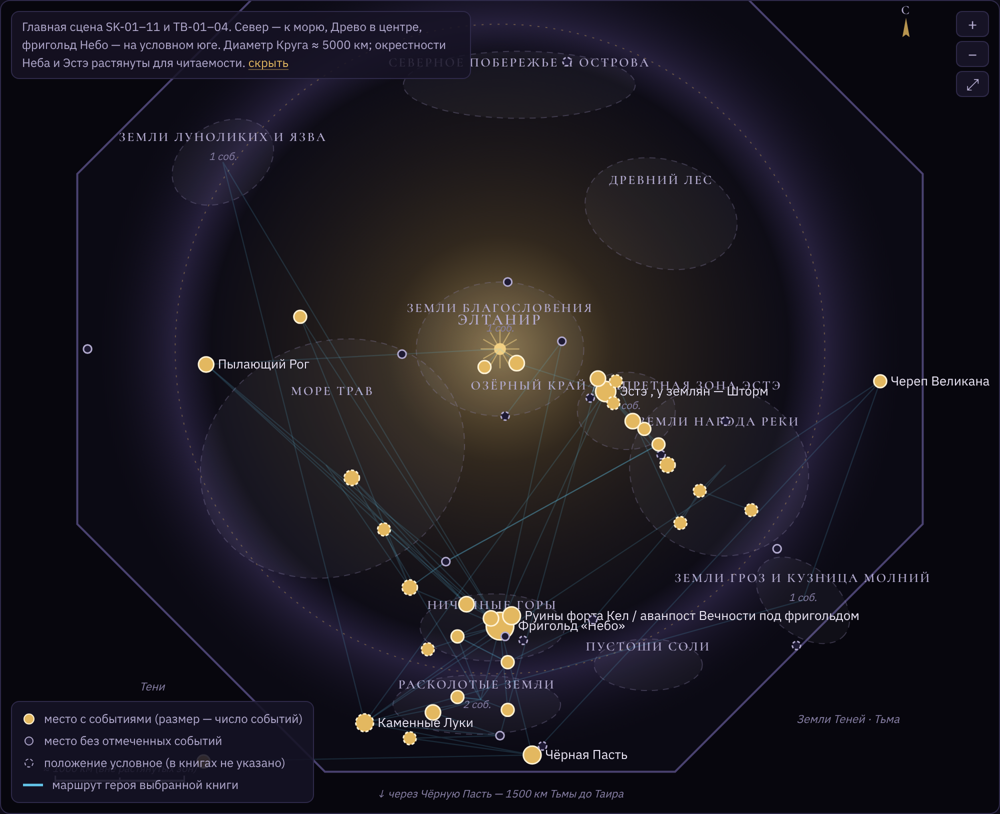
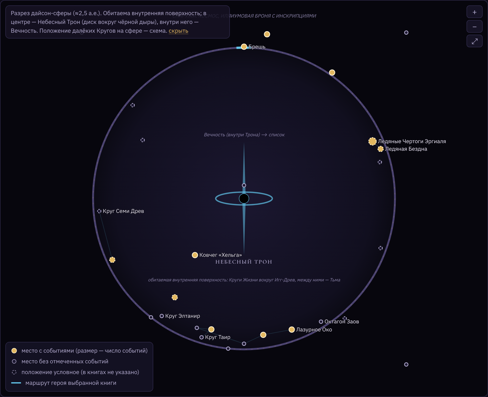
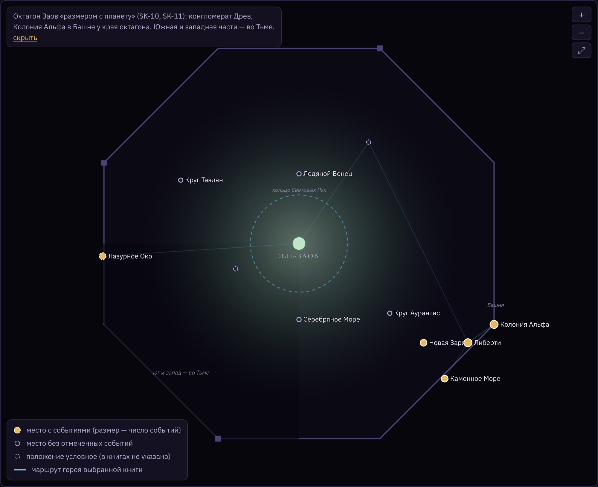

---
hide:
  - toc
---

# Карта мира

Интерактивный атлас: выберите уровень карты и книгу — на карте появится маршрут героя, справа — события. Направления в книгах почти всегда условные, поэтому карта схематичная: пунктирные маркеры — места, положение которых автор не называет.

<iframe class="atlas-frame" src="atlas.html" title="Атлас Единства" loading="lazy"></iframe>

[Открыть карту на весь экран](atlas.html){ .md-button }

## Снимки

