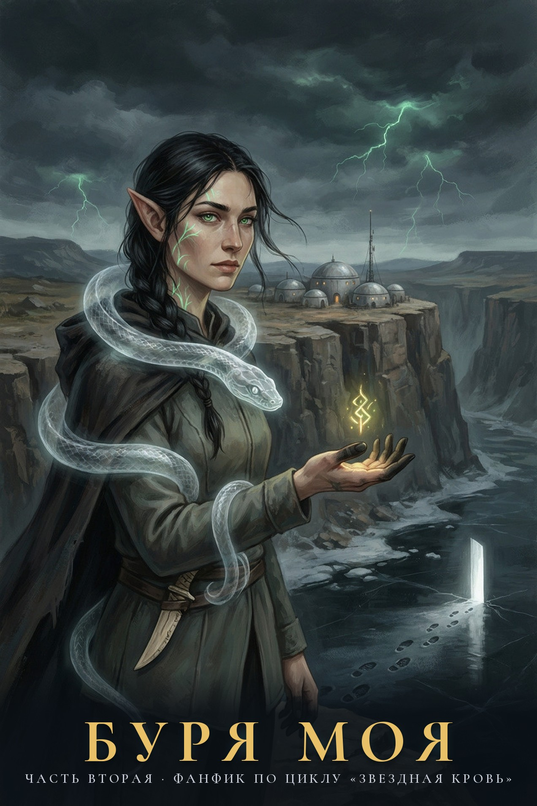

---
hide:
  - toc
---

# Буря моя. Часть 2

{ .book-cover }

*Фанфик по циклу Романа Прокофьева «Звездная Кровь»*

!!! note "Статус"
    Написана целиком: пролог, 28 глав, 7 интерлюдий и эпилог. Выверена: связность, канон, манера автора, вычитка, лексика.

Чужак, упавший с неба, победил ее в драке и не взял ничего — ни Руны, ни жизни. Изгнанница Народа Теней уходит с ним к землянам.

Колония Небо: капсулы, медком, первая добыча, война с Каменными Луками — с ее братом. Она становится женой рикса, фламиникой и матерью. И делает то, о чем не говорит никому.

Двадцать циклов от драки у Башни до черного льда, где ее муж ушел в Домен. Ключ к этой двери подала ему она.

Неофициальный фанфик по циклу «Звездная Кровь». Все права на мир и персонажей принадлежат Роману Прокофьеву.

[Читать онлайн](00-prolog.md){ .md-button .md-button--primary } [Скачать FB2](burya-moya-2.fb2){ .md-button }

## Оглавление

1. [Пролог](00-prolog.md)
2. [Глава 1](01-glava-01.md)
3. [Глава 2](02-glava-02.md)
4. [Глава 3](03-glava-03.md)
5. [Глава 4](04-glava-04.md)
6. [Глава 5](05-glava-05.md)
7. [Глава 6](06-glava-06.md)
8. [Глава 7](07-glava-07.md)
9. [Интерлюдия. Яростный](08-interlyudiya-1.md)
10. [Глава 8](09-glava-08.md)
11. [Глава 9](10-glava-09.md)
12. [Глава 10](11-glava-10.md)
13. [Глава 11](12-glava-11.md)
14. [Глава 12](13-glava-12.md)
15. [Интерлюдия. Яростный](14-interlyudiya-2.md)
16. [Глава 13](15-glava-13.md)
17. [Глава 14](16-glava-14.md)
18. [Глава 15](17-glava-15.md)
19. [Глава 16](18-glava-16.md)
20. [Глава 17](19-glava-17.md)
21. [Интерлюдия. Яростный](20-interlyudiya-3.md)
22. [Интерлюдия. Марк](21-interlyudiya-4.md)
23. [Глава 18](22-glava-18.md)
24. [Глава 19](23-glava-19.md)
25. [Интерлюдия. Марк](24-interlyudiya-5.md)
26. [Глава 20](25-glava-20.md)
27. [Интерлюдия. Марк](26-interlyudiya-6.md)
28. [Глава 21](27-glava-21.md)
29. [Интерлюдия. Марк](28-interlyudiya-7.md)
30. [Глава 22](29-glava-22.md)
31. [Глава 23](30-glava-23.md)
32. [Глава 24](31-glava-24.md)
33. [Глава 25](32-glava-25.md)
34. [Глава 26](33-glava-26.md)
35. [Глава 27](34-glava-27.md)
36. [Глава 28](35-glava-28.md)
37. [Эпилог](36-epilog.md)
