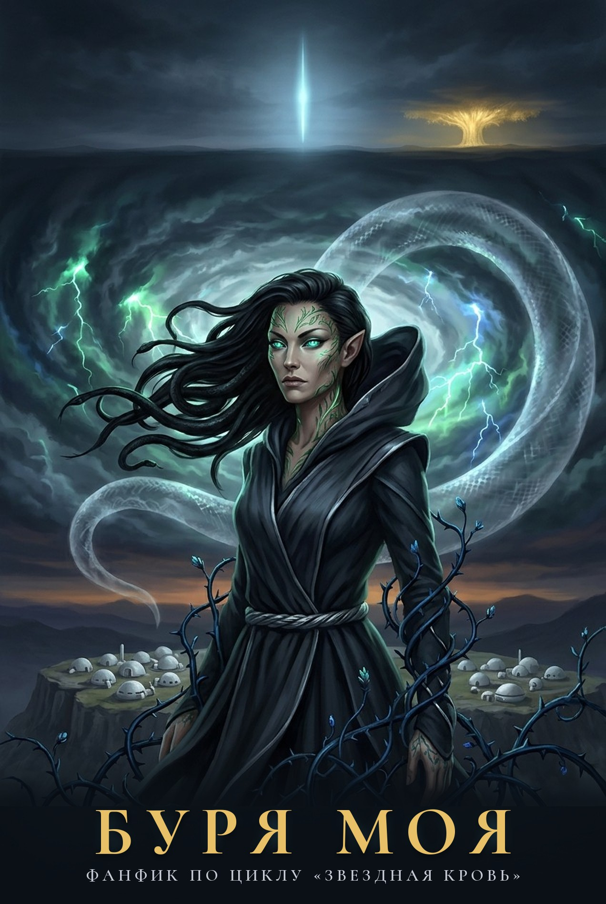

---
hide:
  - toc
---

# Буря моя

{ .book-cover }

*Фанфик-приквел по циклу Романа Прокофьева «Звездная Кровь»*

!!! note "Статус"
    Черновик. Написан целиком: пролог, 27 глав, 4 интерлюдии и эпилог.

Ее называют ведьмой — земляне, которых она спасла. Ее называют отравительницей — Народ, который ее изгнал. Муж называет ее бурей.

Говорящая-с-Травами, дочь последнего кинга Теней и фламиника земного фригольда «Небо», знает цену крови, ядам и именам. Семнадцать циклов она лечила чужаков, упавших с неба, растила сына и дочь и ждала.

Но теперь у ее детей есть гвозди Вечности, у ее матери — шпионы, у ее мужа — тайны, а у нее самой — сад, о котором не знает никто.

Неофициальный фанфик-приквел к циклу «Звездная Кровь». Все права на мир и персонажей принадлежат Роману Прокофьеву.

[Читать онлайн](00-prolog.md){ .md-button .md-button--primary } [Скачать FB2](burya-moya.fb2){ .md-button }

## Оглавление

1. [Пролог](00-prolog.md)
2. [Глава 1](01-glava-01.md)
3. [Глава 2](02-glava-02.md)
4. [Интерлюдия. Тени шепчут](03-interlyudiya.md)
5. [Глава 3](04-glava-03.md)
6. [Глава 4](05-glava-04.md)
7. [Глава 5](06-glava-05.md)
8. [Глава 6](07-glava-06.md)
9. [Глава 7](08-glava-07.md)
10. [Интерлюдия. Марк](09-interlyudiya-mark.md)
11. [Глава 8](10-glava-08.md)
12. [Глава 9](11-glava-09.md)
13. [Глава 10](12-glava-10.md)
14. [Глава 11](13-glava-11.md)
15. [Глава 12](14-glava-12.md)
16. [Глава 13](15-glava-13.md)
17. [Глава 14](16-glava-14.md)
18. [Глава 15](17-glava-15.md)
19. [Глава 16](18-glava-16.md)
20. [Интерлюдия. Винсент](19-interlyudiya-vinsent.md)
21. [Глава 17](20-glava-17.md)
22. [Глава 18](21-glava-18.md)
23. [Глава 19](22-glava-19.md)
24. [Глава 20](23-glava-20.md)
25. [Глава 21](24-glava-21.md)
26. [Глава 22](25-glava-22.md)
27. [Интерлюдия. Шелковая Тень](26-interlyudiya-shelkovaya.md)
28. [Глава 23](27-glava-23.md)
29. [Глава 24](28-glava-24.md)
30. [Глава 25](29-glava-25.md)
31. [Глава 26](30-glava-26.md)
32. [Глава 27](31-glava-27.md)
33. [Эпилог](32-epilog.md)
