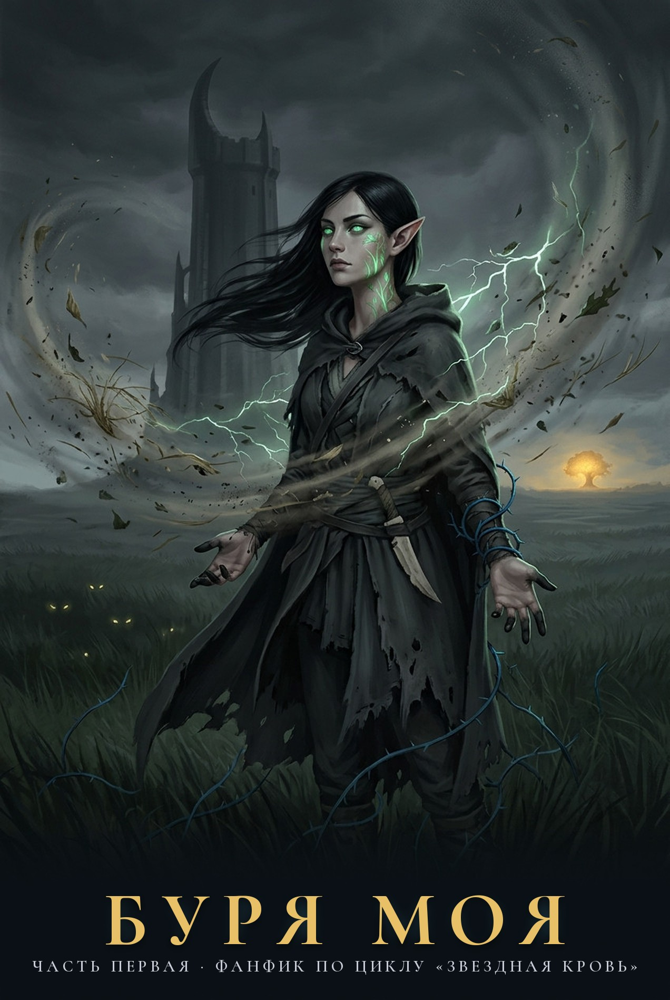

---
hide:
  - toc
---

# Буря моя. Часть 1

{ .book-cover }

*Фанфик-приквел по циклу Романа Прокофьева «Звездная Кровь»*

!!! note "Статус"
    Написана целиком: пролог, 26 глав, 6 интерлюдий. Выверена: связность, канон, манера автора, вычитка.

Дочь кинга Народа Теней слышит Травы. Лучшие из них растут во Тьме — а Тьма торгует честно и берет плату не с того, кто покупал.

Она спасает брата черной Травой, выкупает гвоздь погибшего у твари из Тьмы и лечит умирающего отца тем, чем лечить нельзя. За каждое спасение платят те, кого она любит.

Юность Говорящей-с-Травами в Каменных Луках — от первого испытания до встречи с чужаком, упавшим с неба.

Неофициальный фанфик-приквел к циклу «Звездная Кровь». Все права на мир и персонажей принадлежат Роману Прокофьеву.

[Читать онлайн](00-prolog.md){ .md-button .md-button--primary } [Скачать FB2](burya-moya.fb2){ .md-button }

## Оглавление

1. [Пролог](00-prolog.md)
2. [Глава 1](01-glava-01.md)
3. [Глава 2](02-glava-02.md)
4. [Интерлюдия. Уголек](03-interlyudiya-1.md)
5. [Глава 3](04-glava-03.md)
6. [Глава 4](05-glava-04.md)
7. [Глава 5](06-glava-05.md)
8. [Глава 6](07-glava-06.md)
9. [Интерлюдия. Уголек](08-interlyudiya-2.md)
10. [Глава 7](09-glava-07.md)
11. [Глава 8](10-glava-08.md)
12. [Глава 9](11-glava-09.md)
13. [Глава 10](12-glava-10.md)
14. [Глава 11](13-glava-11.md)
15. [Интерлюдия. Уголек](14-interlyudiya-3.md)
16. [Глава 12](15-glava-12.md)
17. [Глава 13](16-glava-13.md)
18. [Глава 14](17-glava-14.md)
19. [Глава 15](18-glava-15.md)
20. [Глава 16](19-glava-16.md)
21. [Глава 17](20-glava-17.md)
22. [Глава 18](21-glava-18.md)
23. [Интерлюдия. Яростный](22-interlyudiya-4.md)
24. [Глава 19](23-glava-19.md)
25. [Глава 20](24-glava-20.md)
26. [Глава 21](25-glava-21.md)
27. [Глава 22](26-glava-22.md)
28. [Интерлюдия. Яростный](27-interlyudiya-5.md)
29. [Глава 23](28-glava-23.md)
30. [Глава 24](29-glava-24.md)
31. [Интерлюдия. Яростный](30-interlyudiya-6.md)
32. [Глава 25](31-glava-25.md)
33. [Глава 26](32-glava-26.md)
