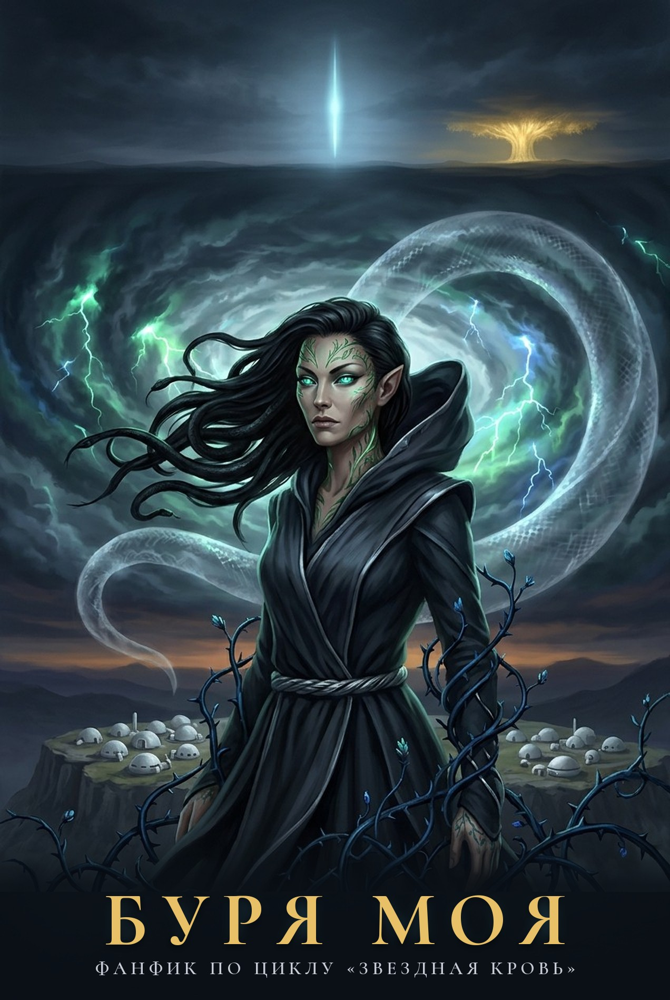
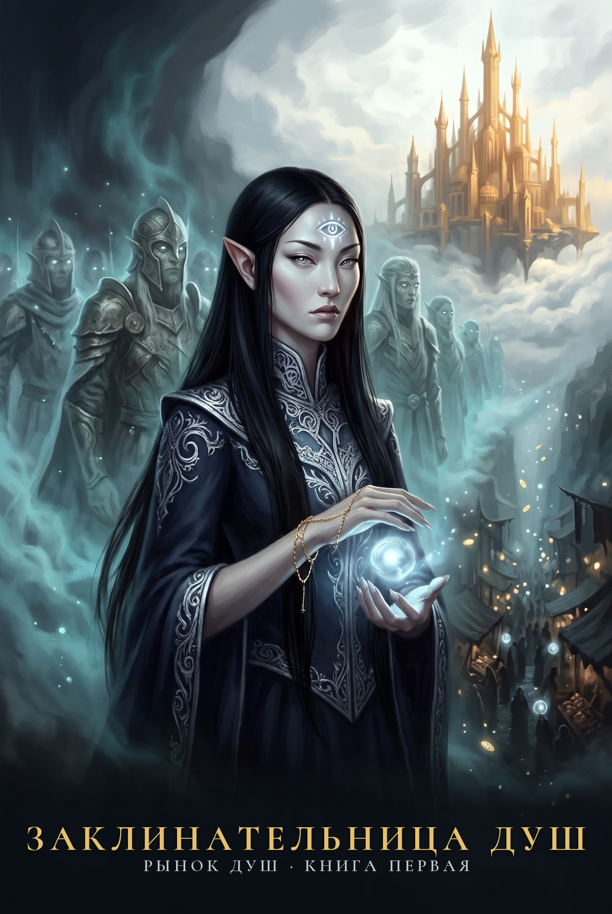

# Книги

Фанатские книги по вселенной «Звездной Крови». Не канон: мир и персонажи принадлежат Роману Прокофьеву.

Каждую книгу можно читать прямо на сайте или скачать в формате FB2 для читалки.

Книги связаны в одну историю: колония землян, Вечность и Серебряный Замок. Читать по порядку, сверху вниз.

**1. [Буря моя](burya-moya/index.md)**

Фанфик-приквел по циклу Романа Прокофьева «Звездная Кровь»

Написан целиком: пролог, 27 глав, 4 интерлюдии и эпилог. Выверен по памятке проверок: канон, связность, жесткость, манера автора.

**2. [Заклинательница душ](zaklinatelnica-dush/index.md)**

Рынок душ. Книга первая. Фанфик-приквел по циклам Романа Прокофьева «Звездная Кровь» и «Тысяча Братьев»

Написан целиком: пролог, 20 глав, 2 интерлюдии и эпилог. Выверен по памятке проверок: канон, ошибки, манера автора, лексика и термины мира, жесткость.

**3. [Серебряный Замок](serebryanyj-zamok/index.md)**

Рынок душ. Книга вторая. Фанфик-приквел по циклам Романа Прокофьева «Звездная Кровь» и «Тысяча Братьев»

Написан целиком: пролог, 18 глав, интерлюдия и эпилог. Выверен по памятке проверок: канон, связность, ошибки, манера автора, жесткость.

**4. [Полет Ангела](polet-angela/index.md)**

Рынок душ. Книга третья. Фанфик-приквел по циклу Романа Прокофьева «Звездная Кровь»

Написан целиком: пролог, 22 главы, 2 интерлюдии и эпилог. Выверен по памятке проверок: канон, связность, ошибки, манера автора, термины мира, жесткость.

