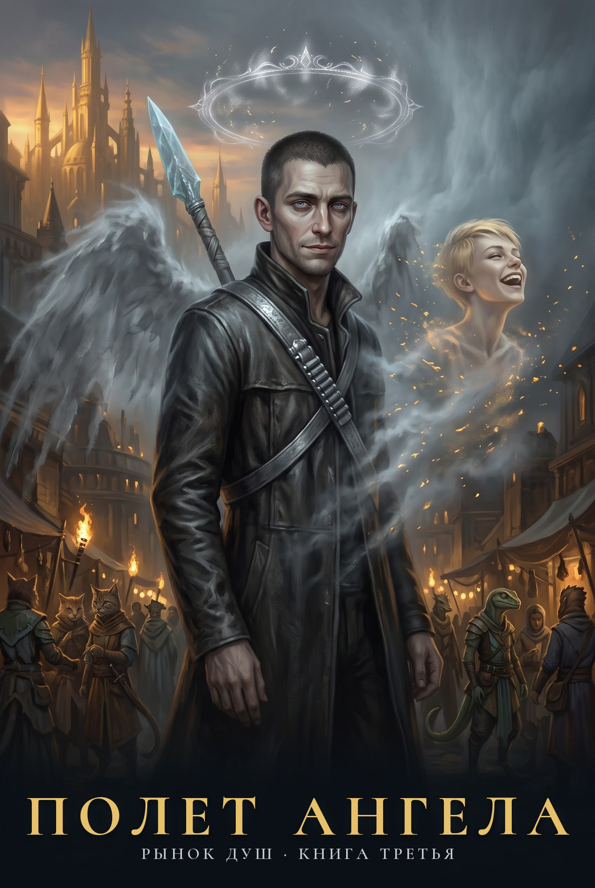

---
hide:
  - toc
---

# Полет Ангела

{ .book-cover }

*Рынок душ. Книга третья. Фанфик-приквел по циклу Романа Прокофьева «Звездная Кровь»*

!!! note "Статус"
    Написан целиком: пролог, 22 главы, 2 интерлюдии и эпилог. Выверен по памятке проверок: канон, связность, ошибки, манера автора, термины мира, жесткость.

Умирать оказалось не больно. Больно стало потом, когда я понял, что меня никто не позовет.

Меня зовут Микки. Я нейробиолог с «Хельги», полевой медик копья, и в колонии меня звали Ангелом. Говорят, Вечность — рай для павших Восходящих. Я прошел ее Чертоги, где мертвые ждут живых, Испытания, где разводят тех, кто пришел вместе, и Туман, где тебя убивают, пока не согласишься.

Я знаю, как устроена надежда: это подкрепление, которое приходит не всегда. Поэтому от нее невозможно отучиться.

Где-то здесь Рэйчел. Где-то здесь человек, который ее продал. Найду ли я ее раньше, чем забуду, как она смеется?

В этом раю продается все — даже души. А платят здесь одним — Звездной Кровью!

Неофициальный фанфик-приквел к циклу «Звездная Кровь». Все права на мир и персонажей принадлежат Роману Прокофьеву.

[Читать онлайн](00-prolog.md){ .md-button .md-button--primary } [Скачать FB2](polet-angela.fb2){ .md-button } [FB2 с «ё»](polet-angela-yo.fb2){ .md-button }

## Оглавление

1. [Пролог](00-prolog.md)
2. [Глава 1](01-glava-01.md)
3. [Интерлюдия. Полет Ангела](02-interlyudiya-polet-angela.md)
4. [Глава 2](03-glava-02.md)
5. [Глава 3](04-glava-03.md)
6. [Глава 4](05-glava-04.md)
7. [Глава 5](06-glava-05.md)
8. [Глава 6](07-glava-06.md)
9. [Глава 7](08-glava-07.md)
10. [Глава 8](09-glava-08.md)
11. [Глава 9](10-glava-09.md)
12. [Глава 10](11-glava-10.md)
13. [Глава 11](12-glava-11.md)
14. [Глава 12](13-glava-12.md)
15. [Глава 13](14-glava-13.md)
16. [Глава 14](15-glava-14.md)
17. [Глава 15](16-glava-15.md)
18. [Интерлюдия. Рэйчел](17-interlyudiya-reychel.md)
19. [Глава 16](18-glava-16.md)
20. [Глава 17](19-glava-17.md)
21. [Глава 18](20-glava-18.md)
22. [Глава 19](21-glava-19.md)
23. [Глава 20](22-glava-20.md)
24. [Глава 21](23-glava-21.md)
25. [Глава 22](24-glava-22.md)
26. [Эпилог. Позывной](25-epilog.md)
