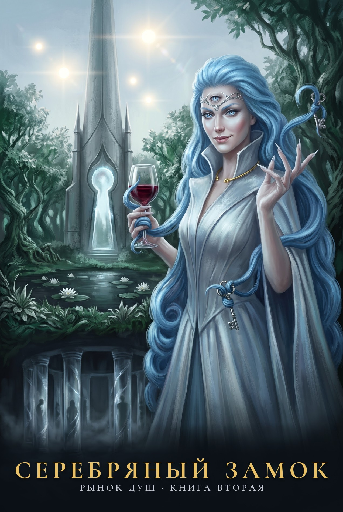

---
hide:
  - toc
---

# Серебряный Замок

{ .book-cover }

*Рынок душ. Книга вторая. Фанфик-приквел по циклам Романа Прокофьева «Звездная Кровь» и «Тысяча Братьев»*

!!! note "Статус"
    Написан целиком: пролог, 18 глав, интерлюдия и эпилог. Выверен по памятке проверок: канон, связность, ошибки, манера автора, жесткость.

Тысячу циклов она не менялась. Двадцать восемь циклов назад ударил Колокол, и она украла тайну, за которую Хранители не прощают.

Теперь у нее есть Замок, дверь в который открывается только изнутри, и коллекция, где каждому гостю найдется место.

Кто придет, когда ключ повернется снаружи?

Неофициальный фанфик-приквел к циклам «Звездная Кровь» и «Тысяча Братьев». Все права на мир и персонажей принадлежат Роману Прокофьеву.

[Читать онлайн](00-prolog.md){ .md-button .md-button--primary } [Скачать FB2](serebryanyj-zamok.fb2){ .md-button } [FB2 с «ё»](serebryanyj-zamok-yo.fb2){ .md-button }

## Оглавление

1. [Пролог](00-prolog.md)
2. [Глава 1](01-glava-01.md)
3. [Глава 2](02-glava-02.md)
4. [Глава 3](03-glava-03.md)
5. [Интерлюдия. Сто Голосов](04-interlyudiya-sto-golosov.md)
6. [Глава 4](05-glava-04.md)
7. [Глава 5](06-glava-05.md)
8. [Глава 6](07-glava-06.md)
9. [Глава 7](08-glava-07.md)
10. [Глава 8](09-glava-08.md)
11. [Глава 9](10-glava-09.md)
12. [Глава 10](11-glava-10.md)
13. [Глава 11](12-glava-11.md)
14. [Глава 12](13-glava-12.md)
15. [Глава 13](14-glava-13.md)
16. [Глава 14](15-glava-14.md)
17. [Глава 15](16-glava-15.md)
18. [Глава 16](17-glava-16.md)
19. [Глава 17](18-glava-17.md)
20. [Глава 18](19-glava-18.md)
21. [Эпилог. Отражение неба](20-epilog.md)
