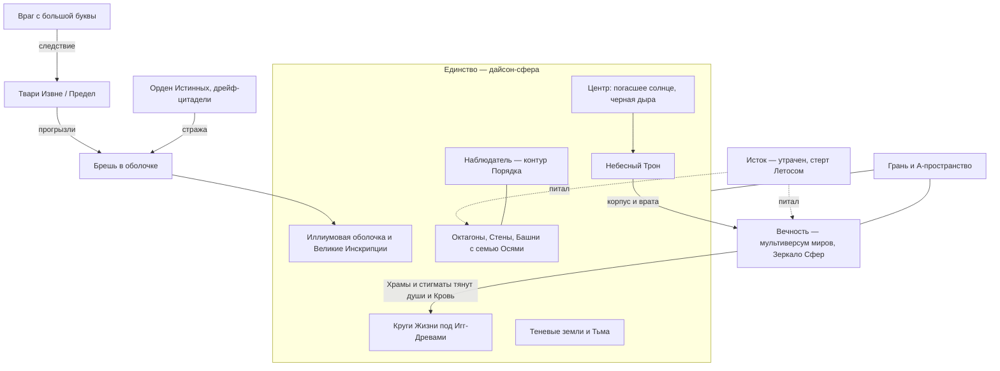
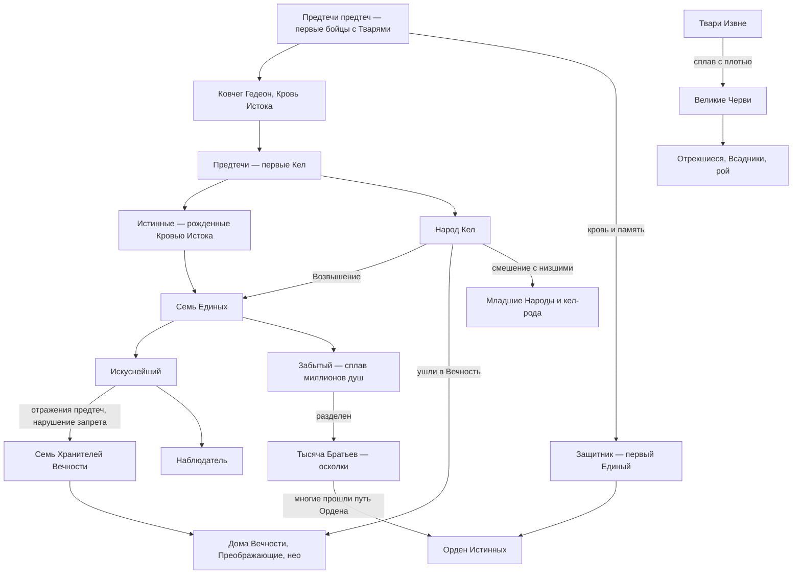
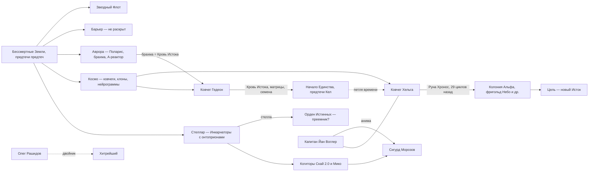

# 03. Космология и история мира «Звездной Крови»

>
> Формат ссылок: `(ЗК-3, пролог)`, `(ТБ-4, гл. 10)`. Догадки помечены *(предположение)*. Когда источники противоречат друг другу, это сказано прямо, и указано, какая книга новее (порядок: ЗК-1…ЗК-11, ТБ-1…ТБ-5; ТБ идут параллельно ЗК-7…ЗК-11; ЗК-12 — пока пролог и гл. 1–3). Слова автора из Telegram помечены «(автор, TG: [пост N](https://t.me/prokofiev_litrpg/N))»: это не текст книг, но старше свода читателей.

---

## 0. Как читать древнюю историю: кто рассказывает

У автора почти вся предыстория подана через «летописи» в прологах, и у каждой есть своя предвзятость. Плюс действует **Руна Забвения**: события, связанные с Забытым и Истоком, вычеркнуты из мироздания, и даже бессмертные помнят их обрывками (ЗК-10, пролог; ЗК-11, гл. 8 и 21). Любую версию стоит помечать: «кто это говорит».

| Голос | Где | Позиция |
|---|---|---|
| «История Народа Кел» (голос Белого Дьявола, затем безличный летописец) | ЗК-2, ЗК-3, ЗК-4, ЗК-6 (прологи) | «Классическая» версия, умеренно анти-Вечность. Основной каркас эпох |
| «Великая Охота», «Календарь Небесных Сезонов» | ЗК-5, ЗК-7 (прологи) | Энциклопедический голос, эпоха Кругов |
| «Небесный Трон» | ЗК-8, пролог | **Пропаганда Вечности** (солнце выпил Забытый) |
| «Легенда о Хранителях Вечности» | ЗК-9, пролог | Взгляд на Хранителей, «то шепчут змеиные языки изменников» |
| «Легенда об Истоке» | ЗК-10, пролог | Синтез версий об Истоке |
| «Стены и Башни» | ЗК-11, пролог | Устройство октагонов |
| «Легенда о Тысяче Братьев» I–V | ТБ-1…ТБ-5 (прологи) | Две версии разом: «уста Вечности» и «те, кто носит тайные знаки Тысячи» |
| Лекция Хитрейшего | ЗК-8, гл. 9 | Хранитель-циник: «Единство — фабрика Единых» |
| Небо-страж и Тайновидица Ордена | ЗК-8, гл. 12 | «Мы защитники света; Вечность — тень» |
| Сага Сестры Солнца | ЗК-9, интерлюдия | Слова самого Искуснейшего (сильнейший источник по Хранителям и «Гедеону») |
| Сага «Голубая Стрела» (Эйлориан) | ЗК-11, интерлюдия и гл. 21 | Единственный очевидец эпохи до Раскола; запись изрезана Забвением |
| Кейнор, Ледяной Кузнец | ЗК-11, гл. 17; ТБ-4, гл. 17 | Брат-небо, знаток Истока и Башен |
| Скай, Аврора, Минос, Рашидов | ЗК-8…ЗК-11 | Научные гипотезы землян (не канон-факт, а модели) |

---

## 1. Устройство вселенной

### 1.1. Итоговая картина (последняя версия)

- Во вселенной есть **Враг «с большой буквы»**, который хочет уничтожить «всю материальную вселенную во всех ее слоях»; **Твари Извне** — «лишь следствие» (Хитрейший, ЗК-8, гл. 9). Твари приходят **Извне / из-за Предела**; их «чужеродность» нарушает модель мироздания (ЗК-11, гл. 21).
- Против них предтечи построили **Единство**: дайсон-сферу вокруг звезды, «скрытую цитадель», невидимую из глубин мироздания (ЗК-2, пролог). Корпус — многослойная броня из **иллиума**, снаружи покрытая **Великими Инскрипциями** размером с октагон (ТБ-4, интерлюдия «Брешь»). Цель — выжить и вырастить «инструменты защиты»: **Восхождением** превратить лучших в сверхсуществ, **Единых** (ЗК-8, гл. 9).
- Изнутри сфера разделена **Великими Стенами** на бесчисленные **октагоны**, а на стыках стоят **Башни** с семью управляющими **Осями** (ЗК-11, пролог, гл. 3).
- Твари всё-таки нашли сферу и прогрызли **Брешь**. Её держали **Защитник (Тот-Кто-Сражается)** и **Орден Истинных** (ЗК-2, пролог; ЗК-8, гл. 12).
- Энергией всего была **Кровь Истока** («энергия первотворения», брахма), а Исток давал её без конца. Из неё сделаны материя, Руны, **Звездная Кровь**, Домены и **Небесный Трон** (ЗК-10, пролог).
- **Вечность** — творение Искуснейшего: «отражение» Единства и мультиверсум миров, «Зеркало Сфер» и хранилище душ (ЗК-3, пролог; ЗК-11, гл. 21). Её зримый корпус — **Небесный Трон**. В войне **Раскола** Вечность (по другой версии — Забытый) **выпила солнце**. Теперь на месте солнца чёрная дыра с аккреционным диском, а вокруг неё Трон (ЗК-3, пролог; ЗК-11, гл. 21).
- Исток утрачен: его стёрла **Великая Руна Забвения** (Летос) (ЗК-6, пролог; ЗК-8, гл. 9). **Искуснейший** пролился «дождем Звездной Крови» по всей сфере, и Восхождение открылось всем (ЗК-6, пролог).
- Свет вместо солнца дают **Игг-Древа Творящей**. Освещённые ими зоны — **Круги Жизни**, вокруг тянутся теневые земли и **Тьма** (ЗК-3, пролог; ЗК-4, пролог).
- Через **Храмы** и **стигматы** Вечность выкачивает из Единства души и Звездную Кровь, потому что без Истока она деградирует (ЗК-10, пролог; ЗК-9, гл. 14).
- Порядок внутри сферы поддерживает **Наблюдатель**, «исполнительный контур Порядка» (ЗК-11, гл. 21).
- 28–29 циклов назад Хранители Великой Руной **Хронос** перенесли в Единство земной ковчег **«Хельга»**, чтобы земляне-«предтечи» снова создали Исток (ЗК-3, интерлюдия «Хранители»; ЗК-8, гл. 9).

### Схема 1. Структура мироздания

### 1.2. Извне, Враг, Твари Извне, Предел, Грань, А-пространство

- **Враг.** Хитрейший: «В нашем… мироздании существует враг… Твари Извне? — Они лишь следствие» (ЗК-8, гл. 9). Эти же слова почти дословно звучат у землян: «Стеллар» и «Космо» создавались, чтобы спасти человечество «от зла, которое должно было его уничтожить» (ЗК-11, гл. 8). Природу Врага не раскрывает никто.
- **Твари Извне.** Их нельзя описать нормально: «многорукая и длинная, как змея», будто «сознание не могло подобрать форму» (ЗК-9, интерлюдия, видение Сестры Солнца). У Бреши видны «черные сферы, окутанные голубым сиянием» (ЗК-8, гл. 12). Тварь, утащившая Защитника, — «размером чуть ли не в половину Единства» (ЗК-8, гл. 12). Кел-термины для них: «нарушители модели», «чужеродные порождения» (ТБ-3, гл. 9); у них есть «корень-сердце», видимый Оку как «чужеродные гармоники» (ЗК-11, гл. 21).
- **Пришествия Тварей** (по летописи Кел): первое — до Единства, когда они уничтожили родину предков Кел (ЗК-2, пролог, легенда 1); второе — во 2-м обороте галактики, через **Брешь** (там же); третье — в Раскол, «сквозь распахнутые изнутри врата» (ЗК-6, пролог); затем Твари, «соединив нематериальную сущность с плотью» обитателей, породили **Червей** (ЗК-4, пролог).
- **Предел, Пустота-за-Пределом, Мертвые Сферы, иные Сферы.** В космологии Кел кроме Единства существуют другие «сферы», в том числе мёртвые. «Звездный Полет — для путешествий между Сферами» (ЗК-10, разд. 10). **Стражи Предела** — кел-иерархия обороны; Орден Истинных — их «краеугольный камень»; стелла означает «Хранить Предел. Хранить Единство. Хранить Восхождение» (ЗК-11, гл. 21). «Порождения Предела» могли заражать кел-системы (Сай’Рхос, ЗК-10, разд. 10).
- **Грань.** Граница бытия, куда уходят души («уйти за Грань»), и синий переход, через который «Хельга» вышла в Единство: «синяя вспышка Грани» (ЗК-1, интерлюдия «Хельга»). Руна Хронос «распустилась синим огнем Грани» (ЗК-3, интерлюдия «Хранители»). Анима — «А-сущность… Приходящая из Грани и за Грань уходящая» (ЗК-11, гл. 2). Забытый ждёт осколки **за Гранью** (ТБ-4, интерлюдия «Всполох»).
- **А-пространство.** Земной термин для гиперпространства: «Когда синяя бездна А-пространства распахнулась, выпустив ковчег в обычный мир, все на борту „Хельги“ были мертвы» (ЗК-1, интерлюдия «Хельга»). Из А-пространства у Мира-Кольца вышел «зловещий пришелец» (там же). На Земле знали **А-энергию** («строительный материал вселенной»; основа ЗК — ЗК-4, гл. 1) и боялись **А-катастрофы** (ЗК-1, гл. 23). Связь синевы А-пространства, синевы Грани и синевы Бреши-воронки (ЗК-8, гл. 12) — *(предположение)*: это одно и то же «измерение».

### 1.3. Единство: дайсон-сфера

**Размер и положение.**
- Гипотеза Матиаса (Миноса): сплошная сфера Дайсона диаметром ~2,5 а.е.; люди живут на внутренней поверхности, горизонт «поднимается» (ЗК-1, гл. 23).
- Единство «стоит на месте Солнечной системы 6 оборотов галактики» (Минос, ЗК-2, разд. 6). «Хельга» после выхода из А-пространства не нашла ни одного объекта Солнечной системы (ЗК-1, интерлюдия «Хельга»). Прибытие Кел — «шесть оборотов» назад (ЗК-2, пролог).
- Скай: материалов Солнечной системы на такую сферу не хватило бы, значит, материю творили из энергии (ЗК-10, гл. 15). Пролог ЗК-12 приписывает это Великой Руне **Террос**: «В звездной системе не найдется достаточно планет и лун, чтобы выковать даже малую его часть» (§1.10).
- Круги — «де-факто… отдельные миры со своей историей и персонажами»: устройство Единства и Вечности позволяет множество независимых историй (автор, TG: [пост 839](https://t.me/prokofiev_litrpg/839?comment=4443)).
- Снаружи сфера «чуть приплюснутая», покрыта фракталами с «узором как рунный» (ЗК-8, гл. 9), окружена «шлейфом осколков, похожих на астероидное поле» (ЗК-11, интерлюдия), «осколками черных лун» (ТБ-4, интерлюдия «Брешь»).

**Тело сферы (метафора «живого организма», ЗК-11, пролог; ТБ-2, гл. 2–3).**
- **Кости** — иллиумовый каркас. Иллиум — «холодное железо», творение Искуснейшего, «неподвластен ни энергии, ни времени»; его не берут даже Руны неба (ЗК-2, гл. 17; ЗК-11, пролог). Кости «старше Вечности, старше Раскола и старше самих Единых», их ковал Искуснейший «или те, кто в конце Восхождения стали им» (ЗК-11, пролог).
- **Полые кости** — оболочка с «глубинными горизонтами», тоннелями и **Изнанкой**. Там живут фрогги, диггеры и караваны «идущих-сквозь-тьму», а Черви по этим ходам прорываются в Круги (ТБ-1, гл. 5–14; ЗК-8, разд. 12). Некоторые конструкции могут оказаться «телами дремлющих Строителей» (ТБ-2, гл. 2).
- **Жилы** — вода, небесный огонь, воздух, подземные пути и «нити», меняющие рельеф. Назначение шестых, седьмых и восьмых жил «неизвестно даже тем, кто коснулся неба» (ЗК-11, пролог).
- **Плоть** — земля, моря, Круги.
- **Атмосфера.** «Воздушные реки»; на высоте — «граница систем искусственного удержания», «атмосферное одеяло» и «высотный потолок» Наблюдателя (ЗК-8, разд. 6; ЗК-11, гл. 12).
- **Небесные острова.** Часть климатической машины эпохи солнца: «теневые ядра» давали искусственную ночь, и таких островов по оценке 800 млн — 1,5 млрд (ЗК-10, гл. 7). Позже — базы Наблюдателя (ЗК-2…ЗК-7).
- **Магнитного поля нет**, компас не работает (ЗК-1, гл. 5). Внутри сферы видны два источника света, поэтому люди отбрасывают **две тени** (ЗК-3, аннотация).

**Снаружи** (ТБ-4, интерлюдия «Брешь»): вакуум, холод, «бесконечное поле камней», поля обломков древних битв. «Порталы и Домены здесь не работали», техниты почти отсутствуют, и «войти обратно, миновав Брешь, — нет». Великие Инскрипции частью мертвы, частью горят «голубым и изумрудным огнем — древние знаки предупреждения, защиты, тревоги». Ещё есть **«вторая кожа»** — фрактальная рунная броня над оболочкой, которая сжигает всё, что её коснётся (ЗК-8, гл. 12).

### 1.4. Октагоны, Стены, Башни и семь Осей

**Октагоны.**
- Сфера «виток за витком» опоясана октагонами; их «тысячи» (ЗК-7, пролог) или «бесчисленное множество» (ЗК-11, пролог). Октагон — неправильный восьмиугольник с 4 длинными и 4 короткими гранями (ЗК-10, гл. 20). Размером он «подобен нашей родной планете» и сам по себе «замкнутая вселенная» (ЗК-11, гл. 4; ЗК-9, гл. 4). Стены высотой от 2500 м (ЗК-9, гл. 4). Круг занимает лишь часть октагона.
- **Цвета (специализации)** (ЗК-7, пролог): **золотые и серебряные** (жилища самих Кел), **изумрудные** (леса и горы), **сапфировые** (реки и океаны для водных народов), **алмазные** (воздушные), **рубиновые** (недра, камень, пламя). Были октагоны «по образу иных звездных сфер» для беженцев, октагоны-полигоны, мастерские и испытательные (ЗК-11, пролог).
- **Спирали и витки**: октагоны «спаянные воедино» — Великая Река, Изумрудная Спираль (ЗК-7, пролог). Между ними стояли **разделяющие щиты и небесные купола**, «ничто не могло пройти без дозволения… даже свет» (ЗК-11, пролог). Щиты «пали с приходом тьмы» (ЗК-6, разд. 10). По преданию, россыпи **чёрного лита** (материал, поглощающий свет) — обломки упавших с неба «небесных куполов» (автор, TG: [пост 4769](https://t.me/prokofiev_litrpg/4769)).
- До Раскола у каждого октагона был свой Небесный Знак и свои испытания (ЗК-7, пролог). «Тёмные» и «туманные» октагоны встречаются и в Вечности (ЗК-9, гл. 14).

**Башни.**
- Стоят на стыке четырёх граней: «одна Башня — один октагон», каждый октагон примыкает к четырём Башням (ЗК-11, гл. 4, 21). Это административный центр и «нервный узел» (ТБ-2, гл. 2).
- Размер Башни Альфы — **1200×1200 км**. Внутри ярусы, Жилой Пояс, Узел Жил, Фабрикаториум, Залы Ткачей, Левиафановы Доки (ЗК-11, гл. 2). Стражи — Привратник и экзо-Ткачи (ЗК-11, гл. 2–3).
- **Жилы от Башен** (Справочник): водяные жилы акварезонита расходятся от главных артерий, «начинающихся в Башнях на стыках октагонов», и питают корни Игг-Древ ([пост 5344](https://t.me/prokofiev_litrpg/5344)); по легендам, сверхпроводящие жилы в иллиумовых костях выкованы из ледяного серебра (эония), и «сила по ним расходилась от Башен по всему октагону» ([пост 6701](https://t.me/prokofiev_litrpg/6701)) (автор, TG). Это сходится с «жилами» пролога ЗК-11.
- По Кейнору, Башни — «врата, хранилища и сосуды. Горло, через которое Единство пило силу». Всякий, кто «идет тропой истинной крови», рано или поздно входит в Башню (ТБ-4, гл. 17; ЗК-11, гл. 17).
- Гипотеза Авроры: сферическая полость с энерговодами в Башне Альфы — это **реактор**, похожий на онтоприон, то есть **Истоки стояли в каждой Башне** (ЗК-11, гл. 11, 17). Это гипотеза, а не канон.
- В Раскол Башни стали главными целями: «разрушить Башню — означало ослепить врага». Башню Элтанира выжгли изнутри: «кто-то вскрыл Оси Созидания и Путей, пустив по всем жилам небесный огонь» (ЗК-11, пролог; гл. 21).
- Сейчас большинство Башен «скрылось во Тьме». Некоторые пробуждаются как маяки (ЗК-11, пролог). Остаточная мощность Башни Альфы — менее 1,5%: 237 Путей, 14 Стрел, 3 Домена, 17 постов Наблюдателя (ЗК-11, гл. 4).

**Зал Семи Осей** (ЗК-11, гл. 3–4): **Стража, Потоки, Надзор, Созидание, Забвение, Пути, Твердь**. Ось — терминал с ложем вроде пилотского ложа стигиса и восемью пазами для Инскрипций. Доступ даёт Печать («Печать Стражи», «Печать Курьера»). Для полной работы нужны «синхронное взаимодействие всех семи операторов» и «предельные золотые или небесные Атрибуты Разума»; без когитора оператор впадает в кататонию.
- *(предположение)* Семь Осей и семь Единых, возможно, связаны. Подсказки: «Забвение» — ось Башни и одновременно «право Надзора усечь целую ветвь причинности» (Эйлориан, ЗК-11, гл. 21); Палач «имитирует функцию Надзора» (ТБ-4, интерлюдия «Брешь»); Руна Надзора Сай’Рхос — «чистильщик» октагонов (ЗК-10). Канонически соответствие не установлено.

**Земляне и кел-системы.** Механизмы Башни считают землян «вернувшимся техническим персоналом» и «легитимными пользователями», и запреты Наблюдателя на них не действуют (ЗК-11, гл. 2).

**Транспорт древности.** Стрелы (треугольные врата из Пера и Наконечника), Малые Стрелы и Знаки Переноса, «межрайонные» и «лифтовые» станции (ЗК-4, гл. 18–21; ТБ-3, гл. 14). Небесные Пути и **Печать Курьера**: «Проход сквозь щиты октагонов, доступ в Башни, Звезды и Ковчеги» (ЗК-11, гл. 21). **Прозрачные Дороги** — «спящие» транспортные сети, которые знак открывает раз в сто циклов (ЗК-10, гл. 19, 21). **Мысль-поле** — всеобщая рунная сеть, в которой кел жили «как дельфины» (ЗК-11, интерлюдия).

### 1.5. Круги, Игг-Древа, Тьма

- **Круг** — зона, освещённая Игг-Древом: «Насколько падает свет от Древа, настолько и Круг длится» (ЗК-1, гл. 15). Диаметр зависит от возраста Древа; Эль-Танир (Элтанир) — около 5000 км (ЗК-1, гл. 15; ЗК-3, гл. 14). Круг — «кислородный пузырь» (ЗК-3, гл. 14). Звёзды на ночном небе — свет других Кругов (ЗК-1, гл. 23).
- «Игг-Древо дает свет и воздух, а Небесный Трон — незримое тепло» (ЗК-1, гл. 15). Вечность греет Единство «подобно титаническому инфракрасному излучателю» (ЗК-3, гл. 14).
- **Типы Древ** (ЗК-10, гл. 11): золотое (землеподобные биомы), сапфировое (холод и пустыни), рубиновое (горы и недра), а также изумрудное «для октагонов, где жизнь немного отличалась» (ТБ-1, гл. 5). По Справочнику, спектров свечения пять: «золотой, серебряный, сапфировый, изумрудный и багряный» (автор, TG: [пост 632](https://t.me/prokofiev_litrpg/632)); серебряного в книгах пока нет.
- **Размер и число** (Справочник): Великие Древа растут всю жизнь; крона — до «десятков тысяч миль», высота — «сотен километров». Высоту ограничивает толщина атмосферы, поэтому старейшие, «фактически бессмертные», Древа растут уже только вширь ([пост 632](https://t.me/prokofiev_litrpg/632), [ответ 2953](https://t.me/prokofiev_litrpg/632?comment=2953)). По некоторым оценкам, в Единстве около четырёх миллиардов Древ и Кругов ([пост 632](https://t.me/prokofiev_litrpg/632)) (автор, TG). Древо — «адаптивная биосистема для восстановления биосферы после катастрофы» (ЗК-10, гл. 11).
- **Происхождение (две версии).**
  1. Классическая: Древа — «величайшее создание Творящей» после Раскола, ответ на Тьму (ЗК-3, пролог; ЗК-4, пролог).
  2. Эйлориан (новее, ЗК-11, гл. 21): до Раскола он возил «семена мыслящих древ на кнорры Творящих для Дальних Посевов… живые якоря для преображения бессолнечных и очищения мертвых сфер… Внутри Единства их раньше не было». По ТБ-3 (гл. 5), Древа тогда были «лишь забавной игрушкой учеников Творящей». То есть Древа существовали и раньше, но как оружие и инструмент колонизации вне сферы, а Творящая перенесла их внутрь.
- **Забытые Золотые Сады** — место, где служители Творящей вывели первые Древа и звёздные Травы, «плакала сама Творящая», её слёзы наполняли Звёздные Кувшины; там раздавали первые Семена и «плоды бессмертия» и заключали первые союзы Кругов (ТБ-3, гл. 16).
- **Семена**: одно из миллиона даёт Свет и становится Ростком → Малым → Великим Древом. Такое Семя дают за золотой Подвиг (ЗК-3, гл. 7). Великое Древо «рождает Хранителей как улей — пчел» (ЗК-6, гл. 11) и достигает небесного ранга (ЗК-7, гл. 22). Свет Древа — главное оружие против всего, что несёт след Тварей Извне (ТБ-3, гл. 10). **Аура Благословения** в центре Круга не даёт совершать убийства (ЗК-1, гл. 22).
- **Первый тинг** провела сама Творящая у первого Игга (ТБ-4, гл. 11).
- Круги «должны сомкнуться» *(предположение Сигурда, ЗК-6)*. В летописи «иные слились воедино» (ЗК-5, пролог).
- **Тьма** — ледяные пространства без света; там «черный лёд» и твари (ЗК-1, гл. 15). В эпоху Тьмы одни Народы ушли в Домены, другие под купола искусственных светил, третьи изменили тела, четвёртые «закопались к самым костям Единства» (ЗК-4, пролог). Тьма Великих Червей — их «живая черная кровь» — особая субстанция (ТБ-3, гл. 4).
- **Солнечные Змеи** — «дети умершего Солнца», «любимцы Наблюдателя» (ЗК-10, гл. 7).

### 1.6. Брешь

- «Язва, где Твари прогрызли оболочку Единства» во 2-м обороте галактики (ЗК-2, пролог). В видении — «исполинский пролом, горящий алыми и желтыми огнями, дыра в настоящий космос», а в момент вторжения — «исполинская воронка… пасть в ослепительно-синюю бесконечность» (ЗК-8, гл. 12).
- Снаружи Брешь — разлом с оплавленными краями, «затянутый мерцающей пленкой»; дальше пустота, обломки, осколки черных лун (ТБ-4, интерлюдия «Брешь»). Видение Сестры Солнца показывает **«фрактальную завесу»** из голубого огня, за которой копошится «скопище» Тварей (ЗК-9, интерлюдия).
- **Оборона**: Защитник (до гибели), небо-стражи Истинных, кольца **дрейф-цитаделей** («золотые короны», «города-короны» с астролитами, роями экзо-банши и экзо-дракки), небесные острова Наблюдателя (ЗК-3, интерлюдия «Хранители»; ЗК-8, гл. 12; ТБ-4, интерлюдия «Брешь»). Вспомогательная тактика — «доменные бомбы» против обиталищ Тварей (ТБ-2, гл. 7).
- **Правило**: войти в Единство снаружи можно только через Брешь, и Орден не разбирает, кто перед ним: всё, что несёт след Тварей, уничтожается (ТБ-4, интерлюдия «Брешь»). Небесный Ордена: «Мы не преследуем Вечность. Она лишь тень» (ЗК-8, гл. 12).
- **28 циклов назад Тот-Кто-Сражается погиб**: Вечное Око передало траурную весть небо-стражей (ЗК-3, интерлюдия «Хранители»). Сцена гибели: Тварь «выглянула» из воронки, схватила Защитника щупальцами и утащила; небо-стражи бросились за ним (ЗК-8, гл. 12). «Никто не знает, сколько Истинные… смогут защищать Брешь. Может, еще один цикл. А может, еще тысячу циклов» (ЗК-3, интерлюдия).
- Белый Дьявол бывал у Бреши и говорил с Защитником «после того, как поднялся по лестнице Восхождения, но до того, как был рожден в числе тысячи» (ЗК-4, гл. 21). Дарующий Молнии провёл в Ордене у Бреши сто циклов (ТБ-4, гл. 10).

### 1.7. Вечность и Небесный Трон

**Что видно с земли.** Ночью в центре неба «голубое веретено» или «синяя игла Небесного Трона», «око Вечности»: пульсар — «овал, пронзенный длинной иглой на треть небосвода» (ЗК-3, гл. 6; ЗК-5, эпилог). При смене знака проступает серебряная мегаконструкция — Звездный (Небесный) Трон, «ажурная цитадель в горизонте событий» (ЗК-1, гл. 23; ЗК-11, гл. 21). Знак Вечности — **круг, пронзённый иглой** (на стигматах — «игла, пронзающая круг»; ЗК-1, гл. 7; ТБ-5, гл. 13).

**Версии природы Вечности:**

| Версия | Кто говорит | Суть |
|---|---|---|
| «Великое место и великая машина, созданная из Звездной Крови», пьющая энергию звезды; отражение вселенной, «покорное законам» Кел | Летопись Кел (ЗК-3, пролог) | Классика |
| Загробный мир, «вечная обитель небожителей», куда уходят души Восходящих | Верования, пропаганда (ЗК-1, гл. 15; ЗК-8, пролог) | Народная |
| «Звездная машина», вычислитель и центр управления Единством | Учёные землян (ЗК-1, гл. 23) | Ранняя гипотеза, позже отвергнута: Наблюдатель Вечности не служит (ЗК-4, гл. 21) |
| Глобальная копия Единства, «репозитарий душ», врата между слоями мироздания; альтернатива провалившейся «фабрике Единых» | Хитрейший (ЗК-8, гл. 9) | Взгляд Хранителя |
| «Программируемая реальность, где базовым кодом служит Кровь Истока»; «Небесный Трон не содержит Вечность, он и есть Вечность… самый мощный квантовый компьютер во вселенной» | Скай (ЗК-9, гл. 14) | Научная модель |
| «Крепость Созидающих, Врата и Зеркало Сфер, великий анимариум и великий ключ»: слепок мироздания «до последней души»; погибшую сферу можно воссоздать из Зеркала; затем «кто-то сел на зеркало мироздания» и назвал его Троном | Эйлориан, очевидец до Раскола (ЗК-11, гл. 21) | **Новейшая и самая «первичная» версия** |
| Небесный Трон — ловушка, где души, Руны и Кровь Восходящих «питают дряхлых владык Вечности»; коллапс солнца устроила сама машина Трона | «Маргинальные культы» в Справочнике (автор, TG: [пост 5794](https://t.me/prokofiev_litrpg/5794)) | Еретическая версия, не канон |

**Справочник о Троне** (автор, TG: [пост 5794](https://t.me/prokofiev_litrpg/5794)): главный источник тепла и большей части излучения в сфере — аккреционный диск, а не Древа; при смене цикла релятивистские струи складывают материю диска в Небесный Знак, и только в этот миг видна мегаконструкция Трона. Сердце Вечности — Золотой Город, «отражение древней столицы Народа Кел» (так и в ЗК-5, гл. 9).

**Устройство Вечности** (ЗК-5, ЗК-6, ЗК-9):
- С момента создания миры разделились: в Вечности **не было** Раскола, Тьмы, Древ и Червей. Один её слой — копия прежнего Единства **с солнцем** (ЗК-5, гл. 3, 9; ЗК-9, гл. 14).
- Это мультиверсум «тысяч миров», Домены-миры, Бассейны Душ (изобретение учеников Искуснейшего). **Золотой Город** — «хаб вселенского колеса» с миллиардами жителей (ЗК-9, гл. 11, 14). Настоящий Золотой Город был столицей Кел до Раскола, и БД там родился (ЗК-5, гл. 9). В Саге «Голубая Стрела» обломки дрейф-города падают на город, похожий на Золотой Город Вечности (ЗК-11, интерлюдия).
- Порядок в Золотом Городе держит **«рэйа»** — плетение небесного ранга (ЗК-5, гл. 9). **Рэйя** над Кругом Семи Древ — небесное плетение-купол с опорой на шесть Замков: «Пока рэйя цела, чужие врата не откроются» (ТБ-5, гл. 19). *(предположение)* Рэйя — общее кел-название защитных небесных куполов, наследие «небесных куполов» октагонов.
- **Эмпиреи** — верхние небесные залы. Из Эмпиреев «сошли» Преображающие (ЗК-1, интерлюдия «Белый Дьявол»), там стоит **Тысячелетний Замок** с **Колоколом Вечности** (ЗК-3, интерлюдия «Хранители»).
- **Ключи Небесного Трона** — созданы Искуснейшим «для управления великим Небесным Троном» и хранятся у семи Хранителей (ЗК-9, пролог). Сомкнутые Ключи дают Колоколу «новый звук» решения (ЗК-3, интерлюдия).
- Сословия: кел/небесные (правят), **нео** (души со стигматом: «скот, игрушки, слуги»), **энно** (бездушные) (ЗК-9, гл. 14). Кел Вечности не рожают и вымирают (ЗК-5, гл. 11). Окончательной смерти нет: смерть — откат к Бассейну Душ, кроме «Приговора» Палача (ЗК-9, гл. 18–19).
- **Деградация**: отрезанная от Истока, Вечность медленно угасает и высасывает ЗК из Единства (ЗК-9, гл. 14; ЗК-10, пролог). Хитрейший: если получим Исток, «Вечности уже будет не нужно Единство» (ЗК-8, гл. 9).
- **Вечность закрыла золотые врата** после поражения Гармонии и гибели Псов (ТБ-5, гл. 1, 15).

### 1.8. Исток и Кровь Истока

**Канон, в котором сходятся все:** Исток — источник бесконечной Крови Истока, «энергии первотворения». Из него Кел творили материю, Руны, Звездную Кровь, сферу, октагоны, Башни, острова, цитадели Наблюдателя, Домены и Небесный Трон (ЗК-10, пролог). После утраты Истока началась «медленная, но неотвратимая» деградация длиной в тысячи циклов (ЗК-10, пролог; ЗК-8, гл. 9).

**Версии происхождения:**
1. Исток **принесли Кел на межпространственном ковчеге** (ЗК-6, пролог). Сага Искуснейшего: «В ковчеге, что их принес, хранилось все: Кровь Истока, матрицы разума, семена жизни» — ковчег **«Гедеон»** (ЗК-9, интерлюдия).
2. Исток **создал Искуснейший**, или Исток породил первых Истинных, и те стали Искуснейшим (ЗК-6, пролог).
3. Исток **и был Единым**, а потому его никогда не существовало отдельно (ЗК-10, пролог).
4. Исток **«не мог находиться в Единстве»**: в Крови Истока — «дыхание Извне», «живой чужеродный огонь», и такой костёр внутри сферы — «маяк для Тварей Извне». «Однажды это случилось», и с тех пор Червей «не выковырять из-под шкуры Единства» (Кейнор, ЗК-11, гл. 17; ТБ-4, гл. 17). **Кейнору как Брату-небу это новейшее и важнейшее свидетельство.**
5. Исток — **технология**: А-реактор, производящий брахму, или технология брахма-симбионтов (Скай, ЗК-8, гл. 18). Истоки стояли **в каждой Башне** (Аврора, ЗК-11, гл. 11, 17). По Эйлориану, до Раскола Звездная Кровь была «везде… в любой Башне, Звезде, Астролите, Ковчеге», а доступ к ней ограничивал «отпечаток иерархии» (ЗК-11, гл. 21).

**Судьба Истока (версии):**
- Его потеряли в войнах Раскола (ЗК-3, пролог). Его уничтожил Забытый, чтобы лишить Вечность силы (ЗК-10, пролог).
- Искуснейший, ужаснувшись предательству учеников, «лишил [их] Истока», Великой Руной стёр память о его создании и рассеялся вместе с ним «дождем Звездной Крови» (ЗК-6, пролог; ЗК-9, пролог).
- Хитрейший: Руной **Летос** уничтожены «Исток (или Истоки) и Забытый»; парадокс самоуничтожения Руны знал только Искуснейший (ЗК-8, гл. 9).
- «В Забвении есть изъян, иначе бы все, созданное с помощью Истока, было уничтожено», а значит, есть надежда (ЗК-10, пролог).

**Кровь Истока = брахма-материя землян.** Контейнеры проекта «Аврора» распознаются как «Кровь Истока» (ЗК-8, гл. 18; ЗК-11, гл. 5). Брахма — «субстрат предреальности», который заменяет в Рунном Искусстве любые компоненты. Азимандия сделала золотую Руну из одних её капель (ЗК-10, гл. 3). «Из нее можно сделать любую Руну, от дерева до неба… В Вечности из нее сотворили тысячи миров» (ТБ-3, гл. 17). Кровь Истока «не имела никаких рангов» (ТБ-3, гл. 17); «Исток — сила, что не имеет ранга» (Кейнор, ЗК-11, гл. 17). Контейнеры падают с небес вместе с землянами, и открыть их могут только «круглоухие» (ЗК-8, гл. 18).

**Кто чего хочет от Истока** (ЗК-10, пролог): Вечность — вернуть господство; Тысяча — вернуть величие Единства и «своего забытого отца»; Наблюдатель — продолжать Восхождение; Истинные — защитить сферу. Земляне держат ключ, но не понимают, какую дверь он открывает.

**Что нужно землянам, чтобы создать Исток** (Аврора, ЗК-11, гл. 8, 11): полная база «Полариса», нейрограмма Рэя Мартинса и много «живой материи», а всё это есть только на «Хельге».

### 1.9. Звездная Кровь как субстанция (космологический аспект)

Механика Рун и Восхождения подробно разобрана в других файлах базы. Здесь — только то, что относится к космологии.
- **«Кровь творения».** В Единстве ЗК считают «кровью творения», концентрированной сутью энергии в основе сущего; земные учёные — «азур-энергетической субстанцией с невероятно гибким кодом», упакованной в «адаптивные контейнеры с разным „кодом“» — Капли, Скрижали, Руны, Атрибуты. С её помощью, вероятно, построены почти все чудеса Кел и, может быть, сама сфера. Название «Звездная Кровь» старше Единства: Кел «прекрасно знали (и знают), что такое звезды» (автор, TG: [пост 2154](https://t.me/prokofiev_litrpg/2154), [пост 3195](https://t.me/prokofiev_litrpg/3195)).
- Иерархия материи по Миносу: **А-энергия** (основа) → **брахма / Кровь Истока** (живая, без рангов) → **Звездная Кровь** («вода», «переплавленный и прирученный свет», с рангами) → **Минералы, Реликты, Фрагменты** («лёд») и **Эфир** («пар», тонкая форма) (ЗК-4, гл. 1; ЗК-8, гл. 6; ЗК-11, гл. 17).
- **Техниты Наблюдателя** — не нанороботы, а «сетевые А-сигналы, встроенные в саму структуру Звездной Крови»; каждый Восходящий служит им ретранслятором (ЗК-10, гл. 10). Любая капля несёт паттерны Восхождения, связанные «через тахионную сеть, основными маяками которой… служат Башни и аванпосты Наблюдателя» (Аврора, ЗК-11, гл. 16).
- **Происхождение нынешней ЗК**: жертва Искуснейшего, «дождь Звездной Крови» (ЗК-6, пролог). Ранняя версия: Тот-кто-Искусен «пожертвовал собой» и дал ЗК Единству (ЗК-1, гл. 23); отвернулся от предателей и «рассеял Кровь… дав всем разумным шанс» (ЗК-2, гл. 9, 15). Позже уточнено, что он рассеялся **вместе с Истоком** (ЗК-6).
- Искуснейший пролил Кровь «неравномерно», поэтому одни Круги богаты серебром, другие бедны (ТБ-3, гл. 1).
- **Звёздный лёд** — «Слезы Искуснейшего, пролитые по гибнущему Единству»; восстанавливается, «можно повредить, но нельзя уничтожить» (ЗК-8, эпилог; ТБ-2, гл. 6).

### 1.10. Великие (Единые) Руны и Сферы Искуснейшего

- **Единые Руны** создал Искуснейший «для управления всем сущим: временем и пространством, светом и пустотой, памятью и энергией» (ЗК-9, пролог). Семь Великих Рун (ЗК-2, пролог) «способны полностью изменять законы мироздания» и рассчитаны на Единых; Хранителю они требуют «невероятного количества Звездной Крови» (ЗК-8, гл. 9).
- **Хронос** (небесно-голубая) — «сводит линии времени», переносит нечто из прошлого или «извне». Ею пользовался Предвестник «много раз», с помощью других Хранителей и без неё (ЗК-3, интерлюдия). Руну получил Тот-Кто-Молчит (ЗК-2, разд. 6; ЗК-12, пролог: «Тот-Кто-Молчит взял ее», чтобы перекрыть временные реки). Ею перенесли «Хельгу», для чего пришлось сомкнуть все Ключи и потратить «многовековой запас Крови» (ЗК-8, гл. 9). Хитрейший: «нет второго броска Хроноса» (ЗК-9, гл. 19); Кейнор: это «правда, смешанная с ложью» (ЗК-11, гл. 17). Чем дальше назад по Реке Времени, тем дороже (ТБ-4, гл. 17). Палач думала, что с Хроносом «сбежали в прошлое те, кого я не смогла найти» (ЗК-3, интерлюдия), а Лодочника остановили «только с помощью Великой Руны Хронос» (ТБ-3, пролог).
- **Летос / Руна Забвения** — «онто-оружие… право Надзора усечь целую ветвь причинности». Стирает объект «из прошлого, настоящего и будущего»; стёрты «целые иерархии. Целые сокровищницы знаний» (ЗК-8, гл. 9; ЗК-11, гл. 21). Ею уничтожены Забытый и Исток. Она же поразила и самих Хранителей: те «понятия не имеют, что вообще ищут» (Рашидов, ЗК-11, гл. 8). Сагу Эйлориана Забвение «изрезало» так, будто «ножницы… удалили ненужные кадры» (ЗК-11, интерлюдия). Тождество Летос = Руна Забвения — канон (ЗК-8, гл. 9: «одна, известная как Летос, Руна Забвения»). По ЗК-12 (пролог) Летос отвечала за «память и забвение» и была отдана Единой «Взор-и-Закон»; она «уничтожала не память, а саму причинность», поэтому нет настоящего имени Забытого, а память об Истоке «полна провалов». По Справочнику, она же могла «вырезать» знание о создании новых Рун (автор, TG: [пост 5026](https://t.me/prokofiev_litrpg/5026)).
- **Великие Руны по ЗК-12 (пролог «Великие Руны»)** — семь «первых» Рун, ответы Искуснейшего на семь вопросов мироздания. Ранга не имеют, «ибо ранги были придуманы позже»; «нельзя сковать заново»; не меняют сущее, а «определяют сами правила». Названы пять:
  - **Хронос** («Когда?») — время; у Молчащего.
  - **Космос** («Где?») — пространство; у Защитника; держит «границы Предела и врата мироздания против Тварей Извне», замыкает Единство «в самом себе»; Стрелы, Домены и Порталы — «бледная тень» её силы. По легенде её хранит **Орден Истинных**.
  - **Террос** («Что?») — материя, «любимое орудие Того-Кто-Искусен»: превращала Звездную Кровь в вещество, задавала ему небывалые свойства; ей приписывают иллиум, эфир, небесную и ледяную сталь. Поэтому Искуснейший «называл себя не творцом, а всего лишь мастером».
  - **Люмос** («Кто?») — свет и жизнь («для Единства это одно и то же»); ею владели Творящая и ученики, ею созданы растения, животные и младшие Народы, её свет «до сих пор мерцает в каждом Игг-Древе». Хранят её, по легенде, ученики Творящей.
  - **Летос** — память и забвение; у Взора-и-Закона (см. выше).
  Имена шестой и седьмой стёрты, «вероятно, лишь благодаря Руне Забвения». Цена Великой Руны — Кровь «океанами» (утолить жажду мог лишь Исток) и «шрам» на теле сферы при каждом переписанном правиле. Следы пяти потерялись в Раскол; остальные, по легендам, — в сокровищнице Наблюдателя или тайниках Трона. «Руна Хронос недавно была брошена снова. И в небе Единства появился ковчег, которого там быть не могло» (ЗК-12, пролог). Досье Единых со знаками и Рунами — `characters/edinye.md`.
- Хранители «силой, обманом и предательством завладели частью» Единых Рун (ЗК-9, пролог). Догадки свода читателей («Виртус», «Вакуус», Руны «Адгезии» и «Гравитации») канону не соответствуют. «Лишь Великие Руны привели Хранителей… к победе над Тысячей. И они же — истощили их мощь» (ТБ-4, пролог).
- **Руны-Желания** (Оживление и др.) создал Искуснейший, «когда проигрывал в сферы своим ученикам» (ЗК-8, гл. 18).
- **Сферы** — игра Искуснейшего: «Единый не творил игрушек. В сферах скрыто устройство мира и власти над ним» (ТБ-4, гл. 17). «Перевернуть сферы» значит «создать новый порядок причин. И новое право делать ходы» (ЗК-11, гл. 17). Центральная фигура — **Исток** (колодец, дающий «капли действия»); партия проиграна, если убит владыка или захвачен Исток (ЗК-8, эпилог; ЗК-10, пролог). Хранители буквально играют живыми фигурами (ЗК-8, постскриптум).

### 1.11. Время: Река Времени и Молчащий

- **Молчащий** «навсегда перекрыл течение временных рек» (ЗК-2, пролог) — «затворил течение временных рек» (Кейнор, ЗК-8, гл. 18). Единство — «спокойная заводь» времени (ЗК-2, пролог).
- Легенды о происхождении Кел допускают путешествие **из будущего вниз по Реке Времени** (ЗК-2, пролог). Небо-страж Ордена называет землян «дети нового ковчега, что пришел по Реке Времени» (ЗК-8, гл. 12).
- **Лодочник** (Брат) «научился плавать по великой реке времени», «единственный из живых, кто говорил с Молчащим»; он видел «заводи, омуты и скрытые протоки Реки Времени» и мог «идти против течения» (ТБ-3, пролог; ЗК-11, гл. 17).
- **Камни Молчащего** — «жемчуг временных рек», ресурс золотого ранга (ТБ-3, гл. 16).
- Образ, проходящий через весь цикл: **«Змея кусает свой хвост»** (Хитрейший, ЗК-3, интерлюдия; Белый Дьявол, ЗК-5, интерлюдия «Аврора»; «дракон, кусающий свой хвост», ЗК-8). Это намёк на временную петлю: земляне повторяют путь предтеч.

### 1.12. Небесный календарь (космологический аспект)

- Календарь старше Вечности и Раскола. Он появился, когда Кел «начали засеивать дайсон-сферу жизнью»; в нём «мудрость Незримого», воплощённая Искуснейшим, Творящей и Тем-Кто-Наблюдает (ЗК-7, пролог). «Сто сорок четыре знака заложили в него ученики Искуснейшего» (ТБ-4, гл. 13).
- До Раскола для каждого октагона знак выбирал Наблюдатель, «великие механизмы» показывали знак, а знаки меняли реки, горы и численность народов. Цель — «создать новых Единых из слияния душ своих лучших Восходящих» (ЗК-7, пролог).
- После Раскола знак един для всей сферы, «Единство не смогло обойтись без помощи Вечности». Кто его определяет, спорят: Трон, Наблюдатель или «слепой жребий Незримого» (ЗК-7, пролог). Во время знака небо показывает Око или пульсар, а смена совпадает с изменением формы аккреционного диска (ЗК-1, гл. 23).
- Особые знаки: **Дикая Охота** («выпущена из врат Небесного Трона», ЗК-6, гл. 20; под её маской ходят Псы, ЗК-9, эпилог) и **Прозрачные Дороги** (раз в сто циклов, ЗК-10, гл. 19).
- **Небесное Семидневье (Смена Знака)** — общий праздник всех разумных: прекращаются войны (нарушителя ждёт презрение, вплоть до изгнания), собираются большие и малые тинги, договоры этих дней считаются нерушимыми; ярмарки, Контракция и Великие Караваны торгуют, цены снижаются; претенденты идут в Храмы за стигматами. Есть ещё шесть **Дней Единых** по одним суткам: День Защитника (турниры, фионтары), День Творящей (нельзя убивать и брать плату, признаются в любви, зачатых детей зовут «благословлением Творящей»), День Молчащего (от рассвета до заката молчат) и другие (автор, TG: [пост 5069](https://t.me/prokofiev_litrpg/5069)). Нового года в Единстве нет — нет земного календаря (автор, TG: [пост 4447](https://t.me/prokofiev_litrpg/4447)). Канон совпадает: смена Знака — праздник, перемирие и тинг (ЗК-7, гл. 17).

### 1.13. Сводка расхождений по устройству мира

| Вопрос | Версия А | Версия Б (новее/иная) |
|---|---|---|
| Кто погасил солнце | Вечность «выпила всю энергию звезды» (ЗК-3, пролог; ЗК-6, пролог: «Небесный Трон выпил энергию солнца») | Пропаганда Трона: «Тот-Кто-Забыт выпил животворное солнце» (ЗК-8, пролог); Хитрейший: «гасить и зажигать звезды под силу только Единым» (ЗК-8, гл. 9); БД: «Сестра Солнца погасила солнце» (ЗК-5, гл. 9); Тысяча: Вечность боится правды о том, «кто… погасил Солнце» (ТБ-1, пролог) |
| Когда погасло солнце | В конце 4-го оборота галактики (ЗК-3, пролог) | «Три оборота галактики назад» (ЗК-3, аннотация; ЗК-5, аннотация) — сейчас идёт 6-й оборот (ЗК-2, аннотация: сфера «уже шесть оборотов галактики» на месте Солнечной системы; так же свод читателей), и «три оборота назад» из аннотации ЗК-3 — неточность аннотации |
| Кто впустил Тварей в Раскол | Забытый (Вечность, ЗК-3; ЗК-8, пролог; Хитрейший — «радикальный сторонник консервации», ЗК-8, гл. 9) | Ученики Искуснейшего «использовали Исток» (ЗК-6, пролог); Вечность открыла путь, чтобы ослабить Забытого (ЗК-3, пролог) |
| Когда построены Башни | В 4-й оборот, вместе с Наблюдателями, Стражами, Стрелами и Цитаделями (ЗК-3, пролог) | Кости и Стены — «старше самих Единых», с Башнями на стыках (ЗК-11, пролог); Искуснейший создал Башни и Наблюдателей (ЗК-6, пролог) |
| Происхождение Игг-Древ | Творение Творящей после Раскола (ЗК-3/04) | Существовали до Раскола как семена «Дальних Посевов» вне сферы (ЗК-11, гл. 21) |
| Вечность | Загробный рай / машина из ЗК | «Зеркало Сфер», на которое «кто-то сел» (ЗК-11, гл. 21) |
| Связь Вечности и Наблюдателя | Наблюдатели — инструмент Вечности (гипотеза Матиаса, ЗК-1) | «Он не служит Вечности и никогда ей не служил. Вечность была лишь следствием» (БД, ЗК-4, гл. 21) |

---

## 2. Пантеон: семь Единых

### 2.1. Что такое Единый

- «Единые — высшая форма человеческого Восхождения… не подобны ни друг другу, ни — тем более — людям» (ЗК-4, пролог). Единого рождает **Возвышение**: слияние душ многих сильнейших Восходящих, «объединенных общим стремлением», которое случается «только в экстраординарных обстоятельствах» (ЗК-7, пролог; Хитрейший, ЗК-8, гл. 9). Забытый «сплавил в себе миллионы душ» (ТБ-5, пролог; ЗК-8, гл. 9). Справочник: «каждый Единый рожден слиянием множества величайших Восходящих, ставших единым целым. Отсюда и само имя» (автор, TG: [пост 6348](https://t.me/prokofiev_litrpg/6348)).
- Над небом «стоят Единые… это единственная дорога к бессмертию, которая не лжёт» (ТБ-5, гл. 11). Шкала рангов: «За Золотыми идут Небесные, а за ними — Единые» (ЗК-1, гл. 15).
- Единые «не имеют силы вне Единства», поэтому Искуснейший вручил Ключи от Трона Хранителям (ЗК-9, пролог).
- Семь — священное число Кел. В храмах каждый Единый имеет свой цвет и числовую сигну (ТБ-3, гл. 2).
- Люди по складу «принадлежат» Единым: воины — Тому-Кто-Сражается, учёные — Искуснейшему, целители — Творящей. Покровительство Забытого стёрто (ЗК-7, гл. 16).
- Клятвенные формулы: «Та-Кто-Закон рассудит», «Тот-Кто-Судит одобрит», «Пусть Единые слышат, а Наблюдатель видит», «смеяться над Незримым» (ЗК-4, интерлюдия; ЗК-8, гл. 18; ТБ-4, гл. 9; ТБ-1, гл. 16).
- **«Великий Единый»** — эпитет, которым называют Забытого как «великого отца» Тысячи («осколки поверженного Единого… тем, кто когда-то стал великим Единым», ТБ-2, пролог; «Великий Единый? Падший осколок?», ТБ-3, гл. 2).

### 2.2. Порядок Единых по разным источникам

| Источник | Порядок |
|---|---|
| **Порядок возвышения** (ЗК-2, пролог; подтверждён ЗК-6, пролог: Искуснейший «рожден третьим, после Защитника и Молчащего»; так же у автора: «Первым Возвысился Защитник… Вторым называют Молчащего… Третьим был Искуснейший… Четвертая — Творящая», TG: [пост 6348](https://t.me/prokofiev_litrpg/6348)) | 1 Защитник → 2 Молчащий → 3 Искуснейший → 4 Творящая → 5 Незримый → 6 Шестой (стёрт) → 7 Седьмая «стала Взором и Законом» |
| **Космогоническая иерархия** в храмах (ТБ-3, гл. 2) — порядок, принятый в базе | **Искуснейший** (золото) → **Творящая** (зелень) → **Защитник** (синь) → **Незримый** (пурпур) → **Забытый** (алый) → **Закон** (серебро) → **Молчащий** (белый) |
| Номера колонн в том же Домене (ТБ-3, гл. 2) | Защитник — 1, Незримый — 2, Искуснейший — 3, Творящая — 4, Забытый — 5, Закон — 7, Молчащий — «последний» (видимо, 6) |
| Перечень в ЗК-6, пролог | «Защитник, Молчащий, Тот-Кто-Искусен (третий), Та-Кто-Творит, Незримый (погиб раньше), Тот-Кто-Забыт, Тот-Кто-Сражается» — **расхождение**: Защитник и Тот-Кто-Сражается в одном списке *(в разборе ЗК-6 сделан вывод, что это разные Единые, но ЗК-2, пролог, и ЗК-8, гл. 12, прямо отождествляют их; итог — один Единый)* |
| Ранний ЗК-3 | Шестой — Забытый, Седьмая пала вместе с ним; «Та-Кто-Закон» упомянута отдельно (гл. 15) |

**Порядок рождения Забытого: противоречие.** В ЗК-2 Шестой родился до Раскола, вместе с остальными в первом обороте. В ЗК-7 (пролог) Забытый и «тот, что стал Взором» родились позже, в эпоху Календаря, «из слияния душ лучших Восходящих». Хитрейший: «Последним рожденным Единым был тот, кого ты знаешь под именем Забытого» (ЗК-8, гл. 9). Летопись ЗК-2 при этом утверждает, что в 3-м обороте новых Единых не было и «Единых было и оставалось шестеро» после гибели Незримого. *Итог:* Забытый — последний (седьмой по времени появления? или шестой) Единый, рождённый из Восходящих младших эпох; летописи путают счёт.

**«Четверо из семи пали, одна пропала, один стал временем, а еще один давно забыт»** (послание Посланника, ЗК-6, гл. 12; повтор, ТБ-4, гл. 17). Расклад *(предположение, с опорой на тексты)*:
- пали четверо: **Незримый** (2-й оборот), **Закон**/Седьмая (Раскол), **Искуснейший** (жертва после Раскола), **Защитник** (≈28–30 циклов назад, см. §2.3); то же «четверо из семи пали» — в прологе ЗК-12;
- пропала одна: **Творящая**;
- стал временем: **Молчащий**;
- забыт: **Забытый**.

В ЗК-3 (интерлюдия) Сестра Солнца считала, что «трое из семи — мертвы», и смерть Защитника сделала четвёртого. Это совпадает с раскладом выше.

### 2.3. Единые по отдельности

#### Искуснейший (Тот-Кто-Искусен, Тот-кто-Искусен)
- **Функция.** Демиург, строитель, «объединяющий разрозненное в единое». Создал кости Единства, небесные материалы, Стражей и Колоссов, Минералы, Башни, Стрелы, дрейф-цитадели, Изнанку, Домены, небесные острова, **Наблюдателей**, **Небесный Трон и Вечность**, Великие Руны, Руны-Желания, игру сферы, Звездную Кровь и первые Руны (по одной из версий) (ЗК-6, пролог; ЗК-3, пролог; ЗК-8, гл. 18; ТБ-4, гл. 17). Иллиум — его «холодное железо» (ЗК-2, гл. 17). Из жёсткого света «лепил глифы на внешней оболочке и щиты против Тварей Извне» (ТБ-2, гл. 11). Цвет — золото (ТБ-3, гл. 2).
- **Образ.** В Саге Сестры Солнца: «обычный мужчина… белая и изумрудная» одежда, «недлинные каштановые волосы, морщинки… лицо простое, человеческое, усталое», «взгляд… того, кто держит небо» (ЗК-9, интерлюдия).
- **Порок.** «Недуг гордости»; после гибели Незримого стал «тем, кто указывал путь». Искал «иной путь», раз новых Единых не было целый оборот (ЗК-6, пролог).
- **Судьба.** В Раскол впервые в истории Единый сразился с Единым: Искуснейший вступил в прямой бой с Забытым (ЗК-6, пролог). Увидев, что ученики-Хранители выпили солнце, «ужаснулся», проклял их, отнял Исток, стёр Великой Руной память о создании Истока и **рассеялся вместе с Истоком «дождем Звездной Крови»** (ЗК-6, пролог; ЗК-9, пролог). «Не простил этого — ни себе, ни своим ученикам» (ЗК-7, пролог).
- **Наследие.** Вся нынешняя ЗК; звёздный лёд — его слёзы (ЗК-8, эпилог); Хранители, его «отражения» и бывшие ученики (ЗК-9); адепты Искуснейшего в Великую Охоту создавали лёд-доспехи и игг-оружие (ЗК-5, пролог); ученик **Зентарис**, зодчий Доменов для отбора избранных из низших (ТБ-3, гл. 9, 17).
- **Великая Руна Террос** («Что?», материя) — «любимое орудие Того-Кто-Искусен»: ею, по легенде, созданы иллиум, эфир, небесная и ледяная сталь (ЗК-12, пролог).
- **Связь с Хранителями.** Он создал их «в нарушение запретов» как «последних из Истинных», отражения величайших предтеч, и сказал: «Истинных не может быть много. Бессмертие — не дар, но ноша» (ЗК-9, интерлюдия).

#### Творящая (Та-Кто-Творит)
- **Функция.** Жизнь: «заселявшая Единство жизнью из корня самих Кел, мать младших рас, растений и животных» (ЗК-2, пролог). Самая близкая к смертным, бродила «неузнанной» (ЗК-4, пролог). Цвет — зелень.
- **В Раскол** «в печали отвернула свой лик», «надолго исчезла», и многие сочли это трусостью (ЗК-3, пролог; ЗК-4, пролог).
- **Наследие.** Игг-Древа и Круги Жизни (вместе с Искуснейшим и Наблюдателем); звёздные Травы; в Великую Охоту её последователи создали **Небесных Змеев, Огнезубов, Ледозубов, Скалозубов** (ЗК-5, пролог). Дыхание Творящей в больших Храмах исцеляло больных (ТБ-3, гл. 9). Ученица — **Цветок / Гнилая Садовница** из Тысячи (ТБ-3, пролог; ТБ-5, пролог).
- **Судьба.** «Давно пропала» (ЗК-3, интерлюдия); «тысячи циклов не показывалась смертным» (ЗК-7, пролог).
- **Великая Руна Люмос** («Кто?», свет и жизнь) — у Творящей и её учеников; ею созданы растения, животные и младшие Народы, её свет «мерцает в каждом Игг-Древе»; хранят её, по легенде, ученики Творящей (ЗК-12, пролог). Символ — раскрытое семя с тремя побегами, в древней версии — овал с тремя волнистыми линиями (автор, TG: [пост 6348](https://t.me/prokofiev_litrpg/6348)).
- **Тень Творящей?** Бабушка Яшма — старушка с йурром у Ростка, перед которой склоняются небесные Псы («Я узнал тень ее Скрижали… Она не то, что ты думаешь», ТБ-4, интерлюдия «Дикая Охота»; ЗК-9, эпилог). Она странствует между Кругами сотни лет (ЗК-7, гл. 16); её Кувшин делает растения звёздными (ЗК-8). Легенды называют её «травницей, потерявшей детей», «золотой странницей» (ЗК-11, разд. 12; ТБ-4). *(предположение)* Яшма — аватар или тень Творящей.

#### Защитник / Тот-Кто-Сражается
- **Функция.** Стража от Тварей Извне. В ЗК-2 (пролог) — **первый** возвысившийся. Цвет — синь (ТБ-3, гл. 2). Орден: «Мы были сотворены из Крови Истока по образу и подобию тех, кто стал первым Единым. Тем-Кто-Сражается! Орден Истинных создан именно им» (ЗК-8, гл. 12). Мико: Защитник — «Первый из Единых», вёл Стражей Предела (ЗК-11, гл. 21).
- **Происхождение.** «Из их крови и памяти [предтеч предтеч] родился Тот-Кто-Сражается» (Искуснейший, ЗК-9, интерлюдия). Земляне — «отражения… тех, кто стал частью Защитника» (Мико, ЗК-11, гл. 18).
- **Путь.** После второго пришествия Тварей «прозванный отныне Тем-Кто-Сражается, занял вечную стражу в Бреши» (ЗК-2, пролог). В Раскол не вмешивался: «Война Единых означает разрушение Единства» (небо-страж, ЗК-8, гл. 12). Но, когда Твари вошли через внутренние врата, «вернулся из Грани» и вместе с Истинными покинул Брешь (ЗК-3, пролог; ЗК-6, пролог).
- **Гибель.** Утащен чудовищем из воронки Бреши (ЗК-3, интерлюдия «Хранители»; ЗК-8, гл. 12). Срок — как в тексте: «двадцать восемь циклов назад» к ЗК-2/ЗК-3 (ЗК-2, гл. 23); к ЗК-6…ЗК-11 это уже 29 (ЗК-11, гл. 8: ковчег прибыл «двадцать девять циклов назад»), к ЗК-12 — около 30 («Хельга» «уже тридцать циклов» сбрасывает капсулы, аннотация ЗК-12). Счёт порядковый, как у автора (Р1 сводки ноября 2026; допуск ±1).
- **Великая Руна Космос** («Где?», пространство) была у Защитника; ею держались «границы Предела и врата мироздания против Тварей Извне». По легенде её хранит Орден Истинных (ЗК-12, пролог).
- **Синяя Сталь** — по преданиям, дар Защитника своим Истинным, её секрет хранит лишь Тот-Кто-Сражается; большинство изделий из неё — оружие и снаряжение Ордена (автор, TG: [пост 5689](https://t.me/prokofiev_litrpg/5689)). Символ — стелла, «трехлучевая звезда, символизирующая единство тела, духа и разума» (автор, TG: [пост 6348](https://t.me/prokofiev_litrpg/6348)).
- **Наследие.** Орден Истинных, стелла («Три луча — три обета»), Мико (их имя восходит к «той, что носила хранительница Защитника», ЗК-10, гл. 1), афоризмы: «пепел всегда превращается в почву, что рождает новое пламя» (ЗК-8, гл. 12). Ученики «под стеллой Того-Кто-Сражается» (ТБ-4, гл. 10).

#### Незримый
- **Функция.** «Обучал идущих путем Восхождения тайным знаниям» (ЗК-2, пролог); «управляет Духом», провидение и удача: гадалки и «мешок с камнями» (ТБ-1, гл. 16); знаки Календаря — его «мудрость» или «слепой жребий» (ЗК-7, пролог). Прозрачные Дороги появляются «по воле Незримого» (ТБ-5, гл. 2). Цвет — пурпур.
- **Судьба.** Принёс себя в жертву во 2-м обороте, в эпоху битв у Бреши; «мудрость, утраченная с его гибелью, стала невосполнимой потерей» (ЗК-2, пролог).
- **Наследие.** Поговорки: «любимцы Незримого», «если Незримый будет милостив», «Незримый выстлал перед Тысячей дорогу из белых камней» (ТБ-4, пролог). Сравнение: Предвестник «подобен Незримому» (ЗК-9, пролог). При этом Бродячий Торговец (фактотум Хитрейшего) раскладывает для Тысячи «тропинку из белых камней» (ТБ-1, разд. 12), а Хранители «притворялись Едиными» (ТБ-5, гл. 1). *(предположение)* Хитрейший играет роль Незримого, ведя Тысячу.

#### Забытый (Тот-Кто-Забыт, Шестой, Разделённый)
- **Функция.** Неизвестна: стёрта. «Тот, чье имя стерто, но чью силу нельзя забыть» (ТБ-3, гл. 2). Цвет — алый.
- **Природа.** «Единый, в котором когда-то слились дух и воля неисчислимого множества Восходящих» (ТБ-1, пролог); «сплав… миллионов Восходящих» (ЗК-8, гл. 9). По Хитрейшему — «радикальный сторонник консервации», то есть стремился законсервировать Восхождение внутри сферы и разжечь его снова (ЗК-8, гл. 9).
- **Раскол.** «Знамя Кел, бросивших вызов Вечности» (ЗК-3, пролог). Сначала «взял верх» и вторгся в Вечность, потом сражался с Искуснейшим (ЗК-6, пролог). Обвинения: впустил Тварей, погасил солнце (ЗК-8, пролог; Хитрейший). Контрверсия Тысячи: Вечность боится правды о том, «кто призвал Тварей… и навсегда погасил Солнце» (ТБ-1, пролог).
- **Судьба.** «Был разорван», «стерт» Руной Летос, «лишён имени и всех атрибутов… одна из граней Великих Рун» (ЗК-6, пролог; ЗК-4, гл. 22; ЗК-8, гл. 9). Сторонники подвергнуты **Позору** — стали лишёнными памяти рабами Вечности (ЗК-3, пролог).
- **Тысяча.** Версия Тысячи: «Забытый, провидя то, что произойдет, сам разделил себя на тысячу осколков» (ТБ-1, пролог). Версия Вечности: его «разделили на множество частей… решили дать второй шанс» (Хитрейший, ЗК-8, гл. 9; ТБ-2, пролог). Когда последний осколок уйдёт за Грань, Забытый «сольется вновь» (ТБ-1, пролог; ЗК-11, гл. 17). Хранители 28 циклов назад допускали «заново собрать его» ради защиты Бреши (ЗК-3, интерлюдия).
- **Союзники в Раскол.** «Голоса тех, что сейчас забыты»; Дом Ноктис поддержал Забытого (ТБ-2, разд. 10). Дома Кел Аммос и Кел Эррос, возможно, стояли «на стороне Того-Кто-Забыт… или поддержали противников» (ТБ-3, гл. 5).

#### Закон (Та-Кто-Закон, Седьмая, «Взор-и-Закон»)
- **Функция.** «Седьмая стала Взором и Законом, которому подчинялись все остальные» (ЗК-2, пролог); «Закон, установивший порядок» (ТБ-3, гл. 2). Цвет — серебро.
- **Судьба.** «Шестой и Седьмая пали» в Раскол (ЗК-3, пролог).
- **Наследие.** **Палач** — «наследница павшего Закона» (ЗК-9, пролог). Формулы клятв: «Та-Кто-Закон рассудит» (ЗК-4, интерлюдия); «кара Той-Кто-Закон» (ЗК-3, гл. 15); «вообразила себя Той-Кто-Закон» (ЗК-9, гл. 19). Вероятно, сюда же относится «Тот-Кто-Судит» (ЗК-8, гл. 18; ТБ-2, гл. 4) *(предположение: судейская ипостась Закона)*.
- **Взор и Закон — одна Единая** (закрыто): «Единой, известной как Взор-и-Закон» отдана Великая Руна Летос (ЗК-12, пролог); так и в ЗК-2 (пролог): «Седьмая стала Взором и Законом». Формулировка ЗК-7 (пролог) «тот, что стал Взором» — отдельная, ранняя; там же Календарь определял **Тот-Кто-Наблюдает**. С Наблюдателем она не тождественна: Наблюдателей создал Искуснейший (ЗК-6, пролог), «Наблюдатель — не Единый» (ТБ-5, гл. 19). *(предположение)* Нынешний Наблюдатель — исполнительный механизм («контур Порядка»), переживший хозяйку.

#### Молчащий (Тот-Кто-Молчит)
- **Функция.** Время: «навсегда перекрыл течение временных рек» (ЗК-2, пролог), «хранящий время» (ТБ-3, гл. 2). Цвет — белый. Владелец Руны Хронос (ЗК-2, разд. 6). «Молчащий даёт взглянуть на течение временных потоков» (ТБ-1, гл. 16).
- **Судьба.** «Стал временем» (ЗК-6, гл. 12), «никогда не оставит свой пост» (ЗК-3, интерлюдия). Хронос он «взял», чтобы перекрыть временные реки, по которым могли приходить «те, кому не было места в Единстве» (ЗК-12, пролог). Символ — две дуги и точка (песочные часы без перемычки) (автор, TG: [пост 6348](https://t.me/prokofiev_litrpg/6348)). В Раскол «по-прежнему сторожил время» (ЗК-3, пролог). С ним говорил только Лодочник (ТБ-3, пролог).
- **Связь с настоящим.** БД при виде проекта «Аврора»: «Тут не обошлось без Молчащего и Руны Хроноса, ведь только ему по силам повернуть течение временных рек» (ЗК-5, интерлюдия «Аврора»). Хронос сейчас у Хранителя Предвестника (ЗК-3, интерлюдия). Как Руна ушла от Молчащего, не сказано.

### 2.4. Тот-Кто-Наблюдает и Наблюдатель

- **Функция.** Задания, Подвиги, Слава, Клятвы («колокол Наблюдателя»), сокровищница Рун, кары. Защищает Древа и «полезных созданий», бьёт **каэдометрическими** лезвиями по всему, что несёт «червивый след», и запрещает полёты выше «высотного потолка» (ЗК-1…ЗК-11; ТБ-2, гл. 11).
- **Природа (эволюция знаний).**
  - ЗК-1: распределённая сеть «альфа-разумов» (гипотеза Матиаса); «Око… далеко не всевидящее».
  - ЗК-3: «суть сущностей», техниты — его глаза.
  - ЗК-4, гл. 21 (БД): «Он не служит Вечности и никогда ей не служил. Вечность была лишь следствием, а не причиной».
  - ЗК-10, гл. 10: техниты — «сетевые А-сигналы» в структуре ЗК.
  - ЗК-11, пролог: «некогда для этого сотворили Наблюдателя — и древний разум остался единственным хранителем Единства, когда мудрость покинула дайсон-сферу».
  - **ЗК-11, гл. 21 (Эйлориан, итог):** Наблюдатель — не владыка, а «часть низшей иерархии. **Исполнительный контур Порядка**, распределенный по октагонам, Башням, дрейф-островам и малым цитаделям».
  - ТБ-5, гл. 19: «Наблюдатель — не Единый».
- **Исторические роли.** Участвовал в создании Кругов (ЗК-4, пролог). Объявил **Великую Охоту**, «признав Червей великой угрозой», и понёс в ней «огромные, безвозвратные потери» (ЗК-5, пролог). Ловушка с искусственным **Игг-Солнцем** для Великого Червя Гибели (ТБ-2, гл. 14). Держит древних тварей «на поводке» как испытание (Зелван Пожиратель, ЗК-7, гл. 15, 19). Небесные корабли и острова Наблюдателя спасали Народ Теней и Пылающий Рог (ЗК-3, интерлюдия «Видящая»; ЗК-6, гл. 8–9).
- **Справочник** (автор, TG: [пост 5389](https://t.me/prokofiev_litrpg/5389)): большинство легенд называет Наблюдателя созданием Искуснейшего и его учеников; он «не пастух Народов и не судья», намеренно держит систему испытаний и ради глобальной безопасности допускает жестокость «вплоть до геноцида целых разумных Народов или полной санации биологической жизни на огромном пространстве». Каждый Народ в Восхождении получает малое Око. Земные учёные гадают, не готовит ли он разумных к испытанию страшнее Великих Червей.
- **Принципы.** «Восхождение — это не демократия» (ЗК-9, гл. 3). Запрещает полностью истреблять врагов и «оставляет корень» (ТБ-2, гл. 6). «Не любит тех, кто высоко взлетает» (ЗК-10, гл. 9). Не видит сквозь «червивую Тьму» (ЗК-9, гл. 7). В Обломках Скрижалей «спорит с жадной Вечностью» (ТБ-1, гл. 6).

---

## 3. Силы и организации древности

### Схема 2. Генеалогия сил

### 3.1. Народ Кел

- **Приход.** Огромный межпространственный корабль стал первой столицей и «будущим сердцем великого Единства» (ЗК-2, пролог). Три легенды о родине: бегство из вселенной, уничтоженной Тварями; приход «из невероятно далекого будущего… вниз по Реке Времени, чтобы заново переиграть историю»; посланник «из отдаленного прошлого», чтобы «возродить жизнь в опустошенной вселенной» (ЗК-2, пролог). Позднейший ответ — ковчег «Гедеон» с Земли (ЗК-9, интерлюдия; см. раздел 4).
- **Природа.** Цивилизация II типа по Кардашеву, почти бессмертные биотехнологи (Матиас, ЗК-1, гл. 23). «Постлюди» с тройной спиралью ДНК, 54 хромосомами, 8 основаниями, ~98% гомологии с человеком; вместо стигмата у них орган-«Источник» между лёгкими (гипотеза Миноса, ЗК-9, гл. 3). Кел «еще в утробе слышат голос Восхождения», а у землян «кровь — спит» (ТБ-4, гл. 17). Их кровь «размывалась уже во втором-третьем поколении» среди младших (ТБ-4, гл. 8).
- **Расслоение (4-й оборот).** «Генетическая аристократия», элитные **созвездия и плеяды**, позже — **Дома**. Из учителей Кел стали «жестокими тиранами», массово уходили в Вечность, а с ними из Единства уходила Звездная Кровь (ЗК-3, пролог). Аристократию отличает «третий глаз» — капля с сигной Дома, подкожный венец (ЗК-2, гл. 18–19).
- **Расселение младших.** Кел заселяли октагоны младшими расами «из своего корня» и «разумными из разных уголков мироздания» (ЗК-2, пролог), расселяя их по октагонам с разными испытаниями (ЗК-6, разд. 10). «Кайр’элиссы» — «приемные дети Единства из гибнущих сфер» (ЗК-10, гл. 23). Расы-солдаты с «печатями Кел» — предки нордийцев (ЗК-4, гл. 8).
- **Изъян.** Младшим Кел заложили наследственный изъян «из страха, что творение превзойдёт создателей», поэтому без стигмата они не пользуются ЗК (ТБ-1, гл. 10; ЗК-9, гл. 3). Земляне изъяна не имеют, они «предтечи самих Кел» (ТБ-1, гл. 10; ЗК-5, гл. 15).
- **Исход.** «Лучшие» приняли смерть, «худшие» бежали в Вечность (Морвейн, ТБ-5, гл. 11). «Кел ушли в Вечность добровольно» (ТБ-4, пролог). Оставшиеся в Единстве потомки «превратились в новые Народы» (ЗК-4, пролог).
- **Известные Дома и линии** (без претензии на полноту): **Кел Аммос** (астролиты Каменных Луков, «плеяда Тёмных Звёзд»; потомки — Народ Теней и кель-рода), **Кел Эррос** (кровь «сильна даже в тысячном поколении» у Людей Трав, ЗК-1, гл. 17; Эриний Зариман кел Эррос), **Визу Аран** (рунные мастера, Азимандия), **Ноктис** (наёмники, поддержали Забытого), **Эммис** («кровь древнее самого Небесного Трона», Тэйлисс-Всполох), **Норны**, **Вортекс**, **Ардат**, **Алмазный Двор**, **Серебряные Иглы**, **Некролит** («древний Дом Кел, ушедший в Смерть до прихода Червей», ЗК-9, гл. 9), **Краттос** (кровь у Садовника из алого Круга, ЗК-2, разд. 12). Подробности — в файлах о фракциях.

### 3.2. Истинные и Орден Истинных

- **Кто такие.** «Особая каста, рожденные истинной кровью Истока в начале времен»; меняют тела и живут вечно (ЗК-6, пролог). Истинные — это «происхождение и Кровь, а не ранг», старше Народа Кел; «разговаривали с Едиными под юными небесами», и многие сами стали Едиными (ЗК-5, гл. 5). «Истинные рождаются только по воле Единых» (Эйлориан, ЗК-11, гл. 21).
- **Создатели.** «Истинных и Восхождение, саму Звездную Кровь и ее Исток создали предтечи Кел, прибывшие на небесном ковчеге» (БД, ЗК-5, гл. 5). Орден: «сотворены из Крови Истока по образу и подобию… Того-Кто-Сражается» (ЗК-8, гл. 12).
- **Ограничение.** Единые запретили создавать новых: «Истинных не должно быть больше, чем породил Исток» (ЗК-5, гл. 5; ЗК-6, пролог). Попытки Кел «вырвать тайну» истинной Крови — одна из причин Раскола (ЗК-5, гл. 5; ЗК-6, пролог). «Неконтролируемая сила» и бессмертие Истинных стали причиной раскола Народа Кел (ТБ-4, интерлюдия «Брешь»).
- **Орден Истинных.** Создан Защитником «неисчислимое время назад. Еще не были скованы первые кости Единства» (Тайновидица, ЗК-8, гл. 12). Хранит «клятву и девиз» предтеч предтеч (ЗК-9, интерлюдия). **Обет:** «В каждом теле и любом обличье, / Живым или мертвым… / Я клянусь не терпеть зла… / Быть бесстрашным… / … и всегда защищать людей» (ЗК-8, гл. 12). **Стелла** — трёхлучевая звезда с перемычками: «триединство Тела, Разума и Души» (ЗК-8, гл. 12) и «Три обета. Хранить Предел. Хранить Единство. Хранить Восхождение» (ЗК-11, гл. 21). Эта сигна была на шлемах земного подразделения Зигфрида (ЗК-9, интерлюдия).
- **Дрейф-цитадели** у Бреши — «золотые короны» с астролитами (ТБ-4, интерлюдия «Брешь»). **Храмы Первого, Второго, Третьего Шага** — испытательные Домены (Тело; Воля, Восприятие, Мышление; «Лишь тот, кто сгорит, засияет золотом») и одновременно «путеводная нить домой для Истинных» (ЗК-8, гл. 10–12). **Архив Тайн** и **Тайновидица** хранят кииры с прошлыми жизнями: «Имя — это цепь» (ЗК-8, гл. 12; ТБ-4, гл. 18).
- **«Дорога сброса».** Истинный на пределе безумия оставляет память, Кровь, Руны и тело в киире Архива, а его душа уходит в новое безымянное тело, заново проходит Восхождение и возвращается через Храмы (ЗК-8, гл. 12). Истинные «проходили тысячи сбросов, чтобы избежать ловушки бессмертия» (ЗК-5, гл. 11). Идущим в сброс дают разумные Руны-когиторы **Мико** (ЗК-9, гл. 18; ЗК-10, гл. 1).
- **Право Ордена** (ТБ-4, интерлюдия «Брешь»): системы «Идентификация», «Проверка деяний», «Приговор». Завет: все носители истинной крови должны служить Ордену. Над Тысячей Орден не властен — Братья «рождены иначе» (ТБ-4, гл. 18).
- **Позиция в Раскол.** Не вмешались: «Война Единых означает разрушение Единства» (ЗК-8, гл. 12). Позже часть Истинных покинула Брешь ради Великой Охоты (ЗК-5, пролог), а в эпоху Кругов Истинные «бродили среди» Народов, обучая Восхождению (ЗК-4, пролог).
- **Связь с землянами.** Возможный преемник проекта «Стеллар» (Скай, ЗК-11, гл. 8). Мико — модель когитора «Стеллара» (ЗК-11, гл. 18). Орден активировал Скай у Сигурда и пригласил к Бреши Кассиди, Аврору и Сигурда (ТБ-4, разд. 10).

### 3.3. Хранители Вечности

**Общее.**
- Семь Хранителей хранят **Ключи Небесного Трона**. «Все Хранители коснулись неба» (ЗК-9, пролог). Это «любимейшие ученики Искуснейшего», которые первыми перенесли разумы в Вечность (ЗК-3, пролог). По Саге — **«последние из Истинных»**, созданные Искуснейшим «в нарушение запретов», **«отражения величайших» предтеч**, наделённые кровью Истинных и Ключами (ЗК-9, интерлюдия; ЗК-6, пролог).
- **Предательство.** В Раскол они «обманули и предали учителя», выпили солнце, получили великую силу и победили (ЗК-6, пролог). Позже «силой, обманом и предательством завладели частью» Единых Рун (ЗК-9, пролог).
- **Нынешнее положение.** «Хранят, а не правят», каждый ведёт свою игру (ЗК-6, гл. 13). «У Хранителей больше нет единого голоса» (Пламени Подобный, ЗК-11, гл. 15). Тысячу циклов не собирались, пока не ударил Колокол (ЗК-3, интерлюдия). Хранители «притворялись Едиными» (ТБ-5, гл. 1). Их маски-аватары в Единстве — «жалкая подделка», но уже небо (ТБ-2, гл. 21).
- **Прообразы** по Саге (ЗК-9, интерлюдия), без прямой привязки к именам:
  1. «Тот, кто был тобой, некогда создал основы Восхождения, наполнив их смыслом».
  2. «…создал матрицы разума и глубже всех погрузился в тени».
  3. «…дважды прошел путем Восхождения, первый раз — объединив бессмертных перед тенью Тварей Извне, а второй — став столпом Ордена Истинных».
  4. Сестра Солнца: «создавала жизнь и смерть. И стояла у истоков…».
  - Искуснейший добавил: «То, что сделано однажды, может повториться… вы встретите тех, кого отразили, но идущих иным путем… их ранг неизвестен!»

| Хранитель | Прежнее «имя» и черты | Сфера, слуги, Ключ | Аналог Единого | Статус к концу корпуса |
|---|---|---|---|---|
| **Предвестник** | «Первый из них», мудрец и пророк, «провидит Реку Времени до самого Истока»; облачная обитель (ЗК-9, пролог) | Руна **Хронос**; «сияющие Вестники» с белыми крыльями; ударил в Колокол (ЗК-3, интерлюдия) | «Подобен Незримому» (ЗК-9, пролог) | Без остальных «ничего не сможет» (ЗК-8, гл. 9) |
| **Хитрейший** | Бог торговли, «нищий-миллиардер» на ярусах торгового города; «владыка тайн»; играет в сферы (ЗК-8, постскриптум; ЗК-6, гл. 14) | **Контракция**, Бродячий Торговец, контрактории, пайцза; девиз — присказка древнего Червя «Что бы вы ни делали, мои, вы — мои» (ТБ-1, эпилог) | *(предположение)* Незримый: «белые камни» | Ведёт игру с Тысячей и землянами; «Компания довольна торгом» (ТБ-5) |
| **Посланник** | Мастер дипломатии, «голос Небесного Трона» (ЗК-9, пролог) | **Дом Норн**, Храмы Вечности; послание «Четверо из семи пали…» (ЗК-6, гл. 12) | — | Вестник Храма предупреждает Тысячу (ТБ-4, разд. 10) |
| **Сестра Солнца** | «Когда-то была блистательной Сестрой Солнца», капризна: свет или смерть (ЗК-9, пролог; ЗК-3, интерлюдия) | **Золотые Варвары**; Ключ — **небесный лук**; храм-«станция» бафа Духа; хозяйка Чертога Вечного Пира | Творящая? («жизнь и смерть») *(предположение)* | БД обвиняет её: «погасила солнце Единства» (ЗК-5, гл. 9); передала Сигурду Сагу и Стратагемы (ЗК-9) |
| **Полководец** | «Тысячу циклов назад звался Полководцем»; «переломил хребет воинству Забытого» (ЗК-9, пролог) | **Черная Гвардия** и Клинки; серебряный **Куб-Крепость** в пустоте; маски — совет экзархов **Гармонии** (ТБ-2) | Защитник? *(предположение)* | Маска уничтожена Братьями (ТБ-2); «Гармония потерпела поражение» (ТБ-5, гл. 15) |
| **Палач** | «Некогда сильнейшая из них», «наследница павшего Закона» (ЗК-3, интерлюдия; ЗК-9, пролог) | **Псы Вечности** — небесные инквизиторы; «Приговор» — абсолютная смерть; гексагональная Руна вызова; «имитирует функцию Надзора» (ТБ-4, интерлюдия «Брешь») | Закон | Её Псы разбиты: Всполох убита, Драконоборец убит у Бреши, Небесный осуждён Орденом (ТБ-4) |
| **Странник** | Вечно в пути, меняет облики; единственный, кто в Великую Охоту «сошел вовне, чтобы убить Великого Червя» (ЗК-9, пролог) | Странники дорог; **Великие Караваны** («Клянусь Дорогой… Странник отвернётся», ЗК-10, гл. 17) | «Единственный, кому не находилось подобия» (ТБ-5, гл. 1) | В мятеж Тысячи «самоустранился» (ТБ-5, гл. 1). *(предположение)* «крылатая фигура с копьем» на Совете (ЗК-3) — это Странник, если сверять списки |

- **Вестник.** Хитрейший говорит: «никто давно не видел крыльев Вестника рядом с черными кораблями» (ЗК-8 и ТБ-2, постскриптумы). Вестник — либо Посланник, либо Предвестник (его «сияющие Вестники» крылаты) *(не раскрыто)*.
- **Совет в Тысячелетнем Замке 28 циклов назад** (ЗК-3, интерлюдия) — ключевая сцена. Участники: Хитрейший, Посланник, Сестра Солнца, Полководец, крылатый с копьём, Палач, Предвестник. Решение: «Пусть они обретут [Исток]. Пусть станут новым щитом вовне, как это было в начале времен. И тогда, как это уже было, мы заберем Исток… И их Звездную Кровь». Позже договор формулируется так: «Мы должны вернуть Исток — вот и все»; «не будем мешать ходу событий»; «предтечи… должны остаться неприкосновенными» (ЗК-8, постскриптум). Хранители договорились Ключами «не трогать предтеч» (ЗК-9, гл. 19). Отсюда приказ Псам: «Не убивайте предтеч» (ТБ-4, интерлюдия «Дикая Охота»).
- **Фактотумы** — тайные посланники Хранителей и Домов в Единстве: отражения в Саркофагах, подменыши хранителей (ТБ-5, гл. 13). Пример — лже-Амарис.

### 3.4. Прочие силы Вечности (кратко)

- **Дом Норн** — служит Посланнику, «создал Храмы как огромные врата»; хранит «золотые врата и все нити вовне» (ЗК-9, гл. 3, 9; ТБ-5, гл. 13–14). Храмы у Древ — «жалкие врата, что норны раскидали» вокруг единого многомерного Домена-Храма (ТБ-4, гл. 11).
- **Преображающие / Псы Вечности** — «тысяча» небесных воинов, «сошедших» из Эмпиреев против Тысячи Братьев (ЗК-1, интерлюдия; ТБ-4, пролог). Дом «Преображающих» умеет синхронизировать отражения (ЗК-5, гл. 15). Вступив в Единство, они становятся смертны: «единственная жизнь» (ТБ-4, гл. 7–8). Известные: **Тар Энимус Небесный** (Кел Аммос, дом Тёмной Звезды; гранд-инквизитор Небесного Трона; участник войн Раскола и войны с Тысячей, уничтожил или пленил 34 Истинных, из них 23 осколка; осуждён Орденом на 100 циклов службы в Бреши — ТБ-4, интерлюдия «Брешь»), **Драконоборец** (трёхглавый крылатый Аспект; испепелён дрейф-цитаделью у Бреши — там же), **Всполох — Тэйлисс Кел Эммис** (моложе тысячи лет, Аспект — огненная птица, Руна Анор; шпионка, «принесла на золотом блюде головы нескольких Братьев», любовница Дарующего Молнии; убита Кейнором и Мариссой, душа — в драконьем сосуде — ТБ-4, интерлюдии «Дикая Охота» и «Всполох»), **Эриний Зариман кел Эррос** (авгур, ЗК-5). Отражения троих спали в Саркофагах под фригольдом землян (ЗК-7, эпилог; ЗК-9, эпилог).
- **Золотое воинство / небесное воинство** — выходит из врат Трона «в момент великой нужды». Это было дважды: против Забытого и против Тысячи (ЗК-8, пролог); «может наступить и третий раз». Сюда же относятся **Небесные Ястребы** — золотые Руны-доспехи «служителей Палача» (ЗК-4, гл. 14; ЗК-6, разд. 10).
- **Гармония** — держава «за Зеркалом», наследующая кел, сбежавшим в Вечность; совет бессмертных экзархов, за которыми стоят маски Хранителей (ТБ-2). Когда-то остановила армии Тысячи (ТБ-2, разд. 10). Её Нексус Войны похож на «искаженный пирамидион Наблюдателя» (ЗК-8, гл. 20).
- **Контракция** (Хитрейший), **Золотые Варвары** (Сестра Солнца), **Черная Гвардия** (Полководец), **Ковенант**, **Вортексы** — подробно в файлах о фракциях.

### 3.5. Тысяча Братьев

**Природа и происхождение.**
- Братья — «осколки разбитого Единого, что сплавил в себе миллионы душ» (ТБ-5, пролог). Это **тысяча частей Того-Кто-Забыт, рождённые вторично как Истинные**: «Тысяча ведь тоже происходит из Истинных» (ЗК-5, гл. 5; ТБ-5, гл. 11). По истинной крови они равны Истинным Защитника, но «стояли выше и людей, и Восходящих, и даже Истинных» (ТБ-2, пролог). Каждый «несёт часть разбитого дара Забытого» (ТБ-5, гл. 19).
- **Почему тысяча — неизвестно.** Сами Братья не знают, сколько их было; «тех, кто решился сбросить оковы Вечности… была ровно тысяча и один» (ТБ-2, пролог).
- **Появились после Раскола**, родились в новых телах в юных Кругах, росли рядом со «слугами Творящей и учениками Искуснейшего» (ТБ-2, пролог; ТБ-5, гл. 1). Сначала ничего не помнили; память о жизни «до Забытого» возвращалась мозаикой (ТБ-2, пролог). Многие прошли путь Ордена, где их принимали за Истинных на дороге сброса (ТБ-2, пролог; ТБ-4, гл. 18). «Многие Братья свободно посещали Вечность… а некоторые — служили ей» (ТБ-4, пролог); «прошли ее золотыми тропами» и принесли «горькую правду» (ТБ-2, пролог).
- **Знак** — молния над переносицей (ЗК-6, разд. 10). Боевой канон — «звезда» из семи: «страж и воин на острие, полководец в центре, лучник и ловчий на крыльях, мастер пространства и мастер зверей» (ТБ-2, гл. 7).
- **Бессмертие и цель.** Осколков нельзя убить окончательно: убитый «уходит за Грань к Забытому». Поэтому Вечность берёт их живыми и сковывает, «ибо осколки павшего Врага нельзя объединять даже за гранью смерти» (ТБ-1, пролог; ТБ-4, интерлюдия «Всполох»). «Мы должны умереть, чтобы вновь стать Единым» (ЗК-11, гл. 17). Окончательно убивает только **Разделитель** — Аспект и дар Забытого, доставшийся Предателю: он «разымает» плоть, Источник, каналы эо и нити души (ТБ-5, гл. 15, 20).

**История Тысячи** (ТБ-4, пролог; ТБ-3, пролог; ТБ-5):
1. **Заря** — новый Восход Единства после Тьмы; Братья становятся вождями Народов.
2. **Полдень** — эпоха **Великой Охоты**: «выковали силу» в войне с Червями (Ледяной Кузнец убил Мерзость; Урсонд-Буреносец — Великого Червя). На пике Тысяча **владела тысячей Кругов и сотнями Доменов**, «правила миллиардами разумных» (ТБ-4, пролог; ТБ-1, разд. 10). Братья снимали оковы Вечности: Генерал носил доспехи «из расплавленных стигматов», Дарующий Молнии «менял гвозди на молнии» (ТБ-3, пролог; ТБ-5). Тысяча «медленно, но верно» перекрывала «русло реки душ, Рун и Звездной Крови», питавшей Вечность (ТБ-4, пролог).
3. **Закат** — война с Вечностью: «Тысяча Преображающих» против Тысячи Братьев. Многие Братья прибегли к запретному (проклятые Руны, союзы с Врагами Единства), «и Круги становились кладбищами» (ТБ-4, пролог; ТБ-1, разд. 10). Обиды Тысячи на Полководца: **Рукрейх, Мечта, Храм Познания, пепел Черных Рек, резня в Солнечной Башне, Битва у Разорванных Врат** (ТБ-2, разд. 10). **Потеря «Мечты»** (сожжённая «Мечта», ЗК-2, гл. 23). Гармония остановила армии Тысячи (ТБ-2). Империя Семи Звёзд Тысячу не признала (ТБ-2).
4. **Разгром.** У **Разорванных (Чёрных) Врат** над «террацитовым городом» Предатель разорвал путь, по которому шла помощь. Генерал (**Алый Король**) пал, «мертвые воды плещутся» над местом последнего боя (ТБ-3, пролог; ТБ-5, гл. 15, 20). Затем Братьев «уничтожали по одному», а пленных заточали в разных местах (ТБ-4, пролог). Хранители победили Великими Рунами, но истощили их (ТБ-4, пролог).
5. **Плен.** Курганы под Древами, иллиумовые колокола, вулкан (Орин), Позор (Деймос, Тёмная Звезда); гробницы-ловушки для освободителей (ТБ-1, разд. 10; ТБ-4, пролог). Хранители «тысячи циклов уничтожали его отражения» (ЗК-3, интерлюдия).
6. **Пробуждение** (настоящее время): БД освобождён (ЗК-1…ЗК-6), затем Орин, Кейнор вступает в игру, Соловей, Сатори, Осьминог, Моргейн (ТБ-1…ТБ-5). По Полководцу, освобождение срежиссировал Хитрейший (см. раздел 6).

**Ведущие Братья.** «Тысячу объединяли мудрость Янтандера, блеск Моргейн и гений того, кого прозвали Генералом» (ТБ-2, разд. 10).

| Брат / Сестра | Прозвища | Дар, деяния | Судьба |
|---|---|---|---|
| **Генерал Тысячи Братьев** | Алый Король (у врагов) | Объединил Тысячу; доспехи из расплавленных стигматов; армии не знали поражений до «удара в спину» (ТБ-3, пролог) | Пал у Черных Врат (ТБ-3, пролог) |
| **Янтандер** | Мудрый, Златоуст, «уста и голос Тысячи»; у врагов Змеиный Язык | Мудрец, «зажёг огонь Тысячи», не брал оружия; мастер золотого Атрибута Влияния (ТБ-3, гл. 11); из Круга Семи Древ | Скован под Курганом рода Талас; освобождён в теле Морвейн, **убит Предателем**, душа за Гранью (ТБ-5, гл. 20) |
| **Моргейн** | Ведьма Путей, Владычица (Хранительница) Путей и Порталов; «самая прекрасная в Тысяче» | «Собрала Тысячу», искала Братьев по Кругам; драконий клинок; **Путь Моргейн** — «шов», которым она сшивала два места; казнила предательницу Визуандию Аран (ЗК-2, гл. 23); у врагов — «охотилась на врагов в прошлом» вместе с Лодочником | После поражения пытана, клинок сломан, она прибита его осколками к алтарю; Курган рода Саар; освобождена в теле Илианы кель’Саар (ТБ-5) |
| **Лодочник** | — | Плавал по Реке Времени, говорил с Молчащим; остановлен только Хроносом (ТБ-3, пролог) | Под Курганами (вероятно, рода Амарис); Моргейн идёт его освобождать (ТБ-5) |
| **Урсонд Несущий Бурю** | Буреносец, Буревестник, Глаз Бури | Рождён на летающей цитадели; вёл «Проклятый» звёздный флот; братство Буревестников; «золотые звёзды Буреносца» под светом Игг-Фениксов убили Великого Червя (ТБ-4, гл. 1); войско Буревестников уничтожило Тирана вместе с октагоном (ТБ-2, гл. 14) | Курган Майр уничтожен Садовницей и Предателем; судьба неизвестна (ТБ-5) |
| **Деймос Разрушитель** | — | Величайший воин, не проиграл ни одного поединка | Побеждён обманом, подвергнут **Позору**, раб в Вечности (ТБ-3, пролог) |
| **Тёмная Звезда** | — | Служила Трону; познав суть, привела к Тысяче весь свой Дом | Опозорена вместе со сторонниками (ТБ-3, пролог) |
| **Дракон** | — | Создатель **драконьих Рун**, растущих с владельцем до неба; «Адская Кузница»; объявлен врагом Вечности ещё до войны; служил и Ордену (ЗК-9, разд. 12) | Неизвестна; Домен разрушен первым (ТБ-3, пролог). Его предала возлюбленная **Марисса кел Ноктис**, «Золотая Змея», ставшая проклятой Руной (ЗК-8; ТБ-2) |
| **Ледяной Кузнец — Кейнор** | — | Убил Великого Червя **Мерзость**, вырвав сердце небесным копьём; ковал молнии Дарующему и Мечи городам Братьев; создал клонированный народ **лед-кузнецов** и **Эргиаль** из звёздного льда; предупреждал, что пути Тысячи ведут во тьму; увёл Народ до поражения (ТБ-2, разд. 10) | Не пленён; жив, небо; союзник БД (ТБ-2…ТБ-5) |
| **Нор-Аэль, Звездный (Ночной) Соловей** | Соловей-в-Ночи | «Шепот проникал во сны»; гнёзда на небесных островах; Ночные Песни; обличала «чёрные дела» самих Братьев (ТБ-4, разд. 12) | Освобождена (ТБ-5, гл. 15, 19) |
| **Дарующий Молнии** | Белый Дьявол, Пламени Подобный | См. раздел 5.4 | Жив, в теле Марка Кассиди |
| **Король Хворей** | — | Дар исцеления стал проклятьем; эпидемии убили миллиарды, выкосил половину Золотого Города «изнутри Вечности» (ТБ-1, разд. 10; ТБ-5, пролог) | Под Курганом Роан; ПП запретил его освобождать (ТБ-5) |
| **Цветок** | Гнилая Садовница, Цветущая | Ученица Творящей; превращала разумных в растения; Цветение захватывало Круги; изгнана Тысячей (ТБ-5, пролог) | Выпущена в ТБ-5 (подброшена Хитрейшим); Цветение погасло, судьба неизвестна |
| **Художник** (Баталист, Художник Кошмаров) | — | «Живые чернила меняли мироздание», Саги-окна в битвы; соавтор драконьих Рун (ЗК-9, гл. 17) | Неизвестна |
| **Орин** | — | Дитя Огня, чемпион Арен, правил Народом Огня (Тигль); убил Братьев Мелькиора и Сарвару Нежную (ТБ-1) | Заточён в вулкане; освобождён; убит БД на Арене, Хитрейший столкнул их (ТБ-1, эпилог) |
| **Сатори**, **Осьминог** | Гидроморфы | Сатори «долго жила в Вечности» (ТБ-2) | Освобождены, с Кейнором |
| **Чёрный Крест** | — | Основал фанатичный орден с призрачными легионами; заморожен (ТБ-2) | Погиб в Зиккурате (ТБ-3, разд. 10) |
| **Предатель — Арвейн Размыкатель** | «Тот-у-кого-больше-нет-имени» | Стоял рядом с Генералом, «его тень ложилась на все карты сражений»; катал камешек на тингах; разорвал путь у Врат; Аспект **Разделитель**. Цена — пощада его Народа: потомков-полукровок Аммос он поставил стражами Курганов (кель-рода), сам написал заветы и вызвался стать «последним затвором» — Седьмым Курганом под корнями Арандара. Дочь — Итта Талас кел Аммос (ТБ-5, пролог, гл. 15, 20) | Пробудился в ТБ-5, убил хранителей, Садовницу, Буревестников, Янтандера и Морвейн; **разъял сам себя** через Путь Моргейн (ТБ-5) |
| **«Тёмные» Братья** (ТБ-5, пролог) | — | **Лишённый Имени** (правая рука Алого Короля, Всадник Мерзости, сгорел в небесном огне); **Жаждущий** (кровавые жертвы, казнён Тысячей); **Считающий/Братоубийца** (убивал Братьев, остановлен Генералом); **Хор** (сливал Братьев в себя, звал себя малым Единым, убит Тысячей); **Ржавая Сестра, Мастер Башен** (его механизм разрушил октагон), **Полый Кузнец, Пастырь Мертвых** (раб Некролита), **Многоликая, Небесный Пастух, Весовщик, Пожиратель Имён, Шепчущий, Пепельный Ветер** | Большинство мертвы или неизвестны |
| Прочие имена | — | **Миротворец, Тысячеликая** (ТБ-3, разд. 12); **Мелькиор, Сарвара Нежная** (убиты Орином); **Эрланд** (ТБ-3); **Брат с Клинком Небесного Огня** (ТБ-1) | — |

**Курганы Круга Семи Древ (Янтандер)** (ТБ-5, гл. 4–19):
- Шесть Курганов с **Малыми Древами** и Замками; Седьмой — «последний затвор» под корнями Арандара. Насыпаны «тысячи циклов назад, когда Семь Древ были Ростками»; основатели кель-родов «пришли с небесным воинством».
- Стража — «капкан о трёх замках»: **Живой** («живые от живых»), **Мёртвый** («мёртвые от мёртвых» — некротическое войско предков) и **Теневой** («тени от теней» — кольцо чёрного лита с прикованными Пожирателями). Последняя дверь — иллиумовая оковка «кровь от крови». Над Кругом — **рэйя**.
- Завет: «Если демон Тысячи вступит в Круг, удержите его цепями… и скорее шлите весть за золотые врата».
- Распределение (по ТБ-5): **Талас** — Янтандер; **Саар** — Моргейн; **Майр** — Урсонд; **Роан** — Король Хворей; **Амарис** — вероятно, Лодочник; **Варрен** — неизвестный Брат; **Седьмой** — Предатель. Ранний список «Янтандер, Моргейн, Буревестник, Лодочник» — ТБ-2, разд. 10. Ранняя версия «шесть Братьев под Курганами» — ТБ-1, разд. 10.
- На памяти Морвейн было три попытки освобождения; кель-рода получают стигматы только в местном Храме и после смерти уходят в Вечность нео (ТБ-5, гл. 4, 16).

**Кель-рода** — Народ Предателя, полукровки Аммос («серые глаза Аммос», третье око). Рода: Талас, Саар, Майр, Роан, Варрен, Амарис. Знаменитые: **Морвейн кель’Талас** (40 циклов в Единстве, погибла, отражая прорыв больше ста циклов назад, 106 циклов в Вечности, служанка Флекса Тория; погибла окончательно в ТБ-5), **Итта Основательница**, **Морри**, **Илиана кель’Саар** (ТБ-5).

**Позиция других сил к Тысяче.** Орден: «Братья сами выбрали свой путь… отвергли заветы Защитника… стали теми, кого им предназначено было уничтожить» (ЗК-8, гл. 12). Хитрейший: «пролили море крови», заключали союзы с Червями (ЗК-8, гл. 9) — и при этом готов «поспособствовать» их возрождению, «если Исток попадет в правильные руки». ТБ-5 (пролог): «не все страшные сказки Вечности о тысяче демонов — ложь».

### 3.6. Народ Теней, Народ Молний и наследники Эстэ (историческая часть)

- В Элтанире стоял астролит **Кел Аммос** (Каменные Луки). Октагон контролировали Дома **Аммос и Эррос**, имена которых после Раскола «оказались… забыты»; через астролит прокатилась междоусобная война (ТБ-3, гл. 5). Потомки Кел «смешались с низшими» в Раскол (ТБ-3, гл. 5).
- Дарующий Молнии стал **экзархом** этих потомков и **одиннадцати Народов** Круга. «Десять отреклись и живы, один истреблён» (ТБ-5, гл. 15). Брал в жёны «дочерей Аммос» (ЗК-3, гл. 14).
- **Эстэ** — «Надежда», столица Элтанира, «куда стекались все пути». Были Канал Трёх Молний, Купол Вознесения, Звёздные Сады, Архив Снов и семь поколений Королев Снов, Башня Молний, 12 Мечей Жёсткого Света (ТБ-1, разд. 10; ЗК-4, разд. 12; ТБ-4, разд. 12).
- После падения Эстэ беглецы ушли в тени и стали **Народом Теней** (септы), а Люди Реки (Мёртвая Рыба) — «все они… когда-то были его» (ТБ-1; ТБ-4, интерлюдия «Дикая Охота»). Наблюдатель объявил на месте Эстэ запретную зону (ТБ-1, разд. 10).
- Кинг Народа Теней — только тот, в ком «кровь Дарующего» (ТБ-3, интерлюдия «Народ Теней»).
- Поздняя история Теней: нашествие на **Пылающий Рог** при кинге Поющем-о-Смерти, гибель трёх септ, спасение кораблями Наблюдателя (≈100–120 циклов назад, ЗК-6, разд. 10; ТБ-3); свержение Шепчущего-в-Ночи; изгнание Говорящей-с-Травами; война Каменных Луков с только что прибывшими землянами (ТБ-3, интерлюдия).

### 3.7. Великие Черви, Твари Извне, Отрекшиеся, Пожиратели

**Происхождение.** Твари Извне, проникшие в Раскол, «соединили свою нематериальную сущность с плотью живых обитателей Единства, породив… Червей» (ЗК-4, пролог). «Черви — потомство Тварей Извне, обретшее плоть в Единстве» (ЗК-1, гл. 18). «Великие — суть обретшие плоть Твари Извне» (ТБ-3, гл. 13). Пришли путём, открытым Забытым (Иниэсс, ЗК-7, гл. 15) — это версия Народа Древа. По Кейнору, Червей привлёк «костёр» Истока внутри сферы (ЗК-11, гл. 17).

**Природа истинных Червей** (ЗК-4, пролог): злобный разум и псионика, бессмертие, рост всю жизнь (до размеров, при которых проглатывают город), пожирание памяти и способностей жертв — «тёмное Восхождение». Слабость — стремление пожрать друг друга. Великие Черви создали рой, «Черные Руны, Черные Травы, Черные Голоса» (ТБ-4, гл. 7), извратили Травы и Минералы, соблазняли Народы, были «ложными богами культов». Их Тьма — «живая черная кровь», её запас конечен (ТБ-3, гл. 4, 13).

**Девять Великих Червей** (список Братьев, ТБ-2, гл. 14; имена — ЗК-5, пролог):

| Червь | Особенность | Кто и как убил | Статус |
|---|---|---|---|
| **Мерзость** | «Хитроумная», создала **черные Руны** (ЗК-5, пролог); её черный мёд превратил Лишённого Имени во Всадника | Ледяной Кузнец вырвал сердце небесным копьём | Мертва; кости — у Бреши в логове, куда Кейнор выбросил Псов (ТБ-4, интерлюдия «Брешь»); пятно Тьмы на Кейноре? («Сам-то червяка убил, а пятнышко осталось» — Яшма, ТБ-4) |
| **Пожиратель** | «Громаднейший», проглотил летающую цитадель Наблюдателя | Хозяйка-из-Скал и Ультиматум | Мёртв. *Не путать с Зелваном Пожирателем — А-существом, пожирателем душ, скованным Наблюдателем (ЗК-7)* |
| **Энзим** | Ядовитая кровь отравила океан | Сгинул в Глубинной Битве | Мёртв |
| **Тенекрут** | Незримый повелитель иллюзий, крылатая тень «могла скрыть око Небесного Трона» | Небо-стражи Истинных | Мёртв |
| **Искушающая** и **Алчущий** | «Грызли кости Единства», «алчущая парочка в глубинах» | Звёзды из Храмов Червебоя | Мертвы |
| **Тиран** | Шипастое тело — неприступная крепость | Войско Буревестников (Урсонда), уничтожено вместе с октагоном | Мёртв |
| **Шелест** | Червь-философ, «открывающий разумным темные истины» | По слухам — Вечность: «сам Странник снизошёл с Небесного Трона» (ТБ-2, гл. 14; ЗК-9, пролог) | Мёртв (по слухам) |
| **Гибель** | — | Пойман в **Ловушку** и испепелён искусственным Игг-Солнцем Наблюдателя: «Наблюдатель получил лишь чёрный пепел» | **Выжил**. Сейчас — Великий Червь Улья у Черной Пасти, «почти исцелился» (ТБ-2, гл. 14; ТБ-4, разд. 10; ЗК-11, гл. 21) |

- Победители по летописи: **Буревестник, Червебой, Хозяйка-из-Скал, Ледяной Кузнец, Ультиматум, Провидец** (ЗК-5, пролог).
- **«Древний Червь»**, чья присказка «Что бы вы ни делали, мои, вы — мои» стала девизом Хитрейшего (ТБ-1, эпилог). *(предположение)* Это Шелест («философ»).
- Обращение «моя/мои» — наследие древних мыслеговорящих Червей (ЗК-3, гл. 18).
- Легенда: кто-то из Великих уцелел, «окуклившись», или был скован в тайных Доменах (ЗК-5, пролог). Подтвердилось на Гибели.
- **Вершитель** — серебряный «Малый Червь»-псионик, носитель Дитя Великого Червя (ЗК-7, интерлюдия «Черви»), но не Великий.
- **Отрекшиеся** — «предатели человеческого рода» с червивыми изменениями. **Всадники** — золотые Отрекшиеся с личинкой в голове; в древности водили войска великих ульев верхом на **Золотых Скакунах** (ТБ-3, гл. 4, 15).
- **Великий Улей** — опухоль больше 3000 км вокруг мёртвой Башни на стыке октагонов, «червивый туман», а под ним Великий Червь, «материализованная тварь Предела» (ЗК-11, гл. 21). В ЗК-12 (гл. 1): в Улье «несколько миллиардов биологических сигнатур», он лежит в мёртвых октагонах примерно в 40–45 тыс. км от Круга; хитин его хребтов — **сфагматис** («сверхпрочный биологический экзоматериал»). Эйрик узнаёт Червя: «Гибель… Так его кличут»; он не спит и «заметил» Сигурда. От Улья тянутся **«тропы чужеродности»** — энергетические следы, по которым идут рои; часть путей уходит в глубину Единства, вероятно, по оборванным древним артериям, и сходится к **Черной Пасти**. Там Матери закрепляются на краях разлома, чтобы ударить по всему Кругу с нескольких сторон. Эйлориан называет Улей «корнем чужеродности внутри великой сферы» (ЗК-12, гл. 1).
- **Расколотые Земли** — след древней армии Великого Червя на юный Элтанир, сожжённой семью небесными Рунами («Тяготение») Дарующего Молнии (ТБ-3, гл. 10; ТБ-4, гл. 10). Ранняя версия ЗК-1 (гл. 18) — «отпечаток небесной Руны» Брата, выжегшего гнездо Червей. Обе версии согласуются.
- **Пожиратели** (класс). Пожиратели душ — «пожиратели душ, которых терзает вечный голод. Такова их природа» (Жемчужина, ЗК-7, гл. 15). Зелван Пожиратель скован Народами «по воле Наблюдателя» ещё в эпоху, когда Элтанир был единственным Древом Круга (ЗК-7, гл. 15). Пожирателей приковывают к обелискам Теневого Рубежа Курганов (ТБ-5). Их «сердце-филактерия» — А-объект (ЗК-7). Это отдельная ветвь древних чудовищ, связь с Тварями не установлена.
- **Некролит** — Дом Кел, «ушедший в Смерть» до прихода Червей и заразивший октагон; Скрипторумы рассеяны по Единству и Вечности (ЗК-9, гл. 9).

### 3.8. Древние кел-иерархии эпохи солнца (по Эйлориану и Башням)

- В ЗК-12 (гл. 1) Эйлориан взывает к «Звездному Крылу» и «Стражам Предела», называет себя **ар-рингом** и курьером («Порядок обязывает курьера»), а Сигурда — **«Истинный со стеллой Ордена»**. Ответа нет: «Твоего Порядка больше нет».
- **Звёздное Крыло** — «дальние крылья Стражей Предела… глаз, копье и вестник за пределами великой сферы»: разведка дальних звёзд, сопровождение **кнорров Творящих** (семена Древ) и **ковчегов Созидающих** (ЗК-11, гл. 21). Пилоты — **ар-ринги** на **стигисах** («Голубая Стрела» Эйлориана). Были ещё **небесный дозор**, **иллиумовые ковчеги-аванпосты** размером почти с Башню, **астролиты** («небесные стрелы»), **Звезды**, мысль-поле.
- **Созидающие** — кел-иерархия хозяев Вечности-Зеркала (ЗК-11, гл. 21). **Творящие** — иерархия семенных флотов. *(предположение)* Это ордена Искуснейшего и Творящей.
- **Распорядители Надзора** и Руны Надзора: «Этот октагон подлежит очистке?» (ЗК-10).
- **Кел открывали Единство беглецам из чуждых сфер** и строили города-кольца, города-колодцы, города-мосты (ТБ-5, гл. 1). «Некоторые сферы просили убежища» (ЗК-11).
- **Отражения-Существа**: кел создавали «отражения» великих Восходящих — Архитектор Зентарис, Держатели Молний Эстэ, разумы астролитов (Эсмерра). «Многие считали, что конец Народа наступил, когда отражения стали лучше людей» (ТБ-3, гл. 9).
- **Империя Семи Звёзд** — летающие острова, Походы, «святоши», охотники на кел-ренегатов (ЗК-2; ЗК-5; ТБ-2).

### 3.9. Астролиты

- **Канон.** Каменные Луки — «Астролит. Один из тысяч астролитов Кел Аммос, что некогда проецировали силу своих создателей через пространство и время»: цитадели, способные поразить цель над всей спиралью октагонов, а объединённые в Созвездие — в любой точке Единства; «оружие небесного ранга», выкованное учениками Искуснейшего. Изумрудный октагон Луков контролировали Дома Кел Аммос и Кел Эррос; через астролит прокатилась междоусобная война. Главная обитель септы — **Башня-Рог**, «уцелевшее плечо небесного лука» (ТБ-3, гл. 5). Разум прицела — **Эсмерра** (ТБ-3). В ЗК-12 (гл. 3) от Луков остались «оплывшие обрубки» после войны со Всадником и гнева небесных Псов, но к руинам привязана большая часть Порталов Народа Молний, и Каласса собирает там выживших.
- **Справочник автора** (автор, TG: [пост 4042](https://t.me/prokofiev_litrpg/4042)): астролиты строили в ключевых точках сферы до Раскола; объединённые в **Констелляции**, они били в любую точку Единства. Части комплекса: Звездный Прицел, Цитадель-Контур, Сенсориум, Мастерские Наконечников, Дом Стрелков, Залы Проекции (мгновенный Перенос), Арсенал Судьбы. Ими управляли Существа на матрице Кел; девиз — «Там, где слова бессильны, говорит Астролит». Почти все уничтожили сами Кел в Раскол. Частично уцелели **Каменные Луки**; по слухам, **Ледяная Корона** заморожена в глубинах Ледяной Бездны, **Огненный Молот** взорван собственной стрелой, **Громовые Врата** лежат на дне океана. Действующие астролиты есть у Империи Семи Звёзд на летающих островах («стоят и будут стоять, пока сияют Семь Звезд»); похожее оружие, возможно, у Наблюдателя и дрейф-цитаделей Ордена.
- По карточке автора, **Эсмерра** — бывший разум Сенсориума Каменных Луков; фламины септы почитали её как **Голос Астролита** (автор, TG: [пост 6002](https://t.me/prokofiev_litrpg/6002)).

---

## 4. Земная линия

### 4.1. Земля до ковчегов

- **Время.** XXV век. Био Сигурда: «2408−13 гг. Кадетский корпус Новой Арконы. 2413−18 гг. Санкт-Петербургский филиал Академии Звездного Флота… С 2418 — данные засекречены. С 2419 — участник проекта „Космо“» (ЗК-1, гл. 16). В расшифровке: «С 2418 (альфа-доступ), зачислен в экспериментальную…» группу «Стеллара» (ЗК-11, гл. 2, 8). Аниматургия, наука об аниме, развивается «с XXII века» (ЗК-11, гл. 2).
- **Цивилизация.** Земляне — «покорители Марса и Титана, создатели Мира-Кольца и Звездного Флота» (ЗК-4, гл. 22). **Мир-Кольцо** — «огромный серебряный тор» с причальными «клыками» стапелей, у которого стояли «громады двух ковчегов» (ЗК-1, гл. 23; ЗК-11, гл. 8). Технологии: А-физика, А-реактор «Полариса» (единственный прототип), позитронные когиторы гамма/бета/альфа, крипторы (римановы складки), L-поле, синтетики (ЗК-5, интерлюдия; ЗК-8, разд. 6; ЗК-11, гл. 5).
- **Угроза.** Опасались «катастрофы класса А» (ЗК-1, гл. 23). Проект «Космо» строился вокруг «сценария тотальной А-катастрофы» (ЗК-9, гл. 16). Задолго до Единства на Земле «существовала большая группа бессмертных, которые и создали все проекты по спасению человечества — „Космо“, „Стеллар“, „Аврору“» — от «зла, которое должно было его уничтожить» (Кондор и Аврора, ЗК-11, гл. 8). Гранд-координаторы Совета «стояли у истоков проектов „Космо“, „Стеллар“, „Барьер“, „Звездный Флот“» (ЗК-11, гл. 16).
- **Последние минуты (ЗК-1, интерлюдия «Хельга»).** «Хельга» уходила от «зловещего пришельца, вышедшего из А-пространства рядом с Миром-Кольцом». Переход, «синяя вспышка Грани», экипаж мёртв, жив только капитан. Навигация не находит Солнечную систему, на экране — Единство. Капитан зовёт когитора: «Скай, ты меня слышишь?» Ругательство — «Астра фатида!»

### 4.2. Разбитая Земля, Гренландский Город и ковчег «Гедеон» (Сага Сестры Солнца, ЗК-9, интерлюдия; гл. 16)

- Ковчег **«Гедеон»** — «самый большой и совершенный из построенных человечеством звездных кораблей» — возвращается к Земле. Материки «раздробили на части немыслимой силы ударами». Ковчег ложится на орбиту и сбрасывает модули: «первая высадка колонистов с „Гедеона“».
- Искуснейший: «Так пришли предтечи. В ковчеге, что их принес, хранилось все: **Кровь Истока, матрицы разума, семена жизни**. **С этого началось Единство.** Предтечи сохранили свои отпечатки, чтобы подняться снова, когда это станет нужно. Вы — отражения величайших из них».
- «Но и сами предтечи были лишь отражениями других… **Ковчеги создали предтечи предтеч.** Первые, кто увидел тень Тварей Извне… Из их крови и памяти родился Тот-Кто-Сражается. Их клятву и девиз хранит Орден Истинных».
- **Земля после катастрофы.** Иссечённая равнина, траншеи, останки существ, «напоминающих останки Червей» (серо-голубой хитин, крылья). Город с тремя кольцами циклопических Стен («самая продвинутая оборонительная система на планете… ни одна тварь не прорвется»). Техника Альфа-класса: «Микадо», «Карронады», «Зевс», ударные «Грифоны». На шлемах — **белая трёхлучевая звезда-стелла**, «архаичная форма стеллы Ордена Истинных».
- В небе — **«черная луна»**: «катастрофически поврежденный» планетоид, иссечённый трещинами и «странной голубой сетью», с «лазурным нимбом» по краю.
- Фреска над вратами: воин в кидо со щитом, на котором свернулся дракон, и техномечом. «— Сигурд? — Так точно, мэм! Это **Стена Дракона**! В честь него и назвали… — Гранд-легат в Городе?» Глазами смотрит женщина-«мэм», то есть сама будущая Сестра Солнца *(предположение: её прообраз)*.
- **Анализ Скай** (ЗК-9, гл. 16): совпадение с моделью «Земли после тотальной А-катастрофы»; метеоритная бомбардировка, причиной которой, вероятно, был повреждённый аномальный объект на орбите; Город — в **Гренландии**, где в «наше время» стояли космодром, орбитальный лифт и секретный объект Звездного Флота. Стелла — эмблема секретного подразделения, ставшего прообразом Истинных; к нему принадлежал **гранд-легат Зигфрид**.
- Гипотеза Скай о «трёх инкарнациях Зигфрида»: (1) оригинал Морозова, оставшийся на Земле и ставший гранд-легатом Зигфридом; (2) его клон на «Гедеоне»; (3) клон на «Хельге» — нынешний Сигурд (ЗК-9, гл. 16).
- После видения Земли идёт видение Бреши: семь крылатых Истинных стягивают Тварь «в плоть» и уничтожают её (ЗК-9, интерлюдия).

### 4.3. Проекты

| Проект | Суть | Люди | Источник |
|---|---|---|---|
| **«Космо»** | Колонизация/реколонизация Земли после катастрофы. Ковчеги-колонизаторы; колонисты — **генетические копии (клоны)** с **нейрограммами** (полными картами нейронных связей); на «Хельге» 50 тыс. альфа-инкубаторов, до 200 тыс. носителей в год. Иерархия: рабочий (серый) → специалист (синий) → эксперт (жёлто-золотой) → координатор (чёрный) → гранд-координатор и капитан. Протоколы «Космо»: капитан воскресает, не может покинуть борт до конца миссии; без капитана ковчег в аварийном режиме кружит и сбрасывает капсулы | Капитан Йан Воглер; координаторы Аврора Мартинс, Олег Рашидов, Дирк Кондор | ЗК-1, интерлюдия; ЗК-3, гл. 12; ЗК-5, интерлюдия; ЗК-11, гл. 2, 8, 12 |
| **«Стеллар»** | «Секретный проект спасения человечества», параллельный «Космо»: создание бессмертных сверхлюдей-**Инкарнаторов**, «защитников человечества после грядущей катастрофы». У каждого в аниме **онтологический прион** — «ксенотехнология, которую невозможно подделать», и **нейрокогитор**. Символ Стеллара «подозрительно совпадал» с символом Ордена (стеллой) | 1-е поколение: Дирк Кондор, Олег Рашидов, Луиза Шварц; 2-е («направленная попытка производства»): Сигурд Морозов, Аврора Мартинс; «все ключевые фигуры Звездного Флота — тоже были Инкарнаторами»; Йан Воглер | ЗК-11, гл. 8, 16, 18 |
| **«Аврора»** | Корпорация «Поларис», руководитель — **Рэй Мартинс**. **Брахма-материя** («живая материя»), синтезирована в экспериментальном А-реакторе; цель — брахма-симбионт «аврора»: управляемая инкарнация и трансформация тела. Без стигмата-ограничителя, позволяет видеть всех Восходящих. Знак — три волнистые полоски. Симбионт Авроры — «полная копия лабораторных прототипов» Рэя Мартинса на основе онтоприонов, но без когитора | Аврора Мартинс (первая носительница); Вероника Максвелл, Фьюри | ЗК-5, интерлюдия «Аврора»; ЗК-11, гл. 16 |
| **«Барьер»** | Только назван | — | ЗК-11, гл. 16 |
| **Звёздный Флот** | Военно-космические силы; ключевые фигуры — Инкарнаторы; Академия | Сигурд — выпускник Академии | ЗК-4, гл. 22; ЗК-11, гл. 8 |
| **Ковчег «Гедеон»** | Первый ковчег, вернувшийся к разбитой Земле с Кровью Истока, матрицами разума и семенами жизни; «с этого началось Единство» | Экипаж — «предтечи»; возможно, Зигфрид-клон | ЗК-9, интерлюдия |
| **Ковчег «Хельга»** | «Один из двух ковчегов проекта „Космо“», хранит материалы и технологии для восстановления Земли, полную базу «Полариса», нейрограммы кандидатов. Перенесён в Единство Руной Хронос 29 циклов назад, сразу перешёл в аварийный режим. Орбита — волнообразный эллипс до десятков млн км от оболочки, над Заовом раз в 60–70 дней, «окна» 3–20 минут | Капитан Йан Воглер | ЗК-8, гл. 9; ЗК-11, гл. 8, 12 |

*(предположение)* Второй ковчег у Мира-Кольца (ЗК-1, гл. 23) и есть «Гедеон». Рашидов называет «Хельгу» «одним из двух ковчегов „Космо“» (ЗК-11, гл. 8).

### 4.4. Люди земной линии

- **Йан Воглер** — капитан «Хельги», Инкарнатор с онтоприоном и когитором **«Скай 2.0»** (экспериментальная модель с субличностями для капитанов, на базе альфа-когиторов «Скай»; способна синхронизироваться с любым объектом Звездного Флота). Системы ковчега считают его «DEAD», «KIA» или «MIA». Версия координаторов: анима Воглера была захвачена и «нештатно внедрена» в клон с нейрограммой Морозова — так получился **Сигурд** как «ключ» к «Хельге» (ЗК-11, гл. 8). Подтверждения: в интерлюдии ЗК-1 капитан зовёт «Скай»; Скай впервые активирована в Ордене Истинных, и её матрица была заблокирована «приказом с высоким приоритетом» (ЗК-11, гл. 8). Открытый вопрос: где была анима 29 циклов (ЗК-11, разд. 10).
- **Сигурд Морозов** — клон с нейрограммой выпускника Академии и участника «Стеллара». По гипотезе Скай — третья инкарнация Зигфрида (ЗК-9, гл. 16). Особенность души «Измененный», «Двуединый», спящие Навыки (Криптография, Гиперкалькуляция), инкарнации («Активация № N») (ЗК-5…ЗК-8). В нём «предтечи предтеч»: «Даже у предтеч есть предтечи… сражались с Тварями Извне ещё до того, как был рожден Защитник» (ТБ-2, разд. 10). Хитрейший: «мы когда-то были знакомы… не совсем я и не совсем с тобой» (ЗК-8, разд. 12). Сестра Солнца: «их ранг неизвестен» (ЗК-9, интерлюдия).
- **Аврора Мартинс** — координатор, дочь Рэя Мартинса, 2-е поколение «Стеллара» («Меня туда засунул отец… хотел… подарить… бессмертие»), первая носительница симбионта, «рыжеволосая Истинная» (ЗК-5; ЗК-11, гл. 8).
- **Олег Рашидов** — координатор Альфы, 1-е поколение «Стеллара», «главный специалист в области нейрограмм». Внешне — **«брат-близнец земного аватара Хитрейшего»** (ЗК-10, эпилог). Известен «эффект Рашидова-Шварц» — дорога теней, иная пространственная метрика (ЗК-10, гл. 16, 18). У него «джентльменское соглашение» с Хитрейшим (ЗК-11, разд. 12). Ему нужен нейрослепок **Луизы Шварц** с ковчега (ЗК-11, гл. 18).
  - *(предположение, сильное)* Хитрейший — Хранитель, отражение прообраза Рашидова. По Саге, один из прообразов Хранителей «создал матрицы разума и глубже всех погрузился в тени»; у Рашидова — нейрограммы (матрицы разума) и «дорога теней».
- **Луиза Шварц** — 1-е поколение «Стеллара», данные засекречены. Хитрейший: «Будь осторожнее с мертвыми именами… некоторые мертвы только потому, что кому-то так удобнее. А некоторые — потому что их слишком опасно будить» (ЗК-11, гл. 19). Вопрос о ней «сломал» Хитрейшему план разговора. *(предположение)* Это прообраз одного из Хранителей или ключ к Истоку.
- **Дирк Кондор** — 1-е поколение, глава ранней Альфы (210 первопроходцев на верхнем ярусе Башни); пожертвовал эмоциями ради золотых Атрибутов Разума (ЗК-11, гл. 10; разд. 12).
- **Рэй Мартинс** — создатель «Авроры». Его нейрограмма нужна для Истока (ЗК-11, гл. 8). *(предположение)* Прообраз Хранителя, «создавшего основы Восхождения».
- **Гранд-легат Зигфрид** — герой Гренландского Города и «Стены Дракона», с драконом на щите, из подразделения со стеллой (ЗК-9, интерлюдия). Аспект Сигурда — Дракон Звездного Света (ЗК-7, гл. 11).
- **Элизабет Янг, Иван Кляйнер** — имена из земной линии «Стеллара», роли не раскрыты (ЗК-11, разд. 12).

### 4.5. «Земляне — предтечи Кел»

- Голос (БД) в ЗК-1: «Добро пожаловать домой, Кел!» (ЗК-1, разд. 10). Земляне и аборигены — «из одного корня», возможно скрещивание (ЗК-1, гл. 13, 22–23).
- Земляне — «предтечи истинных Кел», поэтому Кнут смог управлять Небесным Ястребом (ЗК-4, гл. 14). «Предтечи самих Кел… Восхождение доступно сразу», зачаток эо есть изначально (ТБ-1, гл. 10). «В крови нет изъянов низших», и гвозди не нужны (ЗК-6, гл. 28). У ~10% колонистов есть врождённый зачаток средоточия (ЗК-4, гл. 1). «Кровь — спит» (ТБ-4, гл. 17).
- Голос в ЗК-2 (пролог) показал Сигурду силуэт ковчега на золотых вратах Кел — тот же, что на шевронах «Космо».
- «Моя Кровь рождена Истоком. А вы и есть Исток» (БД, ЗК-5, гл. 15). Земляне — «новый Исток» и «новый Щит» (ЗК-6, гл. 5, 13).
- Мико: земляне — «отражения тех, кто построил Единство. Тех, кто создал Орден. Тех, кто стал частью Защитника» (ЗК-11, гл. 18). Небо-страж: «Вы пришли с другим Истоком, несете в себе тайну первых Единых» (ЗК-8, гл. 12).
- Кел-системы признают землян «вернувшимся техническим персоналом», «одним из ранних видов кел» (ЗК-11, гл. 2).
- По карточке автора, Пламени Подобный знает, что появление землян не случайно — «они часть эксперимента Хранителей для возвращения Истока» (автор, TG: [пост 5864](https://t.me/prokofiev_litrpg/5864)); в книгах это прямо не сказано, но сходится с §4.6.
- Хитрейший о землянах: «Тех, кто прибыл на небесном ковчеге из невообразимых бездн времени, тоже нельзя было недооценивать… Когда-то эту ошибку совершили их собственные враги — и поплатились всем» (ЗК-8, постскриптум).

### 4.6. Зачем Хранители перенесли землян

1. **Тот-Кто-Сражается мёртв, Брешь не защищена** (ЗК-3, интерлюдия «Хранители»).
2. Предвестник Хроносом «свёл линии времени» и перенёс то, «что поможет изменить ход истории»: «Пусть они обретут [Исток]. Пусть они возвысятся. Пусть станут новым щитом вовне, как это было в начале времен. И тогда, как это уже было, мы заберем Исток» (там же).
3. Хитрейший: «Змея укусила свой хвост?» и «Прекрасный план, если вспомнить, кто придет среди них… Я бы не поставил на победителя и одной Монеты» (там же).
4. Для переноса все Хранители сомкнули Ключи и «безвозвратно» потратили запас Крови, который Вечность «копила просто тьму лет» (ЗК-8, гл. 9). Цель всех — «вернуть свои инвестиции» (там же).
5. Чтобы создать Исток, землянам нужна «Хельга» (база «Полариса», нейрограмма Рэя Мартинса, «живая материя»). Хранители, поражённые Забвением, «понятия не имеют, что вообще ищут» и ждут, «пока это сделаем мы» (Рашидов, ЗК-11, гл. 8).
6. 28 циклов назад, когда ударил Колокол, Хранители **«почуяли новый Исток»** (Азимандия, ЗК-2, гл. 23). Полководец: «Старые отражения уже двадцать восемь циклов вовне. Древняя Кровь Истока с ними» (ЗК-8 и ТБ-2, постскриптумы).
7. Фракции Вечности (фактотумы, Корпус, шпионы-«отражения») охотятся за брахмой. Уничтожены поселение Сваргас и аванпост Земля-три, вырезан торговый квартал Либерти (ЗК-5, интерлюдия «Аврора»).

### Схема 3. Связи земных проектов

### 4.7. Временная петля: версии

- **Версия «петли»** (лейтмотив «змея кусает хвост»). Земной ковчег («Гедеон») стал началом Единства и Народа Кел. Хранители — отражения величайших людей того времени. Хронос вытащил «Хельгу», второй ковчег той же программы, чтобы история повторилась: земляне создают Исток и становятся щитом, а Вечность забирает Исток, «как это уже было» (ЗК-3, интерлюдия; ЗК-9, интерлюдия). Легенда Кел о предках, пришедших «из невероятно далекого будущего… вниз по Реке Времени», с этим согласуется (ЗК-2, пролог). Белый Дьявол: «Присутствовать при рождении того, что породило тебя самого» (ЗК-5, интерлюдия).
- **Неясности.**
  - Если Единство стоит на месте Солнечной системы 6 оборотов галактики, а «Гедеон» вернулся к разбитой Земле, то земная катастрофа случилась ~6 оборотов назад. Значит, «Гедеон» и «Хельга» вышли из одной эпохи, а «Хельгу» перенесли на 6 оборотов вперёд. Альтернатива: «Гедеон» ушёл вниз по Реке Времени *(обе версии — предположения)*.
  - «Зловещий пришелец» из А-пространства у Мира-Кольца (ЗК-1) и «черная сфера с голубым нимбом» в видениях Сигурда («КРАСНАЯ ТРЕВОГА», ЗК-2, ЗК-8, гл. 18) напоминают повреждённую «черную луну» с голубой сетью и лазурным нимбом над разбитой Землёй (ЗК-9) и чёрную дыру Единства с голубым диском. *(предположение)* Причиной земной катастрофы могли быть Твари или сам Небесный Трон.
  - Чем «Гедеон» отличался от Кел-«межпространственного ковчега», ставшего «первой столицей», не сказано.

---

## 5. Хронология эпох

Единицы: **оборот галактики** (летописи Кел; *(предположение)* 200–250 млн земных лет по реальной астрономии, автор цифру не даёт); **цикл** — местный «год» переменной длины (сезон Тумана — 209 древодней, знак Медленных Вод — 420; ЗК-9, гл. 15); **древодень** — ~25 ч (ЗК-2, гл. 12). Летописи считают «шесть оборотов» от прихода Кел до настоящего (ЗК-2, пролог).

### Схема 4. Шкала эпох

### 5.1. Подробная шкала

| # | Эпоха / событие | Что происходит | Источники |
|---|---|---|---|
| 0 | **Предтечи предтеч** | Первые, «кто увидел тень Тварей Извне… дал им имя и встретил в бою». Создали ковчеги. Из их крови и памяти родился Тот-Кто-Сражается. Их клятву хранит Орден | ЗК-9, интерлюдия |
| 0а | **Земля: катастрофа и «Гедеон»** | Тотальная А-катастрофа и бомбардировка, разбитая чёрная луна. Гренландский Город за тройным кольцом Стен воюет с червеподобными тварями. Гранд-легат Зигфрид, подразделение со стеллой. «Гедеон» привозит Кровь Истока, матрицы разума, семена: «с этого началось Единство» | ЗК-9, интерлюдия, гл. 16 |
| 0б | **Орден Истинных** | Создан Защитником, когда «еще не были скованы первые кости Единства» | ЗК-8, гл. 12 |
| 1 | **Прибытие Кел** (6 оборотов назад) | Межпространственный корабль — первая столица. Кел начинают строить «скрытую цитадель, заключающую внутри звезду» | ЗК-2, пролог |
| 2 | **1-й оборот: эпоха мира и созидания** | Искуснейший и ученики «целую эпоху» куют кости сферы. Октагоны, Стены, Башни (ЗК-11: кости «старше самих Единых»). Возвышение семи Единых: Защитник, Молчащий, Искуснейший, Творящая, Незримый, Шестой, Седьмая. Появляется Небесный Календарь, Кел засевают сферу жизнью из своей крови. Истинные — каста первых | ЗК-2, пролог; ЗК-6, пролог; ЗК-7, пролог; ЗК-11, пролог |
| 3 | **2-й оборот: эпоха битв** | Твари Извне пришли снова и прогрызли **Брешь**. «Неисчислимые жертвы». Гибель **Незримого**. Защитник становится Тем-Кто-Сражается и занимает вечную стражу с лучшими Истинными. По Хитрейшему: «исследования звездных просторов прекращены, Единство перешло в режим осады. Замкнуло пространственно-временной контур». Молчащий «перекрыл течение временных рек» | ЗК-2, пролог; ЗК-8, гл. 9 |
| 4 | **3-й оборот: апогей Кел** | Победа над болезнями, жизнь продлена на сотни циклов. Заселение младшими расами и беженцами из иных сфер. Расцвет октагонов, «фабрика Единых». Новых Возвышений нет | ЗК-2, пролог; ЗК-7, пролог; ЗК-8, гл. 9 |
| 5 | **4-й оборот: Вечность** | Искуснейший создаёт **Вечность и Небесный Трон**. Ученики первыми переходят туда и становятся Хранителями; у многих по нескольку отражений. Созданы Наблюдатели, Стражи, Стрелы, Башни, Цитадели. Выкованы **первые стигматы** — «награда для младших… оружие, которое старший вкладывает в руку младшего». Кел вырождаются, появляются генетическая аристократия, плеяды, Дома. Борьба за тайну Истинных. По Календарю — рождение Забытого и «того, что стал Взором» из слияния душ | ЗК-3, пролог; ЗК-6, пролог; ЗК-7, гл. 1 (БД); ЗК-7, пролог |
| 5а | «Седьмая эпоха» | Гарнизоны астролитов Кел Аммос стреляют по Тварям. Эсмерра «стреляла» с прошлым воплощением БД. Деление на «эпохи» не раскрыто | ТБ-3, разд. 10 |
| 5б | **Эпоха солнца в зените** | Вечный день, ночь создают теневые ядра островов. Звездное Крыло, стигисы, иллиумовые ковчеги, кнорры Творящих с семенами Древ («Дальние Посевы»), союз со сферами-беженцами | ЗК-10, гл. 7; ЗК-11, гл. 21 |
| 6 | **Конец 4-го оборота: Раскол** | Удар по **Лор-Айону**, дрейф-городу Белой Чайки, во время переговоров великих Домов и «голосов Единых»; обломки рушатся на город, похожий на Золотой Город. Бои дрейф-цитаделей, атаки на ковчеги внутри сферы, золотые корабли с «третьим глазом» перехватывают курьеров. Гибель Эйлориана. Единые разделились: Молчащий и Защитник в стороне, Творящая «отвернула лик», остальные воюют. Забытый — знамя анти-Вечности, сначала побеждает и вторгается в Вечность, затем Искуснейший бьётся с ним. **Твари входят «сквозь распахнутые изнутри врата»**. Защитник «вернулся из Грани». Башни выжигают изнутри через Оси. **Вечность выпивает солнце**, оно становится чёрной «брешью». Исток утрачен. **Забытый разорван** и стёрт Летосом, **Седьмая пала**, сторонники опозорены. Искуснейший проклинает учеников, стирает Исток и **рассеивается «дождем Звездной Крови»** | ЗК-3, пролог; ЗК-6, пролог; ЗК-11, интерлюдия, гл. 21; ЗК-8, пролог |
| 7 | **Начало 5-го оборота: Эпоха Тьмы** | Мрак, миллиарды гибнут. Народы уходят в Домены, под искусственные светила, в глубинные горизонты. Большинство Кел навсегда удаляются в Вечность. Трон «предательски сиял» | ЗК-3, пролог; ЗК-4, пролог |
| 8 | **Эпоха Кругов** | Первый росток Игг-Древа. Творящая (с Искуснейшим и Наблюдателем — *противоречие: Искуснейший уже рассеялся*) создаёт Круги. Последователи разносят Семена, Истинные снова учат. Первый тинг Творящей у первого Игга. Забытые Золотые Сады. Календарь становится общим для сферы. Наблюдатель становится «единственным хранителем». **Появляются Храмы Вечности** — «ручей душ… полился в Небесный Трон». В Кругах рождаются **Братья** | ЗК-3, пролог; ЗК-4, пролог; ЗК-7, пролог; ЗК-10, пролог; ТБ-2, пролог; ТБ-3, гл. 16; ТБ-4, гл. 11 |
| 9 | **Расцвет Червей** | Потомки Тварей годами копят силу во Тьме, затем идут войной на Древа, уничтожая множество Кругов. Черви «подтачивают древние жилы» | ЗК-4, пролог |
| 10 | **Великая Охота** | Тот-Кто-Наблюдает объявляет Охоту. Новые Клятвы, союз Творящей, Искуснейшего (*его адептов*), Наблюдателя, Истинных, Кел и младших. Созданы Небесные Змеи, Огнезубы и др. Ордена истребителей. Вечность тоже шлёт воинов. Девять Великих Червей уничтожены (Гибель выжил). **Полдень Тысячи**: Ледяной Кузнец убивает Мерзость, Урсонд — Червя под Игг-Фениксами; Странник убивает Шелеста | ЗК-5, пролог; ТБ-2, гл. 14; ТБ-4, пролог, гл. 1; ЗК-9, пролог |
| 11 | **Дарующий Молнии в Элтанире** | Юный Элтанир, армия Великого Червя сожжена семью небесными Рунами — появляются **Расколотые Земли**. Спасение Народа Древа. Эстэ, экзархат. Первое освобождение Народа «от рабских оков» | ТБ-3, гл. 10; ТБ-4, гл. 3, 10 |
| 12 | **Тысяча на пике** | «Тысяча Кругов и сотни Доменов», миллиарды подданных. Тысяча перекрывает реку душ. Темная Звезда переходит к Тысяче. Дракон создаёт драконьи Руны | ТБ-4, пролог; ТБ-3, пролог |
| 13 | **Война Тысячи с Вечностью** | Тысяча Преображающих. Рукрейх, Храм Познания, Черные Реки, Солнечная Башня. Король Хворей бьёт Вечность изнутри. Гармония останавливает армии Тысячи. Потеря **«Мечты»**. **Падение Эстэ** (Псы, Небесные Ястребы, Бесконечные Штормы, Королева Снов гибнет в Архиве). Битва у **Разорванных (Черных) Врат**: предательство Арвейна, гибель Генерала. Второй выход золотого воинства Трона | ТБ-2, разд. 10; ТБ-4, пролог; ТБ-5, пролог; ЗК-8, пролог; ЗК-1, интерлюдия «Белый Дьявол» |
| 14 | **Охота на осколков** | Братьев добивают и сковывают. Насыпаны **Курганы** Семи Древ («когда Семь Древ были Ростками»), поставлены кель-рода. БД скован Живыми Цепями. Позор Деймоса и Тёмной Звезды. Кейнор уводит лед-кузнецов в Эргиаль | ТБ-5, гл. 4, 15; ТБ-1, разд. 10 |
| 15 | **Долгий мир Кругов** | Народ Теней в тенях; малый тинг у Колонны Сияния «четвертую сотню циклов». Прорывы к Курганам (три на памяти Морвейн). Нашествие Червей с наездниками из Ледяных Пустошей. Гибель Круга Таир | ТБ-3, интерлюдия; ТБ-5; ЗК-3, интерлюдия «Видящая»; ЗК-10, разд. 10 |
| 16 | **≈100–120 циклов назад** | Горячее Солнце, посадка Пылающего Рога, война с Червями при кинге Поющем-о-Смерти, гибель трёх септ, корабли и небесный остров Наблюдателя. Посажена Новая Заря (золотой Подвиг). Иниэсс правит Благословением ~100 циклов. Морвейн погибает «больше ста циклов назад» | ЗК-6, разд. 10; ЗК-11, гл. 19; ТБ-5, гл. 4 |
| 17 | **28–29 циклов назад** | Гибель Того-Кто-Сражается. Колокол Вечности, совет в Тысячелетнем Замке. Хронос — «Хельга» в Единстве («29 циклов назад», ЗК-11, гл. 8). Ковчег в аварийном режиме сбрасывает капсулы. Гармония появляется в Ледяной Бездне (28–29 циклов, ТБ-2) | ЗК-3, интерлюдия; ЗК-8, постскриптум |
| 18 | **Первые циклы колоний** | Альфа (210 первопроходцев в Башне). Фригольд Небо: Винсент Кассиди, Эйрик, Вероника, Гай Флоу, Кнут; Говорящая-с-Травами. Война с Каменными Луками на 2-м цикле. Изгнание Кнута. Эйрик по заказу «небесного кел» бросает Семя с йурром в озеро у склепа БД. Либерти | ЗК-6, эпилог 2; ЗК-9, разд. 12; ЗК-4, разд. 10 |
| 19 | **≈10 циклов назад** | Кассиди — в Колонне Безвременья у Азимандии. Азимандия бежит из Вечности (~20 циклов назад). Марк уходит к Говорящей | ЗК-2, разд. 12; ТБ-1, разд. 10 |
| 20 | **ЗК-1** (28-й цикл колонии по счёту автора = 27 полных; со знака Дикой Охоты, ЗК-6, — 29-й) | Капсула Сигурда падает у озера-«спящей женщины»; Сигурд находит склеп и каплю Крови БД | ЗК-1; автор, TG: [пост 3841](https://t.me/prokofiev_litrpg/3841?comment=105239); ЗК-9, гл. 15 (колония существует «29 лет и 114 суток» — земные годы) |

### 5.2. Противоречия в датировках

- **Солнце погасло.** «На исходе четвертого оборота» (ЗК-3, пролог) против «три оборота галактики назад» (ЗК-3, аннотация; ЗК-5, аннотация). Если от прихода прошло 6 оборотов, Раскол был ~2 оборота назад. Аннотации, вероятно, округляют или считают иначе.
- **Падение Эстэ.** «Сотни циклов назад» (Всполох, ТБ-4, интерлюдия «Всполох»); заточение «несколько сотен, а может, тысячу» циклов (ТБ-1, разд. 12); «тысячи циклов назад» (ЗК-4, гл. 8, 12); осанна БД о войне с Вечностью — «оборот галактики назад» (ЗК-2, гл. 23). Новейшие и прямые оценки (ТБ) — **сотни циклов**. При этом Курганы насыпаны «тысячи циклов назад» (ТБ-5). Значит, Курганы старше падения Эстэ, или БД был пленён позже основного разгрома *(предположение)*.
- **Колокол и ковчег.** Колокол — 28 циклов назад (ЗК-2, гл. 23; ЗК-3, интерлюдия); Хитрейший говорит о «двадцати девяти циклах назад» (ЗК-8, постскриптум); ковчег прибыл 29 циклов назад (ЗК-11, гл. 8); колония — 29 лет (ЗК-9, гл. 15); в ЗК-12 — «тридцать циклов». Разница снята автором: «Когда упал Сигурд, шел 28 цикл с первого падения колонистов. После знака Дикой Охоты — пошел 29» (автор, TG: [пост 3841](https://t.me/prokofiev_litrpg/3841?comment=105239)). Числа в тексте — порядковые; в полных циклах ЗК-1…ЗК-5 — 27, ЗК-6…ЗК-9 — 28. «29 лет» ЗК-9 — земные годы (циклы неравны).
- **Когда построены Башни и Наблюдатели**: в 4-й оборот (ЗК-3) против «старше Единых» (ЗК-11). Возможно, иллиумовые кости и Стены старше, а «Башни-управление» и Наблюдатель — позже *(предположение)*.
- **Искуснейший после Раскола**: умер сразу (ЗК-6) против «объединился с Творящей» при создании Кругов и в Великую Охоту (ЗК-4, пролог). Летописец ЗК-4 мог иметь в виду его адептов.
- **Звёздные полёты**: прекращены после Бреши, во 2-м обороте (Хитрейший, ЗК-8, гл. 9), но Звездное Крыло летает до самого Раскола (ЗК-11). Хитрейшему выгодно упрощать — или он говорит лишь о «партии консервации».

### 5.3. Белый Дьявол / Дарующий Молнии / Пламени Подобный: биография по жизням

Самоописание: «Я был частью великого целого, которое пришлось разделить. Я прошел все ступени лестницы Восхождения и поднялся выше неба, а потом спустился по ней вниз, потому что иначе было нельзя. Я тысячи раз умирал и **трижды рождался заново, обретая новое имя**. Я был Истинным… одним из т[ысячи]» (ЗК-3, гл. 14). «Трижды рожденный» (ТБ-1, гл. 11). Какие это три рождения, автор не перечисляет. Ниже — реконструкция.

**Жизнь I — до Забытого (имя стёрто).**
- Родился в **настоящем Золотом Городе**, столице Кел до Раскола (ЗК-5, гл. 9).
- Прошёл три Шага (Храмы Ордена) и «взошёл до самого конца» (ЗК-5, разд. 12). Бывал у Бреши и говорил с Защитником «после того, как поднялся по лестнице Восхождения, но до того, как был рожден в числе тысячи моих братьев и сестер» (ЗК-4, гл. 21).
- *(предположение)* Служил в гарнизоне астролита («Мы стреляли с тобой в седьмой эпохе», Эсмерра, ТБ-3).
- Вошёл в сплав Забытого: «часть великого целого». Память об этой жизни — мозаика, изрезанная Забвением (ТБ-2, пролог).

**Жизнь II — Дарующий Молнии (Белый Дьявол), экзарх Элтанира.**
- Родился в эпоху юного Элтанира у потомков Кел, смешавшихся с низшими (ТБ-3, гл. 5). «В двенадцать циклов вышел серебром из пещеры камнезуба в венце молний» (ТБ-4, гл. 3, 10).
- Прошёл Храмы Первого, Второго, Третьего Шага и **сто циклов служил в Ордене Истинных «под стеллой Того-Кто-Сражается»**. Юных Братьев принимали за безымянных Истинных (ТБ-4, гл. 10, 18).
- Вернулся. Остановил нашествие Червей **семью небесными Рунами** («Тяготение»), отсюда **Расколотые Земли**. Спас юный Элтанир и беглый **Народ Древа** (Зеленый Побег из разрушенного Круга) (ТБ-4, гл. 10; ТБ-3, гл. 10).
- Город **Эстэ** признал его владыкой. Пробуждение: Восходящая «**с медовыми волосами**» пришла из Портала и сказала «Ты один из нас» (ТБ-4, гл. 10). *(предположение, сильное)* Это **Моргейн**: «при жизни — мёдовые волосы» (ТБ-5), «её волосы пахли медом» (Кейнор, ТБ-2), она «собрала Тысячу», странствуя по Кругам (ТБ-3, пролог).
- Экзарх Круга и **одиннадцати Народов** («десять отреклись и живы, один истреблён», ТБ-5, гл. 15). Раздавал **молнии вместо гвоздей**. Их ковал Кейнор; молния над переносицей «удерживает последнюю каплю Крови» и делает гвоздь «мертвым» для Вечности (ТБ-4, гл. 8–9, 17). «Сверкал молниями с ветвей своего небесного древа» (ТБ-5). Брал в жёны дочерей Аммос, «щедро делился кровью с дочерьми Народа Молний» (ЗК-3, гл. 14; ТБ-4, гл. 10).
- Ранг — **небо**. Аспект — **Сплетённые Молнии** / венец из молний. Владел Большим Оком Наблюдателя, Небесным Жезлом, Руной Мертвых Полководцев, Гармоническим Щитом (ЗК-1, интерлюдия; ЗК-4, гл. 21; ТБ-1, гл. 11).
- Эстэ: Канал Трёх Молний, гонки иглогривов, 12 Держателей Мечей Жёсткого Света (Талайн Змеиный Глаз и др.; Аур-Тален), Сердца Мечей из запретных Фрагментов Бреши, Архив Снов с Королевой Снов, Башня Молний (кристалл-сфера Домена), Звёздные Сады, Дворец Пустоты (ТБ-1, разд. 10; ТБ-3, гл. 9; ТБ-4, разд. 12).
- Деяния: убил золотого многозуба, будущую «Мёртвую Рыбу» (ТБ-1). Дрался в Проклятом Святилище с провидицей, «плетущей нити судьбы» (ТБ-1). «Когда-то говорил» в тингвеллире (ЗК-6, разд. 10). Знал авгура Эриния (ЗК-5).
- Любовница **Тэйлисс Кел Эммис** — шпионка Трона, будущая Преображающая Всполох. Она его предала (ТБ-4, гл. 10; интерлюдия «Всполох»).
- **Падение.** «Потерял все в одну ночь, когда Псы Вечности пришли за мной» (ТБ-4, гл. 10). Эстэ сожгли «золотое воинство» и Небесные Ястребы (Метеоритный Дождь, Болиды, «гнев Вечности вскипятил реку»), разрушен форпост Тар-на-Элтанир (ТБ-1, разд. 10; ТБ-4). Последний бой: Небесный, Драконоборец и Всполох; Руна Анор, потеря рук и Небесного Жезла; «Ваш замысел давно раскрыт» (ЗК-1, интерлюдия «Белый Дьявол»). Скован **Живыми Цепями**, Кровь выпита «оставив одну капельку, чтобы ты никогда не смог по-настоящему умереть» (там же; ЗК-3, гл. 19).
- Заточён в склепе-зиккурате (иллиумовом «колоколе») у озера рядом с Эстэ на «несколько сотен, а может, тысячу» циклов; душу держит капля Крови (ТБ-1, разд. 10, 12; ТБ-5, гл. 18). Беглецы Эстэ стали **Народом Теней**, Наблюдатель закрыл зону (ТБ-1).

**Межжизнье — вселенец в Сигурде (ЗК-1…ЗК-6).**
- Хитрейший через Эйрика подбросил к склепу Семя и йурра — «ключ и ключника» (ЗК-6, эпилог 2). Склеп вскрывал отряд «Восходящий и экзо Наблюдателя» («гробокопатели», ТБ-1, разд. 12; ЗК-1).
- Сигурд поднял каплю Крови: она заменила ему стигмат, а БД стал голосом в его голове. Сигурд освобождает тело голоса золотым Семенем (ЗК-7, разд. 10). Больше цикла они делят тело, БД дважды проходит в нём Храм, учит Сигурда («хейр», «ювейн») (ТБ-5, разд. 10).
- Финал ЗК-6: Сигурд убивает Марка; капля Крови над телом Сигурда переносит БД в тело **Марка Кассиди** — сына Винсента и Говорящей-с-Травами (ЗК-6, гл. 28; ТБ-1, гл. 7).

**Жизнь III — Пламени Подобный (ТБ-1…ТБ-5).** *(Если считать тело Марка третьим рождением: формально это вселение, а не рождение.)*
- Однорукий изгой без гвоздя, «слабое серебро». Вернул стигмат у Народа Реки. Арена: убил Брата **Орина** — «кисть держала чужая рука» Хитрейшего (ТБ-1, эпилог).
- Эргиаль: союз с Кейнором, Корпусом Ноктис, Мариссой; победа над Гармонией и маской Полководца (ТБ-2).
- Стал риксом Каменных Луков, затем «мерцающим» **кингом Народа Теней**, убил Всадника, начал исход Народа в Эстэ (ТБ-3).
- Отбился от Псов: Всполох уничтожена Кейнором, Небесный и Драконоборец выброшены за пределы сферы к Бреши (ТБ-4). Тинг Круга; Народ Молний снова получает молнии вместо гвоздей (ТБ-4, гл. 9).
- Курганы Янтандера: освобождена Моргейн, гибнут Янтандер и Морвейн, Предатель уничтожен; сожжён Храм Вечности у Медных Башен (ТБ-5). Ранг — серебро у порога золота, с золотыми Атрибутами (ТБ-5).
- Цель — экзарх Круга; ждёт Перекрёсток и Лодочник. Хитрейший: «Тысяча всё ещё действует в пределах его плана» (ТБ-5, разд. 10).

**Белые пятна биографии:** точное число циклов заточения; что за «замысел», раскрытый Псами (ЗК-1); имя в первой жизни; как погибли или где остались его жёны и дети (потомки — Каменные Луки, Говорящая-с-Травами «моя кровь», ЗК-6); почему Вечность заточила его рядом с Эстэ; откуда у него Большое Око Наблюдателя, которое «Вечность не посмела тронуть» (ЗК-4, гл. 21).

---

## 6. Тайны и версии

| # | Тайна | Что известно (улики) | Версии |
|---|---|---|---|
| 1 | **Кто срежиссировал освобождение Братьев** | Полководец — Хитрейшему: «Ты пробудил их, свел вместе, обучил, дал оружие и помощь!» и «как ты охотишься за секретами их гробниц… хочешь его самого вернуть из-за Грани?» (ЗК-8 и ТБ-2, постскриптумы). Семя и йурр у склепа БД — через Эйрика, от «небесного кел» (ЗК-6, эпилог 2; ЗК-9, разд. 10). Руна Бродячего Торговца в наследстве Орина (ТБ-1, эпилог). «Незримый выстлал… дорогу из белых камней» (ТБ-4, пролог). Садовницу подбросил Хитрейший (ТБ-5). Хитрейший готов «поспособствовать» возрождению Братьев, «если Исток попадет в правильные руки» (ЗК-8, гл. 9). Отряд с экзо Наблюдателя вскрыл склеп (ТБ-1) | (а) Хитрейший — главный кукловод, Тысяча как фигура против других Хранителей; (б) общий план Хранителей — «заново собрать» Забытого как щит Бреши (ЗК-3, интерлюдия); (в) участвует и Наблюдатель |
| 2 | **Судьба Забытого** | Разорван, стёрт Летосом, но «одна из граней Великих Рун» (ЗК-4, гл. 22). Убитые осколки уходят к нему за Грань; когда уйдёт последний, «Тот-Кто-Забыт сольется вновь» (ТБ-1, пролог; ЗК-11, гл. 17). Хор пытался собрать его в себе (ТБ-5) | Ждёт за Гранью; возвращение может стать спасением (щит) или катастрофой; Летос имеет изъян (ЗК-10) |
| 3 | **Кто погасил солнце** | См. таблицу 1.13 | Вечность / Хранители (особенно Сестра Солнца) или Забытый (как Единый); Хитрейший прямо уклоняется |
| 4 | **Кто впустил Тварей в Раскол** | Взаимные обвинения; ученики Искуснейшего «использовали Исток» (ЗК-6); Кейнор: костёр Истока сам стал маяком (ЗК-11, гл. 17) | Забытый — нарочно (Хитрейший: ради нового Возвышения); Вечность — чтобы ослабить его; случайность, вызванная Истоком |
| 5 | **Правда о Вечности** | «Зеркало Сфер», анимариум, слепок мироздания (Эйлориан); «кто же сел на зеркало мироздания и назвал себя Троном?» (ЗК-11, гл. 21); квантовый компьютер (Скай) | Хранители захватили инструмент восстановления сфер и превратили его в трон; теоретически из Зеркала можно воссоздать Единство или стёртое *(предположение)* |
| 6 | **Природа и место Истока** | Версии раздела 1.8. «Исток не мог находиться в Единстве» (Кейнор); Истоки в каждой Башне (Аврора) | Внешний источник (Извне); технология А-реактора; сам Единый |
| 7 | **Петля времени и «Гедеон»** | Раздел 4.7 | Земляне — прошлое и будущее Кел; Хранители повторяют прошлую игру |
| 8 | **Кто такой Сигурд** | Анима Воглера + нейрограмма Морозова (Рашидов); три Зигфрида (Скай); «предтечи предтеч» в душе; «ранг неизвестен»; «Тайна» и стелла на песке; Хитрейший «лепил» его как фигуру «героя» (ТБ-4, разд. 10) | Инструмент одной из сил; «повтор» гранд-легата; прообраз одного из Хранителей *(предположение)* |
| 9 | **Кто такой Винсент Кассиди** | Стигмат Ордена без клейма, Мико, драконья Руна Истинных («Наставница?»), Клятва Ордену, «умер и был оживлён», «будто заранее знал, что ничего не потеряет» на тинге (ЗК-7; ЗК-9; ТБ-1; ТБ-4, разд. 10) | Истинный на дороге сброса; землянин с двумя душами (сам он отрицает) |
| 10 | **Рашидов и Хитрейший; Луиза Шварц** | Внешность-близнец; эффект Рашидова-Шварц; нейрограммы; «мертвые имена» (ЗК-10; ЗК-11) | Хитрейший — отражение прообраза Рашидова; Шварц — прообраз другого Хранителя или ключ к Истоку |
| 11 | **Бабушка Яшма** | Псы склоняются; «тень ее Скрижали»; йурры, «тысячу циклов не видел»; Кувшин; легенды о травнице и золотой страннице (ЗК-9, эпилог; ТБ-4) | Тень/аватар Творящей |
| 12 | **Брешь после гибели Защитника** | Истинные держат её; «новая сила готовится вступить в пределы дайсон-сферы» (ТБ-4, гл. 16); Орден зовёт землян к Бреши | Предстоящее вторжение — финальный конфликт цикла |
| 13 | **Наблюдатель и павший Закон** | «Седьмая стала Взором и Законом» (ЗК-2); «тот, что стал Взором» (ЗК-7); контур Порядка (ЗК-11); «не Единый» (ТБ-5); Палач «имитирует функцию Надзора» | Наблюдатель — механизм Закона без хозяина; Палач пытается узурпировать его функции |
| 14 | **Хронос: второй бросок** | «Нет второго броска» (Хитрейший); «правда, смешанная с ложью» (Кейнор); против Хроноса — Моргейн и Лодочник (ЗК-11, гл. 17) | Лодочник — козырь Тысячи против переигрывания ходов |
| 15 | **Кто сбил капсулу Сигурда** | «Капсулу Сигурда сбил вовсе не небесный клинок альфа-разума» (ТБ-3, гл. 4) | Хранители / фактотумы, чтобы направить его к склепу *(предположение)* |
| 16 | **Удар по Лор-Айону** | Пространство «сломалось… голубыми трещинами» во время переговоров (ЗК-11, интерлюдия) | Кто ударил первым в Раскол — не раскрыто; голубые трещины похожи на эффект Хроноса или небесных Рун |
| 17 | **Враг с большой буквы** | Хитрейший, Кондор/Аврора | Сущность за Тварями; связь с «Пределом» |
| 18 | **«Ошибку совершили их собственные враги»** | Хитрейший о прибывших на ковчеге (ЗК-8, постскриптум) | Древний конфликт предтеч; *(предположение)* враги предтеч недооценили людей Гренландского Города |
| 19 | **Оставшиеся Братья** | Лодочник, Брат под Курганом Варрен, Король Хворей (запрет), Дракон, Деймос и Тёмная Звезда в Вечности, Урсонд, Художник | Будущие сюжеты ТБ |
| 20 | **Медоволосая из Портала** | ТБ-4, гл. 10 | Моргейн (сильная улика, см. 5.3) |
| 21 | **Как Хронос ушёл от Молчащего к Предвестнику** | Руна «получена» Молчащим (ЗК-2); теперь у Предвестника (ЗК-3); Хранители «силой, обманом и предательством» взяли часть Великих Рун (ЗК-9, пролог) | Хищение или передача; Молчащий «стал временем» |
| 22 | **Назначение жил 6–8, Изнанка, «тела дремлющих Строителей»** | ЗК-11, пролог; ТБ-2, гл. 2 | Белое пятно для приключений |
| 23 | **«Старые отражения уже 28 циклов вовне»** | Полководец (ЗК-8 и ТБ-2, постскриптумы) | Земляне как отражения предтеч (наиболее вероятно); либо Братья |

---

## 7. Приложения

### 7.1. История «оков»: стигматы, молнии, венцы

Как менялось отношение к стигматам — ключ к политической истории сферы.

1. **Эпоха Кел (до Раскола).** Кел гвозди не нужны: у них свой орган-«Источник», а сигна Дома — «третий глаз» (ЗК-9, гл. 3; ЗК-2, гл. 18). Младшим Народам Кел заложили **наследственный изъян** «из страха, что творение превзойдёт создателей» (ТБ-1, гл. 10). Наблюдатели до Раскола с помощью ваала (наследственного изъяна в крови животных) регулировали численность зверей (ЗК-1, гл. 14).
2. **Первые стигматы (4-й оборот).** «Награда для младших, дарующая им… Звездную Кровь» (ЗК-3, пролог). БД: «стигматы были созданы как оружие, которое старший вкладывает в руку младшего, открывая путь Восхождения» (ЗК-7, гл. 1). Древние гвозди Ордена Истинных — без клейма Вечности, со стеллой. Их можно было ставить в любую точку с эо-каналами, они «не крали души», а сохраняли их для перерождения или отпускали за Грань: «тогда древние гвозди были оружием, а не рабским ошейником» (ТБ-1, гл. 10; ТБ-2, гл. 5; ЗК-7, гл. 12).
3. **После Раскола.** Вечность, утратив Исток, превратила стигматы в **«рабские оковы»**: гвоздь удерживает 9/10 Крови и Рун погибшего (ТБ-5, гл. 15) и уносит душу в Чертоги. Появляются **Храмы Вечности** у Древ — «ручей душ… полился в Небесный Трон» (ЗК-10, пролог). Голос БД: стигматы привлекли младших к войне с Червями, «И одновременно не потерять контроль» (ЗК-1, гл. 13). Небесный Трон «постарался стереть память» о прежних гвоздях (ТБ-2, гл. 5). Массово стигматы распространились «во времена Древ и Червей» *(предположение Сигурда, ЗК-5, гл. 5)*.
4. **Альтернативы эпохи Тысячи.**
   - **Молнии Народа Молний** — знак над переносицей, «удерживающий последнюю каплю Крови», с печатью и осанной. Делает гвоздь носителя «мертвым» для Вечности, а потомки Восходят без гвоздя, «кроме тех, чей изъян излечить невозможно». Ковал их Кейнор, раздавал Дарующий Молнии (ТБ-4, гл. 8–9, 17; ЗК-11, гл. 16–17).
   - **Подкожный венец** («строенная молния», «дар первородных Кел, из капли моей истинной Крови… чтобы избавить их от оков Вечности», ЗК-4, гл. 20).
   - **Доспехи Генерала** из расплавленных стигматов (ТБ-3, пролог). Тысяча «выдирала у Восходящих гвозди» — так это подаёт пропаганда Вечности (ТБ-1, пролог).
   - Вечность «запрещает» Народам создавать аналоги стигматов (ЗК-11, гл. 16).
5. **Сейчас.** Обходные пути: продать стигмат Наблюдателю, «поместив в Руну», — тогда душа свободна (ТБ-4, гл. 9; ТБ-5, гл. 11). Драконья Клетка Душ — «гвоздь без клейма Вечности» (ЗК-8, гл. 15). Ложные стигматы — Руны для шпионов (ЗК-6, гл. 15). Рецепт Кейнора: Кровь Истинного + Руна Слияния + Руна Забвения (ЗК-11, гл. 17). Брахма-симбионт «аврора» (ЗК-5). У землян изъяна нет.

### 7.2. Древние места и шрамы по эпохам

| Место | Эпоха | Суть | Источник |
|---|---|---|---|
| **Брешь** | 2-й оборот → сейчас | Пролом в оболочке, дрейф-цитадели, поле обломков | ЗК-2, пролог; ТБ-4 |
| **Золотой Город** (изначальный) | До Раскола | Столица Кел; место рождения БД; копия — хаб Вечности | ЗК-5, гл. 9; ЗК-9, гл. 14 |
| **Лор-Айон** | Первый день Раскола | Дрейф-город Белой Чайки, расколот ударом во время переговоров | ЗК-11, интерлюдия |
| **Тысячелетний Замок, Эмпиреи** | Вечность | Зал Колокола, совет Хранителей | ЗК-3, интерлюдия |
| **Куб-Крепость** | Вечность | Серебряный куб Полководца «в великой черной пустоте» | ЗК-9, пролог |
| **Башня Альфы** | Эпоха октагонов → сейчас | 1200×1200 км, Зал Семи Осей, <1,5% мощности | ЗК-11, гл. 2–4 |
| **Мёртвая Башня Элтанира** | Раскол | Выжжена изнутри через Оси Созидания и Путей; позже ядро Великого Улья | ЗК-11, гл. 21 |
| **Астролит Каменных Луков** | До Раскола | Небесная «пушка» Кел Аммос; междоусобная война; руины — у Народа Теней | ТБ-3, гл. 5; ТБ-4, интерлюдия |
| **Небесный остров с Голубой Стрелой** | Раскол | Чёрный остров, где упал стигис Эйлориана | ЗК-11, интерлюдия |
| **Зеркало, Черная Пасть, Расколотые Земли** | Раскол (по ЗК-10) | Следы небесного оружия | ЗК-10, разд. 10 |
| **Расколотые Земли** (уточнение) | Эпоха юного Элтанира | Семь небесных Рун Дарующего Молнии против армии Великого Червя. **Расхождение**: ЗК-10 относит их к войнам Раскола, ТБ-3/ТБ-4 — к деяниям Брата | ТБ-3, гл. 10; ТБ-4, гл. 10 |
| **Таир** | Тысячи циклов назад | Круг, уничтоженный Червями, с тремя рубиновыми Древами. Спасено Рубиновое Сердце (Семя) | ЗК-10, гл. 10 |
| **Забытые Золотые Сады** | Эпоха Тьмы и Кругов | Сады Творящей, первые Семена, «плоды бессмертия», первые союзы Кругов | ТБ-3, гл. 16 |
| **Некролит** | До Червей | Октагон, заражённый Домом Смерти; Скрипторумы | ЗК-9, гл. 9 |
| **Эстэ, Тар-на-Элтанир** | Эпоха Тысячи | Город и форпост Дарующего Молнии; пали под ударами Псов | ТБ-1; ТБ-4 |
| **Адская Кузница** | Эпоха Тысячи | Домен Дракона, разрушен первым | ТБ-3, пролог |
| **Черные (Разорванные) Врата** | Эпоха Тысячи | Террацитовый город, «мертвые воды» над полем последней битвы | ТБ-3, пролог; ТБ-5 |
| **Курганы Семи Древ** | После войны Тысячи | Тюрьмы Братьев, кель-рода | ТБ-5 |
| **Эргиаль, Ледяная Бездна** | С эпохи Тысячи | Город лед-кузнецов из звёздного льда; в Бездне — Гармония | ТБ-2; ЗК-8 |
| **Шайо-Иннах / Аан-Тил** | После Раскола | Отрезанный октагон без Древа, под светом двух сломанных искусственных солнц; Народ без Храма и гвоздей, «естественные мутанты Звездной Крови» | ТБ-4, разд. 12 |
| **Колонна (Столп) Сияния** | Древность | Маяк Наблюдателя, антирунное поле; кладбище небесных воинов; древняя битва за Столп | ЗК-3, гл. 7–8; ТБ-3, интерлюдия |
| **Великий Перекрёсток** | Древность → сейчас | Узел Великих Караванов, Камень Перекрёстка | ЗК-11; ТБ-5, гл. 2 |
| **Пылающий Рог** | ≈100–120 циклов назад | Малое Древо, посаженное Горячим Солнцем; война с Червями | ЗК-6, разд. 10 |

### 7.3. Народы — наследники древности (исторические корни)

- **Народ Теней (Народ Молний)** — потомки Кел Аммос и Эррос, смешавшиеся с низшими, бывшие подданные Эстэ. Делятся на септы, кинг — только по «крови Дарующего» (ТБ-3, интерлюдия; ТБ-4).
- **Народ Реки** — потомки Народа Великой Реки; «Мертвые рыбы жили в Эстэ. Все они… когда-то были его» (ТБ-4, интерлюдия «Дикая Охота»).
- **Народ Трав** в эпоху единственного Древа Элтанира «носил иное имя» и вместе с другими Народами по воле Наблюдателя сковал Зелвана (ЗК-7, гл. 15). В нём «кровь Эррос сильна даже в тысячном поколении» (ЗК-1, гл. 17).
- **Народ Древа (Зеленый Побег)** — беглецы из разрушенного Круга, спасённые Дарующим Молнии (ТБ-4, гл. 10). Они умеют «слышать и говорить с Древом» (ЗК-7).
- **Кель-рода** — Народ Предателя Арвейна (ТБ-5).
- **Лед-кузнецы** — клонированный Народ Кейнора, «пробуждённые, а не рождённые»; Эрин надеется родить первого рождённого (ТБ-2, эпилог).
- **Созданные народы**: Камнерожденные (рудокопы), никси (обслуга воздушных биомов), Солнечные Змеи (ЗК-10, разд. 10); расы-солдаты с «печатями Кел» — предки нордийцев (ЗК-4, гл. 8).
- **Кайр’элиссы** — «приемные дети Единства, прибывшие из гибнущих сфер» (ЗК-10, гл. 23).
- **Великие Караваны** — бродячий торговый Народ, «служит Страннику»; связывает Круги до и после Раскола (ЗК-9, разд. 12; ТБ-5).
- **Дом Ноктис / Корпус** — остатки кел в Единстве: поддержали Забытого, во время войны Тысячи играли на обе стороны (ТБ-2, разд. 10).

### 7.5. Краткий глоссарий космологии

- **А-энергия / Азур** — «строительный материал вселенной», основа ЗК (ЗК-4, гл. 1).
- **А-пространство** — земное название гиперпространства; синяя «бездна» (ЗК-1).
- **Анима** — «А-сущность», душа (ЗК-11, гл. 2).
- **Брахма-материя** — «живая материя», Кровь Истока (ЗК-5; ЗК-8, гл. 18).
- **Брешь** — пролом в оболочке сферы, «Разрыв» (ЗК-2; ЗК-3).
- **Вечность** — творение Искуснейшего; см. 1.7.
- **Взор** — Единый или ипостась Седьмой; см. 2.3.
- **Враг** — первопричина Тварей Извне (ЗК-8, гл. 9).
- **Грань** — граница бытия; синий переход (ЗК-1; ЗК-3).
- **Дрейф-цитадель** — летающая крепость, «золотая корона» Ордена (ТБ-4).
- **Единые** — сверхсущности, рождённые слиянием душ; см. 2.1.
- **Единые (Великие) Руны** — Хронос, Летос и др.; см. 1.10.
- **Звёздное Крыло** — дальняя разведка Стражей Предела (ЗК-11).
- **Зеркало Сфер** — изначальная функция Вечности (ЗК-11, гл. 21).
- **Изнанка** — рукотворные лабиринты внутри оболочки (ЗК-6, пролог).
- **Иллиум** — «кости Единства» (ЗК-2, гл. 17).
- **Исток** — источник Крови Истока; см. 1.8.
- **Ключи Вечности** — семь Ключей Трона у Хранителей (ЗК-9, пролог).
- **Колокол Вечности** — созывает Хранителей (ЗК-3).
- **Круг** — зона света Игг-Древа (ЗК-1).
- **Летос** — Руна Забвения (ЗК-8, гл. 9).
- **Мысль-поле** — рунная сеть кел (ЗК-11).
- **Небесный Трон** — корпус Вечности над погасшим солнцем (ЗК-3, пролог).
- **Октагон** — сектор-мир сферы (ЗК-7; ЗК-11).
- **Оборот галактики** — летописная эпоха (ЗК-2, пролог).
- **Оси (семь)** — Стража, Потоки, Надзор, Созидание, Забвение, Пути, Твердь (ЗК-11, гл. 3).
- **Отражение** — тело или копия души; Хранители — «отражения» предтеч (ЗК-9).
- **Предел** — граница, которую хранят Стражи Предела; оттуда приходят «порождения» (ЗК-10; ЗК-11).
- **Предтечи / предтечи предтеч** — экипаж «Гедеона» и создатели ковчегов (ЗК-9).
- **Раскол** — война Единых и Кел в конце 4-го оборота (ЗК-3).
- **Река Времени** — образ времени; Молчащий, Лодочник (ЗК-2; ТБ-3).
- **Рэйя** — небесное плетение-купол (ЗК-5, гл. 9; ТБ-5, гл. 19).
- **Стелла** — трёхлучевая звезда Ордена и «Стеллара» (ЗК-8; ЗК-9; ЗК-11).
- **Твари Извне** — пришельцы из-за Предела (повсюду).
- **Техниты** — «сетевые А-сигналы» Наблюдателя (ЗК-10, гл. 10).
- **Тьма** — неосвещённые земли; также «живая черная кровь» Червей (ЗК-1; ТБ-3).
- **Хронос** — Руна Времени (ЗК-3; ЗК-8).
- **Эмпиреи** — высшие залы Вечности (ЗК-1; ЗК-3).
