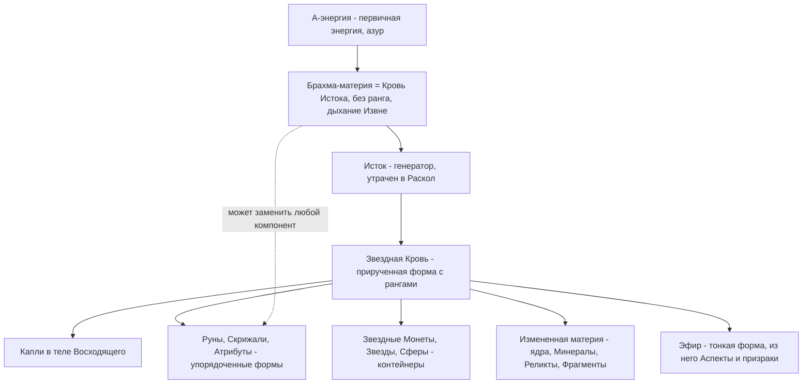
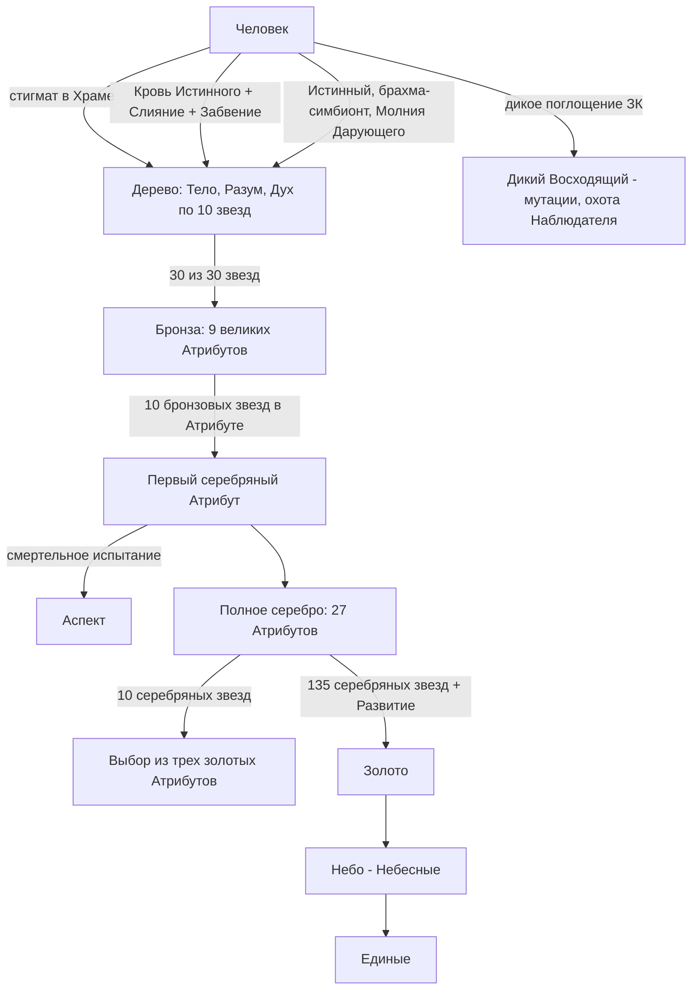
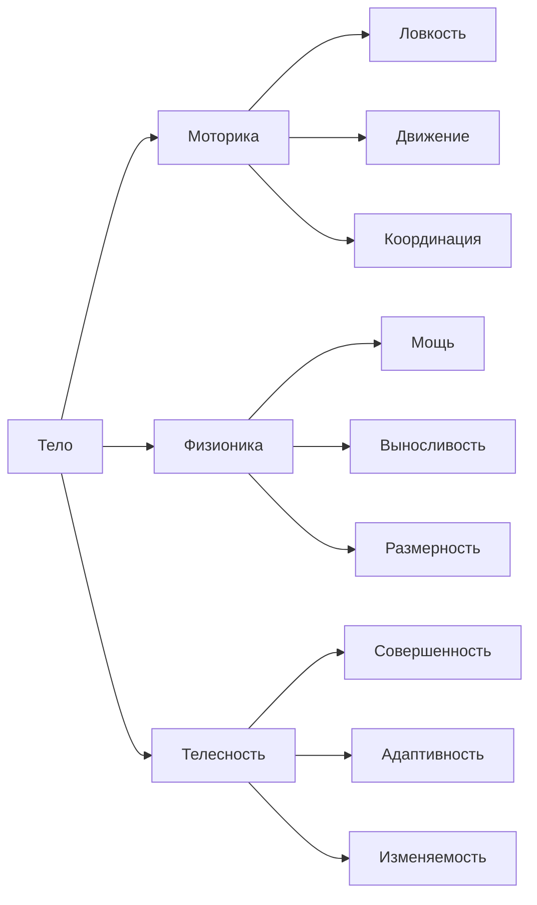
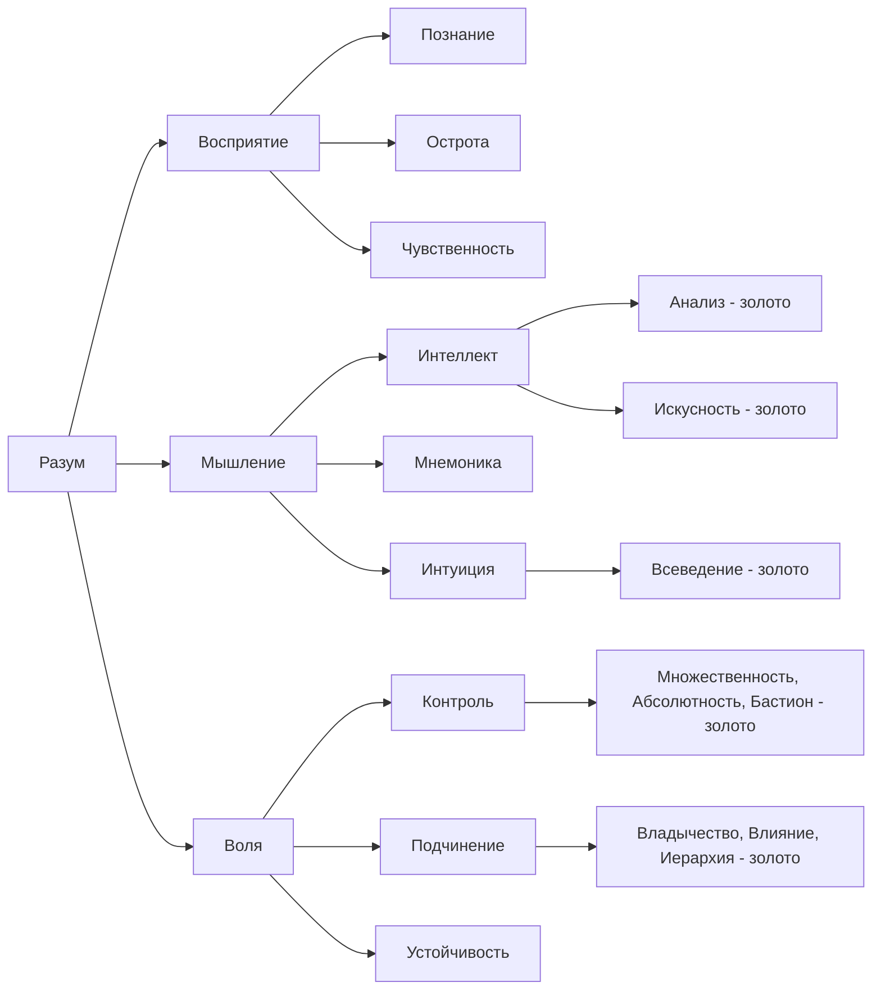
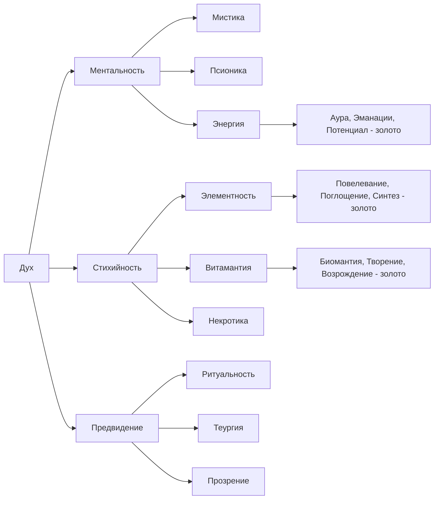
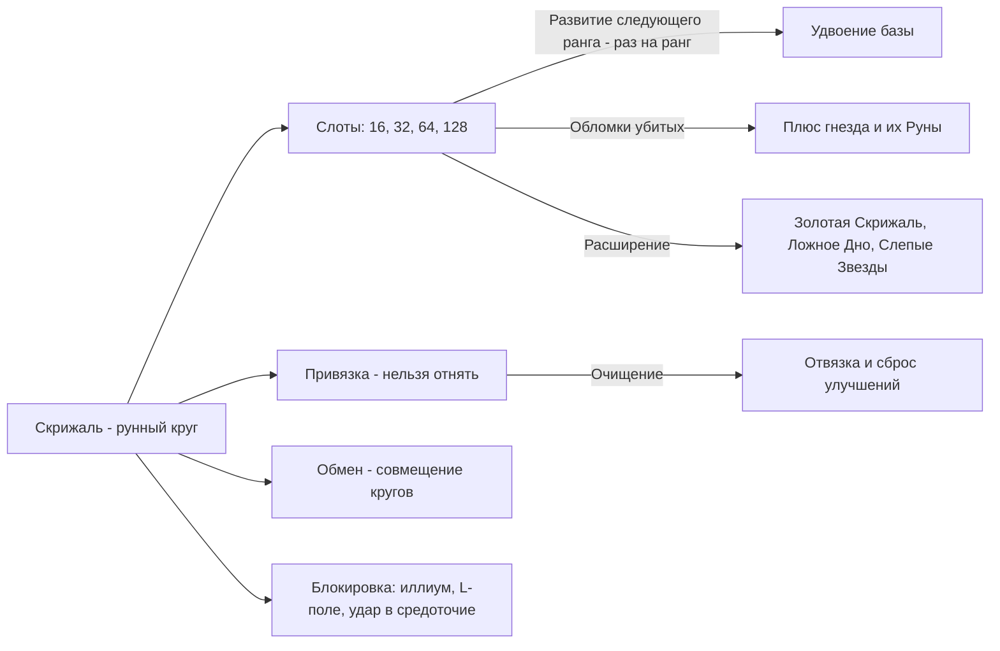
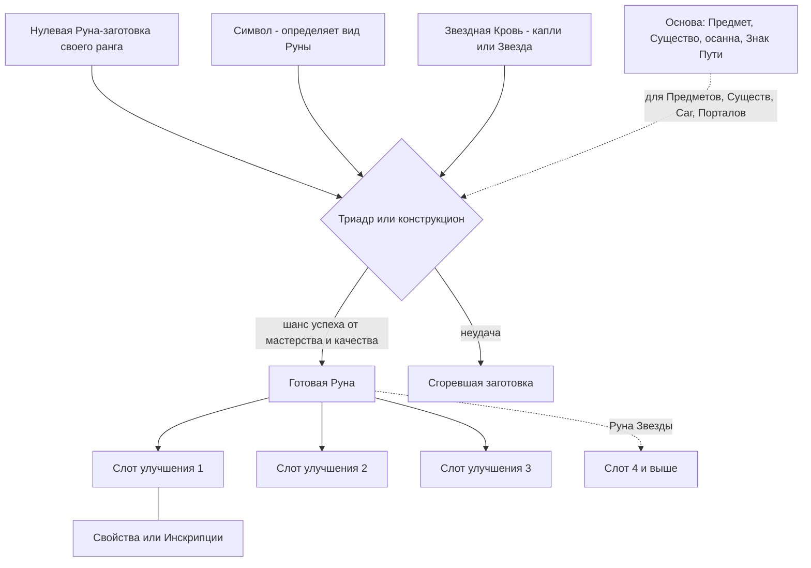
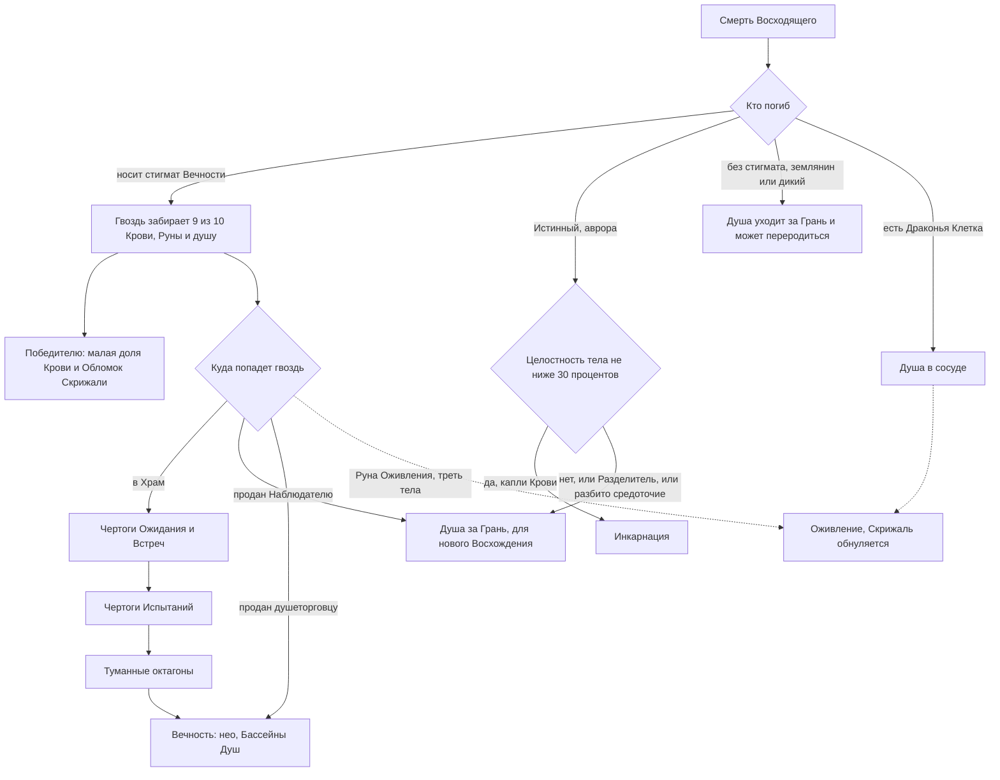
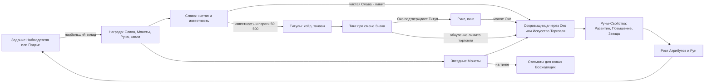

# 02. Механика мира: система Восхождения

> Справочник правил вселенной «Звездная Кровь» (ЗК-1…ЗК-11) и «Тысяча Братьев» (ТБ-1…ТБ-5). Задача — чтобы автор новой книги не нарушил канон.
> Формат ссылок: `(ЗК-3, гл. 12)`. Догадки помечены *(предположение)*. Где книги расходятся, это указано явно, и сказано, какой источник новее. Порядок «свежести»: ЗК-1 → ЗК-6 → ТБ-1 и ЗК-7 идут параллельно → … → ЗК-11 и ТБ-5 (последние).
> Важно: в ЗК-1–ЗК-6 многое объясняет «голос» — Белый Дьявол (он же Пламени Подобный / Дарующий Молнии), который живёт в теле Сигурда. Он пристрастен: например, к Вечности и стигматам. Поздние книги часть его слов подтверждают, часть уточняют.

## Оглавление
1. [Обзор: Восхождение, Звездная Кровь, А-энергия, брахма](#1-обзор)
2. [Звездная Кровь: запас, регенерация, расход, смерть](#2-звездная-кровь)
3. [Ранги Восхождения](#3-ранги)
4. [Атрибуты (полное дерево)](#4-атрибуты)
5. [Скрижаль и Атлас](#5-скрижаль-и-атлас)
6. [Руны: типы, карточка, Свойства, улучшения](#6-руны)
7. [Рунное Мастерство, Артефакция, Инженерия](#7-рунное-мастерство)
8. [Навыки и Умения](#8-навыки-и-умения)
9. [Аспект](#9-аспект)
10. [Стигмат и жизнь без него](#10-стигмат)
11. [Смерть и воскрешение](#11-смерть-и-воскрешение)
12. [Наблюдатель Единства](#12-наблюдатель-единства)
13. [Социальная механика: Слава, Монеты, Титулы, Клятвы, тинг](#13-социальная-механика)
14. [Перемещения: Порталы, Домены, Дороги, Стрелы](#14-перемещения)
15. [Время и календарь](#15-время-и-календарь)
16. [Земные технологии и Руны](#16-земные-технологии)
17. [Сводные таблицы-справочники](#17-сводные-таблицы)
19. [Неясности и противоречия канона](#19-неясности-и-противоречия)

---

## 1. Обзор

### 1.1. Что такое Восхождение
**Восхождение** — встроенная в мир-сферу Единство система развития разумных и зверей. Её основа — **Звездная Кровь** (ЗК). Восходящий поглощает Кровь, копит её и тратит на Руны. Он развивает **Атрибуты** (звёзды по шкале 10), открывает **Навыки** и поднимается по **рангам**: дерево → бронза → серебро → золото → небо (Небесные) → Единые (ЗК-1, гл. 14–15; ТБ-2, гл. 16; ТБ-5, гл. 11).

Интерфейс Восходящего состоит из трёх панелей (ЗК-1, гл. 8):
- **Скрижаль** — рунный круг, хранилище Рун;
- **Атрибуты** со спиралью капель ЗК, Славой и Навыками;
- **Атлас** — Титулы, Клятвы, Прорывы, Карты, Приказы (задания), Восхождение, Хроники.

Говоря языком Кел, Восхождение задумывалось как путь к **Возвышению**: поколения Кел шли по нему, чтобы «стать в один ряд с Истинными». Лучшие за «три оборота галактики» стали **Едиными** (ЗК-1, гл. 17, голос). Итоговая формулировка из поздних книг: «Выше неба стоят Единые… Те, кто прошёл путь Восхождения до конца, становятся Едиными, и это единственная дорога к бессмертию, которая не лжёт» (ТБ-5, гл. 11).

Восхождение не нейтрально. Вечность его исказила, и «мало кто может взойти даже на золотую ступень» (ЗК-11, гл. 17, Пламени Подобный). Единство платит Вечности «дань Звездной Кровью и душами» (ЗК-11, гл. 17, Кейнор). У Восхождения нет демократии: «Восхождение — это не демократия» (ЗК-9, гл. 3). Цена силы личная: «каждый Восходящий что-то теряет, обретая силу» — например, Кондор потерял эмоции ради золотых Атрибутов Разума (ЗК-11, гл. 10).

### 1.2. Звездная Кровь, капли, А-энергия, Азур, брахма — эволюция понимания
| Книга | Трактовка ЗК | Кто говорит |
|---|---|---|
| ЗК-1, гл. 13 | Субстанция в особых Зверях, Травах, Предметах, Минералах. Восходящие её «чуют, собирают и используют для Рун и Навыков» | Грай |
| ЗК-1, гл. 14 | «Звездная Кровь способна на все… сотворить воду из воздуха и меч из камня, материализовать мысль…» | голос |
| ЗК-1, гл. 23 | «Энергетическая субстанция с невероятно гибким кодом», «А-природы», упакована «в виде адаптивных контейнеров — Капель, Скрижалей, Рун, Атрибутов» | Матиас (учёный) |
| ЗК-1, гл. 23; ЗК-2, гл. 9, 15 | По легенде её дал Тот-Кто-Искусен (Искуснейший): пожертвовал собой и «рассеял свою Кровь в Единстве» против Червей | легенда / голос |
| ЗК-4, гл. 1 | «А-энергия — это как бы строительный материал вселенной… Звездная Кровь создана на основе А-энергии, все Руны, Скрижали, Предметы — суть её упорядоченные формы». Неупорядоченная форма — **Азур** | Минос |
| ЗК-5, инт. «Аврора» | ЗК — «один из вариантов энергетического состояния брахма-материи, идеально приспособленный для взаимодействия с человеческим организмом» | Аврора Мартинс |
| ЗК-6, гл. 6 | Руны — «оболочка кода», которая заставляет ЗК принять форму | голос |
| ЗК-8, гл. 6 | Аналогия: А-энергия — основа; Кровь — «вода»; Минералы, Реликты, Фрагменты — «лёд»; Эфир — «пар» | Минос |
| ЗК-8, гл. 18; ЗК-10, гл. 3 | **Кровь Истока = брахма-материя** землян (контейнеры проекта «Аврора»). Это «субстрат предреальности» без ранга, способный заменить любой рунный компонент | Скай, Мартинс, Азимандия |
| ЗК-11, гл. 17; ТБ-4, гл. 17 | «Звездная Кровь — переплавленный и прирученный свет, Кровь Истока — живой чужеродный огонь». В Крови Истока — «дыхание Извне», и такой «костёр» внутри сферы стал бы маяком для Тварей Извне | Кейнор |
| ЗК-11, гл. 11, 17 | Гипотеза: Истоки стояли в Башнях октагонов как реакторы, «брахма-инжиниринг… материален и техногенен… может быть воссоздан» | Аврора *(научная гипотеза, не подтверждена)* |
| ТБ-3, гл. 17 | Кровь Истока — субстанция Первотворения, «из которой Искуснейший некогда выковал само Единство». Рангов не имеет | ПП, Эсмерра |

**Итоговая картина** (последние книги — ЗК-11, ТБ-4, ТБ-5):
1. Есть первичная **А-энергия** (у землян — А-физика, азур). Её высшая, «живая» форма — **брахма**, она же у Кел **Кровь Истока**. Она пришла «Извне» и не имеет ранга (ТБ-3, гл. 17; ЗК-11, гл. 17).
2. **Исток** — генератор бесконечной Крови. Его принесли предтечи Кел на ковчеге (ЗК-5, гл. 5; ЗК-6, пролог). Его уничтожили (Руной Забвения/Летос — ЗК-8, гл. 9), и с тех пор ЗК не пополняется, а мир медленно деградирует (ЗК-8, гл. 18; ЗК-10, пролог).
3. **Звездная Кровь** — «прирученная», ранжированная форма этой силы. Она «встроена» в Восхождение: каждая капля несёт его паттерны и связана «тахионной сетью», маяки которой — Башни и аванпосты Наблюдателя (ЗК-11, гл. 16, Аврора). Капля, покинувшая тело не-Истинного, «становится частью Восхождения» и обнуляется (ТБ-4, гл. 17).
4. **Земляне** принесли брахму и, вероятно, способны создать новый Исток (ЗК-8, гл. 9, 18; ЗК-11, гл. 5, 8). Поэтому за ними и за брахмой охотятся Хранители Вечности и Дома.



---

## 2. Звездная Кровь

### 2.1. Где она есть и как её получить
- ЗК есть «в Зверях, Травах, Предметах, Минералах, но не всех подряд, а в особых, самых сильных». Интерфейс помечает любое существо: «Содержит / Не содержит Звездную Кровь» (ЗК-1, гл. 7–8, 13). Носители ЗК внешне необычны и «на порядок крепче» (ЗК-1, гл. 9, 19).
- Когда носитель умирает, над телом появляется жемчужно-звёздный глиф-«капля», его забирают касанием (ЗК-1, гл. 7, 9, 11). У существ без Скрижали суть при гибели «спекается в Руну» (обычно одну, редко две-три); Наблюдатель выбирает свойство, которое ярче всего горело в побеждённом (ТБ-5, гл. 3).
- Другие источники: Травы, Минералы, Фрагменты (части крупных существ), Реликты (обломки древних артефактов), сущностные ядра, пилюли и эликсиры (ЗК-2, гл. 1; ЗК-3, гл. 19; ЗК-7, гл. 7). Ядра Червей можно «выпить» (ТБ-2, гл. 4).
- **Распыление Рун и Монет.** Ненужную Руну или Звездную Монету можно «сломать» и получить ЗК (ЗК-3, гл. 7). С Монеты выходит 1–3 капли (ЗК-2, гл. 23). С Руны на серебряном Рунном Искусстве — 7–20 капель, «коэффициент извлечения» растёт с мастерством (ЗК-5, гл. 16). Без Навыка много осечек (ЗК-2, гл. 20).
- **Выкачивание из материи.** Рунная Артефакция и Контроль Крови вытягивают ЗК из изменённой материи: 15 капель из «мусора», 42 из золотого осколка Алтаря (ЗК-6, гл. 19); ~20 капель из Реликта (ЗК-10, гл. 6). Ядра при этом рассыпаются в пыль, Предметы пустеют (ТБ-1, гл. 4, 8). В ЗК-11 Сигурд купил руду на 100 Монет и выкачал из неё >1500 капель: «дешевле купить руду и высосать», чем покупать Кровь (ЗК-11, гл. 19).
- **Убийство Восходящих** — «быстрый способ набрать ЗК» (ЗК-3, гл. 5). Но с Восходящего, носящего стигмат, падает лишь малая часть (см. §2.6).
- **Перезарядка Наблюдателем.** Он может восполнить запас Восходящего даже в зоне блокировки, это бывает наградой (ЗК-3, гл. 8). Небесные Восходящие умеют мгновенно восполнять чужую Кровь и перезаряжать Руны (ЗК-8, гл. 13, 20).
- **Храмы Хранителей в Вечности:** статуя Хитрейшего за 1 Монету восполняет ЗК (ЗК-9, гл. 12). Подношение в Храме Сестры Солнца даёт полное восстановление и бафф Атрибутов Духа на «1 солнечный день» (ЗК-5, гл. 9).
- **Тингвеллир** излучает А-энергию, рядом Кровь восстанавливается быстрее (ЗК-6, гл. 20).

### 2.2. Максимум запаса
- У запаса есть **текущее/максимум** (например, «33/46»). Максимум растёт при поглощении капель и **падает при безвозвратных тратах**: имплантация Навыков, крафт, ремонт Рун, Руны с пометкой «безвозвратно» (ЗК-1, гл. 14; ЗК-2, гл. 15–23; ЗК-5, гл. 3).
- Особые средства поднимают максимум навсегда: духовный чай Народа Трав дал +2 (ЗК-7, гл. 14).
- Ориентиры: «средний запас Восходящего» — около 100 капель (ЗК-7, гл. 8). Сигурд на бронзе — 400–500. На серебре — 1–2 тыс. (ЗК-5–ЗК-7), позже 2,2–5 тыс. (ЗК-9, гл. 2; ЗК-10, гл. 10, 19). «Могущественные кел на этом этапе обычно вели счёт в Звездах» (по 24 капли), цель Белого Дьявола — минимум тысяча Звезд (ТБ-2, гл. 1). У фактотума Вечности — «огромный запас» (ТБ-5, гл. 15).
- Числа максимума у Сигурда в ЗК-4 скачут (418 → 486 → 447 → 441), автор здесь непоследователен (см. §19).
- «Восходящий может быть сколь угодно силён, но он беспомощен, как котёнок, если исчерпал свою Звездную Кровь» (ЗК-4, гл. 17). «В конечном счёте важна только Звездная Кровь» (ТБ-5, гл. 11).
- Небо можно измотать, потому что небесные Руны едят огромные объёмы Крови. Так когда-то победили Белого Дьявола (ЗК-8, гл. 20–22).

### 2.3. Регенерация
Базовое правило интерфейса: «Таймер перезарядки: капля / малый цикл», то есть **одна капля в местные сутки** (ЗК-1, гл. 8–9). Скорость растёт в основном от ветки **Духа** (Ментальность), а позже — от всех трёх ветвей.

| Состояние | Скорость | Источник |
|---|---|---|
| Новичок-дерево | 1 капля / древодень (~25 ч) | ЗК-1, гл. 9 |
| Дух 4 | ~1 капля / 17 ч; каждая звезда Духа ≈ +10 % *(наблюдение Сигурда)* | ЗК-2, гл. 7 |
| Обещание голоса | «Когда ты достигнешь бронзы Духа, за древодень будут восстанавливаться три капли» | ЗК-2, гл. 7 |
| Бронзовая Ментальность | почти втрое быстрее, капля < 10 ч | ЗК-2, гл. 21 |
| Дух 10 + Ментальность 1★ | 8 ч 42 мин на каплю | ЗК-3, гл. 2 |
| Серебряная Ментальность | ~2,5 капли/ч, 66 в сутки | ЗК-4, гл. 21–22; ЗК-5, гл. 1 |
| Полное серебро всех Атрибутов | ещё примерно втрое быстрее | ЗК-6, гл. 19 |
| Серебро + Предметы + медитации | >2500 капель в сутки | ЗК-8, гл. 19 |
| Высокие ранги | тратят и восстанавливают тысячи капель в день | ЗК-4, гл. 17 |

- Три пути восстановления: **Дух** (Ментальность и медитации), **Разум** (Воля и Навыки Восприятия), **Тело** (Физионика и упражнения). Если совместить все три, к серебру можно восстанавливать «больше сотни капель за древодень» (ТБ-1, гл. 2).
- **Медитации.** «Ступень» и позы-«нары» гоняют ЗК по малому кольцу; «эо» — энергетический рисунок; средоточие видится звездой в солнечном сплетении. Медитация ускоряет регенерацию и качает Аутотренинг (ЗК-2, гл. 20; ЗК-3, гл. 2). Третий «нар» даёт +6 капель за сеанс на бронзе (ЗК-5, гл. 5). Для слабого эо медитация опасна (ЗК-2, гл. 20).
- **Ускорители:** пилюли Говорящей (розовая +6, голубая +10, удваивают регенерацию), пилюли Клыка (утраивают, ~20 ч), эликсир из Трав и ядер (почти ×2), Руны Энергии (~+100 капель мгновенно) (ЗК-3, гл. 5; ЗК-4, гл. 11, 17, 21; ЗК-7, гл. 19).
- **Звезда Искателя:** ×10 к восстановлению на древодень, 3 заряда (ЗК-2, гл. 21; ЗК-5, гл. 4–5; ТБ-1, гл. 11). **Серебряный Фиал:** +1000 капель раз в древодень, после улучшений — за пол-древодня (ЗК-8, гл. 17; ЗК-9, гл. 2). «Голубой Родник» Эйрика полностью восполняет запас (ЗК-7, гл. 12).
- **Ранговое ограничение:** зелья и Предметы регенерации в полную силу работают только на своём ранге. Бронзовая Звезда Искателя почти бесполезна серебряному (ЗК-5, гл. 3).
- **Утрата стигмата** повреждает эо и резко замедляет восстановление. У Белого Дьявола в теле Марка было «6 капель/день» (ТБ-1, гл. 1, 8).

### 2.4. Расход
- **Активация Рун.** Стоимость указана в карточке, по рангу она примерно удваивается: Умения дешевле, Заклинания «примерно вдвое» дороже, потому что «создают эффект из ничего» (ЗК-1, гл. 14; ЗК-2, гл. 16). Таблица — в §17.1.
- **Безвозвратные траты:** имплантация Руны-Навыка (6–12 капель на дереве/бронзе), Рунное Мастерство (12 капель), крафт и ремонт, Счастливая Монета (120), Руна Оживления (480), Холодное Пламя ПП (48), Навык «Перезарядка» (двойная цена), «Нерожденная Звезда» (ЗК-1, гл. 14; ЗК-2, гл. 21; ЗК-8, гл. 18; ЗК-9, гл. 2; ЗК-11, гл. 13; ТБ-2, гл. 1).
- **Передача.** Кровь передают через Звезды и Сферы (ЗК-3, гл. 19; ТБ-5, гл. 11). Восполнить чужой запас «на лету» могут только небесные мастера и Навык «Звёздный Исток» ветки Эманаций (ТБ-2, гл. 20).
- **Аспект** при вызове забирает 100 капель в собственный запас. Остаток при отзыве возвращается (ЗК-5, гл. 4–5).

### 2.5. Контейнеры и «сферы ЗК»
| Контейнер | Ёмкость | Источник |
|---|---|---|
| Капля | 1 | — |
| Малая Звезда (дерево) | 3 | ЗК-3, гл. 19 |
| Звезда (бронза) / «средняя» | 6 (ЗК-3, ЗК-5) — **или 12** (ЗК-7) | см. §19 |
| Большая Звезда (серебро) | 24 | ЗК-3, гл. 19; ТБ-2, гл. 1 |
| Звездная Сфера | ≈300 | ЗК-10, гл. 18, 20; ТБ-5, гл. 11 («30 сфер = 9000 капель») |
| Люкс-накопитель стигиса | 300 000 (1000 Сфер) | ЗК-10, гл. 18; ЗК-11, гл. 21 |
| Серебряный Фиал | заряды по 1000 | ТБ-1, гл. 8 |
| «Светляк» (люкс Заова) | 1 капля в лиоровой монете | ЗК-10, гл. 21 |

Звезды создают Навыком «Контроль Звездной Крови». Их ломают без потерь, ими же Кровь передают между Восходящими (ЗК-3, гл. 19).

### 2.6. ЗК при смерти: доли
- При смерти Восходящего со стигматом «выплёскивается ~1/10 ЗК». Над телом остаются последние использованные Руны и ключевые Навыки, в **Обломке Скрижали** — материальные Руны (Существа, Предметы) и случайная часть арсенала. Остальное аккумулирует стигмат и уносит «в загробный мир» (ЗК-3, гл. 5).
- Итоговое правило: **«гвоздь забирает девять десятых»** того, что могло бы упасть с убитого (ТБ-5, гл. 15). «Победитель Восходящего получает лишь малую часть его Крови, большую удерживает стигмат для Вечности» (ЗК-2, гл. 9).
- Раздел Рун: «большая часть его Рун остаётся в обломках Скрижали. Если погибший носит гвоздь… стигмат забирает все обломки… кроме того, что достаётся победителю, и тех, что пополняют сокровищницу Наблюдателя» (ТБ-2, гл. 1). У младшего Восходящего один Осколок достаётся победителю, остальное хранит гвоздь (ЗК-5, гл. 11). В Обломках «по воле Наблюдателя, спорящего с жадной Вечностью» остаются Монеты, Хранилища, Предметы, Существа и Саги (ТБ-1, гл. 6).
- Без стигмата (Гай Флоу, ЗК-1, гл. 11) с тела выпало сразу 46 капель и полноценный Обломок.
- **Истинный при окончательной смерти теряет всё** (шесть обломков Скрижали Орина — ТБ-2, гл. 1).
- Солдаты Гармонии клеймены **Посмертным Растворением**: тело, Скрижаль и Предметы исчезают, остаются пустышки, Кровь и стигматы (ТБ-2, гл. 11–12). Руна «Растворение» обнуляет выпадающие Руны или позволяет «сбежать через смерть» (ЗК-5, гл. 13, 16).
- Если хозяин погиб, а время вызова Руны-Существа истекло, Существо становится Руной на месте и достаётся нашедшему (ТБ-1, гл. 15). Существо, привязанное к Скрижали погибшего, забирает Наблюдатель (ТБ-5, гл. 17). Руны погибшего может «втянуть» ближайший Восходящий (ТБ-5, гл. 9).
- Капля ЗК может тысячи циклов сохраняться в останках, если её удерживает артефакт (ЗК-4, гл. 20). Так Брат держится в мёртвом теле на алтаре из морлоида (ТБ-5, гл. 18).

### 2.7. Отнятие ЗК
- «Отнимать ЗК у живого (или у своей Руны) — тягчайшее из оскорблений… когда-то это сделали со мной, оставив всего одну каплю!» (ЗК-3, гл. 19, голос).
- Из Руны-Существа нельзя забрать её ЗК (ЗК-3, гл. 18–19). Существа, выросшие из Восходящих, сами собирают Кровь и Руны, и отнять собранное нельзя (ЗК-5, гл. 13–14).
- Навык «Поглощение Энергии»: на 1-й звезде работает только при контакте и против слабых, на 10-й — «Вампиризм на расстоянии» *(прогноз Скай)*. Белый Дьявол считал это «бесчестием» (ЗК-10, гл. 8).
- Приговор Ордена Истинных включает «Извлечение Звездной Крови до стандартного запаса» (ТБ-4, интерлюдия «Брешь»).

---

## 3. Ранги

### 3.1. Шкала и цвета
| Ранг | Другие названия | Цвет фрейма/глифа | Суть (по ТБ-2, гл. 16) |
|---|---|---|---|
| **Дерево** | «обычное», «мусор», «грязь», «мусорная стадия» | зеленоватый | «мусор» |
| **Бронза** | — | тёмный металл | «равна или чуть сильнее обычного человека» |
| **Серебро** | — | светлый, «белоснежный» металл | «выводит Восходящего за пределы того, что доступно любому разумному» |
| **Золото** | — | сияющий/яркий золотой | «позволяет дотянуться до полубога» |
| **Небо** | Небесные, «небесный ранг» | пронзительно-синий, лазурь | «последняя ступень перед Едиными»: «может кроить материю, пространство и время, разрушая или созидая целые октагоны» |
| **Единые** | — | — | боги: «Выше неба стоят Единые» (ТБ-5, гл. 11) |

Источники цветов: ЗК-2, гл. 4, 15; ЗК-8, гл. 11 («зеленоватое дерево, темная бронза, белоснежное серебро, сияющее золото и пронзительно-синее небо»); ТБ-1, гл. 9, 15. Особые цвета: Проклятые Руны — «шевелящаяся чернота», качество «мерзость»; драконьи — алые/багровые; жемчужный — капля ЗК (ЗК-1, гл. 7; ЗК-5, гл. 16; ТБ-1, гл. 9).

- Ранг существа виден по цвету его фрейма (ЗК-2, гл. 4). Тускло-жёлтый фрейм означает «по крайней мере одну золотую способность» (ЗК-7, гл. 18). У Временной Петли фрейм был «смешанный мигающий» (ЗК-7, гл. 17).
- Небесного ранга касаются «единицы из миллиардов», «от человека в нём остаётся немногое» (ТБ-2, гл. 16). Небо существует и у тварей: Великий Червь «отливал голубизной неба» (ЗК-7, гл. 12). Великие Древа «достигают небесного ранга» (ЗК-7, гл. 22).

### 3.2. Числовые соотношения
- **«Одна бронза — десять дерева. Одно серебро — десять бронзы»** (ЗК-1, гл. 14). Отсюда и правило разбиения Рун: одна высшая → 10 низших (§6.9).
- Атрибуты дерева развивают Рунами дерева. Тратить бронзу на дерево — «рубить хворост боевым топором» (ЗК-1, гл. 14).
- **Иерархия силы:** «как бронза не может одолеть серебро, так и серебро бессильно перед золотом» (ТБ-1, гл. 9); «серебро можно убить только серебром» (ТБ-1, гл. 13); «противостоять золоту (как и повредить ему) может только золото» (ЗК-7, гл. 18; ТБ-4, гл. 4); «Только небо может остановить небо» (ТБ-5, гл. 5). Против золота «бессильны бронза и слабое серебро», нужны «оружие из твёрдого света или пространственные уничтожители» (ЗК-4, гл. 23).
- **Пропасть золото — небо:** «между золотом и небом — пропасть… против золота выстоит только золото!» (ЗК-5, гл. 2). Небесные Атрибуты «несоизмеримы даже с золотыми» (ТБ-4, гл. 5). Золотые Руны небу почти не вредят (ТБ-5, гл. 15, 20). Даже «маска Хранителя (жалкая подделка)» — небо, перед которым золото бессильно (ТБ-2, гл. 21).
- **Небесные Руны** оставляют раны в Единстве, которые заживают тысячи циклов (ТБ-5, гл. 20). Наблюдатель «гневается» на пробои реальности небесными Рунами (ТБ-2, гл. 2).

### 3.3. Как открывается следующий ранг
| Переход | Условие | Источник |
|---|---|---|
| Человек → дерево | Стигмат в Храме, или инициация иным путём (§10), или дикое поглощение ЗК | ЗК-1, гл. 8; ЗК-4, гл. 1 |
| Дерево → бронза | **10 звёзд в каждом из трёх начальных Атрибутов** (Тело, Разум, Дух). Каждый «распадается на три бронзовых» — «девять великих бронзовых Атрибутов» | ЗК-1, гл. 15; ЗК-2, гл. 21 |
| Бронза → серебро | 10 бронзовых звёзд в Атрибуте открывают его три серебряных. «Полное серебро» — все 9 бронзовых на 10/10 (Сигурду не хватало 36 бронзовых звёзд, серебряное Развитие = 10 бронзовых звёзд) | ЗК-1, гл. 15; ЗК-6, гл. 19 |
| Серебро → золото | **135 серебряных звёзд** в Атрибутах — «пограничная черта». Ещё одно Развитие сверх неё — и «плащ Восхождения» становится золотым | ТБ-5, гл. 11 |
| Золото → небо | Механика не раскрыта. Небесные Подвиги дают Руны неба (ЗК-7, гл. 12) | — |

- Внутри атрибута на 10 серебряных звёздах открывается выбор из **трёх золотых потоков** (ТБ-3, гл. 3, 11) — см. §4.
- **Золото без золотого ранга.** Можно иметь отдельные золотые Атрибуты и Навыки, оставаясь серебром. У Сигурда были Анализ и Искусность при серебряном фрейме (ЗК-9–ЗК-11). У ПП — 52 серебряные + 2 золотые звезды при «слабом серебре» (ТБ-3, гл. 12).
- **«Древний трюк» повторно восходящих:** держать себя на грани (134–135 звёзд) и перейти в нужный момент (ТБ-5, гл. 14).
- Повторно восходящих Восхождение оценивает «согласно звездам его тела», а не духа: «кожа карлика не растянется, если в него вселится дух великана» (ТБ-1, гл. 1). Старые Навыки духа «прорастают» в новое тело только через испытания (ТБ-1, гл. 4).

### 3.4. «Перфектность», «слабое/сильное» внутри ранга
- **Перфектное дерево** — 10/10/10 по Телу/Разуму/Духу. Сразу после этого голос называет Сигурда «слабой бронзой» (ЗК-3, гл. 1). У Миноса формулировка «сильное дерево / слабая бронза» (ЗК-4).
- **Слабое серебро** — серебряный фрейм и мало серебряных звёзд (ЗК-5: 5 из 9 базовых на 10/10). **Сильное серебро** — близко к 135, по ПП «до сильного серебра оставалось… смешать Мощь со Скоростью» (ТБ-3, гл. 12). «Серебро бывает разное. Чуть сильнее бронзы — и почти достигшее золота» (ЗК-7, гл. 3). Эйрик: 27 Атрибутов — 270 серебряных звёзд, а «если развивать что-то одно, не переступая золотой порог, — это девяносто звезд». У Эйрика 32, у Винсента ~50, у Вероники 14, у Сигурда тогда 2 (ЗК-7, гл. 3).
- «Бронза всегда лучше дерева, а сильная бронза почти равна серебру» (ЗК-4, гл. 22).
- **Подуровни (терминология Скай):** «серебро-пять», «золото-4», «золото-8», «за пределами золота-10», «небо-три», «небо-один-три» (ЗК-8). Это *оценочная* шкала когитора, а не системный интерфейс.
- **Класс Восходящего** определяется ещё и тем, сколькими Рунами одновременно он управляет (ТБ-5, гл. 14). Сигурд не может управлять больше чем двумя Существами сразу (ЗК-10, гл. 14).

### 3.5. Типичные стартовые ранги и демография
- Новые Восходящие обычно «дерево» (Атрибуты Инь 4-7-4, Грай 6-3-3 по Телу/Разуму/Духу). Авторитетный человек может сразу получить бронзу и Титул (ЗК-6, интерлюдия). Стигмат «с высокой базой» даёт ранг выше неофита (ЗК-4, гл. 1).
- Дети сильных Восходящих рождаются с толикой ЗК. Если их готовят звёздными Травами, они вступают сразу на бронзу (ЗК-9, гл. 10). Народы кормят детей мясом звёздных тварей, чтобы вырастить Восходящих; закалка с детства превращает Руны-Умения в телесные свойства (ТБ-1, гл. 1, 4; ЗК-4, интерлюдия).
- «Дерево легко сменить на бронзу… Но серебро — ступень, которую перешагнет не каждый». Искуснейший «пролил свою Кровь неравномерно», поэтому есть Круги, богатые и бедные на серебро (ТБ-3, гл. 1). Источники роста на серебре и золоте: Порталы, чужие Домены, походы во тьму, небесные острова, Арены (ТБ-3, гл. 1).
- Учёные фригольда считали серебро «за пределами возможностей человеческого организма» (ЗК-6, интерлюдия). Позже это опровергнуто.
- Сроки: Иниэсс шла к золоту сто циклов (ТБ-4, гл. 10). Восходящие сохраняют молодость — Веронике за 50 (ЗК-4).

### 3.6. Ранг тварей
Звери тоже Восходят: поедают Травы с ЗК и растут до бронзы и выше (ЗК-2, гл. 5).
- **Дерево** — «просто гораздо сильнее обычных».
- **Бронза** — «одна, может, две особенности»: огненное дыхание, громовой крик и т. п.
- **Серебро** — «обычным оружием… не возьмешь. Может положить целый отряд» (ЗК-1, гл. 15, 20).

В центре груди у тварей «ядро» — сущностное ядро (ЗК-1, гл. 21; ЗК-3, гл. 4). Слишком сильное существо, «преодолевшее дозволенный рубеж», Наблюдатель объявляет угрозой (ТБ-1, гл. 7).



---

## 4. Атрибуты

### 4.1. Общие правила
- **Атрибут** — «показатель развития… относительно первого предела Восхождения». У каждого 10 делений-«звёзд» (ЗК-1, гл. 8, 15).
- Атрибуты поднимают **Рунами Развития своего ранга**: деревянные Малые → дерево, бронзовые → бронза, серебряные (Большие) → серебро, золотые (Великие) → золото (ЗК-1, гл. 14; ЗК-2, гл. 16, 21). Эффект мгновенный и физический: эйфория, рост мышц (ЗК-1, гл. 9, 19). Система перестраивает тело по антропометрическому типу (ЗК-6, гл. 19). При вложениях внешность меняется («анимафикация»): у Сигурда стали угловатее черты, глаза стальными, рост +2 см (ЗК-11, гл. 12).
- **Ветвление по три.** Начальный Атрибут на 10★ распадается на три бронзовых, бронзовый на 10★ — на три серебряных, серебряный на 10★ — на выбор из трёх золотых (ЗК-2, гл. 21; ЗК-4, гл. 21; ТБ-3, гл. 3, 11). Итог: 3 → 9 → 27 → 81 *(расчёт по правилу)*. Эйрик говорит, что серебряных Атрибутов «на самом деле больше» 27 (ЗК-7, гл. 3).
- На серебре **золотой поток выбирают**: из трёх открывается один (Витамантия → выбрано Возрождение, ТБ-3, гл. 3). Пробуждение золотого Атрибута даёт первый золотой Навык (ТБ-3, гл. 11).
- **Правило Белого Дьявола:** до серебра важны все Атрибуты, все бронзовые надо довести до серебра — «это база, а с серебра начинается специализация» (ЗК-5, гл. 3, 17; ЗК-8, гл. 2).
- **Звёзды и Навыки.** На дереве звёзды лишь пробуждают дремлющие Навыки, «почти каждая бронзовая звезда открывает новые навыки». Набор индивидуален, хотя часто совпадает (ЗК-2, гл. 7, 21; ЗК-3, гл. 2, 5). На последних звёздах Атрибута лежат самые ценные способности *(мнение Скай, ЗК-10, гл. 20)*. Правило, какие Навыки открываются на серебре, не выявлено (ЗК-7, гл. 17).
- **Синергия.** Умения дают «лишь столько усиления, сколько готово впитать Тело» (ЗК-2, гл. 6). Навыки бессмысленно развивать намного выше Атрибутов: «невозможно поднять вес… если не хватает необходимых мышц» (ЗК-8, гл. 16). Золотые Умения в полную силу работают только у золотого Восходящего (ЗК-10, гл. 14).
- **Взаимоисключения.** Золотая Кровь закрывает Некротику, «ибо частицы игг-крови не терпят темных энергий» (ТБ-3, гл. 12). Золотые Атрибуты ветки Подчинения опасны: владелец «навсегда терял способность к равноправным отношениям» (ТБ-3, гл. 11).
- **Атрибуты не переносятся между отражениями** (Единство ↔ Вечность). Без синхронизации Навыки «выцветают» (ЗК-5, гл. 15; ЗК-9, гл. 11).

### 4.2. Полное дерево Атрибутов, известных по книгам

| Начальный (дерево) | Бронзовый (9) | Серебряные (27) | Известные золотые (выбор из трёх) |
|---|---|---|---|
| **Тело** | **Моторика** — реакция, рефлексы, координация (ЗК-3, гл. 1, 5) | Ловкость, Движение, Координация (ЗК-5, гл. 3) | — |
| | **Физионика** — общая кондиция, меняет структуру тела, «в несколько раз» увеличивает силу (ЗК-3, гл. 5; ЗК-6, гл. 19) | Мощь, Выносливость, Размерность (ЗК-6, гл. 19) | — |
| | **Телесность** — структура и сопротивляемость тела (ЗК-3, гл. 5) | Совершенность, Адаптивность, Изменяемость (ЗК-5, гл. 3) | — |
| **Разум** | **Восприятие** (ЗК-3, гл. 2) | Познание, Острота, Чувственность (ЗК-5, гл. 10) | — |
| | **Мышление** — логика, память, обучение (ЗК-3, гл. 2) | Интеллект, Мнемоника, Интуиция (ЗК-6, гл. 19) | Интеллект → **Анализ**, **Искусность** (+ 3-й не назван) (ЗК-9, гл. 16; ЗК-10, гл. 17; ТБ-4, гл. 1). Интуиция → **Всеведение** + 2 не названы (ТБ-4, гл. 1) |
| | **Воля** (ЗК-3, гл. 2) | Контроль, Подчинение, Устойчивость (ЗК-6, гл. 19) | Контроль → **Множественность**, **Абсолютность**, **Бастион** (ТБ-4, гл. 1). Подчинение → **Владычество**, **Влияние**, **Иерархия** (ТБ-3, гл. 11) |
| **Дух** | **Ментальность** — регенерация ЗК (ЗК-2, гл. 21) | Мистика, Псионика, Энергия (ЗК-4, гл. 21) | Энергия → **Аура**, **Эманации**, **Потенциал** (ЗК-10, гл. 20; ЗК-11, гл. 13) |
| | **Стихийность** (ЗК-2, гл. 21) | Элементность, Витамантия, Некротика (ЗК-5, гл. 3) | Витамантия → **Биомантия**, **Творение**, **Возрождение** (ТБ-3, гл. 3). Элементность → **Повелевание**, **Поглощение**, **Синтез** (ТБ-4, гл. 1) |
| | **Предвидение** (ЗК-3, гл. 2; ЗК-5, гл. 19) | Ритуальность, Теургия, Прозрение (ЗК-5, гл. 13 — у Морвены; ТБ-3, гл. 1) | — |

Вне таблицы:
- **Трансцендентность** — золотой Атрибут, «который часто выбирали адепты Незримого». Позволяет «видеть суть Восхождения, его незримой конструкции и ступеней, что вели к небу». Навык — «Взор-за-Грань» (ТБ-5, гл. 17). Ветка не названа: вероятно, Интуиция или Предвидение *(предположение)*.
- «Золотой Атрибут Поглощения» у ПП (ТБ-4, гл. 5) — из ветки Элементности.
- **Воображение** — упомянуто только в ЗК-2 (гл. 21) как серебряный/золотой Атрибут, нужный рунным мастерам («Воображения, Искусности и прочих»). Позже не встречается — ранний, неподтверждённый термин.
- «Скорость» (ТБ-3, гл. 12: «смешать Мощь со Скоростью») — скорее всего, разговорное обозначение Движения *(предположение)*.
- «Хрономантия» и «Грёзы» (ТБ-3) — области искусства (Хрономантию изучал Архитектор), а не подтверждённые Атрибуты.

### 4.3. Что даёт каждый Атрибут (известные Навыки)
**Тело**
- **Моторика** → бронзовые Навыки Амбидекстрия, Акробатика, Уклонение, Баланс, Меткость, Альпинизм, Ловкость Рук, Верховая Езда, Незаметность. На 10★ они сливаются в серебряное **Владение Телом** (ЗК-5, гл. 3). Серебро: Ловкость (Безупречная Точность, Молниеносность), Движение (Быстрый Бег, Рывок), Координация (Кинестетическая Память, Идеальный баланс) (ЗК-8, гл. 16; ЗК-9, гл. 6; ТБ-1, гл. 4).
- **Физионика** → общая сила. Серебро: Мощь («телесная сила, недоступная смертному»; Навык Несокрушимость, ТБ-1, гл. 11), Выносливость («адаптивная биоморфная оптимизация», запас прочности, защита от отката стимуляторов. Навыки: Второе Дыхание, Длинное Дыхание, Каменное Сердце — почти анабиоз, Закалка, Медленная Кровь, Звериный Сон, Серебряная Закалка, Сопротивление Перегрузкам — ЗК-8, гл. 19; ЗК-11, гл. 13–21), Размерность (рост вплоть до «карлика или гиганта» — ТБ-4, гл. 1; ЗК-8, гл. 8). Высокие Атрибуты Тела нейтрализуют алкоголь (ЗК-7, гл. 1).
- **Телесность** → серебряная **Телесная Крепость** (ЗК-5, гл. 3). Совершенность — красота и пропорции, Навык Гармония Форм (ТБ-1, гл. 11; ТБ-4, гл. 1). Адаптивность — стойкость к ядам, болезням, заражениям: Живая Иммунность, Активная Стабилизация. Она позволяет впитывать изменения, «оставаясь при этом человеком», и нужна для Золотой Крови (ЗК-11, гл. 21; ТБ-3, гл. 12). Изменяемость меняет тело необратимо: «те, кто Изменяется, — уже сами по себе монстры» (ЗК-8, гл. 5). Вместе с Совершенностью и Адаптивностью она «может превратить человека в иное существо» (ЗК-5, гл. 3).

**Разум**
- **Восприятие** → Мультисенсорика (серебряное слияние), Биосенсорика (ведущий Атрибут Восприятие). Серебро: Познание (Распознавание Обмана, спящая Криптография; «открывает путь к сокровищнице Наблюдателя» — нужно для Искусства Торговли, ТБ-2, гл. 1, 4; ЗК-5, гл. 10), Острота (Чуткое Ухо, Кровавое Чутьё/Нюх; на ней держатся «взломщики» Хранилищ — ТБ-3, гл. 11; ЗК-11, гл. 18), Чувственность.
- **Мышление** → Визуальное Исчисление (ЗК-4, гл. 1). Серебро: Интеллект — «способность усваивать, обрабатывать и использовать информацию» (Гиперкалькуляция, ЗК-7, гл. 17), Мнемоника (Печати Тайны и Забвения; держит память прошлых циклов, ТБ-1, гл. 15), Интуиция. Золото: **Анализ** (Стратагемы, Тень Врага), **Искусность** (Взор Создателя; без неё нельзя чинить золотые Руны — ЗК-8, гл. 16; ЗК-10, гл. 17), **Всеведение** («Око Незримого» → на пределе небесное «Всевидящее Око»; «Сокровенное Желание» — ТБ-4, гл. 1; ТБ-5, гл. 17).
- **Воля** → Самоконтроль, Стойкость, Резильентность (Резильентность + Самоконтроль → серебряная Решимость, ЗК-8, гл. 11). Серебро: Контроль (Закрытый Разум, Железная Воля), Подчинение (Аура Подчинения, Доминация, Голос Повелителя, Внушение — «не насиловали чужой разум», ТБ-3, гл. 5), Устойчивость (Несгибаемость, Истинная Стойкость, Головоломка, Разрушение Иллюзий). Золото: Множественность («Раздвоение» — второй поток сознания, призрачный двойник), Владычество («Голос Древней Власти»), Иерархия («для экзархов, управляющих целыми цивилизациями»), Влияние (мастер — Янтандер) (ТБ-3, гл. 11; ТБ-4, гл. 1).

**Дух**
- Дух — «развитие бестелесного начала», через которое Восходящий использует Кровь. Голос: «дух должен преодолеть животное начало, подчинить тело» (ЗК-2, гл. 7; ЗК-3, гл. 14).
- **Ментальность** → регенерация ЗК. Бронзовые субнавыки — Закрытый Разум, Ментальная Эмпатия, Мыслеформы, Ментальный Барьер, Резонанс, Гипнотизм, Определение лжи, Внушение. При переходе в серебро они сливаются в серебряное **Ментальное Искусство**, «пятый великий навык Народа Кел»: управление механизмами Кел, чтение надписей мыслеформами, мысленная речь, осанны (ЗК-4, гл. 21–22). Серебро: Мистика; Псионика (Психокинетика); **Энергия** — «энергетическое взаимодействие организма Восходящего и Звездной Крови», «без неё любой Восходящий лишь слепой и глухой» (ЗК-4, гл. 22; ТБ-2). Навыки Энергии: Обнаружение Энергии («азур-зрение»), Энергетическая Регенерация, Переток Крови, Манипуляция Звездной Кровью (заменяет Контроль ЗК), Энергетическая Сенсорика, **Эфирные Манипуляции** (нужно 5★), Энергетическая Сигнатура, Поглощение Энергии, Эфирный Резонанс, Энергетическая Адаптация, «Перезарядка» (ЗК-8, гл. 6; ЗК-9, гл. 6; ЗК-10, гл. 8, 20). Золото: Аура (личные поля), Эманации (направленные выбросы; «Звёздный Исток» — перезарядка чужих Рун и Крови), Потенциал (Восходящий как «сосуд и реактор»; «Нерожденная Звезда», «Накопление Атрибутов») (ЗК-11, гл. 13, 21; ТБ-2, гл. 20).
- **Стихийность** → серебряное **Стихийное Сродство**: сопротивление Огню, Воде, Воздуху, Земле, Молнии, Свету, Металлу, Жизни, Яду, Смерти (ЗК-5, гл. 3). Серебро: Элементность (Чувство Элементов, сродство со стихиями), Витамантия (Целительное Прикосновение ≈ Малое Исцеление; Дыхание Жизни — «преддверие золотого Оживления»; Жертва; Перелив; на пике — «Исцеление/Прикосновение Королей»; с даром локи может сделать тело «практически бессмертным» — ТБ-2, гл. 1, 12; ТБ-3, гл. 3), Некротика (Руна-Навык «Великое Возрождение Плоти» требует Некротику 9 и Ритуальность 6 — ЗК-9, гл. 9).
- **Предвидение** → Концентрация, «универсальное усиление» (ЗК-4, гл. 1). Ветка провидцев и ритуалистов. Незримый «управляет Духом» (ТБ-1, гл. 16).

### 4.4. Схемы дерева Атрибутов







---

## 5. Скрижаль и Атлас

### 5.1. Слоты по рангам
| Ранг Скрижали | Базовая ёмкость | Источник |
|---|---|---|
| Дерево («обычная») | 16 | ЗК-1, гл. 8 |
| Бронза | 32 | ЗК-2, гл. 16 |
| Серебро | 64 | ЗК-3, гл. 19 |
| Золото | 128 | ЗК-3, гл. 19 («номинал… сто двадцать восемь Рун плюс бонусы») |

- Скрижаль — рунный круг из вложенных окружностей, её вид отражает ранг: голубоватый металл у бронзы, древесно-зелёный у дерева, лазурно-золотой у высших (ЗК-1, гл. 20–21).
- **Повышение ранга Скрижали** — Руной Развития следующего ранга. Его можно сделать один раз на каждый ранг, оно удваивает базовую вместимость (ЗК-2, гл. 16, 21; ТБ-1, гл. 4). Золотая Руна **Расширения** может «позолотить Скрижаль или расширить уже имеющуюся золотого ранга», а также увеличить Хранилища и Домены (ТБ-3, гл. 3). Существуют Руны Расширения, которые увеличивают Скрижаль (ЗК-7).
- **Обломки чужих Скрижалей** присоединяются и добавляют гнёзда: Гай +10, Клык +8, речник +5, Эйлориан — 26 слотов (ЗК-3, гл. 4, 19; ЗК-4, гл. 21; ЗК-10, гл. 18). Удвоение при апгрейде идёт «от стандартного, а не реального объёма», Обломки как бы «приплюсованы сверху» (ЗК-3, гл. 19). Обломок приносит и Руны погибшего (ЗК-1, гл. 11; ЗК-2, гл. 21).
- **Золотой обломок Скрижали** можно вскрыть только Рунной Инженерией (ЗК-8, гл. 14). Для бронзового нужны Навык рунного мастера и бронзовые Атрибуты (ЗК-1, гл. 11).
- **Символы занимают слоты** по видам (ЗК-3, гл. 19).
- Обломок Скрижали может уцелеть в теле, даже если Кровь выпита (ЗК-7, гл. 13).

### 5.2. Видимость и тайна Скрижали
- Восходящие одной Крови не видят чужих глифов, только их количество (ЗК-2, гл. 5, 21). Руны вне Скрижали видят все Восходящие (ЗК-3, гл. 10). Содержимое Скрижали — главная тайна Восходящего (ТБ-1, гл. 13). Многие скрывают имя, ранг и Титул от чужих («Знание — самое сильное оружие»), но внутри фригольда они видны (ЗК-1, гл. 16).
- Средства сокрытия: **Маскировка** (Свойство, занимает звезду, скрывает одну Руну), **Слепые Звёзды** (слияние Расширений — тайные гнёзда), **Завеса Скрижали** (серебряное Заклинание, опытные её замечают), **Ложное Дно** (золотая Руна-Расширение за 300 Монет, делит Скрижаль на внешний и внутренний круги), Плащ Караванщика (скрывает рунную ауру). «Стражи Курганов смотрят трижды: в лицо, в мысли, в Скрижаль» (ТБ-5, гл. 1).
- Карточка «Ложного Дна»: «Руна-Расширение / Ранг: золото / Усиления: Имя, Маскировка, Функция / Изменяет структуру Скрижали, разделяя ее на внешний и внутренний круги… Внимание: при активации скрытых Рун возможно их обнаружение. Внимание: Применение требует возможности Расширения Скрижали» (ТБ-5, гл. 1).
- **Всевидящий Веридий** (серебряное Существо) просвечивает Скрижали (ЗК-10, гл. 1). Руна-Умение **Эхо Скрижали** копирует вражеские глифы, а небесные — лишь как «тени» (ТБ-3, гл. 3; ТБ-5, гл. 15).

### 5.3. Обмен, привязка, отвязка
- **Обмен Рунами.** Две Скрижали совмещают края, образуя фигуру «песочные часы», и Руны перекидывают (ЗК-2, гл. 5, 21; ЗК-3, гл. 18; ТБ-1, гл. 4).
- **Привязка.** Руна Привязки закрепляет Руну за Скрижалью: её нельзя передать или отнять (ЗК-3, гл. 18). Не у всех Рун есть слот под Привязку (ЗК-9, гл. 10). Цены: золотая Привязка — 120 Монет (ЗК-9, гл. 10). Непривязанные Руны могут отнять: Палач конфисковала у Сигурда золотые Ястреб и Цепи, а привязанные подарки Хитрейшего не тронула (ЗК-10, гл. 1). Привязку делают «Звездными Монетами» через Наблюдателя (ТБ-3, гл. 4).
- **Отвязка** — Руной Очищения, снимает Привязку и улучшения. Серебряное Очищение стоит 25 Монет у Наблюдателя (ЗК-3, гл. 18). Золотую Руну Переноса пришлось отвязывать золотым Очищением (ЗК-6, гл. 28).
- Домен привязан к Скрижали владельца и врагу не достанется (ТБ-2, гл. 8).
- Хранилище Экзо-Сейф вскрывают тремя способами: сломать Руну (получишь часть содержимого, «если Незримый будет милостив»), применить Очищение (если замок дан Усилением) или нанять взломщика с Навыками Остроты (ЗК-11, гл. 18).

### 5.4. Блокировка Скрижали
- **Иллиум** «абсолютно нейтрален» к ЗК. Страж-браслет (иллиумовый ошейник Кел) блокирует Скрижаль и открывается рунным ключом (ЗК-3, гл. 12). Внутри замкнутого иллиумового контура Скрижаль не открывается, но уже активированное продолжает работать (ЗК-8, гл. 3). Иллиум перерезает энергонить Предмета (ЗК-6, гл. 3).
- Удар иллиумом в **средоточие** не даёт пользоваться Скрижалью и убивает (ЗК-2, гл. 23; ЗК-3, гл. 3). Удар в средоточие заставляет Скрижаль трескаться — уязвимо даже для высших (ЗК-5, гл. 20).
- **L-поле / «Великая Пустота» / «Абсолютная Пустота»** блокирует Скрижали, Атлас и Атрибуты. При Абсолютной Пустоте работают лишь заранее призванные Предметы, и то без Крови (ЗК-8, гл. 17, 21; ТБ-2, гл. 17, 20). Мощность золото-5 отключает Скрижали всех в радиусе (ЗК-10, гл. 23). В Домене Абсолютная Пустота отключает Руны, Скрижали и небесные Навыки, но Атрибуты и Предметы остаются (ТБ-4, гл. 6).
- Железный Вьюн — Черная Трава: паралич, нельзя открыть Скрижаль (ЗК-7, гл. 17).
- Живые Цепи с золотым Великим Усилением блокируют Скрижаль цели (ЗК-5, гл. 14; ЗК-6, гл. 15).

### 5.5. Атлас
Разделы (ЗК-1, гл. 8; ЗК-6): Титулы, Клятвы, Прорывы, **Карты** (самозаполняющиеся, с геолокацией, могут висеть постоянной вкладкой), Приказы (задания; иконка гаснет при выполнении — ЗК-4), Восхождение, **Хроники** (журнал событий; принятие во фригольд фиксируется в «Хронике Единства» — ЗК-1, гл. 16). Звёздочка на «наградной плашке» Атласа отмечает выполненное золотое задание (ЗК-7, гл. 17). В Атласе хранятся записи Клятв (ЗК-8, гл. 10). Статус-экран в Вечности: имя отражения, Слава, ЗК, Руны, Монеты, Бассейн Душ, Особенности («Измененный», «Двуединый»), Печати, Клятвы, Запреты (ЗК-8, гл. 6).



---

## 6. Руны

### 6.1. Природа Руны
- Руна — призрачный глиф-«контейнер» ЗК со свойством, умением, заклинанием, предметом, существом или местом (ЗК-1, гл. 6–8). Это «оболочка кода», которая заставляет Звездную Кровь принять форму (ЗК-6, гл. 6).
- **Руны нельзя уничтожить:** «Их можно повредить или сломать, перевести в другое состояние, но уничтожить — нельзя, потому что нельзя уничтожить Звездную Кровь» (ЗК-4, гл. 24). Сломанная Руна распыляется обратно в Кровь. Оговорки и противоречия — в §19.
- Глифы при «луте» окрашены по рангу: серый/зелёный — дерево, серебристый — серебро, золотой — золото, жемчужный — капля ЗК (ЗК-1, гл. 7).
- **Активация:** вывести Руну жестом из круга и выбрать цель (ЗК-1, гл. 9). Бывают массовые Руны: Укрепление дробится на копии (ЗК-1, гл. 20).
- Для Руны-Существа время стоит: это **рунная компрессия**. Существо живёт лишь в промежутках Вызовов (ЗК-3, гл. 18; ЗК-2, гл. 14).
- Все Руны — творения Кел. «Кел потеряли Исток и утратили искусство творить новые формы Рун» (ЗК-5, гл. 16). После потери Истока «новые формы и новые правила Рун» создавали только великие рунные кузнецы Тысячи — так появились драконьи Руны (ТБ-1, гл. 9–15). Система таймеров и шаблонов — искусственное ограничение. Одноразовые Руны, «обратившие свою Кровь в стихийный эффект» (блуждающие Штормы), намного мощнее стабильных Заклинаний (ЗК-5, гл. 18).
- Руны можно размножать «брахма-копированием рунной матрицы»: «Размножьте Ключи, ведь это всего лишь Руны» (ЗК-11, гл. 18; ТБ-4, гл. 18).

### 6.2. Карточка Руны (системный формат)
Стандартные поля:
```
<Название Руны>
<Тип: Руна-Умение / Руна-Заклинание / Руна-Предмет / ...>
Качество: <дерево | бронза | серебро | золото | небо>   (в поздних книгах также «Ранг: золото»)
[Усиления: <имена встроенных улучшений>]               (ТБ-5: «Усиления: Имя, Маскировка, Функция»)
Активация: <N> капель Звездной Крови [(безвозвратно)]
<описание эффекта; иногда курсив-приглашение, «Внимание: …»>
[Требования: Атрибут X не менее N]                      (для Рун-Навыков)
Время действия: <… | нет | одноразовая, при активации исчезает>
Время перезарядки: <… | нет>
Текущий таймер / Таймер перезарядки: <… | готово к активации>
```
Примеры:
- «Руна Ночное Зрение / Руна-Умение / Качество: дерево / Активация: 3 капли Звездной Крови / При активации позволяет видеть в естественной темноте / Время действия: 144 минуты / Время перезарядки: 1 полный цикл / Текущий таймер: готово к активации» (ЗК-3, гл. 2).
- «Руна Медленного Падения / Руна-Заклинание / Качество: бронза / Активация: 12 капель Звездной Крови / Уменьшает скорость падения объекта наложения. / Время действия: 30 секунд / Время перезарядки: 10 минут» (ЗК-4, гл. 18).
- «Руна Игг-Феникса / Руна-Существо / Качество: золото / Активация: 240 капель… / …способен, принеся себя в жертву, воскресить владельца из мертвых. Для уточнения возможностей активируйте Руну. / Время действия: 1 час / Время перезарядки: 7 древодней / Таймер перезарядки: готов к активации» (ТБ-4, гл. 1).
- Руна-Навык Рунное Мастерство: «Качество: бронза / Активация: 12 капель Звездной Крови (безвозвратно) / Древнее рунное искусство… / Время действия: одноразовая, при активации исчезает / Требование: Атрибут Интеллект (бронза)» (ЗК-2, гл. 21).
- Золотые Руны Вечности несут пометку «Артефакт-оружие Вечности», драконьи — «Время действия: нет. Время перезарядки: нет» (ЗК-1, гл. 8; ТБ-1, гл. 9). У «Артефактов Единства» (Сердце Меча) своя пометка (ТБ-1, гл. 14).
- Неизвестное система показывает «???». Термины подбираются с «соответствием термину N%» (ЗК-1, гл. 7; ЗК-5, гл. 1, 10, 16; ЗК-7, гл. 2).
- Описания усиленных Рун и Предметов система генерирует «с ходу, что твой когитор» (ЗК-7, гл. 8).

### 6.3. Типы Рун
Наградное меню Наблюдателя предлагает девять видов: «Руна-Свойство, Руна-Предмет, Руна-Умение, Руна-Навык, Руна-Существо, Руна-Заклинание, Руна-Портал, Руна-Домен, Руна-Сага» (ЗК-3, гл. 10; ЗК-4, гл. 17; ЗК-5, гл. 16). Остальные — подтипы.

| Тип | Суть | Особенности | Источники |
|---|---|---|---|
| **Руна-Свойство** | Модификатор других Рун, Атрибутов, Навыков | Одноразовая. Действует на Руны своего ранга. Список — §6.5 | ЗК-1, гл. 8; ЗК-3, гл. 15 |
| **Руна-Умение** | Усиливает собственный организм (Чуткое Ухо, Ночное Зрение) | Дешевле Заклинания. Сила зависит от Атрибутов. «Легче всего превратить в собственный Навык» | ЗК-1, гл. 14; ЗК-6, гл. 2 |
| **Руна-Заклинание** | «Мощное внешнее действие, на который неспособен твой собственный организм» | ~Вдвое дороже Умения, малый откат, «почти не ломается». Подтипы: **Превращение** (рунное оборотничество, как у Форели), **«боевой протез»** — проекция силы на союзников (физический, ментальный, тактический: «Второй Рубеж») | ЗК-1, гл. 14; ЗК-10, гл. 14 |
| **Руна-Навык** | Одноразово обучает Навыку | Активация безвозвратно сжигает капли. Есть требования к Атрибутам. Знание приходит как «воспоминание» | ЗК-3, гл. 3; ЗК-4, гл. 20 |
| **Руна-Предмет** | Артефакт, переведённый в ЗК и упакованный в глиф | Срока действия нет. Предмет можно передать даже не-Восходящему. Активация стоит Крови. Ремонт дешёвый | ЗК-4, гл. 14; ЗК-10, гл. 7, 14 |
| **Руна-Существо** | Слуга, созданный из ЗК, или разумный, превращённый в Руну | Вызов ограничен по времени, есть перезарядка, может «сломаться». «Лотерея» | ЗК-2, гл. 14; ЗК-10, гл. 14 |
| **Руна-Портал** | Одноразовые врата к привязанной точке | См. §14.1 | ЗК-2, гл. 12 |
| **Руна-Домен** | Ключ или корень личного пространства | Подтипы: **Руна-Ключ**, **Руна-Зерно** (Семя Домена), **Руна-Сокровище** (одноразовый вход в Домен с наградой и Стражем), **Руна-Башня**, **Руна-Арена**, **Руна-Храм** | ЗК-2, гл. 12; ЗК-6, гл. 16; ТБ-3, гл. 1 |
| **Руна-Сага** | «Послание или история, которую ты сможешь прожить наяву» | Возникает в момент смерти Восходящего, «когда известен секрет, который не должен уйти из мира». Её можно создать из осанны. Во время просмотра Восходящий слеп и глух. Может быть оружием (шок, безумие, внушение) и «многослойной» (внутри — пакет инсталляции Навыка) | ЗК-2, гл. 7; ЗК-4, гл. 13–14; ЗК-9, гл. 16; ЗК-11, гл. 20 |
| **Руна-Хранилище** | Экстрамерная сумка | «Не может хранить живое… вещи, размером превышающие человека… Руны-Предметы». Отнять или обыскать до смерти нельзя. Реликварий — золотое Хранилище-пирамида, «мини-домен» | ЗК-3, гл. 3, 7; ЗК-9 |
| **Руна-Инскрипция** | Сменный модуль-усилитель в звезде Руны | Меняется только в развёрнутом состоянии, «как сменные боевые модули». Ставится и на земную технику, превращённую в Руну | ЗК-10, гл. 6, 18, 20 |
| **Руна-Функция** | Служебная функция Кел (Ṣa'i-Ra'Ḫōs) | Не для частного использования (§12.6) | ЗК-10, гл. 18–20 |
| **Руна-Желание** | Созданы Искуснейшим, «когда проигрывал в сферы своим ученикам» | Оживление. В открытую продажу не попадают | ЗК-8, гл. 18; ТБ-2, гл. 18 |
| **Руна-Расширение** | Меняет структуру Скрижали | Ложное Дно, Расширение | ТБ-3, гл. 3; ТБ-5, гл. 1 |
| **Руна Стигмата** | Стигмат, упакованный в Руну-Предмет | Продаётся Наблюдателю или душеторговцам (§10) | ЗК-5, гл. 3 |
| **Доминион** | Руна-Существо небесного (и ниже) ранга: хранилище Рун и Существ в одном слоте, меняет ландшафт | Живая Башня. Доминион Призрачных Арахнидов | ЗК-9, гл. 17; ТБ-3, гл. 15 |
| Прочие | Руна Имени, Руна Протокола, Руна Бесконечности (ЗК-10, гл. 8, 19), **Руна Надзора** (Ṣa'i-Ra'Ḫōs — «функция осуществления Порядка», страж-чистильщик Башни, ЗК-10, гл. 18) | — | — |

Плюс особые классы: **драконьи** (§6.10), **проклятые/чёрные** (§6.11), **Великие (Единые)** (§6.12), **небесные** (§3.2).

### 6.4. Сравнение типов (практика Восходящих)
- «Навык лучше Умения: всегда с тобой, не занимает места в Скрижали, не требует ЗК… можно развивать» (ЗК-1, гл. 14). «Любой Навык лучше Руны» (ЗК-7, гл. 7, вселенец).
- Сравнение из ЗК-10 (гл. 14): **Предмет** универсален и экономичен, его передают не-Восходящим — поэтому земляне берут Предметы. **Заклинание** энергозатратно, но с малым откатом и почти не ломается. **Существо** — «лотерея», с долгим откатом и риском поломки.
- Золотые Руны глазами фригольда (ЗК-7, гл. 1, 20). Свойство можно купить у Наблюдателя за 100 Монет. Умение и Навык бесполезны без золотых Атрибутов. Портал и Домен — лотерея. Заклинание требует «уйму Крови»: обычному Восходящему хватит на 2–3 залпа. Существо — лотерея, вызов на час, долгая перезарядка. Сага — риск. Предмет без срока действия, его легко передавать.
- Люди Трав почти не берут Руны-Порталы, предпочитают Предметы, Существ и Заклинания (ЗК-2, гл. 12).

### 6.5. Руны-Свойства (полный известный список)
| Свойство | Действие | Источник |
|---|---|---|
| **Развитие** | +звезда Атрибута, Навыка или Аспекта; повышение ранга Скрижали. Размеры: Малая (дерево), обычная (бронза), Большая (серебро), Великая (золото). Начальный Атрибут может поднять сразу до 10 | ЗК-1, гл. 11; ЗК-2, гл. 16; ЗК-11, гл. 10 |
| **Изменение** | Увеличивает время действия или уменьшает перезарядку. Продлевает Порталы (×3), время Существ в мире | ЗК-1, гл. 19; ЗК-2, гл. 12; ТБ-3, гл. 1 |
| **Усиление** | Сила эффекта. Конкретный вариант выпадает случайно из нескольких. Открывает новые функции Предметов | ЗК-2, гл. 16; ТБ-1, гл. 4; ЗК-8, гл. 19 |
| **Уменьшение** | Снижает стоимость активации (впитывание Рун-Навыков — вдвое) | ЗК-2, гл. 16; ТБ-1, гл. 4 |
| **Ясность** | Сброс усилений | ЗК-2, гл. 6 |
| **Стихия** | Стихийное свойство Заклинаниям и Предметам. Вариант случаен: Воздух — Молния/Гром/Полёт/Ветер. Лёд, Яд, Огонь, Смерть, Жизнь, Небесный Огонь. «Яд — это Вода, она сильнее и просто заместит основное Свойство». Яд на носимом Предмете отравит владельца | ЗК-2, гл. 6; ЗК-3, гл. 15; ТБ-1, гл. 4 |
| **Превращение** | Умение или Заклинание → Навык (§8.3). Развитие → Усиление и т. п. Теряются вложенные Усиления и Изменения | ЗК-2, гл. 6, 16; ТБ-2, гл. 4 |
| **Трансформация** | Обратно Превращению: Навык → Умение или Заклинание, Заклинание → Умение. Только для Рун с «эфирной Печатью» | ТБ-2, гл. 4; ТБ-3, гл. 15 |
| **Повышение** | Поднимает ранг Руны или Предмета на один (§6.8) | ЗК-3, гл. 17; ЗК-4, гл. 22 |
| **Связь** | Связывает две Руны для одновременного применения. Занимает по звезде у каждой. Первая — «якорь» | ЗК-5, гл. 10 |
| **Слияние** | Объединяет Руны в одну «за счёт звезды усилений» (Высшая Призрачность + Крылья = Призрачная Крылатая Форма). Ещё нужно для инициации без гвоздя | ЗК-9, гл. 6; ТБ-3, гл. 16; ТБ-4, гл. 17 |
| **Звезда** | +1 гнездо усилений. Редкое. «Звезды — единственный способ уравнять серебро с драгоценным золотом» | ЗК-7, гл. 20; ТБ-2, гл. 12 |
| **Перезарядка** | Мгновенно восстанавливает таймер Руны своего ранга, но «одна звезда улучшения Руны-объекта будет безвозвратно утрачена». Бронзовая — 10 Монет у Наблюдателя | ЗК-6, гл. 15; ЗК-10, гл. 14; ТБ-3, гл. 9 |
| **Очищение** | Снимает Привязку и улучшения. Нейтрализует рунный эффект своего ранга | ЗК-3, гл. 18; ТБ-3, гл. 13 |
| **Привязка** | Закрепляет Руну за Скрижалью | ЗК-3, гл. 18 |
| **Запечатление** | Переносит эффект в Предмет как постоянное свойство (§7.6) | ЗК-7, гл. 8 |
| **Универсальная** | Превращается в любую Руну-Свойство равного качества. Наблюдатель их не продаёт | ЗК-4, гл. 21; ЗК-8, гл. 16 |
| **Расширение** | Увеличивает Скрижаль, Хранилища, Домены. Золотой ранг Скрижали | ТБ-3, гл. 3 |
| **Прерывание** | Одноразово схлопывает Портал или долговременный конструкт, снимает эффект равного ранга | ЗК-8, гл. 4; ЗК-11, гл. 11 |
| **Извлечение** | Разбирает Руну, сохраняя ценные усиления | ТБ-5, гл. 18 |
| **Маскировка** | Занимает звезду, скрывает Руну | ТБ-5, гл. 1 |
| **Восполнение**, **Энергия** (+100 капель) | — | ЗК-7, гл. 19; ЗК-9, гл. 10 |
| **Путеводная Звезда** | Основа Камня Пути (§14.1). Продаётся Наблюдателем | ЗК-7, гл. 8 |
| **Забвение** (рунное, не Великое) | Мягкое стирание памяти. Компонент инициации без гвоздя | ЗК-3, гл. 18; ТБ-4, гл. 17 |
| Новые из ЗК-11 | Условие, Тишина, Дальность, Изоляция, Рассеяние, Жертвы | ЗК-11, гл. 20–21 |
| Усиления-«имена» | Имя, Маскировка, Функция (в карточке Ложного Дна) | ТБ-5, гл. 1 |

Сокровищница Наблюдателя продаёт **только Свойства**: Развитие, Изменение, Усиление, Уменьшение, Повышение, Превращение, Привязку, Связь, Запечатление и др., всех рангов до золота (ЗК-5, гл. 16).

### 6.6. Слоты улучшений («звёзды усилений»)
- У любой Руны изначально **три слота** усилений («три звезды»). Руна Звезды добавляет четвёртый, бывают и пятизвёздные (Истинный Взор — 5) (ЗК-3, гл. 19; ЗК-7, гл. 20). Отмечаются звёздочками: «Истинный Взор*****» (ЗК-3, гл. 19).
- Типовая схема мастера: **Уменьшение + Усиление + Изменение** (ЗК-3, гл. 19).
- **Трижды усиленная Руна ≈ Руна следующего ранга без усилений**, часто с новым именем: Порыв Ледяного Ветра → Ледяной Вихрь, Деревянная Кожа → Древесный Доспех, Легкий Прыжок → Воздушный Прыжок (ЗК-3, гл. 17, 19). Это работает только для дерева, бронзы и серебра: трижды усиленное серебро — «слабое золото», а серебро с 5 усилениями «фактически слабое золото» (ЗК-5, гл. 2, 14; ЗК-7, гл. 16).
- Звёзды тратятся: на Связь и Слияние уходит по звезде, Руна Перезарядки и Навык «Перезарядка» стоят звезду (ЗК-5, гл. 10; ЗК-6, гл. 15; ЗК-10, гл. 20).
- **Инскрипции** вставляются в звёзды Руны как сменные модули (ЗК-10, гл. 18). У Осей Башни — по восемь пазов для Инскрипций (ЗК-11, гл. 3).

### 6.7. Ранговые правила Свойств
- Свойства применяются к Рунам **того же ранга** (ЗК-3, гл. 15). Руна Перезарядки и Прерывание — к Рунам «своего ранга» (ЗК-6, гл. 15; ЗК-8, гл. 4).
- Для Рун-Существ с заключёнными Восходящими работают только Изменение, Уменьшение и Перезарядка. Повышение даёт лишь случайную звезду в Атрибуте («серебро в золотой оправе»), Усиление — +1 звезду случайному Навыку. Развивают такие Руны Развитиями (ТБ-1, гл. 15).

### 6.8. Повышение и «позолота»
- Повышение поднимает ранг Руны: дерево → бронза, бронза → серебро, серебро → золото (ЗК-4, гл. 22; ТБ-2, гл. 20). На раннем этапе «теряются все улучшения, включая стихийные» (ЗК-4, гл. 22). Позже уточнено: Повышение «переносит не все усиления», и поэтому есть Извлечение (ТБ-5, гл. 18).
- Повышение может кардинально изменить Руну: Холодное Дыхание → Ледяной Взор потерял массовость (ЗК-5, гл. 10). Оно бывает «непредсказуемым и неполноценным» — Временная Петля получилась с мигающим смешанным фреймом (ЗК-7, гл. 17). Бывает просто неудачным (ЗК-8, гл. 19).
- Повышение и Усиление переименовывают Руну: Плащ Призрака → Плащ Бесшумного Фантома, Алый Поток → Алая Волна, Гипнотизм → Массовый Гипноз → Месмеризм → Ментальное Доминирование → Ментальный Императив (ЗК-5, гл. 10, 20; ЗК-8, гл. 13).
- **«Позолоченное серебро»** обычно слабо и дорого: сильную серебряную Руну с 4–5 усилениями лучше не трогать. Изначально золотые Руны мастера закладывают со «созвездием развития до неба» (ТБ-1, гл. 16; ТБ-2, гл. 20; ТБ-3, гл. 16). «Повышение может сделать из очень сильного серебра посредственное золото» (ТБ-5, гл. 18).
- Серебряный Портал с Повышением становится огромными Вратами (ЗК-8, гл. 4).
- Покупка золотых Повышения, Звезды, Слияния (и Превращения) у Наблюдателя требует **исполненного золотого задания или Подвига** (ЗК-7, гл. 17; ЗК-8, гл. 16).

### 6.9. Разбиение и распыление
- Высшую Руну можно разбить на 10 низших (золото → 10 серебряных, серебро → 10 бронзовых), но не собрать обратно (ЗК-4, гл. 21; ЗК-5, гл. 3, 18).
- Погрешность: даже на серебряном Мастерстве выходит 9 вместо 10 (ЗК-7, гл. 7). Золотое Развитие при слабых Атрибутах даёт 7 серебряных, а без Рунной Инженерии его не разбить вовсе (ЗК-8, гл. 16).
- Высокое Рунное Искусство разбирает Руны «на изначальные составляющие» (пустышка, Символы, Печати) почти без потерь (ЗК-6, гл. 15; ТБ-1, гл. 15).
- Распыление в Кровь — см. §2.1.

### 6.10. Драконьи Руны
- **Адаптивные:** принимают ранг владельца и растут вместе с ним, от бронзы до неба. У кел они красные, у Сигурда серебряные, у неба лазурные (ЗК-8, гл. 15; ТБ-1, гл. 9).
- Свойства парадоксально сильные: нет перезарядки, бесконечное действие, работа без Крови, «не имеют ограничений по использованию» (ТБ-1, гл. 9; ТБ-2, гл. 18). Пример — «Драконий Жезл Змеиной Крови»: мысленно подчиняет всех фроггов в прямой видимости, «Время действия: нет. Время перезарядки: нет» (ТБ-1, гл. 9).
- Создатели — великие рунные кузнецы из Тысячи Братьев (Дракон, Художник Кошмаров/Баталист), которые пытались вернуть память о Забытом. Это одна из причин, почему их «не стало» (ЗК-9, гл. 17; ТБ-1, гл. 15).
- Цена «равна небу». Драконья Руна «Дракон» оценена в 500 Монет (ЗК-8, гл. 15; ЗК-9, гл. 16).
- Бывают Предметы, Хранилища, Существа, **Драконья Клетка Душ** (§11) и разумное оружие Истинных (его нельзя использовать без согласия) (ТБ-1, гл. 9). Для драконьих Символов нужна Рунная Наковальня (ТБ-1, гл. 15). Драконьи Руны и небесные Символы «могли поднять ранг небесного мастерства» (ТБ-2, гл. 15).

### 6.11. Проклятые (чёрные) Руны
- Созданы Великим Червём Мерзостью «для отступников из числа разумных, исказив Руны и смысл Восхождения». Качество — «мерзость», стоимость и таймеры — «???», изъяны — «шепот червей», «кровь безумия» (ЗК-5, гл. 16). Великие Черви «прокляли Руны», создавали «Черные Руны, Черные Травы, Черные Голоса» (ЗК-7, гл. 22; ТБ-4, гл. 7).
- Наблюдатель: «Немедленно уничтожьте все найденные черные Руны!» и «При любой попытке использования черных Рун вы будете наказаны! Наказание: Позор». Распыление даёт 1 Славу и 1 Монету за Руну (ЗК-5, гл. 16; ТБ-3, гл. 7).
- Проклятые Руны меняют пользователя навсегда. «Среди Тысячи Братьев были те, кто соблазнился мощью проклятых Рун» (ТБ-3, гл. 7).
- Примеры: Кошмарная Роща (~золото), Семя Улья (Руна-Существо), Кровавая Порча, Кровоток, Черный Нарост, Песнь Вскормленных, Гниющий Взор, Панцирь Агонии, Червивое Поглощение, Чрево Улья (золото), Зубастые Врата, Память Пожранных (ЗК-6, гл. 23; ТБ-2, гл. 4; ТБ-3, гл. 7–16). Болезни-проклятия — паразиты «в тысячу раз меньше песчинки», «подобные искаженным технитам» (ТБ-3, гл. 9).

### 6.12. Великие (Единые) и небесные Руны
- **Семь Великих (Единых) Рун** создал Тот-Кто-Искусен (ЗК-2, пролог). Они «способны полностью изменять законы мироздания» и рассчитаны на Единых (ЗК-8, гл. 9).
- **Хронос** — Руна Времени у Того-Кто-Молчит, потом у Предвестника (Хранителя). Она «сводит линии времени», переносит из прошлого или извне. Ею перенесли «Хельгу», для чего все Хранители объединили Ключи и потратили многовековой запас Крови (ЗК-3, интерлюдия; ЗК-8, гл. 9). Хронос позволяет Вечности «переигрывать ходы». «Чем большее расстояние… по Реке Времени, тем больше требуется Крови». Заявление, что Крови больше нет, — «правда, смешанная с ложью» (ЗК-11, гл. 17). «Нет второго броска Хроноса» (ЗК-9, гл. 19). Противники Хроноса — Моргейн (Владычица Путей) и Лодочник (ЗК-11, гл. 17).
- **Летос** — Руна Забвения: стирает объект из прошлого, настоящего и будущего. Ею уничтожены Исток (Истоки) и Забытый (ЗК-8, гл. 9). **Великая Руна Забвения** — «онто-оружие… право Надзора усечь целую ветвь причинности». Стёрты «целые иерархии. Целые сокровищницы знаний», пострадали и сами Хранители (ЗК-11, гл. 8, 21). В Забвении «есть изъян» (ЗК-10, пролог). Летос и Великая Руна Забвения — вероятно, одно и то же *(предположение, ТБ-3)*.
- **Анор** — не Единая, а **небесная** Руна: пламя, «многократно усиленный небесный огонь», «разрушать любые препятствия, сжигать рунные конструкты». Любимая Руна Преображающей Всполох, потом дар Кейнора ПП «за небесный подвиг» (ТБ-4, гл. 5, 8). Для активации ПП нужно было «вдвое больше Крови», чем у него было. Позже он применил её трижды: уничтожил Храм Вечности, пробил небесный барьер, опалил Предателя (ТБ-5, гл. 14–20). Другие небесные Руны Псов — «Эос», «Дао Энай» (ТБ-4, гл. 5).
- Небесная Руна требует «во много раз больше Звездной Крови, чем для золота» (ТБ-4, гл. 8). Стоит «от тысячи Монет до бесконечности», Наблюдатель выкупает небесные Руны за 350 (ЗК-8, гл. 16). Небесные Подвиги дают «3 Руны (качество: небо)» (ЗК-7, гл. 12).
- Боевые эффекты неба: купол на десятки километров, мгновенная заморозка армии, «сопоставимая с… стратегическим ядерным оружием, но с избирательностью воздействия», перемещение зиккурата (ЗК-8, гл. 20–22). Развёртывание Домена в обычный мир доступно лишь небу, «и то далеко не каждому» (ТБ-2, гл. 16).

### 6.13. Ремонт, поломка, восстановление
- Повреждённую Руну нельзя активировать до ремонта (ЗК-5, гл. 1). Ремонт стоит фиксированную сумму Крови, безвозвратно: золото — 30 капель (Ястреб), сломанные бронзовые Зерцало и Древесный Доспех — по 6, Арахниды — 12, Ночница и Шейд — по 20, Стигис — 140, «Грифон»-Руна — около 10 (ЗК-5, гл. 1, 7, 14; ЗК-7, гл. 6; ЗК-10, гл. 14, 18).
- **Золото может починить только золотой мастер** (нужна Искусность) или одноразовая Руна Починки (220 Монет у Контракции) (ЗК-5, гл. 1; ЗК-8, гл. 16; ЗК-10, гл. 14).
- Существа «бессмертны»: сломанная Руна-Существо возвращается в Скрижаль и восстанавливается (Экзо-Шейд — 6 капель) (ЗК-4, гл. 9; ТБ-5, гл. 13, 15).
- **Потерянный Предмет:** «У Рун-Предметов нет срока действия. Если Восходящий теряет Предмет… этот Предмет остается в материальном мире… любой Восходящий, коснувшись, вновь обращает его в Руну и забирает в свою Скрижаль» (ЗК-10, гл. 7). Если хозяин долго не возвращает Предмет в Скрижаль, связь прерывается («отражение погибло, связь с Руной прервалась» — так Небесный Ястреб стал «ничьим», ЗК-4, гл. 14). При смерти владельца призванный Предмет возвращается в Руну (ЗК-10, гл. 19).

---

## 7. Рунное Мастерство

### 7.1. Линейка Навыков
| Ступень | Ранг | Что открывает | Источник |
|---|---|---|---|
| **Рунный Разбор** | дерево/бронза | Разбор Рун с меньшими потерями | ТБ-1, гл. 4 |
| **Рунное Мастерство** («Рунный Мастер») | бронза (ведущий Атрибут — Интеллект/Мышление) | «Создавать, разрушать и изменять Руны, Скрижали и Знаки». Один из «девяти великих Навыков» Кел | ЗК-2, гл. 21 |
| **Рунное Искусство** | серебро | Конструктор, триадр, Символы. Ранг Искусства определяет, какие варианты Символов видны | ЗК-3, гл. 19; ЗК-7, гл. 7 |
| **Рунная Инженерия** | золото | «Высшая ступень Рунного Искусства, которая позволяет создавать золотые Руны, видеть и перенастраивать их внутреннюю структуру». Вскрывает золотые Обломки, разбивает золото | ЗК-8, гл. 14 |
| **Рунная Артефакция** → **Искусство Артефакции** | бронза → серебро | «Наделять артефакты Звездной Кровью», ремонт и перезарядка Предметов, выкачка ЗК из материи, превращение земной техники в Предметы | ЗК-3, гл. 19; ЗК-5, гл. 10; ЗК-6, гл. 6 |
| **Контроль Звездной Крови** → Манипуляция ЗК | бронза → серебро | Создание Звезд, управление Кровью | ЗК-3, гл. 19; ЗК-8, гл. 6 |
| **Взор Создателя** | золото (Искусность) | Видеть структуру рунных объектов, разбирать, собирать и чинить конструкции золотого ранга (на 1★ — до «золото-3») | ЗК-10, гл. 17 |

- Для рунного мастерства нужны бронзовые Атрибуты, а для высокого уровня — серебряные и золотые: «Воображения, Искусности и прочих» (ЗК-1, гл. 14; ЗК-2, гл. 21).
- «Рунному мастеру требовалось куда больше Крови, чем обычному Восходящему» (ЗК-5, гл. 11). Рунные мастера — каста, они не делятся секретами (ЗК-4, гл. 14). Фламины Народов часто сами рунные мастера (ТБ-1).
- Золотой Навык Инженерии без золотого Атрибута Искусности не позволяет чинить золото (ЗК-8, гл. 16).

### 7.2. Устройство Руны: триадр
«У любой Руны три составляющих. Первая — это основа, нулевая Руна-заготовка. Вторая — это Символ, который изготавливается из измененной материи… он определяет вид Руны! И третий элемент, самый важный — Звездная Кровь» (ЗК-3, гл. 19).

- **Триадр** — простейший рунный конструкт: пустая заготовка + Символ + капля Крови (ЗК-2, гл. 21). В Рунном Конструкторе Символов есть «режим рунного триадра», где из заготовки, Символа и Звезды создают и изменяют большинство Рун. Шанс неудачи есть: у Сигурда сгорела бронзовая заготовка при 65 % (ЗК-3, гл. 19).
- **Полная формула:** нулевка + ЗК + Символ + **основа** — Предмет, Существо или осанна (ЗК-7, гл. 7–8; ЗК-8, гл. 2).
- **Конструкцион** — «призрачная пентаграмма», мастерская-ритуальный зал рунного мастера (ЗК-5, гл. 1; ЗК-10, гл. 19).



### 7.3. Заготовки (нулевки)
- Нулевые (пустые) Руны — заготовки для Рун **своего ранга** (ЗК-2, гл. 14, 21). Цена — 2–3 Монеты (ЗК-11, гл. 14). Серебряные нулевки у Наблюдателя или Контракции — по 20 (ЗК-6, гл. 16).
- Мастер делает нулевки из материи с достаточным запасом Крови, из своей Крови (серебряная — 80–100 капель, золотая — 300–400 капель и звёзды Атрибутов) или из Эфира. Это умение открывает одна из золотых звёзд Искусства (ТБ-1, гл. 15).
- Из **звёздного льда** режутся почти все Символы, пустые Руны, Повышение, Усиление и даже Звезда (ЗК-9, гл. 1–2; ТБ-2, гл. 9). Лед-кузнецы считают это святотатством (ТБ-2, гл. 6).

### 7.4. Символы, Знаки, Печати
- **Символ** — материальный глиф из изменённой материи (сущностных ядер, Минералов, Фрагментов, Реликтов, Камней Пути, Эфира). Он определяет вид Руны (ЗК-2, гл. 21; ЗК-3, гл. 19). Ядра обычно дают Символы Свойств и Умений, иногда Заклинаний. Для других видов нужны Фрагменты, Минералы, Реликты (ЗК-3, гл. 19).
- Окно вероятностей Конструктора: «Малое Ядро / Качество: дерево / Символ Развития (дерево) — 65 %…» (ЗК-3, гл. 19). Неудача раскалывает ядро.
- **Аффиксы материала.** Костяной Минерал жертв Азимандии: Символ Предмета >70 %, Стихии 50 %, Превращения и Умения <1 %. Кристалл Алого Сердечника: Изменение 90 %, Повышение 75 %, Усиление 50 %, Заклинание 30 % (ЗК-5, гл. 3, 10). Золотые Осколки Алтаря Душ: Предмет 40 %, Привязка 30 %, Связь 25 %, Очищение 20 %, Ясность 10 %, Повышение 5 % (ЗК-6, гл. 19). Звёздный феррит — Повышение. Фрагменты звёздных жужень — Связь. Звёздные кораллы — Изменение, Усиление, Энергия, Слияние, Восполнение (ЗК-11, гл. 14, 20). Камни Молчащего (временные кристаллы) — Символы и Печати остановки и ускорения времени, золотой ресурс (ТБ-3, гл. 16).
- **Руна Энтропии** превращает плоть и кости существ с ЗК в стекловидный Минерал — сырьё для Символов и Печатей (ЗК-2, гл. 23; ЗК-7, гл. 21). Руны Энтропии и Деградации понижают ранг материалов (ТБ-2).
- Материалы по рангу: дерево — для Разбора, бронза — простые Символы и Печати, серебро — Предметы (ТБ-1, гл. 5).
- **Знаки** относятся к бронзе, **эфирные Печати** — к серебру (ЗК-8, гл. 6).
- **Инструменты:** Рунный Конструктор Символов (серебро, с подсказками), Иллиумовые Резцы (без подсказок), **Рунная Наковальня** (показывает точные свойства Рун без активации и меняет их, нужна для драконьих Символов), золотой **Фолиант Символов, Печатей и Знаков** — энциклопедия «вплоть до золотого ранга», работает обратно Конструктору: показывает, какие ингредиенты нужны для Символа (требует Мыслеформ и Языка Кел) (ЗК-3, гл. 18; ЗК-7, гл. 21; ТБ-1, гл. 15; ЗК-11, гл. 20).
- Число Символов = число компонентов или использований. Для нескольких Предметов или Существ нужно столько же Символов (ЗК-6, гл. 7). Число Символов Саги = число просмотров (ЗК-6, гл. 19). Число Символов Ключа = число использований Ключа (ЗК-5, гл. 17).

### 7.5. Ядра и измененная материя
- **Сущностное ядро** — «измененная живая материя», «твердое сердце» существа с ЗК. У Червей оно в головном сегменте (ЗК-3, гл. 4, 19). Из ядер делают пилюли, эликсиры, Предметы-артефакты, Знаки и Символы. Пилюли из Трав и Ядер — главное средство усиления Восходящих (ЗК-3, гл. 5).
- Плоть и кости существ с ЗК — «измененная материя» (ЗК-2, гл. 23). Аналогия Миноса: Минералы, Реликты, Фрагменты — «лёд» Крови, Эфир — «пар» (ЗК-8, гл. 6).
- **Эфир** — «нематериальная сущность призрачного», скорее энергетическая субстанция. Из него состоят призраки и Аспекты. У порождений пустоты остаётся «Эссенция Пустоты, Эфир» (ЗК-8, гл. 2, 4).
- **Звёздный лёд** — серебряный экзоресурс с Кровью внутри, «Слезы Искуснейшего». Восстанавливает форму: «Его можно повредить, но нельзя уничтожить» (ЗК-8, гл. 19; ТБ-2, гл. 6).
- **Иллиум** — «холодное железо», творение Искуснейшего, «несокрушимые кости Единства». Не ломается, не плавится, «абсолютно нейтрален» к Крови. Его делают только Наблюдатели (ЗК-2, гл. 17). **Синяя (небесная) сталь** не ограничивает рунные взаимодействия, в отличие от иллиума (ЗК-10, гл. 18).

### 7.6. Создание Рун по типам
- **Руна-Предмет:** нулевка + Символ Предмета + Кровь + сам предмет. На дереве подойдёт любой однородный неизменённый предмет — «хоть камнем или веником». Большие и сложные требуют высоких рангов (ЗК-5, гл. 3). Бронзовая Руна-Предмет — 1 Символ + 6 капель, многокомпонентный кидо — 4 Символа и 24 капли (ЗК-7, гл. 7). Земной винтокрыл «Грифон» — 28 Символов, по одному на подсистему (ЗК-10, гл. 19). Можно упаковать Семя Великого Древа (нужны золотые нулевка и Символ) или живое Существо (ЗК-5, гл. 3).
- **Превращение Предмета в Руну:** конструкцион-триадр, в вершинах которого Предмет, нулевка того же ранга и Символы Предмета (ЗК-10, гл. 19).
- **«Есть предметы и Предметы»:** без Крови вещь — мусор. Предмет с Кровью может создать мастер, знающий его устройство. Чем больше и сложнее вещь, тем больше Крови и знаний (ЗК-6, гл. 6). Ремонт сложного Предмета Артефакцией требует точно помнить или представлять схему (ЗК-7, гл. 4). Предмет-артефакт (Торк, амулет) может использовать обычный человек, но его надо подзаряжать. Руна-Предмет хранится как глиф и доступна только Восходящим (ЗК-3, гл. 1, 19).
- **Как делали Кел** (Минос): изначально из изменённой материи, однокомпонентные, с бесконечными аффиксами, набором Заклинаний и огромным резервом Крови. Сложные Предметы запечатывали в Руны, где «ремонт одним кликом» (ЗК-7, гл. 4, 8).
- **Руна Запечатления:** активировать на Предмете, затем наложить эффект — он станет свойством. Эффект должен быть «накладываемым» и равного ранга: серебряное Заклинание «разорвёт» бронзовое Запечатление. Умения для живых не подходят механизмам. Атакующие свойства портят броню, защитные — оружие. Без жертвы самой Руны эффект ограничен зарядами («Зарядов 1/1») (ЗК-7, гл. 8).
- **Руна-Сага:** нужна осанна, созданная Ментальным Искусством (ЗК-8, гл. 2). Ранг Саги зависит от вложенной осанны (ЗК-7, гл. 12).
- **Руна-Портал:** Путевой Камень → Печать с координатами (§14.1).
- **Руна-Существо:** существо, «готовое стать Руной» (ЗК-8, гл. 2), см. §7.8.
- **Ключ Домена:** серебряная заготовка + Символ Ключа + Кровь (ЗК-5, гл. 17).

### 7.7. Копирование Навыков через Эфир
- Земная наука считала, что Руны-Навыки формируются только после смерти Восходящего из его преобладающего Навыка («энергоинформационная матрица»). Но Азимандия создавала их при жизни (ЗК-7, гл. 7). Навык с погибшего «отражает одну из основных способностей погибшего» (ЗК-8, гл. 6).
- **Механизм** (ЗК-8, гл. 2, 6): Восходящий-донор жертвует **одну звезду своего Навыка** и из Эфира создаёт **Печать** — «эфирный конструкт, который заключал в себя Навык». Копия всегда однозвёздная. Можно сделать Навык низшего ранга (бронзу из серебра), но это ослабляет собственную линейку. Нужен Навык **Эфирные Манипуляции** (серебро, требует 5★ Энергии, в Контракции — 45 Монет). «Создание Руны-Навыка навсегда забирает одну звезду Навыка у создателя» (ТБ-1, гл. 4). Записать свой Навык на пустышку стоит рунному мастеру бронзовой звезды (ТБ-2, гл. 5).
- Покупать Навык в Контракции дешевле, чем копировать самому (ЗК-8, гл. 6). «Навык минимум вдвое дороже Предмета, т. к. при создании расходуется звезда Навыка», а дешевле всего Руны-Навыки в Вечности (ТБ-2, гл. 1).
- **Заклинания копировать сложнее:** его сначала надо сделать своим Навыком (оно слабеет, нужны специфические Атрибуты). Для этого нужен «маг-артефактор» с серебряными Атрибутами Духа (ЗК-8, гл. 2).
- Скрипторум Некролита за «жертвы» (пустые Руны и Кровь) наполняет пустые Руны некротическими Навыками, но секрет не раскрывает (ЗК-8, гл. 1).

### 7.8. Оживление Предметов и запечатывание разумных
- **Существа из Звездной Крови** создаются в Преобразователях (у Кел — «аппарат копирования Существ из Звездной Крови»). При создании «сразу создаётся всё созвездие его развития — от мусора до неба». Скрижалей и Рун у них нет, Атрибутов мало (ТБ-1, гл. 15; ЗК-7, гл. 21).
- **Отражения-Существа** (Архитектор, Эсмерра, Аур-Тален) Кел создавали как слуг, хранителей и воинов по образцу великих Восходящих. «Часто они превосходили творцов… многие считали, что конец Народа наступил, когда отражения стали лучше людей». Таких нельзя заставить принести Клятву: «нет воли, но есть разум, цель и задачи». Золотые Существа «могли обладать развитым самосознанием и мстительностью» (ТБ-3, гл. 3, 9, 11).
- **Запечатывание разумных в Руну.** Руна-Существо — «либо создано из Звездной Крови как слуга, либо разумный, превращённый в Кровь». Внутри время стоит. Существо — вечный раб владельца (ЗК-2, гл. 14). Добровольное превращение: серебряная нулевка + серебряный Символ Существа + Клятва + согласие. Память сохраняется (ЗК-5, гл. 14). Принудительное — с очищенной памятью (Клятва Визу Аран рассчитана на Существ с очищенной памятью, ЗК-3, гл. 18).
- Заключённые чувствуют голод и желания. **Древние законы Кел запрещали помещать разумных в Руны** (ТБ-1, гл. 15). Клятва выкупа душ (по 1000 Монет за душу) «против законов Восхождения» (ТБ-5, гл. 6).
- Существа, выросшие из Восходящих (Азимандия), сильнее обычных: у них свои Скрижали, Предметы и Руны (ЗК-5, гл. 13–14). Подчинённое Существо не может использовать свои Руны без приказа (ЗК-3, гл. 18–19). Через Клятву Руна не может лгать (ТБ-1, гл. 15).
- Для Существа смерть в Руне не окончательна, но становится «важной ступенью» (ТБ-3, гл. 1).
- **Освобождение:** Существо освобождается, если отпустит тот, кому принесена Клятву (ЗК-9, гл. 9). Клятву Руны-Существа можно стереть из Атласа (ЗК-6, гл. 15). Если Существо передано в чужую Скрижаль, стирание Клятвы носителя делает его подвластным новому (ТБ-5, гл. 16). Обратное превращение Существа в отражение: Кровь «пересобирает» его (ЗК-6, гл. 15). Руна Разрыва Связи рвёт связь Восходящего с Существом и может обратить Существо против хозяина (ЗК-11, гл. 11).
- «Все, обращенное в Звездную Кровь, может перемещаться между Единством и Вечностью. В том числе и Руны-Существа» (ЗК-9, гл. 15). Так Морвейн вышла из Вечности в Скрижали землянина (ТБ-5, гл. 13). Но вынесший душу из Вечности становится «Врагом Вечности» (ЗК-9, гл. 15).
- **Существа-Руны и тайники.** Предметы и Существа могут хранить чужие Руны вне Скрижали (ТБ-2, гл. 1).
- Ограничения вызова: Существо не уходит далеко от хозяина (Пикси) (ЗК-4, гл. 9, 15). Время вызова продлевает Изменение (Азимандия — 1–3 часа, Морвейн — 8 часов в сутки, Драккарис — 4 часа) (ТБ-3, гл. 1; ТБ-4, гл. 4). Вызов золотой Руны-Существа — 240 капель, следующий через древодень (ЗК-3, гл. 19). Уничтоженное Существо-Руна отдаёт капли ЗК убийце (ЗК-3, гл. 12).

---

## 8. Навыки и Умения

### 8.1. Различие
- **Навык** — постоянная способность. Не занимает слот, не требует ЗК, развивается (ЗК-1, гл. 14). Навык «нельзя отобрать» (ТБ-2, гл. 4). У изгоев отнимают Руны, но Навыки остаются (ТБ-1, интерлюдия, гл. 6).
- **Умение** — Руна, требующая ЗК на каждую активацию.
- Формат строки Навыка: «Название (бронза, N/10) — описание. Ведущий Атрибут: X» (ЗК-4, гл. 1, 22).

### 8.2. Как изучаются
1. **Родные (открытые Атрибутами).** Звёзды Атрибутов пробуждают Навыки. Родные растут сами при практике: система «опознаёт» реальные умения, навык пилота растёт стремительно (ЗК-4, гл. 8, 17; ЗК-10, гл. 8). Уровень Навыка зависит от прежних умений: Бой-без-Оружия сразу 8/10 (ЗК-1, гл. 14).
2. **Из Рун-Навыков.** Активация безвозвратно сжигает капли и уменьшает максимум: 6 капель (дерево), 12 (бронза) (ЗК-1, гл. 14; ЗК-2, гл. 21). Впитывание двух бронзовых — 24 капли, Уменьшение снижает цену вдвое (ТБ-1, гл. 4). Есть требования к Атрибуту: «Требования: Атрибут Тела не менее 8» (ЗК-4, гл. 20), «Атрибут Разум выше 5» (ЗК-3, гл. 3). Бронзовые Навыки стоит брать только после бронзовых Атрибутов (ЗК-2, гл. 7). «Чужие» Навыки требуют усилий или вложения Рун (ЗК-4, гл. 22).
3. **Превращением Руны** (§8.3).
4. **Покупкой** в Контракции (через Искусство Торговли) или у Бродячего Торговца (ЗК-8, гл. 6).
5. **«Спящие» Навыки** — проявляются сразу с несколькими звёздами (Криптография 5/10, Стойкость 4/10, Решимость 6/10, Виртуозный оператор 5/10). Это «старая грань личности», память прошлой жизни (ЗК-5, гл. 10, 17; ЗК-8, гл. 11, 16).
6. **Временные** — Мастерство Торговли от статуи Хитрейшего «развеется за пределами торгового поста Контракции» (ЗК-5, гл. 10).

### 8.3. Превращение Умения/Заклинания в Навык
- Руна Превращения: «Умение → Навык». Имплантация стоит безвозвратных капель (Чуткое Ухо — 6, Биолокация — 12) (ЗК-2, гл. 16; ЗК-7, гл. 7).
- Требует соответствующих Атрибутов. Порыв → Стихийность ≥ 5, Легкий Прыжок → Физионика 2, Подводное Дыхание → по 5★ Стихийности, Физионики, Телесности (ЗК-2, гл. 16; ЗК-7, гл. 13).
- Навык поначалу слабее Руны и «синхронизируется» с телом (может ослабнуть), но не требует Крови и развивается. Биосенсорика к 8-й звезде «почти» сравнялась с Биолокацией (ЗК-3; ЗК-7, гл. 17). Теряются вложенные Усиления и Изменения (ТБ-2, гл. 4).
- Обратно — Трансформацией (только для Рун с «эфирной Печатью»).

### 8.4. Звёзды Навыка и ранговые переходы
- У Навыка 10 звёзд на ранг. **На 10/10 Навык переходит в следующий ранг и меняет имя:** Бой-без-Оружия → Стиль Железа, Чуткое Ухо → Суперслух, Знание Единого Языка → Продвинутое Знание, Знание Техники Земли → Универсальный Пилот → Искусство Пилотирования, Жизнестойкость → Резильентность, Аутотренинг → Мастерство Медитации, Ночное Зрение → Темновидение, Рунная Артефакция → Искусство Артефакции, Рунное Искусство (серебро) → Рунная Инженерия (золото, с первой золотой звезды) (ЗК-3, гл. 17, 19; ЗК-5, гл. 3, 10, 16; ЗК-8, гл. 14). Переход может перестраивать тело: «Суперслух» был болезненным (ЗК-3).
- **Слияние в «великий» Навык:** при переходе Атрибута в серебро его бронзовые Навыки сливаются в один серебряный с субнавыками. Субнавыки можно качать по отдельности бронзой или все сразу серебром (ЗК-4, гл. 22). Примеры: Ментальное Искусство, Владение Телом, Телесная Крепость, Стихийное Сродство, Мультисенсорика (ЗК-5, гл. 3, 10).
- **«Девять великих Навыков» Кел** «считались важнейшими и необходимыми всем Восходящим». Названы: Рунное Мастерство, Ментальное Искусство («пятый»), пространственный перенос («обязательный навык всех Кел») (ЗК-2, гл. 21; ЗК-4, гл. 22; ЗК-5, гл. 2, 11). Остальные шесть не названы.
- **Боевые Стили** — Навыки: Стиль Железа, Лозы, Быка, Бури, Воды. Мастер может создавать и учить Стили (ТБ-1, гл. 4; ТБ-3).
- **Любовное Искусство** — тоже Навык (ЗК-3; ЗК-10, гл. 8).

### 8.5. Ментальные практики (Навыки ветки Разума и Духа)
- **Осанна** — сжатое воспоминание или мыслеформа, передаётся по ментальному мосту (Навык Ментальной Связи). При показе многим её сила размывается (ЗК-7, гл. 12; ТБ-3, гл. 6). Восприятие Саги и осанны зависит от Атрибутов Разума, ими можно оглушать (ЗК-7, гл. 12, 22).
- **Резонанс** позволяет разделить чужую травму (ЗК-7, гл. 12). **Ментальное Доминирование** ломает волю вплоть до чтения памяти Червя (ЗК-7, гл. 11). Система предупреждает: «Внимание: при намеренном злоупотреблении возможен гнев Наблюдателя!» (ЗК-5, гл. 20).
- **Печать Тайны** (серебро, Мнемоника) внедряет в разум печати, срабатывающие по ключу-сигналу. **Печать Забвения** «полностью очищает разум от воспоминаний предыдущей жизни (исключая защищенные Печатью Тайны)» (ЗК-8, гл. 13–14). Носитель Печати Тайны может умереть особым образом, не выдав тайн (ТБ-4, интерлюдия).
- **Печать сброса** — «Печать, запечатленная в духе. Она сбрасывает все знания и память Восходящего». Её ставят себе Истинные и Хранители своим «псам» (ЗК-5, гл. 21).
- Память не бесконечна: без особых Атрибутов предел — 300–400 циклов, иначе безумие (ЗК-9, гл. 14). Её держат серебряная Мнемоника и золотая Память Прошлого (ТБ-1, гл. 15).

---

## 9. Аспект

### 9.1. Что это
- «Пробуждённая сущность, воплощение самого Восходящего. Те Восходящие, кто пробудил свой Аспект, гораздо могущественнее, ведь у них есть помощник» (ЗК-4, гл. 16).
- «Аспект — это грань твоей натуры и отражение твоей сути Восходящего… Давным-давно они были даны Восходящим как слуги, воины, мечи или стрелы» (ЗК-4, гл. 22). «То, что всегда с Восходящим, его суть, отражение, второе я» (ТБ-1, гл. 11).
- Аспект «не Существо, не Руна, не Восходящий» — грань сущности (ЗК-5, гл. 4–5). Состоит из Эфира (ЗК-8, гл. 2).
- Аспекты уникальны, но внутренняя суть разумных повторяется: Феникс у Орина и у Всполох, гидра у Триглава (ТБ-1, гл. 18). Бывают типа «Плащ» или «Призрак» (ТБ-4, гл. 3).

### 9.2. Условия получения
1. **Ранг:** право на Аспект появляется вместе с **первым серебряным Атрибутом** («Вы можете пробудить свой Аспект», ЗК-4, гл. 21). Мрак ещё в ЗК-1 связывал «открыть первое серебро и получить Аспект» (ЗК-1, гл. 14). «На серебре всем дают» (ЗК-7, гл. 11).
2. **Испытание:** пробуждается «только на краю пропасти» — в смертельном испытании (ЗК-5, гл. 4–5; ТБ-1, гл. 11, 18). Формулировка из ТБ-4 (гл. 3): «Пробуждение истинной сути Восходящего в момент смертельной опасности… Аспект всегда отражает истинную суть Восходящего».
3. Может родиться **спонтанно** в момент смертельной опасности (Бастион Адаманта, ЗК-10, гл. 7).

### 9.3. Механика
- Вызывается волей, без перезарядки. При вызове забирает **100 капель** в собственный запас. Сам не регенерирует, остаток при отзыве возвращается (ЗК-5, гл. 4–5). Если Аспект уничтожен, его можно призвать снова за 100 капель (ЗК-10, гл. 5–7).
- Растёт с рангом: на серебре — Дракон Звездного Света, на золоте — Звёздный Дракон (ЗК-5, гл. 5). Холодное Пламя при переходе ПП в золото стало Холодным Солнцем (ТБ-5, гл. 14). Аспекты развиваются Рунами Развития (ЗК-2, гл. 16, 18).
- В Навык Аспекта можно влить золотой Навык: Раздвоение → «Разделённый Разум», огненный двойник со вторым потоком сознания (ТБ-5, гл. 4).
- **Уязвимости:** в Сфере Великой Пустоты Аспект существовать не может (ТБ-1, гл. 18). Небесный (синий) огонь разрушает эфирные связи и «съедает» Аспекты (ЗК-10, гл. 18). Свет контрит Аспект «Темная Звезда» (ЗК-8, гл. 10, 13).

### 9.4. Известные Аспекты
| Владелец | Аспект | Свойства | Источник |
|---|---|---|---|
| Сигурд | Дракон Звездного Света (серебро) → Звёздный Дракон | Летающий призрачный дракон-скакун. «Полет» (1 капля), «Звездный Свет», «Эфирное Дыхание» (24 капли; сдувает туман и эктоплазму). Зрение Аспекта годится для Переноса | ЗК-5, гл. 4; ЗК-6, гл. 28; ЗК-7 |
| Белый Дьявол (в прошлом) | Венец из молний / Сплетённые Молнии | — | ЗК-4, гл. 16; ТБ-1, гл. 18 |
| ПП | **Холодное Пламя** → **Холодное Солнце** | «Уничтожает рунные барьеры и нейтрализует рунные атаки». Живой Огонь (24), Пластичная Форма (24), Холодное Пламя (48 безвозвратно, опасно и для своих Рун). Щит, клинок, бур, обогрев. Многоликая Форма. Разрушает рунные цепи Предметов | ТБ-1, гл. 18; ТБ-2, гл. 1; ТБ-5, гл. 14 |
| Азимандия | Призрачный Лик | — | ЗК-2, гл. 18 |
| Говорящая-с-Травами | Удушающая змея-анаконда | — | ЗК-4, гл. 16 |
| Вероника | Гипнотический Глаз | Записывает увиденное и проецирует голограммой | ЗК-6, гл. 8; ЗК-7, гл. 11 |
| Винсент Кассиди | Призрачная длань-трамплин, громадная ладонь | — | ЗК-7, гл. 11; ТБ-4 |
| Жемчужина | «Мудрость Предков» — призрачная шептунья | «Духовный когитор-советчик», хранитель знаний поколений | ЗК-7, гл. 11 |
| Эйрик | Семья превращается в стаю гигантопитеков | — | ЗК-7, гл. 11 |
| Моркан | Аспект-гигант | — | ЗК-8, гл. 8 |
| Орин, Всполох | Феникс, огненная птица | — | ТБ-1, гл. 18; ТБ-4 |
| Триглав | Гидра | — | ТБ-1, гл. 18 |
| Найтфир | «Лунная Вуаль» | — | ТБ-4, гл. 3 |
| Драконоборец | Многоглавое чудовище-разведчик | — | ТБ-4 |
| Ночная Гостья | Темная Звезда | Растворяться и перемещаться во тьме на любые расстояния | ЗК-8, гл. 10 |
| Предатель | **Разделитель** (Аспект и дар Забытого) | Убивает Истинного навсегда: разымает плоть, кровь, Источник, каналы эо и нити души. Одна цель за раз | ТБ-5, гл. 15, 20 |
| Воины Вечности | Тени за плечами | — | ЗК-4, гл. 16 |
| Кайр, Илиана | Говорящий Архив; Аспект-наблюдатель | — | ТБ-5 |

---

## 10. Стигмат

### 10.1. Внешний вид и выдача
- **Стигмат** («гвоздь Вечности», «метка Вечности», «гвоздь») — серебряный гвоздь с треугольной шляпкой, вживлённый в запястье. У живых он виден как серебряная капля в левом запястье, на шляпке — клеймо иглы, пронзающей круг (ЗК-1, гл. 7, 12, 21). Материал — белый иллиум, прочный как кости Единства (ЗК-5, гл. 3). Может стоять не в запястье: у Ночной Гостьи — в основании шеи (ЗК-8, гл. 5). Древние гвозди можно было вставлять в любую точку с эо-каналами (ТБ-1, гл. 10).
- **Выдача.** Стигматы выдаёт Храм Вечности за Звездные Монеты. Фригольд получает на тинге 2–3 стигмата, вожди решают, кого сделать Восходящим, главы фригольда получают сразу (ЗК-1, гл. 13, 21). Монеты фригольда идут в основном на стигматы (ЗК-7, гл. 17). «Гвозди не напечатаешь, их покупают у Наблюдателя» (ЗК-7, гл. 12) — расходится с прочими книгами, где источник — Храм (§19).
- **Цены:** пустой стигмат в Храме — 10 Монет (ЗК-8, гл. 15; ЗК-9, гл. 6). Храм платит за сданный стигмат 1 Монету и выдаёт новый гвоздь (ЗК-2, гл. 9, 17; ЗК-8, гл. 18). Наполненный «серебряной душой, что сохранила часть своей Крови и Рун», стоит серебряное Развитие (ЗК-8, гл. 18). Душеторговец платит за деревянную душу 5 Монет, бронзовую 10, серебряную 18 (ЗК-5, гл. 11). Наблюдатель — 3 Монеты за Руну-Стигмат (ЗК-5, гл. 15–16; ТБ-1, гл. 7).
- **Обмен в Храме:** стигмат павшего кладут в левую ладонь статуи — в правой появляется пустой серебряный гвоздь (ЗК-6, гл. 12). «Вечности все равно, кто принесет в Храм гвоздь» (ЗК-1, гл. 16). Неврученный стигмат ждёт хоть тысячу циклов (ЗК-2, гл. 9). Касание чужого стигмата даёт задание Вечности, «Повеление Храма»: вернуть его (ЗК-1, гл. 8; ЗК-3, гл. 4).
- **Чужой стигмат вставить невозможно** (ЗК-2, гл. 9). Пустой можно (ЗК-5, гл. 15).

### 10.2. Инициация
- Ставится только в Храме Вечности, во время Бесконечного Сна в **Саркофаге**. Нужен жрец-норна (Дом Норн) (ЗК-2, гл. 9; ЗК-9, гл. 3, 9). Гвоздь вкладывают в ладонь золотой норны в кольце статуй (ЗК-11, гл. 19). Инициация длится обычно 3–4 часа, иногда 6 (ЗК-6, гл. 16).
- Почему в Саркофаге: имплантация — боль «в 10 раз сильнее», поэтому гвоздь вонзают, пока душа в Вечности (ЗК-5, гл. 15). «Гвозди Вечности содержат боль, убивающую вне Саркофагов Бесконечного Сна: так каждый Восходящий оставляет первый отпечаток в Чертогах Ожидания» (ТБ-1, гл. 10).
- Сознание переносится в **Чертог Встреч**, где открываются начальные Атрибуты и Навыки и приходят умершие Восходящие своего Народа (ЗК-2, гл. 9; ЗК-4, гл. 3). Новичок выбирает имя Восхождения (Тень-из-Неба, Ворон) и получает Скрижаль, Атлас и Атрибуты (ЗК-4, гл. 3; ЗК-11, гл. 19).
- Стигмат «сращивается со всей нервной системой, проникает в сердце, в мозг» (ЗК-2, гл. 9).
- После инициации — мучительная **нейротрансформация**: «Восходящий — произведена адаптация организма к поглощению и использованию Звездной Крови. Скрижаль, Атрибуты и Атлас сформированы, нейролингвистическая настройка завершена» (ЗК-1, гл. 8).
- Новичок получает одну стартовую каплю (ЗК-6, гл. 16) или 12 капель (ЗК-7). Новичку фригольда дают большую Звезду (24) и 1–2 Руны (ЗК-11, гл. 19).
- В Храм пускают раз в жизни, риксов и фламиник — неоднократно (ЗК-2, гл. 9). Главы Народов входят «в обмен на некую Благодарность Храма» и могут говорить с умершими соплеменниками (ЗК-6, гл. 12). Изгоям дорога в Храм закрыта (ТБ-1, гл. 7).

### 10.3. Функции стигмата
1. **Доступ к Восхождению для «младших».** Даёт обычным людям «возможность накапливать Звездную Кровь, видеть и использовать Скрижаль и Руны» (ЗК-1, гл. 21). У низших Народов есть генетический **изъян**, заложенный Кел «из страха, что творение превзойдёт создателей»: нет даже зачатка эо, и его заменяет стигмат (ТБ-1, гл. 10; ЗК-5, гл. 15; ЗК-9, гл. 3).
2. **Контроль изменений.** Без стигмата поглощение ЗК даёт неконтролируемые мутации — «дикий Восходящий» (ЗК-4, гл. 1).
3. **Удержание души и 9/10 ЗК.** Стигмат — контейнер с «энергоинформационной матрицей» и большей частью ресурсов Восходящего. Через гвозди Кровь и Руны утекают в Вечность (ЗК-5, гл. 3). При смерти он забирает 9/10 (ТБ-5, гл. 15). Анима в стигмате погибшего находится в стазисе, как Существо в Руне (ЗК-9, гл. 15).
4. **«Клеймо Вечности» — нить Дома Норн.** Храмовый стигмат привязан к единственному отражению в Чертогах. «Нить» Саркофага ведёт в Чертоги Ожидания, смену привязки норны заблокировали (ЗК-6, гл. 12; ЗК-9, гл. 9). Старые стигматы Ордена Истинных клейма не имеют: на шляпке синяя трёхлучевая «стелла» (ЗК-7, гл. 1; ЗК-9, гл. 9).
5. **Видимость.** Носители стигматов видят друг друга, но не видят высших Восходящих без гвоздя (ЗК-5, инт. «Аврора»; ЗК-1, гл. 13).

### 10.4. Как понимание стигмата менялось
| Книга | Трактовка |
|---|---|
| ЗК-1, гл. 13, 21 | Голос: «стигматы были созданы для того, чтобы привлечь младшие расы к войне с Червями. Дать им оружие… И одновременно не потерять контроль». «Предназначение гвоздей… иное, но знают ли они о нем?» |
| ЗК-2, гл. 9 | Голос: стигматы — «рабские оковы», Кел задумали их как изъян в младших, «чтобы всегда быть выше». Изъятие душ лишает Единство новых Возвышений |
| ЗК-5, инт. «Аврора» | «Вспомогательное устройство для рас с нулевым А-резонансом, заложенным в генотип» |
| ЗК-7, гл. 1 | БД: «созданы как оружие, которое старший вкладывает в руку младшего… но Вечность сделала их рабскими оковами» |
| ТБ-1, гл. 10; ТБ-2, гл. 5 | Древние гвозди ковали для героев младших Народов. Они «не крали души, а сохраняли их для перерождения» (делая людей «подобием Истинных») или отпускали за Грань. «Тогда древние гвозди были оружием, а не рабским ошейником» |
| ТБ-5, гл. 15 | «Гвоздь забирает девять десятых» |
| ЗК-10, пролог | Храмы Вечности перекачивают души со стигматами в Небесный Трон |

### 10.5. Запреты, связанные со стигматом
- **Уничтожение стигмата:** «Восходящий! При намеренном уничтожении стигмата вы навсегда будете объявлены врагом Вечности! Наказание: Позор / Враг Вечности / Награда за вашу голову» (ЗК-5, гл. 3). Упаковка в Руну разрешена. Распыление такой Руны — «враг Вечности без содержимого» (ЗК-5, гл. 3).
- **Удар по чужому стигмату:** «Злонамеренное отделение стигмата запрещено Храмом Вечности!». Фактически списано 10 Славы как первое предупреждение, за повтор можно лишиться Титула (ЗК-8, гл. 5).
- **Вырезать стигмат из трупа** можно, стигмат Кнута легко извлекается (ЗК-3, гл. 4; ЗК-4, гл. 24). Стигматы погибших обязательно возвращают во фригольд (ЗК-7, гл. 6).

### 10.6. Отсечение и потеря
- Отсечение руки со стигматом: «человек перестает быть Восходящим». Энергетические каналы травмированы, Скрижаль ломается, часть Крови и Рун выпадает, большая часть капсулируется в стигмате. Гвоздь можно вернуть в Храм. Экс-Восходящий может вживить новый стигмат или свой (вернув Руны), Атрибуты и пассивные Навыки сохраняются (ЗК-6, гл. 27).
- Так могут судить риксы с большой Славой, другие рискуют «гневом Вечности» (ЗК-6, гл. 27).
- Повторно вживлённый гвоздь выдерживает «один из тысячи» (ТБ-1, гл. 10). Чистый гвоздь начинает Восхождение заново (ТБ-1, гл. 10).
- Утрата стигмата повреждает эо и замедляет регенерацию (ТБ-1, гл. 1).

### 10.7. Продажа стигматов и судьба душ
- Стигматы можно поместить в Руну-Предмет и продать (ТБ-2, гл. 12).
  - **Наблюдателю** — он «разомкнёт узы, заберёт содержимое в сокровищницу, а душу отпустит за грань бытия, для нового Восхождения». Это «справедливее, чем кормить душами жадную Вечность» и единственный выход для кель-родов (ТБ-1, гл. 7; ТБ-4, гл. 9; ТБ-5, гл. 11, 17).
  - **Душеторговцам / Торговцу Контракции** — души «кормят Вечность» (ТБ-2, гл. 12).
- Возвращённый в Храм гвоздь воскрешает Восходящего в Вечности; вернуться в Единство нельзя (ЗК-2, гл. 9). Родные платят за возврат гвоздя, чтобы близкий «обрёл бессмертие» (ЗК-3, гл. 13). «Если утерян — душа не попадет в Вечность» (ЗК-3, гл. 13).

### 10.8. Фальшивые и альтернативные стигматы
- **Гвоздь-обманка** показывает другим только то, что хочет хозяин. Его выдают Храм своим «псам» и высокие Дома шпионам. Изготовить может золотой мастер Предметов (ЗК-5, гл. 11, 15; ЗК-7, гл. 1).
- **Руна Ложного Стигмата** (серебряный Предмет): «Полностью имитирует стигмат Восходящего, маскируя ранг, Скрижаль, Атрибуты и Руны согласно желанию владельца Руны». Маркер ставится в любую точку тела. **Кел распознают обман, если маска выше реального ранга**, золотые хранители распознают подделку (ЗК-6, гл. 14–16; ТБ-5, гл. 13, 15). Мастера великих Домов делают такие только для тайных посланников (ЗК-6, гл. 14). Земные приборы опознают Ложный Стигмат как «имитирующую рунную матрицу» (ЗК-10, эпилог).
- **Подкожный венец** — знак строенной молнии над переносицей, сращённый с костью. «Дар первородных Кел, из капли моей истинной Крови… чтобы избавить их от оков Вечности» (ЗК-4, гл. 20). «Третий глаз» высокородных Кел — капля над переносицей с сигной Дома (ЗК-2, гл. 18–19).
- **Молния Народа Молний** (Знак Трёх Молний) вдавлена над переносицей — «древний знак, удерживающий последнюю каплю Крови», замена гвоздя. Перековка требует «капли истинной крови», в знак запечатлены печать и осанна. Гвоздь носителя молнии «станет мертвым»: не поглотит душу, Скрижаль и Кровь. Потомки Народа станут Восходящими без гвоздя, кроме тех, «чей изъян излечить невозможно». Молнии когда-то ковал Кейнор (ТБ-4, гл. 8–9, 17). «Кел не нуждались в гвоздях, но их кровь размывалась уже во втором-третьем поколении» (ТБ-4, гл. 8). Вечность запрещает Народам создавать аналоги стигматов (ЗК-11, гл. 16).
- **Драконья Клетка Душ** работает как гвоздь без клейма Вечности (§11).
- **Пайцза Хранителя** — не стигмат, а золотая Руна-Предмет-покровительство: «невозможно продать, передать или украсть, а также невозможно распознать в Скрижали» (ЗК-9, гл. 12).

### 10.9. Жизнь без стигмата
| Категория | Как работает Восхождение | Источники |
|---|---|---|
| **Дикий Восходящий** | Младший без стигмата, поглощающий Существ, Травы, Минералы с ЗК. Мутирует неуправляемо, первые признаки — через 5–10 древодней. Может «свихнуться», тогда Наблюдатель выдаёт задание на уничтожение. Рунами не пользуется, способности проявляются сами, часто в гневе. Многие Народы растят «диких», а потом ставят стигмат | ЗК-3, гл. 1; ЗК-4, гл. 1; ТБ-5, гл. 2–3 |
| **Кел** | «Входят в Вечность как хозяева, а не гости». У кого есть «имя и отражение», инициация не нужна. Орган-«Источник» между лёгкими управляет ЗК вместо стигмата *(гипотеза Миноса)*. «Еще в утробе слышат голос Восхождения» | ЗК-4, гл. 3; ЗК-9, гл. 3; ТБ-4, гл. 17 |
| **Истинные** | «Не нужны стигматы». Дух создан с «истинной, первозданной» Кровью. Осколок Единого управляет гвоздём, «потому что его Кровь выше» | ЗК-5, гл. 5; ЗК-6, гл. 11; ТБ-1, гл. 10 |
| **Земляне («Исток», «предтечи Кел»)** | Генетического изъяна нет. «Многие могут обходиться без гвоздей». Зачаток эо есть изначально: «Предтечи самих Кел… Восхождение доступно сразу» (ТБ-1). Врождённый зачаток средоточия — у ~10 % колонистов (ЗК-4). У землян «кровь — спит» (ТБ-4, гл. 17). Для Наблюдателя и машин Кел они — «вернувшийся технический персонал» | ЗК-4, гл. 1; ЗК-5, гл. 15; ЗК-6, гл. 28; ТБ-1, гл. 10; ЗК-11, гл. 2 |
| **«Авроры»** (брахма-симбионт) | Восхождение «без ограничений стигмата», видят всех Восходящих, управляемая инкарнация | ЗК-5, инт. «Аврора»; ЗК-10, гл. 4 |
| **Сигурд** | Особая Кровь «голоса», невидимая чужим Восходящим: «Гвозди Вечности созданы для младших рас, а Кел хотели ходить среди них неузнанными. Это — изъян». Знающий о такой Крови Восходящий «без колебаний убьет» носителя. Позже — Истинный с онтоприоном | ЗК-1, гл. 13; ЗК-6, гл. 28; ЗК-11, гл. 8 |
| **Восходящие в Вечности** | Стигматы не нужны даже нео | ЗК-9, гл. 9 |

### 10.10. Рецепт инициации без стигмата (Кейнор)
> «Нужны три части. Первая — это капля Крови Истинного. Вторая — Слияние, которое научит вашу кровь говорить с Восхождением. И третья — Забвение, чтобы смертный пережил Слияние» (ЗК-11, гл. 17; ТБ-4, гл. 17).

- Почему Кровь Истинного: «только она запечатлевает эхо привязанной души Истинного, даже покинув его тело. Обычная же Звездная Кровь, освободившись, становится частью Восхождения».
- Слияние и Забвение — Руны, ковать которые Кейнор может научить.
- Альтернативы: молния Дарующего, брахма-симбионт «Аврора», «Истинным становятся только через Кровь Истока» (ЗК-10, гл. 1, слова Мико).

---

## 11. Смерть и воскрешение

### 11.1. Обычный Восходящий со стигматом
1. **Момент смерти.** Скрижаль ломается: «часть Рун пропадает навсегда, часть Рун выпадает наружу, а часть остается в таких Обломках» (ЗК-1, гл. 14). Примерно 1/10 Крови и Обломок достаются победителю (§2.6). 9/10 и душу забирает гвоздь (ТБ-5, гл. 15). Анима в стигмате в стазисе (ЗК-9, гл. 15).
2. **Судьба гвоздя.** Его либо возвращают в Храм (душа уходит в Вечность), либо продают Наблюдателю (душу отпускают «за грань бытия, для нового Восхождения»), либо продают душеторговцам (душа «кормит Вечность»), либо теряют («душа не попадет в Вечность») (§10.7).
3. **Путь души нео** — по последней, самой подробной версии (ЗК-9, гл. 14):
   - **Чертоги Ожидания и Встреч** — изумрудные октагоны-«рай», мало ЗК. Здесь риксы и фламины могут говорить с недавними мёртвыми (ЗК-6, гл. 12; ТБ-5, гл. 9).
   - Граница без возврата: связь с Единством теряется. «Из Чертогов не возвращаются» (ТБ-5, гл. 9).
   - **Чертоги Испытаний** — «крысиная гонка». Их тайны защищены Клятвами (ЗК-9, гл. 15).
   - **Туманные октагоны** — кел-стервятники, ложные порталы, рабство, Монеты Души.
   - **Вечность** — Золотой Город и миры.
   В ЗК-5 (гл. 11, 17) порядок иной: Чертоги Ожидания, Испытаний, Героев, Встреч (там Славу меняют на Монеты) → изолированные изумрудные октагоны для роста → открытые миры → Врата Золотого Города, после чего Чертоги закрыты. Роды Круга Семи Древ, «сторожащие могилы Братьев», имеют прямой путь через Туман (ЗК-9, гл. 15).
4. **В Вечности.** Храм даёт «нулевое» отражение, созданное при имплантации, и забирает всё (ЗК-5, гл. 11). Возможности тем выше, чем больше Славы и Крови набрано при жизни (ЗК-2, гл. 9). Носители гвоздя — **нео**, «клеймо нео не смывается». «Нео не живут, а длятся» (ТБ-5, гл. 9, 11). Касты Вечности: Кел (небесные) → нео → энно, «бездушные» (ЗК-5, гл. 9; ЗК-9, гл. 14).
5. **Смерть внутри Вечности** не окончательна. Убитый возрождается в ближайшем **Бассейне Душ** и теряет 10–20 % Крови и несколько Рун (ЗК-5, гл. 8; ЗК-9, гл. 18). Бассейны неуничтожимы, Руны в них не работают, точку привязки («нить») можно менять (ЗК-5, гл. 6, 15; ЗК-9, гл. 15). **Алтарь Душ** — мобильная точка возрождения, им же можно ловить души без отражения (ЗК-5, гл. 12). Бессмертие Вечности — проклятие: блок Рун, Переносов и Доменов, пытки без смерти, перемещение «души» в другие отражения (ЗК-6, гл. 14).
6. **Абсолютная смерть** — «Приговор» Палача, в сферах — «абсолютная смерть» (ЗК-9, гл. 19). Аналог в Вечности не подтверждён *(предположение)*.
7. **Позор** (в Вечности и у сторонников Забытого): лишение Рун, Атрибутов, памяти и тела, обращение души в раба Вечности. Души опозоренных «не гаснут», их можно вернуть (ЗК-2, гл. 18; ЗК-3, пролог; ТБ-3, пролог, гл. 1).
8. **Порабощение душ.** Душу можно вырвать из отражения и привязать «Вечными Узами» к атамэ, затем заточить в Кувшине (ЗК-9, гл. 18). **Монеты Души** — валюта чёрных сделок из порабощённых душ нео (ЗК-9, гл. 13, 17). Небесные господа заключают души в Монеты, химер и говорящие Предметы (ТБ-5, гл. 9).

### 11.2. Без стигмата
- Дух без стигмата может «уйти за край» и «родиться в Единстве вновь» (ЗК-5, гл. 17, Морвена). Народ Трав сжигает павших дотла, чтобы душа освободилась и могла переродиться (ЗК-7, гл. 20).
- Пожиратель «пожирает души», тела остаются в коме. «Если тело цело, душа в него вернется» после гибели духа-пожирателя (ЗК-7, гл. 15, 19).
- Без гвоздя и сосуда душа уходит **за Грань** и Руной Оживления недоступна.

### 11.3. Истинные: инкарнация
- **Природа.** «Узы, скрепляющие дух Истинного с телом, куются в ином горне». Есть «междумирье, где Истинные собирают себя заново» (ТБ-5, гл. 5). Тело Истинного «не отпускает душу» (ЗК-6, гл. 28). Раны Истинных заживают мгновенно (ЗК-6, гл. 28).
- **Интерфейс Сигурда** (ЗК-6, гл. 28): «Активация № 3 / Носитель мертв. Провести инкарнацию? / Требуется: ~ 30 капель Звездной Крови (содержит ~ 5000 единиц А-энергии) / Текущее количество: 296/1668 капель…». Это меню дополненной реальности, «стилизованное под интерфейс Восхождения, но не тождественное ему».
- **Порог целостности** (с ЗК-8, гл. 11): «Внимание: при потере целостности ниже 30% инкарнация будет невозможна!». Пока тело горит, целостность падает. При 42–45 % «все конечности на месте» после инкарнации (ЗК-8, гл. 22; ЗК-10, гл. 16).
- **Цена растёт:** ~30 капель при третьей, почти 300 при шестой (ЗК-6, гл. 28; ЗК-8, гл. 22).
- **Блок:** в L-поле инкарнация невозможна, душу удерживает эфирная нить к телу (ЗК-8, гл. 22). При утрате тела понадобился бы «другой носитель с А-источником» (ЗК-8, гл. 22, Скай).
- **Побочные эффекты:** смерть обнуляет действие стимуляторов вместе с «похмельем» (ЗК-10, гл. 13, 19). Смерть снимает оковы и печати, наложенные на тело (ТБ-5, гл. 5). Тело воссоздаётся Кровью таким, каким было за миг до гибели (ТБ-5, гл. 20).
- **«Жизни» в запасе Крови** (ТБ-1, гл. 1, 3). ПП в теле Марка: при 6 из 11 капель — «единственная жизнь», при 30 — «в запасе одна смерть». Число жизней связано с запасом капель *(точная формула не дана)*.
- **Окончательная смерть Истинного:**
  - **Разделитель** — дар Забытого Предателю (ТБ-5, гл. 15, 20);
  - **Последний Холод / Ледяная Печать** — «в клочья разрывала его средоточие» (ТБ-2, гл. 16);
  - разрушенное средоточие: «не спасёт даже истинная кровь» (ТБ-1, гл. 18).
  Истинный при окончательной смерти теряет всё (ТБ-2, гл. 1). Истинного, «перешагнувшего золотой порог», трудно отправить за Грань, если он укрепил эо (ТБ-4, гл. 1).
- **Вселение.** Душа Истинного переходит в новое тело только после смерти носителя (ЗК-10, гл. 1). Чтобы Кровь БД вышла, носитель должен умереть. Капля Крови над телом Сигурда, коснувшись Марка, перенесла вселенца (ЗК-6, гл. 28). Тело могут делить двое: гость управляет с разрешения хозяина (ТБ-5, гл. 18). Истинные перестраивают новые тела, «их дух сильнее плоти», а не-Истинный в чужом теле застревает навсегда (ТБ-4, гл. 8). Дух меняет внешность тела за «пару циклов» (ТБ-1, гл. 8).
- **Осколки Единого** (Тысяча) умирают «тысячи раз» и возвращаются. Убитый осколок уходит за Грань к Забытому, поэтому Вечность старается брать Братьев живыми (ТБ-4, гл. 1, 5). Вечность не уничтожила дух БД, а сковала, «потому что осколки вновь объединились бы в единое за гранью сущего» (ЗК-5, гл. 21). «Мы должны умереть, чтобы вновь стать Единым» (ЗК-11, гл. 17).
- **Преображающие**, в отличие от Истинных, имеют «единственную жизнь», их гибель «открывала настоящую сокровищницу» (ТБ-4, гл. 7–8).
- **Дорога сброса.** Истинный у предела безумия оставляет в киире Архива Тайн память, Кровь, Руны и тело. Душа уходит в новое безымянное тело в Единстве, заново проходит Восхождение и возвращается через Храмы Ордена (ЗК-8, гл. 12). Так он защищается от «безумия бессмертия». «Истинные проходили тысячи сбросов, чтобы избежать ловушки бессмертия» (ЗК-5, гл. 11; ТБ-4, гл. 3, 18). Идущим сбросом выдают рунных когиторов-Мико (ЗК-10, гл. 1).

### 11.4. Земляне: клоны, нейрограммы, «авроры»
- Все колонисты «Космо» — генетические копии (клоны). На «Хельге» 50 тыс. альфа-инкубаторов, до 200 тыс. носителей в год. **Нейрограммы** (нейрослепки) — полная карта нейронных связей, их обратная имплантация рискованна, имплантация в клон запрещена (ЗК-8; ЗК-11, гл. 2).
- **Инкарнаторы** проекта «Стеллар» несли в аниме **онтологический прион** — А-симбионт, «ксенотехнологию, которую невозможно подделать». Контролирует его нейрокогитор. Клон-носитель Сигурда не мог иметь онтоприона, но имеет: единственным Инкарнатором с таким свойством на ковчеге был капитан «Хельги» Йан Воглер (ЗК-11, гл. 8).
- **«Аврора»** — брахма-симбионт: «полное восстановление организма после получения смертельных ран… не регенерация тканей, а брахма-репликация по слепку-образцу». Он не спасает от потери целостности, А-фактора, болезней и старения (ЗК-5, инт. «Аврора»). Принудительная инкарнация запускается «критическим сигналом от анимы-хозяина», то есть смертью. У «авроры» нет когитора, поэтому после ментального выжигания тело восстанавливается, а личность нет — «чистый лист», аналог дороги сброса (ЗК-11, гл. 4, 10). Симбионт гасится А-импульсом («азур-шок»), Цепной Разряд временно выводит его из строя, средоточие уязвимо (ЗК-11, гл. 9, 16).
- Протоколы «Космо» позволяли капитану воскресать (ЗК-1, интерлюдия «Хельга»). Капитан ковчега в аварийном режиме не может покинуть борт, кроме как «вперед ногами либо — после назначения замены из числа других Инкарнаторов» (ЗК-11, гл. 8).

### 11.5. Средства оживления и удержания души
| Средство | Ранг | Условия и цена | Источники |
|---|---|---|---|
| **Руна Оживления** («Руна-Желание») | золото | «Активация: 480 капель Звездной Крови (безвозвратно). Оживляет мертвое тело выбранного существа, заново привязывая к нему душу». Одноразовая. Нужно, чтобы сохранилось **не меньше трети тела** и душа была поймана в сосуд: гвоздь, Драконью Клетку или другой «душелов». Некоторые кел делали душеловы из иллиума и синей стали, хотя Искуснейший запрещал. Оживлённая Онора потеряла все Руны, Скрижаль стала деревянной. «Оживление отворяет гвоздь». В продажу не попадает, стоит 300–1000 Монет (сейчас 650) | ЗК-8, гл. 18; ЗК-9, гл. 15; ЗК-10, гл. 14; ТБ-2, гл. 18 |
| **Драконья Клетка Душ** | драконья | «Улавливает и втягивает внутрь душу владельца (а также его Звездную Кровь) в момент смерти, не позволяя ей уйти за Грань». Работает как гвоздь без клейма Вечности. Печать может снять только небесный мастер | ЗК-8, гл. 15; ТБ-5 |
| **Игг-Феникс** | золото (Существо) | 240 капель, 1 час, перезарядка 7 древодней. «Способен, принеся себя в жертву, воскресить владельца из мертвых». Ткёт тело заново даже после разъятия Разделителем, после этого теряется | ТБ-4, гл. 1; ТБ-5, гл. 15 |
| **Великое Возрождение Плоти** | золото (Руна-Навык) | 240 капель безвозвратно. «Полностью восстановить физические тела из любых сохранившихся останков». Требует Некротику 9 и Ритуальность 6 | ЗК-9, гл. 9 |
| **Дыхание Жизни** (Витамантия) | серебро | «Преддверие золотого Оживления» | ТБ-2, гл. 12 |
| **Хранитель Душ** стигиса | золото | Удерживает душу погибшего пилота | ЗК-10, гл. 18 |
| **Серебряный Кристалл Странника** | серебро | 3–6 зарядов исцеления смертельных ран, срабатывает сам | ЗК-6, гл. 11; ЗК-8, гл. 21 |
| **Алая Ночница** | Кел | Одноразовый исцеляющий артефакт из ЗК, оставляет шрам | ЗК-1, гл. 21 |
| Капля Крови на алтаре | — | Удерживает Брата в мёртвом теле (морлоид + оковы) | ТБ-5, гл. 18 |



---

## 12. Наблюдатель Единства

### 12.1. Природа
- По верованиям — альфа-разум Круга, «надмировая сущность». По гипотезе землян — распределённая сеть искусственных альфа-разумов. Каждый следит за сектором, контактирует с носителями ЗК, выдаёт задания, поощряет и наказывает. «Совершенно точно не люди и совершенно точно не всемогущи» (ЗК-1, гл. 12, 23; ЗК-3, гл. 7).
- **Итоговая трактовка** (ЗК-11, гл. 21, Эйлориан): Наблюдатель — не владыка, а «часть низшей иерархии. Исполнительный контур Порядка, распределенный по октагонам, Башням, дрейф-островам и малым цитаделям». «Наблюдатель — не Единый» (ТБ-5, гл. 18). «Он не служит Вечности и никогда ей не служил. Вечность была лишь следствием, а не причиной» (ЗК-4, гл. 21). «Даже псы Вечности боятся бросить вызов Наблюдателю» (ЗК-4, гл. 21). Вечность не смеет указывать Наблюдателю (ТБ-1, гл. 14).
- Хранитель и распределитель Рун и ЗК, свидетель Клятв, но **не надзирает за Народами** (ЗК-3, гл. 7). Механизм заданий отражает разум: «Уничтожьте или верните Наблюдателю???» (ТБ-1, гл. 8). Для землян у него «отсутствуют нужные понятия» (ЗК-7).
- «Око… далеко не всевидящее» (ЗК-1, гл. 16). «Наблюдатель не всеведущ» (ТБ-4, гл. 13). Наблюдатель «не любит тех, кто высоко взлетает» (ЗК-10, гл. 9, совет БД).

### 12.2. Техниты, Колонны и Столпы Сияния
- **Техниты** — «в тысячу раз меньшие, чем пылинка», из Звездной Крови. Неразумная сеть (ЗК-3, гл. 4, 16). Итоговое уточнение: «Техниты Наблюдателя имеют корпускулярно-волновую природу. Это не наносущества, это сетевые А-сигналы, встроенные в саму структуру Звездной Крови». Каждый Восходящий — их мини-ретранслятор. «Он смотрит глазами и слышит ушами Восходящих» (ЗК-10, гл. 10; ТБ-2, гл. 3). В Доменах есть «техниты Ока», иначе не работали бы Ключи и Клятвы (ЗК-2, гл. 20).
- **Колонны/Столпы Сияния** — базы технитов, древние маяки. **Эль-целестус** — «эль, звезда, поддерживающая их мощь», «малое Око Наблюдателя». У Колонны в ЗК-3 было 12 гнёзд для целестусов (ЗК-3, гл. 4, 8).
- **Антирунная зона Столпа** (~9–10 миль): Руны, Навыки и большинство Предметов отключены, шкала ЗК стоит, аура страха, «нет жизни», молчит шёпот Червей. Восходящие используют такие места для безопасных переговоров (ЗК-3, гл. 7; ЗК-9, гл. 7–8; ТБ-3, интерлюдия).
- **Цитадели** — «узелок великого плетения»: механизмы погоды, «купола психического излучения», охранные столпы с пламенными сферами, башни против Червей, небесные острова, небесные корабли, скрытые Домены, звёздные цитадели (ЗК-3, гл. 8).
- **Экзо** — «существа неживой природы, нерожденные», тела из зирдина. Кел от них отказались («Руны лучше»), таинство хранит лишь Наблюдатель. Фабрикаторы выпускают экзо от слуг до разрушителей городов. Виды: экзо-слэшер (иллиумовые лезвия), дрон-проводник, «гусеница», «стрекоза», экзо-кодек, экзо-траон, экзо-шейд (ЗК-3, гл. 8, 11).
- **Рип-сканирование** снимает отпечаток «души»: рип-отпечатки нужны для ядер новых экзо. Часто убивает. Ему обречены Восходящие с предельным Бесчестием (ЗК-3, гл. 8). Сигурд пережил его благодаря инкарнации (ЗК-8, «смерть № 2»).
- **Иллиум** производят только Наблюдатели. Небесные воины носят иллиумовые шипы (ЗК-2, гл. 17).

### 12.3. Где Наблюдатель слеп
- **Тёмные земли:** связь с узлами слаба или отсутствует. Черви летают безнаказанно, задания и награды не приходят, Домены и Порталы не работают (Каменные Троны, Мертвый Город) (ЗК-10, гл. 15, 17).
- **Червивая Тьма / чёрный туман** пожирает технитов, «Черный Дождь» его ослепляет. Червивый туман блокирует рунное, эфирное и оптическое наблюдение, связь с Существами (ЗК-9, гл. 7–8; ЗК-11, гл. 21; ТБ-2, гл. 3; ТБ-3, гл. 14). Споровые облака частично блокируют способности (ЗК-10, гл. 9).
- **Вне сферы** техниты почти отсутствуют (ТБ-4, интерлюдия «Брешь»).
- Награду за Подвиг он засчитывает задним числом, когда герой возвращается в зону технитов (ЗК-10, гл. 20).

### 12.4. Задания
**Типы:**
- **Повеление Храма Вечности** — лазурь с золотом, печать «голубое кольцо с иглой» (ЗК-1, гл. 8).
- **Задание Наблюдателя Единства** — синие тона, глиф «точка в круге» — «Око Наблюдателя» (ЗК-1, гл. 8).
- **Личные** выдаются конкретному Восходящему и невидимы другим. **Общие** — всем в области; награду получает «достойнейший», внёсший наибольший вклад: «Восхождение не обманешь. Награду получит достойнейший» (ЗК-2, гл. 13; ЗК-4, гл. 18). Если ключевой удар нанёс обычный человек, задание «сгорает» — защита от армий слуг (ЗК-4, гл. 18). Награду получает стрелок, нанёсший последний удар (ЗК-10, гл. 15).
- **Групповые** («Восходящие!») дают пятикратную награду (ЗК-7, гл. 4).
- **Приказы** высшего приоритета (капслоком): «ПРИКАЗ НАБЛЮДАТЕЛЯ! ВОСХОДЯЩИЙ СИГУРД! ПРИКАЗЫВАЮ НЕМЕДЛЕННО ЛЮБЫМИ СПОСОБАМИ УНИЧТОЖИТЬ ИЛИ ИЗОЛИРОВАТЬ ФРАГМЕНТ ВЕЛИКОГО ЧЕРВЯ!… ПРИ БЕЗДЕЙСТВИИ… ВЫ БУДЕТЕ ПРИЗНАНЫ ВРАГОМ ЕДИНСТВА!» Затем такой же приказ уходит всем Восходящим Круга (ЗК-8, гл. 21).
- **Бесконечные / ступенчатые:** личное задание на Червей 10 → 100 → 1000…, **Великая Охота** — личный счётчик убитых Червей с наградами за пороги: 1000 → серебряная Руна на выбор, 10 000 → золотая (ЗК-2, гл. 13; ЗК-5, гл. 18; ЗК-7, гл. 13).
- **Поиск исполнителя:** сначала поблизости, потом по Народу, Кругу, всем Кругам (ЗК-2, гл. 5).
- Первый закрывший повеление может получить редкую Руну (ТБ-1, гл. 6).

**Формат:**
> «Задание Наблюдателя Единства! Восходящий! Доставьте и установите эль-целестус… Внимание: при утрате… последует наказание. Награда: Слава… Наказание: Позор» (ЗК-3, гл. 4).
> «Восходящий! Найдите и уничтожьте Крылатую Матерь… Награда: Слава; 10 Звездных Монет; Руна (качество: серебро)» (ЗК-10, гл. 15).
> «Восходящий Сигурд! Ваша Слава повышена на 5. Вы получаете 5 Звездных Монет. Выберите любую Руну (бронза): Руна-Свойство, Руна-Предмет, …, Руна-Сага» (ЗК-5, гл. 16).

Неопознанная угроза отображается «знаками вопроса», термин подбирается с процентом соответствия: «Пожирателя (соответствие термина 70%)» (ЗК-7, гл. 2, 4).

**Ранги заданий и награды:**
| Ранг | Типичная награда | Примеры |
|---|---|---|
| Дерево | Слава, Руна дерева | 10 низших Червей (ЗК-3, гл. 2) |
| Бронза | 3–5 Славы, 1–5 Монет, бронзовая Руна | Отрекшийся — «бронзовое задание высокого ранга»: 5/5/бронза (ЗК-5, гл. 16) |
| Серебро | 10 Славы, 10 Монет, серебряная Руна; иногда +25 капель | Огнезуб (ЗК-6, гл. 7); «равно разорению Гнезда» (ЗК-4, гл. 7); ТБ-1, гл. 9 |
| «Двойное серебро» | — | ТБ-3, гл. 16; ТБ-4, гл. 1 |
| Золото / **Золотой Подвиг** | 100 Славы, 100 Монет, (100 капель), любая золотая Руна | Росток (ЗК-6, гл. 27); Гром (ЗК-10, гл. 14); Улей, Семя («золотое, по рангу равное Подвигу», ЗК-2, гл. 21) |
| **Небесный Подвиг** | «3 Руны (качество: небо)» | Великий Червь (ЗК-7, гл. 12) |

- **Подвиги** отмечены золотой каймой (ТБ-3). Новые Древа сажают как Подвиг (ЗК-11, гл. 19).
- **Выбор Руны:** после выбора типа система даёт три случайных варианта, приоритет — «зоне и духу» задания, недостающее берётся «из общего котла Единства» (ЗК-2, гл. 7, 20). Предложение зависит от задания, места, времени, стихии, врага, способа победы и числа участников (ТБ-1, гл. 4). «Предметы стоит брать там, где есть Предметы»: за руины Кел — Арсенал Кел (ЗК-7, гл. 2, 20). В цитадели Наблюдателя велик шанс получить его оружие или экзо (ЗК-3, гл. 11). Сокровищница пополняется «тысячами поколений Восходящих» (ТБ-1, гл. 4). Лучшие Руны выдаются только за Подвиги (ТБ-1, гл. 15).
- **Обычаи раздела** (не системные): «Слава — исполнителю, Монета — фригольду, Руна — фригольду, если задание выдано риксом, иначе копью» (ЗК-4, гл. 6). У копья Сигурда: «Слава твоя, Монеты — риксу, а Руна — копью» (ЗК-7, гл. 5). Системный закон: трофеи «принадлежат исключительно победителю, если не оговорено иное… обязывать сдавать или забирать — нельзя» (ЗК-7, гл. 13). «По законам Восхождения Руны побеждённого принадлежат победителю» (ЗК-11, гл. 11).

### 12.5. Сокровищница и торговля
- **Доступ:** через **Око Наблюдателя** — привилегию вождей, оно позволяет видеть задания области и торговать (ЗК-4, гл. 17, 21; ТБ-3, гл. 6). Ещё доступ даёт Навык **Искусство Торговли** (серебро; требует бронзовую Ментальность и 1★ Познания; с Титулом хейр работает «в любом месте, куда проникают его техниты»; у ПП куплен за 55 Монет) (ЗК-5, гл. 10, 15–16; ТБ-2, гл. 4). В ранней книге назван Навык «Струна Гармонии» (ЗК-3, гл. 18). Низшие Народы эффективно торгуют лишь через рикса (ЗК-5, гл. 18). Торговля — монополия риксов (ЗК-7, гл. 17).
- **Ассортимент:** только Руны-Свойства всех рангов до золота. Универсальных нет. Остальное — через «рулетку заданий». Покупает дёшево, продаёт в 2–3 раза дороже (ЗК-5, гл. 16; ЗК-7, гл. 17; ЗК-8, гл. 16).
- **Цены Наблюдателя:** серебряная Руна — 25 Монет, золотая — 100; серебряное Очищение — 25; бронзовая Перезарядка — 10. Наблюдатель скупает Руны-мусор по 1 Монете, Руну со стигматом — по 3, бронзу — по 3, небесные Руны — за 350 (ЗК-3, гл. 18; ЗК-8, гл. 16; ЗК-10, гл. 14; ТБ-1, гл. 7–8).
- **Лимит по Славе** (понимание менялось):
  - ЗК-5, гл. 18: лимит сделок = Слава (каждая сделка — 1 Слава), обновляется каждый цикл со сменой Небесного Знака.
  - ЗК-7, гл. 17: лимит покупок за сезон равен «чистой» Славе, заработанной на заданиях («известность» идёт только на Титул). Обнуляется после тинга.
  - ЗК-8, гл. 16: около 100 единиц.
  - ТБ-5, гл. 18: Слава — «валюта Наблюдателя для покупок в его сокровищнице».
- **Условия на золото:** золотые Повышение, Звезда, Слияние, Превращение — только после исполненного золотого задания или Подвига (ЗК-7, гл. 17; ЗК-8, гл. 16). Доступ к золоту зависит от Славы (ТБ-1, гл. 15).
- **Обход Наблюдателя:** Контракция и её **Торговый Представитель** (золотая Руна; без Славы, наценка 100 %, комиссия 1 Монета, залоговые контракты; всё видит Хитрейший) (ЗК-8, гл. 15; ЗК-9, гл. 2, 12). **Бродячий Торговец** (фактотум Хитрейшего): одна Руна за вызов, вызов раз в древодень, без «позолоты» — только до серебра; бронза — 20 Монет, серебро — 50, «вдвое дороже Наблюдателя» (ТБ-2, гл. 1, 4). Контракция всегда «отыграет свое с процентами» (ЗК-8, гл. 19).

### 12.6. Кары, защита, запреты
- **Порядок кар** за защищённых существ: убить 10 можно, 20–30 — нельзя. Сначала предупреждение (повеление), потом наказание: нет заданий и Славы, списание Славы, другим Восходящим поручают прогнать или убить нарушителя (награда за голову), может вмешаться сам Наблюдатель (ЗК-2, гл. 3; ТБ-1, гл. 4, 13). Защищены, например, айсвормы, Ледяные Черви, Дикобразы, Хладноцвет, Белый Лотос, каменные жуки-стражи (ЗК-7, гл. 3; ТБ-2, гл. 10). За убийство Небесных Змеев без задания — Позор (ЗК-4, гл. 17).
- **Кары за Клятвы** — непредсказуемые и коллективные: засуха на 30–100 циклов, ускоренное старение, дождь, сдирающий кожу, сухие молнии, «небесные корабли» с «Воинами Единства из огня и металла» (ЗК-1, гл. 17). «Наблюдатель не объявляет виновности, он просто карает» (ЗК-1, гл. 19). Эскалация: «Наблюдатель пришлет небесный корабль… Погибнет десять кораблей — пришлет небесный остров» (ЗК-3, гл. 17).
- **Ваал** — «наследственный изъян, заложенный Кел в кровь животных». До Раскола Наблюдатели применяли его, «чтобы управлять числом животных». Последователи Червей вывели растения, чьи невидимые семена «активируют изъян»: поражённые не чувствуют боли и страха (ЗК-1, гл. 14). Голос считает ваал карой за нарушенную Клятву (ЗК-1, гл. 19).
- **Запрет полётов (каэдометрика):** Наблюдатель сбивает летательные аппараты и капсулы «боевыми Рунами», чтобы матери Червей не долетели до Древ (ЗК-1, гл. 10; ЗК-2, гл. 14). Правила (ЗК-3, гл. 16; ЗК-4): запретные зоны (аванпосты, небесные острова, титанические сооружения, карантин); хитин, яд, тела или **запах Червей** и Феромоны на борту; множество пассажиров; заатмосферная высота («высотный потолок», «атмосферное одеяло» — ЗК-11, гл. 12). Тогда следует рунная атака. **Каэдометрическое лезвие** — «призрачный светящийся диск… изумрудно-бирюзового плетения… размером в половину стадиона», «тончайшее, как лист бумаги». Режет небоскрёб и золотую Руну, бьёт сериями по семь, от него нет защиты (ЗК-4, гл. 23–24; ЗК-8, гл. 21; ЗК-11, гл. 21; ТБ-2, гл. 11). **Закон червивого следа:** «просто разит всё, что источает червивый след» в воздухе (ТБ-2, гл. 11). Каэдометрией можно бить третьих лиц, если сделать мишенью себя (ЗК-8, гл. 21–22). Кел «стоят выше», им можно летать там, где младшим нельзя, «но некоторые правила едины для всех» (ЗК-4).
- **Другие запреты:** «Руны не для частного использования» (Руна Надзора Сай'Рхос) — под угрозой аннулирования всей Славы и Титулов, с предложением выкупа (ЗК-10, гл. 20). Наблюдатель запрещает полностью истреблять врагов, «оставлял корень» (ТБ-2, гл. 6). Ущерб Игг-Древу лишает всей Славы, повторный карается смертельными повелениями, вредящих Древам объявляют угрозой (ТБ-5, гл. 18). Приближаться к небесным осколкам нельзя (ЗК-2, гл. 9). Чёрные Руны — Позор (§6.11).
- **Предупреждения на Рунах:** Ментальное Доминирование, Печати Тайны и Забвения несут пометку о «гневе Наблюдателя» при злоупотреблении (ЗК-5, гл. 20; ЗК-8, гл. 14).
- **Признание Народа:** «Народ без собственных Восходящих Единство не признаёт» (ЗК-2, гл. 3). Дикий Народ не признан Наблюдателем и не имеет прав и имени (ТБ-5, гл. 2).
- **Испытания:** Наблюдатель держит древних тварей «на поводке» как испытание (ЗК-7, гл. 15, 19). Небесные Знаки — «череда испытаний Восхождения… праздное благополучие вредно для разумных» (ТБ-1, гл. 8).
- **Против Червей:** корабли, «небесный остров, бивший огнём», искусственное Игг-Солнце (ЗК-6, гл. 8–9; ТБ-2, гл. 14).
- **Земляне** для систем Башен — «вернувшийся технический персонал». Запреты Наблюдателя в Башне на них не распространяются (ЗК-11, гл. 2).

---

## 13. Социальная механика

### 13.1. Слава и Позор
- **Определения.** Слава — «морально-этическая ценность разумного существа на лестнице Восхождения» (ЗК-4, гл. 1); «сложный, комплексный показатель ценности Восходящего: известность, уважение, поступки, задания Наблюдателя, победы Народа» (ЗК-6, гл. 2). «Слава — плащ достойных. Только те, кто надевают его, получают Титулы» (ЗК-2, гл. 1). Белый Дьявол: «когда она велика, ты сам должен быть велик» (ЗК-6, гл. 3).
- **Как растёт.**
  - Когда о поступке **узнают** другие Восходящие: +1 за яйцо найтволка, +1 за сданный стигмат (ЗК-1, гл. 16); +1 после поединка, пока Юки рассказывает о нём (ЗК-3, гл. 11); Тени называют имя Сигурда — Слава растёт извне (ЗК-9, гл. 6); репортаж прибавил почти треть (ЗК-11, гл. 12).
  - За задания (§12.4) и победы на фионтаре (+12 за поединок с Форелью, ЗК-6, гл. 3). Вход на тинг +1 (ЗК-6, гл. 20).
  - Сага «прорастит Славу» (ЗК-7, гл. 12, 22).
  - Системное сообщение: «Ваша Слава повышена на 1.» (ЗК-6, гл. 3).
- **Две Славы:** «чистая» (с заданий — лимит торговли) и «известность» (идёт только на Титул) (ЗК-7, гл. 17). В Вечности Слава считается отдельно для каждого отражения (ЗК-5, гл. 6, 15).
- **Позор** — «обратная сторона Славы… его Слава падает, превращаясь в Позор… за порогом которого сам Восходящий может стать целью Единства». Наказание обычно равно награде (–10 Славы и первый Титул) (ЗК-3, гл. 4). Списания — за убийство стражей Наблюдателя, удар по стигмату, защищённых существ (ЗК-7, гл. 3; ЗК-8, гл. 5). Предел — «Бесчестие» (рип-сканирование, ЗК-3, гл. 8). За ущерб Древу — потеря всей Славы (ТБ-5, гл. 18).
- «Слава иногда важнее Рун и Монет» (ЗК-7, гл. 22, Винсент). Без высоких Титулов «многие врата закрыты» (ЗК-3, гл. 4).

### 13.2. Звездные Монеты
- «Золотой глиф со звездой, валюта из оформленной Крови» (ЗК-2, гл. 5, 23). Монеты выдаёт Наблюдатель за задания. На них в Храме покупают стигматы, Руны, артефакты (ЗК-1, гл. 8, 13).
- Монеты можно разрушить Рунным Мастерством (1–3 капли), но ценятся они «многократно выше обычной Крови» (ЗК-2, гл. 23).
- **Курсы** (сильно плавают):
  - в Вечности 1 Монета = Большая Звезда (24 капли) = 4 средних = 8 малых (ЗК-5, гл. 10, 15);
  - Счастливая Монета: 120 капель ≈ 10 Монет (ЗК-9, гл. 2);
  - 700 Монет ≈ 8000 капель «в Вечности» (ЗК-11, гл. 19);
  - в Либерти Монету отдают за 16 «светляков», а покупают за 45–50 (ЗК-10, гл. 21).
- В Обломках Скрижалей часто лежат Монеты (ЗК-2, гл. 21; ТБ-1, гл. 7). За каждую уничтоженную проклятую Руну Наблюдатель платит Монету (ТБ-3, гл. 7).
- Прочие валюты: люкс Заова (светляк = 1 капля = 100 «пустышек»), караванные бирки, чешуя глубинников, камни Рощ, живой жемчуг (ЗК-10, гл. 21). **Монеты Души** — чёрная валюта Вечности (ЗК-9, гл. 13). Внутри фригольда Неба — репликационные баллы (ЗК-1, гл. 17).

### 13.3. Титулы
| Титул | Значение | Условия | Права | Источники |
|---|---|---|---|---|
| — (без Титула) | Новичок | — | Нельзя говорить за Народ | ЗК-6, гл. 21 |
| **Ювейн** | «ученик, оруженосец, юный воин», первый Титул | Получен за Гнездо (+10 Славы, +10 Монет) | — | ЗК-1, гл. 16; ЗК-2, гл. 17 |
| **Хейр** | «признанный (равными)» | **50 Славы + выполненное бронзовое задание** Наблюдателя | «Взывать к Наблюдателю, давать и принимать Клятвы, говорить и отвечать за свой Народ». Торговля с Сокровищницей через Искусство Торговли | ЗК-4, гл. 1; ЗК-5, гл. 16; ЗК-6, гл. 10 |
| **Танаан / тан** | «равный» | **500 Славы + выполненное серебряное задание + ему доверила жизни группа воинов** | — | ЗК-5, гл. 16; ЗК-6, гл. 10 |
| **Эрл / знаменосец** | «посланник, знаменосец… правая рука рикса», военный вождь | Назначается **только риксом** из танаанов (не системой). Обычно серебро с высокой Славой | Может замещать рикса | ЗК-1, гл. 17; ЗК-2, гл. 10; ЗК-6, гл. 10; ЗК-10, гл. 15 |
| **Фламин / фламиника** | «вторая голова фригольда… хранящий мудрость и исцеляющий», жрица, часто рунный мастер | Специфические Навыки + особое испытание Наблюдателя | Входит в Храм неоднократно, говорит с умершими | ЗК-1, гл. 16; ЗК-6, гл. 10–12 |
| **Рикс** | «первая среди равных», вождь племени/фригольда | Слава выше всех + племя вручает власть. **Выбирают только Восходящие**. На тинге «вступает в права» под Оком, получает малое Око Наблюдателя | Торговля через Око, повторный вход в Храм, суд (в т. ч. отсечение стигмата) | ЗК-4, гл. 9; ЗК-6, гл. 1, 10, 20, 27 |
| **Кинг** | «повелевающий кровью» — владыка всех племён Народа | Скрещение лучей Ок риксов; подтверждается **только на большом тинге** («мерцающий» Титул до этого). У Теней — только кровь Дарующего | — | ЗК-4, гл. 8; ЗК-9, гл. 7; ТБ-3, гл. 16; ТБ-4, гл. 13 |
| **Экзарх** | Правитель Круга, «небесный властелин» | Связан с золотым Атрибутом Иерархия *(предположение)* | — | ТБ-1; ТБ-3, гл. 11 |
| **Изгой** | Вне закона | Титул окрашивается багрянцем | Изгоев можно убить безнаказанно, дорога в Храм закрыта. Формула: «Я не вижу тебя» (признание — «Я тебя вижу») | ЗК-6, гл. 24; ТБ-1, гл. 7, 10 |
| Вечность: **неофит → посвящённый** | Титулы отражения | По Славе в Вечности (104 — «Посвященный») | — | ЗК-6, гл. 15; ЗК-8 |

- «Большинство [Титулов] — не просто обозначение количества полученной Славы, а слагаемое нескольких… параметров» (ЗК-6, гл. 10).
- У одного Народа может быть несколько риксов (Вероника и Эйрик) (ЗК-4, гл. 9). Если появляется второй претендент, Народ делится или решает спор судебным поединком-фионтаром (ЗК-6, гл. 10, 21).
- Титулы, имя и ранг можно скрывать от чужих, внутри фригольда они видны (ЗК-1, гл. 16). «Истинное Имя» (золотой Навык) позволяет видеть скрытые имена Восходящих своего ранга (ТБ-5, гл. 17).

### 13.4. Виры
- «Плата за кровь» по законам Восхождения. **Золотая** — золотая Руна/Предмет или 100 Монет, **серебряная** — 10, **бронзовая** — 3 (ЗК-6, гл. 25).
- Кровь, пролитая на тинге, требует виры, например «цены десяти гвоздей» (ТБ-4, гл. 13). Виру назначают «до смены небесного знака» (ЗК-7, гл. 22). Сага бывает вирой (ЗК-7, гл. 22).

### 13.5. Клятвы Единству
- Клятвы — «аналог системы договоров и судебно-правовых отношений» с неподкупным гарантом-Наблюдателем. Записываются в Атласе. Сопровождаются гонгом и небесно-голубым глифом-оком (ЗК-6, гл. 5). Перед фионтаром Руны поединщиков сливаются в Око: «Клятва Единству принята» (ЗК-1, гл. 11). «Колокол Наблюдателя зафиксировал Клятву» (ЗК-10, гл. 23; ТБ-2, гл. 15).
- Отменить Клятву может лишь тот, кому она дана (ЗК-2, гл. 22–23).
- **Наказания:** штраф Монетами, Позор, потеря Титула, смерть. «Гнев Наблюдателя» — бедствие всему Народу. В крайних случаях — задание другим Восходящим или небесный корабль (ЗК-6, гл. 5). «За Клятву Единство наказывает сразу» (ЗК-2, гл. 3).
- **Коллективная ответственность:** за Клятву Восходящего отвечает весь его Народ; «за одного Восходящего отвечало все племя» (ЗК-1, гл. 17; ЗК-6, гл. 21).
- **Формула** (ТБ-4, гл. 9): «Пусть Единые слышат, а Наблюдатель видит: отныне и до смерти твой путь — мой путь, твоя кровь — моя кровь…». Клятвы приносят, «призывая в свидетели альфа-разум, под угрозой Гнева Наблюдателя» (ЗК-11, гл. 18).
- Присоединение Народа к другому — Клятва перед Оком (ЗК-6, эпилог 1). Клятва неразглашения Ордена Истинных — под страхом смерти (ЗК-8, гл. 10–11). Караванная клятва: «Клянусь Дорогой», при нарушении «Странник отвернется» (ЗК-10, гл. 17).
- Принцип Сигурда: «Я не даю Клятв, в которых не уверен» (ЗК-10).

### 13.6. Тинг, фионтар, фригольд
- **Тинг** созывается при смене Небесного Знака, в «семиночье» под Великим Древом, на **тингвеллире** — амфитеатре из технологий Наблюдателя (зирдин, лиор) (ЗК-6, гл. 20; ТБ-4, гл. 13). Смена знака — 7–10 дней праздника, перемирия и сборов на тинг (ЗК-10, гл. 19).
  - **Малый тинг** — выборы рикса внутри Народа, собрание септ.
  - **Большой тинг** — собрание свободных Восходящих Круга под Оком Наблюдателя (ЗК-6, глоссарий; ТБ-3).
  На тинге фригольды закупают стигматы, Народы открывают земли и Стрелы, идёт торг, приходят гости из других Кругов. **Церемония Имён:** Око голубым лучом подтверждает Титул и признание Народа (ТБ-4, гл. 9–13).
- **Фионтар** — «священный поединок Восходящих на Рунах под Клятвой», поединок по законам Восхождения для споров между фригольдами и претендентами (ЗК-1, гл. 10–12; ЗК-10, гл. 23). Если ранги не равны, за слабого может сражаться сюзерен или боец равного ранга (ЗК-6, гл. 21; ТБ-4, гл. 13). На Аренах-Доменах — свои правила (§14.2).
- **Фригольд** — самоуправляемое поселение Народа с правом на землю (ЗК-1, гл. 11). Триумвират: рикс, знаменосец, фламиника (ЗК-2, гл. 10). Принятие во фригольд фиксируется в Хронике Единства (ЗК-1, гл. 16).
- **Копьё** — боевая группа фригольда, около 7 человек. Задания распределяют по копьям (ЗК-1, гл. 18; ЗК-2, гл. 1).
- Нарушение границы чужого Народа — повод к войне (ЗК-1, гл. 12). У изгнанных отнимают Руны (ТБ-1).



---

## 14. Перемещения

### 14.1. Руны-Порталы
- **Свойства:** ведут в любую точку Единства, к привязанной точке. Пропускают в обе стороны любое число существ человеческих габаритов. Работают **один древодень** (~25 ч), затем закрываются навсегда. Изменение продлевает срок до трёх суток (ЗК-2, гл. 12; ЗК-3, гл. 11, 14). Обитатели той стороны могут пройти к вам. Вид — стабильная арка с огненной кромкой (ЗК-3, гл. 14).
- **Ранг ограничивает габарит:** «Серебряный локи не пройдет через бронзовый Портал… Если бы я усилил Руну, превратив ее во Врата — тогда эта дверь открылась бы и для него» (ТБ-1, гл. 13). Повышенные и усиленные Порталы становятся серебряными **Вратами** (~6×6 м) для тысяч людей и работают «до трех древодней». Портал на 250 человек пропускает их за 20–25 минут (ЗК-8, гл. 4; ЗК-10, гл. 4–6, 12; ТБ-3, гл. 13).
- **Правила безопасности.** Народ Трав: «в Портал должна идти группа не менее пяти Восходящих, чей ранг превосходит ранг Руны» (ЗК-2, гл. 12). Правило, «написанное кровью»: «идти в Портал только на ранг ниже самого Восходящего» (ЗК-10, гл. 4). Многие Народы считают Порталы ловушками и не держат постоянных Порталов между Кругами из-за риска вторжения (ТБ-1; ЗК-10, гл. 8). Имя Портала подсказывает, что за ним (ТБ-1).
- **Закрытие:** Руна Прерывания (ЗК-8, гл. 4). Порталы блокируют Домены (по воле хозяина), Храм Вечности, стабилизаторы Гармонии, Небесный Замок Пространства-и-Времени, тёмные земли (ЗК-5, гл. 16; ЗК-6, гл. 12; ТБ-2, гл. 7; ТБ-4, гл. 5; ЗК-10, гл. 15).
- **Создание.** «Руна-Портала создается из пустой Руны-заготовки, Звездной Крови и Знака Пути… Знак Пути — то, что указывает место… где стоит путевой камень. Это как Стрела, ее Оперение и Наконечник» (ЗК-3, гл. 14). Цепочка, по Миносу и БД: **Руна Путеводной Звезды** (продаётся Наблюдателем) + **Руна Запечатления** + изменённый Минерал или путевой Реликт → одноразовый **Камень Пути** → Рунным Искусством из него делают **Печать/Знак Пути** с координатами → основа Портала (ЗК-4, гл. 14; ЗК-7, гл. 8; ЗК-8, гл. 2). Старые рунные круги Переноса Кел уже сделаны из путевого камня (ЗК-4, гл. 14). Бронзовый рунник мог бы сделать Портал во фригольд (ЗК-2, гл. 12). Говорящая-с-Травами умела, но секрет скрывала (ЗК-7, гл. 8).

### 14.2. Домены
- **Определение:** «Особая, отделенная от Единства область, где действуют только законы хозяина Домена. Личное королевство» (ЗК-2, гл. 12). Экстрамерность «неизвестного порядка сжатия» — тот же принцип, что у крипторов, но сжатие сильнее (ЗК-7, гл. 7). Работает тысячи циклов без хозяина (ЗК-5, гл. 17). «Их неисчислимое множество, как пузырьков в мыльной пене» (ЗК-4, гл. 17). Их создавали Кел, сильные Восходящие, Наблюдатели и Единые (ЗК-2, гл. 12).
- **Кристалл-сфера** — ядро и материальные врата Домена. Физически находится в Единстве, обычно из морлоида. Разрушение ядра губит Домен со всеми жителями и даёт выброс, способный стереть поселение («доменная бомба»: взрыв тем сильнее, чем больше Домен; Истинные взрывали так обиталища Тварей Извне у Бреши) (ЗК-5, гл. 5, 17; ЗК-6, гл. 24; ЗК-7, гл. 7; ТБ-2, гл. 7). Кел прячут сферы и по обычаю нанизывают их на иллиумовую ось, чтобы не унесли (ТБ-4, гл. 16). Владелец не может взять сферу внутрь — «нельзя поместить её в самое себя» (ТБ-2, гл. 5).
- **Входы** (ЗК-7, гл. 7, 21): через сферу; Руной-Ключом (для Ключа нужна серебряная нулевка); корневой Руной-Доменом — «пузырём» транслокации (вплотную, до двоих спутников; чтобы перейти вместе, надо держаться за руки или обняться — ЗК-6, гл. 23; ТБ-2, гл. 9).
- **Корневая Руна-Домен** даёт «право суверенного владения и управления»: климат, сутки, доступы, блокировка Рун, расширение территории. Работает как бессрочный Ключ: 24 капли за перенос, только из Единства. Активация и смена владельца — 240 капель (ЗК-5, гл. 16–17). Владелец может заблокировать вход даже держателям Ключей (ЗК-7, гл. 21). Возврат — в точку входа, поэтому уходить можно только с неподвижного места (ЗК-10, гл. 9).
- **Гостевые Ключи:** серебряная заготовка + Символ Ключа + Кровь, число Символов = число использований (ЗК-5, гл. 17). Владелец кладёт Ключ в сокровищницу Наблюдателя как «входной билет». Обратный билет из Ключа даёт лишь владелец (ЗК-2, гл. 12). Без Ключа-входа нет точки возврата (ЗК-5, гл. 16).
- **Виды:**
  - **Сокровище** — ценность и её стражи; обязательно есть Сокровище и Страж, иногда тайный Страж с «настоящим Сокровищем». Такие Домены питаются Кровью и Рунами погибших, побеждённый хранитель сам становится наградой (ТБ-3, гл. 1–3).
  - **Башня** — испытание (Три Шага Истинных: бронза, серебро, золото) (ЗК-5, гл. 4; ЗК-7, гл. 12).
  - **Ключ**, **Арена**, **Храм**.
  Выхода нет: только пройти Башню, найти Сокровище или выиграть Арену, тогда возврат в точку входа (ЗК-2, гл. 12).
- **Арены:** поединок двух Восходящих одного ранга, выходит один и забирает всё. Атрибуты ограничены рангом Домена. Первый активировавший Руну бросает вызов всем владельцам такой же Руны (отказ — потеря Руны). Перенос блокирован лишь во время поединка (ТБ-1, гл. 11, эпилог). Вручать судьбу Арене — «все равно что вручать свою судьбу в лапы Хитрейшего» (ТБ-3, гл. 1).
- **Развитие:** **Домен-Зерно** (Семя Домена, Руна-Зерно) прорастает в кристалл-сферу и Руну-Домен. «Зерно прорастает, развивается, повышает ранг — как наша Скрижаль» (ЗК-4, гл. 17; ТБ-2, гл. 5). Классы: крошечные, маленькие, средние (город), большие (страна), огромные (октагон) (ТБ-2, гл. 5). Развитие требует ЗК, изменённой материи, особых Рун и небоевых Навыков. Ранг поднимают Расширением (ТБ-2, гл. 5; ТБ-3, гл. 3). Небесная постройка требует пыли абсолютной пустоты, небесной стали, эмпирейума, сердец звёзд (ТБ-3, гл. 17).
- **Особенности:** внутри Серебряного Замка чужие Ключи и Порталы не работают (ТБ-1). Вызов Существа Контракции внутри Домена выдаёт Хитрейшему координаты сферы (ТБ-2, гл. 15). Домен можно использовать как огромный грузовой криптор (ЗК-6, гл. 26), а кристалл-сферу — как десантный «транспорт» (ЗК-7, гл. 9). В Храме Вечности не работают Руны-Порталы и Руны-Домены (ЗК-6, гл. 12). Развёртывание Домена в обычный мир доступно только небу (ТБ-2, гл. 16).

### 14.3. Прозрачные Дороги
- **Знак** «раз в сотню циклов». Открываются стабильные Врата без активации и срока, на цикл связывающие разные части Единства. Знак похож на спираль переплетённых троп (ЗК-10, гл. 19, 21). Скай считает их «спящими» транспортными сетями между октагонами.
- **Ранг и предел:** «Каждая Дорога имеет свой ранг и свой предел». Малая (щель в рост человека) — около десятка людей (~16 проходов, «восемь человек туда-обратно»). Средняя (как врата фригольда) — около сотни. Большая (с полтингвеллира) — тысячи (ТБ-4, гл. 13; ЗК-11, гл. 20). Каждый проход истончает Дорогу. Исчерпанная исчезает навсегда, и в тот же миг в другом месте открывается новая. Предвестник закрытия — рябь или вибрация (ЗК-11, гл. 14). Скверные Дороги закрывают, проходя туда и обратно.
- **Цвет — место назначения:** зелёный — изумрудные октагоны; золотой и серебряный — древние места кел; сапфировый — глубокие воды; алый — рубиновые недра (огненный биом); прозрачный, как алмаз, — небесные просторы (у Сигурда серый — «Алмазные октагоны»); чёрный с искрами ЗК — Изнанка (ТБ-4, гл. 13; ЗК-11, гл. 13, 20).
- Не открываются во Тьме, мёртвых октагонах, Улье, «жерле небесного огня», в мёртвых зонах Наблюдателя. Могут появиться на границе со злом (ТБ-4, гл. 13; ЗК-10, гл. 19). Появляются «по воле Незримого». Караваны их предугадывают, Камень Перекрёстка синхронизирует Атласы хранителей путей (ТБ-5, гл. 2). Особую Дорогу, в том числе за пределы сферы, можно купить у Компании Бродячего Торговца (ТБ-4, гл. 7).

### 14.4. Стрелы, Круги Переноса, Знаки, Перенос
- **Стрелы** — древние порталы-дороги Кел: огромные треугольные врата, переносят на сотни км. Состоят из двух концов, «Пера (Оперения) и Наконечника» (ЗК-4, гл. 18–21; ТБ-3, гл. 14). Если уничтожить путевые камни, связь «существовавшая еще до Раскола» прервётся (ТБ-3, гл. 14). Храм Вечности в Круге — лишь вход-Стрела (ЗК-6, гл. 11).
- **Малые Стрелы / Знаки Переноса / Круги Переноса** — круглые постаменты из серебряного лиора с рунным знаком. Интерфейс показывает «станции», бывают «межрайонные» и «лифтовые». Управляются мысленно (ЗК-4, гл. 18–21). Заменяют в кел-зданиях двери и лестницы (ЗК-5, гл. 2).
- **Руна Переноса** (золото): в любое видимое в реальном времени место (своими глазами, через технику, зрением Аспекта) или к ≤3 заранее отмеченным маякам, без лимита расстояния. Видна как золотой столб (ЗК-6, гл. 28; ЗК-9, гл. 7). **Мерцание** — прыжки до видимых меток, до 6 за древодень (ТБ-5, гл. 2).
- **Путь Моргейн** — «не Портал, не Домен, не Дорога — шов, которым Владычица Путей сшивала два места». У Пути всегда два конца, Руну Пути творит только она (ТБ-5, гл. 18–19).
- **Иные пути:** хождение через тени (тенеходцы, Дорога теней — иная метрика), пути через Грёзы королев снов, червивые пути Тьмы (ТБ-3, гл. 9; ЗК-10, гл. 16).
- **Блокировки перемещений:** Печать Замкнутого Доминиона (запрещает перемещения, в том числе свои), Якорь Стабилизации, стабилизаторы Гармонии, Небесная Клетка, Абсолютная Пустота (ЗК-10, гл. 16; ЗК-11, гл. 11; ТБ-2, гл. 7, 19; ТБ-5, гл. 17). Хронозахват замедляет время, защита от него — L-поле равной мощности или Руны стабилизации (ЗК-10, гл. 3).
- **Вне сферы** (за Брешью) не работают Порталы и Домены. Вернуться внутрь, минуя Брешь, невозможно (ТБ-4, интерлюдия «Брешь»).
- **Транспорт кел:** стигис — «именной боевой стигис небесного дозора» из синей стали и изменённого иллиума. Полёт ~8 капель в минуту, выстрел 120. «Звездный Полёт» — переход на десятки тысяч км за мгновение. Для управления нужны золотые Атрибуты (ЗК-10, гл. 8, 18; ЗК-11, гл. 21). Небесный Ястреб: 1200 м/с, 240 капель в час, до 40 тыс. км в сутки (ЗК-8, гл. 17).

---

## 15. Время и календарь

| Единица | Значение | Источник |
|---|---|---|
| **Малый цикл / древодень** | Местные сутки — цикл свечения Игг-Древа: 24 ч 59 мин 54 с, «25 часов», «на час больше» земных. «Древодень» — также светлое время суток | ЗК-1, гл. 5, 9, 13; ЗК-2, гл. 12; ЗК-9, гл. 15 |
| **Семиночье** | Неделя | ТБ-4 |
| **Цикл (полный, большой)** | Местный «год», период одного **Небесного Знака**. Длина разная: самый короткий — сезон Тумана (209 древодней), знак Медленных Вод — 420. В среднем «соответствует нашей ассоциации с годами»: колония живёт 29 лет — «цикл 29». Дата в журнале: «День 97, цикл 29, знак Дикой Охоты» | ЗК-9, гл. 11, 15 |
| **Небесный Знак** | Символ в небе (обычно Око Вечности — «овал, пронзённый длинной иглой»). Меняется с концом большого цикла и приносит «новые законы и явления»: знаки могут умножать, уничтожать, перекраивать рельеф. Знак сияет 12 дней, затем превращается в обычное голубое веретено. При смене аккреционный диск принимает форму Руны, «под которой Единство будет жить следующий цикл» | ЗК-1, гл. 23; ЗК-5, гл. 18; ЗК-6, эпилог 1; ЗК-7, пролог |
| **Сезон** | Синоним цикла-знака («сезон Тумана», «сезон испытаний») | ЗК-9, гл. 15 |
| **Календарь Небесных Сезонов** | «Сто сорок четыре знака заложили в него ученики Искуснейшего». Календарь конечен. После Раскола знак един для всей сферы, прежде у каждого октагона был свой круг сезонов | ТБ-4, гл. 13; ЗК-6, гл. 1; ЗК-7, пролог |
| **«Раз в сто циклов»** | Знак Прозрачных Дорог | ЗК-10, гл. 19 |
| **Оборот галактики** | Эпохальная мера. Единство стоит 6 оборотов; Раскол — в конце 4-го оборота; лучшие Кел стали Едиными за 3 оборота | ЗК-1, гл. 17; ЗК-2, пролог; ЗК-3, глоссарий |
| **Тысячи циклов** | Мера жизни бессмертных; память нео — 300–400 циклов до безумия | ЗК-9, гл. 14 |

**Известные Знаки:** Быстрой Воды, Сухих Гроз, Безумия, Перевернутых Гор, Целующихся Близнецов, Алого Гона, Медленных Вод, Тумана, **Дикой (Небесной) Охоты** — звери в ярости без потери разума, миграции орд, пробуждаются древние враги, ведёт её Восходящий «с отблеском неба в глазах», выпущена «из врат Небесного Трона», приходила трижды; **Прозрачных Дорог** (ЗК-6, гл. 1, 20; ЗК-7, пролог; ЗК-9, гл. 15; ТБ-4, гл. 8).

**Смена Знака** = конец цикла: праздник, перемирие, тинг, обнуление лимита торговли с Наблюдателем, начало новых испытаний (ЗК-7, гл. 17; ЗК-10, гл. 19). Небесные Знаки — «череда испытаний Восхождения» (ТБ-1, гл. 8).

**Эпохи** (ЗК-2, гл. 1; ЗК-3, пролог; ЗК-4, пролог):
1. Брешь и вторжение Тварей Извне.
2. Создание Единства и Вечности; эпоха солнца.
3. Раскол: Вечность «выпила солнце»; утрачен Исток.
4. Тьма: замёрзшие океаны, Народы ушли под землю.
5. Игг-Древа и Круги Жизни, созданные Творящей.
6. Черви.
7. Нынешняя эпоха: деградация, приход землян.

**Перезарядки Рун** считают в секундах, минутах, малых циклах, «полном цикле», древоднях (ЗК-1, гл. 8; ЗК-3, гл. 2; ТБ-4, гл. 1). «Время перезарядки: 1 полный цикл» у деревянного Умения — это одни сутки, а не год: слово «цикл» двусмысленно (§19).

---

## 16. Земные технологии

### 16.1. Что принесли земляне
- **Крипторы** (римановы складки; наручные — 1,5 м³, 16 ячеек, 800 кг, ДНК-замок; мегакрипторы), **Репликаторы и Схемы** (одноразовые, многоразовые, бесконечные; радиометка на всех репликах), **вокс** (мнемоуправление, AR), **когиторы** (гамма — бытовые, бета — профессиональные, альфа — суперинтеллект на позитронных чипах; альфа-плюс — А-технологии и виртуальная матрица) (ЗК-1; ЗК-2, гл. 3; ЗК-4, гл. 14; ЗК-8, гл. 13–14).
- **А-индикатор** на браслетах и крипторах реагирует на артефакты Кел, аномалии, Столпы и на самого Сигурда при перегрузке ЗК (он светится голубым). Значит, создатели «Космо» знали об А-энергии (ЗК-1, гл. 6; ЗК-3, гл. 8; ЗК-4, гл. 21; ЗК-7, гл. 4). Рост А-излучения предвещает активацию способности (ЗК-7, гл. 18). **А-монитор** снимает «азур-слепок»: энергетический контур, средоточие, каналы (ЗК-4, гл. 1).
- **L-поле** (протокол «Фарадей», Сфера Пустоты) подавляет Руны. **А-супрессор** — «земной аналог иллиумовых оков» (ЗК-11, гл. 1).
- В Единстве не работают компас, гирокомпас, барометрический высотометр (ЗК-1, гл. 5; ЗК-3, гл. 16).

### 16.2. Техника как Предмет и Руна
- **Земная вещь → Руна-Предмет** у рунного мастера: щит и топор Динамита (ЗК-2, гл. 4). Винтокрыл «Одиссей»/«Грифон» стал серебряным Предметом за 507 капель (ЗК-6, гл. 6), затем Руной-Предметом: 28 Символов на 28 подсистем, ремонт около 10 капель (ЗК-10, гл. 19). Рунный кидо Грохота (Боевой Отражающий Доспех) — 4 Символа и 24 капли (ЗК-7, гл. 7–8).
- **Инскрипции на технику:** Вуаль, Рассеивающая Линза, Ускорение Полёта на «Грифоне» (ЗК-10, гл. 20; ЗК-11, гл. 10).
- Предметы ценны для землян: их можно передать не-Восходящим (ЗК-10, гл. 14).
- **Гибриды:** Квантовый Азур-Вокс — «Мгновенная связь… квантового сопряжения. Дальность не ограничена. Длительность сеанса — 60 секунд. Зарядов 3/3» (ЗК-11, гл. 11).
- **Разрыватель Кел** применим только Восходящими. ЗК скрепляет материю, и насыщенное ею существо разрыватель не берёт (ЗК-1, гл. 19–20).
- Военная техника землян привязана к сертификату личности. Эксперты снимают ДНК-защиту с устройств рабочих и специалистов, координаторы — с устройств экспертов (ЗК-3, гл. 12, 16).
- **Полёты.** Винтокрылы летают, если соблюдают правила Наблюдателя (§12.6). Шаттл Альфы, превысивший «высотный потолок», уничтожен каэдометрией (ЗК-11, гл. 12).

### 16.3. Брахма, «Аврора», Скай
- **Брахма-материя** («живая материя», класс «альфа-плюс») — «используется для репликации объектов любой сложности». Кел называют её Кровью Истока. Открыть контейнеры могут только «круглоухие» (ЗК-8, гл. 18). В рунном искусстве она заменяет **любые** компоненты: Азимандия сделала золотую Руну из одних её капель (ЗК-10, гл. 3). Один сосуд ≈ «сотня серебра. Десять золота! И одна небесная Руна» (ТБ-3, гл. 17). За брахмой охотятся фактотумы Хранителей и Дома.
- **Проект «Аврора»** — программа симбионтов для управляемой инкарнации и трансформации организма с помощью брахмы, то есть создания Истинных (ЗК-8, гл. 13–14). Подробно — §11.4.
- **Скай** — когитор альфа-плюс («Скай 2.0», капитанская модель «Полариса»). Пробуждена в ЗК-8, гл. 12 как **нейрокогитор** в голове Сигурда. Питается энергоинформационным обменом носителя. Оценивает ранги в подуровнях, считает Стратагемы, бросает Счастливую Монету внутри Временной Петли (ЗК-8, гл. 10, 14; ЗК-11, гл. 1, 8). **Мико** — рунные когиторы Ордена Истинных, «созданы как ее подобие»: разумное оружие-Существо для идущих дорогой сброса (ЗК-9, гл. 18; ЗК-10, гл. 1).
- **Истоки и А-реактор.** На Земле существовал единственный прототип А-реактора. По гипотезе Авроры, Истоки стояли в Башнях. Для создания Истока нужны полная база «Полариса», нейрограмма Рэя Мартинса и много «живой материи» с «Хельги» (ЗК-11, гл. 5, 8, 11, 17).
- Земляне, по Скай, классифицируются системами Кел как «один из ранних видов кел… легитимные пользователи» (ЗК-11, гл. 2). Мико: земляне — «отражения тех, кто построил Единство» (ЗК-11, гл. 18). Они «предтечи истинных Кел», поэтому Кнут смог управлять Небесным Ястребом, хотя тот доступен лишь Кел по крови (ЗК-4, гл. 23).

---

## 17. Сводные таблицы

### 17.1. Стоимость активации типичных Рун по рангам
| Ранг | Тип | Пример | Активация | Действие | Перезарядка | Источник |
|---|---|---|---|---|---|---|
| Дерево | Умение | Чуткое Ухо, Ночное Зрение | 3 | 144 мин | малый цикл | ЗК-1, гл. 8; ЗК-3, гл. 2 |
| Дерево | Умение | Легкий Прыжок | 3 | 4 мин | 1 ч | ЗК-2, гл. 4 |
| Дерево | Заклинание | Порыв Ветра, Деревянная Кожа | 6 (с Уменьшением 3) | 1 с | 30 с | ЗК-1, гл. 19; ЗК-3, гл. 17 |
| Дерево | Руна-Навык | Бой-без-Оружия, Чуткое Ухо | 6 безвозвратно | — | — | ЗК-1, гл. 14; ЗК-2, гл. 16 |
| Бронза | Умение | Биолокация, Глаз Небесного Змея | 6 | 144 мин / 2 ч 24 мин | 25 ч | ЗК-2, гл. 16; ЗК-7, гл. 2 |
| Бронза | Заклинание | Алый Коготь, Алый Поток, Медленное Падение, Ядовитое Дыхание | **12** («бронзовые Заклинания стоят по 12») | 3 с – 30 с | 1–10 мин | ЗК-1, гл. 11; ЗК-4, гл. 18 |
| Бронза | Предмет | Зерцало | 6 | — | — | ЗК-2, гл. 6 |
| Бронза | Руна-Навык | Рунное Мастерство, Мастер Пловец | 12 безвозвратно | — | — | ЗК-2, гл. 21; ЗК-4, гл. 20 |
| Серебро | Умение | Гипнотизм, Шепот Червей, Психокинетика | 12 | 30 мин | цикл / древодень | ЗК-2, гл. 16; ЗК-6, гл. 2 |
| Серебро | Заклинание | Феромоны, Чужое Лицо | 24 | — / 2 ч | — | ЗК-2, гл. 16; ТБ-5, гл. 1 |
| Серебро | Заклинание | Объединение Разумов | 48 | 30 мин | — | ЗК-7, гл. 11 |
| Серебро | Существо | Экзо-Шейд | 48 | 2 ч | 1 цикл | ЗК-3, гл. 10 |
| Серебро | Портал / Сокровище | Голубая Стрела, Разбитая Скрижаль | 24 | древодень / одноразовая | — | ЗК-10, гл. 3; ТБ-3, гл. 1 |
| Серебро | Аспект | Дракон Звездного Света | 100 в запас Аспекта | — | нет | ЗК-5, гл. 4 |
| Золото | Предмет | Живые Цепи | 120 | нет | 7 малых циклов | ЗК-1, гл. 8 |
| Золото | Предмет | Счастливая Монета | 120 безвозвратно | бросок | 1 древодень | ЗК-8, гл. 10 |
| Золото | Существо | Азимандия, Игг-Феникс, Ледяной Дракарис | **240** | 1–4 ч | 1 древодень – 7 древодней | ЗК-2, гл. 23; ТБ-4, гл. 1; ТБ-2, гл. 20 |
| Золото | Заклинание | Временная Петля, Иссушение, Огненный Вихрь + Река Энергии | 240 | 3 с / 3 мин в час | 1 мин / 2 ч | ЗК-7, гл. 17; ТБ-1, гл. 16; ТБ-2, гл. 1 |
| Золото | Домен (корневая) | Серебряный Замок | 240 активация, 24 перенос | — | — | ЗК-5, гл. 16–17 |
| Золото | Руна-Навык | Великое Возрождение Плоти | 240 безвозвратно | — | — | ЗК-9, гл. 9 |
| Золото | Руна-Желание | Оживление | 480 безвозвратно | одноразовая | — | ЗК-8, гл. 18 |
| Золото | Предмет-доспех | Небесный Ястреб | 4/мин полёта, 24 за способность, 240/ч | — | 3,5 дня | ЗК-7, гл. 19; ЗК-8, гл. 17 |
| Небо | — | Анор и др. | «во много раз больше, чем для золота» | — | — | ТБ-4, гл. 8 |

*Наблюдение:* цена Умения и Заклинания примерно удваивается от ранга к рангу (3 → 6 → 12 → 24), а на золоте делает скачок примерно в 10 раз (до 120–240). Стандартный таймер Заклинания — 60 секунд (ЗК-7, гл. 11). Повторная активация большинства Рун — раз в древодень (ЗК-7).

### 17.2. Известные числа
| Параметр | Значение | Источник |
|---|---|---|
| Звёзд в Атрибуте или Навыке на ранг | 10 | ЗК-1, гл. 15 |
| Начальных / бронзовых / серебряных Атрибутов | 3 / 9 / 27 | ЗК-2, гл. 21; ЗК-5, гл. 3 |
| Порог золота | 135 серебряных звёзд + 1 Развитие | ТБ-5, гл. 11 |
| Соотношение рангов | 1 бронза = 10 дерева; 1 серебро = 10 бронзы | ЗК-1, гл. 14 |
| Разбиение Руны | 1 высшая → 10 низших (на практике 7–9) | ЗК-4, гл. 21; ЗК-7, гл. 7; ЗК-8, гл. 16 |
| Слоты Скрижали | 16 / 32 / 64 / 128 + Обломки | ЗК-3, гл. 19 |
| Слоты усилений Руны | 3 (+Звезда → 4, известно до 5) | ЗК-3, гл. 19; ЗК-7, гл. 20 |
| Регенерация новичка | 1 капля / древодень | ЗК-1, гл. 9 |
| Регенерация серебряной Ментальности | ~66 капель / сутки | ЗК-5, гл. 1 |
| Звезды Крови | 3 / 6 (или 12) / 24 | ЗК-3, гл. 19; ЗК-7, гл. 12 |
| Сфера Крови | 300 капель | ТБ-5, гл. 11 |
| Доля стигмата при смерти | 9/10 | ТБ-5, гл. 15 |
| Порог инкарнации | целостность ≥ 30 % | ЗК-8, гл. 11 |
| Инкарнация | ~30 капель (3-я) → ~300 (6-я) | ЗК-6, гл. 28; ЗК-8, гл. 22 |
| Оживление | 480 капель, ≥ 1/3 тела, душа в сосуде | ЗК-8, гл. 18 |
| Аспект | 100 капель за вызов | ЗК-5, гл. 4 |
| Хейр / танаан | 50 / 500 Славы | ЗК-4, гл. 1; ЗК-5, гл. 16 |
| Виры | 3 / 10 / 100 Монет (бронза / серебро / золото) | ЗК-6, гл. 25 |
| Пустой стигмат | 10 Монет | ЗК-8, гл. 15 |
| Руна-Стигмат у Наблюдателя | 3 Монеты | ЗК-5, гл. 16 |
| Души у душеторговца | 5 / 10 / 18 Монет (дерево / бронза / серебро) | ЗК-5, гл. 11 |
| Серебряная / золотая Руна у Наблюдателя | 25 / 100 Монет | ЗК-8, гл. 16 |
| Небесная Руна | Наблюдатель выкупает за 350; на рынке «от тысячи Монет до бесконечности» | ЗК-8, гл. 16 |
| Торговец Контракции | бронза 20, серебро 50 Монет | ТБ-2, гл. 4 |
| Золотое Повышение (рынок Вечности) | ~300 Монет | ЗК-7, гл. 17 |
| Золотое Уменьшение / Привязка | 200 / 120 Монет | ЗК-9, гл. 2, 10 |
| Руна Оживления | 300–1000 (650) Монет | ЗК-10, гл. 14 |
| Руна Починки | 220 Монет | ЗК-10, гл. 14 |
| Ложное Дно | 300 Монет | ТБ-5, гл. 1 |
| Нулевка | 2–3 Монеты (серебряная — 20) | ЗК-11, гл. 14; ЗК-6, гл. 16 |
| Ларцы Вечности | 24 / 96 / 384 Монеты (бронза / серебро / золото) | ЗК-5, гл. 6 |
| Синхронизация отражений | 47 Монет / 1128 капель (позже 13 Монет / 312 капель) | ЗК-5, гл. 15; ЗК-6, гл. 13 |
| Наценка Руны над компонентами | бронза ×3–4, серебро ×5–10 | ЗК-11, гл. 14 |
| Портал | 1 древодень (до ×3 Изменением) | ЗК-2, гл. 12 |
| Прозрачные Дороги | раз в 100 циклов; малая ~16 проходов | ЗК-10, гл. 19; ЗК-11, гл. 20 |
| Древодень | ~25 ч (24:59:54) | ЗК-1, гл. 5 |
| Цикл | 209–420 древодней | ЗК-9, гл. 15 |
| Небесных Знаков в календаре | 144 | ТБ-4, гл. 13 |
| Знак сияет | 12 дней | ЗК-6, эпилог 1 |
| Зона Столпа Сияния | ~9–10 миль без Рун | ЗК-3, гл. 7 |
| Память нео | 300–400 циклов | ЗК-9, гл. 14 |
| «Средний запас» Восходящего | ~100 капель | ЗК-7, гл. 8 |
| Великая Охота | 1000 → серебро; 10 000 → золото | ЗК-5, гл. 18 |
| Золотой Подвиг | 100 Славы, 100 Монет, (100 капель), золотая Руна | ЗК-6, гл. 27; ЗК-10, гл. 14 |

---

## 19. Неясности и противоречия

1. **Название бронзового Атрибута Разума.** В ЗК-2 (гл. 21) он назван **«Интеллект»** (требование Руны Рунного Мастерства, первая звезда даёт Осознанный Сон). С ЗК-3 (гл. 2) это **Мышление**, а Интеллект — его серебряная ветвь (ЗК-6, гл. 19; ЗК-7, гл. 17). Использовать поздний вариант.
2. **«Воображение»** как Атрибут есть только в ЗК-2 (гл. 21), дальше не встречается.
3. **Звезда («средняя»): 6 или 12 капель.** ЗК-3 (гл. 19) и ЗК-5 (гл. 10, 15: «4 средних по 6») — 6. ЗК-7 (гл. 12) — «средней Звездой — плюс двенадцать капель». Устойчиво только: Малая — 3, Большая — 24, Сфера — 300.
4. **Порог золота.** ТБ-5 (гл. 11) — 135 серебряных звёзд. В ЗК-7 (гл. 3) Эйрик говорит про «90 звёзд», если развивать одно направление: это не порог, а ёмкость ветки. В ТБ-4 (гл. 1) у ПП «127 звёзд — ещё чуть-чуть» (с учётом золотых?). Канон — 135 (самая поздняя и прямая формулировка).
5. **Курс Монета ↔ капли** не согласован: 1–3 капли при распылении (ЗК-2), 24 (ЗК-5), ~12 (ЗК-9), ~11,4 (ЗК-11). Видимо, это разные рынки и разные способы конвертации.
6. **Лимит торговли с Наблюдателем** описан тремя способами (§12.5): «1 сделка = 1 Слава, обновление каждый цикл» (ЗК-5), «чистая Слава за сезон, обнуление после тинга» (ЗК-7), «около 100» (ЗК-8).
7. **Повышение и улучшения:** «теряются все улучшения» (ЗК-4, гл. 22) против «переносит не все усиления» (ТБ-5, гл. 18).
8. **Универсальная Руна:** «превращается в любую Руну-Свойство равного качества» (ЗК-4) против «пустышки, превращаемые в любой Символ-эффект» (ТБ-2, гл. 17, 20). Возможно, это одно и то же.
9. **Откуда стигматы.** Почти везде — Храм Вечности за Монеты. В ЗК-7 (гл. 12): «гвозди не напечатаешь, их покупают у Наблюдателя». Возможно, имеется в виду, что Монеты на них зарабатывают у Наблюдателя *(предположение)*.
10. **Цены стигмата:** Храм платит 1 Монету за сданный и даёт новый (ЗК-2, ЗК-8), пустой стоит 10 (ЗК-8, ЗК-9), полный «серебряный» — серебряное Развитие (ЗК-8). Плюс цены душеторговцев и Наблюдателя. Это разные сделки, но цифры легко спутать.
11. **Нужен ли землянам стигмат.** ЗК-1–04: нужен (без него — дикий). ЗК-5: «многие могут обходиться». ТБ-1 (гл. 10): «Восхождение доступно сразу». ТБ-4 и ЗК-11 (гл. 17): «кровь — спит», нужен рецепт или брахма. ЗК-4: зачаток средоточия у ~10 %. Итог: часть землян потенциально способна, но нужна инициация или особый случай.
12. **Руны «нельзя уничтожить»** (ЗК-4, гл. 24), но в книгах их «уничтожают»: Бродячий Торговец (ТБ-2, гл. 15), Руна Морвейн (ТБ-5, гл. 7), Великая Руна Забвения стирает целые сокровищницы. Холодное Пламя «пожирает Руны». Трактовка: Кровь не исчезает, исчезает форма.
13. **Список и имена Единых** различаются (ЗК-2/03: Защитник, Молчащий, Искуснейший, Творящая, Незримый, Шестой, Седьмая; ЗК-6: Тот-Кто-Сражается отдельно от Защитника; ТБ-3: + Закон). Тот-Кто-Сражается мёртв (ЗК-6, гл. 13), но Защитнику служат в настоящем времени. Это космология, на механику влияет через Великие Руны.
14. **Летос и Великая Руна Забвения** — вероятно, одно и то же (ТБ-3), прямо не сказано.
15. **Анор** иногда относят к «Великим Рунам». По тексту это **небесная** Руна Преображающей Всполох, а не Единая (ТБ-4, гл. 5, 8).
16. **Путь души в Вечности:** ЗК-5 (Чертоги Ожидания, Испытаний, Героев, Встреч → изумрудные октагоны → Золотой Город) против ЗК-9 (Ожидания и Встреч → Испытаний → Туманные октагоны → Вечность). Брать последнюю версию, ЗК-9.
17. **Цена инкарнации и «жизни».** ~30 капель (ЗК-6), почти 300 (ЗК-8, 6-я). Нумерация смертей в ЗК-10 неоднозначна («Восьмая?»). У ПП «жизни» связаны с запасом капель (ТБ-1) без формулы.
18. **Ранг Сигурда в ЗК-11.** Он серебро с золотыми Атрибутами, но в тексте мелькает «золотой ранг» (гл. 10, 14). Вероятно, авторская неточность.
19. **Максимум ЗК Сигурда в ЗК-4** колеблется (418 → 486/483 → 447 → 441) без ясной причины.
20. **Регенерация «три капли на бронзе Духа»** (обещание голоса, ЗК-2) против фактических ~2,5 капли/ч на серебряной Ментальности (ЗК-4). Шкала нелинейная, промежуточных цифр мало.
21. **Правила Порталов:** «группа ≥ 5, ранг выше Руны» (ЗК-2), «Портал на ранг ниже себя» (ЗК-10) и «ранг ограничивает габарит» (ТБ-1). Это не противоречие, а разные правила (безопасность и физический размер), но их легко спутать.
22. **«Цикл»** значит и сутки («Время перезарядки: 1 полный цикл» у деревянного Умения), и год (цикл-знак). Перезарядка «1 цикл» у серебряных Существ (Экзо-Шейд) — скорее сутки *(предположение)*.
23. **Слава при Титулах.** Сигурд стал хейром при 65 Славы (ЗК-5, гл. 16), а порог — 50. Танааном он стал в ЗК-7, гл. 19, хотя в эпилоге ЗК-6 «так и не дорос» (Слава ~400+). Точная Слава на момент Титула не дана.
24. **Природа Наблюдателя:** «альфа-разум», «надмировая сущность» (ЗК-1–03) против «исполнительного контура Порядка низшей иерархии» (ЗК-11). Последняя версия точнее, но кто стоит выше (распорядители Надзора, Стражи Предела) — не раскрыто.
25. **Где был Исток.** «Принесён на ковчеге предтечами» (ЗК-5/06), «Исток не мог находиться в Единстве» (Кейнор, ЗК-11 / ТБ-4), «Истоки стояли в Башнях» (гипотеза Авроры, ЗК-11). Не разрешено.
26. **Механика неба** (ранг неба, небесные Атрибуты, как стать небом) в книгах практически не раскрыта. Писать о ней надо осторожно и помечать как допущение.
27. **Третьи золотые Атрибуты** у Интеллекта и Интуиции, все золотые ветки Тела, Восприятия, Мнемоники, Устойчивости, Мистики, Псионики, Некротики и Предвидения не названы.
28. **«Девять великих Навыков» Кел** — известны только три (Рунное Мастерство, Ментальное Искусство, пространственный перенос).
