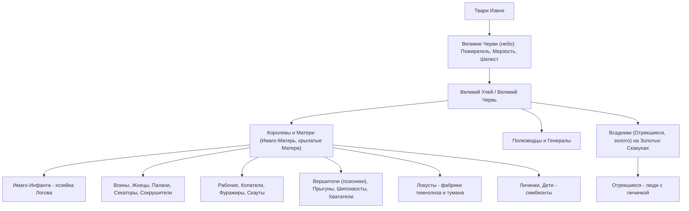
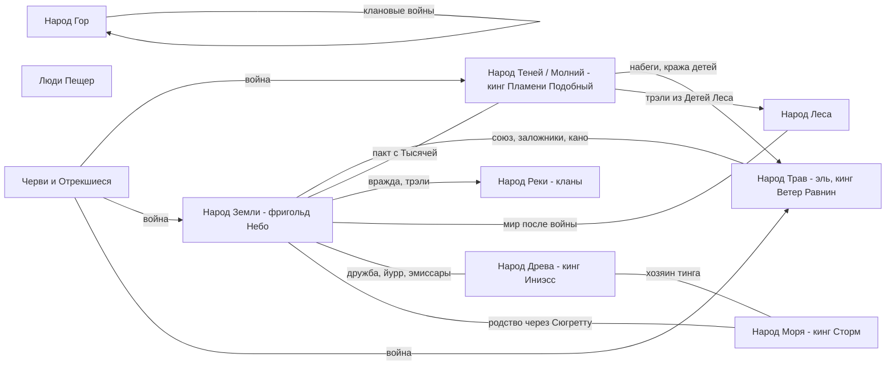
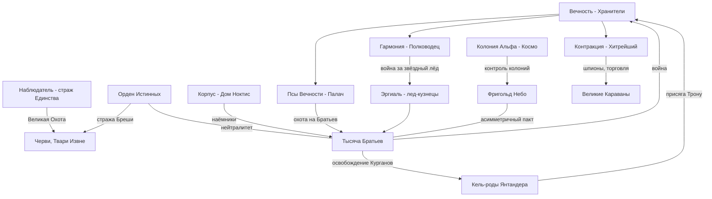
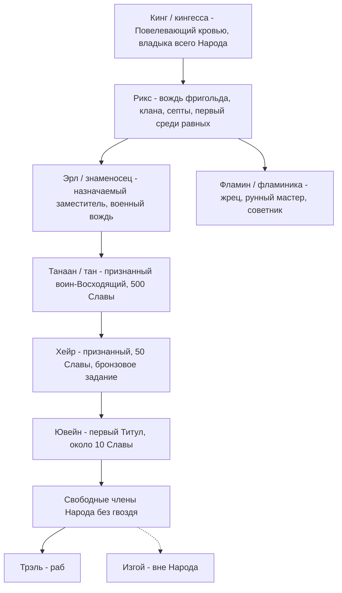
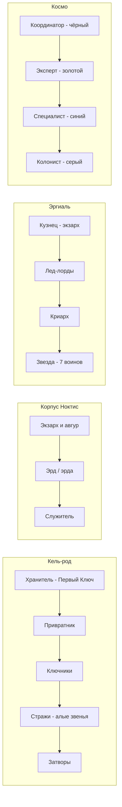

# 05. Народы, фракции, существа

> Сводный справочник по Народам Единства, организациям и бестиарию цикла «Звездная Кровь» (ЗК-1…ЗК-11) и «Тысяча Братьев» (ТБ-1…ТБ-5).
> Термины — в «Словарь». Механика рангов/Рун — в соответствующем файле механики.
> Факты из канала автора (статьи «Справочника колониста», карточки персонажей, ответы) помечены «(автор, TG: пост N)» со ссылкой; строки фанатской таблицы «Система Восхождения» — «(свод «Система Восхождения»)». Текст книг главнее: где автор или свод спорят с каноном, это оговорено.

## Содержание
1. [Общие принципы: что такое «Народ»](#1-общие-принципы-что-такое-народ)
2. [Народы Круга Элтанир (девять Народов тинга)](#2-народы-круга-элтанир)
3. [Народ Кел и его ветви](#3-народ-кел-и-его-ветви)
4. [Народы и расы вне Элтанира](#4-народы-и-расы-вне-элтанира)
5. [Фракции и организации](#5-фракции-и-организации)
6. [Бестиарий: звери, растения и Травы, экзоресурсы](#6-бестиарий-звери-растения-и-травы-экзоресурсы)
7. [Отношения: схемы союзов и вражды](#7-отношения-схемы-союзов-и-вражды)
8. [Иерархии титулов](#8-иерархии-титулов)
9. [Как создать нового персонажа из Народа X](#9-как-создать-нового-персонажа-из-народа-x)
10. [Противоречия и открытые вопросы](#10-противоречия-и-открытые-вопросы)

---

## 1. Общие принципы: что такое «Народ»

- **Народ** — признанная Наблюдателем общность разумных Единства с правом на землю (фригольды), своими Восходящими, тингом и Клятвами. Народы — «даже не расы, а иные ветви человека… плоды генетических экспериментов Кел» (ЗК-6, гл. 20). Люди Трав, Теней, Пещер, Гор и Моря физиологически близки землянам; Народ Реки (перепонки, жабры), Народ Леса (йети) и Люди Древа (хвостатые «лемуры») — «вид один, а породы разные» (ЗК-6, гл. 20).
- **Происхождение.** Большинство младших Народов созданы Кел (ТБ-1, гл. 5–12, взгляд Белого Дьявола: Народ Реки — «низшая раса, созданная Кел»). Некоторые созданы как оружие/испытание: нордийцы — «раса, созданная для войны» (ЗК-4, гл. 8; ТБ-4: «потомки великанов, созданных Кел как оружие»); Народ Леса — «некогда созданные для морозных земель» (ТБ-4); тавры, фрогги, имиры, гигантопитеки — «Враги Единства, созданные Кел как бедствие низших Народов» (ТБ-2, разд. 7; ЗК-7, гл. 3 — тавры «созданы как испытание для Восходящих»). Народы Трав и Теней — полукровки, прямые потомки Золотой (Эррос) и Серебряной (Аммос) рас Кел (ЗК-3, гл. 5; ЗК-7, гл. 5, 14).
- **Изъян.** Врождённый блок низших Народов на работу со Звездной Кровью; поэтому им нужен стигмат («гвоздь») из Храма Вечности (ЗК-5, гл. 5). Земляне — «предтечи Кел», без изъяна (ЗК-5, гл. 5, 15).
- **Закон Единства.** Межнародные споры решаются Клятвами под Оком Наблюдателя, фионтаром (ритуальный поединок) и тингом; нарушение Клятвы карается Позором и «гневом Наблюдателя», вплоть до уничтожения Народа (Люди Пещер «Черные мясоеды» уничтожены за многолетние нарушения — ЗК-1, гл. 17; ЗК-6, гл. 5). Герой удивляется: «как Народы, такие разные, все еще не истребили друг друга?» — ответ: «правила Наблюдателя работают» (ЗК-6, гл. 20).
- **Изгои** — изгнанные из Народа, вне законов Единства, без права на тинг, с риском лишиться доступа к Храму Вечности (ЗК-2, гл. 11–12; ЗК-6, гл. 24; ТБ-3, гл. 16). Банды изгоев — в Шторме (Кнут), «Колючие Кости» у Теней и т. п.
- **Три имени.** «У Людей Единства два, а иногда — три имени. Первое, детское — скорее шутливое прозвище… до обряда взросления. Второе — взрослое… третье брали только Восходящие, называя его, когда втыкали гвоздь» (ТБ-1, гл. 7). У Народа Гор мальчик получает взрослое имя, лишь «самостоятельно одолев зверя» (ТБ-1, гл. 2).
- **Общие обычаи Круга:** обмен дарами со Звездной Кровью = взаимный выбор/помолвка (ЗК-4, гл. 3; ЗК-6, гл. 3); вира за кровь (золотая 100 / серебряная 10 / бронзовая 3 Монеты или Руна ранга — ЗК-6, гл. 2, 25); трэли (рабы) у многих Народов (Река, Тени, ферма Эйрика); копьё — боевой отряд (у землян ~7, у Теней ~10 воинов — ЗК-2, гл. 1; ТБ-3, разд. 7); формула «Я вижу тебя» / «Я не вижу тебя» — признание/отвержение (Тени, Трав, Гор — ЗК-3, гл. 13; ЗК-7, гл. 14; ТБ-1, гл. 6–7).
- **Отношение к Вечности.** Стигматы покупаются в Храме Вечности (вход у Древа); кандидатов выбирают на тинге (ЗК-2, гл. 7, 9). Норны проводят инициацию через Саркофаги (ТБ-3, гл. 4). Восходящие верят, что после смерти душа уходит в Вечность (Чертог Встреч с предками — ЗК-2, гл. 9). Позже (ЗК-5…ЗК-9) раскрыто, что стигмат — ловушка для души и Крови (см. 06/механику), а Тени у Пламени Подобного получают «молнию Дарующего» вместо гвоздя (ТБ-4, гл. 8, 17; ЗК-11, гл. 16).

---

## 2. Народы Круга Элтанир

На большом тинге у Элтанира — **девять Народов**: «Люди Древа, Реки, Моря, Земли, Пещер, Гор, Трав, Леса и Теней» (ЗК-6, гл. 20; подтверждено ТБ-4, гл. 11, 13). В ТБ-4 Народ Теней выступает как **Народ Молний**.

Сводка:

| Народ | Облик | Власть | Где живёт (см. статья «География») | Отношение к землянам |
|---|---|---|---|---|
| Земли (земляне) | люди Земли, «круглоухие» | рикс + знаменосцы + фламин(ика), копья | фригольд Небо (Скай) на плато над Расколотыми Землями; ферма Эйрика | — |
| Трав | медово-золотая кожа, янтарные глаза | кинг эля + риксы кланов | Море Трав, Малое Древо Пылающий Рог | союзники (заложники, побратимство) |
| Теней / Молний | беловолосые, бледные, зелёные «каменные глаза Аммос» | кинг (кровь Дарующего) + риксы септ | теневое кольцо вокруг Круга | враги → союз через Пламени Подобного |
| Реки (Воды) | бледные, перепонки, жабры, Чешуя-тату, острые уши | риксы кланов + фламиника | реки, озёра, болота востока/юго-востока | вражда, трэли-земляне |
| Древа (Ветвей) | на 2 головы выше, хвостатые, зелёная вязь | кинг Иниэсс | Благословение у Великого Древа | нейтральные хозяева тинга, затем друзья |
| Моря (нордийцы) | рослые, рыжие/светлые, синие татуировки | кинг Сторм Сто Смертей | северное побережье и острова, Морской Свет | нейтралы, родство через Сюгретту |
| Леса | йети в шерсти | риксы фригольдов | Древний Лес на северо-востоке Круга (к северу и востоку от Шторма) | война → мир |
| Гор | смуглые/меднокожие, горбоносые, желтоглазые | риксы кланов | горы к западу и востоку от фригольда, за Змеиным Каньоном | соседи, набеги |
| Пещер | полудикие, коренастые, бронзовокожие; костяные ожерелья | вожди кланов и племён | горы юга и юго-запада Круга, по обе стороны плато Неба; пещеры | стычки в первые циклы колонии; слабые соседи |

### 2.1. Народ Земли (Люди Земли, земляне)
- **Самоназвание/прозвища:** «Народ Земли» (так их регистрирует Единство, ЗК-1, гл. 16); местные — «Небесные Люди» (ЗК-1, гл. 21), «круглоухие» (кел и Корпус — ЗК-8, гл. 8; ТБ-2, гл. 17), «предтечи» (Тени, ТБ-3; ТБ-4), «бесхвостые» (у Людей Древа — о всех не-Людях Древа, ЗК-6, гл. 20).
- **Состав:** колонисты проекта «Космо», сброшенные ковчегом «Хельга»; во фригольде «Небо» — 2744 колониста (ЗК-1, гл. 16) / ~2000 (ЗК-2, гл. 2, 8, 10 — после потерь); живут в Круге «около 30 циклов» (ТБ-4). Женщин вдвое больше, чем мужчин; растёт третье поколение рождённых в Единстве (ЗК-7, гл. 1, 3, 15). В ЗК-7 ~80+ Восходящих, 22 копья; 16 боевых копий в ЗК-4.
- **Власть:** коммуна со сводом из 45 законов / «конституция по земным законам» (ЗК-1, гл. 16; ЗК-4). Рикс (Винсент Кассиди → Вероника Максвелл → Трейв Уитли → снова Кассиди), знаменосцы (Майкл, Трейв, Эйрик, «четвёртый знаменосец по особым поручениям» Сигурд — ЗК-11, гл. 15), фламиника/фламин (Говорящая-с-Травами → Минос), копья (Адамант, Динамит, Мрак, Серена, Фрост, Айс, Асмодей, Минос…), тинг фригольда. Фракции: «старики» (Адамант, Крик) и «молодое крыло» Марка (ЗК-4).
- **Социальная лестница «Космо»:** серые комбинезоны — колонисты (~70%), синие — специалисты, золотые — эксперты/лидеры (~4%), чёрные — координаторы (ЗК-4, гл. 5, 7; ЗК-11, гл. 1). Точные доли «по сводке Наблюдателя»: 68,678 % рабочих, 27,585 % специалистов, 3,736 % экспертов, 0,001 % координаторов (автор, TG: [пост 4556, комментарий](https://t.me/prokofiev_litrpg/4556?comment=138200)).
- **Вера/отношение к Вечности:** прагматики; стигматы закупают в Храме, но после ЗК-5 знают, что Вечность опасна. Колонисты — носители Истока («Кровь Истока»/брахма), отсюда интерес Вечности и Тысячи (ЗК-5, гл. 5; ЗК-9, гл. 1; ТБ-3, гл. 17).
- **Поселения:** фригольд «Небо»/«Скай» с Ростком — четвёртым Малым Древом Круга «Скай» (ЗК-7, гл. 22); ферма Эйрика (ЗК-4, гл. 7–9; клан Эйрика позже переезжает на плато — ЗК-7, эпилог); Колония Альфа, Станция Терра, Либерти — в других Кругах (см. §5.11).
- **Отношения:** с Травами — союз (заложники Лэндо и Ярослав Эйрикссон; договор о свободном проходе и сборе «небесных даров» — ЗК-1, гл. 13; ЗК-4, гл. 5, 7, 10); с Рекой — вражда (Гай Флоу убит стрелой — ЗК-1; земляне-трэли — ЗК-9, гл. 10; ТБ-1); с Лесом — мир после карательной экспедиции (ЗК-4, гл. 10, 18); с Тенями — враги (ЗК-3–04), затем асимметричный оборонительный пакт с Тысячей и Народом Молний (ЗК-11, гл. 18); с Древом — «врата Благословения вновь открыты землянам» (ЗК-7, гл. 22).
- **Восходящие и типичные Руны:** гибрид земной техники и Рун (кидо «Гоплит», вингеры, «Грифоны»); рунные мастера (Трейв, Минос, Том-Ключ). Подробно — в файлах персонажей/техники.
- **Имена:** земные (англо-, русско-, азио-), плюс позывные/прозвища копий: Динамит, Мрак, Фрост, Айс, Асмодей, Грохот, Свирель, Ассоль, Угрюмый. Неопознанным и принятым чужакам дают фамилию **«Скай»** (Юки Скай — ЗК-7, гл. 5).

### 2.2. Народ Трав (Люди Трав, «дети Эррос»)
- **Облик:** кожа цвета мёда/золотистая, янтарные (жёлтые) глаза, заострённые уши (ЗК-1, гл. 12–13; ЗК-6, гл. 7–9; ЗК-7, гл. 14). Потомки Кел Эррос — «древняя кровь Эррос» (ЗК-1, гл. 17; ЗК-2, гл. 1). По автору: волосы чаще чёрные, реже тёмные с каштановым отливом; выраженных клыков и жевательных зубов нет, отсюда мягкий подбородок; с землянами дают жизнеспособное потомство (автор, TG: [пост 4374](https://t.me/prokofiev_litrpg/4374)).
- **Устройство:** кочевые кланы, «часто враждующие» (ЗК-1); племенной союз — **эль** (ЗК-4, гл. 5). Кланы: **Солнца, Ветви (Ветвей), Молнии (Молний), Тауро** и др. (ЗК-6, гл. 7; ЗК-7, гл. 12). Над всем элем — **кинг** («Повелевающий кровью») **Ветер Равнин**; жена — фламиника Жемчужина-в-Волосах; сыновья — старший Кандо Солнечный Ветер, средний Лэндо Солнечное Крыло (ЗК-6; ЗК-7). Сила: 10 тыс. воинов и 800 Восходящих под рукой кинга; при сборе всего эля — вдвое-втрое больше (ЗК-7, гл. 14–15). По автору, в эль входят больше двадцати племён и родовых общин; в знаках некоторых племён и в языке Трав живёт образ солнца (автор, TG: [пост 4374](https://t.me/prokofiev_litrpg/4374)).
- **Где:** Море Трав (почти вся юго-западная и западная часть Круга); столица эля — Малое Древо **Пылающий Рог** (посажено Горячим Солнцем, предком клана Солнца — ЗК-7, гл. 14). У Рога — брошенные гарнизон-капсулы воинства Наблюдателя (ЗК-6, гл. 7–9). → статья «География».
- **Быт:** ездят на цезарях, тауро, кархах, голиафах; есть летающие Существа и Аспекты (ЗК-7, гл. 14); огромные бородатые собаки (ЗК-6). Напитки: **моос** (медовый алкоголь), **духовный чай** на семи великих Травах (+Кровь, видение аур) (ЗК-4, гл. 8; ЗК-7, гл. 14). Мёртвых **сжигают** (ЗК-7). «Небесные дары» — упавшие капсулы землян, которые Травы собирают (ЗК-4).
- **Обычаи:** **саан-кано** — долг крови/побратимство; **кано** — обращение к побратиму/наставнику (ЗК-2, гл. 1; ЗК-7, гл. 14). **Хазак** — нож-клык ледозуба, который мальчик получает после испытаний, залог долга жизни (ЗК-2, гл. 1; ЗК-6, гл. 8). Приветствие «Я вижу тебя!». Обмен заложниками с союзниками (ЗК-1). Цитируют Того-Кто-Сражается (ЗК-2).
- **Религия:** почитание Единых (Тот-Кто-Сражается); Малое Древо как святыня; Аспект «Мудрость Предков» у Жемчужины — хранитель знаний (ЗК-7, гл. 15). Призрак Кочевника — разумный дух старого воина Трав (ЗК-7, гл. 5).
- **Речь:** ломаный Единый у Лэндо — инфинитивы, «быть»: «Такие Восходящие рассказывать детям у костра. Тысяча демонов хотеть захватить тысячу Кругов…» (ЗК-4, гл. 22).
- **Отношения:** союзники землян; вражда с Тенями (Тени крадут у них добычу, зверей, детей — ЗК-2); в ТБ-4 Ветер Равнин сперва враждебен Пламени Подобному, затем сделка — вира гвоздями, Клятва (ТБ-4). Древнее нашествие Червей на Пылающий Рог отбивали вместе с септами Теней (ТБ-3, интерлюдия, гл. 16). Тогда погибли три септы, и Тени до сих пор винят Народ Трав: «это наше Древо призывать Червей» (ЗК-3, интерлюдия «Видящая»; ЗК-6, гл. 9; ТБ-4, гл. 14).
- **Роль в сюжете:** Лэндо — побратим и спутник Сигурда; Травы — основной союзный Народ фригольда; Травинка носит имя по обычаю Трав/Теней.
- **Имена:** составные природные, часто «Стихия + Существительное»: Ветер Равнин, Солнечное Крыло, Солнечный Ветер, Горячее Солнце, Жемчужина-в-Волосах, Победитель Варгов (абориген у Эйрика), Травинка-на-Ветру.

### 2.3. Народ Теней / Люди Тени → Народ Молний
- **Облик:** белолицые, стройные; беловолосые/сереброволосые (вожди — «сереброволосы»); зелёные глаза — «зелёный/каменный камень Аммос» (ЗК-3, гл. 5; ЗК-6, гл. 17, 20; ЗК-7, гл. 5). Татуировки синими волнистыми линиями; одежда из шкур найтволков, найткожа, тень-шёлк; маски с оксидином для теневых земель (ЗК-2; ЗК-3, гл. 5; ТБ-3, гл. 8; ТБ-4).
- **Происхождение:** потомки детей Аммос, изгнанных после падения города Белого Дьявола (ЗК-3, гл. 5); по ТБ-1/ТБ-3 — потомки беглецов из Эстэ, «дети» Белого Дьявола; Народ Молний Эстэ (ТБ-3, гл. 3). В риксах — «тень крови» Белого Дьявола; Каменные Луки — «кровь Белого Дьявола» (ЗК-3, гл. 17; ЗК-6, гл. 20). Язык — диалект наречия Аммос (ЗК-3, гл. 5).
- **Численность:** 50–100 тыс. (ЗК-9, гл. 7). Каменные Луки: ~100 копий и 10 «рук» Восходящих (ЗК-3) / >100 Восходящих (ЗК-9, гл. 7) / 13 000 едоков, 1000 воинов, 150 Восходящих (ТБ-3, гл. 10).
- **Устройство:** **септа** — род с общим предком (ЗК-3, гл. 5). Власть: **кинг** — верховный правитель, «только кровь Дарующего» (ЗК-9, гл. 7; ТБ-3), требует признания на тинге (ЗК-10, гл. 3); **рикс** — глава септы; **эрл**/**знаменосец** — первый воин/наследник; **фламин/фламиника** — жрец(-ица); **танаан** — воин-Восходящий; **хейр** — молодой воин; **трэль** — раб (ТБ-3, разд. 7). Последний кинг до Пламени Подобного — Шепчущий-в-Ночи, «последний, кого слушал весь Народ» (ТБ-3). Малый и большой тинги септ, **тингвеллир** (ЗК-3, гл. 10; ТБ-3). Резиденция рикса — **хоф** (ЗК-3, гл. 13) / **кип** — дом-крепость (ТБ-3, гл. 14).
- **Септы** (на начало цикла ТБ-3 — восемь; география — статья «География»):
  | Септа | Характер | Вожди | Источник |
  |---|---|---|---|
  | **Каменные Луки** | высшая, хранители древней крови; столица — астролит Аммос «черные рога» | Шепчущий-в-Ночи (кинг) → Яростный-как-Пламя → Каласса Огненная-как-Ветер; Быстрый-как-Ветер (танаан) | ЗК-3, гл. 17; ТБ-3, гл. 5–11; ЗК-11, гл. 21 |
  | **Небесные Когти** | добывают когти экзо у Столпа Сияния, делают тарны для всего Народа; 30 копий, 10 Восходящих (ЗК-3) / 30 рук воинов, 2 руки Восходящих (ТБ-3) | Видящая-сквозь-Тьму («первая мать»), Коготь-как-Серебро | ЗК-3, гл. 11–13; ТБ-3, гл. 14 |
  | **Лунные Тени / Луноликие** (= Лунные Маски) | сновидцы, маски из лунного камня, единственная россыпь лунного камня, «на четверть чужая кровь»; прародительница — Королева Снов Эстэ | Шепот-в-Ночи (старуха), Найтфир (Ночной Страх) | ЗК-3; ЗК-9, гл. 7; ТБ-3; ТБ-4, гл. 3 |
  | **Серые Шипы** | младшая септа из изгоев, охотники и мастера ловушек | Острый-как-Шип | ЗК-3; ТБ-3, гл. 11 |
  | **Тёмные Грозы** | кузнецы теней и молний («сухие грозы»), Кузница Молний; уничтожены | Пьющий-Кровь-Ледозубов, фламиника Буря-в-Ночи | ТБ-3, гл. 12–16 |
  | **Черепа** (Кровавые, Дикие, Чёрные) | самые дикие, восток, крепость Череп Великана; едят плоть Червей; тенелоза; держат трэлей из Детей Леса | Пожиратель Костей (Всадник) → Рвущий-Червивые-Жилы; прежние — Смеющийся, Лунохвост | ЗК-3; ТБ-3, гл. 9, 13 |
  | Блуждающие: **Колючие Кости**, **Зубастые** | бродячие | — | ТБ-3 |
  | Упомянуты в ЗК-3: **Маски**, **Грозы** | = Луноликие (Лунные Тени) и Тёмные Грозы. На вопрос «А сколько у Луков? У Масок? У Шипов?» Коготь отвечает про Луков, Лунных Теней, Шипов и Гроз (ЗК-3, интерлюдия «Видящая»). Ни у автора, ни в своде «Система Восхождения» отдельной септы «Масок» нет (автор, TG: [пост 3654](https://t.me/prokofiev_litrpg/3654)) | — | ЗК-3, интерлюдия «Видящая» |
- **Обычаи:** позы покорности; клейма — «печать равнодушия» (клеймо изгнанника, не признавшего волю септы); приёмыши — «из принесённых»; трэли со страж-браслетами/ошейниками (ЗК-3, гл. 3, 12–13). Брак: в ЗК-4 — «жёны иногда берут нескольких мужей» (ЗК-4, гл. 9); в ТБ-4 — многожёнство кинга (Найтфир — первая жена) (ТБ-4). Обряд «Я вижу тебя». Узоры — ритуальные татуировки (ТБ-3, гл. 7). Знамя — **сигна** (ТБ-3). Оружие — **тарн** (древко с иллиумовым когтем экзо / из священной синей стали) (ЗК-3, гл. 10; ТБ-3). Ездовые: найтораксы/тораксы, приручённые лиззы (их «твёрдая слюна» образует мосты-переходы) (ЗК-3, гл. 5, 10). Ругательства: «тенехваты» (те, что «крадут детей в сумерках»), «ама» (о Говорящей) (ЗК-6, гл. 18, 21).
- **Религия:** Белый Дьявол — божество-предок (святилище в хофе Когтей — ЗК-3, гл. 11–13); титул «**Дарующий**» (ЗК-9, гл. 7); гнев **Незримого** опасен (ЗК-3, гл. 5). При Пламени Подобном — сигна **молния** как заменитель гвоздя, «Молния Дарующего» (ТБ-4, гл. 8; ЗК-11, гл. 16).
- **Восходящие/Руны:** ментал и Дух (духовидцы — Видящая-сквозь-Тьму), сновидение (Луноликие — Искусство Грез), теневая маскировка, тарн-бой; Аспекты (Лунная Вуаль Найтфир, огненный Аспект Калассы) (ЗК-3; ТБ-4, гл. 3). По карточкам автора: Каласса — полукровка, дочь танаана Быстрого-как-Ветер и пленной землянки, 25–28 циклов (в ТБ-3, гл. 6 — «не более чем двадцать девять»), «сильное серебро», Стиль Железа; Найтфир — внучка Шепот-в-Ночи, наследница Королев Снов с кровью Аммос, около 30 циклов, серебряная сновидица-ментал (автор, TG: [пост 4891](https://t.me/prokofiev_litrpg/4891), [пост 5666](https://t.me/prokofiev_litrpg/5666)).
- **Народ Молний** (ТБ-3–ТБ-4; ЗК-11): Пламени Подобный объединяет септы — «четыре септы под одной рукой плюс присоединённые Черепа»; кинг — Пламени Подобный, королева — Найтфир (ЗК-11, гл. 15, 18, 20). Возвращают Эстэ как столицу (ТБ-4; ТБ-5, эпилог). Псы Вечности разрушают Каменные Луки (ЗК-10, гл. 2, 8).
- **Отношения:** враги Трав (набеги) и землян (ЗК-2–04: Коготь берёт Сигурда в плен); через Говорящую-с-Травами (дочь Шепчущего-в-Ночи, изгнанница Луков) и Травинку связаны с Кассиди. Черепа граничат с Народом Леса. Пакт с землянами — ЗК-11.
- **Роль:** главный «чужой» Народ ЗК-3, главный Народ ТБ-3–ТБ-5.
- **Имена:** описательные составные с дефисами — «Действие/Качество + как/в/сквозь + Образ»: Видящая-сквозь-Тьму, Коготь-как-Серебро, Острый-как-Шип, Яростный-как-Пламя, Быстрый-как-Ветер, Огненная-как-Ветер, Шепчущий-в-Ночи, Шепот-в-Ночи, Буря-в-Ночи, Танцующая-в-Тени, Тростник-который-Поет, Пьющий-Кровь-Ледозубов, Рвущий-Червивые-Жилы, Молния-из-Стали, Серебряное Облако, Шелковая Тень, Ночной Страх (Найтфир). Земляне сокращают: «Коготь», «Юки».

### 2.4. Народ Реки (Люди Реки, Народ Воды, «речные»)
- **Облик:** бледнокожие, перепонки между пальцами, жаберные щели, острые уши; чешуйчатые татуировки, которые превращаются в доспех — **Чешую**; почти без одежды (ЗК-1, гл. 11; ЗК-6, гл. 2–3; ЗК-9, гл. 10). Мёртвая Рыба — с голубыми узорами наследников Эстэ (ТБ-1).
- **Происхождение:** «низшая раса, созданная Кел» (ТБ-1); потомки Эстэ (ТБ-2). «Старшие братья» — **Подводный Народ** с рыбьими хвостами, в океанах (ТБ-1). По автору, Кел вывели их как полуамфибий для мелких тёплых морей, озёр и рек; в отличие от Подводного Народа, Люди Реки сохранили человеческий облик и смешиваются с другими расами, среди них есть метисы. Юноши проходят обряд зрелости: убить или приручить речное чудовище (автор, TG: [пост 3989](https://t.me/prokofiev_litrpg/3989)).
- **Кланы (фригольды):** **Мёртвая Рыба** (дворец в скелете гигантского золотого многозуба — ТБ-1; сожжён — ТБ-4, интерлюдия «Дикая Охота»), **Золотое Озеро** (крупнейший водоём Круга), **Холодные Воды / Холодное Озеро**, **Болотные Пещеры** (затопленные тоннели у Великой Стены; «изменённые», якобы скрещивались с фроггами — ТБ-1), **Тростник** (ЗК-6). Болота уничтожены, новый клан — **Золотые Каналы** (ТБ-4). Один из четырёх крупнейших Народов Круга (ЗК-6, гл. 2–3). → статья «География» (восток и юго-восток Круга, за рекой Бурной).
- **Кланы по автору:** четыре крупных клана держат восток и юго-восток: Мёртвая Рыба — самый многочисленный; Золотое Озеро — озёрный край на северо-востоке; Холодные Воды — горный юг; Болотные Пещеры — тоннели в Великой Стене и болота юго-востока, их люди самые «изменённые» (автор, TG: [пост 3989](https://t.me/prokofiev_litrpg/3989)).
- **Власть:** риксы кланов + фламиника («владычица Вод»). Аурвак Владыка Чешуи (Мёртвая Рыба), его жена Элесс Голубая Раковина (фламиника), Звездоперая (Золотое Озеро), Чёрный Триглав (Болотные Пещеры, «повелитель фроггов»), безымянный рикс Холодных Вод (ТБ-1). Отец Зирдана — рикс Мёртвой Рыбы (ЗК-1). Мирисс Серебряная Форель — «вторая дочь его третьего сына, Керна Ныряльщика», то есть внучка Аурвака (ТБ-1, гл. 6); по карточке автора — бронзовая Восходящая-ищейка, 20–25 циклов (автор, TG: [пост 3879](https://t.me/prokofiev_litrpg/3879)).
- **Быт и война:** костяное оружие, плоскостные мечи (клинок из уплотнённого воздуха), **лиссы** — панцири из костяных пластин речных чудовищ (ЗК-1, гл. 11; ЗК-9, гл. 10); ездовые никсы, иглогривы, черепахи (ТБ-1); хазак из кости многозуба (ТБ-1, гл. 8); Навык «Мастер Пловец» (ЗК-4, гл. 20). Держат земных трэлей (ЗК-9, гл. 10; ТБ-1). Обычно не ходят далеко на север (ЗК-1).
- **Восходящие/Руны:** власть над водой, оборотничество (Серебряная Форель — энхидрион, гигантская выдра; Водяное Тело) (ЗК-1, гл. 10; ТБ-3, гл. 15).
- **Речь (жаргон):** «журчать» — говорить; «брызги/брызгать» — пустые слова, хвастовство; «мелкие брызги!» — ерунда; «бурлить» — спорить/обсуждать; «прозрачно» — ясно/честно; «глубина», «**Тёмная глубина!**» — восклицание-проклятие (ТБ-1, гл. 6–7; ЗК-6, гл. 3; ЗК-9, гл. 10; ТБ-4, гл. 4). «Тс-си» — «сдаюсь» (ЗК-6, гл. 3). «Водяное мясо» — фрогги (болотный жаргон, ТБ-1, гл. 8).
- **Религия:** раковины-оракулы, «голос раковин» у фламиник; локи — священно-опасные твари озёр (ЗК-6, гл. 20).
- **Отношения:** враги землян (брод на Бурной, фионтар с Зирданом — ЗК-1; спор на тинге: «Народ Воды не признает тот фионтар!» — ЗК-6, гл. 3); конфликты с фроггами; Пламени Подобный в ТБ-1 проходит путь изгоя у Мёртвой Рыбы.
- **Имена:** «Имя + Прозвище-водный образ»: Аурвак Владыка Чешуи, Зирдан (Зирдин) Хвост Акулы, Керн Ныряльщик, Мирисс Серебряная Форель, Элесс Голубая Раковина, Ирс Серый Плавник, Мираак Острый Плавник, Звездоперая, Чёрный Триглав, Плавник, Яростный Многозуб.

### 2.5. Народ Древа (Люди Древа, Народ Ветвей, Благословение)
- **Состав — три расы** (ЗК-6, гл. 11, 20): (1) эмигранты из других Народов, даже земляне; (2) **Люди Ветвей** — великаны-«лемуры» на две головы выше людей, длиннопалые, с природной зеленоватой вязью на коже, изумрудными/зелёными волосами, хвостами, оливковой кожей (ЗК-6; ЗК-7, гл. 22; ЗК-8, гл. 16); (3) **Хранители Древа** (Дети Древа) — порождения Элтанира золотого/серебряного ранга, не Восходящие, умеют принимать форму Золотых Стрекоз (ЗК-6, гл. 11; ЗК-7, гл. 22). Также Золотые Термиты (ТБ-4).
- **Власть:** кинг **Иниэсс Зелёный Лист (Зеленолистная)** — золотая Восходящая, >100 циклов, прозрачный посох с игг-сиянием (ЗК-6, гл. 20). Хозяева тингвеллира и тинга. «Самый могущественный Народ Круга» (ЗК-7, гл. 22).
- **Быт:** экипировка выращена, а не сделана; летают на Золотых Стрекозах; плантации с йуррами; отвергают огонь, рубку деревьев и мясо (ЗК-1; ЗК-7, гл. 22; ЗК-8, гл. 16). Город у Корней, древесные дома для гостей (ЗК-6, гл. 10–11). По автору: рост Людей Ветвей — до двух с половиной метров, цепкие пальцы на руках и ногах и длинный хвост делают их лучшими древолазами; живут прямо в стволе и кроне, и многие ни разу в жизни не сходят вниз; преступлением считается даже сорвать лист; Хранители не уходят от своего Древа, зато рядом с ним необычайно могущественны (автор, TG: [пост 4495](https://t.me/prokofiev_litrpg/4495)). Слова автора, что все Хранители — Восходящие, спорят с каноном («не была Восходящей», ЗК-6, гл. 11) и не вносятся. Защита Благословения: сторожевые менгиры, «бродячие леса», деревья-стражи, рунные истуканы Западного Прохода (ЗК-6, гл. 10, 20).
- **Вера:** утверждают, что Древо разумно и говорит с их Восходящими (ЗК-1).
- **Речь:** растительные метафоры — «прорастёт много бед», «сплестись», «одинокую ветвь сломать проще», формула согласия **«Да прорастёт так»**, пренебрежительное «**бесхвостый**» (ЗК-6, гл. 11, 20).
- **Отношения:** нейтральные арбитры; в Дикую Охоту закрывают Благословение для всех, кроме друзей, пропускающих их копья (ЗК-6, гл. 20); дарят Сигурду самочку йурра, шлют эмиссаров (ЗК-7; ЗК-8; ЗК-10); Росток землян — четвёртое Малое Древо (ЗК-7, гл. 22).
- **Имена:** Иниэсс (кел-подобные, с двойными «сс») + растительное прозвище: Зелёный Лист. Новые: Аэлисс Тихая Крона, Ирвесс Корень-Света *(образцы, не канон)*.

### 2.6. Народ Моря (Люди Моря, Люди Островов, нордийцы)
- **Облик:** широкая кость, крепкое сложение, «богатырское здоровье»; рыжие и светловолосые, синие татуировки (Узоры); «полуголые, разрисованные синей татуировкой здоровенные детины с разбойничьими физиономиями» (ЗК-4, гл. 8; ЗК-6, гл. 11). Женщины — крупные (Сюгретта) (ЗК-4, гл. 8). «Нордийцы» — прозвище землян по сходству со скандинавами (ЗК-4, гл. 8). «Печать древней ярости» видна в их красноватых зрачках (ТБ-4, гл. 11).
- **Физиология по автору:** при вскрытии найдено второе «малое» сердце, способное заменить основное, и железы неясного назначения; кожа очень прочна и быстро заживает, истечь кровью нордиец не может; болевой порог понижен, реакция быстрая. Отдельным видом их это не делает: с другими Народами они дают потомство. Среди Народов Круга у них больше всего Восходящих; Аспекты тяготеют к буре, силе и хищному зверю; нордийцев охотно нанимают по всему Единству (автор, TG: [пост 5489](https://t.me/prokofiev_litrpg/5489)).
- **Происхождение:** «потомки расы, созданной для войны» (ЗК-4, гл. 8); «потомки великанов, созданных Кел как оружие» (ТБ-4).
- **Характер:** «не ведал страха и легко впадал в неистовство» — берсерки, «лучшие воины Круга»; есть оборотни (ЗК-2; ЗК-4, гл. 8). Культ силы: споры решают поединком-оплеухой, ежегодный «чемпионат по оплеухам» (ЗК-6, гл. 10–11). Корабли-джонки (ЗК-6).
- **Власть:** кинг **Сторм Сто Смертей**, «владыка Морского Света» (Малое Древо на островах) (ЗК-6, гл. 11, 20; ТБ-4, гл. 11). Фригольд Холодные Берега (Орс) (ЗК-6).
- **Быт:** **морское пиво** — крепчайший чёрный пенящийся напиток из звёздных водорослей (ТБ-4, гл. 11); чаши из драконьего стекла. У Людей Моря выкупали землян (ЗК-7). Сказания нордалов о Священном Городе на острове в северном море (ЗК-1, гл. 13, 15).
- **Речь:** «**Солёная кость!**» — присловье Сторма (ТБ-4, гл. 11).
- **Отношения:** Сюгретта — жена Эйрика (ЗК-1; ЗК-4); уважают силу — Пламени Подобный завоёвывает их уважение, выпив морского пива и приняв вызов кинга (ТБ-4, гл. 11). Варвар — Руна-Существо Азимандии, нордиец-оборотень (ЗК-2).
- **Имена:** короткие «северные» + прозвище-подвиг: Сторм Сто Смертей, Сюгретта (Грета), Орс. *(Предположение: нордалы ЗК-1 = нордийцы.)*

### 2.7. Народ Леса (Люди Леса, Дети Леса, «йети»)
- **Облик:** огромные лохматые гиганты, покрытые шерстью, «земные йети»; «вежливо рычат»; носят ленты-патронташи (ЗК-6, гл. 11, 20). «Некогда созданы для морозных земель» (ТБ-4).
- **Где:** Древний Лес на северо-востоке Круга, к северу и востоку от Шторма (ЗК-6, гл. 1: «восточнее и севернее — обширные древние леса»; ЗК-4, гл. 10: капсулы падают «на условном северо-востоке» от фермы, в Море Трав, «постепенно уходящее к Древнему Лесу»); с землями Народа Леса граничат владения Черепов на востоке Круга (ТБ-3, гл. 13). Слова «занимающего условный „запад“ Круга» в той же ЗК-4, гл. 10 — ошибка канона; карта ставит лес на северо-восток. Фригольд Седая Роща (ЗК-4, гл. 10; ЗК-6). По автору, Древний Лес выходит к теневому радиусу, а Народ Леса Кел создали для холодных биомов: густой рыжий или бурый мех, сила, тонкое чутьё; это лучшие следопыты Круга, с соседями в целом мирные (автор, TG: [пост 5640](https://t.me/prokofiev_litrpg/5640)). Подробнее о месте — в разделе географии.
- **Власть:** риксы фригольдов; Раатан — рикс Седой Рощи, говорит за Народ (ТБ-4).
- **Отношения:** «Народ Леса и Камней» нападал на первых колонистов (ЗК-1, гл. 15); после карательной экспедиции — мир с землянами (ЗК-4, гл. 10, 18). Мохнатые Дети Леса бывают трэлями у Черепов (ТБ-3). Лохмач — изгой, следопыт копья фригольда (ЗК-1–02).
- **Имена:** Раатан, Лохмач (прозвище землян). Короткие рычащие *(предположение)*.

### 2.8. Народ Гор (Люди Гор)
- **Облик:** смуглые, горбоносые (ЗК-6, гл. 20); меднокожие, желтоглазые (ТБ-1); носят шкуры, когти (ТБ-4). Коренастые и плосколицые (сородичи Песчанки — ЗК-6, гл. 11).
- **Устройство:** разобщённые кланы — Чёрная Ящерица, Ползуны (враги Ящериц), Ящерицы, Камнееды (ТБ-1; ЗК-10). Клановые татуировки на шее (ТБ-1, интерлюдия). Фламин, тинг.
- **Где:** земли за Змеиным Каньоном (граница фригольда): Клюв (жертвенный утёс-«кормушка»), Острова (плато с дрейками), Пальцы (снежные пики, хладонит), Длинные Пещеры (ТБ-1, гл. 1–4; ЗК-10, гл. 2). По автору, горцы живут и к западу, и к востоку от земного фригольда и граничат с Людьми Пещер и Людьми Реки (автор, TG: [пост 4813](https://t.me/prokofiev_litrpg/4813)).
- **По автору:** кланы носят имена тотемных зверей, клановую татуировку колют на правой стороне шеи; горцы хорошо видят в темноте; берегут тайные тропы, спрятанные верёвочные лестницы и «крылья» — натянутые над пропастями канаты с кольцами-блоками; одежда из кожи дрейков и меха, оружие из панцирей сталь-жуков, кости и рога; у некоторых кланов приговорённых оставляют на священных утёсах, чтобы звёздные звери не трогали поселения; браки — через обмен дарами (автор, TG: [пост 4813](https://t.me/prokofiev_litrpg/4813)).
- **Обычаи:** три имени; мальчик должен сам одолеть зверя, чтобы получить взрослое имя (ТБ-1, гл. 2); «саан-кано», «кано» — союз/суженый (ТБ-1, гл. 2–3) — в отличие от Трав *(значение у Гор не до конца ясно)*. На тинге рикс Гор: «И отдать свое чужакам? Свое племя, свою землю, своих женщин?» (ЗК-6, гл. 20).
- **Речь:** ломаный Единый («Мы большие враги быть…» — Песчанка, ТБ-1, интерлюдия).
- **Имена:** детские — Камешек, Змейка; взрослые/прозвища — Песчанка (Песчаный Змей), Чёрная Ящерица (клан).

### 2.9. Люди Пещер (Народ Пещер, пещерники)
- Полудикие, украшены костяными ожерельями (ЗК-6, гл. 7, 11). Племена: Скалозубы, Дети Пещер, Чёрные Камни, Нора Камнееда (ТБ-4); вождь объединённых племён — Безумец (ТБ-4).
- «Чёрные мясоеды» — Люди Пещер, уничтоженные Наблюдателем за многолетние нарушения (ЗК-1, гл. 17).
- **Где:** горы юга и юго-запада Круга, по обе стороны плато Неба; на севере они выходят к Морю Трав, на западе — к Расколотым Землям (карта; автор, TG: [пост 6144](https://t.me/prokofiev_litrpg/6144)). В каноне — горы «к западу от наших владений» и «западные границы фригольда» (ЗК-9, гл. 4, 15; там солнцекамень, дрейки, кархи), а горцы — «восточнее» колонии (ТБ-1, гл. 1): горы есть по обе стороны плато.
- **По автору:** отдельный Народ, хотя похож на Людей Гор обликом и обычаями: Наблюдатель их разделил. Невысокие, коренастые, длиннорукие, с бронзовой кожей, широким носом и узкими светло-жёлтыми или карими глазами; видят в полумраке; мужчины бородаты. Несколько десятков независимых кланов, каждый в своей пещере или ущелье; связанные кланы под одной горой зовут «пещерными фригольдами». Охотники и собиратели без земледелия и скота, живут ночью, торгуют рудами и звёздными минералами. Горный край, отведённый землянам, считали своим — отсюда стычки в первые циклы колонии. По общей численности — один из самых многочисленных Народов Круга (автор, TG: [пост 6144](https://t.me/prokofiev_litrpg/6144)).

### 2.10. Малые и упомянутые Народы Круга
- **Люди Камня / Народ Камней** — Древний Лес, рядом с Людьми Леса (ЗК-4, гл. 10); «Народ Леса и Камней» нападал на колонистов (ЗК-1, гл. 15). На тинге девяти Народов отдельно не названы *(возможно, входят в Народ Гор или Леса — предположение)*.
- **Племя Песчанки** — истреблено при нападении на землян (ЗК-1, гл. 13).
- **Клан Зверя** — шаманы; Крагг-гор Кровавый Рог (ЗК-2; ЗК-8, гл. 16).
- **Изгои Шторма** — смешанная банда Кнута (земляне, синтетик «Шиноби», аборигены) (ЗК-4, гл. 13).
- **Последователи Червей / Отрекшиеся** — см. §5.13.

---

## 3. Народ Кел и его ветви

- **Кел** — древняя сверхцивилизация-творец Единства (сфера Дайсона), «как хомо сапиенс и шимпанзе» по отличию от людей; «семь ветвей и более трёх десятков подтипов» (ЗК-5, гл. 6); третий глаз, подкожные венцы с Кровью, гибкие длинные пальцы, заострённые уши; золотые, фарфоровые, чёрно-фиолетовые (ЗК-2, пролог; ЗК-5, гл. 2, 6, 11; ЗК-8). Каждая ветвь почитала своего Единого (ЗК-3, гл. 5).
- **Раскол** — война Кел (конец 4-го оборота галактики), после которой Кел «ушли», большая часть знати бежала в Вечность (ЗК-3, пролог; ТБ-2).
- **Угасание.** По автору, переделка собственной крови обернулась для Кел бесплодием: «пустое чрево» постигло весь Народ, но раньше и сильнее всех — Эттус; Гриммос, по одной из легенд, пытались обойти его семью полами (автор, TG: [пост 6023](https://t.me/prokofiev_litrpg/6023), [пост 6533](https://t.me/prokofiev_litrpg/6533)).
- **Анатомия.** Протокол вскрытия тела из Саркофага Серебряного Замка (предположительно Аммос): рост 212 см при весе 63 кг, по четыре фаланги на пальцах, 28 позвонков, полые кости на 31 % легче человеческих и прочнее их, трёхдольные лёгкие, шестикамерные сердце и желудок (автор, TG: [пост 4487](https://t.me/prokofiev_litrpg/4487)).

Семь ветвей перечисляет автор в статьях «Легенды Единства»; в каноне по имени названы шесть из них, Гриммос — только у автора и в своде «Система Восхождения».

| Ветвь | Облик | Дар и покровитель | Раскол и судьба | Потомки и носители | Источник |
|---|---|---|---|---|---|
| **Эррос** (Золотые Кел, Золотая раса) | кожа отливает золотом (у автора — кремовая или золотистая), глаза — лазурь и ЗК, у Восходящих золото или серебро; волосы чёрные или янтарные | «создатели жизни»: игра с геномами; по автору, почти все существа Единства и младшие Народы выведены ими; покровители — Творящая и «тот, чьё имя стёрто», то есть Забытый | до Раскола самая многочисленная ветвь; многие прошли Позор. «Эпоха расцвета Золотых Кел» — их время | Народ Трав; Дома Тёмные Звёзды (Зариман), Тёмный Закат, Вортекс, Ардат | ЗК-2, гл. 7; ЗК-3, гл. 5; ЗК-5, гл. 2; автор, TG: [пост 76](https://t.me/prokofiev_litrpg/76), [пост 1031](https://t.me/prokofiev_litrpg/1031) |
| **Аммос** (Серебряные, Белые Кел) | «белоснежные как мрамор», волосы цвета ночи и расплавленного серебра, «зелёный камень Аммос» в глазах — «каменноглазые»; у автора глаза «бирюзы и стали» | строители и инженеры, развивали Разум; творцы чудес Единства и самой Вечности, строили астролиты; любимцы Искуснейшего | по автору, именно Аммос начали войну Раскола за Вечность; часть Серебряных Вечность не поддержала и рассеялась | Народ Теней/Молний; Дома Визу Аран и Ноктис (Корпус); кель-роды Янтандера | ЗК-3, гл. 5; ТБ-3, гл. 5; ТБ-5; автор, TG: [пост 115](https://t.me/prokofiev_litrpg/115) |
| **Эммис** (в каноне и «Эмисс») | по автору — белокожие и золотоволосые, глаза фиалковые или небесно-голубые; в Единство сходили в крылатых аватарах | стражи закона и инквизиторы, «почитала себя высшей»; всего семь созвездий, с другими Домами не смешиваются; покровитель — Взор и Закон | после падения своего Единого ненавидят Забытого и Тысячу; в Вечности служат Палачу — это и есть «псы Вечности»; по автору, нанесли решающий удар в войнах Раскола | Всполох (Тэйлисс Кел Эммис); стражи-инквизиторы золота в ЗК-9 | ЗК-1, гл. 6; ЗК-9, гл. 19; ТБ-4; автор, TG: [пост 1954](https://t.me/prokofiev_litrpg/1954) |
| **Эттус** (Чёрные Кел) | по автору — крупнее и мощнее прочих, дубль-сердце, безволосые, глаза алые, кожа чёрная или тёмной бронзы (слухи) | «живое оружие» Кел; в юности — ритуал Сращивания с кел-доспехом; покровитель — Тот-Кто-Сражается | первыми начали угасать; в Расколе разделились и сгинули. В Вечности, говорят, есть Эттус — возможно, поддельные отражения; настоящие, по слухам, служат Ордену Истинных | чёрный доспех с глухим шлемом без прорезей — образец для брони Гармонии | ЗК-2, гл. 22; ТБ-2, гл. 11; автор, TG: [пост 6023](https://t.me/prokofiev_litrpg/6023) |
| **Феллос** (Серые Кел) | облика не описать: меняют кости, кожу, голос и запах по нужде | торговцы, дипломаты, шпионы, посредники; больше всех чтили Незримого | в Раскол служили всем сторонам сразу, и их винят в разжигании войны; в Вечности, по слухам, это слуги Хитрейшего, Посланника и Странника, распоряжаются отражениями миров | Великие Караваны — «потомки серой ветви, незаметных и многоликих Кел Феллос» | ТБ-5, гл. 1; автор, TG: [пост 6234](https://t.me/prokofiev_litrpg/6234) |
| **Гриммос** (Синие Кел) | кожа от голубой до лилово-чёрной, без волос, бровей и ресниц; ритуальный раскрас, вживлённые камни и рунные знаки | переделывали собственную плоть: семь полов («Семикратное Пробуждение»: Дающие, Принимающие, Связующие, Ваятели, Несущие, Пробуждающие, Замыкающие), пол — выбор, а не судьба; целители и животворцы; покровительница — Творящая | многие Дома одними из первых ушли в Вечность; в Кругах их считают проклятыми | — | по своду «Система Восхождения» и автору, TG: [пост 6533](https://t.me/prokofiev_litrpg/6533); в каноне не названы |
| **Краттос** (Красные, или Бронзовые Кел; иногда делятся на старшую и младшую ветвь) | широкая кость, кожа от меди до тёмной бронзы, глаза и волосы — «цвета земли и мокрой глины» (автор); в каноне потомок Краттос (Садовник) — с бронзовой кожей и «густой чернотой волос» | «руки» Народа: строили, копали и служили великим Домам; мысленная речь — отсюда «молчащие кел»; покровитель — Молчащий | «давно сгинувшие» (канон); по автору, понесли самые тяжёлые потери, часть ушла в Вечность, часть смешала кровь с дикими Народами; поговорка «пока золото строит небо, бронза держит лестницу» | «капелька крови» — у Садовника, Руны-Существа Азимандии, родом из «редких алых Кругов» | ЗК-2, гл. 22; автор, TG: [пост 6781](https://t.me/prokofiev_litrpg/6781) |

- **Не ветви.** «Золотые Кел» — прозвище Эррос. **Ноктис** — Дом ветви Аммос: «Эверент Ноктис Кел Аммос, экзарх Корпуса и авгур Дома Ноктис» (ЗК-8, гл. 17). **Кел Тара** — легендарный мастер, автор Руны Пира: стол накрыт «по одному из рецептов легендарного Кел Тара, чья Руна Пира…» (ТБ-1, гл. 16; ТБ-2, гл. 6), а не ветвь и не Дом. Ранний ответ автора «красных нет» ([комментарий к посту 6023](https://t.me/prokofiev_litrpg/6023?comment=207676)) устарел: потом вышла статья о Краттос.

- **Дома Кел** («созвездия», «кел-плеяды»; глава — **авгур**): Визу Аран (павший; Азимандия, Элидатес, Алтея; солдаты — хренгиры), Серебряные Иглы (Клио), Тёмные Звёзды (Эриний Зариман, авгур Зариман Преображающий), Вортекс (навигаторы, сигна — спиральная галактика; Велиор), Норн (служители Храма), Ноктис (Корпус; ветвь Аммос), Геллерс (мастера Вечности), Алмазный Двор, Тёмный Закат, Ардат (ЗК-5, гл. 2–3, 8, 10, 17; ЗК-9, гл. 17; ТБ-2). Некромантский Дом — создатель Некролита (ЗК-9, гл. 9).
- **Атрибуты знатности:** третий глаз, сигна Дома, венец/корона; одежда асари, хэлио, аграф; «эммы» — спутницы-воительницы кел-лорда; «эвгина» — знатная дама/глава служанок (ЗК-2, гл. 18; ЗК-5, гл. 2, 8; ЗК-8, гл. 18).
- **Язык:** высокое наречие — «Хао иллиор, энтельо!» (приветствие, ЗК-2, гл. 18); «Аммор вен'тар, ноктис весс» — «дракон клянётся, тени слышат» (пароль Оноры, ЗК-8, гл. 15); «Либрос» — Грёзы, «Энай» — Молния (ТБ-4, гл. 2); «Айе» — «да» (ТБ-5, гл. 18). Единый язык — «просторечная» версия языка Кел, торговое наречие Кругов (ЗК-3, гл. 3).

---

## 4. Народы и расы вне Элтанира

### 4.1. Лед-кузнецы Эргиаля
- **Кто:** генмодифицированные клоны, выращенные из крови Ледяного Кузнеца (Кейнора), все — Восходящие; «Пробуждённые Дочери/Сыновья» (ЗК-8, гл. 19; ТБ-2, гл. 8). Голубоватая кожа с фрактальными узорами, ледяной орган **лед-сердце**; при смерти — **Последний Холод** (взрыв лед-сердца) (ТБ-2, гл. 8).
- **Где:** Эргиаль — Ледяные Чертоги из звёздного льда в Ледяной Бездне (~100 млн км от фригольда) (ЗК-8, гл. 18–22; ТБ-2). → статья «География».
- **Устройство:** Кузнец — «экзарх»/прародитель; **лед-лорды**; **криарх** — командир «звезды» (боевая звезда — семь Восходящих: «Страж и воин на острие, полководец в центре, лучник и ловчий на крыльях, мастер пространства и мастер зверей», ТБ-2, гл. 7); «созвездия»; войско — **Сто созвездий** (~700 звёзд) (ТБ-2, гл. 7–8; ЗК-11, гл. 17).
- **Символы:** клеймо **Морозная Звезда** (шестиугольник со снежинкой); ритуальная присказка **«Лёд видит / Лёд слышит»** (ТБ-2, гл. 8); лед-доспех (7 серебряных Предметов), зерцало, резонатор (ЗК-9, гл. 1; ТБ-2, гл. 7).
- **Враги:** Гармония (война за звёздный лёд), имиры (ТБ-2).
- **По автору:** прежняя обитель — Бастион Холодного Льда у крупнейшего месторождения звёздного льда, после древних войн брошенный ради Эргиаля; глаза серебряные или золотые, волосы чёрные с синевой; вариаций клонов, говорят, по числу фигур в «сферах» — любимой игре Кузнеца (автор, TG: [пост 5136](https://t.me/prokofiev_litrpg/5136)).
- **Фольклор:** в Кругах верят, что все залежи звёздного льда стерегут лед-кузнецы — «потомки древнего Народа, некогда владевшего Ледяной Бездной», и убивают добытчиков по древним Клятвам (автор, TG: [пост 3023](https://t.me/prokofiev_litrpg/3023)). Это поверье; по канону лед-кузнецы — клоны Кузнеца.
- **Имена:** «Имя + Ледяной/Лунный эпитет»: Эрин Ледяная Искра, Аргис Лунный Огонь, Каренвааль, Арана, Тирос, Имбор.

### 4.2. Кель-роды Янтандера (Круг Семи Древ)
- **Кто:** полукровки Аммос, присягнувшие Небесному Трону; стерегут Курганы Братьев Тысячи (ЗК-9, гл. 8–9; ТБ-5). По ТБ-5, гл. 20 — потомки Предателя Арвейна.
- **Обычаи:** перекрещивают кровь; у хранительницы несколько стражей-консортов («серебряный щит», право — через фионтар); духовную и плотскую любовь называют разными словами; женщины носят хэлио; посмертные серебряные маски висят в главном зале (ТБ-5, гл. 4, 7–8, 12).
- **Иерархия:** Хранитель (Первый Ключ) → Привратник → ключники → стражи (ранг — алые звенья под сигной) → затворы (рядовые) (ТБ-5, гл. 4).
- **Роды:** Талас (серебряные уста на синем; Курган Янтандера; основатели Итта и Эйр-Талас), Саар (серебряный изломанный клинок на багровом; Курган Моргейн), Майр (чёрный холм в алых корнях; Курган Урсонда; уничтожен), Роан (костяной венец; Курган Короля Хворей; «молчаливы»), Варрен (две скрещённые стрелы; «хитры»), Амарис (серебряная звезда в кулаке; «старшая кровь», подражают Кел; хранитель подменён фактотумом Вечности) (ТБ-5).
- **Тайные слова:** «Веш-таар» — дело высшей важности; «Ар-таласар» — родовое слово Талас, снимающее затвор врат (ТБ-5, гл. 7).
- **Имена:** «Имя кель'Род»: Морвейн кель'Талас, Эльвейн, Эйлар, Талар, Итта, Арагвейн кель'Саар, Илиана кель'Саар, Кайр кель'Роан, Морри.
- **Младшие Народы Янтандера:** мирные **мясоеды** (скот, злаки; «чёрные мясоеды» восстали) и молчаливые **туманники** у мёртвых морей («линяют») (ТБ-5).

### 4.3. Великие Караваны
- **Кто:** «древний рассеянный Народ торговцев» (ЗК-9, гл. 10); потомки серой ветви **Кел Феллос** — тайные Навыки смены облика; истинная примета — золотые **Узоры-карты** пройденных дорог на коже (ТБ-5, гл. 1). Караванщики Эль-Кадис/Эль-Керр — фиолетовая кожа, золотые татуировки (ЗК-10).
- **Устройство:** кланы-семьи; касты — **хранитель путей** (навигатор, старейшина, доступ к Атласу) и **страж колёс** (боец) (ЗК-10, гл. 17; ТБ-5). База — Домен **Великий Перекрёсток** с Камнем Странника (ЗК-10, гл. 19; ТБ-5, гл. 1).
- **Вера:** почитают Странника (и Хитрейшего); служат Вечности — «Торговец — всегда шпион» (ТБ-5).
- **Речь:** «Долг — не пыль», «Имя — не пыль», «Клянусь Дорогой», «клянусь пылью под ногами Странника», «бесколесный» — чужак, «колея» (ЗК-10, гл. 17; ЗК-11, гл. 14; ТБ-5, гл. 1).
- **Имена:** «Имя + Эль-Караван» или «Имя + Фел»: Вейн Эль-Керр, Найра Эль-Кадис, Лайранна Фел (Вешка), Огрес Фел (Подкова), Обочина (Идущий-по-Обочине), Эд Ри Саттар (Эдри). Дорожные прозвища: Вешка, Подкова, Обочина.

### 4.4. Народ Огня (Дети Огня, Люди Огня)
- Чёрная кожа с огненными линиями; вулканические крепости-Горны, Тигли в рубиновых октагонах (ТБ-1, разд. 7; ТБ-2). Брат Орин Огненный Клинок правит одним из Тиглей в теле рикса (ТБ-2).

### 4.5. Крылатые и небесные
- **Аэри** — крылатый Народ Лиадора (алмазный октагон Триглав); «Дети Ветра» (ЗК-8, гл. 5; ЗК-10). Родственны **сильдо**; враждебны **никси** — деградировавшим гарпиям, «выродкам Детей Ветра» (ЗК-8, гл. 5; ЗК-10, гл. 5). Аэри и никси — разные Народы: для Аэлин никси «не Народ… Выродки Детей Ветра, небесные падальщики» (ЗК-10, гл. 5). В Таире — «крылатые **айрникси**, хоть они и не такие, как ты» (ЗК-8, гл. 5) — вероятно, тамошние никси *(предположение)*. **Айриксни** — мёртвая птицеподобная крылатая женщина без ЗК в одном из коконов пещеры (ЗК-2, гл. 16): по облику ближе всего к никси *(предположение)*. **Облачники** с летающими кораблями (ЗК-9, гл. 3).
- **Никси по автору:** низшая ветвь крылатых Народов, полуразумные хищники и падальщики алмазных октагонов и высокогорий; Наблюдатель признаёт их Народом редко. Торс почти человеческий, ноги птичьи, размах крыльев до четырёх метров; стаи от двадцати до сотни во главе с альфа-парой; звёздные особи владеют Рунами ветра, звука и «воздушных когтей». Стаи, отрезанные на небесных островах, дичают до «небесных падальщиков» без речи; аэри и сильдо их презирают (автор, TG: [пост 4916](https://t.me/prokofiev_litrpg/4916)).
- **Империя Семи Звёзд** — см. §5.8.

### 4.6. Народы Заова и пути (ЗК-10–ЗК-11)
- **Заряне** — выходцы из Аурантиса: длинная шея, золотые глаза, выгоревшие светлые волосы, оседлые земледельцы; Малое Древо Новая Заря (ЗК-11, гл. 19).
- **Аурантийцы** — мирные кочевники-телепаты Янтарных Саванн (ЗК-10).
- **Враны** — плосколицые, безносые, с серой чешуйчатой кожей; клан **Проводники** у Стрелы Лазурное Око; вождь Пустой Глаз (ЗК-10, гл. 17).
- **Кайр'элиссы** (Народ Льда) — четырёхрукие, голубокожие, «приёмные дети Единства, прибывшие из гибнущих сфер»; Хель Раан — телохранитель Волка (ЗК-10; ЗК-11).
- **Люксарии, хариты, илитарцы, аэриты** — жители кел-городов Заова (ЗК-10).
- **Камнерождённые** — потомки выведенных рудокопов, подземные города Таира; **Народ Таир** (ЗК-10).
- **Шептуны** — разумные амфибии-менталы Каменного Моря, угроза Либерти (ЗК-10, гл. 21; ЗК-11).

### 4.7. Подземные и бродячие
- **Грязекопы (диггеры)** — «крысолюди»: лысые, бледные, огромные чёрные глаза, когти, круглые розовые уши-локаторы, хвосты; архаичные скафандры, механические винтовки; таборы «тарг»/«хорд»; ходят глубинными горизонтами, раскапывают древности (ЗК-4, гл. 13; ЗК-5; ЗК-8, гл. 3). Дилмас — старый грязекоп во фригольде (ЗК-8). По автору, самоназвание Народа неизвестно; таборы по несколько десятков — две сотни особей ведёт совет старейшин; грязекопы чуют тайники Кел, Реликты и изменённую материю сквозь толщу земли, хорошо понимают механику, а карты своих глубинных путей чужакам не показывают; в большие поселения их пускают лишь в особые кварталы (автор, TG: [пост 5975](https://t.me/prokofiev_litrpg/5975)).
- **Цверги** (дикие рудокопы) и их вожаки **ферролорды** — ферритовый прииск (ЗК-9, гл. 6). Ср. Дикие Рудокопы и Строители в Вечности (ЗК-5, гл. 7).

### 4.8. Водные
- **Подводный Народ** — с рыбьими хвостами, «старшие братья» Людей Реки (ТБ-1); **гидроморфная раса** — Сатори (ЗК-8, гл. 20); Король Тритонов (ЗК-9). Сатори — «одно из племён Подводного Народа» (ТБ-5) / «глубоководная ветвь Народа Моря» (ТБ-2) — см. §10.

### 4.9. Прочие
- **Шайо-Иннах** («Те-Кто-Остался», «Желтомордые») — Народ октагона Аан-Тил (ТБ-4, гл. 15).
- **Морозники** — у Древа Норталис в Ледяной Бездне (ТБ-2).
- **Резчики Панцирей** — Дикий Народ-падальщик янтарного октагона (костяные личины, нюхачи) (ТБ-5, гл. 2). **Дикий Народ** — непризнанные Наблюдателем, получают звёздные способности без Рун (ТБ-5, гл. 2).
- **Мыслители** — разумные золотые Существа-ковчеги из чуждых сфер с Народами-симбионтами внутри (ТБ-5, гл. 2).
- **Буревестники (Народ Бурь, Чёрное Крыло)** — см. §5.9.
- **Воины-тени Эстэ** — неизвестный Народ, серебряная Восходящая в маске из зелёного камня (ТБ-5, эпилог; не раскрыто).
- **Земляне Утопии** — земной социум (ЗК-5).

---

## 5. Фракции и организации

### 5.1. Наблюдатель (Тот-Кто-Наблюдает, Альфа-Разумы)
- **Суть:** ИИ-хранитель Единства, «страж Единства и Восхождения, а не пастух Народов» (ЗК-7, гл. 19); созданный Искуснейшим (ЗК-4, гл. 21). Выдаёт задания (печать — Око), Звёздные Монеты, Славу, Руны; гарантирует Клятвы; карает (Воины Единства, небесный корабль — ЗК-1, гл. 17).
- **Ресурсы:** небесное воинство **экзо** (небесные воины из белого зирдина и золотого лиора: слэшер, кодек, траон, шейд, Банши, Коллектор, Анкор, дракки, левиафаны) (ЗК-3, гл. 7–8, 11; ЗК-10, гл. 20; ТБ-4); **техниты** — наночастицы-глаза (ЗК-2, гл. 20; ЗК-3, гл. 4); аванпосты — **Колонна/Столп Сияния** с антирунным полем (ЗК-3, гл. 4, 7; ЗК-9, гл. 7); **каэдометрические Руны** — карающие лезвия-ПВО (ЗК-4; ЗК-8, гл. 21); гарнизон-капсулы у Малых Древ (ЗК-6, гл. 7).
- **Враги:** Черви (объявил Великую Охоту — ЗК-5, пролог), Твари Извне.

### 5.2. Вечность (Небесный Трон) и Хранители
- **Хранители Вечности** — семеро бывших учеников Искуснейшего, держатели Ключей Небесного Трона (ЗК-5, гл. 9; ЗК-9, пролог). Договорились «не вмешиваться» в Тысячелетнем Замке (ЗК-8, постскриптум; ЗК-9, гл. 19).

| Хранитель | Слуги / институт | Источник |
|---|---|---|
| **Хитрейший** | Контракция («Компания»), контрактории, Бродячие Торговцы, Великие Караваны | ЗК-2, гл. 19; ЗК-9; ТБ-2, гл. 1 |
| **Посланник** | Дом Норн, Храм Вечности | ЗК-6, гл. 11; ЗК-9 |
| **Сестра Солнца** | Золотые Варвары; экзарх; небесный лук-Ключ | ЗК-5, гл. 9; ЗК-9, пролог, гл. 12 |
| **Полководец** | Гармония, Чёрная Гвардия / Чёрные Клинки | ЗК-8, гл. 19–22; ЗК-9; ТБ-2 |
| **Палач** | Псы Вечности (инквизиторы) | ЗК-9, эпилог; ТБ-3 |
| **Странник** | Странники; почитается Караванами | ЗК-9; ЗК-10, гл. 17 |
| **Предвестник** | Вестники; Руна Хронос | ЗК-8; ЗК-9; ТБ-3 |

> В ЗК-8 в списке вместо Посланника стоит «Вестник» (ЗК-8, разд. 7); в ТБ-3 Вестники — гвардия «Хранителя, что воображал себя Незримым» (ТБ-3, разд. 7). Итог: Вестники — слуги Предвестника. Это канон: его обитель знают «разве что сияющие Вестники, чьи белоснежные крылья изредка заметны в небесах Вечности», а сам он «подобен Незримому» (ЗК-9, пролог), то есть он и есть Хранитель из ТБ-3.

- **Прочие институты Вечности:** фактотумы (тайные агенты Хранителей), неолары (знать свиты), «псы»/ищейки/инквизиторы, Разумный Архив, Биржа, Чертоги нео, Колокол Вечности (ЗК-2, гл. 19; ЗК-3, гл. 19; ЗК-5). **Преображающие** — кел-«небо» Вечности, прошедшие Преображение вместо Восхождения; «тысяча небесных Преображений», призванных Эмпиреями против Тысячи; трое из них пленили Белого Дьявола (ЗК-1, интерлюдия; ЗК-7, эпилог; ТБ-1, гл. 14; ТБ-4). **Небесные Ястребы** — иллиумовые крылатые доспехи-воины Вечности (ЗК-4, гл. 13; ТБ-1).

### 5.3. Храм Вечности и Дом Норн
- **Храм Вечности** — у каждого Великого Древа (Элтанир — вход-Стрела у Древа; настоящий Храм — Домен над иллюзией Золотого Города) (ЗК-6, гл. 11–12); в Янтандере — в Медных Башнях (уничтожен — ТБ-5, гл. 14); у Новой Зари (ЗК-11, гл. 19). Продаёт стигматы, Руны, артефакты за Звёздные Монеты (ЗК-1, гл. 8, 13). Жрецы «вроде бы даже и не люди» (ЗК-2).
- **Дом Норн** — служит Посланнику, обслуживает Храм; **норны** проводят инициацию через Саркофаги Бесконечного Сна, привязывают стигмат «нитью» (клеймо Вечности) (ЗК-6, гл. 11–12; ЗК-9, гл. 3, 9). Вестник — посланник Дома Норн (ТБ-4, гл. 13–14). Золотая норна — иссиня-чёрные волосы (ЗК-6).

### 5.4. Псы Вечности
- Небесные инквизиторы Палача, «карающая длань небесного воинства»; охотники на Братьев; ведут **Дикую Охоту** (ЗК-9, эпилог; ЗК-10, гл. 1–2; ТБ-3; ТБ-4). Их отражения/саркофаги — в крипте под фригольдом (ЗК-8, пролог; ТБ-4). Состав: золотоволосый предводитель, Восходящий в драконьей шкуре, Всполох (Тэйлисс Кел Эммис), Драконоборец со своей сворой Ловчих (ТБ-4, гл. 5). Руны: Живые Цепи, Сеть Живого Света, небесные Эос/Анор/Дао Энай (ТБ-4, гл. 5). Разрушили Каменные Луки (ЗК-10, гл. 2, 8).

### 5.5. Контракция («Компания»)
- Торговая система и служба безопасности Вечности под Хитрейшим: Биржа, золотые шаары-терминалы, офисы в золотом шпиле со статуей Хитрейшего-нищего с чашей (ЗК-5, гл. 9–10; ЗК-9, гл. 12). Агенты — **контрактории**; **тёмные контрактории/душеторговцы** — «мафия» Вечности, торгующая душами (Флекс Торий; наёмницы-Танцовщицы и их эвгина) (ЗК-6, гл. 13–14). **Бродячий Торговец** — Существо-контракторий, лавка и шпион (ТБ-1, эпилог; ТБ-2, гл. 1); **Торговый Представитель** — Руна передачи товаров (ЗК-9, гл. 2; ЗК-11, гл. 14).

### 5.6. Золотые Варвары, Ковенант, союзы нео
- **Золотые Варвары («Дети Солнца»)** — «большой и старый союз нео» Сестры Солнца, живут ради Славы и ощущений; экзарх Сто Голосов; «Садовники»; Дворец Вечного Солнца (ЗК-5; ЗК-9, гл. 12–13). Воюют с Ковенантом.
- **Ковенант (Небесный Ковенант)** — древний альянс небесных охотников (Эриний, эмма Азтелла; Мёртвая Паутина, Живая Плеть) (ЗК-5, гл. 7–8; ЗК-6).
- **Союзы нео** — объединения недавно умерших (ЗК-5; ТБ-3).

### 5.7. Гармония (Великая Гармония)
- Технологичная держава-армия Полководца, «наследующая кел, сбежавшим в Вечность»; совет бессмертных экзархов в масках Хранителей (ТБ-2). «Одна из жадных лап Вечности» (ЗК-8). Солдаты в чёрной броне в стиле Кел Эттус, «мясо», владеют Посмертным Растворением (ЗК-2; ЗК-5, гл. 16). Структура: **Цвета** (касты), **Клинки** (элита в «живой броне»), корабли — ликторы, сатрапы, экзекуторы, шагоходы-«крабы»; **Нексус Войны** — летающий зиккурат; доктрина **Логика Клинка**, сеть **Логический Узор**; блокада — **Якоря Реальности**, **Сети Иерархии**, Небесная Клетка, Око Пустоты (ЗК-8, гл. 19–22; ТБ-2, гл. 7, 9, 19–20). Враг Эргиаля.

### 5.8. Орден Истинных и Империя Семи Звёзд
- **Орден Истинных** — бессмертные, рождённые Кровью Истока, служители Защитника (Того-Кто-Сражается); гарнизон у Бреши; **дрейф-цитадели** (Аль-Минастир, Нарсил «Светоносные»); высшие — **небо-стражи**; знак — **стелла** (трёхлучевая звезда: Тело, Разум, Дух); испытания-Шаги (Храмы/Домены Первого–Третьего Шага, Лабиринт); обет «дороги сброса» — стирания личности ради нового цикла; Печати Тайны/Забвения; стражи — Экзо-Банши, Мико (драконьи Руны-когиторы); Архив Тайн и Тайновидица; Руны Искателя для последователей; девиз «предтеч предтеч» (ЗК-5, гл. 4; ЗК-7, гл. 1–2, 12; ЗК-8, гл. 10–12; ЗК-9, гл. 17–18; ТБ-4). «Вмешиваться не намерены» (ЗК-8, гл. 12); «древние фанатики, что ещё стерегут вовне» (ЗК-9).
- **Империя Семи Звёзд** — осколок цивилизации Кел на летающих небесных островах («Походы»), теократия под опекой дрейф-цитаделей; Светоч, Клинки, Колыбель; паладины разрядов **аурим, луанор, касторн**; астролиты; «считают себя наследниками Кел»; не признавала Тысячу (ЗК-2, гл. 22; ТБ-2, гл. 5). Ида Сторн (Провидица). Клятва — «Клянусь Семью Звёздами» (ТБ-2, гл. 5).

### 5.9. Тысяча Братьев
- **Суть:** осколки Единого Того-Кто-Забыт, разделившего себя на Тысячу; «дважды/трижды рождённые», «Один из Тысячи», «Осколки Единого»; враги Вечности (ЗК-5, пролог; ТБ-1). В мифах Единства — «тысяча демонов», «тысяча масок, тысяча заговоров» (ЗК-4, гл. 22; ЗК-11, гл. 7). Морвейн зовёт их «Забытыми/Проклятыми Братьями» (ЗК-5, гл. 17).
- **История:** война Тысячи против Вечности, проигранная из-за предательства у **Разорванных (Чёрных) Врат** (ТБ-2, гл. 16; ТБ-5, гл. 15); скованные Братья — под Курганами Янтандера (ТБ-3).
- **Члены (известные):** Белый Дьявол / Пламени Подобный / Дарующий Молнии; Ледяной Кузнец (Кейнор); Сатори «Морская Роза» и Осьминог; Чёрный Крест «Владыка Легионов»; Моргейн «Ведьма Путей»; Нор-Аэль «Соловей-в-Ночи»; Лодочник; Янтандер Златоуст; Урсонд Несущий Бурю; Король Хворей; Эрланд (скрыт); Орин Огненный Клинок; Генерал (погиб); Дракон (Адская Кузница, Драконьи Руны); Арвейн Размыкатель (Предатель); опозоренные — Деймос, Тёмная Звезда, Миротворец, Тысячеликая; убиты Орином — Мелькиор, Сарвара Нежная (ЗК-8, гл. 20; ТБ-1–ТБ-5). Подробно — в файле персонажей.
- **Обычаи:** клятва «Клянусь Кровью Тысячи (моих Братьев)» (ЗК-2, гл. 17; ЗК-6, гл. 2; ТБ-3, гл. 1); «боевая звезда» — отряд из семи (ТБ-2, гл. 7); знак Трёх Молний у слуг Дарующего (ТБ-1); Ночная Песня — массовое сновидение-послание (ЗК-11, гл. 15); игра в сферы.
- **Ресурсы:** Эргиаль, Народ Молний, Корпус (нанят — ЗК-8, гл. 20), Буревестники (Урсонд), Драконьи Руны, Эсмерра.

### 5.10. Корпус (Дом Ноктис)
- Элита наёмников-Восходящих, «что-то вроде ордена», аналог ЧВК; потомки Кел Аммос/остатки кел Единства; поддержали Забытого и потому закрыли себе путь в Вечность; играли на обе стороны (ЗК-8, гл. 8–9; ТБ-2). Глава — **экзарх и авгур** Эверент Ноктис Кел Аммос; командиры — **эрды/эрды** (Онора), рядовые — **служители**; ловчие и ищейки; доспех Кор Ноктис (ЗК-8, гл. 8, 13, 17). Штаб — **Хартленд** (башня Ноктис ~1 км, восьмиугольная стена ~10 км) и **Узлы** (ЗК-8, гл. 15–18; ТБ-2, гл. 17). Заказчики — душеторговцы Вечности; затем — Тысяча (ЗК-8, гл. 9, 20).

### 5.11. Земные структуры
- **Проект «Космо»** — колонизационная программа (миллион добровольцев, ЗК-1, гл. 1): ковчеги «Хельга», «Гедеон» (первый); Совет Земли (гранд-координаторы); связанные проекты **«Аврора»** (брахма-симбионт, бессмертные «авроры»), **«Стеллар»** (бессмертные Инкарнаторы с онтоприоном), «Барьер», **Звёздный Флот** (вингеры, Сигурд/Зигфрид — гранд-легат), «Большая Медведица» (спецдесант), «Одиссей» (экспедиция) (ЗК-1; ЗК-3, гл. 12, 14; ЗК-5; ЗК-9, интерлюдия; ЗК-11, гл. 2). Корпорация **«Поларис»** (когиторы Скай), агентство **ЭОЛ** (планетарная безопасность), Институт/Центр Аниматургии (ЗК-5; ЗК-8, гл. 14; ЗК-11).
- **Колония Альфа** — крупнейшая колония землян (12 тыс. — ЗК-3, гл. 14) в Башне октагона у Каменного Моря; совет координаторов → Чрезвычайная комиссия; «Авангард» — контрразведка «Космо»; «авроры» с тремя алыми полосками; L-поле, А-супрессоры, импланты-бомбы; хочет объединить колонии под «Космо» (ЗК-7, гл. 12; ЗК-9; ЗК-11, гл. 1–16).
- **Фригольды землян:** «Небо/Скай», ферма Эйрика; **Станция Терра** (300–400), **Либерти** (сапфировый Круг Заов, ~5 тыс., анархия: Волки Серого Волка, Инженеры/Кузня, Гильдия, Вольные, Приют мамы Розы) (ЗК-3, гл. 14; ЗК-10, гл. 21–22; ЗК-11).

### 5.12. Фригольды (институт)
- **Фригольд** — самоуправляемое поселение Народа с правом на землю (ЗК-1, гл. 11). Один рикс на фригольд, «первый среди равных» (ЗК-1, гл. 11, 16). У Людей Реки и Леса фригольд = клан-поселение (Мёртвая Рыба, Седая Роща); у землян — колония. Фионтар — способ разрешить спор фригольдов (ЗК-10, гл. 23).

### 5.13. Враги Единства
- **Черви** — потомство Тварей Извне во плоти; Великие Черви (Пожиратель, Мерзость, Шелест…), Великий Улей во втором мёртвом октагоне от Элтанира (ЗК-5, пролог; ЗК-7, гл. 12; ЗК-11, гл. 21). Касты — §6.7.
- **Отрекшиеся** — «антиподы Восходящих», люди с личинкой Червя в голове, слуги Великого Червя; созревший — **Всадник** (золотой) (ЗК-5, гл. 16; ЗК-9, гл. 8; ТБ-3, гл. 4). Гнёзда Отрекшихся в Червоточине (ТБ-3, гл. 9). По автору, превращение необратимо; ранги Отрекшихся (дерево — золото) лишь условно приравнены к обычным; они пользуются Скрижалями и Проклятыми Рунами, которые создал Великий Червь Мерзость, и обращают других через Тьму — «чёрный мёд», кровь Великих Червей (автор, TG: [пост 4230](https://t.me/prokofiev_litrpg/4230)).
- **Твари Извне (Те-Что-Извне)** — пожиратели душ из-за Бреши/Разрыва; уничтожили прежнюю вселенную Кел (ЗК-2, пролог; ЗК-7, гл. 15). Кел-термины: «нарушители модели», «чужеродные порождения» (ТБ-3, гл. 9). Древняя служба против них — Звёздное Крыло и Стражи Предела (ЗК-10, гл. 18; ЗК-11, гл. 20–21).
- **Глубинные Короли** — демонические твари золотого ранга глубинных горизонтов, змееподобные демоны (ЗК-2; ЗК-8, гл. 5).
- **Буревестники / Народ Бурь / Чёрное Крыло** — демонопоклонники Урсонда; Руны-Корабли и Доминион «Праматерь бурь» — небесное веретено; в Великую Охоту уничтожили одного из Великих Червей (ТБ-5, гл. 16).
- **Некролит** — «язва» некромантского Дома Кел (ЗК-8, гл. 1; ЗК-9, гл. 9; ТБ-5, гл. 7, 14).

### 5.14. Древние организации старого Единства
- **Звёздное Крыло** (дальняя космическая служба Кел, курьеры-«ар-ринги»), **Стражи Предела** (против чужеродности), **распорядители Надзора**, **Ковчег**, **Башни** (ЗК-10, гл. 18; ЗК-11, гл. 20–21). Творящие и их «кнорры» — корабли-сеятели Игг-Древ («Дальние Посевы») (ЗК-11, гл. 21).

---

## 6. Бестиарий: звери, растения и Травы, экзоресурсы

Раздел состоит из трёх частей. **Звери** — 6.1–6.10: сначала то, что известно по книгам (по местам обитания, Черви, духи и конструкты, существа Вечности), затем дополнения из «Справочника колониста» автора (6.10). **Растения и Травы** — 6.11. **Экзоресурсы** — 6.12. Текст книг главнее статей автора; где они спорят, это сказано в строке.

### 6.1. Принципы
- **Звёздные Существа** — содержат Звездную Кровь (ЗК), имеют ранг (дерево → бронза → серебро → золото → небо); интерфейс показывает «Содержит Звездную Кровь»; дают капли ЗК, Руны, Ядро (орган в центре груди), Фрагменты (ЗК-1, гл. 21; ТБ-1, гл. 3; ТБ-3, гл. 11). Обычные звери ЗК не содержат (полярия в ЗК-1, гл. 8 — «Не содержит Звездную Кровь»; «Тавр. Реанимат. Не содержит Звездную Кровь» — ЗК-7, гл. 16), но почти у каждого вида встречаются звёздные особи: они крупнее, умнее и опаснее сородичей и часто водят стаи (автор, статьи «Справочника колониста», см. 6.10).
- **Защищённые существа** — повеление/предупреждение Единства запрещает их убивать (ЗК-2, гл. 3) — напр. Ледяной Червь и Хладноцветы как создания Наблюдателя (ТБ-2, гл. 10).
- **Ваал** — массовое безумие животных/дикарей (сезон Безумия; по голосу — следствие нарушения Клятвы или наслано Червями) (ЗК-1, гл. 13–14; ЗК-2, гл. 15; ТБ-1, гл. 5). В **Дикую Охоту** звери не безумны, а яростны, «пробуждаются древние твари» (ЗК-6, гл. 20).
- **Враги Единства** — твари, созданные Кел как бедствие/испытание для низших Народов: тавры, фрогги, имиры, гигантопитеки (ТБ-1; ТБ-2). Автор называет их «раздражителем» для разумных и ставит в этот ряд ещё и варгов (автор, TG: [пост 2590](https://t.me/prokofiev_litrpg/2590), [пост 3085](https://t.me/prokofiev_litrpg/3085), [пост 3405](https://t.me/prokofiev_litrpg/3405)).
- **Стражи против Червей.** По автору, многозубов, огнезубов, ледозубов, скалозубов и Небесных Змеев вывели, чтобы выслеживать отродье Червей; ледозубов, по преданию, создала сама Творящая (автор, TG: [пост 1765](https://t.me/prokofiev_litrpg/1765), [пост 3269](https://t.me/prokofiev_litrpg/3269)).
- **Травы с заглавной буквы** — не всякая трава, а класс растений-существ, которые всегда содержат ЗК (автор, TG: [пост 1936, комментарий](https://t.me/prokofiev_litrpg/1936?comment=24010)); см. 6.11. Для зверей и Минералов правило мягче: ЗК есть не у всех.

### 6.2. Звери Круга (степь, горы, лес)
| Существо | Облик | Опасность / ранг | Где | Что даёт / роль | Источник |
|---|---|---|---|---|---|
| **Тигрекс** | клыки махайрода, змеиная голова, две пары глаз, рудиментарные крылья; теплокровный, яйцекладущий, пары | опасный хищник; от «дерева» до «золотого в серебряной шкуре» | горы, Море Трав, снега | Руны; Эйрик приручает | ЗК-1, гл. 13; ЗК-2; ЗК-4 |
| **Огнезуб (Старый Огнезуб)** | чёрный огнедышащий «тираннозавр» с пятиэтажный дом | «старое серебро» | предгорья у Пылающего Рога | ест старых голиафов, камнеедов, сталь-жуков | ЗК-1, гл. 18; ЗК-4, гл. 7–8; ЗК-6 |
| **Голиафы** | гиганты-ящеры (брахиозавр+стегозавр), выводками; старые уходят умирать «к Костям» | мирные; «звёздный голиаф» | Море Трав | ездовые Трав и Эйрика | ЗК-1, гл. 13; ЗК-4, гл. 5, 8 |
| **Тавры** | быколюди на четырёх копытах, шестипалые руки; каменный век, огонь, тотемы, всеядны | дикий, изменённый (палач, мучитель, инфер), альфа-тавр, альфа-шаман; «катапульты» | северо-запад Моря Трав, Одинокий Пик, «Кости» | задания на сокращение поголовья | ЗК-1, гл. 14; ЗК-4, гл. 5–6; ЗК-7, гл. 3, 16–17 |
| **Тауро** | чёрные косматые быки | — | — | ездовой/вьючный скот | ЗК-1, гл. 10 |
| **Цезари** | ездовые «страусы» с клювом, яркое оперение | — | степь | ездовые Трав | ЗК-4; ЗК-6 |
| **Кархи** (луговые, скальные, горные) | оперённые двуногие ящеры с когтем-шпорой | хищники | степь, горы | ездовые | ЗК-1, гл. 10, 13 |
| **Дрейки** (скальные, альфа-, ледяные, звёздные; рикс-дрейк) | птерозавры; альфа — «бронза с холодным дыханием»; серебряный рикс с Громовым Дыханием | от дерева до золота | каньоны, Острова Народа Гор | Руны дыхания | ЗК-1, гл. 18–20; ТБ-1 |
| **Гигантопитеки** | огромные обезьяны-«йети», по автору 3–6 м ростом; звёздные вожаки громадны: рыжий вожак — «как минимум шести метров в холке» (ЗК-7, гл. 18); прайды с серебряным альфой | главные хищники гор; Каменный Гром — золотой альфа | горы у фригольда; Таир | Умение «Каменный Гром» | ЗК-1, гл. 15; ЗК-7; ЗК-10, гл. 11 |
| **Камнеед** | гусеница с грейдер, ест камень, роет пещеры | мирный | горы | удобрение («дерьмо камнеедов») | ЗК-1, гл. 18 |
| **Варги, Белый Варг, волкеры** (гиена+койот), **гармы** | стайные хищники; гармы чаще домашние «собаки», дикие стаи у них редки (6.10) | Белый Варг — сильное серебро | степь | — | ЗК-1, гл. 13; ЗК-6, гл. 8–9 |
| **Каа** | плотоядная полузмея; «звёздная каа» | — | — | — | ЗК-6; ТБ-3 |
| **Найтволк** | шестиглазый бесхвостый ночной хищник с головой гиены, двойным рядом зубов, резиновой чёрной кожей и пурпурной ядовитой гривой-иглами, которые метает; горит от света Древа; откладывает яйца | ЗК; «теневая тварь» | теневой пояс, ночью в Круге | шкуры — одежда Теней | ЗК-1, гл. 2, 6, 8, 16 |
| **Найторакс / торакс** | помесь трицератопса и буйвола, родня найтволков, шесть глаз | ЗК | теневые земли | ездовые Теней | ЗК-3, гл. 10; ЗК-9, гл. 4 |
| **Полярия** | летающая «медуза»/золотистые пылинки, бьёт током, слизь — гелевый аккумулятор; предвещает бурю | обычно без ЗК; по автору, патриархи стай вырастают огромными, содержат ЗК и опасны (автор, TG: [пост 67](https://t.me/prokofiev_litrpg/67)); есть Руна Золотая Полярия | везде, у Древ | — | ЗК-1, гл. 2, 8; ЗК-4, гл. 7 |
| **Йурр (полевой)** | зверёк-огородник, выведен Кел для плантаций | без ЗК; симбионт Древа | плантации Людей Древа | Кыш — спутник Сигурда | ЗК-1, гл. 4, 7; ЗК-7, гл. 22 |
| **Граги** | ночной «домовой Единства»; мимикрирует, помогает с полями и скотом, стережёт дом (ЗК-6, гл. 5) | обычно дерево: по автору, ЗК у граги частая, но выше дерева он поднимается редко (автор, TG: [пост 1833](https://t.me/prokofiev_litrpg/1833)); старый дикий граги из копей цвергов — бронза (ЗК-9, гл. 6) | фермы; дикий — во главе «стаи» рудокопов | — | ЗК-6, гл. 5; ЗК-9, гл. 6 |
| **Сталь-жуки, каменные жуки (камнежуки), ползуны, древожуки, жужни** | насекомые; камнежуки съедобны, мимикрируют под камни | — | горы, Расколотые Земли | лакомство Огнезуба | ЗК-3, гл. 2, 5; ЗК-4 |
| **Ночница** | паук-многоножка с ладонь, ядовитая (канон): «укус мог на несколько дней вывести из строя взрослого человека» (ЗК-3, гл. 6); отпугивается вонючим маслом. По «Справочнику» — наоборот, кровосос с безболезненным лечебным укусом, «живой шприц» и сырьё для пилюль регенерации (автор, TG: [пост 1734](https://t.me/prokofiev_litrpg/1734)); расхождение отмечено в § 10 | — | степь, тень | Руна-Существо Ночница — разведчик | ЗК-1, гл. 13; ЗК-3, гл. 6; ЗК-5, гл. 17 |
| **Лесной додо, шёлковые птицы, прядильщики, козероги, горный варан, горный прыгун** | обычная фауна | — | — | еда, шёлк | ЗК-1; ЗК-2; ЗК-4 |
| **Гигантский тропос** | «каменная черепаха» с микрокосмом на панцире; сопровождается поляриями | серебро | Расколотые Земли, караванные пути | ездовые Караванов | ЗК-3, гл. 6, 17; ЗК-10 |

### 6.3. Небо и воздух
- **Небесные Змеи** — голубые летающие «коатли» верхних слоёв атмосферы, крылья из шестиугольных пластин, бьют молнией; выведены, «чтобы убивать летающих маток Червей» — «воздушный дозор» Кругов (ЗК-4, гл. 17). Подвид — **Солнечные Змеи** («небесные экзархи», энергия «ра»; детёныши серебро-6, золотой матриарх) (ЗК-10, гл. 7). Небесный Змей — Существо защитников Талас (ТБ-5).
- **Золотые Стрекозы** — симбионты Игг-Древа размером с дрейка, несут 1–2 всадника (ЗК-7, гл. 22).
- **Никси** — деградировавшие гарпии (ЗК-10, гл. 5); **тенептицы** — «летучая мышь + безглазый скат», кровососы с параличом (ЗК-3); **темпесты** — летающие гиганты глубокой Тьмы (ЗК-10, гл. 15); **облачные/парящие киты** (Корпус — ЗК-8, гл. 21); облачные левиафаны (ТБ-2).

### 6.4. Тень и тёмные земли
- **Тенеподы/тенехваты** — «пеньки на паучьих ногах» со щупальцами, внешнее пищеварение; падальщики; в глубине Тени — крупные, бронированные (ЗК-3, гл. 6, 12, 14; ТБ-3).
- **Пустотники (порождения пустоты)** — порождены пустотой во тьме и ЗК, невидимы во тьме, морозят, пьют энергию, боятся света; дают Эссенцию Пустоты (ЗК-8, гл. 4, 7).
- **Лиззы** (приручены Тенями, слюна-мосты), **ледяные львы**, **гнусы**, **найт-серпентис**, **Тёмные Каргоны** (невидимые химеры) (ЗК-3, гл. 5; ЗК-8, гл. 8; ТБ-3).
- **Пожиратели Теневого Рубежа** — теневые твари Курганов (ТБ-5, гл. 17).

### 6.5. Холод: Ледяная Бездна и горы
- **Ледяной Червь (Айсворм)** — «размером с поезд», служит Наблюдателю, производит хладонит; нора на Ледяном Великане (ЗК-2, гл. 3–6; ТБ-2, гл. 10). Его Чешуя — рунный доспех лед-кузнецов (ЗК-2, гл. 7).
- **Ледяные Дикобразы** — создания Наблюдателя на хладоните (ЗК-2; ТБ-2, гл. 10).
- **Хладноцвет** — бронзовая ледяная Трава со смертельным «взглядом», излучает А-энергию; Соцветие (ЗК-2, гл. 4).
- **Ледозуб** — ледяная виверна/лев, охотник на Червей; клык — хазак Трав (ЗК-2, гл. 1; ТБ-2; ТБ-3).
- **Имиры** — ледяные великаны от 3 до 10 м по автору (автор, TG: [пост 3085](https://t.me/prokofiev_litrpg/3085)); в каноне «самый мелкий из которых вдвое превосходил человека ростом» (ТБ-2, гл. 10); голубокожие, с синими узорами; **золотые титаны** — их короли, крупнее прочих; **гуны, двухголовые хруны, фростлинги** (ТБ-2). **Айсмуты** — домашний скот великанов. **Фростбьорны** (шкура — Плащ Ледяного Стража), **стигарды, кристаллоиды, айсгарды** (кристалл-стражи), **ледяные гармы, косматые орионы, элги, снежные зайцы**; **дракарис** — «старший брат дрейков» (Ледяной Драккарис — золотое Существо БД) (ЗК-8, гл. 19–20; ТБ-2).

### 6.6. Вода
- **Локи** — озёрная тварь-иллюзионист, эктоплазма; серебряный локи Холодного Озера (ТБ-1, гл. 7, 12).
- **Фрогги** — полуразумные рептилии-«жабы», Враги Единства: обычные, изменённые, шаманы, плевуны, игловики, ловцы; «водяное мясо» (ТБ-1, гл. 5, 8).
- **Многозубы** (золотой многозуб — скелет-дворец Мёртвой Рыбы), **никсы** (ездовые Реки), **иглогривы**, **энхидрион/энхидриодрон** (гигантская выдра), **змееглавы** (хищные рыбы-барракуды с лапками), **тысяченоги** (Ловчий Тысяченог), **триглавы**, **водяные вараны**, **к'на** (король моллюсков, деликатес Кел), **иглы** (рыба) (ЗК-1, гл. 5, 10; ЗК-2; ТБ-1).
- **Мерцающая Улитка (Тихая Раковина)** — золотое транспортное Существо (ТБ-5, гл. 1–2).

### 6.7. Черви (тхи-усс) и их касты
Народ Трав зовёт отродье Червей **тхи-усс** («много тхи-усс… Старая смерть. Зло!» — ЗК-1, гл. 17; ЗК-2, гл. 14). Не любят дневной свет и игг-свет («Боль» на их языке — ЗК-7, интерлюдия).



| Каста / стаз | Описание | Ранг | Источник |
|---|---|---|---|
| Личинки, коконы, «Дети» | личинки-симбионты Великого Червя | — | ЗК-2, гл. 14; ЗК-7, интерлюдия |
| Фуражир (Имаго-Фуражир), Скаут, Рабочий, Копатель | низшие; Имаго-Копатель — «Низший/малый Червь» | бронза | ЗК-2, гл. 14–15; ЗК-3 |
| Жнец | богомол с хитиновыми иглами | — | ЗК-2 |
| Имаго-Страж, паукообразные защитники | скорпион с алым лучом | — | ЗК-2 |
| Имаго-Матерь | «Низший Червь, репродуктивная стадия» | серебро | ЗК-2 |
| Имаго-Прыгун, Имаго-Палач | новые стазы (Лезвия Палача) | — | ЗК-7, гл. 6 |
| Имаго-Вершитель | Малый Червь-псионик (Объединение Разумов, Психокинетика) | серебро | ЗК-7, гл. 11, 13 |
| «Умный тхи-усс» | разумная управляющая особь | — | ЗК-7, гл. 10 |
| Имаго-Защитник, Имаго-Инфанта, Лигисы, Секутор/Секатор | Инфанта — хозяйка Логова (серебро); Секатор — истребитель Восходящих (серебро) | серебро | ТБ-2, гл. 4; ТБ-3, интерлюдия |
| Локуст | «фабрика» темнолиза, источник червивого тумана | — | ТБ-2, гл. 3; ЗК-11 |
| Шипохвост | «Неизвестный стаз. Малый Червь», живое ПВО | — | ЗК-10, гл. 10; ЗК-11 |
| Хвататели | бронированные сколопендры ~3 м | — | ЗК-11, гл. 20–21 |
| Сокрушители, Многоножки, Плеватели, Броненосцы, Пищевики, Слуги, Консорты, Королевы, Полководцы, Генералы | касты Улья | — | ЗК-7, интерлюдия; ТБ-3; ТБ-4 |
| Всадник (Отрекшийся) | золотой; Трон Всадника, Золотой Скакун. По автору — уже не заражённый человек, а малый Червь в человеческой оболочке из квазиживой Тьмы; обычное оружие и Руны его не берут, уязвим он лишь к игг-свету, небесному огню и холодному пламени (автор, TG: [пост 6730](https://t.me/prokofiev_litrpg/6730)) | золото | ЗК-5, гл. 16; ЗК-9, гл. 8; ТБ-3, гл. 13, 15 |
| Великий Червь | спит раненый в центре Улья; Фрагмент — источник ксеноцита | небо | ЗК-7, гл. 12; ЗК-8, гл. 21 |

- **Стадии колонии:** Гнездо → Логово → Улей; бродячие Ульи в Изнанке (ЗК-2, гл. 12; ТБ-2, гл. 3). Субстанции: **темнолиз** (живая слизь/мицелий → чёрный туман), **сфагматис** (минеральная корка), **чёрный мёд** (кровь Тварей Извне), **ксеноцит**, споровые облака и Чёрный Дождь (глушат Наблюдателя), Пурпурная Гниль (болезнь), Чёрные Травы и Железный Вьюн (оружие против Восходящих) (ТБ-2; ТБ-3, гл. 9, 13–14; ЗК-10, гл. 9). **Проклятые (чёрные, червивые) Руны** — Руны червивых Скрижалей (ЗК-5, гл. 16; ЗК-9, гл. 8). По автору, темнолиз проходит три стадии: сам темнолиз (слизь с усиками, растворяет всё вокруг) → **плайтен** (ячеистые стены Гнёзд и Ульев, источник чёрного тумана, который убивает технитов и прячет Червей от Наблюдателя) → **сфагматис** (органическая броня, держит даже игг-свет). Темнолиз глушит звёздные способности; ЗК в нём есть, но извлечь её нельзя; по слухам, в тёмных землях им покрыты области с континент (автор, TG: [пост 2787](https://t.me/prokofiev_litrpg/2787)).
- **Понятия Червей:** «Дом» — Улей, «Он» — Великий Червь, «Боль» — игг-свет, «Дитя» — личинка-симбионт; обращение господина «моя» (ЗК-3, гл. 18; ЗК-7, интерлюдия).

### 6.8. Духи, нежить, конструкты
- **Зелван Пожиратель** — дух Извне, «А-существо» в теле древнего вождя тавров, связан с филактерией; призрачные тавры, некротические молнии (ЗК-7, гл. 3–4, 15–19). По автору, это **Ахриман** — бесплотный «дух Грани», который в теле ограничен возможностями носителя («вселился в мышь — станешь мышью»); Пожиратель обрёл тело из А-энергии — некротический зелёный туман в форме тавра, привязанный к ядру (автор, TG: [пост 2022, комментарий](https://t.me/prokofiev_litrpg/2022?comment=25017), [пост 2022, комментарий](https://t.me/prokofiev_litrpg/2022?comment=25007)).
- **Кукольник (призрачный кукольник/тенелов, Чёрная Трава)** — бронзовая (в Таире — золотая) Трава-паразит, растёт во тьме в мертвецах, невидимые корни, делает марионеток (ЗК-3, гл. 15; ЗК-4, интерлюдия; ЗК-10, гл. 10).
- **Реаниматы, костяные конструкты Некролита**: Костяной Титан, Костяная Змея, костяные гончие, Скрипторум Некролита (ТБ-5, гл. 7, 14–16).
- **Фэй-вэйд** — сторожевой рунный конструкт Кел: огромная ящерица из бело-золотого сплава (ЗК-4, гл. 22); у Народа Реки — общее слово «старое зло» (ЗК-1, гл. 17).
- **Кошмары Архива Снов** — псионические тени (ЗК-4, гл. 19).
- **Меняющие Форму** — серебряные кристалл-солдаты/големы Кел (ЗК-2, гл. 18; ЗК-7, гл. 21); **кристалл-стражи**, **Каменные жуки** — стражи Печати (ЗК-7, гл. 3, 19); **Держатели Молний** — гвардия Эстэ (ТБ-3, гл. 6); **Руны-Птицы** — летающие кел-механизмы (ТБ-5, гл. 7); **Чистильщики** — амёбы-мусорщики Кел (ЗК-1, гл. 9; ТБ-2).
- **Сай'Рхос** — «Охотник из пустоты», Руна Надзора (ЗК-10, гл. 16–18).

### 6.9. Существа Вечности
- Семарглы (собака + летучая мышь, падальщики Тория), Астральные Защитники и Эйдолоны (стражи рэйи), призрачный кит, золотые «комары», Дикие Рудокопы и Строители (энно), крылатые лошади, минотавры-привратники, Всевидящий Веридий (кот-сканер) (ЗК-5, гл. 7–13).

### 6.10. Звери: что добавляет «Справочник колониста»

Статьи автора из рубрик «Фауна Единства» и «Враги Единства». Здесь только то, чего нет в таблицах выше, коротко и своими словами. Колонка «Канон» — с чем сверено и где автор с книгами расходится.

#### Степь, лес, горы

| Существо | По автору | Канон | Источник |
|---|---|---|---|
| **Полярия** | Парит на водороде, который берёт из воды и растений; держится у свет-деревьев, тропосов и голиафов. Рождается из Цветов верхних Ветвей, когда Древо «созреет». Слизь — природный аккумулятор; есть версия, что через полярий подзаряжаются и перемещаются техниты Наблюдателя | обычная особь без ЗК (ЗК-1, гл. 8) | автор, TG: [пост 67](https://t.me/prokofiev_litrpg/67), [пост 1013](https://t.me/prokofiev_litrpg/1013) |
| **Йурр** | Ростом с крупную белку, помесь хомяка, суслика и кошки. Сам разбивает грядки и отдаёт урожай людям, охотно приручается; тащит в нору потерянные мелочи и потом возвращает | выведен Кел для плантаций (ЗК-1; ЗК-7, гл. 22) | автор, TG: [пост 88](https://t.me/prokofiev_litrpg/88) |
| **Прыгун** | Зверёк вроде тушканчика с белкой и кошкой, ростом не больше кролика. Стуком роговых пяток предупреждает сородичей: у Трав «стук прыгуна» — тревожная весть. Грабит кладовые йурров. Звёздный даёт Руны Лёгкого Шага, Прыжка, Двойного Прыжка; в неволе не живёт | «горный прыгун» (6.2) | автор, TG: [пост 6617](https://t.me/prokofiev_litrpg/6617) |
| **Тауро** | Потомок земных быков, зубров и бизонов, по-видимому, одичавший домашний вид. Рога самцов растут всю жизнь, до двух метров и длиннее; на спине «природное седло», несёт двух всадников. Стада в тысячи голов ведут старые звёздные особи; молоко, шерсть, кожа, мясо — всё в ходу | «чёрные косматые быки» (ЗК-1, гл. 10) | автор, TG: [пост 1065](https://t.me/prokofiev_litrpg/1065), [пост 1065, комм.](https://t.me/prokofiev_litrpg/1065?comment=7416) |
| **Голиаф** | Теплокровный, но откладывает яйца; до 50 м и 100 т; костяной гребень и двойные шипы на хвосте. Семья из 5–20 голов во главе со старой самкой; звёздный голиаф — вожак, его трудно убить | «звёздный голиаф» у Южного Поста (ЗК-9, гл. 3) | автор, TG: [пост 1415](https://t.me/prokofiev_litrpg/1415) |
| **Цезарь** | Нелетающая птица до 3 м с хохолком-«короной». Ест только плоды и разносит семена; прыгает на 5 м и планирует. Приручается с трудом; перья — знак статуса | ездовые Трав (ЗК-4; ЗК-6) | автор, TG: [пост 1223](https://t.me/prokofiev_litrpg/1223) |
| **Карх** | Оперённый ящер с когтем-шпорой, быстр, как тигрекс, но слабее. Даже прирученный опасен, поэтому ездят на нём в основном Восходящие | ездовые (ЗК-1, гл. 10) | автор, TG: [пост 1613](https://t.me/prokofiev_litrpg/1613) |
| **Дрейк** | Птерозавр в пикнофибрах — «грубых волосах»; гнездится колониями на скалах, держится в воздухе по нескольку суток. ЗК вызывает у него мутации: звёздный дрейк растёт и охотится на крупных хищников | Острова Народа Гор (ТБ-1) | автор, TG: [пост 1246](https://t.me/prokofiev_litrpg/1246) |
| **Тропос** | «Ходячий холм»: каменный панцирь, на спине своя экосистема и микроклимат. Одно из немногих животных, что переходят между Кругами; взрослые уходят в теневые и тёмные земли. Полярии его охраняют | «Поляриям нравится такой. Охранять его» (ЗК-3, гл. 6) | автор, TG: [пост 1273](https://t.me/prokofiev_litrpg/1273) |
| **Волкер** | Ростом с шакала, ночной падальщик, охотится парами и избегает людей. С гармами и варгами не в родстве, но под началом варга или дикого граги сбивается в большие стаи | «гиена+койот» (6.2) | автор, TG: [пост 1305](https://t.me/prokofiev_litrpg/1305) |
| **Варг** | Волкоподобный хищник, дерётся стоя на задних лапах; хитёр: ложное отступление, засада, заложники. Звёздный варг регенерирует и умнеет; приручить его может лишь особый Восходящий. Считается одичавшим боевым зверем Кел или карой Наблюдателя; автор относит варгов к Врагам Единства | «древний» Белый Варг, сильное серебро (ЗК-6, гл. 8–9) | автор, TG: [пост 3405](https://t.me/prokofiev_litrpg/3405) |
| **Гармы** | Самые распространённые домашние животные: «собаки» от килограмма до ездовых. Врождённо слушаются людей и чувствуют настроение хозяина; одичавшие быстро ищут новый дом; хозяином стаи бывает граги или дриада | «много диких гармов» (ЗК-6, гл. 9); боевые гармы (ТБ-1, гл. 18) | автор, TG: [пост 3806](https://t.me/prokofiev_litrpg/3806) |
| **Айхо** | Домашний зверёк размером с кролика, с длинными ушами и огромными глазами; помнит до пятидесяти команд, чувствует хозяина; у знати — модный питомец, бывают конкурсы красоты | «милого ручного зверька, что обожали держать Кел» (ЗК-2, гл. 18) | автор, TG: [пост 3598](https://t.me/prokofiev_litrpg/3598) |
| **Граги** | Разумный «домовой» по колено человеку, в рыжеватой шерсти; невидим благодаря мимикрии, говорит мысленно. Живёт при племени людей или стае зверей и гибнет вместе с ними; дикий граги становится вожаком и шаманом звериной стаи. Убить мирного граги — позор | старый дикий граги в копях — бронза, «заросший седой шерстью» (ЗК-9, гл. 6) | автор, TG: [пост 1833](https://t.me/prokofiev_litrpg/1833) |
| **Гигантопитек** | 3–6 м; знает огонь, каменные и деревянные орудия, живёт прайдами. Людей считает соперниками и убивает при встрече. По одной версии, создан Наблюдателем как испытание | Каменный Гром — золотой альфа (ЗК-7) | автор, TG: [пост 1987](https://t.me/prokofiev_litrpg/1987) |
| **Камнеед** (литофаг) | До 20 м; растворяет камень кислотой и прокладывает пещеры, его помёт кормит пещерную флору. За всю жизнь откладывает несколько яиц, живёт сотни циклов | «дерьмо камнеедов» (ЗК-1, гл. 18) | автор, TG: [пост 1090](https://t.me/prokofiev_litrpg/1090) |
| **Камнежук** | Мелкий мусорщик сумеречных земель, мимикрирует под булыжник; Народы теневой полосы едят его в дороге | съедобны (ЗК-3, гл. 5) | автор, TG: [пост 3508](https://t.me/prokofiev_litrpg/3508) |
| **Сталь-жуки** | Размером с собаку; едят рудную породу, превращают её в металл панциря и сбрасывают с линькой — больше 100 кг за цикл; цвет панциря выдаёт руду | лакомство Огнезуба (ЗК-4) | автор, TG: [пост 2422](https://t.me/prokofiev_litrpg/2422) |
| **Солнцежук** | Светящийся жук размером с кулак; ест только солнцекамень, а в конце жизни окаменевает внутри залежи, так что месторождения растут. Рудознатцам служит указателем; пойманный светит несколько дней | — | автор, TG: [пост 4867](https://t.me/prokofiev_litrpg/4867) |
| **Цверги** (дикие рудокопы) | «Барсуки» с головой-долотом: дробят камень ультразвуком и кислотой, сортируют руду по «складам». Колонии по 10–50 особей под звёздным альфа-самцом; меняют руду на сладкое | ферритовый прииск, ферролорды (ЗК-9, гл. 6; см. § 4.7) | автор, TG: [пост 4181](https://t.me/prokofiev_litrpg/4181) |
| **Ползуны** | Змеевидные, часто с четырьмя лапками, от 10 см до метра; норами рыхлят почву. Звёздные разновидности — гигантские каа, ядовитые вайперы и теневые серпентисы (ездить на них можно только через Руну) | каа, найт-серпентис (ЗК-6; ЗК-8, гл. 8) | автор, TG: [пост 4419](https://t.me/prokofiev_litrpg/4419) |
| **Жужни** | Опылители размером с детский кулак, без них не размножились бы многие Травы. Ульи — до двухэтажного дома; мёд со звёздных Трав может содержать ЗК. Звёздные стражи улья — бронза. В ваал или под небесным знаком рои сходят с ума и опустошают округу | «гнездо жужней» (ТБ-2, гл. 18; ЗК-11, гл. 20) | автор, TG: [пост 4578](https://t.me/prokofiev_litrpg/4578) |
| **Ночница** | Кровосос с безболезненным, кровоостанавливающим и заживляющим укусом; «живой шприц», символ исцеления | **против канона**: укус выводит из строя на несколько дней (ЗК-3, гл. 6) | автор, TG: [пост 1734](https://t.me/prokofiev_litrpg/1734) |
| **Додо** | Нелетающая птица около метра и 15–20 кг. За одно поколение дичает или становится домашней, меняя и облик; живёт около 20 лет. Возможно, выведена из генов земного дронта | лесной додо (6.2) | автор, TG: [пост 2223](https://t.me/prokofiev_litrpg/2223) |
| **Птицы** | Силуэт угловатый, стреловидный; многие кочуют кольцом вокруг Древа. Серокрыл — признак любого Круга; говорящий вестник носит послания; зеркальник ворует блестящее. **Парусник** (круголет, семяносец) — один из немногих, кто пересекает Тьму, всегда со ЗК, «посланец Творящей» под защитой Наблюдателя. Часть птиц — потомки земных видов | — | автор, TG: [пост 6452](https://t.me/prokofiev_litrpg/6452) |
| **Золотые Стрекозы** | Симбионты кроны Игг-Древа длиной в несколько метров, всегда со ЗК; пьют нектар Игг-Цветов. Вдали от Древа слабеют и гибнут, поэтому чужим Народам достаются только Руной от Наблюдателя | 6.3; ЗК-7, гл. 22 | автор, TG: [пост 5435](https://t.me/prokofiev_litrpg/5435) |
| **Золотые Термиты** | Симбионты ствола и корней, около метра (ранговые — до 2–3 м), всегда со ЗК. Рой приходит к Древу после его первого Цветения — Наблюдатель даёт задание его перенести. Термиты перерабатывают опад Игга в «златозем» (игг-мёд, янтарин) — сильнейший катализатор роста, несущий игг-свет. Под защитой Наблюдателя | Хранители принимают облик Термитов «в три человеческих роста» (ЗК-6, гл. 11, 20) | автор, TG: [пост 6073](https://t.me/prokofiev_litrpg/6073) |

#### Тень и тёмные земли

| Существо | По автору | Канон | Источник |
|---|---|---|---|
| **Найтволк** | Рептилия, двуполая, откладывает яйца; шесть глаз видят и тепло; иглы гривы парализуют. Игг-свет его жжёт — признак генов Червей | шестиглазый, боится света Древа (ЗК-1, гл. 2, 6) | автор, TG: [пост 1158](https://t.me/prokofiev_litrpg/1158) |
| **Найторакс** | Тоже двуполая яйцекладущая рептилия с шестью жёлтыми глазами; часто со ЗК. В светлых Кругах ему нужна светозащитная попона; гены — «другого создателя» | ездовые Теней (ЗК-3, гл. 10) | автор, TG: [пост 2204](https://t.me/prokofiev_litrpg/2204) |
| **Тенеподы** (тенехваты) | Гермафродиты с тремя щупальцами: два хватают, третье сосёт. У границы Тьмы — коренастые, в пикнофибрах. Наблюдатель их почти не замечает; у аборигенов тенепод — символ трусости | падальщики (ЗК-3, гл. 6, 12) | автор, TG: [пост 1636](https://t.me/prokofiev_litrpg/1636) |
| **Тенептицы** | Безглазые кровососы с липкими крыльями и парализующим ядом; игг-света боятся. Кожа идёт на одежду, яд — на охоту и войну | кровососы с параличом (ЗК-3) | автор, TG: [пост 3250](https://t.me/prokofiev_litrpg/3250) |
| **Пустотник** | Пиявка до полутора метров, живёт без света и воздуха; пасть-пятно пьёт свет и тепло. Спит до прихода добычи, всегда содержит ЗК и выдаёт древние Реликты поблизости. Бронзовые и серебряные создают «зоны покоя», где гаснут и удары, и Руны | ЗК-8, гл. 4, 7 | автор, TG: [пост 3186](https://t.me/prokofiev_litrpg/3186) |

#### Огонь и холод

| Существо | По автору | Канон | Источник |
|---|---|---|---|
| **Огнезуб** (Пламя-Ящер) | ЗК у всех с рождения; в огненном пузыре — горючая взвесь. Ест низших и малых Червей, без них — панцирных зверей. Живёт в пустынях, горах и у вулканов на краю Кругов; кладку стерегут самцы. Популяцию бережёт Наблюдатель; у некоторых племён клыки огнезуба — знак взрослого воина | Старый Огнезуб у Пылающего Рога (6.2) | автор, TG: [пост 2450](https://t.me/prokofiev_litrpg/2450) |
| **Ледозуб** | Кремнийорганическая «ледяная виверна» до 10 м, всегда со ЗК, ледяное дыхание. По преданию, создан Творящей; охотится на Червей на стыке Тьмы и Кругов. Приручить нельзя; суеверные племена приносят «хозяевам льда» людей в жертву; Наблюдатель защищает их только от полного истребления | клык — хазак Трав (ЗК-2, гл. 1) | автор, TG: [пост 3269](https://t.me/prokofiev_litrpg/3269) |
| **Ледяной Червь** (айсворм) | 20–50 м, чешуя сродни звёздному льду. Поедает породу и выбрасывает хладонит, так создаёт и держит холодные регионы. Всегда со ЗК, бывает серебро и золото; под защитой Наблюдателя | нора «диаметр пассажирского поезда» (ЗК-2, гл. 5); на айсвормах ездят лед-кузнецы (ТБ-2, гл. 10) | автор, TG: [пост 2968](https://t.me/prokofiev_litrpg/2968) |
| **Ледяные Дикобразы** | Без глаз и вообще без найденных органов, кремнийорганика с жилами хладонита; мечут осколки панциря; вне хладонита гибнут. По одной версии — «движущиеся частицы» самого хладонита | создания Наблюдателя (ТБ-2, гл. 10) | автор, TG: [пост 2322](https://t.me/prokofiev_litrpg/2322) |
| **Фростбьорн** | Белый медведь до 3,5 м в холке с голубым носом; стережёт края хладонитовых полей, живёт 25–30 циклов. Детёнышей приручают как ездовых | шкура — Плащ Ледяного Стража (ТБ-2) | автор, TG: [пост 3176](https://t.me/prokofiev_litrpg/3176) |
| **Айсмут** | Помесь мамонта, бизона и медведя с голубой кожей и хоботом; 3–4 м, больше 15 т. Стада до сотен голов ведут самки; полудомашний скот, звёздные особи редки | скот великанов (ТБ-2) | автор, TG: [пост 2810](https://t.me/prokofiev_litrpg/2810) |
| **Имиры** | Почти все со ЗК (поверье: без неё убивают при рождении). Титаны подчиняют племена и строят подобие королевств. Руины в их землях говорят о былой цивилизации великанов. Имиры стерегут Ледяных Червей, Дикобразов, хладонит и Хладноцветы; с ними живут фростлинги и ледяные гармы | 6.5; союз с лед-кузнецами (ТБ-2, гл. 10) | автор, TG: [пост 3085](https://t.me/prokofiev_litrpg/3085) |

#### Вода

| Существо | По автору | Канон | Источник |
|---|---|---|---|
| **Никс** | Теплокровный «плиозавр» с четырьмя ластами; живёт парами, кладку стерегут оба родителя. Давно приручён Людьми Реки; звёздные никсы быстро заживляют раны | ездовые Реки (ТБ-1) | автор, TG: [пост 2722](https://t.me/prokofiev_litrpg/2722) |
| **Иглогрив** | Рыба 5–7 м с игольчатым спинным плавником; выпрыгивает и планирует, охотясь на птиц; живёт веками. Речные Народы ездят на иглогривах, а юноши приручают их в обряде посвящения | ТБ-1 | автор, TG: [пост 3757](https://t.me/prokofiev_litrpg/3757) |
| **Многозуб** | Одинокий речной хищник, зубы растут всю жизнь; обычный — 1–2 м, звёздный — исполин. У Людей Реки «многозуб» — прозвище сильнейших воинов. Автор числит многозубов среди стражей против Червей | скелет золотого многозуба — дворец Мёртвой Рыбы (ТБ-1) | автор, TG: [пост 5742](https://t.me/prokofiev_litrpg/5742), [пост 1765](https://t.me/prokofiev_litrpg/1765) |
| **Змееглав** | Змеевидная рыба-амфибия с лапками-плавниками; звёздный змееглав выедает водоём и уходит в следующий — так становится целью заданий | **против канона**: у автора змееглавы «никогда не действуют в стае», в ЗК-4, гл. 20 — «целая стая» | автор, TG: [пост 1782](https://t.me/prokofiev_litrpg/1782) |
| **Локи** | Эктоплазменный хищник-оборотень, в водоёме живёт только один. Звёздные принимают облик девушек с зелёными глазами, которые не говорят и не выходят из воды. Эктоплазма лечит; по поверью, локи стерегут подводные клады | ТБ-1, гл. 7, 12 | автор, TG: [пост 2170](https://t.me/prokofiev_litrpg/2170) |
| **Фрогги** | До 2 м; живут на глубинных горизонтах, где течёт вода, и нашествия приходят оттуда. По одной версии, Кел создали их, чтобы закрыть разумным путь к подземным узлам воды | ТБ-1, гл. 5, 8 | автор, TG: [пост 2590](https://t.me/prokofiev_litrpg/2590) |

#### Небо и подземье

| Существо | По автору | Канон | Источник |
|---|---|---|---|
| **Небесный Змей** | Ленточное голубое тело, полупрозрачные крылья; растёт и размножается в верхних слоях атмосферы. Все известные особи со ЗК; охраняет Круги от летающих Червей, под защитой Наблюдателя | «воздушный дозор» (ЗК-4, гл. 17) | автор, TG: [пост 2083](https://t.me/prokofiev_litrpg/2083) |
| **Солнечные Змеи** | Золотые родичи Небесных: молодые 5–30 м (серебро), взрослые 30–100 м (золото), старые достигают ранга «небо». Гнёзда — на парящих островах, едят парящие кристаллы. Аэри зовут их «детьми умершего Солнца»; за убийство Наблюдатель карает | детёныши — серебро, матриарх — золото (ЗК-10, гл. 7) | автор, TG: [пост 5582](https://t.me/prokofiev_litrpg/5582) |
| **Камнезуб** | 5–7 м, эхолокация; в глубоких тоннелях охотится на Червей и их кладки, всегда со ЗК. Гром-камень считают его продуктом, но это не доказано. Его изображения ставят у входов в подземные города и храмы | — | автор, TG: [пост 3348](https://t.me/prokofiev_litrpg/3348) |
| **Чистильщик** (мусорная амёба) | Мусорщик городов Кел, делится надвое, набрав массу; съевший ЗК растёт без предела и становится опасен | ЗК-1, гл. 9; ТБ-2 | автор, TG: [пост 1490](https://t.me/prokofiev_litrpg/1490) |
| **Черви** в целом | Две касты: о высших почти ничего не известно, низшие быстро меняют стазы под задачу. Игг-свет растворяет их органику; против них выведены стражи (см. 6.1) | 6.7 | автор, TG: [пост 1765](https://t.me/prokofiev_litrpg/1765) |

### 6.11. Растения и Травы

**Травы** с заглавной буквы — растения-существа, которые всегда содержат ЗК и бывают и крохотными, и огромными; **чёрные Травы** несут гены Червей (автор, TG: [пост 1936, комм.](https://t.me/prokofiev_litrpg/1936?comment=24010), [пост 3478](https://t.me/prokofiev_litrpg/3478)). Обычные растения Единства автор описывает как «биофабрики» Кел: они дают лекарства, сахар, пластик, ткань, кремний и железо без всякой промышленности.

#### Травы

| Трава | Суть | Канон | Источник |
|---|---|---|---|
| **Хладноцвет** | В два-три человеческих роста; цветы-колокола светятся и звенят. Растёт только на хладоните, остужает всё вокруг и «ледяным взором» замораживает врага; Наблюдатель его охраняет | бронзовая Трава со смертельным взглядом (ЗК-2, гл. 4); защищённое создание (ТБ-2, гл. 10) | автор, TG: [пост 1453](https://t.me/prokofiev_litrpg/1453) |
| **Белый Лотос** | Огромный светящийся белый цветок на воде с призрачной копией. Корни тянут ЗК из Минералов и Реликтов на дне, поэтому Лотос выдаёт залежи; лепестки — основа духовных чаёв. Стерегут водные спириты, защищает Наблюдатель. Редкий **Всеведающий Лотос** даёт видения прошлого и будущего | — | автор, TG: [пост 2186](https://t.me/prokofiev_litrpg/2186) |
| **Жизнецвет** | Малая Трава, 30–50 см, растёт лугами и оживляет почву, даже выжженную. Главный Фрагмент — корень; по обычаю его оставляют в земле, и Трава отрастает заново. Серебряный вид лечит энергетические раны | — | автор, TG: [пост 3288](https://t.me/prokofiev_litrpg/3288) |
| **Ходячее Древо** (шагун, древо-страж) | Похоже на обычное дерево, но с корнями-ходулями и лианами-хлыстами. Стережёт отмеченные Наблюдателем рощи; старейшее становится Сердцем Рощи. Вредить им Наблюдатель запрещает | вероятно, это «бродячие леса» Благословения (ЗК-6, гл. 20) *(предположение)* | автор, TG: [пост 6672](https://t.me/prokofiev_litrpg/6672) |
| **Кукольник** | Чёрная Трава: прорастает в мертвецов и водит их как кукол. Яд схож с нейротоксином Червей и снимается теми же антидотами; бывает невидимым | 6.8; ЗК-3, гл. 15 | автор, TG: [пост 1936](https://t.me/prokofiev_litrpg/1936) |
| **Железный Вьюн** | Чёрная Трава теневых зон: сине-чёрные шипастые лианы. Токсин парализует и отрезает Восходящего от рунного интерфейса; от игг-света Вьюн рассыпается пылью. Отрекшиеся ставят его как живую ловушку | оружие против Восходящих (6.7) | автор, TG: [пост 3478](https://t.me/prokofiev_litrpg/3478) |
| **Теневая Лилия** | Серый бутон, похожий на валун; при приближении раскрывается и выстреливает облако ядовитых игл. Звёздные лилии зарываются в землю и бывают невидимы; уничтожать лучше огнём | «Опасная Трава»: в покое — серый бутон (ЗК-9, гл. 4); «взрывающиеся ядовитыми спорами семена, как огромная теневая лилия» (ЗК-3, гл. 7) | автор, TG: [пост 4096](https://t.me/prokofiev_litrpg/4096) |
| **Коронный лист** (рикс-корень, духотрава) | Одинокий стебель с листьями-«коронами», часто с каплей ЗК; усиливает другие компоненты эликсиров и духовного чая | Травинка собирает его (ЗК-4, гл. 15) | свод «Система Восхождения» |

#### Растения

| Растение | Суть | Канон | Источник |
|---|---|---|---|
| **Свет-деревья** (электрические) | Вырастают из игг-семян, до 100 м, живут сотни циклов; ночью светятся, при порче бьют током. Ростки ставят в домах вместо ламп; рубить их не одобряют ни Наблюдатель, ни Народы | — | автор, TG: [пост 987](https://t.me/prokofiev_litrpg/987), [пост 992](https://t.me/prokofiev_litrpg/992) |
| **Мицелиум** (грибной камень) | Грибница, твердеющая на воздухе; растёт целыми «городами» с окнами и арками. «Органический бетон» Кел | — | автор, TG: [пост 931](https://t.me/prokofiev_litrpg/931) |
| **Пассифлора** (хлыст, трубочник) | Хищное растение до 3 м с плетями на десятки метров; звёздная бывает ядовитой и умеет ползать. Знатоки Трав сажают её защитным периметром | — | автор, TG: [пост 1131](https://t.me/prokofiev_litrpg/1131) |
| **Камнеягода** | Ягоды-антибиотик в стручке-«блистере», одна ягода — дневная доза. Помогала пережить «период Тьмы» с его «червивыми» болезнями | — | автор, TG: [пост 1369](https://t.me/prokofiev_litrpg/1369) |
| **Жемчужные ягоды** | Грозди розовых, красных или лиловых ягод — природные витамины | в списке трав Травинки (ЗК-8, гл. 16) | автор, TG: [пост 1883](https://t.me/prokofiev_litrpg/1883) |
| **Адамово яблоко** | Дерево с ало-золотыми плодами-афродизиаком; дар Творящей и предмет её культа. Помогает зачатию — отсюда, по автору, в Единстве не знают бесплодия | звёздное Адамово Яблоко во фригольде (ЗК-8, гл. 16) | автор, TG: [пост 1524](https://t.me/prokofiev_litrpg/1524) |
| **Липкий орех** | Плющ на скалах, его орехи полны природного клея | Травинка собирает его (ЗК-4, гл. 15) | автор, TG: [пост 1570](https://t.me/prokofiev_litrpg/1570) |
| **Дождевик** (фонтанник, бочка) | Дерево-бочка: копит подземную и небесную воду, очищает и выбрасывает фонтаном; воду можно пить | — | автор, TG: [пост 1689](https://t.me/prokofiev_litrpg/1689) |
| **Деодар** | «Сосна» до 50–70 м; из шишек, коры и листьев делают биопластик, заменяющий альфа-пластик для Репликаторов | шишки — «чёрные чешуйчатые яйца» (ЗК-6, гл. 2), у автора синие: цвет не фиксировать | автор, TG: [пост 2036](https://t.me/prokofiev_litrpg/2036) |
| **Копейник** | Прямой ствол, ветви под строгим углом; древесина почти не горит и не гниёт — готовые брёвна и древки | — | автор, TG: [пост 2132](https://t.me/prokofiev_litrpg/2132) |
| **Мяс-грибы** | Пещерные «трутовики» до нескольких метров, красные на срезе; заменяют мясо подземным племенам. По одной версии, выведены, чтобы разумные пережили Раскол | — | автор, TG: [пост 2250](https://t.me/prokofiev_litrpg/2250) |
| **Сиропник** (амброзия, медовик) | Куст с плодами-кувшинами, полными сиропа; оболочка — готовая посуда. Звёздный сиропник — «цветок Творящей»: даёт капли ЗК и видения | «источник благоухающей амброзии» (ЗК-8, гл. 16) | автор, TG: [пост 2672](https://t.me/prokofiev_litrpg/2672) |
| **Кож-древо** | Кора и листья заменяют кожу; роща в 20–30 деревьев одевает небольшой фригольд | — | автор, TG: [пост 4619](https://t.me/prokofiev_litrpg/4619) |
| **Нож-трава** | Листья-лезвия, копит чистый кремний (до половины сухой массы); звёздная режет металл | сравнение «жёсткое и острое, как нож-трава» (ТБ-1, гл. 6) | автор, TG: [пост 4728](https://t.me/prokofiev_litrpg/4728) |
| **Соль-трава** | Береговая, морская и болотная; копит соли — из неё добывают соль, йод и магний. Бурый или чёрный цвет зарослей выдаёт отраву в земле | — | автор, TG: [пост 5884](https://t.me/prokofiev_litrpg/5884) |
| **Парусное дерево** | Куст в сотни метров с листьями размером с лодку; отмерший лист сам расслаивается на парусину и волокно | — | автор, TG: [пост 6191](https://t.me/prokofiev_litrpg/6191) |
| **Ферритовое древо** (железное дерево, ржавник) | Растёт над залежами феррита; тяжёлая древесина и «железные орехи»; его пережигают с гром-камнем и получают металл | — | автор, TG: [пост 6325](https://t.me/prokofiev_litrpg/6325) |
| **Гигантский кувшинник** (плотолист) | Плавучий лист до 5–6 м держит человека; высохшая ткань — лёгкая «водяная пробка» | — | автор, TG: [пост 6490](https://t.me/prokofiev_litrpg/6490) |

### 6.12. Экзоресурсы

Экзоресурсы — материалы с неземными свойствами. Свод «Система Восхождения» делит их на Минералы, Травы, Реликты (обломки артефактов со ЗК), Фрагменты (части звёздных существ) и Эфир. По автору, многие Минералы Кел заложили в кору Единства нарочно: свет, воздух, вода, холод и металл для тех, у кого нет промышленности.

| Ресурс | Суть | ЗК | Канон | Источник |
|---|---|---|---|---|
| **Иллиум** («холодное», «ядовитое железо») | Изумрудный сплав каркаса сферы: не ломается, не плавится, не пропускает Руны; его раны опасны звёздным существам. По поверью, создан Искуснейшим; найденные куски — обломки шипов экзо-воинов | — | гвоздь «скован из белого иллиума и так же прочен, как кости Единства» (ЗК-5, гл. 3) | автор, TG: [пост 1909](https://t.me/prokofiev_litrpg/1909) |
| **Зирдин** (белый металл) | Лёгкий, блестит как фарфор, звенит как стекло; рассеивает рунные удары. Броня экзо-воинов и обшивка кораблей Наблюдателя; обрабатывать его не умеют | — | броня экзо (§ 5.1) | автор, TG: [пост 1547](https://t.me/prokofiev_litrpg/1547) |
| **Террацит** (чёрный зирдин, кел-кость) | Гибкий, поглощает рунные удары. Кел от золотого ранга заменяли им кости — «обращение в чёрную кость»; доспехи из него носит Гармония | — | террацитовые пластины Гармонии (ТБ-2, гл. 11) | автор, TG: [пост 3898](https://t.me/prokofiev_litrpg/3898) |
| **Лиор** | Шестиугольные блоки построек Кел: тёплый на ощупь, диэлектрик, не стареет. Добывается только из руин | — | золотой лиор экзо (§ 5.1) | автор, TG: [пост 1322](https://t.me/prokofiev_litrpg/1322) |
| **Хладонит** | Серо-голубые друзы с отрицательной температурой; рядом живут Ледяной Папоротник, Хладноцвет, Ледяной Червь и Дикобразы. Звёздные осколки идут на холодное оружие | редко | друзы на Пальцах, бронзовый Дикобраз (ТБ-1, гл. 4) | автор, TG: [пост 1049](https://t.me/prokofiev_litrpg/1049) |
| **Солнцекамень** | После обработки светит без конца; его спутники — светожуки, солнцежуки и Золотые Термиты. В артефактах может слепить | нет | залежи ищут в горах у Людей Пещер (ЗК-9, гл. 15) | автор, TG: [пост 1188](https://t.me/prokofiev_litrpg/1188) |
| **Оксидин** | Голубой с серебром, выделяет кислород, если повредить защитную плёнку. Держит воздух теневых земель; ходовой товар у тамошних племён | обычно нет | маски с оксидином у Теней (ТБ-3) | автор, TG: [пост 1475](https://t.me/prokofiev_litrpg/1475) |
| **Звёздный лёд** | Серебристый с синим и пурпуром; отражает Руны и сам восстанавливает форму. Все известные залежи — в Ледяной Бездне; по легенде, это слёзы Искуснейшего | много | снаряжение воинов Эргиаля (ЗК-8, гл. 19) | автор, TG: [пост 3023](https://t.me/prokofiev_litrpg/3023) |
| **Морлоид** («кристалл демонов») | Чёрный кристалл с экстрамерным карманом внутри: из него делали хранилища, кристалл-сферы Доменов, тюрьмы для сущностей и **морлиум** — чёрный металл, поглощающий урон. Крупнейшие монолиты — на небесных островах | всегда | ТБ-1, гл. 17 | автор, TG: [пост 2517](https://t.me/prokofiev_litrpg/2517) |
| **Гром-камень** («каменная ярость») | Взрывается от удара и жарко горит: топливо, взрывчатка, «огненный порошок». Часто лежит там, где живут камнееды и камнезубы | — | — | автор, TG: [пост 3526](https://t.me/prokofiev_litrpg/3526) |
| **Лунный камень** | Серебристо-белый с зеленью, лежит шаровыми залежами-«лунами». Навевает сны и галлюцинации, у крупных залежей видения оживают; усиливает менталов и сновидцев | всегда (серебро) | единственная россыпь в Круге — у Луноликих (ТБ-3, гл. 12) | автор, TG: [пост 4334](https://t.me/prokofiev_litrpg/4334) |
| **Чёрный лит** | Поглощает весь свет; по преданию, обломки упавших «небесных куполов». Идёт на невидимость и украшения «застывшая ночь» | всегда | среди трофеев Кузницы Молний (ТБ-3, гл. 16) | автор, TG: [пост 4769](https://t.me/prokofiev_litrpg/4769) |
| **Камни Молчащего** | «Временные кристаллы», «жемчуг временных рек» золотого ранга; из них делают Символы, Печати и Предметы, что останавливают или ускоряют время | золото | ТБ-3, гл. 16 | свод «Система Восхождения» |
| **Феррит** («красная руда») | Порода с 92–98 % чистого железа — металл почти всех Народов; рядом растут железнолист и ферритовое древо, кормятся сталь-жуки | редко | ферритовый прииск (ЗК-9, гл. 6) | автор, TG: [пост 5223](https://t.me/prokofiev_litrpg/5223) |
| **Парящие кристаллы** (аэрит) | Легче воздуха, крупные массивы держат тысячи тонн; основа небесных островов, дрейф-цитаделей и кораблей Империи Семи Звёзд. Аэри, сильдо и никси считают их священными | всегда, мало | — | автор, TG: [пост 5306](https://t.me/prokofiev_litrpg/5306) |
| **Акварезонит** | Ветвистые «водяные жилы» в коре Единства: идут, говорят, от Башен и питают корни Игг-Древ. Обломок сочится водой, а шаровое «сердце» может десятилетиями питать колодец | «сердца» — всегда | — | автор, TG: [пост 5344](https://t.me/prokofiev_litrpg/5344) |
| **Живой жемчуг** | Квазиживые тёплые жемчужины в зарослях акварезонита; очищают и опресняют воду. Добычу не поощряют ни Наблюдатель, ни многие водные Народы | всегда | — | автор, TG: [пост 6120](https://t.me/prokofiev_litrpg/6120) |
| **Синяя Сталь** (священная, истинная) | Только в древних вещах, чаще всего Ордена Истинных. Экранирует Руны и копит ЗК; «дар Защитника». По одной гипотезе, повторяет панцирь Тварей Извне | высший ранг | тарн «из священной синей стали» (ТБ-3, интерлюдия) | автор, TG: [пост 5689](https://t.me/prokofiev_litrpg/5689) |
| **Драконье стекло** («кел-стекло») | Небьющееся цветное стекло Кел, только в готовых изделиях; «разбить драконье стекло» — сделать невозможное | мало | чаши нордийцев (ТБ-4, гл. 11) | автор, TG: [пост 5848](https://t.me/prokofiev_litrpg/5848) |
| **Облачное серебро** | Лёгкий прочный металл кел-кораблей и небесных платформ | серебро | — | автор, TG: [пост 5931](https://t.me/prokofiev_litrpg/5931) |
| **Ледяное серебро** (эоний, грозовой металл) | Сверхпроводник золотого ранга; по легендам, жилы в иллиумовых «костях Единства» несли силу от Башен | золото | — | автор, TG: [пост 6701](https://t.me/prokofiev_litrpg/6701) |
| **Некродермис** | Чёрные жилы Некротики: прорастают в камень, кость и живую плоть, связывая их в реаниматов и химер; высшее мастерство — у владык Некролита | — | «Некродермис уже пускает корни» (ЗК-9, гл. 9) | автор, TG: [пост 6569](https://t.me/prokofiev_litrpg/6569) |
| **Кристалл Алого Сердечника** | Бронзовый Минерал из мира Камней в Вечности; сердечник без особых инструментов не добыть | бронза | ЗК-5, гл. 7 | свод «Система Восхождения» |
| **Темнолиз** | Субстанция Червей — см. 6.7 | мало, не извлечь | 6.7 | автор, TG: [пост 2787](https://t.me/prokofiev_litrpg/2787) |

---

## 7. Отношения: схемы союзов и вражды

### 7.1. Народы Круга Элтанир (состояние к ЗК-11 / ТБ-5)


### 7.2. Космические силы


Ключевые линии:
- **Тысяча ↔ Вечность** — главный конфликт обоих циклов (ЗК-2 → ТБ-5).
- **Орден Истинных** — «не вмешивается», служит Защитнику; Империя Семи Звёзд Тысячу не признавала (ЗК-8, гл. 12; ТБ-2).
- **Корпус** — наёмники обеих сторон; с ЗК-8 работает на Тысячу (ЗК-8, гл. 20; ТБ-2).
- **Колония Альфа ↔ фригольд Небо** — соперничество за власть над землянами, «Авангард» и «Стеллар» против симбионта Сигурда (ЗК-7, гл. 12; ЗК-11).
- **Кель-роды** — тюремщики Братьев, но среди них есть сочувствующие (Морвейн) и фактотум Вечности (Амарис) (ТБ-5).

---

## 8. Иерархии титулов

### 8.1. Народы Единства (Элтанир)

- **Кинг** — «Повелевающий кровью», древний Титул владыки целого Народа (ЗК-4, гл. 8; ЗК-6, гл. 8). У Теней — только с кровью Дарующего и признанием на тинге (ЗК-9, гл. 7; ЗК-10, гл. 3). Женская форма — кингесса (ТБ-4).
- **Рикс** — один на фригольд; у Теней — глава септы (ЗК-1, гл. 11, 16; ТБ-3). Рикса избирают Восходящие своего Народа на **малом тинге**, победитель получает Славу, проигравший её теряет; затем рикса признают главы Народов на большом тинге под Оком Наблюдателя (ЗК-6, гл. 2, 8, 20). Что голоса на малом тинге весят по Славе голосующих, а кинга избирают риксы всех племён, — только по своду «Система Восхождения». Подтверждение власти — **малое Око Наблюдателя** (ЗК-6, гл. 20; ТБ-3, гл. 6; ТБ-4, гл. 13).
- **Знаменосец/эрл** — «правая рука рикса, военный вождь (серебро + Слава)» (ЗК-2, гл. 10; ЗК-6, гл. 10); у Теней эрл — наследник/первый воин (ЗК-3). Эрла и фламина, по своду «Система Восхождения», рикс назначает из танаанов, от 500 Славы.
- **Фламиника/фламин** — жрица-целительница, член триумвирата (рикс–знаменосец–фламиника) (ЗК-2, гл. 2); получают сан через Навыки + испытание Наблюдателя (ЗК-6, гл. 1, 10).
- **Титулы по Славе:** ювейн — первый, «начальный» Титул, около 10 Славы: Сигурд получает его за Гнездо вместе с «Ваша Слава повышена на 10» (ЗК-1, гл. 17; ЗК-2, гл. 17) → хейр (50 Славы / бронзовое задание) → танаан (500 Славы, серебряное задание, доверие воинов) (ЗК-4, гл. 1; ЗК-5, гл. 16; ЗК-6, гл. 3, 8, 10). Обращения Белого Дьявола к Сигурду растут вместе с ним: «ювейн» → «хейр» → «танаан» (ЗК-2 → ЗК-8; ТБ-3, гл. 4). Отрицательный Титул — **Позор**.
- **Выше:** «Небесные», «Единые» — ступени выше золота (ЗК-1, гл. 15).
- **Экзарх** — Титул правителя выше одного Народа: экзарх Корпуса Эверент (ЗК-8, гл. 17), экзархи-главы союзов нео в Вечности (Сто Голосов — ЗК-9, гл. 12–13). Формула «правитель Круга», то есть ступень над кингом, — версия свода «Система Восхождения».

### 8.2. Прочие иерархии (кратко)

- **Дома Кел:** авгур (глава/патриарх или его супруг) → кел-лорды/леди → эммы, эвгина, хренгиры (солдаты) (ЗК-5, гл. 2, 8; ЗК-8, гл. 18).
- **Великие Караваны:** хранитель путей (навигатор, старейшина) → страж колёс (ТБ-5, гл. 1).
- **Империя Семи Звёзд:** паладины аурим → луанор → касторн *(порядок разрядов не уточнён — предположение)* (ТБ-2, гл. 5).
- **Вечность:** Хранители → экзархи (главы союзов нео/октагонов) → неолары → нео → энно (бездушные) (ЗК-5, гл. 7–9; ЗК-9, гл. 13–14).

---

## 9. Как создать нового персонажа из Народа X

Общий чек-лист: (1) Народ и клан/септа/род; (2) детское имя + взрослое имя (+ имя Восхождения, если есть гвоздь) — ТБ-1, гл. 7; (3) ранг (дерево/бронза/серебро/золото) и Титул по Славе (ювейн/хейр/танаан); (4) роль (рикс, эрл/знаменосец, фламин(ика), танаан, хейр, трэль, изгой); (5) отношение к Вечности (стигмат из Храма / молния Дарующего / дикий Восходящий); (6) речевые маркеры; (7) кому дан хазак/кто «кано»; (8) типичный ездовой зверь.

| Народ | Как строить имя | Примеры канона | Речь / клятвы / обычаи |
|---|---|---|---|
| **Трав** | Природа/стихия + часть тела/предмет; «X-в-Y», «X-на-Y» | Ветер Равнин, Лэндо Солнечное Крыло, Кандо Солнечный Ветер, Жемчужина-в-Волосах, Горячее Солнце | Ломаный Единый с инфинитивами; «Я вижу тебя!»; «кано», «саан-кано»; дарят хазак; моос, духовный чай; сжигают мёртвых; ездят на цезарях/тауро |
| **Теней / Молний** | Причастие/прилагательное + «как/в/сквозь» + образ, через дефисы | Видящая-сквозь-Тьму, Коготь-как-Серебро, Яростный-как-Пламя, Шепчущий-в-Ночи, Танцующая-в-Тени, Пьющий-Кровь-Ледозубов | Септа и сигна; клятвы кровью Дарующего; позы покорности; «печать равнодушия»; ругательства «тенехваты», «ама»; тарн; найторакс; маска с оксидином |
| **Реки** | Имя + водный эпитет | Аурвак Владыка Чешуи, Керн Ныряльщик, Мирисс Серебряная Форель, Элесс Голубая Раковина, Ирс Серый Плавник | «журчать», «брызги», «бурлить», «прозрачно», «Тёмная глубина!», «Тс-си»; Чешуя-тату; хазак из кости многозуба; лиссы; никсы, иглогривы |
| **Древа** | Мелодичное «-сс» + растительное прозвище | Иниэсс Зелёный Лист | «Да прорастёт так»; «бесхвостый»; метафоры роста/сплетения; без огня, рубки и мяса; Золотые Стрекозы |
| **Моря (нордийцы)** | Короткое «северное» имя + прозвище-подвиг | Сторм Сто Смертей, Сюгретта, Орс | «Солёная кость!»; поединки-оплеухи; морское пиво; берсерки, синие татуировки, джонки |
| **Леса** | Короткое рычащее имя | Раатан, Лохмач (прозвище) | Вежливое рычание; ленты-патронташи; фригольды-рощи |
| **Гор** | Детское — предмет/зверёк, взрослое — после убийства зверя | Камешек, Змейка, Песчанка | Ломаный Единый («враги быть»); клановая тату на шее; вражда кланов (Ящерицы ↔ Ползуны) |
| **Пещер** | Прозвища-характеристики | Безумец | Костяные ожерелья; племена (Скалозубы, Нора Камнееда) |
| **Земли** | Земное имя + позывной | Динамит, Мрак, Грохот, Ассоль; фамилия «Скай» для найдёнышей | «Астра фатида!» (космофлот), «доннерветтер», «буря» (Кассиди), «копать-хоронить», «на!», «йопта» (Грохот), «Дева Мария!» (Минос) |
| **Лед-кузнецы** | Имя + ледяной/лунный эпитет | Эрин Ледяная Искра, Аргис Лунный Огонь | «Лёд видит / Лёд слышит»; клеймо Морозной Звезды; звезда из семи под криархом |
| **Кель-роды** | Имя кель'Род | Морвейн кель'Талас, Илиана кель'Саар, Кайр кель'Роан | «Веш-таар»; родовые слова-ключи; серебряные посмертные маски; серебряный щит |
| **Караваны** | Имя + Эль-Караван / Фел; дорожное прозвище | Вейн Эль-Керр, Найра Эль-Кадис, Лайранна Фел (Вешка) | «Долг — не пыль», «Клянусь Дорогой», «пылью под ногами Странника», «бесколесный» |
| **Кел** | Многосложное имя + Дом + ветвь | Азимандия Визу Аран, Эриний Зариман кел Эррос, Эверент Ноктис Кел Аммос | Высокое наречие («Хао иллиор, энтельо!»); асари, хэлио; эммы; сигна Дома |
| **Тысяча Братьев** | Эпитет-прозвище + древнее имя | Пламени Подобный, Ледяной Кузнец (Кейнор), Морская Роза (Сатори) | «Клянусь Кровью Тысячи»; «Один из Тысячи»; игра в сферы |

**Шаблон-карточка:**
```
Имя (детское / взрослое / Восхождения):
Народ, клан/септа/род, сигна:
Ранг и Титул (ювейн/хейр/танаан), Аспект:
Должность (рикс, эрл, фламин, танаан, трэль, изгой):
Гвоздь из Храма / молния Дарующего / дикий:
Ездовое Существо и оружие (тарн, хазак, плоскостной меч…):
Речевые маркеры и клятва:
Долги (саан-кано, вира, Клятвы под Оком):
```

---

## 10. Противоречия и открытые вопросы

- **Брак у Теней:** «жёны иногда берут нескольких мужей» (ЗК-4, гл. 9) vs многожёнство кинга (ТБ-4). Возможно, оба обычая (статусные различия) *(предположение)*.
- **Численность Каменных Луков:** ~100 копий / 10 рук Восходящих (ЗК-3) → >100 Восходящих (ЗК-9) → 1000 воинов, 150 Восходящих (ТБ-3, гл. 10). Новее — ТБ-3.
- **Число септ:** ЗК-3 называет Луки, Когти, Серые Шипы, Лунные Тени, Грозы, Маски, Чёрные/Дикие Черепа; ТБ-3 — восемь септ (с тремя Черепами) + блуждающие. «Маски» — это Лунные Тени (Луноликие): на вопрос о Масках Коготь отвечает про Лунных Теней (ЗК-3, интерлюдия «Видящая»).
- **Сатори:** «глубоководная ветвь Народа Моря» (ТБ-2) vs «одно из племён Подводного Народа» (ТБ-5); Подводный Народ — «старшие братья» Людей Реки (ТБ-1). Новее — ТБ-5.
- **Песчанка:** «коренастые и плосколицые сородичи Песчанки» на тинге (ЗК-6, гл. 11; разбор ЗК-6 отождествляет их с Людьми Камней) vs Песчанка «из Ползунов» — клана Народа Гор (ТБ-1, интерлюдия). Новее — ТБ-1 (Народ Гор).
- **Кано:** у Трав — побратим/наставник (ЗК-2; ЗК-7), у Гор — «суженый/брачный союз» (ТБ-1, *предположение разбора*).
- **Ювейн:** обращение Белого Дьявола к младшему (ЗК-1–05) и одновременно первый, «начальный» Титул, около 10 Славы (ЗК-1, гл. 17; ЗК-2, гл. 17). Противоречия нет; прежняя формула «без Титула» была ошибкой.
- **Список Хранителей:** «Вестник» в ЗК-8 vs «Посланник» в ЗК-9; Вестники — слуги Предвестника (ЗК-9, пролог); «Хранитель, что воображал себя Незримым» (ТБ-3) — он же.
- **Орин:** в одном разборе — «прежний враг/пёс Вечности», в другом — Брат Тысячи в теле рикса Народа Огня (ТБ-1/ТБ-2). Скорее всего Брат, сражавшийся с героем *(предположение)*.
- **Айриксни / айрникси / аэри.** Аэри и никси — разные Народы (ЗК-10, гл. 5; автор, TG: [пост 4916](https://t.me/prokofiev_litrpg/4916); свод «Система Восхождения»). Под вопросом остаётся только, кто такие айриксни (ЗК-2, гл. 16) и айрникси Таира (ЗК-8, гл. 5): вероятно, никси.
- **Кел Эммис / Эмисс** — вариант написания одной ветви.
- **Колония Альфа:** 12 тыс. (ЗК-3, гл. 14) — более поздних точных цифр нет.
- **Где Древний Лес:** «условный „запад“ Круга» (ЗК-4, гл. 10) против «восточнее и севернее» (ЗК-6, гл. 1), «северо-восток» той же ЗК-4, гл. 10 и соседства с Черепами востока (ТБ-3, гл. 13). Решено по карте: северо-восток; «запад» — ошибка канона.
- **Черепа:** у автора и в своде «Система Восхождения» — запад Круга ([пост 3654](https://t.me/prokofiev_litrpg/3654)), в каноне — восток (ЗК-9; ТБ-3). Пишем по канону.
- **Хранители Древа:** у автора — «золотые или серебряные Восходящие» ([пост 4495](https://t.me/prokofiev_litrpg/4495)), в каноне Дитя Древа «вообще не была Восходящей» (ЗК-6, гл. 11). Пишем по канону.
- **Ночница:** в каноне укус «мог на несколько дней вывести из строя взрослого человека» (ЗК-3, гл. 6), в «Справочнике» он безболезненный и лечебный ([пост 1734](https://t.me/prokofiev_litrpg/1734)). Мостик: в каноне лечат Алая Ночница и золотые ночницы с цепи Миноса (ЗК-1, гл. 20–21) — рунные и звёздные формы, а укус обычной дикой ночницы вреден *(предположение)*.
- **Змееглавы:** у автора «никогда не действуют в стае» ([пост 1782](https://t.me/prokofiev_litrpg/1782)), в каноне «целая стая зубастых змееглавов» (ЗК-4, гл. 20). Пишем по канону; стая может быть следствием ваала или небесного знака *(предположение)*.
- **Краттос:** у автора волосы «цвета земли и мокрой глины» ([пост 6781](https://t.me/prokofiev_litrpg/6781)), у потомка Краттос в ЗК-2, гл. 22 — «густая чернота волос». Ранний ответ автора «красных нет» устарел.
- **Деодар:** шишки чёрные (ЗК-6, гл. 2) или синие ([пост 2036](https://t.me/prokofiev_litrpg/2036)) — цвет не фиксировать.
