# Галерея Рун

Печати Рун, встреченных в книгах. Цвет ободка и знака повторяет ранг: дерево, бронза, серебро, золото, небо («светились свежей зеленью дерева и темным металлом бронзы»). Каждый знак в галерее свой и больше не повторяется.

- **Описаны в книгах** — знак нарисован по тексту, рядом цитата и место в книге.
- **Остальные** — иллюстрация по смыслу названия: крупный знак — главное слово, малый знак в уголке — второе. Так в книге менялся глиф Порыва Ветра: после Руны Стихии «в его уголке зажглась небольшая снежинка» (ЗК-2, гл. 6). Огоньки слева внизу — вложенные Руны-усиления («зажегся второй маленький огонек», ЗК-2, гл. 16). Значок внизу по центру — вид Руны (▢ Предмет, ◇ Заклинание, ○ Умение, △ Существо). У Рун, названных по имени владельца, знак условный.

Наведите курсор на печать, чтобы прочитать описание. Полные карточки — в разделе [Руны и предметы](runy.md).

## Описаны в книгах <small>(26)</small>

{ .rune-ico-lg loading=lazy title="глиф с точкой в центре круга, подозрительно стилизованной под око; небесно-голубой глиф Наблюдателя, похожий на око" }
Руна Наблюдателя
«глиф с точкой в центре круга, подозрительно стилизованной под око; небесно-голубой глиф Наблюдателя, похожий на око» — ЗК-1, Глава 8; ЗК-6, Глава 5

{ .rune-ico-lg loading=lazy title="Руна-Предмет формой отчетливо напоминала молот" }
Игг-Молот (½)
«Руна-Предмет формой отчетливо напоминала молот» — ЗК-7, Глава 2

{ .rune-ico-lg loading=lazy title="золотой глиф, напоминающий ларец, разделенный пополам" }
Ложное Дно
«золотой глиф, напоминающий ларец, разделенный пополам» — ТБ-5, Глава 1

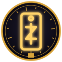{ .rune-ico-lg loading=lazy title="глиф изображал небольшую прямоугольную пластинку со странным символом" }
Пайцза Хранителя Вечности
«глиф изображал небольшую прямоугольную пластинку со странным символом» — ЗК-9, Глава 12

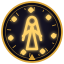{ .rune-ico-lg loading=lazy title="золотая Руна, формой отдаленно напоминающая стройную Восходящую с длинными волосами, окруженную множеством парящих глифов" }
Руна Азимандии
«золотая Руна, формой отдаленно напоминающая стройную Восходящую с длинными волосами, окруженную множеством парящих глифов» — ЗК-2, Глава 23

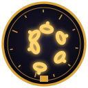{ .rune-ico-lg loading=lazy title="золотой глиф в миниатюре изображал свернутую шипастую цепь" }
Руна Живых Цепей
«золотой глиф в миниатюре изображал свернутую шипастую цепь» — ЗК-1, Глава 8

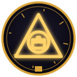{ .rune-ico-lg loading=lazy title="золотая Руна — огромная, вычурная, изображающая треугольник с игрушечным замком в круге" }
Руна Серебряного Замка
«золотая Руна — огромная, вычурная, изображающая треугольник с игрушечным замком в круге» — ЗК-5, Глава 16

{ .rune-ico-lg loading=lazy title="затейливый золотой глиф, изображающий стилизованного призрака с чем-то вроде свитка или книги" }
Руна Скрипторума Некролита
«затейливый золотой глиф, изображающий стилизованного призрака с чем-то вроде свитка или книги» — ЗК-7, Глава 20

{ .rune-ico-lg loading=lazy title="рунный символ напоминал стилизованного торговца в капюшоне" }
Руна Торгового Представителя Контракции
«рунный символ напоминал стилизованного торговца в капюшоне» — ЗК-8, Глава 15

{ .rune-ico-lg loading=lazy title="если судить по символу Руны, это создание напоминало длинное бревно с пучком длинных щупалец сзади" }
Болотница
«если судить по символу Руны, это создание напоминало длинное бревно с пучком длинных щупалец сзади» — ТБ-1, Глава 11

{ .rune-ico-lg loading=lazy title="серебряный глиф, изображающий стилизованный стремительный силуэт с крыльями-импеллерами" }
Винтокрыл «Грифон»
«серебряный глиф, изображающий стилизованный стремительный силуэт с крыльями-импеллерами» — ЗК-10, Глава 19

{ .rune-ico-lg loading=lazy title="первый глиф формой напоминал дымящийся треугольник" }
Домен Кузница Вулкана
«первый глиф формой напоминал дымящийся треугольник» — ЗК-6, Глава 16

{ .rune-ico-lg loading=lazy title="застежка в виде странной трехлучевой звезды — стеллы" }
Звезда Искателя
«застежка в виде странной трехлучевой звезды — стеллы» — ЗК-11, Глава 7

{ .rune-ico-lg loading=lazy title="трепещущий символ, напоминающий силуэт в капюшоне, окруженный сонмом призраков" }
Руна Заклинателя Духов
«трепещущий символ, напоминающий силуэт в капюшоне, окруженный сонмом призраков» — ЗК-5, Глава 14

{ .rune-ico-lg loading=lazy title="первый глиф удивительно напоминал маленького золотого дрона" }
Руна Экзо-кодек
«первый глиф удивительно напоминал маленького золотого дрона» — ЗК-3, Глава 11

{ .rune-ico-lg loading=lazy title="вторая Руна изображала шестиногое и безголовое существо" }
Руна Экзо-траон
«вторая Руна изображала шестиногое и безголовое существо» — ЗК-3, Глава 11

{ .rune-ico-lg loading=lazy title="серебряная Руна, по форме похожая на две наложенные маски" }
Чужое Лицо
«серебряная Руна, по форме похожая на две наложенные маски» — ТБ-5, Глава 1

{ .rune-ico-lg loading=lazy title="глиф, напоминающий человекообразного робота" }
Боевой Отражающий Доспех
«глиф, напоминающий человекообразного робота» — ЗК-7, Глава 8

{ .rune-ico-lg loading=lazy title="Руна-Предмет формой отчетливо напоминала щит" }
Зерцало (Чешуя Ледяного Червя, ¼)
«Руна-Предмет формой отчетливо напоминала щит» — ЗК-2, Глава 7

{ .rune-ico-lg loading=lazy title="символ напоминал грубый булыжник, привязанный к палке жилами" }
Каменный Топор
«символ напоминал грубый булыжник, привязанный к палке жилами» — ЗК-3, Глава 4

{ .rune-ico-lg loading=lazy title="глиф, похожий формой на веточку" }
Руна Зеленого Листа
«глиф, похожий формой на веточку» — ЗК-1, Глава 21

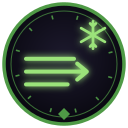{ .rune-ico-lg loading=lazy title="слегка трансформировался глиф — в его уголке зажглась небольшая снежинка" }
Руна Порыва Ледяного Ветра
«слегка трансформировался глиф — в его уголке зажглась небольшая снежинка» — ЗК-2, Глава 6

{ .rune-ico-lg loading=lazy title="простенький светло-серый глиф, состоящий из двух линий" }
Малая Руна Развития
«простенький светло-серый глиф, состоящий из двух линий» — ЗК-1, Глава 8

{ .rune-ico-lg loading=lazy title="глиф изображал услужливо согнутую фигуру в надвинутом капюшоне" }
Руна Бродячего Торговца
«глиф изображал услужливо согнутую фигуру в надвинутом капюшоне» — ТБ-1, Эпилог

{ .rune-ico-lg loading=lazy title="драконья Руна, чей символ напоминал женщину со змеиным хвостом" }
Руна Золотой Змеи
«драконья Руна, чей символ напоминал женщину со змеиным хвостом» — ЗК-8, Глава 18

{ .rune-ico-lg loading=lazy title="каменная площадка со стилизованной стрелой — тот же самый глиф Переноса, только большой" }
Руна Переноса
«каменная площадка со стилизованной стрелой — тот же самый глиф Переноса, только большой» — ЗК-6, Глава 25

### Знаки системы Восхождения <small>(4)</small>

Не Руны, но тоже глифы интерфейса, описанные в тексте.

{ .rune-ico-lg loading=lazy title="знакомый глиф Звездной Крови… изображающий стилизованную каплю" }
Капля Звездной Крови
«знакомый глиф Звездной Крови… изображающий стилизованную каплю» — ЗК-6, Глава 28

{ .rune-ico-lg loading=lazy title="золотой глиф со звездообразным символом в центре" }
Звездная Монета
«золотой глиф со звездообразным символом в центре» — ЗК-2, Глава 7

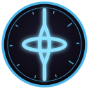{ .rune-ico-lg loading=lazy title="неподвижное веретено пульсара… глиф с его изображением в моем интерфейсе означал Вечность" }
Вечность
«неподвижное веретено пульсара… глиф с его изображением в моем интерфейсе означал Вечность» — ЗК-1, Глава 15

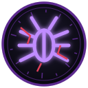{ .rune-ico-lg loading=lazy title="символы напоминали оживших многоногих тараканов… от туманно-серого до фиолетово-черного" }
Руны Мерзости
«символы напоминали оживших многоногих тараканов… от туманно-серого до фиолетово-черного» — ЗК-5, Глава 16

## Золото <small>(18)</small>

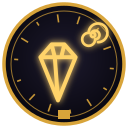{ .rune-ico-lg loading=lazy title="Артефакт древних эпох, созданный из Камня Стойкого Разума, чья история теряется во тьме. Обеспечивает защиту от любых воздействий на разум обладателя, включая ментальные, эмоциональные, контролирующие и порабощающие, вплоть до небесного ранга." }
Аграф Стойкого Разума
Руна-Предмет · ЗК-9, Глава 12

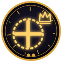{ .rune-ico-lg loading=lazy title="Используется для усиления основного эффекта других Рун. Столь ценным ресурсом вселенец мгновенно воспользовался самостоятельно — вложив Усиление в Руну Живых Цепей. Других вариантов, по сути, и не было. Небесный Ястреб и так прокачан до предела, ну а усиливать Азимандию — сомнительная идея, хотя оче" }
Великая Руна Усиления
Руна-Свойство · ЗК-5, Глава 14

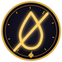{ .rune-ico-lg loading=lazy title="Извлекает влагу изо всех объектов и существ в зоне действия, оставляя после себя лишь сухую, лишенную жизни материю. Способно воздействовать на предметы и природный ландшафт. Время действия Иссушения зависит от устойчивости, количества и размеров объектов наложения." }
Иссушение
Руна-Заклинание · ТБ-1, Глава 16

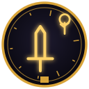{ .rune-ico-lg loading=lazy title="Содержит светоносное копье, излучающее пронзающий луч игг-сияния, способный уничтожать противника на большом расстоянии." }
Копье Игг-Света
Руна-Предмет · ЗК-7, Глава 2

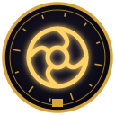{ .rune-ico-lg loading=lazy title="Содержит Кор Ноктис, полный тень-доспех, созданный для воительниц дома Ноктис. Сливается с владельцем, обеспечивая адаптивную защиту от физических, рунных и энергетических ударов. Особые способности: «Поцелуй Ноктис», «Поглощение света», «Ноктис-Зеркало». В паре с оружием Аски Ноктис увеличивает сво" }
Кор Ноктис
Руна-Предмет · ЗК-8, Глава 14

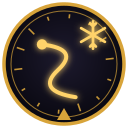{ .rune-ico-lg loading=lazy title="Содержит огромного ледяного дракариса, покрытого кристаллической броней, неуязвимой для обычного оружия. Стремительный дракарис может переносить нескольких наездников и поддерживать их в бою. Активные способности: «Ледяное Дыхание»." }
Ледяной Дракарис
Руна-Существо · ТБ-2, Глава 20

{ .rune-ico-lg loading=lazy title="Содержит Нагрудник Светоносных, созданный из измененного иллиума и излучающий благословенный игг-свет. Нагрудник неуничтожим для физического оружия, полностью блокирует энергетические и рунные удары. Является частью Доспеха Светоносных, созданного в дрейф-цитадели Нарсил для рыцарей Великой Охоты." }
Нагрудник Светоносных (Доспех Светоносного, ¼)
Руна-Предмет · ЗК-7, Глава 2

{ .rune-ico-lg loading=lazy title="Содержит огромное пространственное хранилище, способное вмещать предметы крупного и сверхкрупного размера. Имеет золотую Скрижаль, способную хранить Руны и Звездные Монеты. Имеет Арсенал, способный хранить рунные доспехи и оружие. Имеет Чертог, способный содержать неживых слуг. Может быть превращена" }
Несокрушимый Реликварий
Руна-Хранилище · ЗК-8, Эпилог

{ .rune-ico-lg loading=lazy title="Содержит Звездную Кровь А в следующий миг Наблюдатель прислал мне сообщение. Восходящий Сигурд! Ваша Слава повышена на 100." }
Росток Игг-Древа
ЗК-6, Глава 27

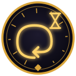{ .rune-ico-lg loading=lazy title="Создает на объекте наложения временную петлю, через три секунды возвращая его в момент наложения Руны." }
Руна Временной Петли
Руна-Заклинание · ЗК-7, Глава 17

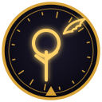{ .rune-ico-lg loading=lazy title="Внутри заключен Игг-Феникс, светоносная птица, рожденная из Игг-Света. Феникс неуязвим для обычного оружия, излучает ауру исцеляющего игг-сияния и способен, принеся себя в жертву, воскресить владельца из мертвых. Для уточнения возможностей активируйте Руну." }
Руна Игг-Феникса
Руна-Существо · ТБ-4, Глава 1

{ .rune-ico-lg loading=lazy title="Использование требует дополнительных затрат Звездной Крови. Содержит Небесный Ястреб, летающий артефакт-доспех Вечности из измененного иллиума. Внимание: использование требует дополнительных затрат Звездной Крови. Для уточнения возможностей активируйте Руну." }
Руна Небесного Ястреба
Руна-Предмет · ЗК-5, Глава 1

{ .rune-ico-lg loading=lazy title="Внутри заключена кел-леди Азимандия из Дома Визу Аран, рунный мастер ранга «золото». Для уточнения ее возможностей активируйте Руну." }
Руна Рунный Мастер
Руна-Существо · ЗК-2, Глава 23

{ .rune-ico-lg loading=lazy title="Использование требует дополнительных затрат Звездной Крови Содержит Голубую Стрелу, именной боевой стигис небесного дозора, летающий корабль из синей стали и измененного иллиума. Для уточнения возможностей активируйте Руну. ??? ???" }
Стигис Голубая Стрела
Руна-Предмет · ЗК-10, Глава 8

{ .rune-ico-lg loading=lazy title="Содержит Счастливую Монету Контракции. Владелец может испытать свое счастье, подбросив ее — и удачный бросок принесет случайную Руну из запасов Контракции. Неудачный бросок не принесет ничего. Пусть тебе повезет (или нет). Внимание: каждый бросок безвозвратно забирает 120 капель Звездной Крови." }
Счастливая Монета Контракции
Руна-Предмет · ЗК-8, Глава 10

{ .rune-ico-lg loading=lazy title="Описание отсутствовало — такое бывало в случае созданных вручную Саг, которые Восходящий не пожелал подписывать. Такой же безымянный подарок на свадьбу преподнес мне Эйрик. Несмотря на предупреждение Морвейн, отвергать дар Сестры Солнца было бы глупо и опасно. К тому же он мог пролить свет на тайны " }
Тем-Чей-Ранг-Неизвестен
Руна-Сага · ЗК-9, Глава 14

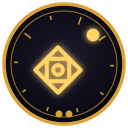{ .rune-ico-lg loading=lazy title="Может быть преобразована в любую Руну-Свойство равного качества." }
Универсальная Руна
Руна-Свойство · ЗК-4, Глава 21

{ .rune-ico-lg loading=lazy title="Содержит Экзо-Банши, элитного экзо-истребителя Наблюдателя. Банши использует драйв-пульсацию, вооружена клинками жесткого света, способна вести как наземный, так и воздушный бой, синхронизироваться с другими экзо и эффективна против целей любого типа." }
Экзо-Банши
Руна-Существо · ЗК-10, Глава 20

## Серебро <small>(45)</small>

{ .rune-ico-lg loading=lazy title="Содержит 24 капель Звездной Крови Звезды используются для создания Рун Необходим Навык «Контроль Звездной Крови» (серебро)" }
Большая Звезда
ЗК-3, Глава 19

{ .rune-ico-lg loading=lazy title="Переносит владельца на Великий Перекресток — узел древних путей Великих Караванов. На Перекрестке можно заказать прибытие любого доступного Каравана в указанную точку Единства, приобрести редкие товары и услуги, а также получить информацию о безопасных путях. Использовано ⅗ зарядов" }
Домен «Великий Перекресток»
Руна-Ключ · ЗК-10, Глава 19

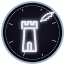{ .rune-ico-lg loading=lazy title="Это смертельное испытание под сигной Кровавого Феникса. Тот, кто вошел, должен сразиться с другим Восходящим. Покинуть арену сможет только один. Два домена с награды за убийство Огнезуба имели огненную стихию! Интересная зависимость…! Все Домены были очень любопытными, особенно первый и последний. О" }
Домен Кровавого Феникса
Руна-Арена · ЗК-6, Глава 16

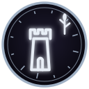{ .rune-ico-lg loading=lazy title="В Перерождающихся Джунглях смелого Восходящего ждут испытания и награды! Вторая, наоборот, напоминала затейливый гротескный дворец: Домен Серебряный Замок Качество-серебро" }
Домен Перерождающиеся Джунгли
Руна-Сокровище · ЗК-2, Глава 17

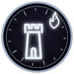{ .rune-ico-lg loading=lazy title="В лабиринте из вечного огня ты найдешь серебряное сокровище, если выдержишь испытания! А третья походила на птицу, распростершую крылья:" }
Домен Пламенный Лабиринт
Руна-Башня · ЗК-6, Глава 16

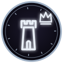{ .rune-ico-lg loading=lazy title="На небесном осколке ждут достойных, готовых занять Сломанный Трон! Я ничего не понимал! Что это значит? О Доменах мне мало что удалось узнать, кроме того, что Руна считалась невероятно опасной. Травинка мельком обмолвилась, что не знает никого, кто из них возвращался, а Динамита и Ко расспросить не " }
Домен Сломанный Трон
Руна-Башня · ЗК-2, Глава 17

{ .rune-ico-lg loading=lazy title="100/100 Звездной Крови Форма эфирного Аспекта из Звездной Крови, которую вы можете призывать на помощь. Обладает следующими способностями: «Полет» — Аспект может летать и носить всадника-Восходящего. Использует 1 каплю Звездной Крови. «Звездный Свет» — эфирная субстанция, из которой состоит Аспект, " }
Дракон Звездного Света
Аспект Восходящего · ЗК-5, Глава 4

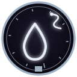{ .rune-ico-lg loading=lazy title="Обладатель жезла получает способность мысленно подчинять всех фроггов в радиусе прямой видимости. Все подчиненные существа выполняют любые команды обладателя жезла или указанных им существ. Жезл обеспечивает непрерывную и абсолютную власть, в том числе за пределами радиуса видимости. Внимание: На по" }
Драконий Жезл Змеиной Крови
Руна-Предмет · ТБ-1, Глава 9

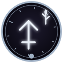{ .rune-ico-lg loading=lazy title="Умение мгновенно заживлять поверхностные раны, быстро — глубокие ранения и в течение нескольких суток выращивать потерянные части тела или внутренние органы." }
Животворный Рост
Руна-Умение · ТБ-1, Глава 14

{ .rune-ico-lg loading=lazy title="С одержит сосуд-хранилище, созданный по древним технологиям Народа Кел. Улавливает и втягивает внутрь душу владельца (а также его Звездную Кровь) в момент смерти, не позволяя ей уйти за Грань. Может содержать неограниченное количество душ. Внимание: сосуд запечатан. При вскрытии печати все содержащи" }
Запечатанная Драконья Клетка Душ
Руна-Хранилище, Руна-Предмет · ЗК-8, Глава 15

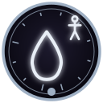{ .rune-ico-lg loading=lazy title="Наделяет способностью выделять разъедающую органическую кислоту. Внимание: ее воздействие распространяется в том числе на ваше собственное тело. Применяйте с осторожностью." }
Кислотная Жидкость
Руна-Умение · ЗК-6, Глава 2

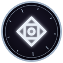{ .rune-ico-lg loading=lazy title="Восходящий должен пройти череду смертельных испытаний, вращая Колесо. Каждая его остановка — уникальное задание, которое может принести Руну… или смерть." }
Колесо-в-Глубинах
Руна-Башня · ТБ-2, Глава 5

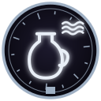{ .rune-ico-lg loading=lazy title="Содержит кувшин, наполненный Звездной Водой, ускоряющей рост и созревание Трав. Наделяет все растущее Звездной Кровью. Вода обладает исцеляющими и защитными свойствами, смертельна для Червей и любых созданий, содержащих кровь Червей. Зарядов 3/3" }
Кувшин Звездной Воды
Руна-Предмет · ЗК-7, Глава 16

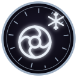{ .rune-ico-lg loading=lazy title="Открывает Портал в Ледяную Бездну, смертельно опасную область во Тьме, богатую измененной материей." }
Ледяная Бездна
Руна-Портал · ЗК-6, Глава 16

{ .rune-ico-lg loading=lazy title="Наделяет объект применения (разумное существо) способностью временно объединять разумы союзников, с помощью телепатической связи улучшая координацию, синхронизацию действий и повышая коллективную эффективность." }
Объединение Разумов
Руна-Заклинание · ЗК-7, Глава 13

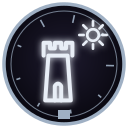{ .rune-ico-lg loading=lazy title="В этих Пещерах мерцают отблески Звездной Крови. Священные знания ждут паломников, желающих идти по великой лестнице Восхождения…" }
Пещеры Древнего Света
Руна-Храм · ТБ-2, Глава 5

{ .rune-ico-lg loading=lazy title="Наделяет способностью к психокинетическим манипуляциям с материальными объектами. Позволяет производить направленное воздействие разного рода, зависящее от Атрибутов применяющего. Ведущий Атрибут: Псионика" }
Психокинетика
Руна-Умение · ЗК-7, Глава 13

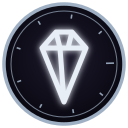{ .rune-ico-lg loading=lazy title="Осколки Скрижалей ждут тебя в пустоте, Восходящий! Есть среди них и золотой, но сумеешь ли ты найти его? Сокровище — не Башня, но его тоже нельзя было получить без смертельного риска — в этом и заключался смысл Восхождения. Об этом приключении Пламени Подобный никогда не слышал, но тем интереснее бы" }
Разбитая Скрижаль
Руна-Сокровище · ТБ-3, Глава 1

{ .rune-ico-lg loading=lazy title="Создает иллюзорные дубликаты цели, имитирующие заданные действия." }
Руна Астральных Фантомов
Руна-Заклинание · ЗК-5, Глава 14

{ .rune-ico-lg loading=lazy title="Содержит Доминион Призрачных Арахнидов, состоящий из десяти Арахнидов-Ткачей, десяти Арахнидов-Сталкеров и десяти Арахнидов-Жнецов. Все Арахниды Доминиона ядовиты, а их паутина способна сковывать даже призрачных существ." }
Руна Доминиона Призрачных Арахнидов
Руна-Существо · ЗК-5, Глава 14

{ .rune-ico-lg loading=lazy title="При активации обучает Навыку Духовной Проекции (качество: серебро). После активации Руна исчезает." }
Руна Духовной Проекции
Руна-Навык · ЗК-5, Глава 14

{ .rune-ico-lg loading=lazy title="Добавляет дополнительную звезду усиления другой Руне соответствующего ранга. Любая Руна изначально имеет три слота усилений — в системе Восхождения они называются звездами. Но я видел Руны и с пятью, и с шестью апгрейдами — чтобы далеко не ходить, таков был отнятый у Азимандии Истинный Взор или Кувш" }
Руна Звезды
Руна-Свойство · ЗК-7, Глава 20

{ .rune-ico-lg loading=lazy title="Наделяет Истинным Зрением, позволяющим видеть скрытое и замечать незримое, смотреть в самую суть вещей, отличать иллюзии от реальности и видеть призрачных сущностей любого уровня." }
Руна Истинный Взор
Руна-Заклинание · ЗК-3, Глава 19

{ .rune-ico-lg loading=lazy title="Мгновенно исцеляет легкие, тяжелые (включая переломы) и смертельные ранения, если объект применения еще жив. Не может восстанавливать потерянные конечности. Не может исцелить организм при потере более 30% клеточной массы." }
Руна Исцеления
Руна-Заклинание · ЗК-5, Глава 3

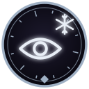{ .rune-ico-lg loading=lazy title="Создает луч ледяного света, мгновенно замораживающий цель." }
Руна Ледяного Взора
Руна-Заклинание · ЗК-5, Глава 10

{ .rune-ico-lg loading=lazy title="Полностью имитирует стигмат Восходящего, маскируя ранг, Скрижаль, Атрибуты и Руны согласно желанию владельца Руны." }
Руна Ложного Стигмата
Руна-Предмет · ЗК-6, Глава 15

{ .rune-ico-lg loading=lazy title="Создает огненный болид, попадающий в указанное место и вызывающий мощный взрыв при контакте с целью. Внимание: применение на короткой дистанции без защиты собственного тела может привести к тяжелым ранениям и смерти!" }
Руна Огненного Болида
Руна-Заклинание · ЗК-6, Глава 7

{ .rune-ico-lg loading=lazy title="Мгновенно восстанавливает таймер перезарядки Руны своего ранга, позволяя снова использовать ее. Внимание: при активации Перезарядки одна звезда улучшения Руны-объекта будет безвозвратно утрачена." }
Руна Перезарядки
Руна-Свойство · ЗК-6, Глава 15

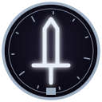{ .rune-ico-lg loading=lazy title="Содержит невидимый плоскостной клинок, способный увеличиваться в размере." }
Руна Плоскостной Меч
Руна-Предмет · ЗК-5, Глава 2

{ .rune-ico-lg loading=lazy title="Позволяет временно подчинить призрачное существо." }
Руна Подчинения Призрака
Руна-Умение · ЗК-5, Глава 14

{ .rune-ico-lg loading=lazy title="Переносит в любую видимую точку в небольшом радиусе, игнорируя материальные преграды." }
Руна Призрачного Шага
Руна-Заклинание · ЗК-5, Глава 2

{ .rune-ico-lg loading=lazy title="Создает мощную пламенную ауру, исходящую от вашего тела. Внимание: воздействие ауры на посторонние объекты может повредить или разрушить их." }
Руна Раскаленной Ауры
Руна-Умение · ЗК-6, Глава 7

{ .rune-ico-lg loading=lazy title="Создает вокруг цели или группы целей эффект ускоренного времени, позволяя опережать противника." }
Руна Ускорения Времени
Руна-Заклинание · ЗК-5, Глава 14

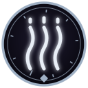{ .rune-ico-lg loading=lazy title="Создает феромонную метку, привлекающую отродий Червей." }
Руна Феромонов
Руна-Заклинание · ЗК-2, Глава 16

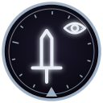{ .rune-ico-lg loading=lazy title="Внутри заключен экзо-шейд, малый воин Наблюдателя. Способен становиться невидимым, проникать сквозь препятствия и эффективно уничтожать врагов. Для уточнения возможностей активируйте Руну." }
Руна Экзо-шейд
Руна-Существо · ЗК-3, Глава 11

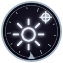{ .rune-ico-lg loading=lazy title="Внутри заключен светожук, небольшое летающее существо, которое излучает целебный и отпугивающий Червей свет. Исцеляет раны, нейтрализует токсины и яды, ускоряет регенерацию и создает защитный световой купол. Для уточнения возможностей активируйте Руну." }
Светожук-Целитель
Руна-Существо · ЗК-7, Глава 12

{ .rune-ico-lg loading=lazy title="Зародыш Домена, дарующий кристалл-сферу серебряного ранга, ведущую на камень в ее пустотной глубине. Получив его, Восходящий становится владельцем внутреннего пространства, которое можно изменять по своему усмотрению. Зерно при прорастании преобразуется в Руну-Домен. Владелец может управлять им, соз" }
Семя Домена
Руна-Зерно · ТБ-2, Глава 5

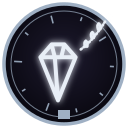{ .rune-ico-lg loading=lazy title="Содержит артефакт Вечности. Будучи экипированным, в случае получения ранений без участия владельца активирует «Исцеление», устраняющее последствия легких, тяжелых (включая переломы) и смертельных ранений (если объект применения еще жив). Не может исцелить при потере значительной доли целостности орг" }
Серебряный Кристалл Странника
Руна-Предмет · ЗК-6, Глава 11

{ .rune-ico-lg loading=lazy title="Внутри заключен Серебряный Огнезуб, свирепый и беспощадный охотник на Червей. Его тело защищено прочной серебряной чешуей, а зубы, когти и огненное дыхание эффективны против большинства видов Червей. Для уточнения возможностей активируйте Руну." }
Серебряный Огнезуб
Руна-Существо · ЗК-7, Глава 12

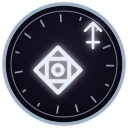{ .rune-ico-lg loading=lazy title="Символы используются для создания Рун. Необходим Навык «Рунное Искусство» (серебро) Примечательно, что они занимали не двадцать, а всего восемь слотов в моей Скрижали, подразделяясь по видам. У нас в наличии имелось пять Символов Развития, пять Символов Ключа, пять Символов Существа и по одному — Ум" }
Символ Развития
ЗК-3, Глава 19

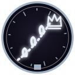{ .rune-ico-lg loading=lazy title="Оружие из священной синей стали, созданное мастерами Ордена Истинных. Тарн невозможно сломать, повредить или уничтожить. Он усиливает восстановление Звездной Крови у своего владельца, способен пробивать большинство физических преград, а также наносить раны эфирным и призрачным созданиям." }
Тарн Искателя
Руна-Предмет · ЗК-8, Глава 11

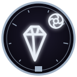{ .rune-ico-lg loading=lazy title="Содержит рунную пилюлю, при применении укрепляющую тело до верхних пределов серебряного ранга. Восходящий становится почти неуязвим для физических атак низших рангов, способен выдерживать экстремальные нагрузки и не подвержен болевому шоку. Внимание: может нанести повреждения телу низкого ранга. По " }
Черная Пилюля Несокрушимости
Руна-Предмет · ЗК-8, Глава 19

{ .rune-ico-lg loading=lazy title="Наделяет способностью воспринимать, понимать и воспроизводить ментально-феромонные команды, используемые Червями." }
Шепот Червей
Руна-Умение · ЗК-6, Глава 2

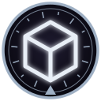{ .rune-ico-lg loading=lazy title="Внутри заключен экзо-арсенал, малый боевой склад Наблюдателя. Способен хранить и транспортировать Руны, боевые артефакты, а также любые иные предметы в своей внутренней Скрижали, предоставляя немедленный доступ на поле боя. Способен передвигаться и развертываться, образуя укрытие бункерного типа. Дл" }
Экзо-Арсенал
Руна-Существо · ЗК-7, Глава 12

{ .rune-ico-lg loading=lazy title="Наделяет способностью переносить экстремальные температурные условия." }
Экстремальная Терморегуляция
Руна-Умение · ЗК-6, Глава 2

## Бронза <small>(29)</small>

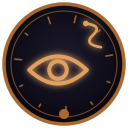{ .rune-ico-lg loading=lazy title="Наделяет зрением Небесного Змея, значительно обостряя существующие способности. Позволяет видеть в недоступных человеческому глазу диапазонах." }
Глаз Небесного Змея
Руна-Умение · ЗК-7, Глава 2

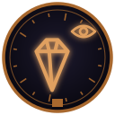{ .rune-ico-lg loading=lazy title="Содержит призматический кристалл, сквозь который можно наблюдать бестелесные сущности, в том числе находящиеся в живых существах или предметах." }
Кристалл Видящего
Руна-Предмет · ЗК-2, Глава 7

{ .rune-ico-lg loading=lazy title="??? ??? И все. Пояснения отсутствовали в принципе. Что это и зачем вообще нужно? Я рискнул «прозвонить» обломок, мысленно его активируя, и добился появления надписи: Соединить Скрижали?" }
Обломок Скрижали Восходящего
ЗК-1, Глава 14

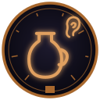{ .rune-ico-lg loading=lazy title="Содержит поющий кувшин из синего нефрита, наполненный золотым эл-центийским вином. Репертуар кувшина — более семи тысяч благозвучных мелодий. Сладкое игристое вино обладает чудесными свойствами: раскрепощает любовников и дарует им неутомимость в ложе." }
Поющий Кувшин
Руна-Предмет · ЗК-2, Глава 7

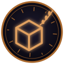{ .rune-ico-lg loading=lazy title="Используется для хранения. Не может хранить живое. Не может хранить вещи, размером превышающие человека. Не может хранить Руны-Предметы." }
Расширенная Сумка Искателя
Руна-Хранилище · ЗК-3, Глава 3

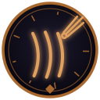{ .rune-ico-lg loading=lazy title="При фокусировке создает испепеляющий энергетический луч." }
Руна Алого Когтя
Руна-Заклинание · ЗК-1, Глава 14

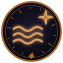{ .rune-ico-lg loading=lazy title="При фокусировке создает испепеляющий энергетический поток." }
Руна Алого Потока
Руна-Заклинание · ЗК-2, Глава 16

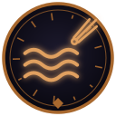{ .rune-ico-lg loading=lazy title="Создает испепеляющую энергетическую волну в указанном направлении." }
Руна Алой Волны
Руна-Заклинание · ЗК-5, Глава 10

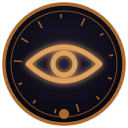{ .rune-ico-lg loading=lazy title="Вид пространственного чутья, позволяющий определять положение объектов в окружающем пространстве." }
Руна Биолокации
Руна-Умение · ЗК-2, Глава 16

{ .rune-ico-lg loading=lazy title="Обучает навыку Выживания (качество бронза). После активации Руна исчезает." }
Руна Выживания
Руна-Навык · ЗК-5, Глава 1

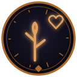{ .rune-ico-lg loading=lazy title="В указанном месте прорастает колючий побег, который опутывает цель в радиусе пяти метров." }
Руна Живой Побег
Руна-Заклинание · ЗК-3, Глава 15

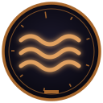{ .rune-ico-lg loading=lazy title="При активации обучает навыку «Мастер Пловец» в водной стихии. После активации Руна исчезает." }
Руна Мастера Пловца
Руна-Навык · ЗК-4, Глава 20

{ .rune-ico-lg loading=lazy title="Уменьшает скорость падения объекта наложения." }
Руна Медленного Падения
Руна-Заклинание · ЗК-4, Глава 18

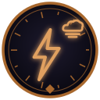{ .rune-ico-lg loading=lazy title="Создает разряд молнии, попадающий в указанное место." }
Руна Облачной Молнии
Руна-Заклинание · ЗК-4, Глава 18

{ .rune-ico-lg loading=lazy title="Позволяет дышать, находясь под водой." }
Руна Подводное Дыхание
Руна-Заклинание · ЗК-3, Глава 19

{ .rune-ico-lg loading=lazy title="Создает из Звездной Крови призрачную руку, которая может менять форму, проникать сквозь препятствия и манипулировать материальными предметами согласно вашим указаниям." }
Руна Призрачная Рука
Руна-Заклинание · ЗК-3, Глава 19

{ .rune-ico-lg loading=lazy title="Создает обжигающую ауру, исходящую от ваших рук. Внимание: Любое прикосновение к посторонним объектам (в том числе к собственному телу) может повредить их." }
Руна Пылающих Рук
Руна-Заклинание · ЗК-3, Глава 5

{ .rune-ico-lg loading=lazy title="Древнее рунное искусство, позволяющее создавать, разрушать и изменять Руны, Скрижали и Знаки. На бронзовой стадии ведущий Атрибут — Интеллект" }
Руна Рунное Мастерство
Руна-Навык · ЗК-2, Глава 21

{ .rune-ico-lg loading=lazy title="Используется для создания связи между Рунами." }
Руна Связи
ЗК-5, Глава 10

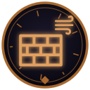{ .rune-ico-lg loading=lazy title="Создает в указанном направлении неподвижную область воздушных завихрений." }
Руна Стены Ветра
Руна-Заклинание · ЗК-4, Глава 18

{ .rune-ico-lg loading=lazy title="Содержит стигмат неизвестного Восходящего." }
Руна Стигмата Восходящего
Руна-Предмет · ЗК-5, Глава 3

{ .rune-ico-lg loading=lazy title="Создает мощный замораживающий поток воздуха в указанном направлении." }
Руна Холодного Дыхания
Руна-Заклинание · ЗК-4, Глава 22

{ .rune-ico-lg loading=lazy title="Содержит Шлем Ледоманта, лед-артефакт, изготовленный из чешуи Ледяного Червя и измененного ледяного хрусталя. Шлем испускает ауру холода, замораживающую ближайших врагов, и позволяет видеть тепловые следы, обнаруживая скрытых врагов. Является одной из четырех частей Чешуи Ледяного Червя — рунного до" }
Руна Шлема Ледоманта (Чешуя Ледяного Червя 2/4)
Руна-Предмет · ЗК-5, Глава 10

{ .rune-ico-lg loading=lazy title="Создает облако ядовитого газа, отравляющего всех в области применения." }
Руна Ядовитого Дыхания
Руна-Заклинание · ЗК-3, Глава 17

{ .rune-ico-lg loading=lazy title="В указанном месте прорастает колючий ядовитый побег, который опутывает и отравляет цель в радиусе пяти метров." }
Руна Ядовитый Побег
Руна-Заклинание · ЗК-3, Глава 15

{ .rune-ico-lg loading=lazy title="Содержит рунический флакон, наполненный эликсиром, нейтрализующим действие большинства известных ядов, токсинов и отравляющих веществ. Очищает организм от последствий проклятых и стихийных эффектов и паразитических заражений. На один древодень дает полный иммунитет к действию ядов, а также обеспечив" }
Рунический Эликсир Очищения
Руна-Предмет · ЗК-5, Глава 17

{ .rune-ico-lg loading=lazy title="Создает вокруг объекта применения сферическую область, непроницаемую для звуков." }
Сфера Тишины
Руна-Заклинание · ЗК-7, Глава 13

{ .rune-ico-lg loading=lazy title="Содержит Шкуру Фростбьорна, теплый и прочный меховой плащ, оберегающий носителя от холода." }
Шкура Фростбьорна
Руна-Предмет · ТБ-2, Глава 5

{ .rune-ico-lg loading=lazy title="Возможные варианты: Символ Изменения (бронза) — 95% Символ Развития (бронза) — 75% Символ Усиления (бронза) — 75%" }
Ядро
ЗК-7, Глава 7

## Дерево <small>(11)</small>

{ .rune-ico-lg loading=lazy title="Используется для изменения свойств Рун" }
Малая Руна Изменения
Руна-Свойство · ЗК-1, Глава 19

{ .rune-ico-lg loading=lazy title="Используется для изменения свойства или вида Руны." }
Малая Руна Превращения
Руна-Свойство · ЗК-2, Глава 16

{ .rune-ico-lg loading=lazy title="Стихия — лед. Используется для придания стихийных свойств другим Рунам. Любопытно — кроме Рун Развития и Изменения, теперь я увидел Стихию. Судя по описанию, она использовалась для изменения свойств других Рун соответствующего ранга, но как это работает?" }
Малая Руна Стихии
Руна-Свойство · ЗК-2, Глава 6

{ .rune-ico-lg loading=lazy title="Возможные варианты: Символ Развития (дерево) — 65% Символ Изменения (дерево) — 33% Символ Стихии Яд (дерево) — 18%" }
Малое Ядро
ЗК-3, Глава 19

{ .rune-ico-lg loading=lazy title="Расскажет скрытую историю, поместив вас в тело одного из ее героев." }
Просьба Изгнанников
Руна-Сага · ЗК-3, Глава 4

{ .rune-ico-lg loading=lazy title="При активации обучает навыку Боя-без-Оружия (качество дерево). После активации Руна исчезает." }
Руна Боя-без-Оружия
Руна-Навык · ЗК-1, Глава 14

{ .rune-ico-lg loading=lazy title="При активации позволяет совершать длинные прыжки на значительное расстояние." }
Руна Легкий Прыжок
Руна-Умение · ЗК-2, Глава 6

{ .rune-ico-lg loading=lazy title="При активации позволяет видеть в естественной темноте" }
Руна Ночное Зрение
Руна-Умение · ЗК-3, Глава 2

{ .rune-ico-lg loading=lazy title="Создает направленный порыв ветра в указанную сторону Время действия — 1 секунда Время перезарядки — 30 секунд" }
Руна Порыва Ветра
Руна-Заклинание · ЗК-1, Глава 19

{ .rune-ico-lg loading=lazy title="Содержит штурмовую винтовку типа «Суворов-3М», произведенную Народом Земли." }
Руна Штурмовой Винтовки
Руна-Предмет · ЗК-5, Глава 3

{ .rune-ico-lg loading=lazy title="При активации обучает начальному Знанию Единого Языка. После активации Руна исчезает." }
Руна Языка (Единый)
Руна-Навык · ЗК-3, Глава 3

## Мерзость <small>(1)</small>

{ .rune-ico-lg loading=lazy title="Вызывает у цели состояние безумия, неконтролируемой паранойи, сопровождаемой галлюцинациями. Внимание: слабых особей может заставить покончить с собой." }
Проклятая Руна
ЗК-5, Глава 16

## Особый ранг <small>(2)</small>

{ .rune-ico-lg loading=lazy title="Заготовка (соответствие термину 70%), шаблон (соответствие термину 55%) для записи любых Рун качества «особая». Необходим Навык «Рунный Мастер». Все чудеснее и чудеснее. Нулевая заготовка, рунный мастер. Повеяло низкопробными электронными новеллами из разряда тех, чьи названия стираются из памяти бы" }
Нулевая Руна
ЗК-1, Глава 9

{ .rune-ico-lg loading=lazy title="При активации значительно обостряет слуховое восприятие, позволяя слышать в большем радиусе и на ранее недоступных частотах." }
Руна Чуткого Уха
Руна-Умение · ЗК-1, Глава 8

## Ранг в тексте не указан <small>(84)</small>

{ .rune-ico-lg loading=lazy title="Упоминаний в тексте: 6" }
Руна Анор
ЗК-1, Интерлюдия. Белый Дьявол, стр. 449

{ .rune-ico-lg loading=lazy title="Упоминаний в тексте: 2" }
Руна Болида
ЗК-6, Глава 7, стр. 651

{ .rune-ico-lg loading=lazy title="Упоминаний в тексте: 2" }
Руна Великой Пустоты
ЗК-8, Глава 17, стр. 1744

{ .rune-ico-lg loading=lazy title="Упоминаний в тексте: 2" }
Руна Ветра
ТБ-1, Глава 3, стр. 376

{ .rune-ico-lg loading=lazy title="Упоминаний в тексте: 4" }
Руна Винсента
ЗК-7, Глава 8, стр. 962

{ .rune-ico-lg loading=lazy title="Упоминаний в тексте: 2" }
Руна Водяного Тела
ТБ-1, Глава 18, стр. 2083

{ .rune-ico-lg loading=lazy title="Упоминаний в тексте: 2" }
Руна Водяного Эха
ТБ-1, Глава 5, стр. 563

{ .rune-ico-lg loading=lazy title="Упоминаний в тексте: 2" }
Руна Восхождения
ЗК-5, Глава 16, стр. 1652

{ .rune-ico-lg loading=lazy title="Упоминаний в тексте: 3" }
Руна Времени
ЗК-8, Глава 9, стр. 896

{ .rune-ico-lg loading=lazy title="Упоминаний в тексте: 3" }
Руна Всеобъемлющей Чистоты
ЗК-8, Глава 15, стр. 1515

{ .rune-ico-lg loading=lazy title="Упоминаний в тексте: 6" }
Руна Гипнотизма
ЗК-4, Глава 2, стр. 202

{ .rune-ico-lg loading=lazy title="Упоминаний в тексте: 3" }
Руна Говорящей-с-Травами
ЗК-6, Глава 17, стр. 1672

{ .rune-ico-lg loading=lazy title="Упоминаний в тексте: 2" }
Руна Громового Шквала
ТБ-1, Глава 3, стр. 370

{ .rune-ico-lg loading=lazy title="Упоминаний в тексте: 2" }
Руна Деревянной Кожи
ЗК-3, Глава 4, стр. 289

{ .rune-ico-lg loading=lazy title="Упоминаний в тексте: 2" }
Руна Дирка
ЗК-11, Глава 11, стр. 1495

{ .rune-ico-lg loading=lazy title="Упоминаний в тексте: 16" }
Руна Домена
ЗК-2, Глава 18, стр. 1520

{ .rune-ico-lg loading=lazy title="Упоминаний в тексте: 3" }
Руна Дуговой Искры
ЗК-4, Глава 19, стр. 1744

{ .rune-ico-lg loading=lazy title="Упоминаний в тексте: 2" }
Руна Желания
ЗК-9, Глава 2, стр. 151

{ .rune-ico-lg loading=lazy title="Упоминаний в тексте: 22" }
Руна Забвения
ЗК-3, Глава 16, стр. 1467

{ .rune-ico-lg loading=lazy title="Упоминаний в тексте: 4" }
Руна Запечатления
ЗК-4, Глава 14, стр. 1268

{ .rune-ico-lg loading=lazy title="Упоминаний в тексте: 2" }
Руна Зеркальной Чешуи
ЗК-4, Глава 21, стр. 1872

{ .rune-ico-lg loading=lazy title="Упоминаний в тексте: 2" }
Руна Золотой Воды
ТБ-2, Глава 3, стр. 238

{ .rune-ico-lg loading=lazy title="Упоминаний в тексте: 2" }
Руна Иллиумовой Цепи
ТБ-2, Глава 1, стр. 58

{ .rune-ico-lg loading=lazy title="Упоминаний в тексте: 2" }
Руна Имени
ЗК-10, Глава 8, стр. 856

{ .rune-ico-lg loading=lazy title="Упоминаний в тексте: 2" }
Руна Искусства Торговли
ТБ-2, Глава 1, стр. 97

{ .rune-ico-lg loading=lazy title="Упоминаний в тексте: 4" }
Руна Кассиди
ЗК-9, Глава 8, стр. 770

{ .rune-ico-lg loading=lazy title="Упоминаний в тексте: 3" }
Руна Кейнора
ЗК-8, Глава 21, стр. 2207

{ .rune-ico-lg loading=lazy title="Упоминаний в тексте: 3" }
Руна Кнута
ЗК-4, Глава 24, стр. 2170

{ .rune-ico-lg loading=lazy title="Упоминаний в тексте: 2" }
Руна Космос
ЗК-12, Пролог. Великие Руны, стр. 26

{ .rune-ico-lg loading=lazy title="Упоминаний в тексте: 2" }
Руна Кровавого Чутья
ТБ-1, Глава 1, стр. 107

{ .rune-ico-lg loading=lazy title="Упоминаний в тексте: 3" }
Руна Ледяных Игл
ЗК-2, Глава 6, стр. 460

{ .rune-ico-lg loading=lazy title="Упоминаний в тексте: 3" }
Руна Ледяных Кинжалов
ТБ-1, Глава 4, стр. 464

{ .rune-ico-lg loading=lazy title="Упоминаний в тексте: 2" }
Руна Маскировки
ЗК-9, Глава 12, стр. 1253

{ .rune-ico-lg loading=lazy title="Упоминаний в тексте: 3" }
Руна Ментального Доминирования
ЗК-5, Глава 20, стр. 2041

{ .rune-ico-lg loading=lazy title="Упоминаний в тексте: 3" }
Руна Морвены
ЗК-5, Глава 14, стр. 1306

{ .rune-ico-lg loading=lazy title="Упоминаний в тексте: 2" }
Руна Морозной Закалки
ЗК-8, Глава 19, стр. 2009

{ .rune-ico-lg loading=lazy title="Упоминаний в тексте: 2" }
Руна Навыков
ЗК-2, Глава 18, стр. 1560

{ .rune-ico-lg loading=lazy title="Упоминаний в тексте: 3" }
Руна Надзора
ЗК-10, Глава 18, стр. 2180

{ .rune-ico-lg loading=lazy title="Упоминаний в тексте: 4" }
Руна Невидимости
ЗК-6, Глава 23, стр. 2240

{ .rune-ico-lg loading=lazy title="Упоминаний в тексте: 3" }
Руна Ночницы
ЗК-5, Глава 17, стр. 1791

{ .rune-ico-lg loading=lazy title="Упоминаний в тексте: 2" }
Руна Облачения
ЗК-6, Глава 13, стр. 1173

{ .rune-ico-lg loading=lazy title="Упоминаний в тексте: 2" }
Руна Облачения Странника
ЗК-5, Глава 6, стр. 543

{ .rune-ico-lg loading=lazy title="Упоминаний в тексте: 2" }
Руна Огненного Вихря
ТБ-2, Глава 4, стр. 249

{ .rune-ico-lg loading=lazy title="Упоминаний в тексте: 2" }
Руна Огненного Куба
ТБ-2, Глава 1, стр. 59

{ .rune-ico-lg loading=lazy title="Упоминаний в тексте: 2" }
Руна Огненной Защиты
ЗК-4, Глава 21, стр. 1871

{ .rune-ico-lg loading=lazy title="Упоминаний в тексте: 3" }
Руна Огненной Крови
ЗК-11, Глава 13, стр. 1702

{ .rune-ico-lg loading=lazy title="Упоминаний в тексте: 18" }
Руна Оживления
ЗК-8, Глава 18, стр. 1861

{ .rune-ico-lg loading=lazy title="Упоминаний в тексте: 2" }
Руна Орина
ТБ-2, Глава 1, стр. 53

{ .rune-ico-lg loading=lazy title="Упоминаний в тексте: 3" }
Руна Остановленного Времени
ЗК-5, Глава 13, стр. 1211

{ .rune-ico-lg loading=lazy title="Упоминаний в тексте: 8" }
Руна Очищения
ЗК-3, Глава 18, стр. 1597

{ .rune-ico-lg loading=lazy title="Упоминаний в тексте: 2" }
Руна Парящего Кувшина
ЗК-3, Глава 18, стр. 1639

{ .rune-ico-lg loading=lazy title="Упоминаний в тексте: 2" }
Руна Пира Кел Тара
ТБ-2, Глава 6, стр. 514

{ .rune-ico-lg loading=lazy title="Упоминаний в тексте: 18" }
Руна Повышения
ЗК-3, Глава 17, стр. 1544

{ .rune-ico-lg loading=lazy title="Упоминаний в тексте: 3" }
Руна Погружения-в-Грезы
ЗК-9, Глава 6, стр. 579

{ .rune-ico-lg loading=lazy title="Упоминаний в тексте: 2" }
Руна Полной Невидимости
ЗК-8, Глава 14, стр. 1442

{ .rune-ico-lg loading=lazy title="Упоминаний в тексте: 2" }
Руна Починки
ЗК-10, Глава 14, стр. 1685

{ .rune-ico-lg loading=lazy title="Упоминаний в тексте: 8" }
Руна Прерывания
ЗК-8, Глава 4, стр. 377

{ .rune-ico-lg loading=lazy title="Упоминаний в тексте: 5" }
Руна Привязки
ЗК-3, Глава 18, стр. 1594

{ .rune-ico-lg loading=lazy title="Упоминаний в тексте: 2" }
Руна Призрака Небесного Огня
ТБ-2, Глава 1, стр. 50

{ .rune-ico-lg loading=lazy title="Упоминаний в тексте: 2" }
Руна Призрачных Фантомов
ТБ-1, Глава 13, стр. 1509

{ .rune-ico-lg loading=lazy title="Упоминаний в тексте: 2" }
Руна Провидицы
ТБ-1, Глава 17, стр. 1942

{ .rune-ico-lg loading=lazy title="Упоминаний в тексте: 6" }
Руна Путеводной Звезды
ЗК-4, Глава 14, стр. 1268

{ .rune-ico-lg loading=lazy title="Упоминаний в тексте: 2" }
Руна Пути
ТБ-5, Глава 11, стр. 1190

{ .rune-ico-lg loading=lazy title="Упоминаний в тексте: 2" }
Руна Расширения
ЗК-7, Глава 8, стр. 942

{ .rune-ico-lg loading=lazy title="Упоминаний в тексте: 4" }
Руна Сай
ЗК-10, Глава 19, стр. 2244

{ .rune-ico-lg loading=lazy title="Упоминаний в тексте: 2" }
Руна Светоча
ЗК-8, Глава 6, стр. 560

{ .rune-ico-lg loading=lazy title="Упоминаний в тексте: 3" }
Руна Силы Десяти Воинов
ЗК-8, Глава 6, стр. 561

{ .rune-ico-lg loading=lazy title="Упоминаний в тексте: 4" }
Руна Слияния
ЗК-7, Глава 8, стр. 942

{ .rune-ico-lg loading=lazy title="Упоминаний в тексте: 2" }
Руна Сна
ЗК-9, Глава 6, стр. 536

{ .rune-ico-lg loading=lazy title="Упоминаний в тексте: 2" }
Руна Стихии Небесного Огня
ЗК-8, Глава 13, стр. 1352

{ .rune-ico-lg loading=lazy title="Упоминаний в тексте: 4" }
Руна Стихии Смерти
ЗК-5, Глава 16, стр. 1731

{ .rune-ico-lg loading=lazy title="Упоминаний в тексте: 3" }
Руна Сферы Пустоты
ЗК-8, Глава 15, стр. 1526

{ .rune-ico-lg loading=lazy title="Упоминаний в тексте: 2" }
Руна Трансформации
ТБ-2, Глава 4, стр. 335

{ .rune-ico-lg loading=lazy title="Упоминаний в тексте: 2" }
Руна Тысячи Нарядов
ЗК-8, Глава 15, стр. 1525

{ .rune-ico-lg loading=lazy title="Упоминаний в тексте: 2" }
Руна Увеличения и Уменьшения
ТБ-2, Глава 4, стр. 332

{ .rune-ico-lg loading=lazy title="Упоминаний в тексте: 2" }
Руна Удара Искрового Ветра
ТБ-1, Глава 4, стр. 468

{ .rune-ico-lg loading=lazy title="Упоминаний в тексте: 15" }
Руна Уменьшения
ЗК-2, Глава 6, стр. 448

{ .rune-ico-lg loading=lazy title="Упоминаний в тексте: 46" }
Руна Усиления
ЗК-2, Глава 6, стр. 448

{ .rune-ico-lg loading=lazy title="Упоминаний в тексте: 18" }
Руна Хронос
ЗК-2, Глава 1, стр. 35

{ .rune-ico-lg loading=lazy title="Упоминаний в тексте: 2" }
Руна Цепкости
ЗК-9, Глава 2, стр. 202

{ .rune-ico-lg loading=lazy title="Упоминаний в тексте: 2" }
Руна Черного Ползуна
ТБ-1, Глава 13, стр. 1496

{ .rune-ico-lg loading=lazy title="Упоминаний в тексте: 3" }
Руна Эликсира Антияда
ЗК-3, Глава 13, стр. 1025

{ .rune-ico-lg loading=lazy title="Упоминаний в тексте: 8" }
Руна Энергии
ЗК-4, Глава 21, стр. 1862

{ .rune-ico-lg loading=lazy title="Упоминаний в тексте: 3" }
Руна Энтропии
ЗК-2, Глава 23, стр. 1970

