# Каталог Рун, Навыков и Аспектов

!!! tip \"Галерея\"
    Все печати Рун одной сеткой — на странице [Галерея Рун](runy-galereya.md).

> Первая встреча карточки — книга, глава, строка в `text/<КОД>.txt`. Повторные появления той же карточки (то же имя и качество) — в столбце «Ещё».

Всего карточек в текстах: **127**, уникальных (имя+качество): **127**; из них Рун — **116** (уникальных **116**), прочих карточек — **11**.

Распределение по качеству (все появления): серебро: 49, бронза: 36, золото: 21, дерево: 12, обычная: 3, золотая (соответствие термину 90%) , эпическая (80%) , сияющая (65%): 1, особая: 1, мерзость: 1, драконье (серебро): 1, драконья (серебро): 1, извращенная мерзость: 1

## Содержание
- [Руна-Предмет](#руна-предмет) — 27
- [Руна-Заклинание](#руна-заклинание) — 27
- [Руна-Умение](#руна-умение) — 12
- [Руна-Существо](#руна-существо) — 12
- [Руна-Свойство](#руна-свойство) — 9
- [Руна-Навык](#руна-навык) — 6
- [Без указания типа](#без-указания-типа) — 5
- [Руна-Башня](#руна-башня) — 3
- [Руна-Хранилище](#руна-хранилище) — 3
- [Руна-Сокровище](#руна-сокровище) — 2
- [Руна-Сага](#руна-сага) — 2
- [Руна-Храм](#руна-храм) — 2
- [Руна Развития](#руна-развития) — 1
- [Руна-Домен](#руна-домен) — 1
- [Руна-Арена](#руна-арена) — 1
- [Руна-Портал](#руна-портал) — 1
- [Руна-Ключ](#руна-ключ) — 1
- [Руна-Зерно](#руна-зерно) — 1
- [Прочие карточки с Качеством (не Руны)](#прочие-карточки-с-качеством-не-руны) — 11

## Руна-Предмет

| Название | Качество | Активация | Действие / перезарядка | Описание | Первая встреча | Ещё |
|---|---|---|---|---|---|---|
| { .rune-ico loading=lazy } **Руна Штурмовой Винтовки** | дерево | 3 капли Звездной Крови | нет; 1 древодень | Содержит штурмовую винтовку типа «Суворов-3М», произведенную Народом Земли. | ЗК-5, Глава 3, стр. 241 |  |
| { .rune-ico loading=lazy } **Боевой Отражающий Доспех** | бронза | 12 капель Звездной Крови | нет; один древодень | Содержит Боевой Отражающий Доспех, созданный мастерами Народа Земли. Доспех обладает высокими защитными свойствами, вооружен кинетическими метателями, а также с высокой вероятностью отражает рунные и энергетические удары бронзового ранга. Зарядов «Зеркального Отражения» 2/2 / Усиления: Руна Усиления | ЗК-7, Глава 8, стр. 995 |  |
| { .rune-ico loading=lazy } **Зерцало (Чешуя Ледяного Червя, ¼)** | бронза | 6 капель Звездной Крови | нет; Один цикл | Содержит Зерцало, прочный шестиугольный щит, изготовленный из отполированной чешуйки Ледяного Червя. Зерцало способно отражать в противника энергетические и рунные удары. Является одной из четырех частей Чешуи Ледяного Червя — рунного доспеха Восходящих, созданного лед-кузнецами (соответствие тер… | ЗК-2, Глава 7, стр. 529 |  |
| 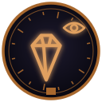{ .rune-ico loading=lazy } **Кристалл Видящего** | бронза | 6 капель Звездной Крови | нет; 1 цикл | Содержит призматический кристалл, сквозь который можно наблюдать бестелесные сущности, в том числе находящиеся в живых существах или предметах. | ЗК-2, Глава 7, стр. 539 |  |
| 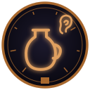{ .rune-ico loading=lazy } **Поющий Кувшин** | бронза | 6 капель Звездной Крови | нет; Один цикл | Содержит поющий кувшин из синего нефрита, наполненный золотым эл-центийским вином. Репертуар кувшина — более семи тысяч благозвучных мелодий. Сладкое игристое вино обладает чудесными свойствами: раскрепощает любовников и дарует им неутомимость в ложе. | ЗК-2, Глава 7, стр. 520 |  |
| { .rune-ico loading=lazy } **Руна Стигмата Восходящего** | бронза | 6 капель Звездной Крови | нет; 1 час | Содержит стигмат неизвестного Восходящего. | ЗК-5, Глава 3, стр. 268 |  |
| 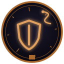{ .rune-ico loading=lazy } **Руна Шлема Ледоманта (Чешуя Ледяного Червя 2/4)** | бронза | 6 капель Звездной Крови | нет; 1 древодень | Содержит Шлем Ледоманта, лед-артефакт, изготовленный из чешуи Ледяного Червя и измененного ледяного хрусталя. Шлем испускает ауру холода, замораживающую ближайших врагов, и позволяет видеть тепловые следы, обнаруживая скрытых врагов. Является одной из четырех частей Чешуи Ледяного Червя — рунного… | ЗК-5, Глава 10, стр. 891 |  |
| { .rune-ico loading=lazy } **Рунический Эликсир Очищения** | бронза | 6 капель Звездной Крови | нет; древодень | Содержит рунический флакон, наполненный эликсиром, нейтрализующим действие большинства известных ядов, токсинов и отравляющих веществ. Очищает организм от последствий проклятых и стихийных эффектов и паразитических заражений. На один древодень дает полный иммунитет к действию ядов, а также обеспе… | ЗК-5, Глава 17, стр. 1773 |  |
| { .rune-ico loading=lazy } **Шкура Фростбьорна** | бронза |  | нет; 1 древодень | Содержит Шкуру Фростбьорна, теплый и прочный меховой плащ, оберегающий носителя от холода. | ТБ-2, Глава 5, стр. 365 |  |
| { .rune-ico loading=lazy } **Винтокрыл «Грифон»** | серебро | 72 капли Звездной Крови | нет; 1 древодень | Содержит рейдовый винтокрыл «Грифон» — боевой летательный аппарат, созданный Народом Земли. Способен нести экипаж до восьми человек. Вооружен кинетическими и ракетными метателями. Для уточнения возможностей активируйте Руну. / Улучшения: нет | ЗК-10, Глава 19, стр. 2350 |  |
| { .rune-ico loading=lazy } **Звезда Искателя** | серебро | 12 капель Звездной Крови | нет; 1 древодень | Содержит Звезду Искателя, артефакт Единства. При активации Звезда в десять раз увеличивает восстановление Звездной Крови Восходящего на один древодень, но тратит один из вложенных зарядов. / Количество зарядов: 3 | ЗК-5, Глава 5, стр. 462 |  |
| 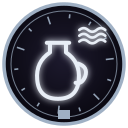{ .rune-ico loading=lazy } **Кувшин Звездной Воды** | серебро | 12 капель Звездной Крови | нет; 1 древодень | Содержит кувшин, наполненный Звездной Водой, ускоряющей рост и созревание Трав. Наделяет все растущее Звездной Кровью. Вода обладает исцеляющими и защитными свойствами, смертельна для Червей и любых созданий, содержащих кровь Червей. Зарядов 3/3 / Усиления: Руна Усиления, Руна Стихии Жизнь, Руна … | ЗК-7, Глава 16, стр. 1737 |  |
| { .rune-ico loading=lazy } **Руна Ложного Стигмата** | серебро | 12 капель Звездной Крови | нет; 1 древодень. | Полностью имитирует стигмат Восходящего, маскируя ранг, Скрижаль, Атрибуты и Руны согласно желанию владельца Руны. | ЗК-6, Глава 15, стр. 1451 |  |
| 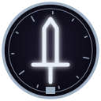{ .rune-ico loading=lazy } **Руна Плоскостной Меч** | серебро | 12 капель Звездной Крови | нет; 1 древодень | Содержит невидимый плоскостной клинок, способный увеличиваться в размере. / Усиления: Руна Усиления, Руна Усиления, Руна Усиления | ЗК-5, Глава 2, стр. 206 |  |
| 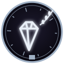{ .rune-ico loading=lazy } **Серебряный Кристалл Странника** | серебро | 12 капель Звездной Крови | мгновенно | Содержит артефакт Вечности. Будучи экипированным, в случае получения ранений без участия владельца активирует «Исцеление», устраняющее последствия легких, тяжелых (включая переломы) и смертельных ранений (если объект применения еще жив). Не может исцелить при потере значительной доли целостности … | ЗК-6, Глава 11, стр. 1034 |  |
| { .rune-ico loading=lazy } **Тарн Искателя** | серебро | 12 капель Звездной Крови | нет; 1 древодень | Оружие из священной синей стали, созданное мастерами Ордена Истинных. Тарн невозможно сломать, повредить или уничтожить. Он усиливает восстановление Звездной Крови у своего владельца, способен пробивать большинство физических преград, а также наносить раны эфирным и призрачным созданиям. | ЗК-8, Глава 11, стр. 1131 |  |
| 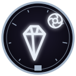{ .rune-ico loading=lazy } **Черная Пилюля Несокрушимости** | серебро | 12 капель Звездной Крови | 30 минут; 1 древодень | Содержит рунную пилюлю, при применении укрепляющую тело до верхних пределов серебряного ранга. Восходящий становится почти неуязвим для физических атак низших рангов, способен выдерживать экстремальные нагрузки и не подвержен болевому шоку. Внимание: может нанести повреждения телу низкого ранга. … | ЗК-8, Глава 19, стр. 2024 |  |
| 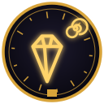{ .rune-ico loading=lazy } **Аграф Стойкого Разума** | золото | 120 капель Звездной Крови | нет; 1 древодень | Артефакт древних эпох, созданный из Камня Стойкого Разума, чья история теряется во тьме. Обеспечивает защиту от любых воздействий на разум обладателя, включая ментальные, эмоциональные, контролирующие и порабощающие, вплоть до небесного ранга. / Усиления: Усиление, Усиление, Маскировка | ЗК-9, Глава 12, стр. 1333 |  |
| 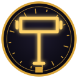{ .rune-ico loading=lazy } **Игг-Молот (½)** | золото | 120 капель Звездной Крови | нет; 1 древодень | Содержит сияющий Игг-Молот, артефакт-оружие, способный уничтожать врагов Единства. Удар Игг-Молота сотрясает твердь Единства, вызывает мощную вспышку игг-света и способен проломить любую броню. Внимание: использование требует дополнительных затрат Звездной Крови. Активные способности: «Сияние», «… | ЗК-7, Глава 2, стр. 205 |  |
| 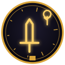{ .rune-ico loading=lazy } **Копье Игг-Света** | золото | 120 капель Звездной Крови | нет; 1 древодень | Содержит светоносное копье, излучающее пронзающий луч игг-сияния, способный уничтожать противника на большом расстоянии. | ЗК-7, Глава 2, стр. 213 |  |
| 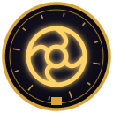{ .rune-ico loading=lazy } **Кор Ноктис** | золото | 60 капель Звездной Крови | нет; 1 древодень | Содержит Кор Ноктис, полный тень-доспех, созданный для воительниц дома Ноктис. Сливается с владельцем, обеспечивая адаптивную защиту от физических, рунных и энергетических ударов. Особые способности: «Поцелуй Ноктис», «Поглощение света», «Ноктис-Зеркало». В паре с оружием Аски Ноктис увеличивает … | ЗК-8, Глава 14, стр. 1450 |  |
| { .rune-ico loading=lazy } **Нагрудник Светоносных (Доспех Светоносного, ¼)** | золото | 120 капель Звездной Крови | нет; 1 древодень | Содержит Нагрудник Светоносных, созданный из измененного иллиума и излучающий благословенный игг-свет. Нагрудник неуничтожим для физического оружия, полностью блокирует энергетические и рунные удары. Является частью Доспеха Светоносных, созданного в дрейф-цитадели Нарсил для рыцарей Великой Охоты. | ЗК-7, Глава 2, стр. 197 |  |
| { .rune-ico loading=lazy } **Руна Небесного Ястреба** | золото | 120 капель Звездной Крови | нет; 3 древодня 12 часов 30 минут | Использование требует дополнительных затрат Звездной Крови. Содержит Небесный Ястреб, летающий артефакт-доспех Вечности из измененного иллиума. Внимание: использование требует дополнительных затрат Звездной Крови. Для уточнения возможностей активируйте Руну. / Улучшения: Руна Усиления, Руна Усиле… | ЗК-5, Глава 1, стр. 71 |  |
| { .rune-ico loading=lazy } **Стигис Голубая Стрела** | золото | 600 капель Звездной Крови | нет | Использование требует дополнительных затрат Звездной Крови Содержит Голубую Стрелу, именной боевой стигис небесного дозора, летающий корабль из синей стали и измененного иллиума. Для уточнения возможностей активируйте Руну. ??? ??? / Улучшения: Руна Слияния, Руна Усиления, Руна Имени, Руна-Инскри… | ЗК-10, Глава 8, стр. 855 |  |
| 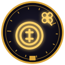{ .rune-ico loading=lazy } **Счастливая Монета Контракции** | золото | 120 капель Звездной Крови безвозвратно | 1 секунда; 1 древодень | Содержит Счастливую Монету Контракции. Владелец может испытать свое счастье, подбросив ее — и удачный бросок принесет случайную Руну из запасов Контракции. Неудачный бросок не принесет ничего. Пусть тебе повезет (или нет). Внимание: каждый бросок безвозвратно забирает 120 капель Звездной Крови. | ЗК-8, Глава 10, стр. 957 |  |
| 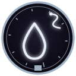{ .rune-ico loading=lazy } **Драконий Жезл Змеиной Крови** | драконья (серебро) | 48 капель Звездной Крови | нет; нет | Обладатель жезла получает способность мысленно подчинять всех фроггов в радиусе прямой видимости. Все подчиненные существа выполняют любые команды обладателя жезла или указанных им существ. Жезл обеспечивает непрерывную и абсолютную власть, в том числе за пределами радиуса видимости. Внимание: На… | ТБ-1, Глава 9, стр. 1010 |  |
| 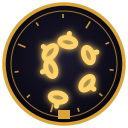{ .rune-ico loading=lazy } **Руна Живых Цепей** | золотая (соответствие термину 90%) , эпическая (80%) , сияющая (65%) | 120 капель Звездной Крови | нет; семь малых циклов | Артефакт-оружие Вечности. Вызывает Живые Цепи, лишающие подвижности выбранное целью существо. Внимание — слабых существ может мгновенно убить или разорвать на части. | ЗК-1, Глава 8, стр. 607 |  |

## Руна-Заклинание

| Название | Качество | Активация | Действие / перезарядка | Описание | Первая встреча | Ещё |
|---|---|---|---|---|---|---|
| { .rune-ico loading=lazy } **Руна Порыва Ветра** | дерево | 6 капель Звездной Крови |  | Создает направленный порыв ветра в указанную сторону Время действия — 1 секунда Время перезарядки — 30 секунд | ЗК-1, Глава 19, стр. 1926 |  |
| { .rune-ico loading=lazy } **Руна Порыва Ледяного Ветра** | дерево |  | 1 секунда; 30 секунд | Создает направленный порыв ледяного ветра в указанную сторону / Усиление: Руна Стихии (Лед) | ЗК-2, Глава 6, стр. 452 |  |
| 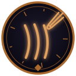{ .rune-ico loading=lazy } **Руна Алого Когтя** | бронза | 12 капель Звездной Крови | 3 секунды; 1 минута | При фокусировке создает испепеляющий энергетический луч. | ЗК-1, Глава 14, стр. 1362 |  |
| 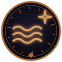{ .rune-ico loading=lazy } **Руна Алого Потока** | бронза | 12 капель Звездной Крови | 6 секунд; 1 минута | При фокусировке создает испепеляющий энергетический поток. / Усиления: Руна Изменения, Руна Усиления | ЗК-2, Глава 16, стр. 1371 |  |
| 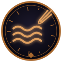{ .rune-ico loading=lazy } **Руна Алой Волны** | бронза | 12 капель Звездной Крови | 6 секунд; 30 секунд | Создает испепеляющую энергетическую волну в указанном направлении. / Усиления: Руна Изменения, Руна Усиления, Руна Усиления | ЗК-5, Глава 10, стр. 854 |  |
| 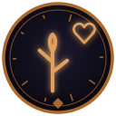{ .rune-ico loading=lazy } **Руна Живой Побег** | бронза | 12 капель Звездной Крови | 30 секунд; 10 минут | В указанном месте прорастает колючий побег, который опутывает цель в радиусе пяти метров. | ЗК-3, Глава 15, стр. 1385 |  |
| { .rune-ico loading=lazy } **Руна Медленного Падения** | бронза | 12 капель Звездной Крови | 30 секунд; 10 минут | Уменьшает скорость падения объекта наложения. | ЗК-4, Глава 18, стр. 1653 |  |
| 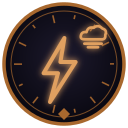{ .rune-ico loading=lazy } **Руна Облачной Молнии** | бронза | 12 капель Звездной Крови | 2 секунды; 1 минута | Создает разряд молнии, попадающий в указанное место. | ЗК-4, Глава 18, стр. 1646 |  |
| { .rune-ico loading=lazy } **Руна Подводное Дыхание** | бронза | 12 капель Звездной Крови | 9 часов 36 минуты; 25 часов | Позволяет дышать, находясь под водой. / Усиления: Руна Изменения, Руна Изменения, Руна Изменения | ЗК-3, Глава 19, стр. 1779 |  |
| { .rune-ico loading=lazy } **Руна Призрачная Рука** | бронза | 6 капель Звездной Крови | 60 минут; 25 часов | Создает из Звездной Крови призрачную руку, которая может менять форму, проникать сквозь препятствия и манипулировать материальными предметами согласно вашим указаниям. / Усиления: Руна Уменьшения, Руна Усиления, Руна Изменения | ЗК-3, Глава 19, стр. 1770 |  |
| { .rune-ico loading=lazy } **Руна Пылающих Рук** | бронза | 12 капель Звездной Крови | 30 секунд; 10 минут | Создает обжигающую ауру, исходящую от ваших рук. Внимание: Любое прикосновение к посторонним объектам (в том числе к собственному телу) может повредить их. | ЗК-3, Глава 5, стр. 385 |  |
| 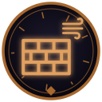{ .rune-ico loading=lazy } **Руна Стены Ветра** | бронза | 12 капель Звездной Крови | 10 минут; 3 часа | Создает в указанном направлении неподвижную область воздушных завихрений. | ЗК-4, Глава 18, стр. 1660 |  |
| { .rune-ico loading=lazy } **Руна Холодного Дыхания** | бронза | 12 капель Звездной Крови | 3 секунды; 1 минута | Создает мощный замораживающий поток воздуха в указанном направлении. | ЗК-4, Глава 22, стр. 1950 |  |
| 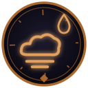{ .rune-ico loading=lazy } **Руна Ядовитого Дыхания** | бронза | 12 капель Звездной Крови | 30 секунд; 10 минут | Создает облако ядовитого газа, отравляющего всех в области применения. | ЗК-3, Глава 17, стр. 1547 |  |
| 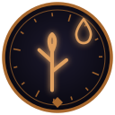{ .rune-ico loading=lazy } **Руна Ядовитый Побег** | бронза | 12 капель Звездной Крови | 30 секунд; 10 минут | В указанном месте прорастает колючий ядовитый побег, который опутывает и отравляет цель в радиусе пяти метров. / Усиление: Руна Стихии (Яд) | ЗК-3, Глава 15, стр. 1400 |  |
| 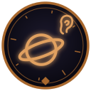{ .rune-ico loading=lazy } **Сфера Тишины** | бронза | 6 капель Звездной Крови | 1 час; 1 древодень | Создает вокруг объекта применения сферическую область, непроницаемую для звуков. / Усиления: Руна Изменения, Руна Уменьшения | ЗК-7, Глава 13, стр. 1496 |  |
| { .rune-ico loading=lazy } **Объединение Разумов** | серебро | 48 капель Звездной Крови | 30 минут; 1 древодень | Наделяет объект применения (разумное существо) способностью временно объединять разумы союзников, с помощью телепатической связи улучшая координацию, синхронизацию действий и повышая коллективную эффективность. | ЗК-7, Глава 13, стр. 1541 |  |
| { .rune-ico loading=lazy } **Руна Астральных Фантомов** | серебро | 12 капель Звездной Крови | 6 минут; 1 час | Создает иллюзорные дубликаты цели, имитирующие заданные действия. / Усиления: Руна Уменьшения, Руна Усиления, Руна Изменения | ЗК-5, Глава 14, стр. 1347 |  |
| { .rune-ico loading=lazy } **Руна Истинный Взор** | серебро | 12 капель Звездной Крови | 60 минут; 12 часов 30 минут | Наделяет Истинным Зрением, позволяющим видеть скрытое и замечать незримое, смотреть в самую суть вещей, отличать иллюзии от реальности и видеть призрачных сущностей любого уровня. / Усиления: Руна Уменьшения, Руна Усиления, Руна Усиления, Руна Изменения, Руна Изменения | ЗК-3, Глава 19, стр. 1759 |  |
| { .rune-ico loading=lazy } **Руна Исцеления** | серебро | 24 капли Звездной Крови | мгновенно; 1 час | Мгновенно исцеляет легкие, тяжелые (включая переломы) и смертельные ранения, если объект применения еще жив. Не может восстанавливать потерянные конечности. Не может исцелить организм при потере более 30% клеточной массы. | ЗК-5, Глава 3, стр. 307 |  |
| 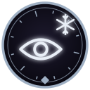{ .rune-ico loading=lazy } **Руна Ледяного Взора** | серебро | 24 капли Звездной Крови | 1 секунда; 1 минута | Создает луч ледяного света, мгновенно замораживающий цель. | ЗК-5, Глава 10, стр. 845 |  |
| { .rune-ico loading=lazy } **Руна Огненного Болида** | серебро | 24 капли Звездной Крови | 6–12 секунд; 5 минут | Создает огненный болид, попадающий в указанное место и вызывающий мощный взрыв при контакте с целью. Внимание: применение на короткой дистанции без защиты собственного тела может привести к тяжелым ранениям и смерти! | ЗК-6, Глава 7, стр. 620 |  |
| { .rune-ico loading=lazy } **Руна Призрачного Шага** | серебро | 24 капли Звездной Крови | мгновенно; 1 минута | Переносит в любую видимую точку в небольшом радиусе, игнорируя материальные преграды. | ЗК-5, Глава 2, стр. 197 |  |
| { .rune-ico loading=lazy } **Руна Ускорения Времени** | серебро | 24 капли Звездной Крови | 1 минута; 5 минут | Создает вокруг цели или группы целей эффект ускоренного времени, позволяя опережать противника. / Усиления: Руна Усиления, Руна Изменения, Руна Изменения | ЗК-5, Глава 14, стр. 1338 |  |
| 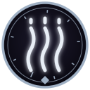{ .rune-ico loading=lazy } **Руна Феромонов** | серебро | 24 капли Звездной Крови | нет; 5 минут | Создает феромонную метку, привлекающую отродий Червей. | ЗК-2, Глава 16, стр. 1405 |  |
| 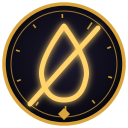{ .rune-ico loading=lazy } **Иссушение** | золото | 240 капель Звездной Крови | 12 — (???) секунд | Извлекает влагу изо всех объектов и существ в зоне действия, оставляя после себя лишь сухую, лишенную жизни материю. Способно воздействовать на предметы и природный ландшафт. Время действия Иссушения зависит от устойчивости, количества и размеров объектов наложения. | ТБ-1, Глава 16, стр. 1763 |  |
| 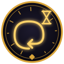{ .rune-ico loading=lazy } **Руна Временной Петли** | золото | 240 капель Звездной Крови | 3 секунды; 1 минута | Создает на объекте наложения временную петлю, через три секунды возвращая его в момент наложения Руны. | ЗК-7, Глава 17, стр. 1839 |  |

## Руна-Умение

| Название | Качество | Активация | Действие / перезарядка | Описание | Первая встреча | Ещё |
|---|---|---|---|---|---|---|
| 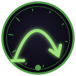{ .rune-ico loading=lazy } **Руна Легкий Прыжок** | дерево | 3 капли Звездной Крови | 4 минуты; 1 час | При активации позволяет совершать длинные прыжки на значительное расстояние. | ЗК-2, Глава 6, стр. 432 |  |
| { .rune-ico loading=lazy } **Руна Ночное Зрение** | дерево | 3 капли Звездной Крови | 144 минуты; 1 полный цикл | При активации позволяет видеть в естественной темноте | ЗК-3, Глава 2, стр. 110 |  |
| 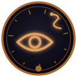{ .rune-ico loading=lazy } **Глаз Небесного Змея** | бронза | 6 капель Звездной Крови | 2 часа 24 минуты; 1 древодень | Наделяет зрением Небесного Змея, значительно обостряя существующие способности. Позволяет видеть в недоступных человеческому глазу диапазонах. | ЗК-7, Глава 2, стр. 290 |  |
| 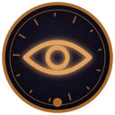{ .rune-ico loading=lazy } **Руна Биолокации** | бронза | 6 капель Звездной Крови | 144 минуты; 25 часов | Вид пространственного чутья, позволяющий определять положение объектов в окружающем пространстве. | ЗК-2, Глава 16, стр. 1361 |  |
| { .rune-ico loading=lazy } **Животворный Рост** | серебро | 12 капель Звездной Крови | 144 минуты; 1 древодень | Умение мгновенно заживлять поверхностные раны, быстро — глубокие ранения и в течение нескольких суток выращивать потерянные части тела или внутренние органы. / Усиление: Руна Усиления | ТБ-1, Глава 14, стр. 1539 |  |
| { .rune-ico loading=lazy } **Кислотная Жидкость** | серебро | 12 капель Звездной Крови | 10 минут; 144 минуты | Наделяет способностью выделять разъедающую органическую кислоту. Внимание: ее воздействие распространяется в том числе на ваше собственное тело. Применяйте с осторожностью. | ЗК-6, Глава 2, стр. 147 |  |
| { .rune-ico loading=lazy } **Психокинетика** | серебро | 12 капель Звездной Крови | 30 минут; 1 древодень | Наделяет способностью к психокинетическим манипуляциям с материальными объектами. Позволяет производить направленное воздействие разного рода, зависящее от Атрибутов применяющего. Ведущий Атрибут: Псионика | ЗК-7, Глава 13, стр. 1551 |  |
| { .rune-ico loading=lazy } **Руна Подчинения Призрака** | серебро | 12 капель Звездной Крови | 30 минут; 1 древодень | Позволяет временно подчинить призрачное существо. | ЗК-5, Глава 14, стр. 1369 |  |
| { .rune-ico loading=lazy } **Руна Раскаленной Ауры** | серебро | 12 капель Звездной Крови | 30 секунд; 10 минут | Создает мощную пламенную ауру, исходящую от вашего тела. Внимание: воздействие ауры на посторонние объекты может повредить или разрушить их. | ЗК-6, Глава 7, стр. 629 |  |
| { .rune-ico loading=lazy } **Шепот Червей** | серебро | 12 капель Звездной Крови | 30 минут; 1 древодень | Наделяет способностью воспринимать, понимать и воспроизводить ментально-феромонные команды, используемые Червями. | ЗК-6, Глава 2, стр. 162 |  |
| { .rune-ico loading=lazy } **Экстремальная Терморегуляция** | серебро | 12 капель Звездной Крови | 144 минуты; 1 древодень | Наделяет способностью переносить экстремальные температурные условия. | ЗК-6, Глава 2, стр. 155 |  |
| { .rune-ico loading=lazy } **Руна Чуткого Уха** | обычная | 3 капли Звездной Крови | 144 минуты; малый цикл | При активации значительно обостряет слуховое восприятие, позволяя слышать в большем радиусе и на ранее недоступных частотах. | ЗК-1, Глава 8, стр. 598 |  |

## Руна-Существо

| Название | Качество | Активация | Действие / перезарядка | Описание | Первая встреча | Ещё |
|---|---|---|---|---|---|---|
| { .rune-ico loading=lazy } **Руна Доминиона Призрачных Арахнидов** | серебро | 48 капель Звездной Крови | 2 часа; 1 древодень | Содержит Доминион Призрачных Арахнидов, состоящий из десяти Арахнидов-Ткачей, десяти Арахнидов-Сталкеров и десяти Арахнидов-Жнецов. Все Арахниды Доминиона ядовиты, а их паутина способна сковывать даже призрачных существ. / Усиления: Руна Усиления, Руна Усиления, Руна Усиления | ЗК-5, Глава 14, стр. 1356 |  |
| { .rune-ico loading=lazy } **Руна Заклинателя Духов** | серебро | 48 капель Звездной Крови | 2 часа; 1 древодень | Внутри заключена Морвейн кель’Талас, заклинатель духов ранга «серебро». Для уточнения ее возможностей активируйте Руну. | ЗК-5, Глава 14, стр. 1419 |  |
| { .rune-ico loading=lazy } **Руна Экзо-кодек** | серебро | 24 капли Звездной Крови | 4 часа; 1 цикл | Внутри заключен экзо-кодек, малый проводник Наблюдателя. Способен указывать путь, искать скрытое, изучать и опознавать предметы, взаимодействовать с разнообразными интеллектуальными системами. Для уточнения возможностей активируйте Руну. | ЗК-3, Глава 11, стр. 828 |  |
| { .rune-ico loading=lazy } **Руна Экзо-траон** | серебро | 24 капли Звездной Крови | 6 циклов; 1 цикл | Внутри заключен экзо-траон, малый транспорт Наблюдателя. Способен нести большой объем груза и нескольких всадников, может выполнять роль бронированного убежища. Для уточнения возможностей активируйте Руну. | ЗК-3, Глава 11, стр. 836 |  |
| 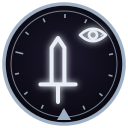{ .rune-ico loading=lazy } **Руна Экзо-шейд** | серебро | 48 капель Звездной Крови | 2 часа; 1 цикл | Внутри заключен экзо-шейд, малый воин Наблюдателя. Способен становиться невидимым, проникать сквозь препятствия и эффективно уничтожать врагов. Для уточнения возможностей активируйте Руну. | ЗК-3, Глава 11, стр. 844 |  |
| 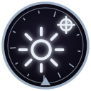{ .rune-ico loading=lazy } **Светожук-Целитель** | серебро | 24 капли Звездной Крови | 2 часа; 1 древодень | Внутри заключен светожук, небольшое летающее существо, которое излучает целебный и отпугивающий Червей свет. Исцеляет раны, нейтрализует токсины и яды, ускоряет регенерацию и создает защитный световой купол. Для уточнения возможностей активируйте Руну. | ЗК-7, Глава 12, стр. 1453 |  |
| { .rune-ico loading=lazy } **Серебряный Огнезуб** | серебро | 24 капли Звездной Крови | 2 часа; 1 древодень | Внутри заключен Серебряный Огнезуб, свирепый и беспощадный охотник на Червей. Его тело защищено прочной серебряной чешуей, а зубы, когти и огненное дыхание эффективны против большинства видов Червей. Для уточнения возможностей активируйте Руну. | ЗК-7, Глава 12, стр. 1446 |  |
| 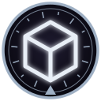{ .rune-ico loading=lazy } **Экзо-Арсенал** | серебро | 48 капель Звездной Крови | 4 часа; 1 древодень | Внутри заключен экзо-арсенал, малый боевой склад Наблюдателя. Способен хранить и транспортировать Руны, боевые артефакты, а также любые иные предметы в своей внутренней Скрижали, предоставляя немедленный доступ на поле боя. Способен передвигаться и развертываться, образуя укрытие бункерного типа.… | ЗК-7, Глава 12, стр. 1439 |  |
| 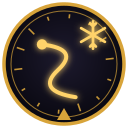{ .rune-ico loading=lazy } **Ледяной Дракарис** | золото | 240 Звездной Крови | 4 часа; 1 древодень | Содержит огромного ледяного дракариса, покрытого кристаллической броней, неуязвимой для обычного оружия. Стремительный дракарис может переносить нескольких наездников и поддерживать их в бою. Активные способности: «Ледяное Дыхание». | ТБ-2, Глава 20, стр. 1870 |  |
| 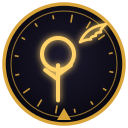{ .rune-ico loading=lazy } **Руна Игг-Феникса** | золото | 240 капель Звездной Крови | 1 час; 7 древодней | Внутри заключен Игг-Феникс, светоносная птица, рожденная из Игг-Света. Феникс неуязвим для обычного оружия, излучает ауру исцеляющего игг-сияния и способен, принеся себя в жертву, воскресить владельца из мертвых. Для уточнения возможностей активируйте Руну. | ТБ-4, Глава 1, стр. 62 |  |
| { .rune-ico loading=lazy } **Руна Рунный Мастер** | золото | 240 капель Звездной Крови | 1 час; 1 цикл | Внутри заключена кел-леди Азимандия из Дома Визу Аран, рунный мастер ранга «золото». Для уточнения ее возможностей активируйте Руну. | ЗК-2, Глава 23, стр. 2074 |  |
| { .rune-ico loading=lazy } **Экзо-Банши** | золото | 480 капель Звездной Крови | 1 час; 2 древодня | Содержит Экзо-Банши, элитного экзо-истребителя Наблюдателя. Банши использует драйв-пульсацию, вооружена клинками жесткого света, способна вести как наземный, так и воздушный бой, синхронизироваться с другими экзо и эффективна против целей любого типа. | ЗК-10, Глава 20, стр. 2459 |  |

## Руна-Свойство

| Название | Качество | Активация | Действие / перезарядка | Описание | Первая встреча | Ещё |
|---|---|---|---|---|---|---|
| { .rune-ico loading=lazy } **Малая Руна Изменения** | дерево |  |  | Используется для изменения свойств Рун | ЗК-1, Глава 19, стр. 1935 |  |
| { .rune-ico loading=lazy } **Малая Руна Превращения** | дерево |  |  | Используется для изменения свойства или вида Руны. | ЗК-2, Глава 16, стр. 1347 |  |
| { .rune-ico loading=lazy } **Малая Руна Стихии** | дерево |  |  | Стихия — лед. Используется для придания стихийных свойств другим Рунам. Любопытно — кроме Рун Развития и Изменения, теперь я увидел Стихию. Судя по описанию, она использовалась для изменения свойств других Рун соответствующего ранга, но как это работает? | ЗК-2, Глава 6, стр. 444 |  |
| { .rune-ico loading=lazy } **Руна Стихии** | бронза |  |  | Стихия — яд. Используется для придания стихийных свойств другим Рунам. | ЗК-3, Глава 15, стр. 1393 |  |
| { .rune-ico loading=lazy } **Руна Звезды** | серебро |  |  | Добавляет дополнительную звезду усиления другой Руне соответствующего ранга. Любая Руна изначально имеет три слота усилений — в системе Восхождения они называются звездами. Но я видел Руны и с пятью, и с шестью апгрейдами — чтобы далеко не ходить, таков был отнятый у Азимандии Истинный Взор или К… | ЗК-7, Глава 20, стр. 2081 |  |
| { .rune-ico loading=lazy } **Руна Перезарядки** | серебро |  |  | Мгновенно восстанавливает таймер перезарядки Руны своего ранга, позволяя снова использовать ее. Внимание: при активации Перезарядки одна звезда улучшения Руны-объекта будет безвозвратно утрачена. | ЗК-6, Глава 15, стр. 1415 |  |
| 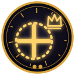{ .rune-ico loading=lazy } **Великая Руна Усиления** | золото |  |  | Используется для усиления основного эффекта других Рун. Столь ценным ресурсом вселенец мгновенно воспользовался самостоятельно — вложив Усиление в Руну Живых Цепей. Других вариантов, по сути, и не было. Небесный Ястреб и так прокачан до предела, ну а усиливать Азимандию — сомнительная идея, хотя … | ЗК-5, Глава 14, стр. 1325 |  |
| 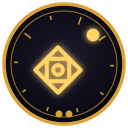{ .rune-ico loading=lazy } **Универсальная Руна** | золото |  |  | Может быть преобразована в любую Руну-Свойство равного качества. | ЗК-4, Глава 21, стр. 1858 |  |
| { .rune-ico loading=lazy } **Малая Руна Развития** | обычная |  |  | Используется для развития Атрибутов, Аспектов и Навыков. И все. А вот второй глиф был гораздо интереснее | ЗК-1, Глава 8, стр. 593 |  |

## Руна-Навык

| Название | Качество | Активация | Действие / перезарядка | Описание | Первая встреча | Ещё |
|---|---|---|---|---|---|---|
| { .rune-ico loading=lazy } **Руна Боя-без-Оружия** | дерево | 6 капель Звездной Крови (безвозвратно) | одноразовая, при активации исчезает. | При активации обучает навыку Боя-без-Оружия (качество дерево). После активации Руна исчезает. / Требования: Атрибут Тела выше 6 | ЗК-1, Глава 14, стр. 1336 |  |
| { .rune-ico loading=lazy } **Руна Языка (Единый)** | дерево | 6 капель Звездной Крови (безвозвратно) | одноразовая | При активации обучает начальному Знанию Единого Языка. После активации Руна исчезает. / Требования: Атрибут Разум выше 5 | ЗК-3, Глава 3, стр. 225 |  |
| { .rune-ico loading=lazy } **Руна Выживания** | бронза | 12 капель Звездной Крови (безвозвратно) | одноразовая | Обучает навыку Выживания (качество бронза). После активации Руна исчезает. / Требования: Атрибут Тела 9 | ЗК-5, Глава 1, стр. 87 |  |
| 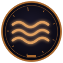{ .rune-ico loading=lazy } **Руна Мастера Пловца** | бронза | 12 капель Звездной Крови (безвозвратно) | одноразовая | При активации обучает навыку «Мастер Пловец» в водной стихии. После активации Руна исчезает. / Требования: Атрибут Тела не менее 8 | ЗК-4, Глава 20, стр. 1793 |  |
| { .rune-ico loading=lazy } **Руна Рунное Мастерство** | бронза | 12 капель Звездной Крови (безвозвратно) | одноразовая, при активации исчезает | Древнее рунное искусство, позволяющее создавать, разрушать и изменять Руны, Скрижали и Знаки. На бронзовой стадии ведущий Атрибут — Интеллект | ЗК-2, Глава 21, стр. 1788 |  |
| { .rune-ico loading=lazy } **Руна Духовной Проекции** | серебро | 24 капли Звездной Крови (безвозвратно) |  | При активации обучает Навыку Духовной Проекции (качество: серебро). После активации Руна исчезает. / Требования: Некротика выше 8 | ЗК-5, Глава 14, стр. 1377 |  |

## Без указания типа

| Название | Качество | Активация | Действие / перезарядка | Описание | Первая встреча | Ещё |
|---|---|---|---|---|---|---|
| { .rune-ico loading=lazy } **Руна Связи** | бронза |  |  | Используется для создания связи между Рунами. | ЗК-5, Глава 10, стр. 835 |  |
| **Руна-Функция (соответствие термина 50%)** | золото | 480 капель Звездной Крови | нет; ??? | Создана неизвестной инстанцией (соответствие термина 50%). Содержит автономного исполнителя внутренней функции Надзора. Протокол???. Предназначение и целевые параметры неизвестны. Внимание: Руна не предназначена для частного использования. ??? ??? / Улучшения: Руна Слияния, Руна Протокола???, Рун… | ЗК-10, Глава 19, стр. 2227 |  |
| { .rune-ico loading=lazy } **Нулевая Руна** | особая | не определено |  | Заготовка (соответствие термину 70%), шаблон (соответствие термину 55%) для записи любых Рун качества «особая». Необходим Навык «Рунный Мастер». Все чудеснее и чудеснее. Нулевая заготовка, рунный мастер. Повеяло низкопробными электронными новеллами из разряда тех, чьи названия стираются из памяти… | ЗК-1, Глава 9, стр. 730 |  |
| { .rune-ico loading=lazy } **Проклятая Руна** | мерзость | ??? | ???; ??? | Вызывает у цели состояние безумия, неконтролируемой паранойи, сопровождаемой галлюцинациями. Внимание: слабых особей может заставить покончить с собой. | ЗК-5, Глава 16, стр. 1689 |  |
| { .rune-ico loading=lazy } **Проклятая Руна** | извращенная мерзость |  |  | Содержит семя мерзкого отродья Червей, необходимое для создания нового Улья… Стало понятно, почему Инфанта выжила в Смерче, единственная из всех Червей в Логове. Она была не обычной особью, а подобием проклятой Руны-Существа. Такие глифы использовались Отрекшимися и Всадниками для распространения… | ТБ-2, Глава 4, стр. 273 |  |

## Руна-Башня

| Название | Качество | Активация | Действие / перезарядка | Описание | Первая встреча | Ещё |
|---|---|---|---|---|---|---|
| 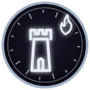{ .rune-ico loading=lazy } **Домен Пламенный Лабиринт** | серебро | 24 капли Звездной Крови | одноразовая, при активации исчезает | В лабиринте из вечного огня ты найдешь серебряное сокровище, если выдержишь испытания! А третья походила на птицу, распростершую крылья: | ЗК-6, Глава 16, стр. 1549 |  |
| 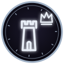{ .rune-ico loading=lazy } **Домен Сломанный Трон** | серебро | 24 капли Звездной Крови | одноразовая, при активации исчезает | На небесном осколке ждут достойных, готовых занять Сломанный Трон! Я ничего не понимал! Что это значит? О Доменах мне мало что удалось узнать, кроме того, что Руна считалась невероятно опасной. Травинка мельком обмолвилась, что не знает никого, кто из них возвращался, а Динамита и Ко расспросить … | ЗК-2, Глава 17, стр. 1508 |  |
| 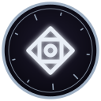{ .rune-ico loading=lazy } **Колесо-в-Глубинах** | серебро | 24 капли Звездной Крови | одноразовая, при активации исчезает | Восходящий должен пройти череду смертельных испытаний, вращая Колесо. Каждая его остановка — уникальное задание, которое может принести Руну… или смерть. | ТБ-2, Глава 5, стр. 383 |  |

## Руна-Хранилище

| Название | Качество | Активация | Действие / перезарядка | Описание | Первая встреча | Ещё |
|---|---|---|---|---|---|---|
| 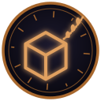{ .rune-ico loading=lazy } **Расширенная Сумка Искателя** | бронза | 3 капли Звездной Крови | нет; 30 минут | Используется для хранения. Не может хранить живое. Не может хранить вещи, размером превышающие человека. Не может хранить Руны-Предметы. | ЗК-3, Глава 3, стр. 244 |  |
| { .rune-ico loading=lazy } **Несокрушимый Реликварий** | золото | 120 капель Звездной Крови | нет; нет | Содержит огромное пространственное хранилище, способное вмещать предметы крупного и сверхкрупного размера. Имеет золотую Скрижаль, способную хранить Руны и Звездные Монеты. Имеет Арсенал, способный хранить рунные доспехи и оружие. Имеет Чертог, способный содержать неживых слуг. Может быть превращ… | ЗК-8, Эпилог, стр. 2393 |  |
| { .rune-ico loading=lazy } **Запечатанная Драконья Клетка Душ** | драконье (серебро) | 48 капель Звездной Крови | нет; нет | С одержит сосуд-хранилище, созданный по древним технологиям Народа Кел. Улавливает и втягивает внутрь душу владельца (а также его Звездную Кровь) в момент смерти, не позволяя ей уйти за Грань. Может содержать неограниченное количество душ. Внимание: сосуд запечатан. При вскрытии печати все содерж… | ЗК-8, Глава 15, стр. 1503 |  |

## Руна-Сокровище

| Название | Качество | Активация | Действие / перезарядка | Описание | Первая встреча | Ещё |
|---|---|---|---|---|---|---|
| 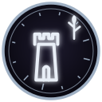{ .rune-ico loading=lazy } **Домен Перерождающиеся Джунгли** | серебро | 24 капли Звездной Крови | одноразовая, при активации исчезает | В Перерождающихся Джунглях смелого Восходящего ждут испытания и награды! Вторая, наоборот, напоминала затейливый гротескный дворец: Домен Серебряный Замок Качество-серебро | ЗК-2, Глава 17, стр. 1494 |  |
| 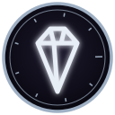{ .rune-ico loading=lazy } **Разбитая Скрижаль** | серебро | 24 капли Звездной Крови | одноразовая, при активации исчезает | Осколки Скрижалей ждут тебя в пустоте, Восходящий! Есть среди них и золотой, но сумеешь ли ты найти его? Сокровище — не Башня, но его тоже нельзя было получить без смертельного риска — в этом и заключался смысл Восхождения. Об этом приключении Пламени Подобный никогда не слышал, но тем интереснее… | ТБ-3, Глава 1, стр. 148 |  |

## Руна-Сага

| Название | Качество | Активация | Действие / перезарядка | Описание | Первая встреча | Ещё |
|---|---|---|---|---|---|---|
| { .rune-ico loading=lazy } **Просьба Изгнанников** | дерево | 3 капли Звездной Крови | одноразовая, при активации исчезает | Расскажет скрытую историю, поместив вас в тело одного из ее героев. | ЗК-3, Глава 4, стр. 294 |  |
| { .rune-ico loading=lazy } **Тем-Чей-Ранг-Неизвестен** | золото | 120 капель Звездной Крови |  | Описание отсутствовало — такое бывало в случае созданных вручную Саг, которые Восходящий не пожелал подписывать. Такой же безымянный подарок на свадьбу преподнес мне Эйрик. Несмотря на предупреждение Морвейн, отвергать дар Сестры Солнца было бы глупо и опасно. К тому же он мог пролить свет на тай… | ЗК-9, Глава 14, стр. 1501 |  |

## Руна-Храм

| Название | Качество | Активация | Действие / перезарядка | Описание | Первая встреча | Ещё |
|---|---|---|---|---|---|---|
| { .rune-ico loading=lazy } **Домен Кузница Вулкана** | серебро | 24 капли Звездной Крови | одноразовая, при активации исчезает | Древняя мастерская в горниле вулкана открыта для Восходящих, готовых отдать многое за секреты рунного мастерства. Стучись в эту дверь, лишь если готов отринуть прежнюю жизнь, обратной дороги — не будет. Вторая изображала спиральный завиток пламени: | ЗК-6, Глава 16, стр. 1542 |  |
| 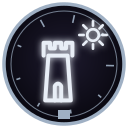{ .rune-ico loading=lazy } **Пещеры Древнего Света** | серебро | 24 капли Звездной Крови | одноразовая, при активации исчезает | В этих Пещерах мерцают отблески Звездной Крови. Священные знания ждут паломников, желающих идти по великой лестнице Восхождения… | ТБ-2, Глава 5, стр. 377 |  |

## Руна Развития

| Название | Качество | Активация | Действие / перезарядка | Описание | Первая встреча | Ещё |
|---|---|---|---|---|---|---|
| **(без названия)** | бронза |  |  | Используется для развития Атрибутов, Аспектов и Навыков. Качество — бронза… Ранги этих предметов и их влияние пока оставались загадкой. Однако, примерив ее к Атрибутам, я обратил внимание, что предполагаемый апгрейд заливает всю доступную шкалу. Это означало, что бронзовая Руна может поднять мой … | ЗК-1, Глава 14, стр. 1324 |  |

## Руна-Домен

| Название | Качество | Активация | Действие / перезарядка | Описание | Первая встреча | Ещё |
|---|---|---|---|---|---|---|
| 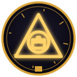{ .rune-ico loading=lazy } **Руна Серебряного Замка** | золото | 240 капель Звездной Крови | нет; нет | Домен «Серебряный Замок». Право суверенного владения и управления. Для уточнения возможностей активируйте Руну. | ЗК-5, Глава 16, стр. 1743 |  |

## Руна-Арена

| Название | Качество | Активация | Действие / перезарядка | Описание | Первая встреча | Ещё |
|---|---|---|---|---|---|---|
| 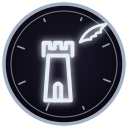{ .rune-ico loading=lazy } **Домен Кровавого Феникса** | серебро | 24 капли Звездной Крови | одноразовая, при активации исчезает | Это смертельное испытание под сигной Кровавого Феникса. Тот, кто вошел, должен сразиться с другим Восходящим. Покинуть арену сможет только один. Два домена с награды за убийство Огнезуба имели огненную стихию! Интересная зависимость…! Все Домены были очень любопытными, особенно первый и последний… | ЗК-6, Глава 16, стр. 1556 |  |

## Руна-Портал

| Название | Качество | Активация | Действие / перезарядка | Описание | Первая встреча | Ещё |
|---|---|---|---|---|---|---|
| 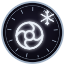{ .rune-ico loading=lazy } **Ледяная Бездна** | серебро | 24 капли Звездной Крови | 1 древодень; одноразовая, при активации исчезает | Открывает Портал в Ледяную Бездну, смертельно опасную область во Тьме, богатую измененной материей. | ЗК-6, Глава 16, стр. 1568 |  |

## Руна-Ключ

| Название | Качество | Активация | Действие / перезарядка | Описание | Первая встреча | Ещё |
|---|---|---|---|---|---|---|
| { .rune-ico loading=lazy } **Домен «Великий Перекресток»** | серебро | 24 капли Звездной Крови | нет | Переносит владельца на Великий Перекресток — узел древних путей Великих Караванов. На Перекрестке можно заказать прибытие любого доступного Каравана в указанную точку Единства, приобрести редкие товары и услуги, а также получить информацию о безопасных путях. Использовано ⅗ зарядов | ЗК-10, Глава 19, стр. 2292 |  |

## Руна-Зерно

| Название | Качество | Активация | Действие / перезарядка | Описание | Первая встреча | Ещё |
|---|---|---|---|---|---|---|
| { .rune-ico loading=lazy } **Семя Домена** | серебро | 120 капель Звездной Крови (безвозвратно) | нет | Зародыш Домена, дарующий кристалл-сферу серебряного ранга, ведущую на камень в ее пустотной глубине. Получив его, Восходящий становится владельцем внутреннего пространства, которое можно изменять по своему усмотрению. Зерно при прорастании преобразуется в Руну-Домен. Владелец может управлять им, … | ТБ-2, Глава 5, стр. 389 |  |

## Прочие карточки с Качеством (не Руны)

| Название | Качество | Активация | Действие / перезарядка | Описание | Первая встреча | Ещё |
|---|---|---|---|---|---|---|
| { .rune-ico loading=lazy } **Малое Ядро** | дерево |  |  | Возможные варианты: Символ Развития (дерево) — 65% Символ Изменения (дерево) — 33% Символ Стихии Яд (дерево) — 18% | ЗК-3, Глава 19, стр. 1835 |  |
| **Знание Языка Народа Кел (0/10)** | бронза |  |  | Вы способны говорить на высоком наречии Народа Кел, понимать письменность и использовать мыслеречь Кел. Ведущий Атрибут: Мышление (1/10) | ЗК-3, Глава 19, стр. 1815 |  |
| **Контроль Звездной Крови (0/10)** | бронза |  |  | Навык управления Звездной Кровью, позволяющий контролировать, принимать, отделять и формировать различные формы Капель, Звезд и Сфер. Ведущий Атрибут: Предвидение (1/10) | ЗК-3, Глава 19, стр. 1819 |  |
| { .rune-ico loading=lazy } **Обломок Скрижали Восходящего** | бронза |  |  | ??? ??? И все. Пояснения отсутствовали в принципе. Что это и зачем вообще нужно? Я рискнул «прозвонить» обломок, мысленно его активируя, и добился появления надписи: Соединить Скрижали? | ЗК-1, Глава 14, стр. 1314 |  |
| **Рунная Артефакция (0/10)** | бронза |  |  | Искусство, позволяющее создавать, разрушать и наделять артефакты рунными свойствами и Звездной Кровью. Ведущий Атрибут: Восприятие (1/10) | ЗК-3, Глава 19, стр. 1823 |  |
| { .rune-ico loading=lazy } **Ядро** | бронза |  |  | Возможные варианты: Символ Изменения (бронза) — 95% Символ Развития (бронза) — 75% Символ Усиления (бронза) — 75% | ЗК-7, Глава 7, стр. 874 |  |
| { .rune-ico loading=lazy } **Большая Звезда** | серебро |  |  | Содержит 24 капель Звездной Крови Звезды используются для создания Рун Необходим Навык «Контроль Звездной Крови» (серебро) | ЗК-3, Глава 19, стр. 1796 |  |
| 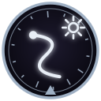{ .rune-ico loading=lazy } **Дракон Звездного Света** | серебро |  |  | 100/100 Звездной Крови Форма эфирного Аспекта из Звездной Крови, которую вы можете призывать на помощь. Обладает следующими способностями: «Полет» — Аспект может летать и носить всадника-Восходящего. Использует 1 каплю Звездной Крови. «Звездный Свет» — эфирная субстанция, из которой состоит Аспек… | ЗК-5, Глава 4, стр. 407 |  |
| 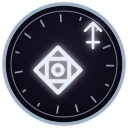{ .rune-ico loading=lazy } **Символ Развития** | серебро |  |  | Символы используются для создания Рун. Необходим Навык «Рунное Искусство» (серебро) Примечательно, что они занимали не двадцать, а всего восемь слотов в моей Скрижали, подразделяясь по видам. У нас в наличии имелось пять Символов Развития, пять Символов Ключа, пять Символов Существа и по одному —… | ЗК-3, Глава 19, стр. 1789 |  |
| { .rune-ico loading=lazy } **Росток Игг-Древа** | золото |  |  | Содержит Звездную Кровь А в следующий миг Наблюдатель прислал мне сообщение. Восходящий Сигурд! Ваша Слава повышена на 100. | ЗК-6, Глава 27, стр. 2661 |  |
| **СКРИЖАЛЬ (соответствие термину 75%)** | обычная |  |  |  | ЗК-1, Глава 8, стр. 586 |  |

## Указатель: все Руны, названные в тексте по имени

> Все обороты вида «Руна/Руну/Руной … <Название>» во всех книгах (встречающиеся 2+ раз). Падеж названия сохраняется как в тексте
> (обычно родительный: «Руна Живых Цепей»). Это указатель для поиска канона, а не выверенный список — возможен шум.

Названий: **147**.

| Название (как в тексте) | Упоминаний | Книги (число упоминаний) | Первое упоминание |
|---|---|---|---|
| { .rune-ico loading=lazy } Руна Развития | 118 | ЗК-1 (13), ЗК-2 (21), ЗК-3 (16), ЗК-4 (7), ЗК-5 (12), ЗК-6 (4), ЗК-7 (10), ЗК-8 (9), ЗК-9 (2), ЗК-10 (7), ЗК-11 (4), ТБ-1 (5), ТБ-2 (4), ТБ-3 (3), ТБ-5 (1) | ЗК-1, Глава 8, стр. 591 |
| { .rune-ico loading=lazy } Руна Усиления | 46 | ЗК-2 (3), ЗК-3 (5), ЗК-4 (1), ЗК-5 (14), ЗК-6 (2), ЗК-7 (9), ЗК-8 (2), ЗК-9 (1), ЗК-10 (2), ТБ-1 (5), ТБ-2 (2) | ЗК-2, Глава 6, стр. 448 |
| { .rune-ico loading=lazy } Руна Изменения | 38 | ЗК-1 (2), ЗК-2 (5), ЗК-3 (12), ЗК-4 (1), ЗК-5 (6), ЗК-7 (3), ЗК-8 (1), ЗК-9 (1), ТБ-1 (3), ТБ-2 (3), ТБ-3 (1) | ЗК-1, Глава 19, стр. 1906 |
| { .rune-ico loading=lazy } Руна Забвения | 22 | ЗК-3 (1), ЗК-8 (7), ЗК-9 (1), ЗК-10 (4), ЗК-11 (4), ЗК-12 (1), ТБ-1 (1), ТБ-2 (1), ТБ-3 (1), ТБ-4 (1) | ЗК-3, Глава 16, стр. 1467 |
| { .rune-ico loading=lazy } Руна Хронос | 18 | ЗК-2 (1), ЗК-3 (1), ЗК-8 (1), ЗК-9 (1), ЗК-11 (4), ЗК-12 (2), ТБ-1 (1), ТБ-2 (3), ТБ-3 (2), ТБ-4 (2) | ЗК-2, Глава 1, стр. 35 |
| { .rune-ico loading=lazy } Руна Повышения | 18 | ЗК-3 (2), ЗК-4 (3), ЗК-5 (4), ЗК-6 (2), ЗК-7 (2), ЗК-8 (2), ТБ-1 (2), ТБ-5 (1) | ЗК-3, Глава 17, стр. 1544 |
| { .rune-ico loading=lazy } Руна Оживления | 18 | ЗК-8 (3), ЗК-9 (9), ЗК-10 (4), ТБ-2 (1), ТБ-3 (1) | ЗК-8, Глава 18, стр. 1861 |
| { .rune-ico loading=lazy } Руна Домена | 16 | ЗК-2 (1), ЗК-5 (2), ЗК-6 (2), ЗК-7 (6), ЗК-8 (2), ЗК-10 (2), ЗК-11 (1) | ЗК-2, Глава 18, стр. 1520 |
| { .rune-ico loading=lazy } Руна Исцеления | 16 | ЗК-3 (1), ЗК-5 (4), ЗК-6 (4), ЗК-7 (1), ЗК-8 (2), ЗК-9 (1), ТБ-1 (1), ТБ-3 (1), ТБ-5 (1) | ЗК-3, Глава 18, стр. 1614 |
| { .rune-ico loading=lazy } Руна Уменьшения | 15 | ЗК-2 (2), ЗК-3 (3), ЗК-4 (1), ЗК-5 (3), ЗК-7 (4), ЗК-9 (2) | ЗК-2, Глава 6, стр. 448 |
| { .rune-ico loading=lazy } Руна Стихии | 14 | ЗК-2 (9), ЗК-3 (2), ЗК-4 (1), ЗК-6 (1), ЗК-7 (1) | ЗК-2, Глава 4, стр. 342 |
| { .rune-ico loading=lazy } Руна Переноса | 14 | ЗК-6 (2), ЗК-7 (1), ЗК-8 (2), ЗК-9 (3), ЗК-10 (5), ЗК-11 (1) | ЗК-6, Глава 28, стр. 2710 |
| { .rune-ico loading=lazy } Руна Живых Цепей | 13 | ЗК-1 (3), ЗК-2 (4), ЗК-3 (1), ЗК-4 (1), ЗК-5 (1), ЗК-6 (1), ТБ-1 (1), ТБ-3 (1) | ЗК-1, Глава 8, стр. 605 |
| { .rune-ico loading=lazy } Руна Наблюдателя | 13 | ЗК-2 (1), ЗК-3 (1), ЗК-4 (1), ЗК-6 (2), ЗК-8 (3), ЗК-10 (1), ЗК-11 (1), ЗК-12 (1), ТБ-5 (2) | ЗК-2, Глава 15, стр. 1267 |
| { .rune-ico loading=lazy } Руна Феромонов | 12 | ЗК-2 (1), ЗК-3 (5), ЗК-4 (1), ЗК-5 (1), ЗК-7 (3), ТБ-2 (1) | ЗК-2, Глава 16, стр. 1403 |
| { .rune-ico loading=lazy } Руна Небесного Ястреба | 12 | ЗК-4 (3), ЗК-5 (1), ЗК-6 (5), ЗК-7 (2), ЗК-9 (1) | ЗК-4, Глава 14, стр. 1234 |
| { .rune-ico loading=lazy } Руна Превращения | 11 | ЗК-2 (4), ЗК-3 (3), ЗК-5 (1), ЗК-7 (3) | ЗК-2, Глава 16, стр. 1342 |
| { .rune-ico loading=lazy } Руна Алого Когтя | 9 | ЗК-1 (3), ЗК-2 (6) | ЗК-1, Глава 11, стр. 969 |
| { .rune-ico loading=lazy } Руна Очищения | 8 | ЗК-3 (2), ЗК-5 (2), ЗК-6 (1), ЗК-11 (1), ТБ-1 (2) | ЗК-3, Глава 18, стр. 1597 |
| { .rune-ico loading=lazy } Руна Энергии | 8 | ЗК-4 (1), ЗК-5 (4), ЗК-7 (1), ЗК-8 (1), ТБ-1 (1) | ЗК-4, Глава 21, стр. 1862 |
| { .rune-ico loading=lazy } Руна Азимандии | 8 | ЗК-5 (4), ЗК-6 (1), ЗК-7 (1), ТБ-1 (1), ТБ-4 (1) | ЗК-5, Глава 13, стр. 1223 |
| { .rune-ico loading=lazy } Руна Прерывания | 8 | ЗК-8 (2), ЗК-10 (4), ЗК-11 (1), ТБ-5 (1) | ЗК-8, Глава 4, стр. 377 |
| { .rune-ico loading=lazy } Руна Анор | 6 | ЗК-1 (1), ТБ-1 (1), ТБ-4 (2), ТБ-5 (2) | ЗК-1, Интерлюдия. Белый Дьявол, стр. 449 |
| { .rune-ico loading=lazy } Руна Истинного Взора | 6 | ЗК-3 (1), ЗК-4 (5) | ЗК-3, Глава 18, стр. 1637 |
| { .rune-ico loading=lazy } Руна Гипнотизма | 6 | ЗК-4 (3), ЗК-5 (3) | ЗК-4, Глава 2, стр. 202 |
| { .rune-ico loading=lazy } Руна Путеводной Звезды | 6 | ЗК-4 (1), ЗК-7 (3), ЗК-8 (1), ЗК-10 (1) | ЗК-4, Глава 14, стр. 1268 |
| { .rune-ico loading=lazy } Руна Связи | 6 | ЗК-5 (2), ЗК-7 (2), ТБ-1 (2) | ЗК-5, Глава 10, стр. 833 |
| { .rune-ico loading=lazy } Руна Порыва Ветра | 5 | ЗК-1 (2), ЗК-2 (1), ТБ-1 (2) | ЗК-1, Глава 19, стр. 1907 |
| { .rune-ico loading=lazy } Руна Биолокации | 5 | ЗК-2 (1), ЗК-3 (1), ЗК-4 (1), ЗК-6 (1), ТБ-2 (1) | ЗК-2, Глава 16, стр. 1359 |
| { .rune-ico loading=lazy } Руна Алого Потока | 5 | ЗК-2 (1), ЗК-3 (2), ЗК-4 (2) | ЗК-2, Глава 16, стр. 1369 |
| { .rune-ico loading=lazy } Руна Цепей | 5 | ЗК-2 (1), ЗК-5 (1), ТБ-1 (2), ТБ-5 (1) | ЗК-2, Глава 20, стр. 1746 |
| { .rune-ico loading=lazy } Руна Привязки | 5 | ЗК-3 (2), ЗК-9 (3) | ЗК-3, Глава 18, стр. 1594 |
| { .rune-ico loading=lazy } Руна Морвейн | 5 | ЗК-9 (2), ЗК-10 (2), ТБ-2 (1) | ЗК-9, Глава 12, стр. 1267 |
| { .rune-ico loading=lazy } Руна Чуткого Уха | 4 | ЗК-1 (2), ЗК-2 (2) | ЗК-1, Глава 8, стр. 596 |
| { .rune-ico loading=lazy } Руна Легкого Прыжка | 4 | ЗК-2 (4) | ЗК-2, Глава 4, стр. 325 |
| { .rune-ico loading=lazy } Руна Запечатления | 4 | ЗК-4 (1), ЗК-7 (3) | ЗК-4, Глава 14, стр. 1268 |
| { .rune-ico loading=lazy } Руна Медленного Падения | 4 | ЗК-4 (2), ЗК-7 (1), ЗК-10 (1) | ЗК-4, Глава 18, стр. 1651 |
| { .rune-ico loading=lazy } Руна Холодного Дыхания | 4 | ЗК-4 (2), ЗК-5 (1), ТБ-2 (1) | ЗК-4, Глава 22, стр. 1948 |
| Руна Стигмата | 4 | ЗК-5 (2), ЗК-6 (2) | ЗК-5, Глава 12, стр. 1127 |
| { .rune-ico loading=lazy } Руна Стихии Смерти | 4 | ЗК-5 (1), ЗК-8 (1), ЗК-9 (1), ТБ-1 (1) | ЗК-5, Глава 16, стр. 1731 |
| { .rune-ico loading=lazy } Руна Шепота Червей | 4 | ЗК-6 (2), ЗК-7 (2) | ЗК-6, Глава 2, стр. 169 |
| { .rune-ico loading=lazy } Руна Невидимости | 4 | ЗК-6 (1), ЗК-10 (2), ТБ-3 (1) | ЗК-6, Глава 23, стр. 2240 |
| { .rune-ico loading=lazy } Руна Слияния | 4 | ЗК-7 (1), ЗК-10 (2), ТБ-2 (1) | ЗК-7, Глава 8, стр. 942 |
| { .rune-ico loading=lazy } Руна Винсента | 4 | ЗК-7 (1), ЗК-9 (2), ЗК-10 (1) | ЗК-7, Глава 8, стр. 962 |
| { .rune-ico loading=lazy } Руна Временной Петли | 4 | ЗК-7 (2), ЗК-8 (2) | ЗК-7, Глава 17, стр. 1837 |
| { .rune-ico loading=lazy } Руна Кассиди | 4 | ЗК-9 (4) | ЗК-9, Глава 8, стр. 770 |
| Руна Стигиса | 4 | ЗК-10 (4) | ЗК-10, Глава 17, стр. 2029 |
| { .rune-ico loading=lazy } Руна Сай | 4 | ЗК-10 (3), ЗК-11 (1) | ЗК-10, Глава 19, стр. 2244 |
| { .rune-ico loading=lazy } Руна Чуткое Ухо | 3 | ЗК-1 (2), ТБ-1 (1) | ЗК-1, Глава 8, стр. 672 |
| { .rune-ico loading=lazy } Руна Порыва Ледяного Ветра | 3 | ЗК-2 (3) | ЗК-2, Глава 6, стр. 450 |
| { .rune-ico loading=lazy } Руна Ледяных Игл | 3 | ЗК-2 (1), ТБ-1 (2) | ЗК-2, Глава 6, стр. 460 |
| { .rune-ico loading=lazy } Руна Энтропии | 3 | ЗК-2 (1), ЗК-5 (1), ТБ-1 (1) | ЗК-2, Глава 23, стр. 1970 |
| { .rune-ico loading=lazy } Руна Серебряного Замка | 3 | ЗК-2 (1), ЗК-5 (2) | ЗК-2, Эпилог, стр. 2092 |
| { .rune-ico loading=lazy } Руна Языка | 3 | ЗК-3 (3) | ЗК-3, Глава 3, стр. 206 |
| { .rune-ico loading=lazy } Руна Пылающих Рук | 3 | ЗК-3 (2), ЗК-6 (1) | ЗК-3, Глава 3, стр. 207 |
| { .rune-ico loading=lazy } Руна Эликсира Антияда | 3 | ЗК-3 (1), ЗК-7 (2) | ЗК-3, Глава 13, стр. 1025 |
| { .rune-ico loading=lazy } Руна Ядовитого Дыхания | 3 | ЗК-3 (1), ЗК-4 (2) | ЗК-3, Глава 17, стр. 1545 |
| { .rune-ico loading=lazy } Руна Дуговой Искры | 3 | ЗК-4 (3) | ЗК-4, Глава 19, стр. 1744 |
| { .rune-ico loading=lazy } Руна Выживания | 3 | ЗК-4 (1), ЗК-5 (2) | ЗК-4, Глава 24, стр. 2185 |
| { .rune-ico loading=lazy } Руна Кнута | 3 | ЗК-5 (2), ЗК-6 (1) | ЗК-4, Глава 24, стр. 2170 |
| { .rune-ico loading=lazy } Руна Остановленного Времени | 3 | ЗК-5 (1), ТБ-1 (1), ТБ-3 (1) | ЗК-5, Глава 13, стр. 1211 |
| { .rune-ico loading=lazy } Руна Морвены | 3 | ЗК-5 (2), ЗК-6 (1) | ЗК-5, Глава 14, стр. 1306 |
| { .rune-ico loading=lazy } Руна Подчинения Призрака | 3 | ЗК-5 (3) | ЗК-5, Глава 14, стр. 1367 |
| { .rune-ico loading=lazy } Руна Ночницы | 3 | ЗК-5 (1), ЗК-6 (1), ЗК-10 (1) | ЗК-5, Глава 17, стр. 1791 |
| { .rune-ico loading=lazy } Руна Ментального Доминирования | 3 | ЗК-5 (1), ЗК-6 (2) | ЗК-5, Глава 20, стр. 2041 |
| { .rune-ico loading=lazy } Руна Огненного Болида | 3 | ЗК-6 (2), ЗК-7 (1) | ЗК-6, Глава 7, стр. 618 |
| { .rune-ico loading=lazy } Руна Перезарядки | 3 | ЗК-6 (3) | ЗК-6, Глава 15, стр. 1413 |
| { .rune-ico loading=lazy } Руна Ложного Стигмата | 3 | ЗК-6 (2), ЗК-11 (1) | ЗК-6, Глава 15, стр. 1449 |
| { .rune-ico loading=lazy } Руна Говорящей-с-Травами | 3 | ЗК-6 (2), ЗК-9 (1) | ЗК-6, Глава 17, стр. 1672 |
| { .rune-ico loading=lazy } Руна Силы Десяти Воинов | 3 | ЗК-8 (3) | ЗК-8, Глава 6, стр. 561 |
| { .rune-ico loading=lazy } Руна Времени | 3 | ЗК-8 (1), ЗК-12 (1), ТБ-2 (1) | ЗК-8, Глава 9, стр. 896 |
| { .rune-ico loading=lazy } Руна Всеобъемлющей Чистоты | 3 | ЗК-8 (1), ЗК-10 (2) | ЗК-8, Глава 15, стр. 1515 |
| { .rune-ico loading=lazy } Руна Сферы Пустоты | 3 | ЗК-8 (1), ЗК-9 (2) | ЗК-8, Глава 15, стр. 1526 |
| { .rune-ico loading=lazy } Руна Кейнора | 3 | ЗК-8 (2), ЗК-9 (1) | ЗК-8, Глава 21, стр. 2207 |
| { .rune-ico loading=lazy } Руна Погружения-в-Грезы | 3 | ЗК-9 (2), ТБ-4 (1) | ЗК-9, Глава 6, стр. 579 |
| Руна Скрипторума | 3 | ЗК-9 (1), ТБ-5 (2) | ЗК-9, Глава 9, стр. 937 |
| { .rune-ico loading=lazy } Руна Скрипторума Некролита | 3 | ЗК-9 (2), ТБ-5 (1) | ЗК-9, Глава 15, стр. 1644 |
| { .rune-ico loading=lazy } Руна Надзора | 3 | ЗК-10 (3) | ЗК-10, Глава 18, стр. 2180 |
| { .rune-ico loading=lazy } Руна Огненной Крови | 3 | ЗК-11 (1), ТБ-2 (2) | ЗК-11, Глава 13, стр. 1702 |
| { .rune-ico loading=lazy } Руна Бродячего Торговца | 3 | ЗК-11 (1), ТБ-1 (1), ТБ-3 (1) | ЗК-11, Глава 14, стр. 1790 |
| { .rune-ico loading=lazy } Руна Ледяных Кинжалов | 3 | ТБ-1 (3) | ТБ-1, Глава 4, стр. 464 |
| Руна Гая Флоу | 2 | ЗК-1 (1), ЗК-2 (1) | ЗК-1, Глава 13, стр. 1129 |
| { .rune-ico loading=lazy } Руна Зеленого Листа | 2 | ЗК-1 (1), ТБ-1 (1) | ЗК-1, Глава 21, стр. 2097 |
| { .rune-ico loading=lazy } Руна Стихий | 2 | ЗК-2 (2) | ЗК-2, Глава 5, стр. 398 |
| { .rune-ico loading=lazy } Руна Легкий Прыжок | 2 | ЗК-2 (2) | ЗК-2, Глава 6, стр. 430 |
| Руна Развития и Изменения | 2 | ЗК-2 (1), ЗК-8 (1) | ЗК-2, Глава 6, стр. 446 |
| { .rune-ico loading=lazy } Руна Зерцала | 2 | ЗК-2 (2) | ЗК-2, Глава 7, стр. 567 |
| { .rune-ico loading=lazy } Руна Навыков | 2 | ЗК-2 (1), ЗК-5 (1) | ЗК-2, Глава 18, стр. 1560 |
| Руна Существ | 2 | ЗК-2 (1), ТБ-2 (1) | ЗК-2, Глава 22, стр. 1896 |
| { .rune-ico loading=lazy } Руна Деревянной Кожи | 2 | ЗК-3 (2) | ЗК-3, Глава 4, стр. 289 |
| { .rune-ico loading=lazy } Руна Ядовитого Побега | 2 | ЗК-3 (1), ЗК-4 (1) | ЗК-3, Глава 17, стр. 1532 |
| { .rune-ico loading=lazy } Руна Призрачной Руки | 2 | ЗК-3 (1), ЗК-4 (1) | ЗК-3, Глава 18, стр. 1637 |
| { .rune-ico loading=lazy } Руна Парящего Кувшина | 2 | ЗК-3 (1), ЗК-5 (1) | ЗК-3, Глава 18, стр. 1639 |
| { .rune-ico loading=lazy } Руна Глаза Небесного Змея | 2 | ЗК-4 (1), ЗК-7 (1) | ЗК-4, Глава 17, стр. 1551 |
| { .rune-ico loading=lazy } Руна Мастера Пловца | 2 | ЗК-4 (2) | ЗК-4, Глава 19, стр. 1745 |
| { .rune-ico loading=lazy } Руна Экзо-Шейда | 2 | ЗК-4 (2) | ЗК-4, Глава 20, стр. 1776 |
| { .rune-ico loading=lazy } Руна Огненной Защиты | 2 | ЗК-4 (1), ЗК-7 (1) | ЗК-4, Глава 21, стр. 1871 |
| { .rune-ico loading=lazy } Руна Зеркальной Чешуи | 2 | ЗК-4 (1), ЗК-7 (1) | ЗК-4, Глава 21, стр. 1872 |
| { .rune-ico loading=lazy } Руна Призрачного Шага | 2 | ЗК-5 (2) | ЗК-5, Глава 2, стр. 194 |
| { .rune-ico loading=lazy } Руна Облачения Странника | 2 | ЗК-5 (1), ЗК-8 (1) | ЗК-5, Глава 6, стр. 543 |
| { .rune-ico loading=lazy } Руна Ледяного Взора | 2 | ЗК-5 (1), ЗК-6 (1) | ЗК-5, Глава 10, стр. 843 |
| { .rune-ico loading=lazy } Руна Ускорения Времени | 2 | ЗК-5 (1), ЗК-7 (1) | ЗК-5, Глава 14, стр. 1336 |
| { .rune-ico loading=lazy } Руна Астральных Фантомов | 2 | ЗК-5 (1), ТБ-1 (1) | ЗК-5, Глава 14, стр. 1345 |
| { .rune-ico loading=lazy } Руна Заклинателя Духов | 2 | ЗК-5 (1), ЗК-6 (1) | ЗК-5, Глава 14, стр. 1417 |
| { .rune-ico loading=lazy } Руна Восхождения | 2 | ЗК-5 (1), ТБ-3 (1) | ЗК-5, Глава 16, стр. 1652 |
| Руна Ястреба | 2 | ЗК-6 (1), ЗК-8 (1) | ЗК-6, Глава 5, стр. 426 |
| { .rune-ico loading=lazy } Руна Раскаленной Ауры | 2 | ЗК-6 (2) | ЗК-6, Глава 7, стр. 627 |
| { .rune-ico loading=lazy } Руна Болида | 2 | ЗК-6 (1), ЗК-10 (1) | ЗК-6, Глава 7, стр. 651 |
| { .rune-ico loading=lazy } Руна Облачения | 2 | ЗК-6 (2) | ЗК-6, Глава 13, стр. 1173 |
| { .rune-ico loading=lazy } Руна Заклинательницы Душ | 2 | ЗК-6 (1), ТБ-5 (1) | ЗК-6, Глава 28, стр. 2797 |
| { .rune-ico loading=lazy } Руна Звезды | 2 | ЗК-7 (2) | ЗК-7, Глава 8, стр. 942 |
| { .rune-ico loading=lazy } Руна Расширения | 2 | ЗК-7 (1), ТБ-3 (1) | ЗК-7, Глава 8, стр. 942 |
| { .rune-ico loading=lazy } Руна Светоча | 2 | ЗК-8 (2) | ЗК-8, Глава 6, стр. 560 |
| { .rune-ico loading=lazy } Руна Стихии Небесного Огня | 2 | ЗК-8 (2) | ЗК-8, Глава 13, стр. 1352 |
| { .rune-ico loading=lazy } Руна Полной Невидимости | 2 | ЗК-8 (1), ЗК-10 (1) | ЗК-8, Глава 14, стр. 1442 |
| { .rune-ico loading=lazy } Руна Тысячи Нарядов | 2 | ЗК-8 (1), ТБ-2 (1) | ЗК-8, Глава 15, стр. 1525 |
| { .rune-ico loading=lazy } Руна Великой Пустоты | 2 | ЗК-8 (1), ТБ-3 (1) | ЗК-8, Глава 17, стр. 1744 |
| { .rune-ico loading=lazy } Руна Морозной Закалки | 2 | ЗК-8 (1), ТБ-2 (1) | ЗК-8, Глава 19, стр. 2009 |
| { .rune-ico loading=lazy } Руна Желания | 2 | ЗК-9 (1), ТБ-5 (1) | ЗК-9, Глава 2, стр. 151 |
| { .rune-ico loading=lazy } Руна Цепкости | 2 | ЗК-9 (1), ЗК-10 (1) | ЗК-9, Глава 2, стр. 202 |
| { .rune-ico loading=lazy } Руна Сна | 2 | ЗК-9 (2) | ЗК-9, Глава 6, стр. 536 |
| { .rune-ico loading=lazy } Руна Маскировки | 2 | ЗК-9 (1), ТБ-5 (1) | ЗК-9, Глава 12, стр. 1253 |
| { .rune-ico loading=lazy } Руна Имени | 2 | ЗК-10 (2) | ЗК-10, Глава 8, стр. 856 |
| { .rune-ico loading=lazy } Руна Починки | 2 | ЗК-10 (2) | ЗК-10, Глава 14, стр. 1685 |
| { .rune-ico loading=lazy } Руна Дирка | 2 | ЗК-11 (2) | ЗК-11, Глава 11, стр. 1495 |
| { .rune-ico loading=lazy } Руна Космос | 2 | ЗК-12 (2) | ЗК-12, Пролог. Великие Руны, стр. 26 |
| { .rune-ico loading=lazy } Руна Кровавого Чутья | 2 | ТБ-1 (2) | ТБ-1, Глава 1, стр. 107 |
| { .rune-ico loading=lazy } Руна Громового Шквала | 2 | ТБ-1 (2) | ТБ-1, Глава 3, стр. 370 |
| { .rune-ico loading=lazy } Руна Ветра | 2 | ТБ-1 (2) | ТБ-1, Глава 3, стр. 376 |
| { .rune-ico loading=lazy } Руна Удара Искрового Ветра | 2 | ТБ-1 (2) | ТБ-1, Глава 4, стр. 468 |
| { .rune-ico loading=lazy } Руна Водяного Эха | 2 | ТБ-1 (2) | ТБ-1, Глава 5, стр. 563 |
| { .rune-ico loading=lazy } Руна Черного Ползуна | 2 | ТБ-1 (2) | ТБ-1, Глава 13, стр. 1496 |
| { .rune-ico loading=lazy } Руна Призрачных Фантомов | 2 | ТБ-1 (2) | ТБ-1, Глава 13, стр. 1509 |
| { .rune-ico loading=lazy } Руна Заклинательницы Духов | 2 | ТБ-1 (2) | ТБ-1, Глава 14, стр. 1535 |
| { .rune-ico loading=lazy } Руна Провидицы | 2 | ТБ-1 (1), ТБ-5 (1) | ТБ-1, Глава 17, стр. 1942 |
| { .rune-ico loading=lazy } Руна Водяного Тела | 2 | ТБ-1 (1), ТБ-3 (1) | ТБ-1, Глава 18, стр. 2083 |
| { .rune-ico loading=lazy } Руна Призрака Небесного Огня | 2 | ТБ-2 (1), ТБ-3 (1) | ТБ-2, Глава 1, стр. 50 |
| { .rune-ico loading=lazy } Руна Орина | 2 | ТБ-2 (2) | ТБ-2, Глава 1, стр. 53 |
| { .rune-ico loading=lazy } Руна Иллиумовой Цепи | 2 | ТБ-2 (2) | ТБ-2, Глава 1, стр. 58 |
| { .rune-ico loading=lazy } Руна Огненного Куба | 2 | ТБ-2 (2) | ТБ-2, Глава 1, стр. 59 |
| { .rune-ico loading=lazy } Руна Искусства Торговли | 2 | ТБ-2 (2) | ТБ-2, Глава 1, стр. 97 |
| { .rune-ico loading=lazy } Руна Золотой Воды | 2 | ТБ-2 (2) | ТБ-2, Глава 3, стр. 238 |
| { .rune-ico loading=lazy } Руна Огненного Вихря | 2 | ТБ-2 (2) | ТБ-2, Глава 4, стр. 249 |
| { .rune-ico loading=lazy } Руна Увеличения и Уменьшения | 2 | ТБ-2 (2) | ТБ-2, Глава 4, стр. 332 |
| { .rune-ico loading=lazy } Руна Трансформации | 2 | ТБ-2 (1), ТБ-3 (1) | ТБ-2, Глава 4, стр. 335 |
| { .rune-ico loading=lazy } Руна Пира Кел Тара | 2 | ТБ-2 (2) | ТБ-2, Глава 6, стр. 514 |
| { .rune-ico loading=lazy } Руна Пути | 2 | ТБ-5 (2) | ТБ-5, Глава 11, стр. 1190 |
