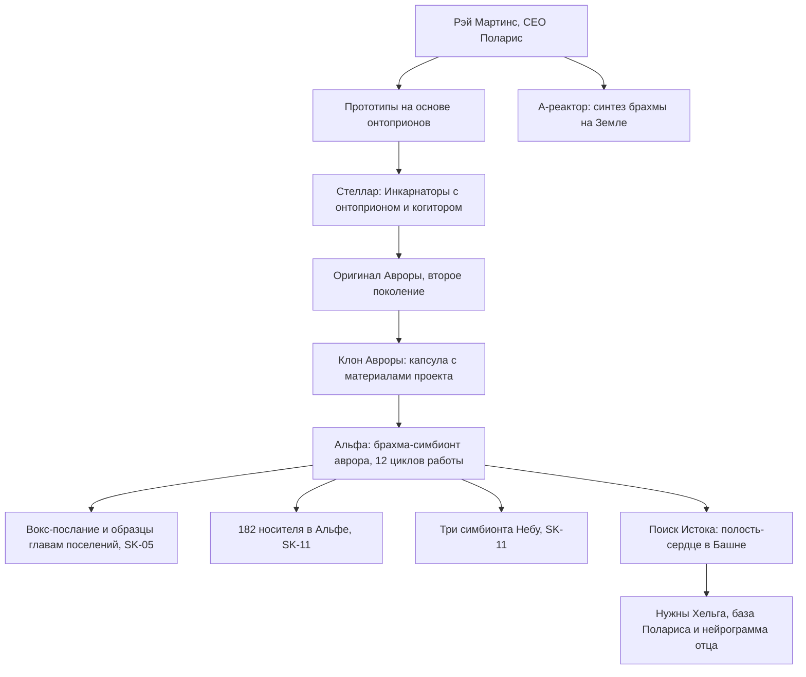

# Аврора Мартинс

| | |
|---|---|
| **Имена** | Аврора Мартинс; в SK-03 — «Аврора **Мартинес**» (устами Шона Макдональда, SK-03, гл. 14) — *расхождение написания*, основное — Мартинс. Обращения: «координатор Мартинс», «Мартинс» (Кондор), «просто Аврора» (SK-11, гл. 5, 16); «рыжеволосая Истинная/предтеча» (Пламени Подобный, TB-04, гл. 17–18); «золотая дочка Мартинса» (в мыслях Кондора, SK-11, гл. 10) |
| **Не путать** | Проект **«Аврора»** (её назвали в честь проекта, а не наоборот) и **«авроры»** — носители брахма-симбионта (Вероника, Фьюри, 182 бойца Альфы и др.) |
| **Происхождение** | Земной проект. Клон с нейрограммой; оригинал — Инкарнатор **второго поколения «Стеллара»**, куда её «засунул отец» — **Рэй Мартинс**, CEO корпорации «Поларис» (SK-11, гл. 8, 11) |
| **Должности** | Член совета координаторов Колонии Альфа; старший координатор проекта «Аврора» (SK-05, интерлюдия «Аврора»); координатор научного сектора (SK-11, гл. 9); после переворота — член Чрезвычайной комиссии (девять человек) и фактический полномочный представитель Альфы (SK-11, гл. 16) |
| **Ранг** | Серебро (SK-11, гл. 4); Разум «слегка поблескивал золотом» (TB-04, гл. 17); носитель брахма-симбионта — технически бессмертна (SK-05, интерлюдия) |
| **Книги** | SK-03 (упом.), SK-05 (вокс-послание, интерлюдия), SK-06–SK-10 (упом., цель пути Сигурда), **SK-11** (гл. 3–11, 15–18 — активно), TB-03 (упом.), **TB-04** (гл. 17–18, совет глазами Пламени Подобного) |
| **Статус на конец канона** | Жива, в Альфе; поклялась перед Наблюдателем в тайном пакте с Тысячей; хочет принять приглашение Ордена (TB-04, гл. 18), визит отложен (SK-11, гл. 18) |

---

## 1. Внешность (кратко)
- «Рыжеволосая женщина в строгом черном комбинезоне с эмблемой проекта "Космо". Не молодая и не старая… лет тридцать… за миловидными чертами проступает жесткий, волевой характер»; «приятный мелодичный голос» (SK-05, интерлюдия).
- «Бледная и рыжеволосая, лет тридцати на вид… сквозь миловидные черты сразу просвечивает жесткая воля, острый ум, кипучая энергия»; «лихорадочно блестящие глаза» (SK-11, гл. 5).
- **Противоречие ракурсов:** Пламени Подобный: «Ее нельзя было назвать красавицей — пожалуй, в этой женщине вообще отсутствовала та незримая притягательность…» (TB-04, гл. 17). Это взгляд осколка Единого, не авторская правка.
- Черный комбинезон — знак высшей касты координаторов «Космо»; таких на борту «всего несколько десятков», выше — только гранд-координатор и капитан (SK-05, интерлюдия). На запястье — серебряная точка гвоздя (SK-05, интерлюдия).
- Жест: накручивает на палец рыжую прядь (SK-11, гл. 16).

## 2. Природа и возможности
- **Носитель брахма-симбионта.** «Да, я первой из людей имплантировала себе экспериментальный образец авроры» (SK-05, интерлюдия). Демонстрация: выстрел из «Дефендера» в висок → брахма-репликация «по слепку-образцу» (там же).
- **Ограничения симбионта** (её же лекция, SK-05, интерлюдия): не восстановит тело, «превращенное в пепел или разделенное на много частей»; крайне уязвим к А-фактору; нужна концентрация брахма-частиц; не защищает от болезней и старения; побочные эффекты — «психологические».
- **Стигмат — «декорация».** Аврора «позволяет взаимодействовать со Звездной Кровью и Рунами… без искусственной системы ограничений, встроенной в стигматы»; стигмат рекомендует оставить, «но исключив из системы управления» (SK-05, интерлюдия). Носители авроры опознают Восходящих высших страт, тогда как носители стигматов — лишь друг друга (там же).
- **Ментальное искусство.** При Резонансе Сигурда «воздвигает ментальные барьеры» — «сильная Восходящая» (SK-11, гл. 4). Приватная Руна-купол «продвинутой Сферы Тишины» (SK-11, гл. 5). По TB-04 «позаботилась о защите» разума (TB-04, гл. 17).
- **Оператор Оси.** Активировала Ось Стражи найденной Инскрипцией «Печать Стражи» и 18 дней провела в кататонии в иллиумовом коконе (SK-11, гл. 3): для работы Оси нужны «семь операторов» с «предельными золотыми или небесными Атрибутами Разума» (SK-11, гл. 4).
- **Технологии, которыми владеет:** брахма-копирование (структуры стигмата, рунных матриц) (SK-11, гл. 16; TB-04, гл. 18); **А-коммандер** — разработка «Стеллара», импульс вызывает «каскадный сбой энергоинформационного обмена симбионта» и азур-шок; её «личное имущество» (SK-11, гл. 16); **Квантовый Азур-Вокс** — новейшая разработка «на основе находок из Башни», бронзовый Артефакт Единства, канал без ограничения дальности, сеанс 60 секунд, 3/3 заряда (SK-11, гл. 11); «Альфа-Домен» — экспериментальная экстрамерность для исследования кел-Доменов (SK-11, гл. 11).

## 3. Личность, мотивация, цели, методы
- **Учёный-прагматик.** «Похоже, ее как главу научного сектора волновал только Исток и все, связанное с ним» (SK-11, гл. 7). Пламени Подобный: «она вытягивала из легенд структуру и заменяла поэзию функциональными схемами, делая сказку механизмом» (TB-04, гл. 17).
- **Этика с ограничителем.** На совете: план Кондора «противоречит как этике с моралью, так и базовым директивам "Космо"»; «Я отказываюсь подписывать приговор» (SK-11, гл. 9). Но знала о бомбах и санациях: «Да, знала!.. А что я могла поделать в одиночку? Кондор — герой, легенда» (SK-11, гл. 11). О Кондоре после переворота: «Лучше бы убил… Пять или шесть трупов, какая разница?» (SK-11, гл. 11).
- **Легалистка «Космо».** Ковчег принадлежит человечеству; о ресурсах «Хельги» решает **Совет Земли** — гранд-координаторы, «люди, которые стояли у истоков проектов "Космо", "Стеллар", "Барьер", "Звездный Флот"» (SK-11, гл. 16). «Сигурд — не капитан "Хельги". Капитаном был Йан Воглер. Сигурд — носитель его анимы и привязанных к ней ключевых доступов» (SK-11, гл. 16).
- **Цели.** (1) Исток — она уверена, что он «материален и техногенен… может быть воссоздан» (SK-11, гл. 11); (2) оживить на «Хельге» Рэя Мартинса, Элизабет Янг и Ивана Кляйнера (SK-11, гл. 11); (3) «перезапустить колонизацию "Космо" в нормальном режиме» (там же); (4) «сохранить контроль над будущим Истоком за собой» (SK-11, гл. 16).
- **Отношение к отцу.** «Меня туда засунул отец… он хотел сделать меня такой же, как он. Подарить… бессмертие» — усмешка выдаёт неблагодарность (SK-11, гл. 8). При этом считает его «ключом к созданию Истоков» (SK-11, гл. 11). Сказав «мой отец», «без особой радости усмехнулась» (там же).
- **Ревность к своему делу.** «"Аврора" — это в первую очередь изобретение моего отца. Я лишь воплотила его замысел» (SK-11, гл. 16) — и тут же оговорка о собственном вкладе: «Я обошла эту проблему с помощью брахма-копирования» (там же).
- **Стиль решений.** «Очень интересно» — признак, что решение принято (SK-11, гл. 5); быстро считывает досье («уложилась в две с половиной минуты», SK-11, гл. 5); не боится конфронтации с Кондором: «Не. Перебивай. Меня» (SK-11, гл. 9).
- **Кофе.** Земной кофе «на вес золота»; угощает Сигурда (SK-11, гл. 5); на совете «отхлебывала кофе» (SK-11, гл. 7); скомкала стаканчик в гневе (SK-11, гл. 9); «Жаль, что у вас тут нет кофе…» (TB-04, гл. 17).

## 4. Речь
Сухая, научно-деловая; термины А-физики («тахионная сеть», «азур-фон», «брахма-инжиниринг»), инженерные аргументы («единственная точка отказа — это критическая уязвимость», TB-04, гл. 17); чертыхается («черт побери»); прямые вопросы.
1. «Приветствую! Мое имя Аврора Мартинс… И, предваряя упреки в тщеславии, — нет, проект не назван моим именем… это я получила имя в честь проекта» (SK-05, интерлюдия).
2. «И кофе. Немедленно… Черт побери, у вас есть кофе?.. Олег, ты не понимаешь, это подождет! Кажется, я обнаружила его!» — «Что именно?» — «Исток» — первые слова после Оси (SK-11, гл. 4).
3. «А ты чего хочешь, Сигварт? Сам, лично?» (SK-11, гл. 5).
4. «Новая жизнь, старый позывной. Здесь есть еще кое-кто, кто его помнит» (о Тайне, SK-11, гл. 5).
5. «Я не за извинениями прилетела, Сигурд… у нас одна задача. Не у меня или тебя, не у Альфы и Неба, а у всего человечества в этой чертовой сфере!» (SK-11, гл. 11).
6. «От древнего пафоса уже в зубах вязнет. Но их знания просто бесценны…» (SK-11, гл. 18).
7. «Эврика, Матиас! Тахионная суперсистема обнуляет трансформационный потенциал…» (TB-04, гл. 17).

## 5. Предыстория (земные проекты)
- **Проект «Аврора» корпорации «Поларис».** «Разрабатывался… под руководством моего отца»; начат «задолго до моего рождения» (SK-05, интерлюдия). Знак — **три волнистые полоски** на контейнерах брахмы и базах репликации с «Хельги» (там же; кейс с симбионтами — SK-11, гл. 16).
- **Брахма-материя** («живая материя») — «уникальный репликационный материал, способный имитировать любое агрегатное состояние любого вещества или энергии»; А-физики считают брахма-частицы строительным материалом вселенной; синтез — в экспериментальном **А-реакторе «Полариса»** (SK-05, интерлюдия). На Земле — «единственный сверхсекретный институт» и «один на всю планету прототип такого А-реактора с весьма ограниченной мощностью» (SK-11, гл. 5).
- **Онтоприоны.** Брахма-симбионт — «полная копия лабораторных прототипов моего отца, Рэя Мартинса, которые, в свою очередь, были изготовлены на основе уникальной инопланетной технологии, так называемых онтоприонов» (SK-11, гл. 16). У Инкарнаторов «Стеллара» — настоящие онтоприоны в аниме, «ксенотехнология, которую невозможно подделать» (SK-11, гл. 8).
- **«Стеллар».** Второе поколение («направленная попытка производства») — оригиналы Авроры и Морозова; Морозова отобрали «по квоте добровольцев из числа наиболее перспективных выпускников Академии Звездного Флота» (SK-11, гл. 8). Аврора узнаёт Сигурда: «в одном проекте были наши оригиналы» (SK-11, гл. 5).
- **«Почти не служила в Звездном Флоте»** — упрёк Кондора (SK-11, гл. 9).
- **Защита от Врага.** «От зла, которое должно было его уничтожить… Нам это рассказывали» (SK-11, гл. 8).
- **Звездная Кровь = брахма.** «Звездная Кровь — это всего лишь один из вариантов энергетического состояния брахма-материи, идеально приспособленный для взаимодействия с человеческим организмом» (SK-05, интерлюдия). «Кел называют Кровью Истока нашу брахма-материю. Значит, Исток — это устройство, в котором она производилась» (SK-11, гл. 5).

## 6. Биография по книгам
- **На Земле / до Единства.** Дочь Рэя Мартинса; оригинал — в «Стелларе». Техническая часть проекта и материалы были в её капсуле при высадке (SK-05, интерлюдия).
- **Падение.** «Я упала двенадцать циклов назад» (SK-11, гл. 5) — т. е. не из 210 основателей Альфы (SK-11, гл. 2, 6). Продолжила «Аврору» в Альфе; за годы прошла то, «над чем десятилетиями бился "Поларис"», благодаря «паттернам» Восхождения (SK-05, интерлюдия).
- **SK-03.** Шон Макдональд: «В Колонии Альфа есть Аврора Мартинес, тебе лучше с ней потолковать» (SK-03, гл. 14).
- **SK-05 (интерлюдия «Аврора»).** Вокс-послание главам поселений (привёз «Одиссей» Альфы с Шоном и Фьюри; симбионт извлекли из биопротеза Фьюри — SK-05, гл. 20): предложение объединения, дар одного образца симбионта, призыв тайно собирать брахму; предупреждение о нападениях ради брахмы — Сваргас, экспедиция Конрада Смита, резня в торговом квартале Либерти, аванпост Земля-три; об «отражениях» — клонах-шпионах Небесного Трона, ищущих «Исток» и «Кровь Истока»; признаки шпиона (скрытый Восходящий, амнезия, изменённый стигмат) и совет «устранить так, чтобы не возникло подозрений… либо держать под наблюдением»; «В Колонии Альфа есть специальная группа» (SK-05, интерлюдия). Белый Дьявол: «Присутствовать при рождении того, что породило тебя самого… Змея кусает свой хвост» (там же).
- **SK-06–SK-10.** Вероника: «Тебе нужно попасть в Колонию Альфа… И найти там Аврору Мартинс» (SK-06, гл. 1). Брахма в хранилищах Ноктис — продукт «Авроры» (SK-08, гл. 18). Цель всего пути Сигурда (SK-08, гл. 14; SK-10, гл. 3).
- **SK-11.**
  - 18 дней в коконе Оси Стражи; «послания» — лицо из движущихся рун (гл. 3). Сигурд через Ось Путей и Скай перезагружает её «смертельным» ментальным ударом — брахма-симбионт проводит инкарнацию (гл. 4).
  - Узнаёт Сигурда («Сигварт?»), даёт 15 минут приватно, выслушивает послание Тысячи/Ордена/Хранителей; спрашивает имя когитора: «Скай? Ты уверен?» (гл. 5).
  - Совет координаторов: допускает «неформальный канал» к Тысяче — «союз… слишком токсичный шаг» (гл. 7).
  - Откровение о «Стелларе»; про отца (гл. 8).
  - Экстренное совещание: против азур-санации и обнуления; предлагает восстановить часть памяти Воглера; голосует против, отказывается подписывать (гл. 9).
  - Скай при захвате Альфы закрывает подступы к её лаборатории (гл. 10).
  - На «Голубе» догоняет Сигурда на плато: возвращает Аграф и Кристалл Странника, передаёт данные о движении «Хельги», просьбу оживить Янг, Кляйнера, Мартинса; рассказывает о полости-«сердце» в Башне; предлагает неофициальный союз «от лица координаторов» с согласия Рашидова; дарит Азур-Вокс; получает Печати Тайны и Забвения, Ключ в Серебряный Замок и цилиндр брахмы — «Как дар или как виру» (гл. 11).
  - По Азур-Воксу соглашается на тайную встречу с Тысячей (гл. 15).
  - Переговоры в Реликварии Серебряного Замка: извинения, кейс с тремя брахма-симбионтами; А-коммандер; признание Неба независимым в закрытом формате; удаление имплантатов, отказ от санаций; армия — ставленники Кондора, «возможен… открытый мятеж»; научная группа с Миносом; спор о «Хельге» (гл. 16).
  - Совет с Тысячей: гипотеза сети Истоков в Башнях; узнаёт Мико как модель «Стеллара»; приносит Клятву перед Наблюдателем (гл. 17–18). Передаёт условие Рашидова — нейрослепок Луизы Шварц (гл. 18).
- **TB-04 (гл. 17–18).** Тот же совет глазами Пламени Подобного: допрашивает Братьев («Перевернуть сферы… Что это значит в вашей терминологии?»), формулирует распределённый контур Истоков; «Эврика» о тахионной сети; хочет принять приглашение Ордена: «Если "Стеллар" все-таки был запущен и они сохранили его Архив… это крайне важно. Не важнее ковчега, но…» (TB-04, гл. 18).

## 6а. Проект «Аврора» под её руководством (свод)
| Аспект | Канон |
|---|---|
| Функции симбионта | 1) управляемая инкарнация (брахма-репликация по слепку); 2) управление и трансформация организма брахмой — аналог прокачки Атрибутов (SK-05, интерлюдия) |
| Совместимость с Восхождением | «Готовый к использованию, полностью адаптированный к системе Восхождения брахма-симбионт»; носитель — «оператор Звездной Крови», Восходящий без стигмата; у Восходящего симбионт перестраивает управление «согласно заданным оператором приоритетам» (SK-05, интерлюдия) |
| Сырьё | Брахма-материя, «много брахма-материи»; А-реактор Альфы «далек от завершения» (SK-05, интерлюдия); ключевые данные — база «Полариса» и нейрограмма Рэя Мартинса на «Хельге» (SK-11, гл. 8) |
| Контроль | Нет собственного разума и удалённого выключения; только А-коммандер «Стеллара» (азур-шок) и А-энергетические Руны; уязвимость — средоточие; сопротивляемость растёт с Атрибутами (SK-11, гл. 16) |
| Носители (известные) | Сама Аврора — первая (SK-05, интерлюдия); Вероника Максвелл и Фьюри (SK-05, гл. 20–21; SK-06, гл. 1); командор Мэй Чжэнь со Станции Терра — «"аврора" с "выключенной" аурой» (SK-10, гл. 11–12 по разбору); в Альфе под контролем Скай оказалось 182 носителя (SK-11, гл. 10); три симбионта — Небу: Минос, Адамант, вероятно Серена (SK-11, гл. 18) |
| Без когитора | «У "аврор" нет нейрокогитора, чтобы восстановить разум» — поэтому выжигание личности необратимо (SK-11, гл. 10) |
| Контрразведка | «Специальная группа» против кел-шпионов (SK-05, интерлюдия); к SK-11 у Альфы «минимум три команды Восходящих, специально натасканных для нейтрализации кел-шпионов» (SK-11, гл. 10) |
| Инициация без стигмата | Аврора повторила «структуру изменений, вносимых стигматом» брахма-копированием (SK-11, гл. 16); Кейнор предлагает иной путь — капля Крови Истинного + Руны Слияния и Забвения (SK-11, гл. 17) |

## 6б. Как писать Аврору (голос и поведение)
- **Сначала дело, потом этикет:** требует данные, кофе и диагностику — в таком порядке, но данные первыми (SK-11, гл. 4).
- **Переспрашивает термины на своём языке:** «Когда вы говорите "игра", "сферы"… это метафора?.. О моделировании причинности? О принципах управления вероятностями?» (TB-04, гл. 17); «Агрессивный азур-фон? Инородная топология излучения?» (там же).
- **Поджимает губы, прищуривается, отхлёбывает кофе** перед ответом; «Очень интересно» — точка принятия решения (SK-11, гл. 5).
- **Режет пафос:** древние речи Братьев и Ордена для неё — «древний пафос», который «в зубах вязнет» (SK-11, гл. 18); «Это не стратегия, а какое-то безумие…» (TB-04, гл. 17).
- **Держит удар:** выдерживает «тяжелый взгляд» Кассиди, отвечает «спокойно» (SK-11, гл. 16); голос со «сталью» (SK-11, гл. 5).
- **Не принимает чудеса:** всё, что слышит, превращает в схему (TB-04, гл. 17–18).

## 7. Научные гипотезы Авроры (свод)
| Гипотеза | Суть | Источник |
|---|---|---|
| Исток — устройство | Брахма = Кровь Истока ⇒ Исток — реактор/технология | SK-11, гл. 5 |
| Полость-«сердце» | Сферическая полость в Башне Альфы с сетью «энерговодов», похожая на прототип брахма-симбионта / онтоприон — вероятно, реактор-Исток Башни | SK-11, гл. 11 |
| Сеть Истоков | «Подобные Истоки были в каждой Башне»; «единственная точка отказа — критическая уязвимость» | SK-11, гл. 11; TB-04, гл. 17 |
| Иллиум как экран | Толстый иллиум Башен экранировал «пробой» при предельной концентрации А-энергии | TB-04, гл. 17 |
| Инициация без стигмата | Любая капля ЗК содержит паттерны Восхождения в тахионной сети, маяки которой — Башни и посты Наблюдателя | SK-11, гл. 16 |
| «Прошивка» Крови | Кровь Восходящего с симбионтом сохраняет «прошивку» вне тела, обычная — обнуляется | TB-04, гл. 17 |
| Орден = «Стеллар»? | Имя и облик Мико совпадают с моделью нейрокогитора «Стеллара», стелла — логотип проекта | SK-11, гл. 18; TB-04, гл. 18 |

**Контраргумент Кейнора:** «Исток не мог находиться в Единстве» — в Крови Истока «дыхание Извне», такой «костёр» стал маяком для Тварей; Башни — «горло, через которое Единство пило силу» (SK-11, гл. 17). Аврора: «не отказываюсь от своей гипотезы» (TB-04, гл. 17).

## 8. Отношения
- **Сигурд.** Спасённая им; узнаёт оригинал; союзница, но не подчинённая. Делает его «каналом» к Ордену и Тысяче (SK-11, гл. 11). Пламени Подобный видит в её взгляде на Сигурда «как единокровная сестра на брата. Так, будто они хранили общую тайну» (TB-04, гл. 17).
- **Рашидов.** Коллега-координатор; Аврора «подозрительно спокойна» к разоблачению Рашидова-«двойника»: «Допустим» — «я понял, что она знала» (SK-11, гл. 5). Именно она настояла, чтобы Рашидов сам объяснил связь с Хитрейшим (SK-11, гл. 5). После переворота — его согласие на союз (SK-11, гл. 11).
- **Кондор.** «Давно тлеющий конфликт» (SK-11, гл. 9): для него она «ресурс, незаменимый инструмент», раздражающе умна (SK-11, гл. 10). Её реакция на обнуление — «Лучше бы убил» (SK-11, гл. 11).
- **Тайна.** Аврора знает о ней: «Здесь есть еще кое-кто, кто его помнит» (SK-11, гл. 5).
- **Кассиди.** Противостояние фронтирного вождя и функционера: спор о «Хельге» (SK-11, гл. 16); в TB-04 она в упор спрашивает, не тайный ли он представитель Ордена (TB-04, гл. 18).
- **Минос.** Цитировала его «Нелинейную нейросистематику» в диссертации; спорит с «разделом о петле обратной идентичности» (SK-11, гл. 16); совместная научная группа Альфы, Неба и Эргиаля (SK-11, гл. 18).
- **Фьюри.** Бывшая подчинённая; после побега «разжалована, но преследовать её не будут» (SK-11, гл. 11).
- **Вероника Максвелл** — носитель её симбионта, рикс Неба в SK-05 (SK-05, гл. 20–21).
- **Тысяча Братьев.** Считает союз «политическим самоубийством» (TB-04, гл. 17), но клянётся в пакте (SK-11, гл. 18).
- **Мико / Орден.** Смотрит на Мико «так, будто видела драконью спутницу раньше» (TB-04, гл. 18; SK-11, гл. 18).
- **Рэй Мартинс** — отец, создатель, нейрограмма на «Хельге» (SK-11, гл. 8, 11).

## 9. Противоречия
- **Мартинес / Мартинс** (SK-03, гл. 14 vs SK-05 и далее).
- **«Миловидная» vs «нельзя назвать красавицей»** (SK-05/SK-11 vs TB-04, гл. 17) — разные наблюдатели.
- **Кто изобрёл симбионт:** в SK-05 — «наша аврора», её прорыв; в SK-11 — «изобретение моего отца. Я лишь воплотила» (SK-11, гл. 16).
- **Визит в Орден:** Аврора за (TB-04, гл. 18), совет постановил — «в Орден — позже» (SK-11, гл. 18).
