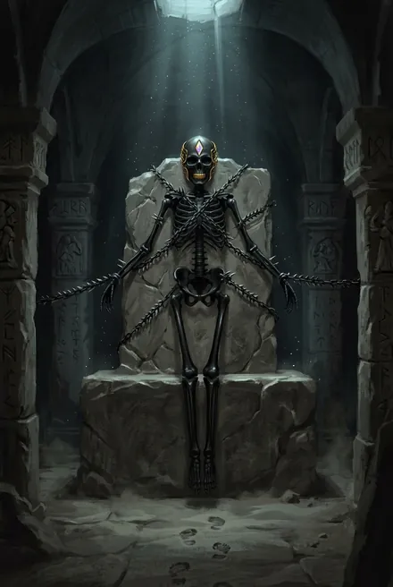
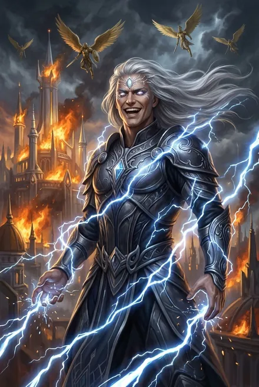
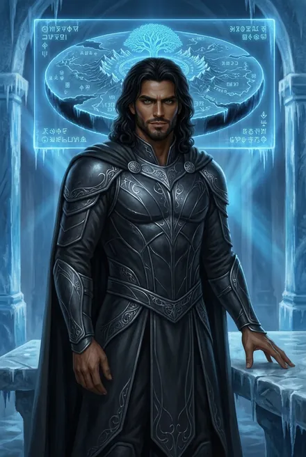
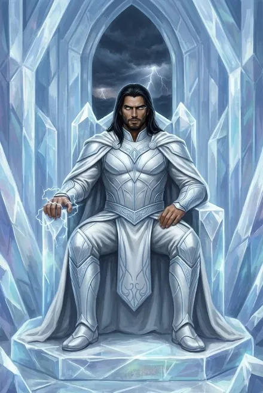
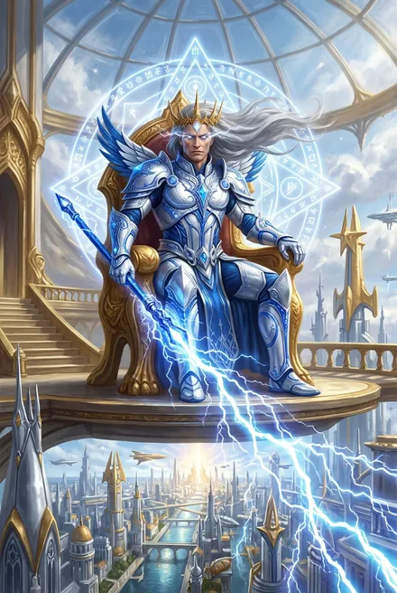

# Белый Дьявол / Дарующий Молнии / Пламени Подобный

> Главный герой цикла «Тысяча Братьев» (ТБ-1…ТБ-5) и «голос в голове» Сигурда в основной серии (ЗК-1…ЗК-6). Самое подробное досье базы.
> Связанные досье: [Кейнор](../personazhi/kejnor.md) · [Морвейн](../personazhi/morvejn.md) · [Азимандия](../personazhi/azimandiya.md) · [Тысяча Братьев](../personazhi/tysyacha_bratev.md) · [Моргейн](../personazhi/morgejn.md) · [Предатель Арвейн](../personazhi/arvejn_predatel.md) · [Орин](../personazhi/orin.md) · [Псы Вечности / Всполох](../personazhi/psy_vechnosti.md) · [Хранители](../personazhi/hraniteli.md) · [Найтфир](../personazhi/najtfir.md) · [Каласса](../personazhi/kalassa.md) · [Народ Теней](../personazhi/narod_tenej.md) · [Существа Скрижали](../personazhi/sushchestva_skrizhali.md) · [Сигурд](../personazhi/sigurd.md) · [Марк «Мрак» Кассиди](../personazhi/mark-mrak.md) · [Винсент Кассиди](../personazhi/vinsent.md) · [Мико](../personazhi/miko.md) (досье основной серии, другой автор).

## Облики на иллюстрациях

<figure markdown="span">
  [{ loading=lazy }](../assets/portrety/062.webp)
  <figcaption>Чёрный скелет в склепе <small>ЗК-1, гл. 6</small></figcaption>
</figure>
<figure markdown="span">
  [{ loading=lazy }](../assets/portrety/063.webp)
  <figcaption>Владыка Аммос при жизни (видения; SK-01, Интерлюдия; SK-07, гл. 5) <small></small></figcaption>
</figure>
<figure markdown="span">
  [{ loading=lazy }](../assets/portrety/064.webp)
  <figcaption>В теле Марка, «осколок Единого» <small>ЗК-8, гл. 17 — ЗК-9</small></figcaption>
</figure>
<figure markdown="span">
  [{ loading=lazy }](../assets/portrety/065.webp)
  <figcaption>Пламени Подобный в белом плаще-доспехе <small>ЗК-10, гл. 3 — ЗК-11</small></figcaption>
</figure>
<figure markdown="span">
  [{ loading=lazy }](../assets/portrety/072.webp)
  <figcaption>Дарующий Молнии, владыка Эстэ (древность; видения в SK-03 и TB-04) <small></small></figcaption>
</figure>

Иллюстрации созданы нейросетью по описаниям из книг; это трактовка, а не официальный арт.

## Шапка

| Поле | Значение |
|---|---|
| **Имена по эпохам** | **Дарующий Молнии** (имя первой «великой» жизни, властелин Эстэ; ТБ-1, гл. 18; ТБ-2, гл. 13); «Дарующий» — краткое, и «кровь Дарующего» как знак кингов Теней (ЗК-9; ТБ-3, гл. 4) · **Белый Дьявол** — имя из преданий, данное «выжившими в горниле его гнева», «белым — из-за серебряных волос его предыдущего отражения» (ТБ-2, гл. 11) · **голос / вселенец / Отец** — в ЗК-1…ЗК-6 · **Подобный Пламени** (ТБ-1, с гл. 3) → **Пламени Подобный** (с ТБ-2; обе формы встречаются, в ТБ-3…ТБ-5 почти только вторая) · **Тёмный Уголь / «Уголь»** — маска слуги Морвейн (ТБ-5) |
| **Титулы** | Экзарх (небесный владыка) Круга Элтанир и «экзарх одиннадцати Народов» в прошлом (ТБ-4, гл. 10; ТБ-5, гл. 15); «прежний экзарх золотого Круга» (ТБ-1) · хейр (Титул по Славе, ТБ-1, гл. 10) · рикс Каменных Луков (ТБ-3, гл. 6) · «мерцающий» кинг Народа Теней (ТБ-3, гл. 16) → **кинг Народа Молний**, подтверждён Оком Наблюдателя (ТБ-4, гл. 13) |
| **Прозвища у других** | «ювейн»/«хейр»/«танаан» — так он зовёт других; его зовут: «мой небесный господин» (Азимандия), «создатель» (Эсмерра), «мой пламенный соавтор» (Архитектор), «демон» (нордийцы, Илиана), «братик» (Гнилая Садовница), «Брат» (Тысяча) |
| **Природа** | Осколок Забытого Единого (Того-Кто-Забыт), один из Тысячи Братьев; «Истинный» по сути, но не из Ордена Истинных; дух, менявший тела |
| **Народ/фракция** | Тысяча Братьев; основатель и «Отец» Народа Молний, чьи потомки — Народ (Люди) Теней и отчасти Народ Реки (ТБ-1, гл. 7; ЗК-3, гл. 13) |
| **Тело (третье)** | Марк Кассиди («Мрак», «Мрак-подобный-Пламени»): сын земного рикса Винсента и фламиники Говорящей-с-Травами (кровь кингов Каменных Луков) — т. е. собственный далёкий потомок героя. По пробе крови: «на четверть — низшие демонопоклонники, другая четверть — Аммос, а половина… я не знаю такого Народа» (ТБ-5, гл. 4) |
| **Роль** | ЗК: наставник-паразит Сигурда, «голос»; ТБ: протагонист (3-е лицо) |
| **Книги** | Интерлюдия ЗК-1; голос ЗК-1…ЗК-6; персонаж-союзник ЗК-7 (за кадром)…ЗК-11; протагонист ТБ-1…ТБ-5 |
| **Ранг на конец канона** | **Золото** (переход в ТБ-5, гл. 14), Скрижаль почти опустошена; в прошлом — «небо», «поднялся выше неба» (ЗК-3, гл. 14), «дважды касался неба» (ТБ-5) |
| **Статус** | Жив; Круг Семи Древ, после гибели Предателя; ледяная Печать Кейнора всё ещё в груди (ТБ-5, финал) |

## Внешность

- **Древняя (видение на алтаре Теней, ЗК-3, гл. 13):** «развевающиеся под невидимым ветром серебряные волосы и золотое плетение венца на челе, похожего на шипастую корону. Кипящие Звездной Кровью глаза, источающие серебряный свет»; облачение из ослепительно-белого и ярко-синего металла — «футуристическая крылатая броня»; жезл синего металла, «выплёскивающий целое море молний»; «сердце и хозяин того города».
- **Древняя (прочее):** высокородный Кел с «короной» — третьим глазом с венцом/подкожным венцом (ЗК-2, гл. 18–19); серебряные волосы «предыдущего отражения» (ТБ-2, гл. 11); в памяти Найтфир/Короны — «небесная корона» из молний над головой (ТБ-4, гл. 3). Скелет в склепе — чёрный, скованный золотыми Живыми Цепями (ЗК-1, гл. 6–7).
- **В теле Марка (ТБ-1):** высокий, черноволосый, смуглый, без левой кисти; со временем — «хищная мускулатура», заострившиеся черты, взгляд «как направленный клинок» (ТБ-1, обзор). Дух постепенно меняет облик: Марк станет неузнаваем «через пару циклов» (ТБ-1, гл. 8); в зеркале у Эрин проступает его собственное лицо поверх лица «сына земного рикса» (ТБ-2, гл. 13); появляются серебряные волоски (ТБ-2, гл. 13).
- **ЗК-8:** бородка, плащ из белого меха, новая рука (ЗК-8, обзор раздела 4).
- **ТБ-3:** тело «похожее на статую древнего бога войны», белая «мраморная» кожа; после Золотой Крови вены и глаза мерцают золотом; стигмат («гвоздь») — в левом запястье (ТБ-3, гл. 11 и обзор).
- **ЗК-10/11:** «король» в белом плаще-доспехе, на троне, с гипнотическим голосом; в доспехах Народа Теней с сигной трёх молний (ЗК-10, ЗК-11, гл. 17).
- **ТБ-5:** в золоте — искры молний в волосах и плащ Холодного Солнца (ТБ-5, гл. 14).
- **Сигна:** Три Молнии (Знак Трёх Молний — Морвейн дарит его в ТБ-1, гл. 16; амулет Талайна с вырезанными им самим Тремя Молниями, ТБ-1, гл. 14).

## Характер, мотивация, ценности

- **Холодный стратег.** Мыслит партиями «в сферах», «камнями хаоса», ступенями и испытаниями; людей видит фигурами (ТБ-2, гл. 14; ТБ-4, обзор). Высокомерен к «мусору» — слабым Рунам, оружию и людям (ТБ-1).
- **Восхождение как религия.** «Восхождение — это дорога не даров, но испытаний» (ЗК-10); «Без дыхания смерти нет испытания, без испытания нет изменения» (ЗК-5); «Восходящий познаёт смерть… в этом и заключается Восхождение!» (ЗК-4, гл. 20). Боль — «безмолвный крик тела» (ТБ-3).
- **Жесток дозированно:** пытки (часовой, Азимандия), Свирель как живая приманка (ТБ-1, гл. 3), показательные казни (ТБ-3, гл. 13), удушение Калассы, приговор Тэйлисс (ТБ-4), жертва Подковы (ТБ-5, гл. 16). «Восхождение всегда было жестоко к своим детям» (ТБ-4, гл. 5 — внутренняя речь).
- **Держит слово буквально**, щедро платит за службу, но всегда оставляет лазейки в Клятвах: «Я не беру то, что не отдано» (ТБ-4, гл. 1, 3); «Я храню чужие тайны, пока их владельцы держат свои обещания» (ТБ-5, гл. 3).
- **Ненависть к Вечности и Хранителям**, скорбь по Тому-Кто-Сражается (своему учителю), по Эстэ и Королеве Снов (ЗК-3, гл. 19; ЗК-5).
- **Влияние Сигурда — главная внутренняя арка.** Сначала «глупая жалость» землянина бесит его; затем он сам повторяет её: отказывается от драконьего Жезла (ТБ-1, гл. 9), щадит Форель (ТБ-1, гл. 13; ЗК-9 — Форель говорит, что пощажена лишь «из-за» Сигурда), признаёт, что прежний путь Тысячи был неверен (ТБ-1, гл. 14), формулирует: «рабы дешевле и надежней, союзники — куда дороже, однако только глупцы путают цену со стоимостью» (ТБ-5, гл. 7 — внутренний монолог).
- **Любит власть и женщин**: «любил тысячи женщин разных Народов… в трёх жизнях» (ТБ-2); «любовь — могучее оружие» (ТБ-1). Обращение к женщинам и подчинённым — «моя/мои».
- **Слабости:** гордыня (вывод в ТБ-1, гл. 14: «Вечность не победить гордостью, силой и мастерством»); склонность к рискованным ставкам ва-банк (вызов Торговца в Эргиале, ТБ-2, гл. 15); постоянная зависимость от чужого плана — Хитрейшего и «владеющих Хроносом» (ТБ-1, эпилог; ТБ-5, финал: Тысяча «всё ещё действует в пределах его плана»); ледяная Печать Кейнора; потеря памяти и сил после каждой смерти (до ТБ-4).
- **Отношение к детям/будущему:** считает Народ Молний своими «детьми» («заблудшие дети», ТБ-3; ТБ-5 о Черепах); признаёт ребёнка Калассы: «Древняя кровь уже бьется у нее под сердцем» (ТБ-4, гл. 18).

## Манера речи

### Как «голос в голове» (ЗК-1…ЗК-6)
Пафос, архаика, афоризмы в духе Сунь-цзы; обращения «юный Восходящий» → «ювейн» → «хейр»; вопрос-рефрен «Ты понимаешь меня, ювейн?»; отговорка «Ты не поймешь» (в ЗК-5, гл. 16 обещает больше так не говорить); клятвы «Кровью Тысячи», «Кровью моих братьев», «тысячей моих братьев»; жалобы на «бедный, варварский язык» / «бедный язык предтеч» (ЗК-1; ЗК-11, гл. 17). Голос «глубокий, как колокол на морском дне» (ЗК-1).
- «Если ты силен, показывай, что ты слаб. Если умен, пусть тебя считают дураком» (ЗК-1, гл. 13).
- «Я тысячи раз умирал и трижды рождался заново, обретая новое имя. Я был Истинным… одним из тех, кого до дрожи боялись цепные псы Вечности» (ЗК-3, гл. 14).
- «Истинный Восходящий не ждет, он приходит и берет» (ЗК-3, гл. 16).
- «Чтобы вырасти над теми, кто выше тебя, можно просто сделать их всех на голову короче!» (ЗК-4, гл. 15).
- Прощание: «Запомни его, хейр. Ты еще услышишь обо мне» (ЗК-6, гл. 28).

### Как герой (ТБ-1…ТБ-5, 3-е лицо)
Сжато, весомо, притчами (о белых и чёрных камнях, о сферах), ссылками на учителя: «Тот-Кто-Сражается говорил…» («Единые смотрят лишь на тех Восходящих, кто не смотрит на Единых», ТБ-1, гл. 14). Сигурда и воинов зовёт «танаан», женщин — «моя». Девиз-клятва «Незримый любит Тысячу» (ТБ-2, гл. 16).
- «Я многое делаю лучше других» (ТБ-1, гл. 12).
- «Скрижаль и Руны можно запечатать… А вот превратить Одного из Тысячи в жалкого трэля ни у кого не выйдет!» (ТБ-2, гл. 13).
- «Иногда, чтобы выиграть, нужно быть готовым сгореть» (ТБ-2, гл. 15).
- «Ты — всего лишь ступенька моего Восхождения» (ТБ-3, гл. 2).
- «Сильные не предупреждают, а действуют» (ТБ-4, гл. 14 — мысль после речи Вестника).

## Биография

### Древняя история (до ЗК-1) — итоговая версия + как менялась

**Происхождение.** Окончательная версия (ТБ-4, гл. 3 — память из кииры; гл. 10): мальчик «с обожжёнными пальцами» в двенадцать циклов вышел **серебром** из пещеры камнезуба «в венце молний». Затем прошёл Храмы Первого, Второго и Третьего Шага и **сто циклов служил в Ордене Истинных** «под стеллой Того-Кто-Сражается» — обычная ступень для юных Братьев, которых принимали за безымянных Истинных (ТБ-4, гл. 18). Тот-Кто-Сражается (Защитник) — его наставник (ТБ-4, персонажи).
- *Как менялось:* в ЗК-1 голос — «был Восходящим раньше, чем Кел сковали первый стигмат»; в ЗК-2 — высокородный **Кел** «с короной», отказавшийся от Дома ради Тысячи; в ЗК-3 — «дух древнего Кел (из ветви Аммос)», правитель летающего города «в эпоху Раскола», «часть великого целого, которое пришлось разделить». В ТБ-4 акцент сдвинут: он родился (в одной из жизней) среди потомков смешавшихся Кел и сам «пришёл к потомкам Кел» (ТБ-3, гл. 4). Эсмерра говорит: «Мы стреляли с тобой в седьмой эпохе… Принадлежность: Аммос. Допуск: гарнизон астролита» — в какой-то из прошлых жизней он служил в гарнизоне астролита Кел Аммос (ТБ-3, гл. 9). **Противоречие:** ТБ-5 (гл. 19 и обзор) утверждает, что Тысяча «родилась уже после Раскола», а ЗК-3 помещает его правление «в эпоху Раскола», и астролиты «до Раскола». *(Предположение: разные жизни одного осколка — до Раскола он мог жить как обычный Кел-воин, а «пробудиться» осколком позже.)*

**Пробуждение осколка.** Восходящая «с медовыми волосами» пришла из Портала и сказала «Ты один из нас» (ТБ-4, гл. 3/10). *(Предположение: это Моргейн — у неё «мёдовые волосы» (ТБ-5, гл. 18), Кейнор вспоминает «её волосы пахли медом» (ТБ-2, гл. 18), она «собирала Тысячу по Кругам» (ТБ-3, пролог).)*

**Дарующий Молнии, экзарх Элтанира.** Вернувшись из Ордена, он встретил у будущих Расколотых Земель «океан Червей», шедший на юный Элтанир, и **семью ударами небесных Рун** (первая — «Тяготение») создал Расколотые Земли; каждый удар навсегда отнимал часть силы. Он спас Элтанир и беглый Народ Древа (Зеленый Побег из разрушенного Круга) (ТБ-4, гл. 10; ТБ-3, гл. 10). Иниэсс: «Мой Народ помнит, что тот… кто даровал молнии, спас Круг» (ТБ-4, гл. 10). Город **Эстэ** признал его владыкой; он стал экзархом потомков Кел, «смешавшихся с низшими в жуткие времена Раскола» (ТБ-3, гл. 4), и **экзархом одиннадцати Народов Круга** (десять отреклись и живы, один истреблён — ТБ-5, гл. 15).
- **Молнии вместо гвоздей.** «Первым освободил свой Народ от рабских оков Вечности» (ТБ-3, пролог): вместо стигматов Вечности вручал знаки Молний (ТБ-1, гл. 14). Молнии ковал для него **Кейнор** (ТБ-2; ЗК-11, гл. 17). Молния делает гвоздь носителя «мёртвым» и не даёт Вечности забрать душу, Скрижаль и Кровь (ТБ-4, гл. 9). Кель-рода в заветах: «менял гвозди на молнии» (ТБ-5).
- **Эстэ в расцвете** (ТБ-1, гл. 14; ТБ-2; ТБ-4): «куда стекались все пути и все Народы октагона»; город тысячи шпилей, каналы с Людьми Реки, гонки иглогривов, рыбные сады, летающая платформа; Чертог Молний, Кузницы Света, Башня Молний, Дворец Пустоты (брачный зал), Архив Снов с семью поколениями Королев Снов; **двенадцать Мечей Жесткого/Истинного Света** с Держателями (Талайн Змеиный Глаз и ещё 11 серебряных учеников), «прерывавших полёт золотых птиц Вечности»; Сфера Небесной Энергии; «город, Народ и серебряное войско, в котором блестело золото» (ТБ-2, гл. 14). Сердца Мечей делали из запретных Фрагментов, найденных в Бреши (ТБ-1). В ЗК-3 Эстэ — «летающий город серебряных шпилей и золотых башен» (ЗК-3, гл. 13).
- **Жёны и кровь.** Брал в жёны дочерей Аммос (ЗК-3), «щедро делился кровью с дочерьми Народа Молний» (ТБ-4, гл. 3). Отсюда «кровь Дарующего» у кингов Народа Теней (ЗК-9; ТБ-3).
- **Аспект прошлой жизни** — «Сплетённые Молнии» (ТБ-1, гл. 11) / «Венец Молний» (ТБ-2, гл. 1) — *(две формулировки одного Аспекта; противоречие названий)*.
- **Арсенал прошлой жизни** (ЗК-1, интерлюдия): Гармонический Щит, Руна Мёртвых Полководцев, Небесный Жезл, связка «Иглы Ледяного Дикобраза + Аннигиляция + Полёт».
- Эпизоды: убил золотого многозуба — будущую «Мертвую Рыбу» (ТБ-1); многочасовой бой в Проклятом Святилище против провидицы, «плетущей нити судьбы» (ТБ-1).

**Тысяча Братьев.** Один из союза, правившего «тысячей Кругов и сотнями Доменов» (ТБ-1). Был «одним из тех, кого боялись цепные псы Вечности» (ЗК-3, гл. 14). Знал Моргейн, Кейнора, Янтандера, Орина, Предателя и др. — см. [Тысяча Братьев (и Сестёр) — общий файл](../personazhi/tysyacha_bratev.md). Великая Охота — «полдень Тысячи» (ТБ-4, пролог).

**Любовь и предательство.** Любовница — Преображающая **Тэйлисс Кел Эммис (Всполох)**, шпионка Палача; она предала его и «пила его Кровь» (ТБ-4, гл. 3/интерлюдия). «Был однажды предан женщиной» (ТБ-5).

**Падение Эстэ.** «Потерял все в одну ночь, когда Псы Вечности пришли за мной» (ТБ-4, гл. 3). Версии:
- ЗК-1, интерлюдия: бело-золотой город гибнет под Призрачными Клинками и Небесными Ястребами; трое Преображающих — **Небесный** (Кел Аммос «из плеяды Темных Звезд», атака «Эос»), **Драконоборец** и **Всполох** («Дао Энай», Руна **Анор**). Он теряет обе руки, его не убивают: «Ваш замысел давно раскрыт». Драконоборец сковывает его зубастой цепью; Всполох обещает отнять всё, «оставив одну каплю, чтобы ты никогда не смог по-настоящему умереть». Он плюёт ей в лицо и бросает Небесному: «Тебе самому… не противно?»
- ТБ-1: золотое воинство Вечности, Небесные Ястребы (Метеоритный Дождь, Болиды), «гнев Вечности вскипятил реку»; беглецы стали Народом Теней; Наблюдатель объявил запретную зону; героя взяли **Живыми Цепями** и заточили рядом, в иллиумовом «колоколе».
- ТБ-4/ТБ-5: форпост Тар-на-Элтанир разрушен; Королева Снов гибнет в Архиве; Эстэ уничтожен пламенем **Анора** (ТБ-5, обзор раздела 10); «срубили под корень» (ТБ-5).
- Казни Братьев: бесконечные смерти и воскрешения, «Позор» (попытка стереть память) на нём не сработал (ТБ-1). Скелет оставлен с одной каплей Крови (ЗК-1; ЗК-3).

**Заточение.** Склеп с саркофагом на острове в озере у руин Эстэ, страж — голограмма-отражение Всполох (ЗК-1, гл. 6; ТБ-1, гл. 14). Срок: «несколько сотен, а может, тысячу» циклов (ТБ-1) — **противоречит** «тысячам циклов» прологов и вопросу голоса «Сколько же тысяч циклов прошло?» (ЗК-1, гл. 13).

**Срежиссированное освобождение.** Колокол заранее вскрыл отряд из Восходящего и экзо-слуги Наблюдателя, которых потом убили (ТБ-1, гл. 14). Капсулу Сигурда сбили над запретным Кругом (ЗК-1); «капсулу Сигурда сбил вовсе не небесный клинок альфа-разума» (ТБ-3, гл. 4). Кейнор: союз предтеч и Тысячи задуман «наверху», Пламени Подобный был **избран наставником Сигурда** (ТБ-3, гл. 1). Хитрейший «пробудил, свёл вместе, обучил» Братьев (ЗК-8, постскриптум).

### ЗК-1…ЗК-6: голос в Крови Сигурда
- **ЗК-1.** Сигурд касается жемчужной капли на черепе скованного скелета, втягивает золотую Руну Живых Цепей — видит казнь (интерлюдия), переживает «нейротрансформацию» (гл. 6–7). Голос объясняет, что он — «суть/заряд/душа» Крови; имя скрывает (гл. 12). Его Кровь невидима для чужих Восходящих и не требует стигмата: «Кел хотели ходить среди них неузнанными. Это — изъян» (гл. 13). Впервые перехватывает сознание, чтобы снять «Ауру Доверия» Вероники (гл. 16); вычисляет убийцу Гая — Марка (гл. 14–15). Финал: «Добро пожаловать домой, Кел!» (гл. 23).
- **ЗК-2.** Впервые берёт тело и калечит банду Рэнди (гл. 11); воскрешает Сигурда в Гнезде (гл. 15); признаётся, что ждал его смерти ради тела, клянётся Кровью Тысячи Братьев (гл. 17); целиком управляет телом в Домене Азимандии, порабощает её (гл. 18–23). Флешбэк: сестра Моргейн казнит предательницу Визуандию Аран на сожжённой «Мечте» (гл. 23). У него была «корона» (гл. 18–19).
- **ЗК-3.** Постепенное раскрытие: «Люди Теней — потомки моего Народа» (гл. 10), изображение на алтаре, видение города, «Отец» (гл. 13), прямое признание — «можешь звать меня так» (гл. 14). Борьба за тело: Сигурд побеждает в схватке воли (гл. 15); новая клятва «Кровью моих братьев» не брать тело без согласия (гл. 18). Скорбь по гибели Того-Кто-Сражается (гл. 19). Надевает Когтю его же ошейник (гл. 12).
- **ЗК-4.** Ведёт Сигурда по Эстэ: Архив Снов, Канал Трёх Молний с «подкожными венцами» (его дар), его «дом» с Оком Наблюдателя, видение битвы у Бреши, легенда о «тысяче демонов»; тайник даёт Сигурду серебряный Атрибут и Аспект (гл. 12, 19–22). План войти в Вечность «вратами Кел» через Саркофаг Азимандии (гл. 3). Ранг: «бывший выше золота».
- **ЗК-5.** Вечность (Золотой Город): ведёт переговоры и бои, играет высокородного Кел; разгромлен душеторговец Флекс Торий; Морвена (Морвейн) становится Руной; Архив Снов и «моя золотая Королева Снов» (гл. 13–17). Говорит, что прошёл Три Шага, бывшее «небо». Мечтает вырвать сердце Сестре Солнца.
- **ЗК-6.** Тинг у Элтанира: объясняет Храм Вечности и Дом Норн; боится только **Посланника** (гл. 12); в Вечности стравливает врагов, казнит Тория (гл. 15), раскрывает, что Братья были «тысячей Его частей» (гл. 16); осанной подчиняет Яростного-как-Пламя (гл. 17); похищает Травинку у матери (гл. 18). Финал: в бою Сигурда и Марка перехватывает контроль, Сигурд умирает (инкарнация), а Белый Дьявол уходит в тело Марка; над Мраком — фрейм с новым именем (гл. 28, эпилог). Забирает Руну Азимандии (с её Скрижалью и Существами), Живые Цепи, Портал Ледяной Бездны, Руну Морвены; дарит две серебряные Универсальные Руны (гл. 28).
- Имя «Подобный Пламени» перекликается с теневым именем Марка — «Мрак-подобный-Пламени» (ЗК-3; ЗК-5) *(предположение: имя «унаследовано» от тела)*.

### ТБ-1 «Пламени Подобный» — третье Восхождение
Начало (гл. 1): однорукий, без стигмата, повреждённое эо (6 капель/день), Кровь 6/11, 7 недоступных Рун; Тело 2 серебряные звезды. Принимает имя Подобный Пламени перед детьми Гор (гл. 3). Цепь «испытаний» под знаком Дикой Охоты: серебряный рикс дрейков у Клюва и бойня изгоев-землян, Свирель-приманка (гл. 3); Белый Крылан (гл. 4); Морвейн и связки Рун (гл. 4); Черный Триглав и драконий Жезл Змеиной Крови — отказ от армии фроггов (гл. 9); **сам вживляет стигмат** при свидетелях (гл. 10), Титул хейр; полноценное серебро (гл. 11); локи в Затопленных Башнях (бывший форпост Эстэ), «выпивший озеро» через Портал (гл. 13); Сердце Меча и останки Талайна, **рука отрастает** (гл. 14); посещение собственной темницы — «освобождение срежиссировано», крик «ДАЙ МНЕ ЗНАК!» (гл. 14); Серебряный Замок, пророчество Морвейн (гл. 15–17). Финал (гл. 18): Арена «Проклятое Святилище», противник — брат **Орин**; гибнут Морвейн и Провидица; пробуждается **Аспект Холодное Пламя**; Орин побеждён. Эпилог: Руна **Бродячего Торговца** — знак Хитрейшего; девиз «Что бы вы ни делали, мои, вы — мои».

### ТБ-2 «Лед-Кузнец»
Наследство Орина; Логово Червей в Эстэ, Сага о Всаднике и предателе-теннике, Семя Домена (кристалл-сфера в Башне Молний) (гл. 2–5). От Сигурда: Великий Червь жив (гл. 4). Ледяная Бездна: спасение Эрин у Шипов (гл. 7), имиры, Меч Жесткого Света, «запах Червей» и гибель эскадры Гармонии (гл. 11), вход в Эргиаль (гл. 13). Партия в сферы с Кейнором (гл. 14), Чертоги Пробуждения и Трофеев (гл. 15); ва-банк — вызов Бродячего Торговца внутри Эргиаля; кара — **Ледяная Печать** в сердце (гл. 16); размороженные Братья, перенос Эргиаля в Единство, первый совет «со времён Разорванных Врат» (гл. 16). Хартленд и Корпус Ноктис (гл. 17–18, параллель ЗК-8). Битва за Эргиаль: гибнет Морвейн (гл. 20), таран Сигурда, казнь маски Полководца (гл. 21). Любовь с Эрин (эпилог). Умирал трижды: гл. 5 (кинжал Иды, добровольно), гл. 11, гл. 16.

### ТБ-3 «Владыка Теней»
Совет четырёх Братьев; откровение Кейнора о Псах под фригольдом (гл. 1). «В третий раз это намного легче». Домен-Сокровище «Разбитая Скрижаль», Архитектор (гл. 2–3). Гасит Шторма над Эстэ. Берёт Каменные Луки: фионтар с Калассой, Аур-Тален склоняется перед кровью Дарующего (гл. 6); забирает в зиккурате «последнюю каплю истинной крови» с памятью предка (гл. 6–7). Подчиняет Шелковую Тень, Калассу (гл. 8). Малый рой, Призрак Великого Древа (гл. 10). Золотая Кровь (гл. 11). Череп Великана, публичная казнь (гл. 13). Разрушение Стрелы Первый-из-Танцев; «троянский» трюк Водяным Телом в желудке Когтя (гл. 14). Убивает Всадника Золотой Кровью ценой своей временной смерти (гл. 15). «Мерцающий» кинг, исход в Эстэ (гл. 16). Кровь Истока из кейса «Аврора»: 3 сосуда — в Домен, 1 — Азимандии, 2 — Кейнору (гл. 17).

### ТБ-4 «Дарующий Молнии»
Свадьба с Найтфир (гл. 1–3). **Киира в Архиве Забвения возвращает полную память Дарующего** (гл. 3). Дикая Охота Псов Вечности: ловушка в три хода — Домен с Абсолютной Пустотой, логово Мерзости, смятое Кейнором, Прозрачная Дорога к Бреши (гл. 5–7). Умер и воскрес через Игг-Феникса (гл. 7). Анор и душа Тэйлисс от Кейнора (гл. 8). Перековка молний, клятва пятерых (гл. 8–9). Иниэсс и осанна о Расколотых Землях (гл. 10). Тинг: «Народ Молний вернулся», небесная Руна, Вестник, Титул кинга (гл. 13–14). Черепа присягают (гл. 15). Яшма (гл. 16). Тайный союз Тысячи и землян, цель — «вновь стать Единым» (гл. 17–18). Каласса — рикс, Найтфир — регент; Ключ Великого Каравана (гл. 18).

### ТБ-5 «Семь Древ Янтандера»
Перекрёсток, Ложное Дно, Чужое Лицо (гл. 1); караван Обочины, Мыслители, Резчики (гл. 2–3); сдан кель-стражам — сам этого хотел (гл. 4); Цветение Садовницы, смерть и возрождение (гл. 4–5); освобождает Морвейн от Клятвы (гл. 7), входит в Замок Талас слугой «Углём» (гл. 8–11); тинг в Медных Башнях, разоблачение фактотума (гл. 13); **переход в золото, Анор сжигает Храм Вечности** — впервые со времён войн Тысячи (гл. 14); Предатель выходит из Седьмого Кургана; потеря Игг-Феникса, сломаны Азимандия, Провидица, Драккарис, Живые Цепи (гл. 15); убивает Подкову (гл. 16); потеря всей Славы за ущерб Древу Аран-Саар (гл. 18); Илиана отдаёт тело Моргейн (гл. 18); Чаша Тёмных Гроз с Моргейн, Руна Пути (гл. 19); третий Анор по Предателю; Предатель разымает сам себя (гл. 20). Выжил.

### Параллельно в ЗК-7…ЗК-11 (с точки зрения Сигурда)
ЗК-7: за кадром посетил Домен, оставил Призрачных Дев и Говорящий Камень. ЗК-8: в Хартленде вместе с Кейнором («Эрин») подчиняет Корпус; отдаёт Сигурду Фиал (гл. 17); битва за Эргиаль. ЗК-9: раскрывает «детектив» Всадника (гл. 8), берёт Теней, женится на Найтфир; мишень Палача. ЗК-10: Домен-ловушка (повышен до золота, ×64), дары Сигурду (Голубая Стрела, Фолиант), получает Руну Морвейн (гл. 3), битва с Псами — за кадром. ЗК-11: тайный совет в Домене Сигурда, дарит «Колыбель Умирающей Звезды» (гл. 17–18).

## Способности и прокачка

### Ранг по книгам
| Точка | Ранг | Источник |
|---|---|---|
| Прошлое | «выше неба», «небо», «дважды касался неба»; прошёл Три Шага | ЗК-3, гл. 14; ЗК-5; ТБ-5 |
| ЗК-1…06 | Ограничен телом Сигурда (дерево → серебро Сигурда) | ЗК |
| ТБ-1 начало | Тело 2★ серебра, Дух 1+1★ серебра, Разум — бронза; 6/11 капель | ТБ-1, гл. 1 |
| ТБ-1 гл. 11 | Полноценное серебро (все бронзовые Атрибуты закрыты), >1000 капель | ТБ-1, гл. 11 |
| ТБ-2 | Серебро, 19★ к гл. 12, +8 в гл. 20; ~1500 → +1000 капель | ТБ-2, гл. 1, 12, 20 |
| ТБ-3 | «Слабое серебро» → 52 серебр. + 2 золотых ★ (гл. 12), +10 в гл. 15 | ТБ-3, гл. 2, 12, 15 |
| ТБ-4 | 127 звёзд, «на золотом пороге», сознательно не переходит (золото привлекает внимание) | ТБ-4, гл. 1–2, 15 |
| ТБ-5 гл. 14 | **Золото** («всего шесть звёзд, но они стоили золотого созвездия») | ТБ-5, гл. 14 |

### Атрибуты (ключевые вехи)
- Воля: Контроль и Подчинение (ТБ-1, гл. 14 — Закрытый Разум, Аура Подчинения); Подчинение 10★ (ТБ-3, гл. 9); золотое **Владычество** → Навык «**Голос Древней Власти**» (ТБ-3, гл. 11); золотая **Множественность** → «Раздвоение» (ТБ-4, гл. 1) → влито в Аспект: «Разделённый Разум» (ТБ-5, гл. 4).
- Витамантия: золото **Возрождение** (1-я золотая ★, Навык «Прикосновение Короля», ТБ-3, гл. 3); доведена «до предела» (ТБ-2, гл. 20); «дар локи» — мгновенное заживление.
- Мышление: золотое **Всеведение** → «Око Незримого» (на пределе — «Всевидящее Око») (ТБ-4, гл. 1); в ТБ-5, гл. 17 — «Сокровенное Желание» (по праву «третьего рождения»); **Трансцендентность** → «Взор-за-Грань» (ТБ-5, гл. 17).
- Особое: **Золотая Кровь** (ТБ-3, гл. 11 — иммунитет к ядам, жжёт червивое), Адаптивность.
- Золото в ТБ-5, гл. 14/17: «Сокрушение», «Боевой Контур», «Истинное Имя».

### Аспект
Прежний: Сплетённые Молнии / Венец Молний → **Холодное Пламя** (ТБ-1, гл. 18; «уничтожает рунные барьеры и нейтрализует рунные атаки»; режимы Живой Огонь, Пластичная Форма — ТБ-2, гл. 1) → «Разделённый Разум» (огненный двойник, ТБ-5, гл. 4) → **Холодное Солнце** — белое пламя с голубой сердцевиной, Многоликая Форма (ТБ-5, гл. 14).

### Важнейшие Руны (сводно; подробные списки — разделы 5 разборов ТБ)
- **Золото:** Живые Цепи (две; одну отдал Сигурду в ТБ-3, гл. 4; сломаны в ТБ-5, гл. 15), Остановленное Время (ТБ-1, гл. 17), Иссушение, связка «Огненный Вихрь + Река Энергии» с небесным огнём (от Орина), Стабилизатор Времени и Пространства (дар Орина, «через Незримого»), Ледяной Дракарис/Драккарис (ТБ-2, гл. 20), Кристалл-Бастион, Великий Шторм, Роза Ледяных Клинков, Призрачная Крылатая Форма, Игг-Феникс (ТБ-4, гл. 1; потерян ТБ-5, гл. 15), Ложное Дно, Воплощение Небесного Огня (ТБ-5, гл. 18), Небесный Клинок, Абсолютная Пустота, двухзвёздный Небесный Ястреб.
- **Небо:** **Анор** (ТБ-4, гл. 8, «за небесный подвиг» от Кейнора; тот самый огонь, что сжёг Эстэ) — применён трижды в ТБ-5 (Храм Вечности, барьер, Предатель).
- **Драконье:** **Драконий Клинок** — иллиум + Лезвие Жёсткого Света, рукоять из звёздного льда с Сердцем Дракона, Клеймо Эргиаля; Руна серебро, истинный ранг — небо (ТБ-2, гл. 18). Драконьи Символы, обломки Жезла Змеиной Крови (ТБ-1, гл. 9, 15) — отданы Кейнору (ТБ-2, гл. 15).
- **Существа:** Азимандия (со свитой), Морвейн, Провидица, Архитектор, Эсмерра, Аур-Тален, Игг-Феникс, Бродячий Торговец (уничтожен Кейнором в ТБ-2, гл. 15, позже снова доступен), Белый Крылан → Клювокрыл → Ледяной Драккарис, Искательница Путей, Караванный Возница (см. [Существа-Руны и разумы на службе Пламени Подобного](../personazhi/sushchestva_skrizhali.md)).
- **Навыки-«фирменные»:** Рунное Мастерство (создаёт Руны-Навыки, учит Стилям), Стили Железа/Лозы/Быка/Бури/Воды, осанна (передача памяти), Медитация.

### Особенности природы
- Управляет гвоздём, «потому что его Кровь выше» (ТБ-1, гл. 10); Кровь и Руны не удерживает стигмат (как у Орина, ТБ-1, эпилог).
- Воскрешается («зрачки вспыхивают серебром и лазурью», ТБ-2, гл. 5), но средоточие эо — уязвимость: его разрушение не спасёт «даже истинная кровь» (ТБ-1, гл. 18); Последний Холод Печати разрывает средоточие (ТБ-2, гл. 16).
- Тело оценивается Восхождением «согласно звёздам тела, а не духа» (ТБ-1, гл. 1); Навыки духа «прорастают» через испытания.

## Отношения и Клятвы

| Кто | Связь |
|---|---|
| Сигурд | Освободитель, ученик, «двуединый» носитель (ЗК-6, гл. 12); клятвы Кровью Тысячи не брать тело без согласия (ЗК-3, гл. 18); союз «щит за щит» (ТБ-2, гл. 16); оценка в ТБ-3: тот «недоволен игрой с завязанными глазами». Кейнор подозревает, что Хитрейший «лепит» из Сигурда фигуру, способную уничтожить Кузнеца (ТБ-4, гл. 16) |
| Кейнор | Брат, кузнец его молний; соперник → союзник; **Ледяная Печать** в сердце (ТБ-2, гл. 16) — взорвётся при попытке вынуть, навредить Кузнецу, предать или ослушаться |
| Моргейн | Сестра (ЗК-2); *вероятно*, та, что пробудила его; «Брат. Долго же ты шёл» (ТБ-5, гл. 18) |
| Морвейн | Первая и преданнейшая слуга, любовница; освобождена от Клятвы (ТБ-5, гл. 7), погибла (ТБ-5, гл. 20) |
| Азимандия | Рабыня-Руна по Клятве, любовница; держит болью и наслаждением |
| Всполох / Тэйлисс | Бывшая любовница-предательница, его палач; в ТБ-4 обращена в трэль |
| Найтфир | Первая жена, Королева Снов, регент Эстэ |
| Каласса | Наложница, «меч», мать его будущего ребёнка, рикс Каменных Луков |
| Шелковая Тень | Бабушка тела, «уши кинга», первый знаменосец |
| Орин | Брат, убитый им на Арене |
| Предатель Арвейн | Заклятый враг; разыман собственным Аспектом |
| Хитрейший / Бродячий Торговец | «Зримая удавка»; кукловод, чьей игре он вынужден следовать |
| Винсент Кассиди | «Отец» тела; «Как умер мой сын?» — «Я убил его» (ТБ-4, гл. 12) |
| Иниэсс | Соперница-партнёр, признала Титул ради щита против Червей |
| Народ Молний | Клятва молнии: «…отныне и до смерти твой путь — мой путь, твоя кровь — моя кровь, а твоя молния — моя молния…» — «…Пока разбитое не станет единым…» (ТБ-4, гл. 9) |
