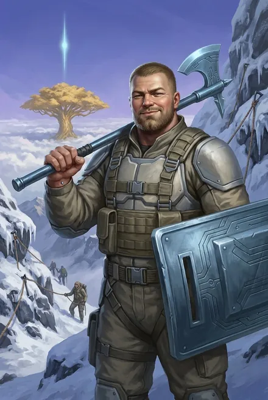
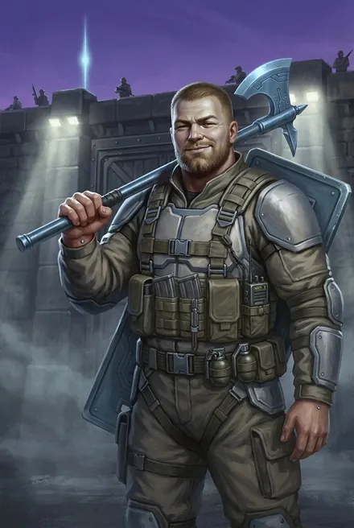

# Динамит (Дмитрий Воронин)

| | |
|---|---|
| **Имя** | **Дмитрий Воронин** (ЗК-1, гл. 17); «Дима», «Дима-Динамит» (ЗК-6, гл. 26; ЗК-10, гл. 22). В тексте один раз — «Дмитрий Воронов» (ЗК-2, гл. 12) — *описка автора* |
| **Позывной** | **Динамит** |
| **Происхождение** | Землянин, «ростовский, тоже специалист. Форсайтер и блокчейн-юрист, можешь себе представить?» (ЗК-1, гл. 17); говорит на «раше», с Сигурдом и Толей — «наших мало» (там же). На Земле — гастротурист: «Страуса пробовал, кузнечиков сушеных, мозги обезьяны, акулу…» (ЗК-2, гл. 1). Не военный |
| **Роль** | Командир «среднего» боевого копья фригольда «Небо» (ЗК-7, гл. 2), первый командир Сигурда; командир аэромобильной группы «Одиссей» на «Грифоне» (ЗК-4, гл. 4); после воскрешения — командир нового копья (ЗК-10) |
| **Книги** | ЗК-1 – ЗК-6 (активно), ЗК-7–08 (память, отражение в Лабиринте), ЗК-9 (воскрешение), ЗК-10–11; ТБ-3 (упом.) |
| **Ранг** | Бронза, хейр (ЗК-1, гл. 17) → крепкая бронза, «неуклонно идущая к серебру» (ЗК-6, гл. 7) → **убит** (ЗК-6) → **воскрешён с новой деревянной Скрижалью** (ЗК-9, гл. 15) |
| **Статус на конец канона** | Жив; командир копья (ЗК-10–11; в ЗК-11 Сигурд ждёт его или Ассоль в Либерти, гл. 14) |

---

## Облики на иллюстрациях

<figure markdown="span">
  [{ loading=lazy }](../assets/portrety/030.webp)
  <figcaption>Командир копья <small>ЗК-1 — ЗК-6</small></figcaption>
</figure>
<figure markdown="span">
  [{ loading=lazy }](../assets/portrety/031.webp)
  <figcaption>Воскрешённый «квадратный бульдозер» <small>ЗК-9, гл. 15 — ЗК-11</small></figcaption>
</figure>

Иллюстрации созданы нейросетью по описаниям из книг; это трактовка, а не официальный арт.

## 1. Личность, мотивация, слабости

**Балагур без субординации.** «Хоть и Восходящий, был далек от армейской субординации» (ЗК-1, гл. 18). Шутит и травит байки, развлекая копьё: «Кто ж еще вас веселить будет, если я замолчу? Как котята несмышленые, ей-богу» (ЗК-2, гл. 3).

**Гурман и повар.** Никого не подпускает к котлу, варит «казачью похлебку» и тигрекса на углях, ищет у новичков приправы из Наборов Колониста (ЗК-2, гл. 5, 6, 12); облизывается на угощение у Пылающего Рога (ЗК-6, гл. 8). Знак его любви к жизни.

**Под маской — осторожный политик.** «Дмитрий-Динамит далеко не так прост, как кажется» (ЗК-2, гл. 1). «Пользовался репутацией благоразумного командира и никогда не лез вперед батьки в пекло, хотя никто не мог упрекнуть» его в трусости (ЗК-4, гл. 11). «Очень рассудительный и рациональный человек, никогда не лез на рожон» (ЗК-6, гл. 10). Требует ясности: «Мэм, при всем уважении я хотел бы заранее знать, к чему готовиться… Речь идет о наших жизнях!» (ЗК-6, гл. 10).

**Справедливый лидер.** Делит трофеи так, чтобы «никого не обижать, предпочитая усиливать команду, но всегда оставлял за собой последнее слово» (ЗК-4, гл. 6). Отдаёт пустой Фьюри её первую Руну: «У нас Рун богато… а ты пустая. Теперь будешь при деле» (ЗК-4, гл. 7) — ход, который сразу делает её своей. Хранит в Скрижали Глаз Небесного Змея, чтобы подарить Сигурду, когда тот станет Восходящим (ЗК-7, гл. 2).

**Хранитель тайн.** «Жги, Сигурд, я — могила!» (ЗК-2, гл. 12). Узнав о нарушении Клятвы Мраком, хватается за голову: «Ну вот на хрена мне-то это все знать? Не было печали…» (там же), — но после «гибели» Сигурда сам идёт к знаменосцу Майклу (ЗК-4, гл. 1). Велит молчать о Соцветиях Хладноцвета (ЗК-2, гл. 8).

**Семьянин.** «Пошел я к себе, жена скучает. Нельзя оставлять женщину одну по вечерам…» (ЗК-1, гл. 17). Не хочет бросать обжитое: «бросать здесь все и начинать заново… у меня жена только все обустроила…» (ЗК-5, интерлюдия «Травинка»).

**Слабости.** Не любит рисковать и не любит высокое начальство; недоверчив (подозревает Фьюри как «креатуру Вероники», ЗК-4, гл. 18); «скептик» (ЗК-6, гл. 7). Сигурд в ЗК-6 считает его «слабейшим звеном нашей группы, хотя сам наверняка был уверен в обратном» (гл. 1).

**Главное.** «Диме-Динамиту действительно все это не нравилось, он хотел спокойно жить во фригольде со своей женой, однако, когда понадобилось — принял решение, встал и пошел. И умер как настоящий мужчина, сражаясь до конца» (ЗК-6, гл. 26).

**После воскрешения.** Помнит всё до смерти; «время будто остановилось» (ЗК-9, гл. 15). Проводит почти всё время с Ханной (ЗК-10, гл. 4). Командир «без особого восторга» принимает навязанного «скаута» Кардо (ЗК-10, гл. 22). Отражение в Лабиринте (ЗК-8, гл. 11) — проекция вины Сигурда: «Я умер из-за тебя, Сигурд».

---

## 2. Речь

Разговорный «раш», присказки, умеренный мат, обращение **«земляк»**, «парни», «камрады» (ЗК-4, гл. 7), «брат». К Веронике — подчёркнуто **«мэм»**.
- «Наши законы небесной механики курят в коридорчике, смекаешь?» (ЗК-1, гл. 17).
- **«Таблетки, таблеточки»** — облизываясь над пилюлями Говорящей (ЗК-2, гл. 1).
- «Не ссать, не срать, стрелять по глазам…» — инструктаж (ЗК-2, гл. 4).
- «Ну слава яйцам…» (ЗК-2, гл. 5); «налетай, подешевело!» (ЗК-2, гл. 5).
- «Правду говорят, новичкам везет… Буду должен» (ЗК-2, гл. 5).
- «Кому ведьма, а кому теща будущая, любимая» (ЗК-2, гл. 11).
- «Поздравляю, мы просрали бронзу» (ЗК-4, гл. 18).
- «Великолепно… Просто великолепно» — после жёсткой посадки Фьюри (ЗК-5, интерлюдия).
- «Останавливаю Живым Побегом, Громовым Раскатом или Криком, врываюсь Рывком и врубаю на ходу Раскаленную Ауру! Если там толпа, то… эх!» (ЗК-6, гл. 7) — его боевой «рецепт».
- «При всем уважении — были, мэм!» — Веронике о её несправедливых решениях (ЗК-4, интерлюдия «Фригольд»).

---

## 3. Предыстория

- **Ростов → «Хельга»?** Специалист-колонист; в «био» Сигурда и его самого — профессии экспертов. *Когда именно прибыл в Небо — не сказано*; к ЗК-1 — опытный хейр, бывал на тинге (ЗК-6, гл. 1).
- **Порталы** (ЗК-2, гл. 12). Лично ходил в три Портала: (1) **Лунная Башня** — теневая зона, руины титанической крепости, охота на «тенеподов», артефакты Кел — самый удачный; (2) чёрная ледяная почти безвоздушная пустыня с антропоморфными гигантами «серебряного» ранга — бегство, один товарищ потерян; (3) обиталище **«огненных муравьев»** — твари прорвались через Портал, погибли трое его товарищей, сам получил множественные ожоги, фригольд потерял 14 человек. «Я сам здесь чуть не кончился с год назад». После этого Вероника запретила Порталы под угрозой изгнания (там же). Отдельно — чужой провал с бронзовым Порталом **«Огненная Пасть»** (магма и инфернальный голем).
- **Лохмач.** Изгой Народа Леса, присоединился к фригольду «несколько лет назад, встреченный Динамитом во время одного из рейдов»: «изначально был целью задания группы Динамита, но наш командир выполнил задачу иначе» (ЗК-2, гл. 5). Только Динамит понимает его рычание.
- **Толя.** Знает его похождения: Толя «за ночь опустошил» бар Витольда, который охранял, и сломал руку двоим (ЗК-2, гл. 5).
- **Жена — Ханна**: «миловидная невысокая блондинка» (ЗК-2, гл. 8).

---

## 4. Биография по книгам

### ЗК-1
- **Гл. 16–17.** По совету Майкла («Он тоже раш») Вероника зачисляет Сигурда учеником в его копьё. Знакомит с отсеком № 37, Инем и Янем («настоящие имена хрен выговоришь»), Лэндо, рассказывает о Толе. О Гае: «Старый Гай был мировым мужиком».
- **Гл. 18.** Распределяет наряды; признаёт, что наказание людей Мрака «по сути» справедливо, «но у нас тут принято между собой такие вопросы решать».

### ЗК-2 — Фригольд
- **Гл. 1.** Сдержанно хвалит Сигурда и Лэндо за ваал; «Таблетки, таблеточки».
- **Гл. 3–7 (Ледяной Великан).** Командир похода за хладонитом: связка (Лохмач первый, Грохот замыкающий); бой с тигрексом — Руна опутывания и **Громовой Разрыв** топором, вызвавший лавину. Отказывается трогать Хладноцветы — «особые указания» от Говорящей. Берёт Соцветие Хладноцвета у Сигурда — «Буду должен» — и вешает Стихию Льда на топор; Руну Стихии передаёт Лэндо. Страхует Сигурда Живым Побегом при спуске. **Обещает выдвинуть Сигурда кандидатом на стигмат от копья** (гл. 7); отказывается делать Восходящим Толю.
- **Гл. 8, 10.** Хранит тайну Соцветий; не берёт пока Грая.
- **Гл. 11.** Узнаёт о романе с Травинкой; советует не ссориться с Говорящей.
- **Гл. 12.** Рассказ о Порталах. Сигурд доверяет ему тайну: Мрак нарушил Клятву у брода. Динамит понимает угрозу войны с Народом Реки: «своих… никогда не выдаем. Значит, война»; советует молчать.
- **Гл. 13–14 (Гнездо).** Под началом Серены и в паре с Фростом чистит каньоны; на счету 56 Червей (у Лэндо 14); держит Сигурда при себе.

### ЗК-3
Упоминания: Портал работает «древодень, 25 часов» (гл. 14); Руна опутывания (гл. 15). После пропажи Сигурда, по ожиданию героя, ругается с Сереной (гл. 2).

### ЗК-4 — Одиссей
- **Гл. 1, интерлюдия «Фригольд».** Сочтя Сигурда погибшим, рассказал Майклу о Мраке и ваале. Требует у Вероники справедливости для вернувшегося: «При всем уважении — были, мэм!». Рекомендует Сигурда кандидатом.
- **Гл. 3.** Взял Грая по рекомендации Сигурда. «Я золота в жизни не видел…»
- **Гл. 4.** Командир аэромобильной группы «Одиссей» (винтокрыл «Грифон», пилот Сигурд, Фьюри и Травинка — пополнение); недоволен назначением: «не ждет от этого назначения ничего хорошего».
- **Гл. 5–7.** Спасение капсул от голиафов и тавров; правила дележа; Острокрыл — Фьюри. Сигурд осаживает его в полёте: «Дмитрий, в полете на воздушном судне командую я!» (гл. 7).
- **Гл. 8.** Отчитывается Эйрику о встрече с Огнезубом и изгоях.
- **Гл. 10–11.** Сбор колонистов в Море Трав; засада изгоев Кнута.
- **Гл. 17–18.** Делёж с Небесных Змеев: «Тебе Повышение, а мне Развитие»; соглашается отдать Глаз Змея Сигурду. Потеря награды.
- **Гл. 22–23.** Бой с Ястребом: подаёт Толе ракетомёт, бросает топор с Громовым Разрывом; **Лохмач отталкивает его из-под удара крыла Ястреба и погибает**.

### ЗК-5 — Вечность (интерлюдия «Травинка», эпилог)
- Выносит на похоронах табличку Сигурда в колумбарий. Копьё хотят расформировать, «Грифон» отдать Мраку. Сначала против бегства («В изгои захотел?»), но соглашается. Второй пилот при угоне; у Эйрика рассказывает «только для твоих ушей» о Клятве Мрака. Уводит копьё (Фьюри, Грохот, Инь, Грай) в Шторм на тауро; **жена Ханна и Янь остаются на ферме**. В эпилоге встречает Сигурда.

### ЗК-6 — Тинг
- **Гл. 1.** Выясняет у Вероники обстоятельства; соглашается сопроводить её на тинг («Как будто у нас есть выбор»). Получает серебряный **Сокрушающий Крик** (Руна погибшего Крика), **Громовую Волну**, **Сферу Льда**; «съел» бронзовые Развития — Тело до первого серебра.
- **Гл. 2–5.** Волкеры, брод Людей Реки («Сигурд, ты с ума сошел? Она же чистая бронза…»), ферма Эйрика после Огнезуба.
- **Гл. 7.** Получает пару Усилений, бронзовое Повышение, шесть бронзовых Развития (Стихийность до максимума) и серебряную **Раскалённую Ауру** (трофей Огнезуба).
- **Гл. 10.** Требует от Вероники плана на тинг; анализирует: право голоса — только у Восходящих.
- **Интерлюдия «Травинка».** Не даёт Марку схватить Травинку. Ночная атака (Железный Вьюн, невидимый убийца): Динамит сжигает кокон Раскалённой Аурой, бросается на убийцу, бьёт ослабленной Громовой Волной — его поглощают тени Говорящей.
- **Гл. 19, 23, 25.** Подтверждённая смерть; его Раскалённая Аура — у Мрака; тело найдено в Домене «изломанным… будто он собирался загрызть кого-то».
- **Гл. 26–27.** Сигурд сообщает Ханне; Кассиди: «Все знают, что копье Динамита помогло мне вернуться и победить». Поминки в «Виски».

### ЗК-7–08
- Память: копьё Сигурда наследует его стиль; Глаз Небесного Змея, сбережённый им для Сигурда, достался Мраку (ЗК-7, гл. 2).
- **ЗК-8, гл. 11.** Отражение в Лабиринте: «Ты мог всех спасти… Я умер из-за тебя, Сигурд». Ответ: «Ты прав, Дима… Прости, командир!».

### ЗК-9 — Ранг неизвестен (воскрешение)
- **Гл. 1.** Сигурд объявляет Кассиди: «Я хочу оживить Динамита». Кассиди: «Динамит умер достойно… Оставь эту Руну как второй шанс для живых»; тело кремировано, гвоздь — у Сигурда.
- **Гл. 2, 6, 8–9.** Поиски тела: Торговый Представитель (заказ отменён); сделка с Пламени Подобным; Руна для Морвейн.
- **Гл. 10.** Ханна, вдова, работает на мелких Репликаторах в инженерном отсеке; даёт разрешение.
- **Гл. 15.** В Домене Морвейн бросает в призрачную колонну прах и гвоздь, плетёт тело; Сигурд вкладывает **Руну Оживления**. Первые слова: «А это… еще кто?» — и узнаёт Миноса: «Матиас…». Новая **деревянная Скрижаль** (бронзовая разбита в поединке с Мраком; часть Рун выпала победителю, часть сохранил стигмат). Анима была в стазисе. «Все в Единстве имеет свою цену. Всегда».
- **Гл. 16.** Возвращение во фригольд — «эффект разорвавшейся бомбы»; Ханна не отходит от мужа.

### ЗК-10 — Прозрачные Дороги
- **Гл. 4.** Реабилитация, время с Ханной.
- **Гл. 8.** Кассиди приказывает сформировать **новое копьё под командованием Динамита** из части людей Сигурда: туда уходят **Инь, Янь, Грай**.
- **Гл. 14.** Эйрик просит узнать, где добыть Руну Оживления, — воскрешение Динамита «начало приносить первые, не совсем радостные плоды».
- **Гл. 22–23.** Ведёт подкрепление через Портал в Либерти: Инь, Янь, Грай, серебряные **Эдри** и лохмач из Народа Леса (бывший пленник Азимандии), плюс «скаут» **Элли Кардо** по приказу рикса. Обнимает Сигурда. При захвате Альфой — «Что делаем, Сигурд? Круговая оборона?».

### ЗК-11 — Колония Альфа
- **Гл. 1, 6, 12.** Вместе с Ассоль забаррикадировался в «Последнем Шансе» и отступил через Портал; Инь попал в плен случайно. Командир копья (Инь — «из копья Динамита»).

### ТБ-3
- Сигурд просит у Пламени Подобного тело для Динамита (гл. 4).

---

## 5. Способности и снаряжение

| Период | Ранг | Руны, оружие |
|---|---|---|
| ЗК-1–02 | Бронза, хейр; Скрижаль с тройным рядом символов | **Громовой Разрыв** (Заклинание через оружие, накладывается на топор за секунды до удара), **Живой Побег** (опутывание/страховка), **Таранный Рывок**, **Каменная Кожа**, **Быстрый Бег** (с тигрекса); **пласталевые штурмовой щит и топор — земные изделия, ставшие Рунами-Предметами** (голос: «в твоем Народе есть рунный мастер»); топор усилен Стихией Льда (Соцветие Хладноцвета); наручный импульсный **«Янтарь»** — «самый слабенький вариант», но «мало не казалось никому» (ЗК-4, гл. 14); Биолокация (ЗК-4, гл. 3); шлем «Скаута», подогнанная экипировка из нескольких комплектов |
| ЗК-4 | Бронза | + Звериная Мощь, Развитие |
| ЗК-6 | Крепкая бронза, Тело — первое серебро | **Сокрушающий Крик** (серебро), **Громовая Волна**, **Сфера Льда**, **Раскалённая Аура** (серебро, с Огнезуба), Повышение, 6 Развитий (Стихийность) |
| ЗК-9+ | Дерево (новая Скрижаль) | Часть Рун, сохранённая стигматом; «Варриор» |

**Роль в бою.** Командир-штурмовик ближнего боя: щит и топор, останавливающие Руны (Побег, Крик) → рывок → аура. Тактик-реалист: сбивает отряд «в кучу» против тигрекса (ЗК-2, гл. 4), использует винтокрыл для «психологического» боевого захода (ЗК-4, гл. 11).

---

## 6. Отношения

- **Сигурд.** Наставник-«земляк». Первый, кто поверил («перед тингом… от нас будешь ты»), первый, кто узнал тайну Мрака. Сигурд воскрешает его как «долг тому, кто отдал за нас жизнь» (ЗК-9, гл. 1).
- **Ханна.** Жена; «маленькая светловолосая женщина» (ЗК-6, гл. 26); осуждала мягкость к Марку (разбор ЗК-6); согласилась на воскрешение (ЗК-9, гл. 10).
- **Толя Грохот.** «Земляк», вечный объект увещеваний: «Ох, Толя, Толя».
- **Лохмач.** Найденный им следопыт, погиб, спасая его (ЗК-4, гл. 23).
- **Лэндо.** Партнёр по дележу трофеев.
- **Фьюри.** Сначала недоверие, затем уважение.
- **Вероника.** Подчиняется, но спорит: «Мэм, при всем уважении…».
- **Мрак.** Враг; убийца.
- **Говорящая-с-Травами.** Её «особые указания»; её Руна убила его (ЗК-9, гл. 15).
- **Кардо.** Навязанный «скаут» (ЗК-10).

---

## 7. Справка: Лохмач (боец копья Динамита)
Абориген Народа Леса («мохнач»), изгой своего Народа; следопыт и разведчик, «работал за троих, молча» (ЗК-2, гл. 1); понимает глобиш, но отвечает рычанием, которое разбирает только Динамит (ЗК-2, гл. 5). Погиб в бою с Ястребом, оттолкнув Динамита (ЗК-4, гл. 23); Вероника похоронила его тело (ЗК-6, гл. 1). Отдельное досье — `lohmach.md`.

---
