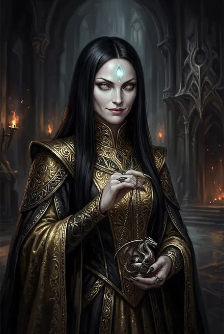
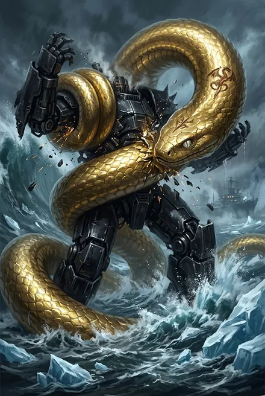
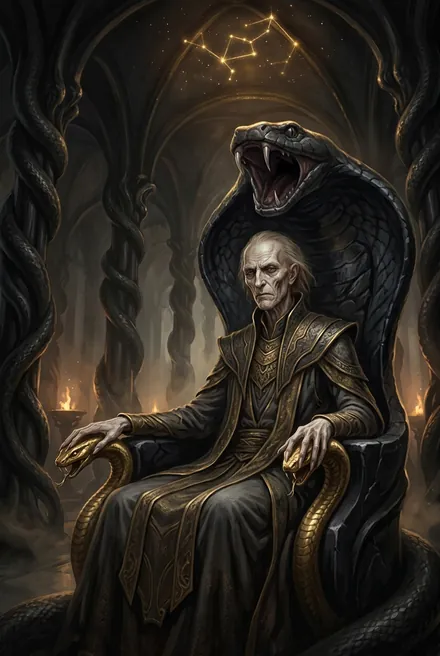
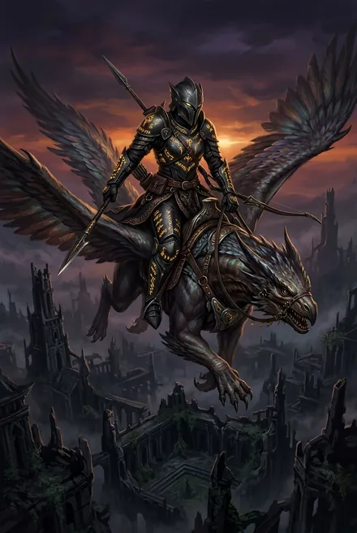

# Дом Ноктис: Марисса Золотая Змея, Эверент, Онора и эрды Корпуса

> См. также: [Эрда Онора (Онора Эверент Ноктис кел Аммос)](../personazhi/onora.md) (Онора глазами Сигурда, другой автор) · [Кейнор](../personazhi/kejnor.md) · [Тысяча Братьев](../personazhi/tysyacha_bratev.md) (Дракон) · [Псы Вечности](../personazhi/psy_vechnosti.md)

**Дом Ноктис и Корпус** — орден наёмников и убийц, потомки Кел Аммос; поддержали Забытого и тем закрыли себе путь в Вечность; в войне Тысячи играли на обе стороны; выжили благодаря Мариссе (ТБ-2, разд. 7, 10). Цитадель — **Хартленд** в разрушенном серебряном октагоне под теневым искажением (небесная Руна): восьмигранная башня из чёрного стекла, Зал Призыва (ТБ-2, разд. 7; ЗК-8). Устройство: боевая тройка (эрд + 2 служителя) → звезда → стая 30–50; полторы дюжины золотых и сотня серебряных Восходящих; чины — эрд, служитель, эвгина, авгур, экзарх (ТБ-2). Корпус охотился на землян за «Кровью Истока»; после подчинения Тысяче — разрыв контрактов с Вечностью, оплата звёздным льдом вдвойне (ТБ-2, гл. 18; ЗК-8).

## Облики на иллюстрациях

<figure markdown="span">
  [{ loading=lazy }](../assets/portrety/126.webp)
  <figcaption>Кел-женщина <small></small></figcaption>
</figure>
<figure markdown="span">
  [{ loading=lazy }](../assets/portrety/127.webp)
  <figcaption>Золотая Змея <small></small></figcaption>
</figure>
<figure markdown="span">
  [{ loading=lazy }](../assets/portrety/128.webp)
  <figcaption>основной облик <small></small></figcaption>
</figure>
<figure markdown="span">
  [{ loading=lazy }](../assets/portrety/129.webp)
  <figcaption>основной облик <small></small></figcaption>
</figure>

Иллюстрации созданы нейросетью по описаниям из книг; это трактовка, а не официальный арт.

## Марисса Ноктис Кел Аммос — Золотая Змея
| Поле | Значение |
|---|---|
| **Кто** | Легендарная **эвгина** (прародительница линии) Дома Ноктис; «избранница одного из славнейших Братьев, создателя драконьих Рун, и первое его творение» (ТБ-2, гл. 20) |
| **Ныне** | **Драконья Руна-Существо** с собственной волей; ранг = рангу владельца (у Кейнора — небо «по праву драконьего клейма») |
| **Книги** | ЗК-8, ТБ-2, ТБ-4 |
| **Статус** | Жива, служанка-Руна Кейнора |

- Надменная черноволосая кел со «змеиным взглядом»; ядовито язвит всех: «Круглоухого щенка обучают команде «служи»?» (ЗК-8); «Остатки некогда великой Тысячи снова собрались вместе. Глупцы, вы так и не усвоили урок…» (ТБ-2, гл. 20). Опаснее Азимандии («лишь тусклое отражение её змеиного коварства»).
- **История:** предала Дракона и была им проклята — превращена в драконью Руну, «лишённую возможности без разрешения пользоваться Скрижалью»; Руна переходила из рук в руки, пока Ноктис не вернули её (ТБ-2, гл. 20). Ноктис-«Хранительница Рун» в усыпальнице саркофагов.
- **ЗК-8/ТБ-2:** оживляет эрду Онору золотой Руной Оживления; переходит к Кейнору; «Звёздный Исток» — может «перезаряжать» чужие Руны и Кровь; в море обвивает и держит **Полководца** («Небо против Неба») (ТБ-2, гл. 21); вытаскивает Сигурда из подледного моря (ЗК-8).
- **ТБ-4:** Подавлением блокирует Скрижаль Всполох на Башне Молний (интерлюдия «Всполох»).
- БД хочет «довести дело Дракона до конца» (ТБ-2). *Тайна:* почему она предала Дракона; как спасла Дом.

## Эверент Ноктис Кел Аммос
Экзарх Корпуса и **авгур** Дома Ноктис, старый чистокровный кел — «тонкий, сухой и старый, как выцветший лист нож-травы», на змеином троне; шелестящий голос: «Я чую запах перемен»; трус перед силой (ТБ-2). В Хартленде угрожает гостям; БД открывается как Брат, «Эрин» сбрасывает маску — это Кейнор; Эверент капитулирует (ЗК-8; ТБ-2, гл. 17). Сломлен, получает **ледяной осколок/конструкт в сердце**, ведёт Корпус в бой за Эргиаль (ТБ-2, гл. 18–20). «Покажите мне Драконью Клетку» (ЗК-8, гл. 17). Жив, служит Эргиалю.

## Онора Эверент Ноктис кел Аммос
Золотая **эрда** Корпуса (поиск и захват); чистокровная кел; «красивая хищная кел с чёрными, почти без радужки глазами», «ядовитая змея перед броском» (ЗК-8). Посмертная осанна-послание: «Я Онора Эверент Ноктис кел Аммос. Эрда Корпуса Ноктис… Если ты, Восходящий, сейчас видишь мою осанну, это означает, что я погибла…»; «Корпус всегда добирается до своей добычи» (ЗК-8, гл. 15) — классическое трио «награда — соблазн — угроза». Пленяет Сигурда, побеждена им в небе; её душа — в **Драконьей Клетке Душ** (работа Дракона) у Сигурда, её Ключ открывает Хартленд (ЗК-8; ТБ-2). Сигурд «продаёт» её Ноктис за 500 Монет, золотые Уменьшение и Оживление (ТБ-2, гл. 17–18); Марисса оживляет её — Скрижаль теперь деревянная, авгур даёт ей пощёчину (ЗК-8). Под Клятвой. Её драконий сосуд потом ловит душу Всполох (ТБ-4). *Будущий мститель (предположение разбора ЗК-8).* Отчество «Эверент» — *вероятно, дочь/потомок авгура (предположение)*.

## Эрды Корпуса (ТБ-2, гл. 18)
Золотые эрды под командой БД в битве за Эргиаль: **Литара Ноктис** (разведка), **Дхаарон** (стратег), **Таналия** (ассасины, «рассекатель миров»), **Вейрам Ноктис** (штурмовики). **Тот-Кто-Хранит-Зал-Призыва** — эрд-полукровка, страж Хартленда, проводник.
