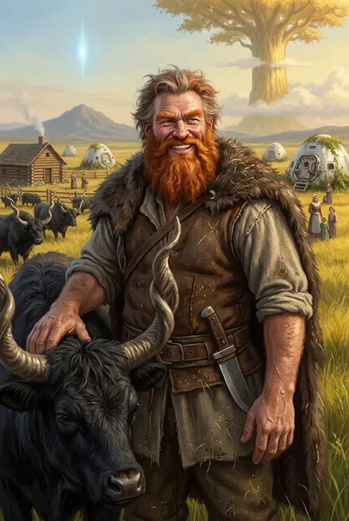

# Эйрик Мастер Зверей

| | |
|---|---|
| **Имя** | **Эйрик**; Титул-прозвище — **Мастер Зверей** (ЗК-1, гл. 13; ЗК-6, гл. 20: «Я, рикс Эйрик, Мастер Зверей, говорю от Фермы Эйрика»). Для Травинки и молодёжи — «дядя Эйрик» (ЗК-4, гл. 7–8). Фамилия не названа; сын — «Ярослав Эйрикссон» (ЗК-7, гл. 20). В баре «Виски» есть коктейль «Кричащий Эйрик» (ЗК-2, гл. 8; ЗК-9, гл. 14) |
| **Происхождение** | Землянин «из первых колонистов» (ЗК-1, гл. 13); при инициации сразу получил бронзу (ЗК-6, интерлюдия «Травинка»). Земная профессия не названа |
| **Роль** | Знаменосец Винсента Кассиди в первые циклы → соперник Вероники на выборах → основатель и **рикс Фермы Эйрика** (ранчо в Море Трав, «второе земное поселение нашего Круга», ЗК-4, гл. 5) → с ЗК-6 **танаан** фригольда «Небо», член «ближнего круга» Кассиди (ЗК-7, гл. 20) → командир копья фермеров |
| **Тайна** | «Ключник»: по поручению «небесного» кел (позже Сигурд узнаёт в нём Хитрейшего) подбросил в озеро Игг-Семя и йурра Кыша (ЗК-6, эпилог 2; ЗК-8, гл. 9) |
| **Книги** | ЗК-1–02 (заочно), ЗК-4 – ЗК-10 (активно), ЗК-11 (упом.) |
| **Ранг** | Серебро: «У меня — тридцать две» серебряные звезды (ЗК-7, гл. 3); второе серебро колонии после Винсента (ЗК-7, гл. 13) |
| **Статус на конец канона** | Жив; **потерял руку** и жену Сюгретту в бою с Каменным Громом (ЗК-10, гл. 14); одержим поиском Руны Оживления; уехал с Кассиди на тинг (ЗК-10, гл. 22); подарил Сигурду чистый гвоздь (ЗК-9, гл. 6; ЗК-11, гл. 12, 19) |

---

## Облики на иллюстрациях

<figure markdown="span">
  [{ loading=lazy }](../assets/portrety/029.webp)
  <figcaption>Хозяин ранчо <small>ЗК-4 — ЗК-11; единый облик</small></figcaption>
</figure>

Иллюстрации созданы нейросетью по описаниям из книг; это трактовка, а не официальный арт.

## 1. Личность, мотивация, слабости

**Патриарх.** Живёт «как принято здесь, у Народов Круга»: много жён, трэли, свой закон (ЗК-4, гл. 9). «Я отец своим людям, а не враг» (ЗК-6, эпилог 1). Уважаем и одновременно предмет зависти и «циничных шуточек» (ЗК-4, гл. 7, 9).

**Хитрец, говорящий загадками.** Белый Дьявол: «он сильное серебро и далеко не так прост, как кажется» (ЗК-4, гл. 8); «Этот Восходящий далеко не прост. Он знает больше, чем говорит… Он уже видел золотой свет» (ЗК-6, гл. 9). Кассиди: «мой старый друг Эйрик далеко не так прост, как кажется. Но он точно не предатель» (ЗК-9, гл. 1). Держится наособицу, «будто нас разделяла невидимая черта» (ЗК-6, гл. 24); на совещаниях «хитро помалкивал» (ЗК-7, гл. 9).

**Прагматик-посредник.** Передаёт Сигурду предложение Говорящей в форме притчи о драконе (ЗК-4, гл. 12) и, видимо, её предложение кингу Трав (ЗК-6, гл. 8). Не ввязывается, если не выгодно: беглецам из фригольда — «до вас мне большого дела нет; вы — свободные люди» (ЗК-5, интерлюдия).

**Мудрость старшего.** «Каждый хейр должен набить свои шишки, я-то знаю…» (ЗК-7, гл. 12); лекция о том, что «серебро бывает разное» (ЗК-7, гл. 3).

**Этика зверолова.** Против геноцида цвергов, верит, что их можно «вылечить»; не хочет убивать безумного граги — «По законам Единства это нехороший поступок» (ЗК-9, гл. 6). «Звери умнее людей» (ЗК-4, гл. 8).

**Слабости.**
- **Женщины.** Его давняя мечта — Руна **«Слово Любви»** («ни одна женщина не устоит перед твоим обаянием»), — именно этим его купил «небесный» кел (ЗК-6, эпилог 2).
- **Рабство** — держит трэлей, «считает, что они должны отработать свои преступления» (ЗК-4, гл. 9); Сигурду это претит.
- **Скрытность** — главный источник подозрений: Сигурд опасается, что он «тайное оружие Хитрейшего», «фактотум Вечности» (ЗК-9, гл. 1).
- **Горе и одержимость (ЗК-10).** После гибели Сюгретты — «мрачная тень прежнего Эйрика»: «Как добыть Руну Оживления… Я отдам за нее все что угодно» (ЗК-10, гл. 14).

**Эволюция.** Отделившийся вождь → союзник «на своих условиях» (ЗК-5–06) → вассал Кассиди, признавший его риксом ради спасения людей (ЗК-6, эпилог 1) → боевой ветеран, чья семья — «главная стена» колонии (ЗК-10, гл. 14) → вдовец, готовый на всё ради воскрешения жены.

---

## 2. Речь

Говорит медленно, «густым басом… с уверенной тяжестью знающего цену словам человека» (ЗК-4, гл. 8). Фирменная присказка — **«я-то знаю»** (десятки раз; вариант «ты-то знаешь» — Винсенту, ЗК-6, эпилог 1). Обращения: «дочка» (Травинке), «друг мой», «Винс», «Ника», «Ветер». Финальное «Бывай!» (ЗК-4, гл. 12).

**Цитаты:**
- «Тот, кто хочет забрать у серебра его Руны, должен быть готов расстаться со своими… Жадность не идет рука об руку с мудростью, друг мой» (ЗК-4, гл. 8).
- «Но Звездная Кровь в тебе уже есть, верно?… Не говори ничего, так иногда бывает, я-то знаю» (ЗК-4, гл. 12).
- «Драконы любят золото, Сигурд… Драконы не торгуются, я-то знаю» (ЗК-4, гл. 12).
- «Я поддержу тебя, когда придет время. Тебя, не твоего рикса. Ты поймешь позже, если одолеешь дракона. Не позволяй себя использовать» (ЗК-6, гл. 9).
- «Значит, дракона ты победил, дом обрел, посадил дерево. Осталось воспитать сына?» (ЗК-6, эпилог 1).
- «Серебро бывает разное, Сигурд… Чуть сильнее бронзы — и почти достигшее золота…» (ЗК-7, гл. 3).
- «Не забудь старину Эйрика, когда взлетишь высоко… Туда, куда еще никто не взлетал» (ЗК-9, гл. 6).

---

## 3. Предыстория

- **Первые циклы.** Ещё бронзой, «правда слабенькой», был в первом отряде с Винсом и Гаем (ЗК-1, гл. 15). Вместе с Винсентом и Вероникой ездил к Древу на тинг заявлять о землянах (там же). Был в «бронзовом копье» с Винсентом, Ветром Равнин, Вероникой, Гаем Флоу и Кнутом (ЗК-7, гл. 15; ЗК-6, гл. 9). С Винсентом нашёл в пещерах Одинокого Пика рунную **печать** над колодцем и «каменных тараканов» — и не стал её трогать (ЗК-7, гл. 2–3). С Винсентом убил серебряного альфу дрейков — «главу здешних гор» на плато (ЗК-7, эпилог). Зачистил плато от гигантопитеков (разбор; ср. «Аспект-гигантопитек»).
- **Роман с Вероникой.** Был её возлюбленным, «позже ставший соперником и врагом»; их дети — близнецы **Райан и Риан Максвелл** (ЗК-5, гл. 20; ЗК-6, гл. 8). В воспоминаниях Вероники — «рыжий Эйрик рядом» с ней и младенцем (ЗК-5, гл. 12).
- **Раскол.** После исчезновения Винсента «Слава Эйрика была выше», но Вероника настояла на выборах по земному закону; Эйрик хотел жить по законам Единства (многожёнство, трэли) — люди его «очень уважали, но еще больше — завидовали» и выбрали Веронику. «Эйрик не стал спорить. Он решил отделиться и уйти» (ЗК-4, гл. 9), забрав одну из капсул (ЗК-4, гл. 7).
- **Ферма Эйрика.** В Море Трав, ~100 миль к югу от гор фригольда (ЗК-2, гл. 10), у пика-трезубца (ЗК-1, гл. 13). Двойной частокол, сторожевые башни с прожекторами, электричество; разводит тауро, луговых кархов, козерогов, шелковых птиц, тигрексов (стражи), даже приручил голиафа (ЗК-1, гл. 13; ЗК-4, гл. 9). Людей — около сотни (ЗК-2, гл. 10); при переходе во фригольд — «сто с лишним человек, среди которых было тридцать Восходящих» (ЗК-7, гл. 1). Главный поставщик скота колонии и Народа Трав.
- **Сделка с «небесным» кел** (до ЗК-1). В Руне-Саге: кел «ранга Небо» («Незнакомец был небом») предлагает **Слово Любви** за то, чтобы скрытно доставить «ключ и ключника» — Игг-Семя и йурра; Эйрик спрашивает, не может ли сам «открыть дверь»; бросает Семя в озеро Девы, оставляет йурра на островке. «Тот, кто найдет ключ и откроет дверь, придет к твоему Народу… Он будет героем» (ЗК-6, эпилог 2). В ЗК-8, гл. 9 Сигурд узнаёт этого кел в Хитрейшем — «Тот самый, что вручил Эйрику Семя и йурра».

---

## 4. Семья и копьё

- **Жёны** (по Граю — «семь жен и пятнадцать детей! Причем десять дочерей», ЗК-1, гл. 13; позже «большое семейство… более двадцати человек», ЗК-4, гл. 8):
  - **Сюгретта (Грета)** — старшая жена, нордийка (Народ Моря), «яркая, как солнце, и порывистая, как ураган», бронза (ЗК-4, гл. 8; ЗК-6, гл. 5). Обороняла ферму от Старого Огнезуба, первой обняла Веронику как спасительницу (ЗК-6, гл. 5). **Погибла** — Каменный Гром сломал ей шею (ЗК-10, гл. 14).
  - **Людмила «Мила»** — темноволосая красавица из Сайберии, медком, Восходящая; мать Ярослава (ЗК-7, гл. 3, 14; ЗК-10, гл. 5).
  - **Шизуки** — миниатюрная азио (ЗК-4, гл. 8).
- **Дети:** **Венди** — старшая дочь, белокурая медком, бронза, свои дети; муж — **Бен** (кидо «Сарисофор», «зять Бен») (ЗК-4, гл. 8; ЗК-7, гл. 3; ЗК-10, гл. 5). *В разборе ЗК-5 Венди названа женой — в тексте этого нет; канон — дочь.* **Ярослав (Эйрикссон)** — бронза, заложник у Народа Трав (ЗК-5; ЗК-6, гл. 9; ЗК-7, гл. 20). **Рэй** — младший сын, Восходящий; кома от призрака Пожирателя, очнулся (ЗК-7, гл. 3, 12). Дочери **Молли**, Эмми, Томби, Дженни, Мэйси, Сэппи, Роззи (ЗК-4, разбор; Инь: «особенно Молли», ЗК-5). От Вероники — **Райан и Риан Максвелл** (см. `maksvell.md`).
- **Копьё фермеров:** Бен, Байо (темнокожий), молчаливый **Джимми Райнерс** (погиб — «Джимми убили обезьяны», ЗК-10, гл. 14), **Победитель Варгов** — абориген Народа Трав, охотник и следопыт, бронза (ЗК-5; ЗК-7, гл. 3; ЗК-10, гл. 5). *Разбор ЗК-10 объединил Джимми и Победителя Варгов — в тексте это разные люди (ЗК-10, гл. 5).*
- **Приёмные/заложники:** Эйно (мальчик Народа Трав, ЗК-5; ЗК-6, гл. 8); племянница Ветра Равнин, ученица Жемчужины — у Эйрика в обмен на Ярослава (ЗК-6, гл. 9; ЗК-7, гл. 15).

---

## 5. Биография по книгам

### ЗК-1–02 (заочно)
- Тигрекс-страж у дороги — «тварь Эйрика» (ЗК-1, гл. 13). Грай: «Эйрик ничего не боится!… Говорят, что серебро».
- Ферма — поставщик скота; обмен с фригольдом (ЗК-2, гл. 10).

### ЗК-4 — Одиссей
- **Гл. 7–9.** Принимает «Грифон» с умирающей колонисткой (Венди оперирует). Пир: расспрашивает об Огнезубе — «Он меня знает, а я знаю его. Нам нечего делить»; изгои пытались украсть тауро — один пойман и «выпотрошен» на допросе (гл. 8, 12). Травинка рассказывает Сигурду историю раскола.
- **Гл. 10.** Его группа на цезарях с Рунами Неутомимости и Быстрого Бега обгоняет винтокрыл (400 км за 3–4 часа) и забирает грузовую капсулу.
- **Гл. 12.** Первый разговор с Сигурдом: угадывает Звездную Кровь в нём, интересуется йурром; **притча о драконе** (Говорящая) и принцессе (Травинка): «Драконы любят золото… Так что, чтобы получить принцессу, герою придется…»; Сигурд: «дракону не стоит назначать цену за то, чего у него нет!». Обещает защиту и кров.
- **Гл. 18.** Продаёт фригольду полсотни смирных тауро для рейда.

### ЗК-5 — Вечность (интерлюдия «Травинка»)
- Принимает угнанный «Грифон» и беглецов. Холоден: Шторм — «мясорубка»; у Ларссона «золотая Руна». Даёт тауро и проводников (Ярослава и Победителя Варгов). **Оставляет у себя Травинку и Лэндо** по закону заложничества: «Я кое-что обещал твоему Сигурду». Холодно встречает Мрака. Предсказывает: «в нашем Круге появился сильный Восходящий» (игг-свет в Шторме).

### ЗК-6 — Тинг
- **Гл. 4–5.** В его отсутствие Старый Огнезуб жжёт ферму; голиаф Эйрика гибнет; спасает Сигурд в облике Ястреба, славу присваивает Вероника.
- **Гл. 8–9.** У Пылающего Рога с Людмилой и Ярославом; «Моя ферма сгорела?»; подозревается как передатчик предложения Говорящей; новый обмен заложниками с кингом. Разговор у винтокрыла: йурр «хочет посадить и вырастить древо… золотое»; «Я поддержу тебя… Тебя, не твоего рикса».
- **Гл. 20, 24.** На тинге говорит от Фермы Эйрика, стоит рядом с Людьми Трав; дистанцируется от посольства Неба.
- **Гл. 26.** Ферму осаждают тавры; Сигурд помогает.
- **Эпилог 1.** Приводит людей во фригольд: «Я, рикс Эйрик Мастер Зверей… признаю Винсента Кассиди своим риксом» — становится **танааном**. Дарит Сигурду **золотую Руну-Сагу**.
- **Эпилог 2.** Содержание Саги (см. Предыстория).

### ЗК-7 — Дикая Охота
- **Гл. 1.** Строит дом на восточном краю плато; Сигурд долго «пытал» его о Саге.
- **Гл. 2–4.** Старший разведки у Одинокого Пика (печать, которую он нашёл с Винсом); получает серебряный Глаз Небесного Змея; Винсент «дал мне невидимку» — Пикси, которой Эйрик управляет как Мастер Зверей («Сегодня ты служишь мне»); связь с ней обрывается («Пикси минус»); касается разумом Пожирателя и цепенеет; прикрывает отход — **золотая чешуйчатая броня со звериным шлемом, кристальный жезл, верхом на Голиафе**; призывает призрачных тигрексов, обезьяну, бронзового карха, тетранодона. Сам добирается до Южного Поста раньше «Грифона».
- **Гл. 9–10.** Феромонная Руна из Гнезда — приманка на Подкове; «чует чужую волю».
- **Гл. 12.** Лечит Сигурда эликсиром **«Голубой Родник»** (очищает разум): «каждый хейр должен набить свои шишки».
- **Гл. 14–15.** Посольство к Народу Трав: «Как в старые времена, Ветер»; описывает Пожирателя; «Могу прибавить парочку дочек, Ветер».
- **Гл. 17–19.** Руна **«Дорога»** переносит штурмовые группы; **Аспект** — семья превращается в стаю гигантопитеков; выпускает Живодавов; два его человека погибли.
- **Гл. 20.** Ведёт сбор трофеев у Пика; советует вложить Усиление в Игг-Копьё и брать золотое Существо.

### ЗК-8–09
- ЗК-8: пополнение и карантин — в узком кругу (гл. 16).
- **ЗК-9, гл. 1.** Сигурд просит Кассиди не говорить Эйрику всего; подозрение в связи с Хитрейшим.
- **ЗК-9, гл. 6.** Просит Сигурда в помощь против цвергов-рудокопов; ловит безумного **граги** («домовой Единства») в Руну-клетку; вместо Руны-награды дарит копью Сигурда **чистый стигмат**; пророчит «взлететь высоко».

### ЗК-10 — Прозрачные Дороги
- **Гл. 2.** В облике рыжего гигантопитека разгребает завалы.
- **Гл. 5–7.** Командир одного из четырёх копий рейда в Портал (Колонна Ветров): осанна о «золотом, старом» существе небесного ранга, оценивает шансы; люди Эйрика тащат мегакрипторы.
- **Гл. 8.** Серебряное Развитие от Кассиди.
- **Гл. 13–14.** Бой с гигантопитеками и золотым **Каменным Громом**: семья в Аспекте — «главная стена»; Гром отрывает Эйрику руку, ломает шею Сюгретте; гибнет Джимми. Сигурд дарит ему **Каменную Шкуру** — «теперь-то ему точно не оторвут руку». Просит узнать о Руне Оживления.
- **Гл. 22.** С Винсентом срочно уехал на тинг (Псы, битва у Шторма).

### ЗК-11
- Подаренный им гвоздь становится одним из трёх гвоздей копья Сигурда (Юки, Кроу, Жабник) (гл. 12, 15, 19).

---

## 6. Способности

- **Ранг:** серебро, 32 серебряные звезды (ЗК-7, гл. 3); «серебряное Слово» (разбор ЗК-6); при инициации сразу бронза.
- **Мастер Зверей:** говорит с животными, понимает их желания (ЗК-6, гл. 9); укрощает тигрексов, тавров «давно отучил» (ЗК-4, гл. 8); умеет формировать **осанны** (ЗК-10, гл. 7); чувствует чужую волю над тварями (ЗК-7, гл. 10).
- **Аспект:** превращает **всю семью** в стаю громадных, почти неуязвимых гигантопитеков; в облике сохраняется доступ к Скрижалям (ЗК-7, гл. 18). Сам — «рыжий гигантопитек».
- **Руны-Существа:** призрачные тигрексы, **Живодавы**, Голиаф (ездовой, погиб в ЗК-6 и/или новый в ЗК-7), бронзовый карх, огненный тетранодон, косматая обезьяна (ЗК-7, гл. 4); огненная птица-разведчик у его людей; Пикси-шпионка — Руна **Винсента**, которую Эйрик берёт под управление (ЗК-7, гл. 3; «шпионка-Пикси в Скрижали Винсента», ЗК-10, гл. 5); по разбору ЗК-5 — Сильви, бывшая шпионка Говорящей.
- **Перемещение:** **«Дорога»** — мгновенный перенос группы (ЗК-7, гл. 17–18); Неутомимость, Быстрый Бег (ЗК-4, гл. 10).
- **Прочее:** золотая чешуйчатая броня со шлемом-зверем, кристальный жезл (ЗК-7, гл. 4); феромонная Руна из Гнезда (ЗК-7, гл. 9); Руна-Предмет с эликсиром «Голубой Родник» (ЗК-7, гл. 12); Руна-клетка (ЗК-9, гл. 6); **Каменная Шкура** (золото, от Сигурда, ЗК-10, гл. 14); создаёт/хранит Руны-Саги.
- **Роль в бою:** командир звериного резерва и «живой стены»; разведка, приманки, перехват; в ЗК-10 — противовес гигантопитекам.

---

## 7. Отношения

- **Сигурд.** Сначала проверяет («парень с йурром»), затем покровительствует «тебе, не твоему риксу», открывает правду Сагой, пророчит взлёт. Сигурд подозревает его, но дарит Каменную Шкуру.
- **Винсент Кассиди.** Старый друг и соратник; признал его риксом под Клятвой. «Он точно не предатель» (Винсент).
- **Вероника.** Бывшая возлюбленная, мать его близнецов; политическая соперница. Отношения в гареме к ней прохладны (ЗК-6, гл. 5).
- **Говорящая-с-Травами.** «Друг» в прошлом, посредничает от её имени; Травинка — «дочь моего друга» (ЗК-4, гл. 12).
- **Ветер Равнин.** Товарищ по бронзовому копью; обмен детьми.
- **Травинка.** «Дочка»; укрывает её от матери (ЗК-5).
- **Хитрейший.** Заказчик «ключа» — Эйрик то ли ничего не знает, то ли фактотум.
- **Грохот:** «Эйрик — мужик что надо! Но с ним лучше не шутить».

---
