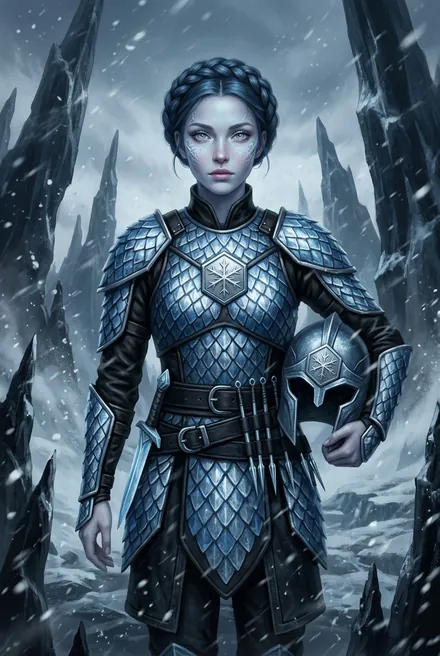
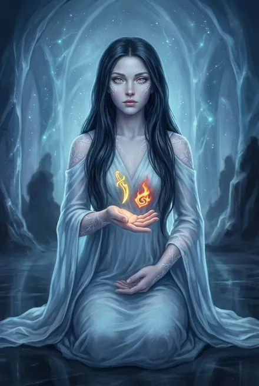

# Эрин Ледяная Искра

> См. также: [Кейнор](../personazhi/kejnor.md) · [Белый Дьявол](../personazhi/belyj_dyavol.md)

| Поле | Значение |
|---|---|
| **Имя** | Эрин Ледяная Искра |
| **Раса** | Лед-кузнец Эргиаля — «**Пробуждённая Дочь**»: клон, выращенный из крови Ледяного Кузнеца; в Чертоге Пробуждения хранятся «бесконечные копии Эрин» (ТБ-2, гл. 15) |
| **Роль** | Лучник дозорной звезды (криарх — Аргис Лунный Огонь); спасённая → проводница → союзница → возлюбленная Белого Дьявола |
| **Ранг** | Серебро, сильнее БД в Атрибутах (ТБ-2) |
| **Руны** | По её словам: ледяные стрелы и копья, ледяные щиты и сферы, сковывание льдом, «благосклонность зимы» (укрепляет броню и оружие), «слова сияния и песнь мороза» (ТБ-2, гл. 9). На отряд накладывает **Дыхание Мороза**, **Ледяной Свет** и **Благосклонность Зимы** (гл. 11); **Снежный Зов** (гл. 9, 11). Серебряные Доспех Ледоманта, Сфера-Резонатор и Лед-Клинок — трофеи Белого Дьявола с её погибшего собрата (гл. 12); таблица «Система Восхождения» записывает их за Эрин |
| **Книги** | ТБ-2 (центральная героиня гл. 7–21, эпилог); упом. ТБ-4 (восстановила Меч) |
| **Статус** | Жива, в Эргиале; возможно, беременна (ТБ-2, эпилог) |

**Внешность.** Тонкая, «как былинка», голубоватая кожа с лед-узорами, иссиня-чёрные косы венцом, серебряные глаза; «в ней виден облик Кузнеца» (ТБ-2, гл. 8). Кровь голубоватая, с кристалликами звёздного льда; в груди — лед-сердце (ТБ-2, разд. 6).

**Характер.** Пробуждена около **4 циклов назад** — неопытна, но хладнокровна и горда; высокомерна к «дикарю в шкуре фростбьорна», но быстро признаёт его лидерство. Умеет говорить с имирами, призывать айсвормов, вырезать Символы; хорошо стрижёт; поёт и слагает стихи (ТБ-2). В Эргиале «нет детей и стариков, мы пробуждаемся, а не рождаемся», гостей не бывает (ТБ-2, гл. 13).

**Речь.** Постоянные «Лед видит», «Лед слышит», «Последний Холод». «Это была… славная битва» (ТБ-2, эпилог). Отказ: «Ты никогда не изберешь единственную, а я не захочу делить тебя с другими. Я лед-кузнец, я дочь Эргиаля и я нужна моему Народу» (ТБ-2, эпилог).

**Путь (ТБ-2).**
- Звезда Эрин (Каренвааль, Арана, Тирос, страж Имбор) попала в двойную засаду Гармонии у Поля Шипов; Каренвааль и Арана погибли, Тирос и Имбор ушли в Последний Холод (гл. 7–11).
- БД находит её со сломанной шеей (лед-сердце держит жизнь), лечит Целительным Прикосновением; её Руны сгорают в Холодном Пламени, он сковывает её Иллиумовой Цепью; называет ей детское имя Кузнеца — Кейнор (гл. 8).
- **Взаимная Клятва под печатью Наблюдателя**; рассказ о Гармонии (28–29 циклов в Бездне) (гл. 9). Ведёт БД на Ледяном Черве сквозь лёд к Короне (гл. 10). Даёт всем ледяные благословения; **чинит Меч Жёсткого Света Эстэ** (гл. 11; ТБ-4 — «восстановлен Эрин»). Тяжело ранена давителем (гл. 12).
- В Эргиале становится прислугой БД «в награду», моет и стрижёт его (гл. 13). Её звезда выживает, атакуя Якоря Реальности (гл. 20–21). Ночь любви; поёт балладу; допускает, что зачала, — «первым, кто будет рождён, а не пробуждён», но остаётся в Эргиале (эпилог).

**Противоречия.** Снежный Зов Эрин назван и «редкой Руной» (гл. 9), и «золотой Руной» (гл. 11). В ЗК-8 «Эрин», сопровождающая БД в Хартленд, — **замаскированный Кейнор** (ТБ-2, гл. 17; ЗК-8).

**Тайны.** Ребёнок — первый «рождённый» лед-кузнец; будет ли он свободен от лед-сердца? Её отношения с «отцом»-Кузнецом.
## Облики на иллюстрациях

<figure markdown="span">
  [{ loading=lazy }](../assets/portrety/092.webp)
  <figcaption>Дозорная в лед-доспехе <small>ТБ-2, гл. 7–12</small></figcaption>
</figure>
<figure markdown="span">
  [{ loading=lazy }](../assets/portrety/093.webp)
  <figcaption>В Чертогах: голубое асари, распущенные волосы <small>ТБ-2, гл. 13 – Эпилог</small></figcaption>
</figure>

Иллюстрации созданы нейросетью по описаниям из книг; это трактовка, а не официальный арт.

