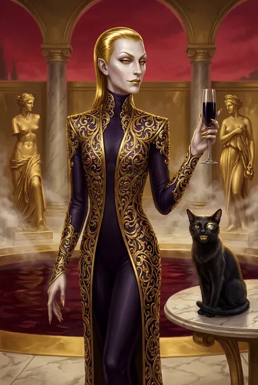

# Флекс Торий

| | |
|---|---|
| **Имена** | Флекс Торий; «душеторговец»; «темный контракторий»; «жалкая пародия на Хитрейшего» (Белый Дьявол, ЗК-6, гл. 15) |
| **Раса / пол** | Кел Вечности; «натуральный андрогин»: «Он? Она? Оно?» (ЗК-5, гл. 11) |
| **Фракция** | Тёмные контрактории — «мафия» душеторговцев, «синдикат, паутина которого тянулась в разные миры Вечности»; по слухам, их «негласно» покрывает Хитрейший (ЗК-6, гл. 14) |
| **Ранг** | Золото — «несмотря на золотые Атрибуты, Флекс Торий был слаб» (ЗК-6, гл. 15) |
| **Происхождение** | Вечность (не земной проект, не Народ Единства) |
| **Книги** | ЗК-5 (гл. 11–14), ЗК-6 (гл. 14–15), упом. ЗК-7–ЗК-11; ТБ-1 (гл. 15–16), ТБ-5 (воспоминания Морвейн) |
| **Статус** | Отражение казнено Белым Дьяволом (ЗК-6, гл. 15); по слухам, «Тория лишили всего — Рун, Домена, даже отражения» (ЗК-9, гл. 17). Окончательная смерть не подтверждена: в Вечности убитый возрождается в Бассейне Душ (ЗК-6, гл. 14) |

## Облики на иллюстрациях

<figure markdown="span">
  [{ loading=lazy }](../assets/portrety/053.webp)
  <figcaption>основной облик <small></small></figcaption>
</figure>

Иллюстрации созданы нейросетью по описаниям из книг; это трактовка, а не официальный арт.

## 1. Внешность (кратко)
«Высокий и тонкий, весь обтянутый черно-фиолетовым… покрытое вычурным золотым плетением облегающее асари. Словно на каблуках… Прилизанные волосы… казались париком, сделанным из жидкого золота. Глаза и губы — тоже золотые, тщательно подведенные, на скулах и подбородке сияла алмазная пыль»; голос «неприятно высокий» (ЗК-5, гл. 11). Облизывает губы, «сладко улыбается» (ЗК-5, гл. 11–12; ЗК-6, гл. 14).

## 2. Возможности и имущество
- **Всевидящий Веридий** — серебряная Руна-Существо: чёрный кот с золотыми зубами и глазом-самоцветом, «способный проникать взглядом в чужие Скрижали» (ЗК-5, гл. 11; ЗК-6, гл. 14). Позже достаётся Сигурду с Велиора Вортекса (ЗК-10, гл. 1).
- **Домен** «под жёлтым небом»: лоза-страж, змеевидные призраки, кристалл-стражи-демоны, клетки на обсидиановом древе (в одной — должник с серебряными шипами, которого ежедневно пожирают семарглы), мёртвая домоправительница, **Зал Извлечения** с хризалидами-кристаллами и **золотой Алтарь Душ** — удерживает души нео без отражения (ЗК-5, гл. 12). Древние кел-солдаты Меняющие Форму (ЗК-5, гл. 13; ЗК-7, гл. 21). Сокровищница — «Живой Ларец» под домом, недоступна (ЗК-5, гл. 14).
- **Применение душ:** гомункулы, химеры, Руны, рабы, «Монеты Души» (ЗК-5, гл. 12).
- **Трусость как навык:** при поражении ломает клетку, «самоуничтожается Руной Растворения», через Алтарь взрывает хризалиды, снимает Печать и бежит к Бассейну Душ (ЗК-5, гл. 13); позже Велиор упоминает, что «ему стоило бы убить себя и сбежать в Бассейн Душ, как это когда-то сделал Торий» (ЗК-9, гл. 18).
- **Свита в Темном:** огромный костяной паук, четыре Существа в тяжёлых доспехах (ЗК-6, гл. 14–15).

## 3. Личность, мотивация, методы
- **Садист-коллекционер.** «Королевы Единства прислуживают в моем доме» — хихикал Торий; пиры, где гости «пробовали» Морвейн «не только тело, но душу и разум»; игра «разрушение любви» с братом Морвейн Таларом (ТБ-5, воспоминания Морвейн). Сорок лет держал Морвейн и её брата в долговом рабстве (ЗК-5, гл. 13; ТБ-1, гл. 16).
- **Жадность и лживость.** Нарушает сделку: забирает Руны и Кровь из гвоздя Кнута, хотя договаривались иначе; отказывается от второй части; угрожает «бесконечными смертями на Алтаре» (ЗК-5, гл. 12).
- **Месть и предвкушение.** В Темном: «Нео, ты слышишь меня? Мы снова встретились, мой!» — и описание трёх кольев «для серебряной предательницы… для тебя… для золотой обманщицы» (ЗК-6, гл. 14).
- **Методы:** сделки на душах (скупка контрабандных стигматов — «невероятная прибыль» от потрошения, ЗК-6, гл. 14), ловушки с союзниками, Существо-сканер вместо доверия.

## 4. Речь
Жеманная, с ласково-угрожающими обращениями «мой нео», «мой загадочный нео», клятвы Хитрейшим.
1. «Ты посланник Азимандии?.. Я думал, что она пришлет одну из своих Рун… Ты нео?» (ЗК-5, гл. 11).
2. «Тайны, тайны, тайны… Пожалуй, Хитрейший ходит где-то рядом, почуяв их аромат» (ЗК-5, гл. 11).
3. «Но ты прав, клянусь Хитрейшим! Сначала завершим дело, потом поговорим об удовольствиях» (ЗК-5, гл. 12).
4. «Руны золотой госпожи впечатляют… но она сама стала Руной! Хитрейший оценил бы этот ход… но кто же тогда держит поводок?» (ЗК-5, гл. 13).
5. «Не дайте ему умереть! Прошу, только не дайте ему умереть!» (ЗК-6, гл. 14).
6. «Четыре золота и много серебра!.. О, наш нео богат и очень глуп, потому что не привязал ни одной своей Руны» (ЗК-6, гл. 14).

## 5. Биография
- **≈10 циклов до ЗК-5.** Покупает у Азимандии драконью Руну Кассиди — Мико: «Торий дал мне за нее почти тысячу Монет» (Азимандия, ТБ-1, гл. 15). Пытается «извлечь или изменить ее», мучит — «она только смеялась»; продаёт «одному из своего круга» (Морвейн, ТБ-1, гл. 16). Через третьих лиц Руна попадает к Велиору Вортексу: «Флекс Торий избавился от непокорной Руны. Ныне она находится в Живой Башне» (ЗК-9, гл. 16). Велиор «предпочитал не знать, откуда Торий извлекал свою добычу» (там же).
- **ЗК-5.** Белый Дьявол (в теле Сигурда, отражение «Звездный Флот») под видом посланника Азимандии продаёт ему стигматы (дерево 5, бронза 10, серебро 18 Монет) и душу Кнута за допрос и «гвоздь-обманку» (гл. 11). В Домене Тория — допрос души Кнута; Торий нарушает сделку, сообщает, что Азимандию ищут Золотые Варвары и экзарх Сестры Солнца (гл. 12). Азимандия, выпущенная БД, громит Домен; Торий скован Живыми Цепями и Иллиумовой Клеткой, пытаем; бегство через самоуничтожение; трофеи — «Живые Цепи, золото, три серебра и 1950 капель ЗК» (гл. 13). Морвена (Морвейн) переходит к Сигурду, становясь Руной (гл. 14). Азимандия: теперь «будут охотиться… все темные контрактории Вечности» (гл. 13).
- **ЗК-6.** Морвена находит в Темном артефактора Зардаса — ловушка. Сигурд пойман гарпунами и хлыстом эвгины Танцовщиц Эмбрассии; рядом Торий, Владыка Голосов и «темный триумвират» в капюшонах (гл. 14). Ковенант Эриния обрушивает свод; Небесный Ястреб разрубает костяного паука; Белый Дьявол Ментальным Доминированием заставляет Тория снять Клятвы и рунные метки со всех слуг, затем: «Если я еще раз услышу твое жалкое имя, в моей Скрижали станет на одно золотое Существо больше» — и насаживает на серебряный кол. Эриний «втянул потерянные Торием Руны» (гл. 15). Морвейн освобождена от метки и вновь обретает собственный облик (ЗК-6, гл. 15 по разбору).
- **ЗК-7–ЗК-11.** Золотые обломки Алтаря Тория и хризалиды — материал для Символов (ЗК-7, гл. 8; ЗК-9, гл. 6); трофей из Домена Тория — трижды усиленная серебряная Руна Ускорения Времени (ЗК-5, гл. 14) — превращена в золотую **Временную Петлю**: «Отличное, имеющее тройное усиление серебро, доставшееся от Тория, превратилось в маловразумительное золото» (ЗК-7, гл. 17); позже Петля станет Спиралью Времени (ЗК-8, гл. 20) — ключевой Руной Сигурда и Скай; урок Ментального Императива — «я помнил, как Белый Дьявол ломал Флекса Тория» (ЗК-9, гл. 5; ЗК-11, гл. 10).
- **ТБ-1.** Белый Дьявол узнаёт от Азимандии о продаже драконьей Руны Торию и сокрушается, что не выменял её при переговорах (гл. 15).

## 5а. Мир Тория: Темное и торговля душами
- **Темное** — «нечто вроде Домена, совершенно отдельная» реальность, вход — через арочные порталы в нескольких точках Золотого Города (например, лестница вниз на задворках Дома Кубков, «абсолютно никем не охраняемый»); «сам Золотой Город — только искаженный, выцветший, потонувший в тенях», тускло-серое небо, чёрные замки, ободранные знамёна; нет «узлов небесной сети»; посетители в плащах с капюшонами (ЗК-6, гл. 14). Белый Дьявол: «Многие Кел приходят сюда в поисках острых ощущений или темных развлечений… Но некоторые не возвращаются» (там же). Барельеф с «монстром, пожирающим солнце» в здании-ловушке (там же).
- **Способы держать врага в Вечности** (где смерть не окончательна): блок Рун артефактами, блок Переносов, Порталов и Доменов, бесконечные муки «не давая умирать», перенос «души» в другие отражения (ЗК-6, гл. 14).
- **Экономика гвоздей.** Цены на стигматы: дерево — 5, бронза — 10, серебро — 18 Монет (ЗК-5, гл. 11); для сравнения: Корпус платит за стигмат служителя 10 Монет — «вдесятеро больше, чем даст Храм Вечности» (ЗК-8, гл. 15). Контрабанда стигматов мимо Храмов «не одобряется одной из фракций Хранителей» (ЗК-5, гл. 11 по разбору). Душа нео без отражения «не имеет выбора, куда уйти» — её держит Алтарь (ЗК-5, гл. 12).
- **Разумный Архив** Вечности: Торий проверяет по нему отражение «Звездный Флот» — «Чистый лист, как будто только что созданное отражение…» (ЗК-5, гл. 12).
- **«Гвоздь-обманка»** — пустой стигмат, позволяющий выдавать себя за низшего Восходящего; «с недавних пор они понадобились многим»; делают Храм (для своих «псов»), высокие Дома (для шпионов) или золотой мастер (ЗК-5, гл. 11, 15).

## 5б. Как писать Тория
- Всегда в паре «сладость — угроза»: облизывает губы, «сладко улыбается», обещает «удовольствия» и тут же — колья и Алтарь (ЗК-5, гл. 12; ЗК-6, гл. 14).
- Самодовольный счёт чужого богатства («Четыре золота и много серебра!») и презрение к «нео» (ЗК-6, гл. 14).
- Трусость под маской всесилия: при первой реальной угрозе — бегство через самоубийство (ЗК-5, гл. 13) или мольбы «не дайте ему умереть» ради своей мести (ЗК-6, гл. 14).
- Подражание Хитрейшему (клянётся им, мечтает, что тот «оценил бы ход») — отсюда кличка Белого Дьявола «жалкая пародия на Хитрейшего» (ЗК-5, гл. 12–13; ЗК-6, гл. 15).

## 6. Отношения
- **Морвейн кель’Талас** — домоправительница-рабыня и палач-по-принуждению; его «мёртвая служанка» стала Руной (ЗК-5, гл. 13–14; ТБ-2, гл. 12).
- **Азимандия** — партнёр по сбыту стигматов «гостей» (ЗК-5, гл. 2) и продавец Мико (ТБ-1, гл. 15).
- **Белый Дьявол** — палач Тория.
- **Эриний Зариман / Небесный Ковенант** — враги «тёмных», громят Темное (ЗК-6, гл. 15).
- **Хитрейший** — предполагаемый патрон (ЗК-6, гл. 14).
- **Танцовщицы (Эмбрассия, Кассиана), Зардас, Владыка Голосов** — подельники (ЗК-6, гл. 14).

## 7. Противоречия
- **Ошибка разбора ТБ-3:** там «Торий» назван «риксом землян (Сигурда), чья драконья Руна осталась в Вечности». В тексте ТБ-3 (гл. 4) лишь повторена реплика Белого Дьявола из ЗК-9, гл. 8: «поможешь Сигурду отыскать драконью Руну — ту, что принадлежала Торию». Речь о Мико Кассиди, прошедшей через руки Тория.
- **Статус:** «казнён» (ЗК-6) vs «лишили… даже отражения» (ЗК-9, гл. 17) — не обязательно смерть души.

## 8. Тайны и крючки
- **Жив ли Торий** и где его душа без отражения.
- **Кому именно он продал Мико** («одному из своего круга», ТБ-1, гл. 16) до Велиора.
- **Сокровищница в «Живом Ларце»** под Доменом (ЗК-5, гл. 14).
- **Темный триумвират** в капюшонах, интересовавшийся, «чье это отражение» и где наследница Визу Аран (ЗК-6, гл. 14).

---

## Дополнение: связи Тория с Тысячей Братьев

> Объединено из второго досье (взгляд цикла «Тысяча Братьев»).

> См. также: [Морвейн](../personazhi/morvejn.md) · [Азимандия](../personazhi/azimandiya.md) · [Белый Дьявол](../personazhi/belyj_dyavol.md) · [Хранители](../personazhi/hraniteli.md) (Контракция)

| Поле | Значение |
|---|---|
| **Кто** | Кел-андрогин, **душеторговец**, «контракторий» Вечности (Тёмное — теневой Домен-изнанка Золотого Города, «мафия» контракториев под негласным покровительством Хитрейшего) |
| **Ранг** | Золото (слабое); 20–40 тыс. капель Звёздной Крови (ЗК-5) |
| **Книги** | ЗК-5 (гл. 11–13), ЗК-6 (гл. 13–15); упом. ТБ-1, ТБ-5 |
| **Статус** | **Казнён** Белым Дьяволом (отражение) в ЗК-6; в таблице разбора ТБ-1 — «жив (за кадром)» — *вероятно, неточность разбора; возможно, жив оригинал в Вечности (предположение)* |

**Облик и речь.** В чёрно-фиолетовом и золоте, высокий голос; жеманный садист и коллекционер тайн: «Я люблю чужие тайны»; к рабам — «мой нео» (ЗК-5). Трус: при угрозе бежит через самоуничтожение (ЗК-5).

**Домен.** Готический Домен под жёлтым небом: лоза-страж, змеевидные призраки, кристалл-стражи-демоны, клетки на обсидиановом древе (в одной — должник с серебряными шипами, Талар, которого ежедневно пожирают семарглы), Зал Извлечения с хризалидами-кристаллами и золотым **Алтарём Душ** (ЗК-5). Осколки Алтаря — золотой Материал-Реликт; из них сделан атамэ-душелов Морвейн (ТБ-2, гл. 18).

**Деяния.**
- Владел Морвейн («мёртвая» домоправительница Морвена) ~40 циклов; ломал её и Талара игрой «разрушение любви» (ТБ-1; ТБ-5, гл. 9). «Торий так хорошо заточил её под стиль мертвецов» (Азимандия, ТБ-1, гл. 8).
- Купил у Азимандии **разумную драконью Руну Истинных**, отнятую у Винсента Кассиди, — «почти тысячу Монет»/«целое состояние»; «перепродал её или оставил в своей коллекции» (ТБ-1, гл. 15). Морвейн в миссии в Вечности должна была «вернуть» эту Руну (ТБ-3). *(Разбор ТБ-3 ошибочно называет «Тория» риксом землян.)*
- Существо — **Всевидящий Веридий**: чёрный кот с золотыми зубами и глазом-самоцветом, серебро, сканирует стигматы (ЗК-5); позже у Велиора Вортекса, затем у Сигурда (ЗК-10).
- **ЗК-5:** предаёт сделку, разгромлен (1950 капель трофейной Крови), сбегает через самоуничтожение (гл. 13).
- **ЗК-6:** в Тёмном вместе с Владыкой Голосов ловит Сигурда; в Небесном Ястребе Белый Дьявол ловит Тория Живыми Цепями, Ментальным Доминированием заставляет снять Клятвы и рунные метки со всех слуг — и казнит (гл. 15).
