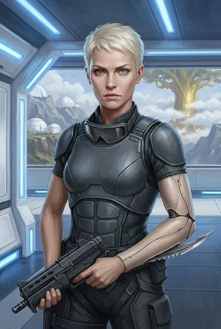

# Фьюри (Кристина Фальк / Лилия ван дер Саар)

| | |
|---|---|
| **Настоящее имя** | **Кристина Фальк** — признаётся сама: «Лилия ван дер Саар — псевдоним для оперативной работы. Мое настоящее имя — Кристина Фальк» (ЗК-10, гл. 23) |
| **Имена и прозвища** | **Лилия ван дер Саар** — легенда/псевдоним (ЗК-4, гл. 4); **«Ледяная Лилия»** — кодовое имя в Альфе и у Волков (ЗК-10, гл. 21, 23); **Фьюри** — «позывной в Восхождении» (ЗК-4, гл. 2). Сигурд в мыслях: «ледышка», «неприступная ледышка», «стойкий оловянный солдатик» (ЗК-4, гл. 2; ЗК-7, гл. 7, 13). На вопрос, как её звать, выбирает: «просто Фьюри» (ЗК-11, гл. 11) |
| **Происхождение** | Землянка, **действующий офицер Колонии Альфа** (ЗК-10, гл. 9), выпускница подготовки Альфы; участница экспедиции «Одиссей» (Альфа → Небо) как штурман, стрелок-оператор и офицер безопасности миссии (ЗК-4, гл. 4–5). «Аврора» — носитель брахма-симбионта проекта «Аврора», т. е. Истинная (ЗК-5, гл. 21; ЗК-7, гл. 1) |
| **Профиль подготовки** | Не легионер, а «телохранитель или разведчик-диверсант» (ЗК-4, гл. 5): рукопашный бой, холодное оружие, стрельба «практически из всего земного ассортимента», бесшумное передвижение |
| **Роль** | Телохранительница Вероники → «глаза и уши» рикса в копье Динамита, штурман и стрелок «Грифона» (ЗК-4) → второй пилот Сигурда (ЗК-7+) → агент Альфы, сдавший копьё (ЗК-10) → освободительница Сигурда и дезертир Альфы (ЗК-11) |
| **Книги** | ЗК-3 (заочно, как «Лилия»), ЗК-4 – ЗК-11 |
| **Ранг** | Бронза (всё время), уклон в Скорость (ЗК-6, гл. 1) |
| **Статус на конец канона** | Жива, второй пилот «Грифона» в копье Сигурда; Альфа объявила её **дезертиром и разжаловала**, «однако искать и преследовать ее никто не будет» (ЗК-11, гл. 11) |

---

## Облики на иллюстрациях

<figure markdown="span">
  [{ loading=lazy }](../assets/portrety/026.webp)
  <figcaption>Телохранительница рикса <small>ЗК-4 — ЗК-6</small></figcaption>
</figure>

Иллюстрации созданы нейросетью по описаниям из книг; это трактовка, а не официальный арт.

## 1. Личность, мотивация, слабости

**Ядро — долг и устав.** Фьюри — профессионал спецслужбы, привыкшая к строгой вертикали Альфы, где «субординация… куда строже нашей» (ЗК-10, гл. 8). При первом знакомстве «за все время не произнесла ни слова, казалась замкнутой и холодной, как ледышка» (ЗК-4, гл. 2). Когда нервничает или вопрос касается тайн, «переходит на официоз» и «сэр»: «Директивы координаторов проекта запрещают мне разглашать такие сведения… Мне неизвестна степень вашего доступа» (ЗК-7, гл. 1); «Это приказ координатора „Космо“! Сэр, я не могу» (ЗК-10, гл. 8).

**Законница.** В первом рейде возражает Динамиту, что Руны должен распределять фригольд: «Это неправильно, и рикс должна узнать об этом… Но ты командир группы, и я выполню твой приказ» (ЗК-4, гл. 6). Даже в Либерти напоминает бандитам: «Это противоречит правилам… Въезд всегда был бесплатный» (ЗК-10, гл. 21).

**Скрытность / «двойное дно».** С первого дня недоговаривает: молчит о бионике, когте, заряженных Предметах (ЗК-4, гл. 5). Отказывается назвать координаты Альфы даже риксу (ЗК-10, гл. 8). Сигурд со Стратагемами видит, что её версия «простой функционер-телохранитель» не сходится: она — единственная Истинная экспедиции, именно она передала Веронике симбионт и послание Авроры (ЗК-10, гл. 9).

**Привязанность, которую она прячет.** Оттаивает постепенно: улыбка после первого удачного боевого захода (ЗК-4, гл. 6), тихое «Спасибо», когда копьё отдаёт ей Существо (ЗК-4, гл. 7), румянец от мужского внимания на празднике (ЗК-7, гл. 13), неожиданное «Соскучился?» (ЗК-9, гл. 4). Признание: «Сейчас там у меня никого нет. В вашем фригольде… больше друзей» (ЗК-10, гл. 9). Остаётся одинокой более двух циклов после гибели мужа — «к такой ледышке немногие решались подойти» (там же).

**Перелом (ЗК-11).** После допросов в Альфе «как чужую» понимает, что «жила… настоящей жизнью» только с копьём, и добровольно идёт против своих: «Я не считаю своими людей, выполняющих преступные директивы. Я ни о чем не жалею» (ЗК-11, гл. 11). Выбор имени «просто Фьюри» — отказ и от альфовской легенды, и от прошлого.

**Слабости.**
- Предательство Сигурда в ЗК-10: знала, что «встреча на корабле» означает силовой захват, и не предупредила (ЗК-11, гл. 1–2). «Однажды предавшему — веры нет, а дважды…» (ЗК-11, гл. 11).
- Как пилот — ученица: первая посадка «слишком резко», ночью повредила «Грифон» (ЗК-5, интерлюдия «Травинка»; ЗК-6, гл. 5); через полгода — «без лихости и изящества профи, но и без» ошибок (ЗК-10, гл. 9).
- Психологическая травма плена у Теней (утрата Рун, гибель мужа) — тему избегает (ЗК-4, гл. 5).

**Эволюция:** надзиратель Вероники → полноправный член копья → лучший после Сигурда пилот Неба → агент, исполнивший долг → дезертир по совести.

---

## 2. Речь

- **«Йеп!»**, **«Йеп, сэр»**, **«Йеп, мэм!»** (Веронике, ЗК-6, гл. 4), **«Йеп, кэп!»** (ЗК-9, гл. 4).
- Ругательство **«астра фатида»**: «Я не вру, астра фатида!» (ЗК-4, гл. 18).
- Рапортный стиль: «Приближаемся. Есть устойчивый сигнал аварийного маячка…» (ЗК-4, гл. 5); «Колониста не наблюдаю. Подозрительных объектов не наблюдаю» (ЗК-9, гл. 4); «Сканирование не выявило жизненных форм» (ЗК-10, гл. 11).
- Обращение к Сигурду — «сэр», «командир»; Сигурд требует звать по имени («Нахваталась в своей Альфе…» — ЗК-11, гл. 11).

**Цитаты:**
- «Они нас ждали, сэр. Замаскировались и внезапно обстреляли» (ЗК-4, гл. 11) — первый переход на официоз от волнения.
- «Нас так учили в Альфе, Навык лучше» (ЗК-7, гл. 13).
- «Великолепно. Нам как раз не хватало сумасшедшего ксеномедика» (ЗК-9, гл. 10) — редкий сарказм.
- «Ты классный пилот, Сигурд. Лучший из тех, что я видела…» (ЗК-10, гл. 15).
- «Я хочу выполнить свой долг. А там… посмотрим» (ЗК-10, гл. 9).
- «Сэр, нужно немедленно уходить!» (ЗК-11, гл. 9).
- «Двоих, сэр. Я не считаю своими людей, выполняющих преступные директивы. Я ни о чем не жалею» (ЗК-11, гл. 11).

---

## 3. Предыстория

- **Альфа.** Офицер, прошедшая спецподготовку; Навыки, имплантированные Рунами: «Знание Единого Языка», «Боевая Акробатика», «Свертываемость Крови», «Прыгучесть» (ЗК-4, гл. 5). В Альфе Восходящие не владеют личными Рунами — их выдают под задание и сдают после (ЗК-11, гл. 6, со слов Тайны); поэтому её поведение, «впервые получившей личные Руны в нашем копье, говорило о многом» (там же).
- **Проект «Аврора».** Получила брахма-симбионт, «одна из немногих новых бессмертных» (ЗК-10, гл. 9). Советует Сигурду найти **Аврору Мартинс**, руководителя проекта (ЗК-6, гл. 1).
- **Экспедиция «Одиссей».** Винтокрыл «Одиссей» из Альфы прибыл в Небо (видение Сигурда: Шон и Фьюри «только ее волосы были длиннее», ЗК-5, гл. 20) «в прошлом цикле, чуть больше полутора земных лет назад» до ЗК-5 (ЗК-5, гл. 21). Восходящих двое — она и её муж, первый пилот **ван Саар**; «Он немного научил меня управлять винтокрылом» (ЗК-4, гл. 4). Экспедиция попала в плен к Теням; ван Саара убили, у Лилии отобрали все Руны (ЗК-3, гл. 15; ЗК-4, гл. 4–5). Вероника выкупила её — предпочтя эксперту Шону Макдональду (ЗК-10, гл. 9; *фраза в тексте построена так, будто Фьюри выкупила Веронику — очевидная описка; по ЗК-3, гл. 15 выкупали Лилию*). Именно Фьюри передала Веронике симбионт и послание Авроры (ЗК-5, гл. 21; ЗК-10, гл. 9).
- **Брак.** «Вдова пилота ван Саара» — открытый вопрос, был ли брак реальным или частью легенды (её фамилия «ван дер Саар» — псевдоним, ЗК-10, гл. 23). *(Предположение: муж реален — Сигурд в ЗК-10, гл. 9 говорит о «гибели ее мужа» как о факте, а сама Фьюри мрачнеет при его упоминании, ЗК-4, гл. 4.)*
- **Связи в Либерти.** Знает Глена «Толстяка Митчелла», бармена «Последнего Шанса» и агента Альфы (ЗК-10, гл. 21). Серый Волк узнаёт её: «Привет, Кристина. Помнишь меня?» — «Мы не знакомы» (ЗК-10, гл. 23).

---

## 4. Биография по книгам

### ЗК-3 — Земли Теней
Шон в Черной Пасти: «Двое: Лилия и Саар. Его убили люди Теней… а Лилию выкупила ваша Вероника» (гл. 15).

### ЗК-4 — Одиссей
- **Гл. 2.** Вместе с Джейкобом конвоирует Сигурда к Веронике; при ней много Предметов, один вмонтирован в приклад укороченного «Суворова».
- **Гл. 4.** Вероника придаёт её копью Динамита: «Лилия из Колонии Альфа… будет выполнять роль штурмана и, при необходимости, дубль-пилота». Она есть в базе когитора «как стрелок-оператор», но ручное управление заблокировано. Сигурд: явный надзиратель рикса.
- **Гл. 5.** «Я… утратила свои Руны… В плену». Ведёт поиск капсул по аварийным маячкам.
- **Гл. 6.** Отсекает огнём турелей тавра, уносящего землянку; впервые улыбается Сигурду. Спорит с правилами дележа.
- **Гл. 7.** Копьё выбирает для неё с задания Руну-Существо — птицу-разведчика (**Острокрыл**, «Глаза Птицы»): «Спасибо».
- **Гл. 11.** Птицей находит лагерь изгоев у грузового модуля; бой с Кнутом.
- **Гл. 17–18.** Сигурд учит её пилотировать; бой с Небесными Змеями: стреляет из турелей, но медлит с ракетным пуском; награду Наблюдателя не получает — подозрения Динамита («Я не вру, астра фатида!»).
- **Гл. 22–23.** Разведка птицей у руин; бой с Ястребом.

### ЗК-5 — Вечность
- **Интерлюдия «Травинка».** Предлагает угнать винтокрыл: «Площадка почти не охраняется. Мы можем уйти воздухом!». На вопрос о мотиве: «Я не могу сказать всего, это не моя тайна, но я уверена: Вероника Максвелл жива!». Вместе с Грохотом бесшумно снимает часовых; впервые сама взлетает и сажает «Грифон» (жёстко, ночью) у фермы Эйрика. Уходит с Динамитом, Грохотом, Инем и Граем в Шторм на тауро.
- **Гл. 20–21.** Сигурд узнаёт из памяти Вероники: та стала Истинной через симбионт, переданный Фьюри.
- **Эпилог.** Встреча с Сигурдом в Шторме: «Новый Небесный Знак… встречи во время смены Знака — судьбоносны».

### ЗК-6 — Тинг
- **Гл. 1.** Знает тайну Сигурда; советует ему Альфу и Аврору Мартинс. Вероника передаёт ей более десятка Рун — «Ледяные Иглы», «Бесшумный Шаг», «Ослепление» и др.; уходит «в скорость», движения размыты.
- **Гл. 4–6.** Головной дозор с Сигурдом; вместе чинят повреждённый её посадкой «Грифон»; рассказ о технике Альфы: «Ничего не нужно, только брахма и Схема. Это похоже на волшебство…» (гл. 5).
- **Гл. 7.** Получает серебряную Руну **Огненного Болида** (трофей Старого Огнезуба) и бронзовую **Звезду Искателя** — «живая пушка».
- **Интерлюдия «Травинка», гл. 17–19, 25.** Похищена вместе с Вероникой, Инем, Граем и Грохотом; Мрак не смог убить «авроров»; найдена Сигурдом в Домене отравленной, в окровавленной одежде (её «убили», и она восстановилась — гл. 25). 
- **Гл. 26–27.** С Сигурдом расстреливает тавров в Море Трав; праздник в «Виски».

### ЗК-7 — Дикая Охота
- **Гл. 1.** Стережёт Сигурда; отказывается обсуждать механику воскрешения «авроры».
- **Гл. 2–4.** Ускоренное обучение пилотированию; птица-разведчик над Одиноким Пиком (её Острокрыл гибнет); в бою с таврами — «Болид» и Ледяные Иглы, Грохот выносит её на сгибе конечности. Сама поднимает подбитый «Грифон».
- **Гл. 7.** Сигурд оптимизирует её 16 Рун (подарки Вероники): получает четыре бронзы, включая **Лезвия Палача** (отравленные кератиновые клинки, под её технику ножей и выкидных имплантов) и Прыгучесть; взамен отдаёт Иню Кристалл Видящего, Грохоту — серебряный Огненный Болид (из «Грифона» его применять нельзя).
- **Гл. 9–11.** Стрелок при «люльке» Грохота; потом сама ведёт «Грифон» в бою и сбивает Прыгунов «Пилумами», удерживая машину под тяжестью твари.
- **Гл. 13.** Награды: Токсичная Иммунность (дерево); с бронзового задания — Навыки; по просьбе Сигурда берёт **Знание Червей** и уступает его ему. Сотня личинок на счёте. Сводка: «Лезвия Палача, Острокрыл, Прыгучесть, Бесшумный Шаг, Ослепление, Ледяные Иглы, Укрепление Кожи, Малая Звезда Искателя, Токсичная Иммунность, Легионный Рацион».
- **Гл. 14, 16–20.** Посольство к Народу Трав; огневая поддержка в битве у Пика; везёт Миноса.

### ЗК-8 — Истинный
- Остаётся во фригольде (уже может выполнять простые вылеты по вокс-маякам, гл. 3); Сигурд создаёт для неё Навык Универсального Пилота (гл. 2, 6); получает равную долю Крови (гл. 7) и бронзовое **Безопасное Падение** (гл. 16).

### ЗК-9 — Ранг неизвестен
- **Гл. 4–6.** Рейд к капсулам за Стеной: «Курс проложен, командир… Соскучился?»; уверенно сажает «Грифон»; засыпает от рунного эффекта; замечает «аномальную синаптическую скорость» Сигурда; впервые ведёт машину на длинной дистанции.
- **Гл. 15.** «Быстрый и безотказный транспортник» колонии; спасение экспедиции в горах.

### ЗК-10 — Прозрачные Дороги
- **Гл. 4–8.** Как уроженка Альфы помогает с маршрутом; новенький «Мангус»; отказывается раскрыть местонахождение Альфы.
- **Гл. 9.** Разговор о возвращении («Я хочу выполнить свой долг…»).
- **Гл. 9–16.** Перелёт через Черную Пасть, Терру, Таир, Каменные Троны, Мертвый Город; гид по Кругу Заов («для моей напарницы — родной Круг», гл. 20). Сбивает серебряную цель «Пилумами» — награда ей (гл. 15); Кассиди её «не заметил» при раздаче. Сигурд даёт ей Развитие, два серебра и Навык **Визуального Исчисления**, возвращает на хранение **Плащ Искателя** (гл. 15). Крушение «Грифона» в Мертвом Городе (гл. 16).
- **Гл. 21–23 (Либерти).** Ищет эмиссара Альфы; штаб в Приюте разгромлен; через Толстяка Митчелла получает шифровку («Ледяная лилия», «Одиссей», «Итака», «торжественный пир прямо на корабле»). Серый Волк требует её выдачи; Сигурд объявляет фионтар за неё; она признаётся в настоящем имени. Альфа проводит «встречу на корабле» — силовой захват всех: «Не стреляйте, это наши!».

### ЗК-11 — Колония Альфа
- **Гл. 1–5.** Сигурд в изоляторе считает её предательницей; у неё — последний Портал в Небо.
- **Гл. 9–10.** По «просьбе» координатора **Рашидова** освобождает Сигурда: «Сэр, нужно немедленно уходить!»; обезглавливает конвоира Лезвиями Палача, «черной молнией» зачищает коридор, отключает защиту; ведёт «Грифон» под огнём «Карронад».
- **Гл. 11.** Допрос под угрозой Ментального Императива; рассказ о мотивах; выбирает имя «просто Фьюри». Альфа объявляет её дезертиром.
- **Гл. 13–14.** Шесть Рун, снятых с убитых «аврор», — её законная добыча; Лезвие Палача усилено; бой у Сапфирового Шторма — «в первый же проход уложив троих».
- **Гл. 19–21.** Второй пилот в Народе Зари и у края Пасти.

---

## 5. Способности и снаряжение

| Период | Что есть |
|---|---|
| ЗК-4 | Бронза с пустой Скрижалью (Руны отняты в плену); Навыки ближнего боя, стрельбы, бесшумности; имплантированные «Знание Единого Языка», «Боевая Акробатика», «Свертываемость Крови», «Прыгучесть»; бионика — рука с боевым когтем, глаз; Предметы со Звездной Кровью в экипировке; укороченный «Суворов». Руна-Существо **Острокрыл** («Глаза Птицы» — удалённый обзор в трансе) |
| ЗК-6 | +10 с лишним Рун от Вероники («Ледяные Иглы», «Бесшумный Шаг», «Ослепление»…); серебряный **Огненный Болид**; бронзовая **Звезда Искателя**; бессмертие «авроры» |
| ЗК-7 | 16 Рун → после обмена: Лезвия Палача, Острокрыл, Прыгучесть, Бесшумный Шаг, Ослепление, Ледяные Иглы, Укрепление Кожи, Малая Звезда Искателя, Токсичная Иммунность, Легионный Рацион; Навыки Вибросенсорика и др.; Знание Червей (отдано Сигурду) |
| ЗК-8–09 | Безопасное Падение; Навык Универсального Пилота (бронза) от Сигурда |
| ЗК-10 | «Мангус», герметичный шлем; Развитие, Навык Визуального Исчисления; Плащ Искателя (на хранении); протез хранит «выкидной рунный клинок бронзового ранга» (гл. 17); Портал в Небо |
| ЗК-11 | Руны с конвоиров (в т. ч. бронзовый Полный Паралич) и шесть Рун «аврор»; усиленное Лезвие Палача |

**Роль в бою.** Штурман-навигатор, оператор вооружения «Грифона» (гаусс-турели, «Пилумы»), дубль-пилот; воздушная разведка птицей; в ближнем бою — акробатка с клинками и когтем. Наблюдатель засчитывает ей задания как стрелку (ЗК-7, гл. 13; ЗК-10, гл. 15).

**Бессмертие «авроры».** Пережила убийство (ЗК-6). Как «аврора» имеет аватар в Чертогах Ожидания (ЗК-9, гл. 15). Механику воскрешения и потерю Крови раскрыть отказывается (ЗК-7, гл. 1).

---

## 6. Отношения

- **Сигурд.** Сначала объект надзора; затем напарник по кабине — «мы уже понимали друг друга почти без слов» (ЗК-10, гл. 15). Она видит в нём лучшего пилота; он — «двойное дно» в ней. Предательство в ЗК-10 и искупление в ЗК-11. Романтической линии нет; Фьюри осуждающе смотрит на «медовый месяц» Сигурда и Травинки в ложементе (ЗК-7, гл. 1).
- **Вероника Максвелл.** Нанимательница, спасительница из плена, «сестра» по симбионту; Фьюри «тенью встала за плечом Вероники» (ЗК-6, интерлюдия «Травинка»).
- **Динамит.** Первый командир; спор о Рунах, затем уважение.
- **Грохот.** Боевой товарищ; в ЗК-5 вместе снимают часовых, в ЗК-7 он выносит её из боя. В ЗК-11 первый подозревает: «А эта откуда?… Она же…» (гл. 10).
- **Винсент Кассиди.** Холоден к ней, «посчитал отрезанным ломтем» (ЗК-10, гл. 15).
- **Олег Рашидов.** Тайный куратор операции освобождения — «приказа не было. Была… просьба» (ЗК-11, гл. 11).
- **Аврора Мартинс.** Руководитель проекта; её имя Фьюри передаёт Сигурду (ЗК-6, гл. 1).
- **Серый Волк.** Знает её по прошлому (ЗК-10, гл. 23).

---
