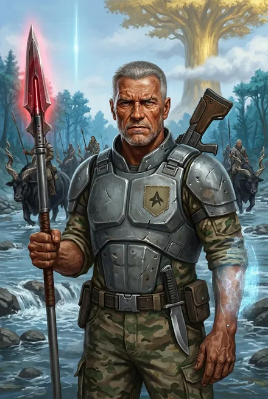

# Гай Флоу (и Келли Флоу)

## Облики на иллюстрациях

<figure markdown="span">
  [{ loading=lazy }](../assets/portrety/052.webp)
  <figcaption>основной облик <small></small></figcaption>
</figure>

Иллюстрации созданы нейросетью по описаниям из книг; это трактовка, а не официальный арт.

## Гай Флоу

| | |
|---|---|
| **Имена** | Гай Флоу; «старый Флоу», «старый Гай Флоу» (ЗК-1, гл. 14; ЗК-5, интерлюдия «Травинка») |
| **Происхождение** | Землянин, колонист «Космо» — шеврон проекта на камуфляже (ЗК-1, гл. 10); один из первых колонистов и «атлантов», на которых поднялся фригольд (ЗК-4, гл. 7) |
| **Роль** | Восходящий, командир боевого копья фригольда Небо (с Марком, Свирелью, Граем, Рэнди, Песчанкой) (ЗК-1, гл. 10, 13) |
| **Ранг** | Бронза: Грай вспоминает зачистку плато от серебряного альфы гигантопитеков — «Тогда был Винс, был Эйрик. Гай тоже был… Они уже тогда были бронзой, правда слабенькой» (ЗК-1, гл. 15). Белый Дьявол: в теле Восходящего было «около пятисот» капель ЗК (ЗК-3, гл. 5) |
| **Книги** | ЗК-1 (гл. 10–15 — активно), упом. ЗК-2–ЗК-8 |
| **Статус** | Мёртв — убит стрелой Марка «Мрака» Кассиди из блочного лука «за двести шагов» (ЗК-6, гл. 23; ЗК-1, гл. 11) |

### Внешность (кратко)
«Напоминал старый кряжистый дуб. Очень крепкий, в выгоревшем земном камуфляже, короткие седые волосы, суровое загорелое лицо, где морщины смешались со старыми шрамами. На поясе — нож, на плече — потертая видавшая виды импульсная винтовка» (ЗК-1, гл. 10). «Бугристая жесткая коричневая ладонь» (там же). Для фионтара — «побитый и поцарапанный» солдатский «Гардиан», технокопьё с вибролезвием (ЗК-1, гл. 11). Глаза «прозрачно-голубые» (отражение в Лабиринте, ЗК-8, гл. 11).

### Личность и речь
- Немногословен, практичен, ставит честь фригольда выше личного: «Все уже решено. И дело вообще не в тебе, Сигурд! Если мы отдадим тебя без боя, то потеряем уважение и врагов, и союзников… Я буду драться не за тебя, а за славу нашего фригольда» (ЗК-1, гл. 11).
- Старший по праву и по Рунам: «У меня лучше Руны, и я здесь старший, Марк, значит, и идти — мне» (ЗК-1, гл. 11).
- **Цитаты:** «Малыш, нельзя! Свои!» — ездовому карху; «Не бойся, он не тронет. Как ты, парень?» (ЗК-1, гл. 10); «Мы своих не отдаем» (ЗК-1, гл. 11); «Не дрейфить» (ЗК-1, гл. 11).

### Биография
- **Ранние циклы фригольда.** В бронзовом копье Винсента Кассиди (Винсент, Ветер Равнин, Эйрик, Вероника, Гай Флоу, Кнут Ларссон, Говорящая-с-Травами — по разбору ЗК-7); Ветер Равнин на пиру: «Наше бронзовое копье… И четверо ныне здесь… Не хватает Гая Флоу и Кнута» (ЗК-7, гл. 15). Зачистка плато от гигантопитеков вместе с Винсентом и Эйриком (ЗК-1, гл. 15). Эйрик: «старого Флоу не воскресить, а он когда-то был моим другом» (ЗК-5, интерлюдия «Травинка»).
- **ЗК-1, гл. 10.** Его копьё спасает Сигурда от оборотня-выдры (Серебряной Форели — та отступила «при появлении копья Гая Флоу», ЗК-6, гл. 3).
- **ЗК-1, гл. 11.** У брода через Бурную Люди Реки требуют Сигурда; Гай вызывает их на **фионтар** под Клятву Единству. Против — Зирдан Хвост Акулы, «третий сын рикса Мертвой Рыбы… хорошая бронза». Алый луч копья, водяная волна, рукопашная в воде; Гай «как медведь» ломает противнику кости и поднимает кулак победы — и падает: «Мертвый Гай Флоу. Вокруг головы уже расплылось алое пятно».
- **Версия убийц.** Мрак докладывает Серене Лафайет: «Гай вышел на поединок. Победил их Восходящего. И его застрелили»; Свирель: «В спину выстрелили, из кустов» — вина свалена на речных (ЗК-1, гл. 14).
- **Трофеи Сигурда с тела:** «Получено 46 капель Звездной Крови… Руна Развития… Обломок Скрижали Восходящего… Руна Боя-Без-Оружия… Руна Алого Когтя» (ЗК-1, гл. 11) — основа первых сил Сигурда; Алый Коготь позже узнан как Руна стража Гнезда Червей (ЗК-2, гл. 15–16).
- **Обломок Скрижали Гая** вскрыт Белым Дьяволом в Домене Азимандии: бронза, 10 слотов, 6 Монет; Руны дерева (Изменение, Развитие, Легионный Рацион, Серебряная Фляга, Эликсир Антияда, Дыхание Пассифлоры, Солдатский Меч) и бронзы — **Технокопьё, Малая Звезда Искателя** (аграф-«трёхлучевая звезда из священной голубой стали», два заряда из трёх Гай уже потратил), Сила Десяти Воинов (ЗК-2, гл. 21). Технокопьё распылено ради Крови (ЗК-2, гл. 23).
- **Похороны.** Прах в колумбарии фригольда кладёт дочь Келли (ЗК-2, гл. 2).
- **Разоблачение убийства.** Сигурд рассказывает Веронике и Кассиди о «убийстве Гая Флоу» (ЗК-2, гл. 11; ЗК-6, гл. 19); на суде Винсент обвиняет Марка «в нарушении Клятвы и убийстве Восходящего Гая Флоу» (ЗК-6, гл. 27). Мрак: «Жаль, что не прихлопнул тебя в самом начале, после поединка с Флоу… Ведь это ты забрал его Руны?» (ЗК-6, гл. 28).
- **Отражение в Лабиринте:** «Я… сражался и погиб за тебя… а ты украл мои Руны… Почему ты солгал? Почему не отдал их моей дочери?» (ЗК-8, гл. 11).

### Противоречия
- **Зирдан / Зирдин** Хвост Акулы — ЗК-1, гл. 11 vs ЗК-6, гл. 3. В ЗК-6 он жив («Гай перед смертью все-таки не сломал ему хребет?»), а Народ Реки не признаёт тот фионтар (ЗК-6, гл. 3).
- **Причина смерти:** в ЗК-1 Сигурд видит лишь рану головы после боя; в ЗК-6 прямо — стрела Марка (ЗК-6, гл. 23).

### Крючки
- Малая Звезда Искателя (стелла!) у Гая — откуда (ЗК-2, гл. 21).

---

## Келли Флоу

| | |
|---|---|
| **Кто** | Дочь Гая; «высокая белокурая девушка» (ЗК-2, гл. 2), «одна из первых красавиц фригольда» (ЗК-4, гл. 14); «жена с желтыми волосами» — так её называет Лэндо/кинг Трав (ЗК-7, гл. 15) |
| **Ранг** | Восходящая с ЗК-6 (гвоздь отца — «Гвоздь Гая возьмет его дочь Келли, это решено», ЗК-4, интерлюдия «Фригольд»); новичок-«дерево» (ЗК-6, разбор); стреляет из блочного лука (ЗК-7, гл. 9) |
| **Книги** | ЗК-1 (гл. 14–15), ЗК-2, ЗК-4, ЗК-6–ЗК-8, ЗК-10–ЗК-11 (упом.) |

- **ЗК-1.** У гроба отца её утешает афро: «не плачь, Восходящие не умирают. Ты еще встретишь его в Вечности» (ЗК-1, гл. 15).
- **ЗК-2.** Хочет стигмат, «увидеть отца в Вечности»; Лэндо: «Если Келли стать Восходящая, я хотеть взять ее в жены» (ЗК-2, гл. 2).
- **ЗК-6.** Получает гвоздь на тинге — в группе Миноса с Милли Симмонс и Салманом Беркутом (ЗК-6, гл. 24). Кинг Ветер Равнин сватает её за Лэндо; Вероника: «Если сама Келли захочет — отдам… мы не приказываем нашим людям, кого любить» (ЗК-6, гл. 8).
- **ЗК-7.** «Дочка у Флоу вышла бойкая — она теперь Восходящая и решает свою судьбу сама» (Кассиди); её ставят в копьё Лэндо (ЗК-7, гл. 15).
- **ЗК-8.** Сигурд через Лэндо дарит ей Алую Волну (усиленную Руну отца) — «запоздалый долг»: «ее отец дрался за меня на фионтаре… Она должна помнить, почти такая же была у ее отца» (ЗК-8, гл. 16).
- **ЗК-10–ЗК-11.** Лэндо «везде появлялся исключительно в компании Келли Флоу» (ЗК-10, гл. 8); «Келли Флоу приняла дары принца»; свадьба — в День Творящей у Пылающего Рога (ЗК-11, гл. 20).
- **Крючок:** знает ли Келли, что Руны отца у Сигурда (ЗК-8, гл. 11, 16); брак землянки с принцем Народа Трав — политический союз.
