# Галерея портретов

Персонажи «Звездной Крови» и «Тысячи Братьев» в разных обликах по книгам. Нажмите на картинку, чтобы открыть ее в полном размере, на подпись — чтобы перейти к досье.

Иллюстрации созданы нейросетью по описаниям из книг; это трактовка, а не официальный арт.

## Сигурд (Сигварт Морозов)

<figure markdown="span">
  [{ loading=lazy }](../assets/portrety/001.webp)
  <figcaption><a href="../sigurd/">Колонист после падения</a> <small>ЗК-1, гл. 1–15</small></figcaption>
</figure>
<figure markdown="span">
  [{ loading=lazy }](../assets/portrety/002.webp)
  <figcaption><a href="../sigurd/">Фригольдер, ученик копья Динамита</a> <small>ЗК-1, гл. 16 — ЗК-2</small></figcaption>
</figure>
<figure markdown="span">
  [{ loading=lazy }](../assets/portrety/003.webp)
  <figcaption><a href="../sigurd/">После Домена Азимандии: «очень крепкий мужчина» в одежде Кел</a> <small>ЗК-3</small></figcaption>
</figure>
<figure markdown="span">
  [{ loading=lazy }](../assets/portrety/004.webp)
  <figcaption><a href="../sigurd/">«Молодой волк», пилот «Грифона»</a> <small>ЗК-4</small></figcaption>
</figure>
<figure markdown="span">
  [{ loading=lazy }](../assets/portrety/005.webp)
  <figcaption><a href="../sigurd/">В доспехе Небесного Ястреба</a> <small>ЗК-5 — ЗК-9; конфискован в ЗК-10, гл. 1</small></figcaption>
</figure>
<figure markdown="span">
  [{ loading=lazy }](../assets/portrety/006.webp)
  <figcaption><a href="../sigurd/">Отражение в Вечности «Звездный Флот»</a> <small>ЗК-5; ЗК-6, гл. 12–16; ЗК-8–ЗК-9 в Вечности</small></figcaption>
</figure>
<figure markdown="span">
  [{ loading=lazy }](../assets/portrety/007.webp)
  <figcaption><a href="../sigurd/">Серебряный Восходящий, «не Геракл, но Аполлон»; инкогнито</a> <small>ЗК-6</small></figcaption>
</figure>
<figure markdown="span">
  [{ loading=lazy }](../assets/portrety/008.webp)
  <figcaption><a href="../sigurd/">Командир в лед-доспехе Эргиаля</a> <small>ЗК-8, эпилог — ЗК-10</small></figcaption>
</figure>
<figure markdown="span">
  [{ loading=lazy }](../assets/portrety/009.webp)
  <figcaption><a href="../sigurd/">Анимафикация: черты Воглера</a> <small>ЗК-11</small></figcaption>
</figure>
<figure markdown="span">
  [{ loading=lazy }](../assets/portrety/010.webp)
  <figcaption><a href="../sigurd/">Дракон Звездного Света (Аспект; пробуждён SK-05, гл. 4)</a> <small></small></figcaption>
</figure>

## Травинка-на-Ветру (Адель Кассиди)

<figure markdown="span">
  [{ loading=lazy }](../assets/portrety/011.webp)
  <figcaption><a href="../travinka/">Медком фригольда</a> <small>ЗК-1, гл. 19 — ЗК-3</small></figcaption>
</figure>
<figure markdown="span">
  [{ loading=lazy }](../assets/portrety/012.webp)
  <figcaption><a href="../travinka/">Тайное свидание / вечер в «Виски»</a> <small>ЗК-2, гл. 9 — ЗК-4, гл. 3</small></figcaption>
</figure>
<figure markdown="span">
  [{ loading=lazy }](../assets/portrety/013.webp)
  <figcaption><a href="../travinka/">Медик боевого копья</a> <small>ЗК-4, гл. 5 — ЗК-5</small></figcaption>
</figure>
<figure markdown="span">
  [{ loading=lazy }](../assets/portrety/014.webp)
  <figcaption><a href="../travinka/">Цветущая Восходящая, жена</a> <small>ЗК-6, гл. 26 — ЗК-11</small></figcaption>
</figure>

## Вероника «Ника» Максвелл

<figure markdown="span">
  [{ loading=lazy }](../assets/portrety/015.webp)
  <figcaption><a href="../veronika/">Рикс в золотом комбинезоне</a> <small>ЗК-1, гл. 16 — ЗК-5</small></figcaption>
</figure>
<figure markdown="span">
  [{ loading=lazy }](../assets/portrety/016.webp)
  <figcaption><a href="../veronika/">В поле: серебряная Восходящая на тауро; Аспект-глаз</a> <small>ЗК-6</small></figcaption>
</figure>

## Винсент «Винс» Кассиди

<figure markdown="span">
  [{ loading=lazy }](../assets/portrety/017.webp)
  <figcaption><a href="../vinsent/">Пленник Колонны Безвременья</a> <small>ЗК-2, гл. 22 — ЗК-6, гл. 19</small></figcaption>
</figure>
<figure markdown="span">
  [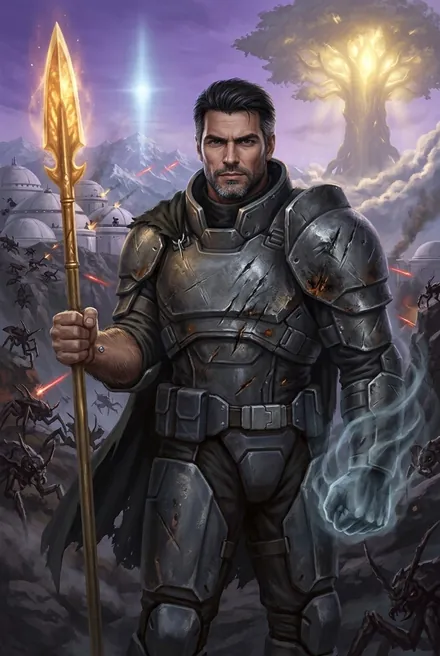{ loading=lazy }](../assets/portrety/018.webp)
  <figcaption><a href="../vinsent/">Возвращённый рикс с Игг-Копьём</a> <small>ЗК-6, гл. 19 — ЗК-8</small></figcaption>
</figure>
<figure markdown="span">
  [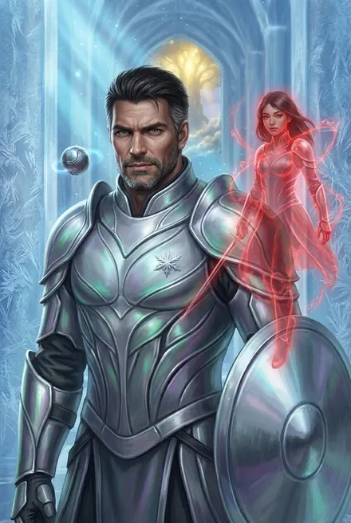{ loading=lazy }](../assets/portrety/019.webp)
  <figcaption><a href="../vinsent/">В лед-доспехе, с драконьей Руной Мико</a> <small>ЗК-9 — ЗК-11</small></figcaption>
</figure>

## Марк Кассиди («Мрак», «Мрак-подобный-Пламени»)

<figure markdown="span">
  [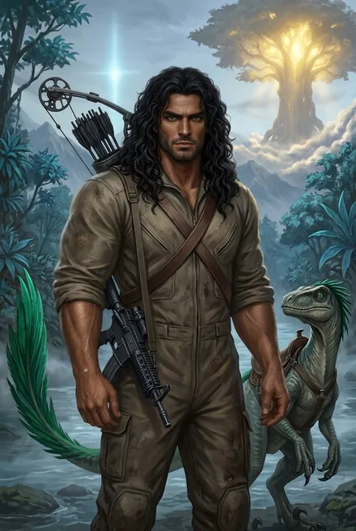{ loading=lazy }](../assets/portrety/020.webp)
  <figcaption><a href="../mark-mrak/">«Варвар», командир копья</a> <small>ЗК-1 — ЗК-6, гл. 26</small></figcaption>
</figure>
<figure markdown="span">
  [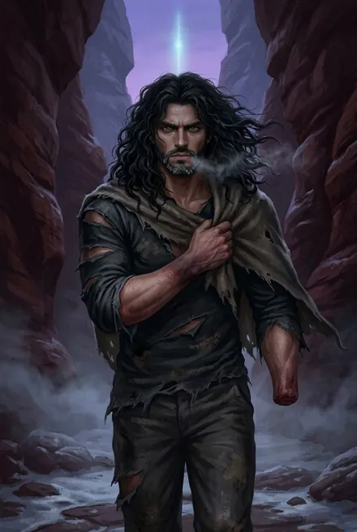{ loading=lazy }](../assets/portrety/021.webp)
  <figcaption><a href="../mark-mrak/">Осуждённый изгнанник, без руки</a> <small>ЗК-6, гл. 27–28</small></figcaption>
</figure>

## Лэндо Солнечное Крыло

<figure markdown="span">
  [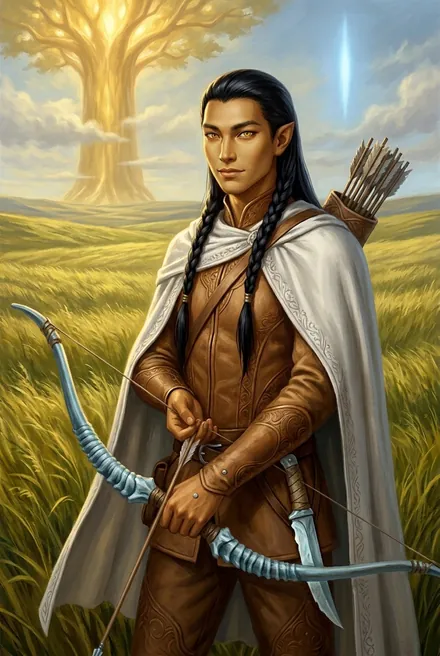{ loading=lazy }](../assets/portrety/022.webp)
  <figcaption><a href="../lendo/">Юный принц-лучник</a> <small>ЗК-1 — ЗК-6</small></figcaption>
</figure>
<figure markdown="span">
  [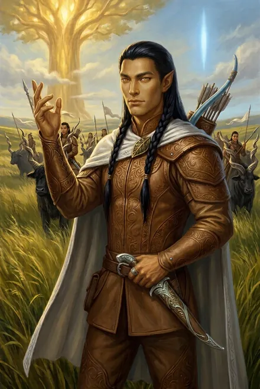{ loading=lazy }](../assets/portrety/023.webp)
  <figcaption><a href="../lendo/">Возмужавший хейр, командир копья</a> <small>ЗК-7+</small></figcaption>
</figure>

## Минос (доктор Матиас Амин)

<figure markdown="span">
  [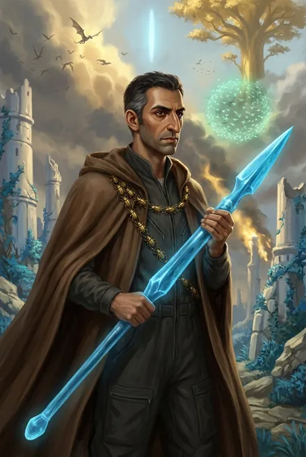{ loading=lazy }](../assets/portrety/024.webp)
  <figcaption><a href="../minos/">Восходящий-«маг»</a> <small>ЗК-1, гл. 19–20; в рейдах ЗК-4, ЗК-6</small></figcaption>
</figure>
<figure markdown="span">
  [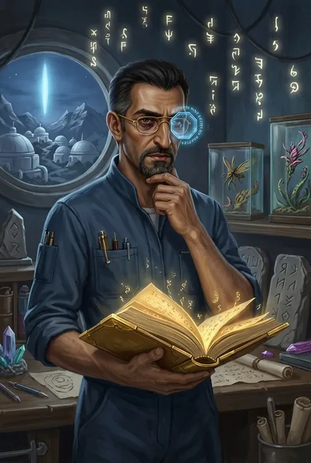{ loading=lazy }](../assets/portrety/025.webp)
  <figcaption><a href="../minos/">Учёный / фламин</a> <small>ЗК-1, гл. 22; ЗК-7 — ЗК-11</small></figcaption>
</figure>

## Фьюри (Кристина Фальк / Лилия ван дер Саар)

<figure markdown="span">
  [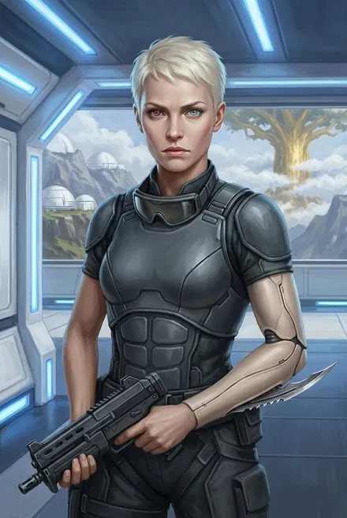{ loading=lazy }](../assets/portrety/026.webp)
  <figcaption><a href="../fyuri/">Телохранительница рикса</a> <small>ЗК-4 — ЗК-6</small></figcaption>
</figure>
<figure markdown="span">
  [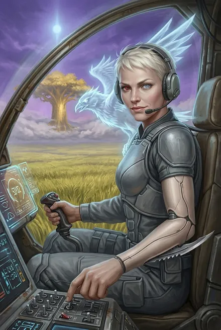{ loading=lazy }](../assets/portrety/027.webp)
  <figcaption><a href="../fyuri/">Второй пилот «Грифона»</a> <small>ЗК-6 — ЗК-10, гл. 22</small></figcaption>
</figure>
<figure markdown="span">
  [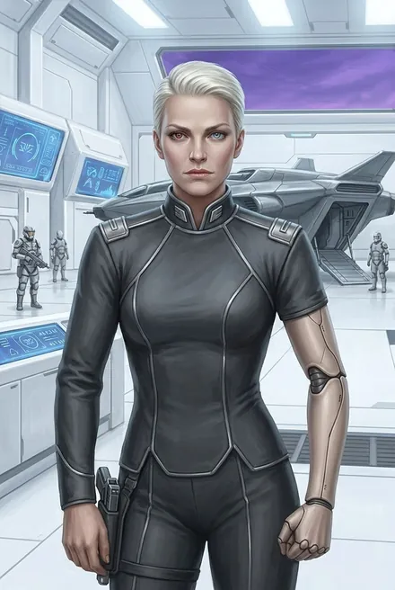{ loading=lazy }](../assets/portrety/028.webp)
  <figcaption><a href="../fyuri/">Кристина Фальк, «Ледяная Лилия», агент Альфы</a> <small>ЗК-10, гл. 23 — ЗК-11</small></figcaption>
</figure>

## Эйрик Мастер Зверей

<figure markdown="span">
  [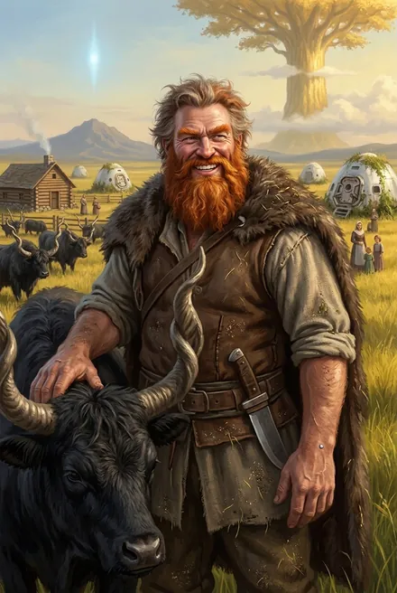{ loading=lazy }](../assets/portrety/029.webp)
  <figcaption><a href="../eirik/">Хозяин ранчо</a> <small>ЗК-4 — ЗК-11; единый облик</small></figcaption>
</figure>

## Динамит (Дмитрий Воронин)

<figure markdown="span">
  [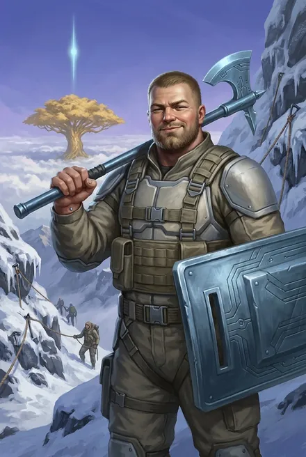{ loading=lazy }](../assets/portrety/030.webp)
  <figcaption><a href="../dinamit/">Командир копья</a> <small>ЗК-1 — ЗК-6</small></figcaption>
</figure>
<figure markdown="span">
  [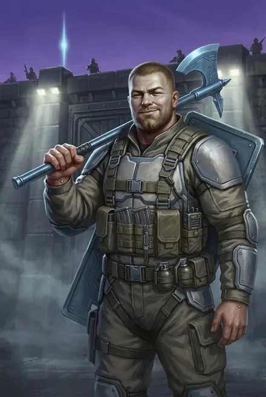{ loading=lazy }](../assets/portrety/031.webp)
  <figcaption><a href="../dinamit/">Воскрешённый «квадратный бульдозер»</a> <small>ЗК-9, гл. 15 — ЗК-11</small></figcaption>
</figure>

## Толя Грохот (Анатолий Горохов)

<figure markdown="span">
  [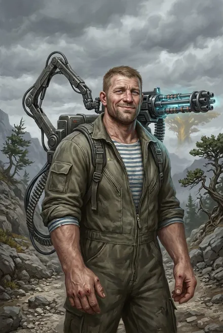{ loading=lazy }](../assets/portrety/032.webp)
  <figcaption><a href="../grohot/">Десантник с гаусс-пулемётом</a> <small>ЗК-1 — ЗК-4</small></figcaption>
</figure>
<figure markdown="span">
  [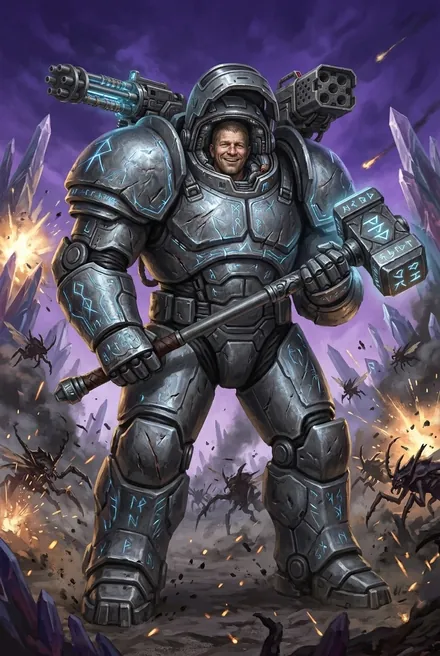{ loading=lazy }](../assets/portrety/033.webp)
  <figcaption><a href="../grohot/">В рунном Боевом Доспехе («Гоплит»)</a> <small>ЗК-7 — ЗК-11</small></figcaption>
</figure>
<figure markdown="span">
  [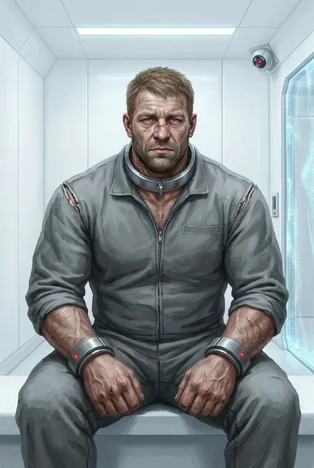{ loading=lazy }](../assets/portrety/034.webp)
  <figcaption><a href="../grohot/">Пленник Альфы</a> <small>ЗК-11, гл. 6</small></figcaption>
</figure>

## Инь и Янь (близнецы-азио)

<figure markdown="span">
  [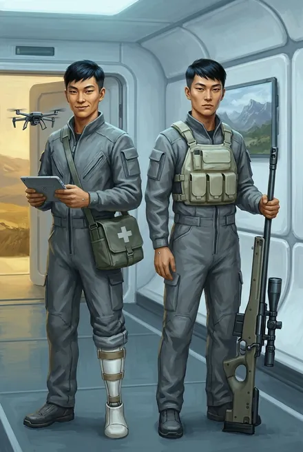{ loading=lazy }](../assets/portrety/035.webp)
  <figcaption><a href="../in-yan/">Близнецы-новички</a> <small>ЗК-1 — ЗК-7</small></figcaption>
</figure>
<figure markdown="span">
  [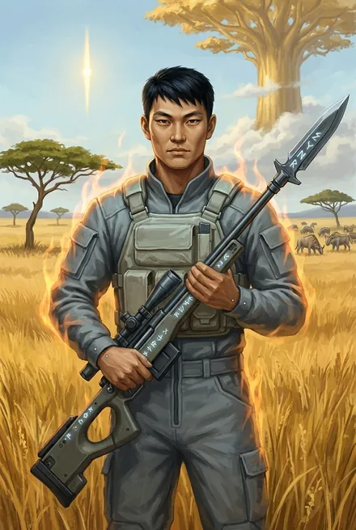{ loading=lazy }](../assets/portrety/036.webp)
  <figcaption><a href="../in-yan/">Окрепший бронзовый Инь</a> <small>ЗК-8 — ЗК-11</small></figcaption>
</figure>

## Юки (Танцующая-в-Тени → Тень → Тень-из-Неба)

<figure markdown="span">
  [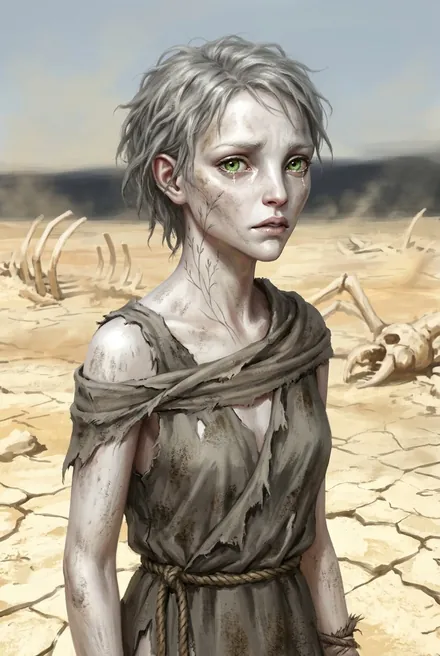{ loading=lazy }](../assets/portrety/037.webp)
  <figcaption><a href="../yuki/">Трэль в Расколотых Землях</a> <small>ЗК-3, гл. 4</small></figcaption>
</figure>
<figure markdown="span">
  [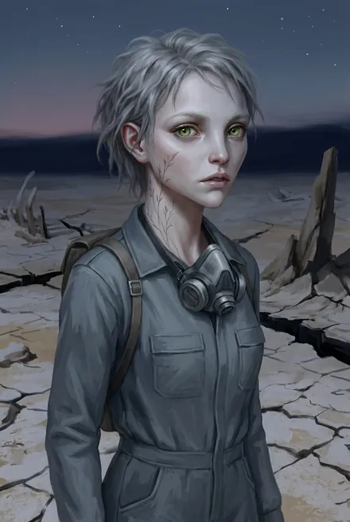{ loading=lazy }](../assets/portrety/038.webp)
  <figcaption><a href="../yuki/">Проводница в земном комбинезоне</a> <small>ЗК-3, гл. 5 — эпилог</small></figcaption>
</figure>
<figure markdown="span">
  [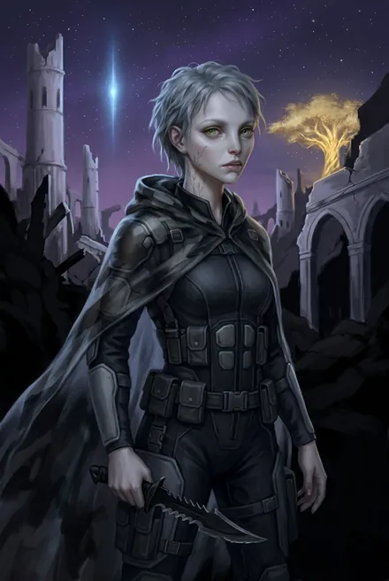{ loading=lazy }](../assets/portrety/039.webp)
  <figcaption><a href="../yuki/">«Тень», скаут копья</a> <small>ЗК-7 — ЗК-11</small></figcaption>
</figure>

## Аврора Мартинс

<figure markdown="span">
  [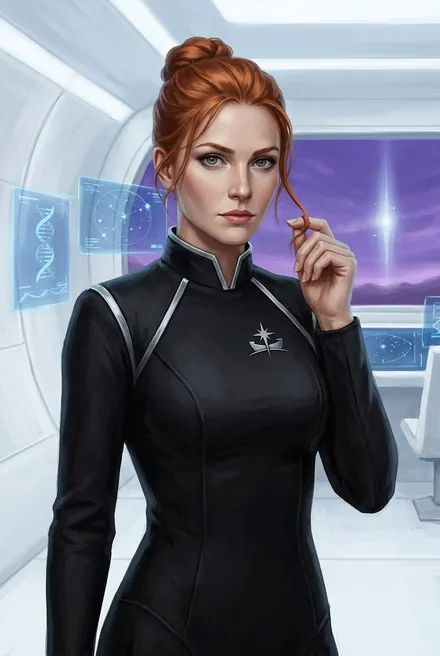{ loading=lazy }](../assets/portrety/040.webp)
  <figcaption><a href="../avrora/">Координатор</a> <small>ЗК-5, Интерлюдия; ЗК-11</small></figcaption>
</figure>

## Трейв Уитли (и его сын Тревор Моримото «Мажор»)

<figure markdown="span">
  [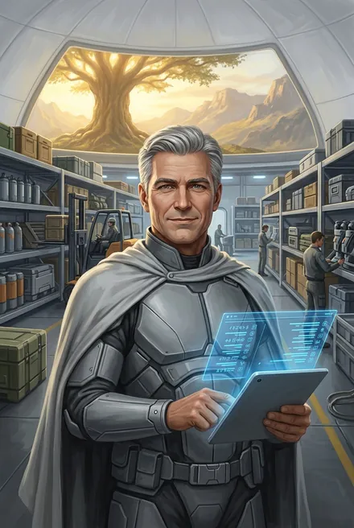{ loading=lazy }](../assets/portrety/041.webp)
  <figcaption><a href="../trejv/">«Джентльмен»</a> <small>ЗК-1 — ЗК-6</small></figcaption>
</figure>

## Грай

<figure markdown="span">
  [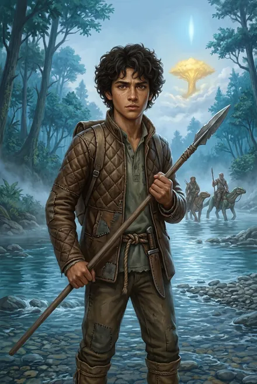{ loading=lazy }](../assets/portrety/042.webp)
  <figcaption><a href="../grai/">Подросток из копья Гая</a> <small>ЗК-1 — ЗК-2</small></figcaption>
</figure>
<figure markdown="span">
  [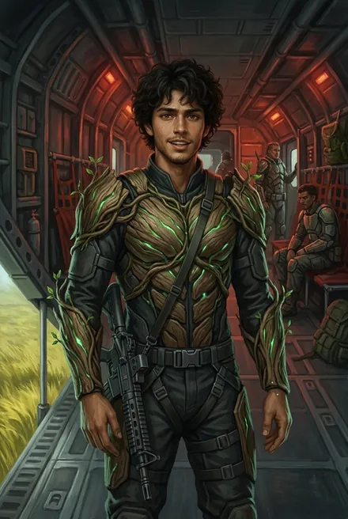{ loading=lazy }](../assets/portrety/043.webp)
  <figcaption><a href="../grai/">Боец копья Сигурда, Древесный Доспех</a> <small>ЗК-5 — ЗК-10</small></figcaption>
</figure>

## Копьё Мрака: Свирель, Рэнди, Мик, Песчанка

<figure markdown="span">
  [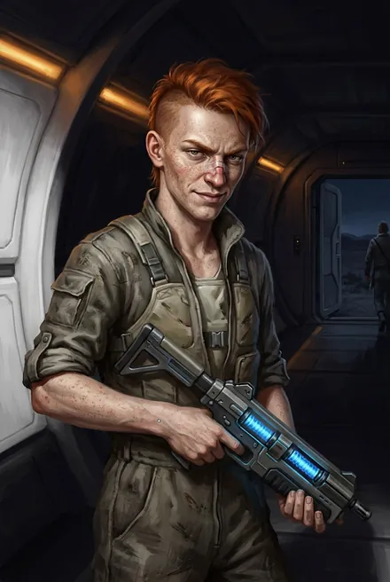{ loading=lazy }](../assets/portrety/044.webp)
  <figcaption><a href="../kopyo-mraka/">основной облик</a> <small></small></figcaption>
</figure>

## Серена Лафайет

<figure markdown="span">
  [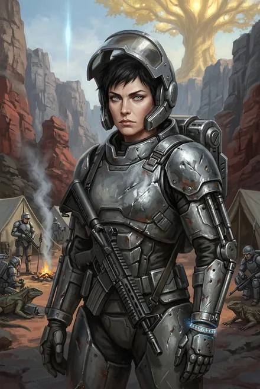{ loading=lazy }](../assets/portrety/045.webp)
  <figcaption><a href="../serena/">В экзоскелете</a> <small>ЗК-1 — ЗК-8</small></figcaption>
</figure>
<figure markdown="span">
  [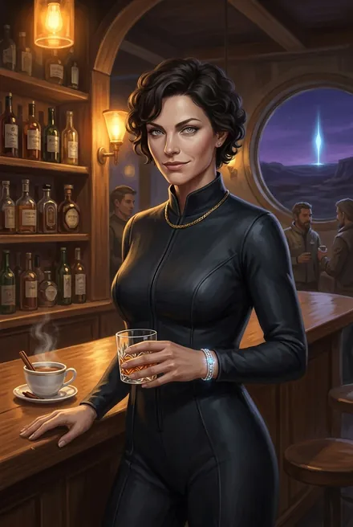{ loading=lazy }](../assets/portrety/046.webp)
  <figcaption><a href="../serena/">Вне службы</a> <small>ЗК-2, гл. 8</small></figcaption>
</figure>

## Ассоль (Патриция Эванс)

<figure markdown="span">
  [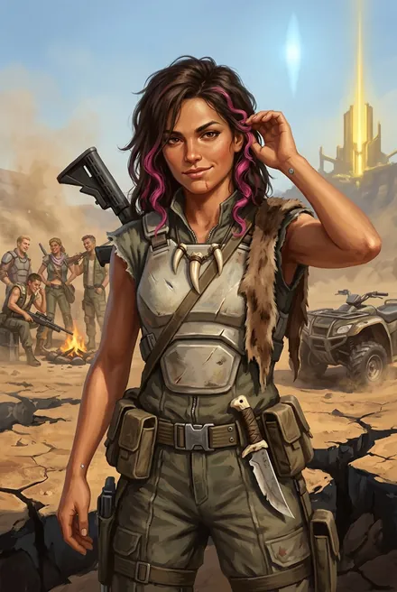{ loading=lazy }](../assets/portrety/047.webp)
  <figcaption><a href="../assol/">основной облик</a> <small></small></figcaption>
</figure>

## Андре Кроу («Птица» → Ворон)

<figure markdown="span">
  [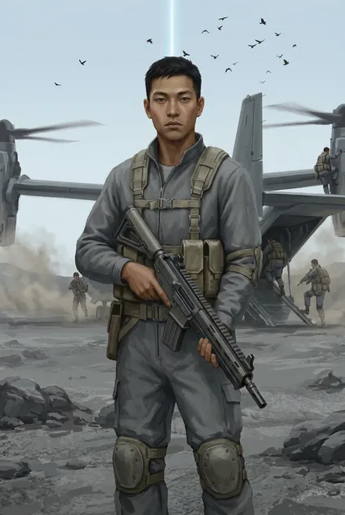{ loading=lazy }](../assets/portrety/048.webp)
  <figcaption><a href="../krou/">основной облик</a> <small></small></figcaption>
</figure>

## Элли (Элеонора) Кардо

<figure markdown="span">
  [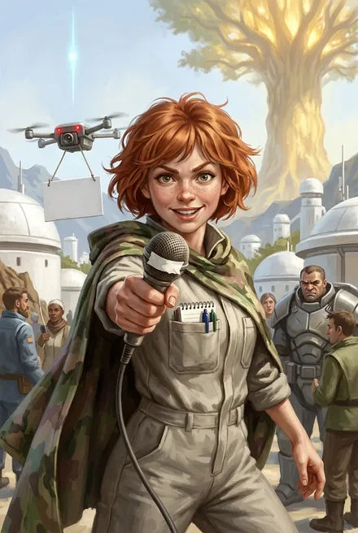{ loading=lazy }](../assets/portrety/049.webp)
  <figcaption><a href="../kardo/">основной облик</a> <small></small></figcaption>
</figure>

## Мико (драконья Руна-когитор Ордена Истинных)

<figure markdown="span">
  [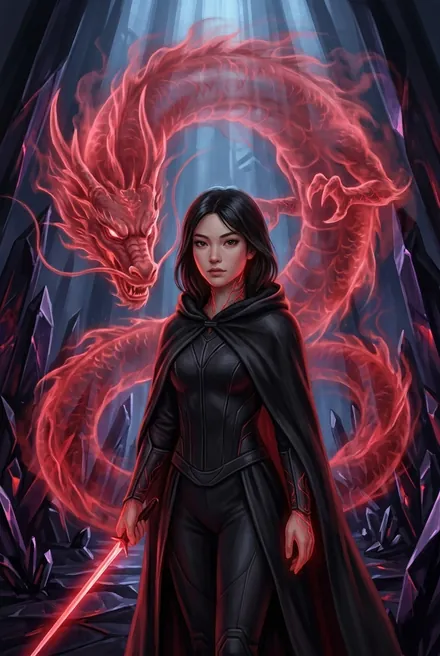{ loading=lazy }](../assets/portrety/050.webp)
  <figcaption><a href="../miko/">основной облик</a> <small></small></figcaption>
</figure>

## Эрда Онора (Онора Эверент Ноктис кел Аммос)

<figure markdown="span">
  [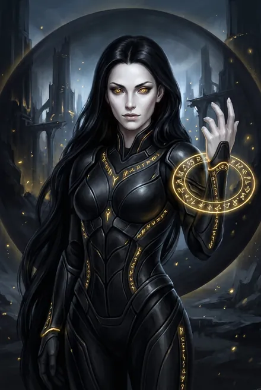{ loading=lazy }](../assets/portrety/051.webp)
  <figcaption><a href="../onora/">основной облик</a> <small></small></figcaption>
</figure>

## Гай Флоу (и Келли Флоу)

<figure markdown="span">
  [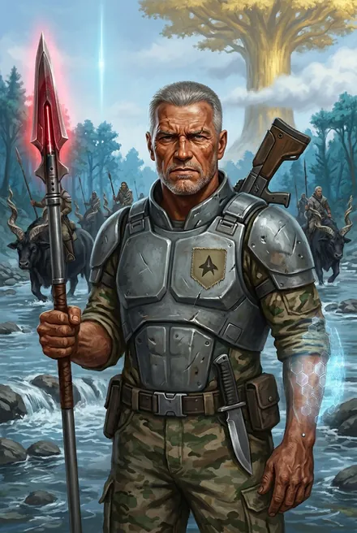{ loading=lazy }](../assets/portrety/052.webp)
  <figcaption><a href="../gai-flou/">основной облик</a> <small></small></figcaption>
</figure>
<figure markdown="span">
  [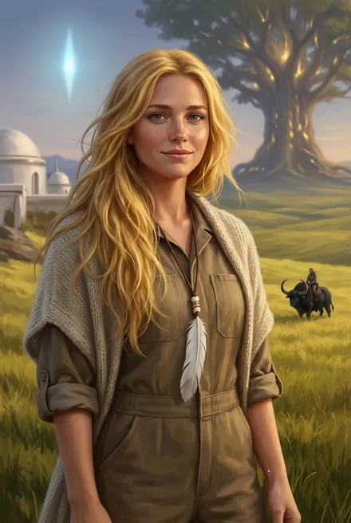{ loading=lazy }](../assets/portrety/069.webp)
  <figcaption><a href="../gai-flou/">Келли Флоу</a> <small></small></figcaption>
</figure>

## Флекс Торий

<figure markdown="span">
  [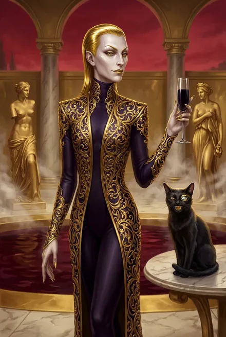{ loading=lazy }](../assets/portrety/053.webp)
  <figcaption><a href="../flex-torij/">основной облик</a> <small></small></figcaption>
</figure>

## Йан Воглер (капитан «Хельги»)

<figure markdown="span">
  [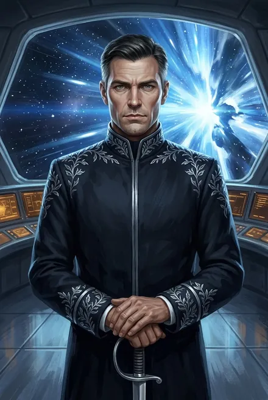{ loading=lazy }](../assets/portrety/054.webp)
  <figcaption><a href="../vogler/">основной облик</a> <small></small></figcaption>
</figure>

## Скай («Скай 2.0»)

<figure markdown="span">
  [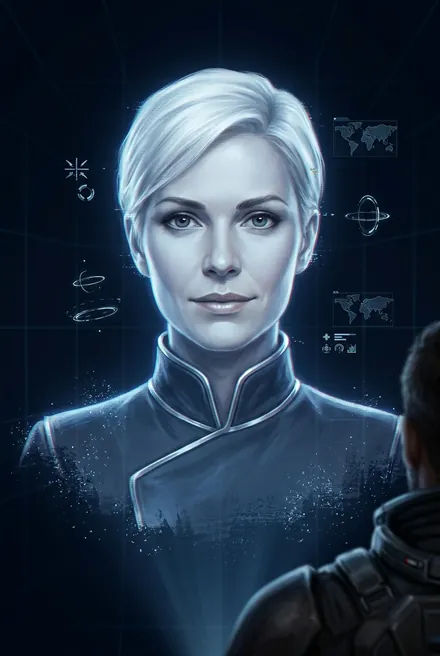{ loading=lazy }](../assets/portrety/055.webp)
  <figcaption><a href="../skay/">основной облик</a> <small></small></figcaption>
</figure>

## Сестра Солнца (как она показана в основной серии)

<figure markdown="span">
  [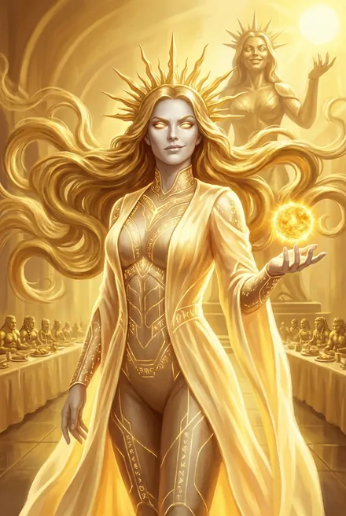{ loading=lazy }](../assets/portrety/056.webp)
  <figcaption><a href="../sestra-solntsa/">основной облик</a> <small></small></figcaption>
</figure>

## Хитрейший (Хранитель Вечности, Хозяин Контракции)

<figure markdown="span">
  [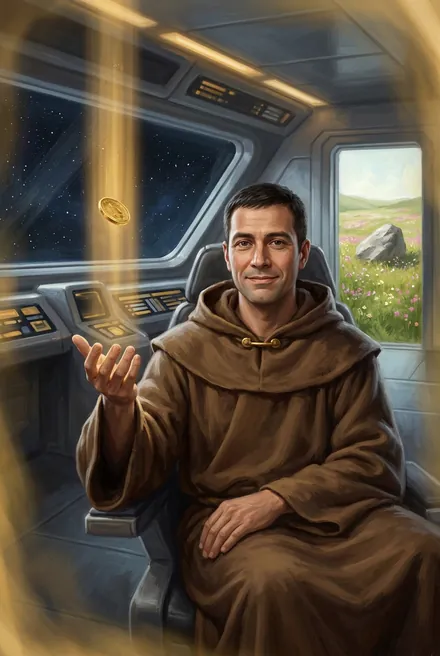{ loading=lazy }](../assets/portrety/057.webp)
  <figcaption><a href="../hitreyshiy/">основной облик</a> <small></small></figcaption>
</figure>
<figure markdown="span">
  [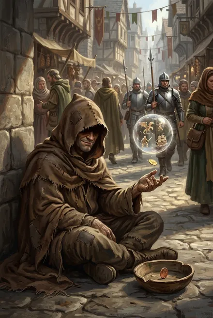{ loading=lazy }](../assets/portrety/138.webp)
  <figcaption><a href="../hitreyshiy/">основной облик</a> <small></small></figcaption>
</figure>

## Кыш

<figure markdown="span">
  [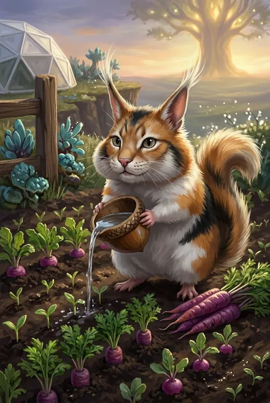{ loading=lazy }](../assets/portrety/058.webp)
  <figcaption><a href="../kysh/">основной облик</a> <small></small></figcaption>
</figure>

## Лохмач (и «второй Лохмач»)

<figure markdown="span">
  [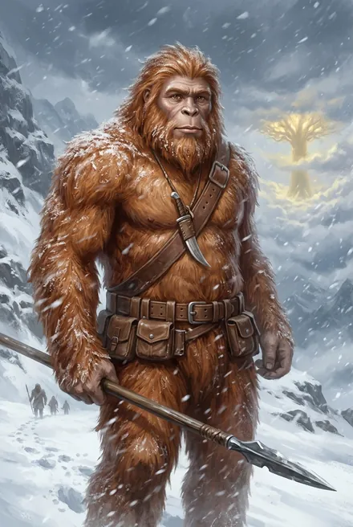{ loading=lazy }](../assets/portrety/059.webp)
  <figcaption><a href="../lohmach/">основной облик</a> <small></small></figcaption>
</figure>

## Азимандия Визу Аран (Аммос)

<figure markdown="span">
  [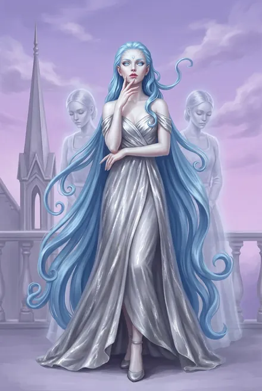{ loading=lazy }](../assets/portrety/060.webp)
  <figcaption><a href="../azimandiya/">Хозяйка Домена</a> <small>ЗК-2, гл. 18–23</small></figcaption>
</figure>
<figure markdown="span">
  [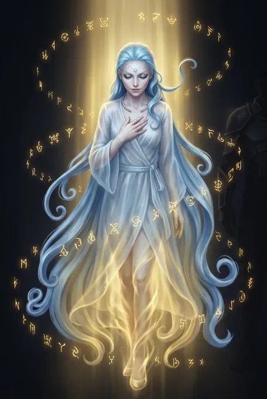{ loading=lazy }](../assets/portrety/061.webp)
  <figcaption><a href="../azimandiya/">Руна-пленница</a> <small>ЗК-3 — ЗК-6</small></figcaption>
</figure>
<figure markdown="span">
  [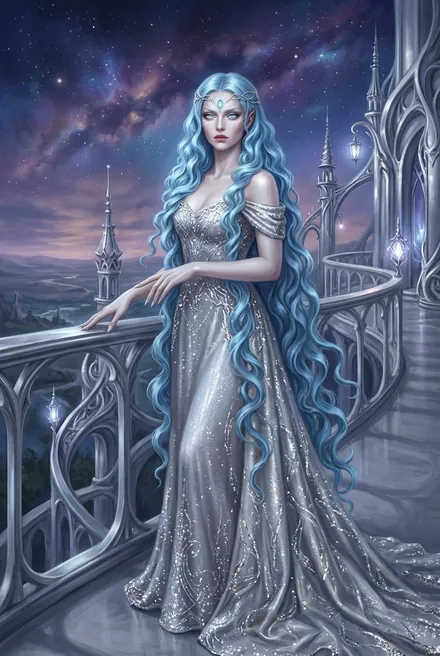{ loading=lazy }](../assets/portrety/099.webp)
  <figcaption><a href="../azimandiya/">Хозяйка Серебряного Замка</a> <small>ЗК-2, гл. 18–23</small></figcaption>
</figure>
<figure markdown="span">
  [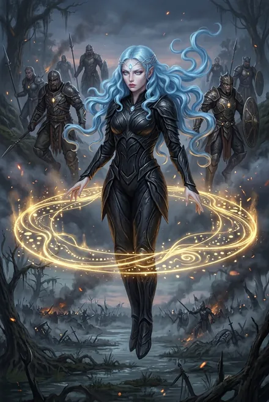{ loading=lazy }](../assets/portrety/100.webp)
  <figcaption><a href="../azimandiya/">Руна-Существо в Шевелящемся Доспехе</a> <small>ТБ-1 – ТБ-5</small></figcaption>
</figure>
<figure markdown="span">
  [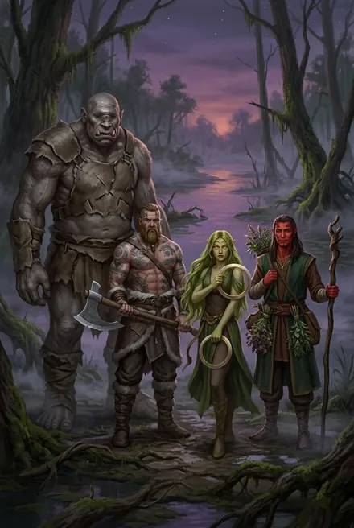{ loading=lazy }](../assets/portrety/101.webp)
  <figcaption><a href="../azimandiya/">Её Руны-Существа — свита</a> <small></small></figcaption>
</figure>

## Белый Дьявол / Дарующий Молнии / Пламени Подобный

<figure markdown="span">
  [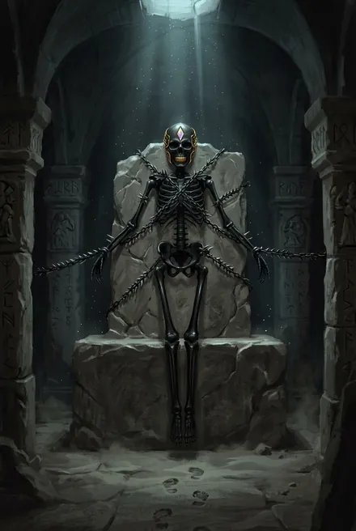{ loading=lazy }](../assets/portrety/062.webp)
  <figcaption><a href="../belyj_dyavol/">Чёрный скелет в склепе</a> <small>ЗК-1, гл. 6</small></figcaption>
</figure>
<figure markdown="span">
  [{ loading=lazy }](../assets/portrety/063.webp)
  <figcaption><a href="../belyj_dyavol/">Владыка Аммос при жизни (видения; SK-01, Интерлюдия; SK-07, гл. 5)</a> <small></small></figcaption>
</figure>
<figure markdown="span">
  [{ loading=lazy }](../assets/portrety/064.webp)
  <figcaption><a href="../belyj_dyavol/">В теле Марка, «осколок Единого»</a> <small>ЗК-8, гл. 17 — ЗК-9</small></figcaption>
</figure>
<figure markdown="span">
  [{ loading=lazy }](../assets/portrety/065.webp)
  <figcaption><a href="../belyj_dyavol/">Пламени Подобный в белом плаще-доспехе</a> <small>ЗК-10, гл. 3 — ЗК-11</small></figcaption>
</figure>
<figure markdown="span">
  [{ loading=lazy }](../assets/portrety/072.webp)
  <figcaption><a href="../belyj_dyavol/">Дарующий Молнии, владыка Эстэ (древность; видения в SK-03 и TB-04)</a> <small></small></figcaption>
</figure>
<figure markdown="span">
  [{ loading=lazy }](../assets/portrety/073.webp)
  <figcaption><a href="../belyj_dyavol/">Последний бой и склеп (падение Эстэ; SK-01, Интерлюдия «Белый Дьявол», гл. 6) — склеп</a> <small></small></figcaption>
</figure>
<figure markdown="span">
  [{ loading=lazy }](../assets/portrety/074.webp)
  <figcaption><a href="../belyj_dyavol/">Голос</a> <small>ЗК-1 – ЗК-6: бестелесный дух в теле Сигурда</small></figcaption>
</figure>
<figure markdown="span">
  [{ loading=lazy }](../assets/portrety/075.webp)
  <figcaption><a href="../belyj_dyavol/">Марк Кассиди («Мрак») до вселения (SK-01 – SK-06): тело-«наследство»</a> <small>ЗК-1 – ЗК-6</small></figcaption>
</figure>
<figure markdown="span">
  [{ loading=lazy }](../assets/portrety/076.webp)
  <figcaption><a href="../belyj_dyavol/">Однорукий изгой</a> <small>ТБ-1, гл. 1–9</small></figcaption>
</figure>
<figure markdown="span">
  [{ loading=lazy }](../assets/portrety/077.webp)
  <figcaption><a href="../belyj_dyavol/">Изгой со стигматом в культе; хейр Мертвой Рыбы</a> <small>ТБ-1, гл. 10–13</small></figcaption>
</figure>
<figure markdown="span">
  [{ loading=lazy }](../assets/portrety/078.webp)
  <figcaption><a href="../belyj_dyavol/">Рука отрастает; Аспект Холодное Пламя</a> <small>ТБ-1, гл. 14–18</small></figcaption>
</figure>
<figure markdown="span">
  [{ loading=lazy }](../assets/portrety/079.webp)
  <figcaption><a href="../belyj_dyavol/">Дикарь Ледяной Бездны</a> <small>ТБ-2, гл. 5–12</small></figcaption>
</figure>
<figure markdown="span">
  [{ loading=lazy }](../assets/portrety/080.webp)
  <figcaption><a href="../belyj_dyavol/">Гость Эргиаля</a> <small>ТБ-2, гл. 13–21</small></figcaption>
</figure>
<figure markdown="span">
  [{ loading=lazy }](../assets/portrety/081.webp)
  <figcaption><a href="../belyj_dyavol/">Рикс Каменных Луков, кинг Народа Теней-Молний</a> <small>ТБ-3 – ТБ-4; ТБ-5, гл. 1–6</small></figcaption>
</figure>
<figure markdown="span">
  [{ loading=lazy }](../assets/portrety/082.webp)
  <figcaption><a href="../belyj_dyavol/">«Тёмный Уголь», слуга под Чужим Лицом</a> <small>ТБ-5, гл. 7–14</small></figcaption>
</figure>
<figure markdown="span">
  [{ loading=lazy }](../assets/portrety/083.webp)
  <figcaption><a href="../belyj_dyavol/">Золотой Восходящий: Холодное Солнце</a> <small>ТБ-5, гл. 14–20</small></figcaption>
</figure>
<figure markdown="span">
  [{ loading=lazy }](../assets/portrety/084.webp)
  <figcaption><a href="../belyj_dyavol/">Аспекты, формы и оружие героя (отдельные промпты) — Холодное Пламя</a> <small></small></figcaption>
</figure>
<figure markdown="span">
  [{ loading=lazy }](../assets/portrety/085.webp)
  <figcaption><a href="../belyj_dyavol/">Аспекты, формы и оружие героя (отдельные промпты) — Холодное Солнце</a> <small></small></figcaption>
</figure>
<figure markdown="span">
  [{ loading=lazy }](../assets/portrety/086.webp)
  <figcaption><a href="../belyj_dyavol/">Аспекты, формы и оружие героя (отдельные промпты) — Воплощение Небесного Огня</a> <small></small></figcaption>
</figure>
<figure markdown="span">
  [{ loading=lazy }](../assets/portrety/087.webp)
  <figcaption><a href="../belyj_dyavol/">Аспекты, формы и оружие героя (отдельные промпты) — Игг-Феникс</a> <small></small></figcaption>
</figure>
<figure markdown="span">
  [{ loading=lazy }](../assets/portrety/088.webp)
  <figcaption><a href="../belyj_dyavol/">Аспекты, формы и оружие героя (отдельные промпты) — Драконий Клинок</a> <small></small></figcaption>
</figure>
<figure markdown="span">
  [{ loading=lazy }](../assets/portrety/148.webp)
  <figcaption><a href="../belyj_dyavol/">Архитектор</a> <small></small></figcaption>
</figure>
<figure markdown="span">
  [{ loading=lazy }](../assets/portrety/149.webp)
  <figcaption><a href="../belyj_dyavol/">Эсмерра</a> <small></small></figcaption>
</figure>
<figure markdown="span">
  [{ loading=lazy }](../assets/portrety/150.webp)
  <figcaption><a href="../belyj_dyavol/">Аур-Тален</a> <small></small></figcaption>
</figure>

## Говорящая-с-Травами

<figure markdown="span">
  [{ loading=lazy }](../assets/portrety/066.webp)
  <figcaption><a href="../govoryashchaya/">Говорящая-с-Травами</a> <small></small></figcaption>
</figure>

## Шон Макдональд

<figure markdown="span">
  [{ loading=lazy }](../assets/portrety/067.webp)
  <figcaption>Шон Макдональд <small></small></figcaption>
</figure>

## Майкл

<figure markdown="span">
  [{ loading=lazy }](../assets/portrety/068.webp)
  <figcaption>Майкл <small></small></figcaption>
</figure>

## Найра Эль-Кадис

<figure markdown="span">
  [{ loading=lazy }](../assets/portrety/070.webp)
  <figcaption><a href="../nayra/">Найра Эль-Кадис</a> <small></small></figcaption>
</figure>

## Дирк Кондор

<figure markdown="span">
  [{ loading=lazy }](../assets/portrety/071.webp)
  <figcaption><a href="../kondor/">Дирк Кондор</a> <small></small></figcaption>
</figure>

## Кейнор — Ледяной Кузнец

<figure markdown="span">
  [{ loading=lazy }](../assets/portrety/089.webp)
  <figcaption><a href="../kejnor/">Владыка Эргиаля в простом асари</a> <small>ТБ-2, гл. 13–16</small></figcaption>
</figure>
<figure markdown="span">
  [{ loading=lazy }](../assets/portrety/090.webp)
  <figcaption><a href="../kejnor/">Небесный Кузнец в черном хэлио с амулетом-снежинкой</a> <small>ТБ-2, гл. 17 – ТБ-5</small></figcaption>
</figure>
<figure markdown="span">
  [{ loading=lazy }](../assets/portrety/091.webp)
  <figcaption><a href="../kejnor/">Лед-кузнецы (Народ Эргиаля) — боевая звезда</a> <small></small></figcaption>
</figure>

## Эрин Ледяная Искра

<figure markdown="span">
  [{ loading=lazy }](../assets/portrety/092.webp)
  <figcaption><a href="../erin/">Дозорная в лед-доспехе</a> <small>ТБ-2, гл. 7–12</small></figcaption>
</figure>
<figure markdown="span">
  [{ loading=lazy }](../assets/portrety/093.webp)
  <figcaption><a href="../erin/">В Чертогах: голубое асари, распущенные волосы</a> <small>ТБ-2, гл. 13 – Эпилог</small></figcaption>
</figure>

## Морвейн кель'Талас (Морвена)

<figure markdown="span">
  [{ loading=lazy }](../assets/portrety/094.webp)
  <figcaption><a href="../morvejn/">Морвена, «живой труп» в Вечности</a> <small>ЗК-5, гл. 12–14</small></figcaption>
</figure>
<figure markdown="span">
  [{ loading=lazy }](../assets/portrety/095.webp)
  <figcaption><a href="../morvejn/">Новое живое тело</a> <small>ТБ-1, гл. 4</small></figcaption>
</figure>
<figure markdown="span">
  [{ loading=lazy }](../assets/portrety/096.webp)
  <figcaption><a href="../morvejn/">Руна Пламени Подобного: тёмно-синее асари, Знак Трёх Молний, Воющий Кувшин</a> <small>ТБ-1, гл. 16 – ТБ-4</small></figcaption>
</figure>
<figure markdown="span">
  [{ loading=lazy }](../assets/portrety/097.webp)
  <figcaption><a href="../morvejn/">Золотая хранительница кель-рода Талас</a> <small>ТБ-5, гл. 6–19</small></figcaption>
</figure>
<figure markdown="span">
  [{ loading=lazy }](../assets/portrety/098.webp)
  <figcaption><a href="../morvejn/">Сосуд Янтандера</a> <small>ТБ-5, гл. 20</small></figcaption>
</figure>

## Провидица — Ида Сторн

<figure markdown="span">
  [{ loading=lazy }](../assets/portrety/102.webp)
  <figcaption><a href="../providica/">основной облик</a> <small></small></figcaption>
</figure>

## Каласса Огненная-как-Ветер

<figure markdown="span">
  [{ loading=lazy }](../assets/portrety/103.webp)
  <figcaption><a href="../kalassa/">Вызов на фионтар: маска и рунная броня</a> <small>ТБ-3, гл. 6</small></figcaption>
</figure>
<figure markdown="span">
  [{ loading=lazy }](../assets/portrety/104.webp)
  <figcaption><a href="../kalassa/">Знаменосец кинга в найткоже; рикс</a> <small>ТБ-3, гл. 8 – ТБ-4</small></figcaption>
</figure>

## Найтфир (Ночной Страх) — Королева Снов

<figure markdown="span">
  [{ loading=lazy }](../assets/portrety/105.webp)
  <figcaption><a href="../najtfir/">Посланница в найткоже и маске из лунного камня</a> <small>ТБ-3, гл. 14 – ТБ-4, гл. 1</small></figcaption>
</figure>
<figure markdown="span">
  [{ loading=lazy }](../assets/portrety/106.webp)
  <figcaption><a href="../najtfir/">Невеста кинга</a> <small>ТБ-4, гл. 2 и далее</small></figcaption>
</figure>

## Народ Теней / Народ Молний — вожди и знать (ТБ-3…ТБ-4)

<figure markdown="span">
  [{ loading=lazy }](../assets/portrety/107.webp)
  <figcaption><a href="../narod_tenej/">Шелковая Тень</a> <small></small></figcaption>
</figure>
<figure markdown="span">
  [{ loading=lazy }](../assets/portrety/108.webp)
  <figcaption><a href="../narod_tenej/">Шепот-в-Ночи</a> <small></small></figcaption>
</figure>
<figure markdown="span">
  [{ loading=lazy }](../assets/portrety/109.webp)
  <figcaption><a href="../narod_tenej/">Острый-как-Шип</a> <small></small></figcaption>
</figure>
<figure markdown="span">
  [{ loading=lazy }](../assets/portrety/110.webp)
  <figcaption><a href="../narod_tenej/">Коготь-как-Серебро</a> <small></small></figcaption>
</figure>
<figure markdown="span">
  [{ loading=lazy }](../assets/portrety/111.webp)
  <figcaption><a href="../narod_tenej/">Режущий Руны</a> <small></small></figcaption>
</figure>
<figure markdown="span">
  [{ loading=lazy }](../assets/portrety/152.webp)
  <figcaption><a href="../narod_tenej/">Иниэсс</a> <small></small></figcaption>
</figure>
<figure markdown="span">
  [{ loading=lazy }](../assets/portrety/153.webp)
  <figcaption><a href="../narod_tenej/">Сторм</a> <small></small></figcaption>
</figure>
<figure markdown="span">
  [{ loading=lazy }](../assets/portrety/154.webp)
  <figcaption><a href="../narod_tenej/">Аурвак</a> <small></small></figcaption>
</figure>
<figure markdown="span">
  [{ loading=lazy }](../assets/portrety/155.webp)
  <figcaption><a href="../narod_tenej/">Форель</a> <small></small></figcaption>
</figure>

## Орин Огненный Клинок

<figure markdown="span">
  [{ loading=lazy }](../assets/portrety/112.webp)
  <figcaption><a href="../orin/">Непобедимый чемпион Арены в морлиуме</a> <small>ТБ-1, гл. 18</small></figcaption>
</figure>
<figure markdown="span">
  [{ loading=lazy }](../assets/portrety/113.webp)
  <figcaption><a href="../orin/">Без доспеха, брат</a> <small>ТБ-1, гл. 18</small></figcaption>
</figure>

## Сатори «Морская Роза» и Осьминог

<figure markdown="span">
  [{ loading=lazy }](../assets/portrety/114.webp)
  <figcaption><a href="../satori/">1</a> <small></small></figcaption>
</figure>
<figure markdown="span">
  [{ loading=lazy }](../assets/portrety/115.webp)
  <figcaption><a href="../satori/">2</a> <small></small></figcaption>
</figure>
<figure markdown="span">
  [{ loading=lazy }](../assets/portrety/116.webp)
  <figcaption><a href="../satori/">основной облик</a> <small></small></figcaption>
</figure>

## Тысяча Братьев (и Сестёр) — общий файл

<figure markdown="span">
  [{ loading=lazy }](../assets/portrety/117.webp)
  <figcaption><a href="../tysyacha_bratev/">основной облик</a> <small></small></figcaption>
</figure>
<figure markdown="span">
  [{ loading=lazy }](../assets/portrety/118.webp)
  <figcaption><a href="../tysyacha_bratev/">основной облик</a> <small></small></figcaption>
</figure>
<figure markdown="span">
  [{ loading=lazy }](../assets/portrety/119.webp)
  <figcaption><a href="../tysyacha_bratev/">основной облик</a> <small></small></figcaption>
</figure>
<figure markdown="span">
  [{ loading=lazy }](../assets/portrety/123.webp)
  <figcaption><a href="../tysyacha_bratev/">Черное Крыло</a> <small></small></figcaption>
</figure>

## Моргейн — Владычица Путей и Порталов

<figure markdown="span">
  [{ loading=lazy }](../assets/portrety/120.webp)
  <figcaption><a href="../morgejn/">Владычица Путей (древность; память героя и Кейнора)</a> <small></small></figcaption>
</figure>
<figure markdown="span">
  [{ loading=lazy }](../assets/portrety/121.webp)
  <figcaption><a href="../morgejn/">Останки в Кургане</a> <small>ТБ-5, гл. 18</small></figcaption>
</figure>
<figure markdown="span">
  [{ loading=lazy }](../assets/portrety/122.webp)
  <figcaption><a href="../morgejn/">Моргейн в теле Илианы кель'Саар</a> <small>ТБ-5, гл. 18–20</small></figcaption>
</figure>

## Предатель — Арвейн Размыкатель

<figure markdown="span">
  [{ loading=lazy }](../assets/portrety/124.webp)
  <figcaption><a href="../arvejn_predatel/">основной облик</a> <small></small></figcaption>
</figure>
<figure markdown="span">
  [{ loading=lazy }](../assets/portrety/125.webp)
  <figcaption><a href="../arvejn_predatel/">Аспект Разделитель (крупно</a> <small></small></figcaption>
</figure>

## Дом Ноктис: Марисса Золотая Змея, Эверент, Онора и эрды Корпуса

<figure markdown="span">
  [{ loading=lazy }](../assets/portrety/126.webp)
  <figcaption><a href="../dom_noktis/">Кел-женщина</a> <small></small></figcaption>
</figure>
<figure markdown="span">
  [{ loading=lazy }](../assets/portrety/127.webp)
  <figcaption><a href="../dom_noktis/">Золотая Змея</a> <small></small></figcaption>
</figure>
<figure markdown="span">
  [{ loading=lazy }](../assets/portrety/128.webp)
  <figcaption><a href="../dom_noktis/">основной облик</a> <small></small></figcaption>
</figure>
<figure markdown="span">
  [{ loading=lazy }](../assets/portrety/129.webp)
  <figcaption><a href="../dom_noktis/">основной облик</a> <small></small></figcaption>
</figure>

## Кель-рода Курганов Янтандера: хранители, ключники, предки

<figure markdown="span">
  [{ loading=lazy }](../assets/portrety/130.webp)
  <figcaption><a href="../kel_roda_kurganov/">кель-страж</a> <small></small></figcaption>
</figure>
<figure markdown="span">
  [{ loading=lazy }](../assets/portrety/131.webp)
  <figcaption><a href="../kel_roda_kurganov/">Хранительница Саар (гл. 12–18)</a> <small></small></figcaption>
</figure>
<figure markdown="span">
  [{ loading=lazy }](../assets/portrety/132.webp)
  <figcaption><a href="../kel_roda_kurganov/">основной облик</a> <small></small></figcaption>
</figure>
<figure markdown="span">
  [{ loading=lazy }](../assets/portrety/133.webp)
  <figcaption><a href="../kel_roda_kurganov/">основной облик</a> <small></small></figcaption>
</figure>
<figure markdown="span">
  [{ loading=lazy }](../assets/portrety/134.webp)
  <figcaption><a href="../kel_roda_kurganov/">Итта</a> <small></small></figcaption>
</figure>
<figure markdown="span">
  [{ loading=lazy }](../assets/portrety/135.webp)
  <figcaption><a href="../kel_roda_kurganov/">Эйр-Талас</a> <small></small></figcaption>
</figure>
<figure markdown="span">
  [{ loading=lazy }](../assets/portrety/136.webp)
  <figcaption><a href="../kel_roda_kurganov/">Талар</a> <small></small></figcaption>
</figure>
<figure markdown="span">
  [{ loading=lazy }](../assets/portrety/137.webp)
  <figcaption><a href="../kel_roda_kurganov/">лже-Амарис</a> <small></small></figcaption>
</figure>

## Хранители Вечности (и их слуги)

<figure markdown="span">
  [{ loading=lazy }](../assets/portrety/139.webp)
  <figcaption><a href="../hraniteli/">основной облик</a> <small></small></figcaption>
</figure>
<figure markdown="span">
  [{ loading=lazy }](../assets/portrety/140.webp)
  <figcaption><a href="../hraniteli/">основной облик</a> <small></small></figcaption>
</figure>

## Псы Вечности — Небесный, Драконоборец, Всполох (Тэйлисс)

<figure markdown="span">
  [{ loading=lazy }](../assets/portrety/141.webp)
  <figcaption><a href="../psy_vechnosti/">основной облик</a> <small></small></figcaption>
</figure>
<figure markdown="span">
  [{ loading=lazy }](../assets/portrety/142.webp)
  <figcaption><a href="../psy_vechnosti/">основной облик</a> <small></small></figcaption>
</figure>
<figure markdown="span">
  [{ loading=lazy }](../assets/portrety/143.webp)
  <figcaption><a href="../psy_vechnosti/">основной облик</a> <small></small></figcaption>
</figure>
<figure markdown="span">
  [{ loading=lazy }](../assets/portrety/144.webp)
  <figcaption><a href="../psy_vechnosti/">основной облик</a> <small></small></figcaption>
</figure>

## Великие Караваны в ТБ-5: Обочина, Вешка, Подкова, Найра, Вейн

<figure markdown="span">
  [{ loading=lazy }](../assets/portrety/145.webp)
  <figcaption><a href="../karavanshchiki/">логово Мерзости</a> <small></small></figcaption>
</figure>
<figure markdown="span">
  [{ loading=lazy }](../assets/portrety/146.webp)
  <figcaption><a href="../karavanshchiki/">Пожиратель Костей (маска)</a> <small></small></figcaption>
</figure>
<figure markdown="span">
  [{ loading=lazy }](../assets/portrety/147.webp)
  <figcaption><a href="../karavanshchiki/">Истинный облик Всадника (Отрекшийся)</a> <small></small></figcaption>
</figure>
<figure markdown="span">
  [{ loading=lazy }](../assets/portrety/156.webp)
  <figcaption><a href="../karavanshchiki/">Обочина</a> <small></small></figcaption>
</figure>
<figure markdown="span">
  [{ loading=lazy }](../assets/portrety/157.webp)
  <figcaption><a href="../karavanshchiki/">Вешка</a> <small></small></figcaption>
</figure>
<figure markdown="span">
  [{ loading=lazy }](../assets/portrety/158.webp)
  <figcaption><a href="../karavanshchiki/">Подкова</a> <small></small></figcaption>
</figure>
<figure markdown="span">
  [{ loading=lazy }](../assets/portrety/159.webp)
  <figcaption><a href="../karavanshchiki/">Улитка</a> <small></small></figcaption>
</figure>

## Бабушка Яшма

<figure markdown="span">
  [{ loading=lazy }](../assets/portrety/151.webp)
  <figcaption><a href="../yashma/">основной облик</a> <small></small></figcaption>
</figure>

## Народы Круга Элтанир в цикле ТБ: риксы, кинги и спутники (кроме Теней)

<figure markdown="span">
  [{ loading=lazy }](../assets/portrety/160.webp)
  <figcaption><a href="../narody_tb/">Народ Теней (групповой портрет</a> <small></small></figcaption>
</figure>
<figure markdown="span">
  [{ loading=lazy }](../assets/portrety/161.webp)
  <figcaption><a href="../narody_tb/">Кел (Аммос), эталон</a> <small></small></figcaption>
</figure>

