# Галерея портретов

Персонажи «Звездной Крови» и «Тысячи Братьев» в разных обликах по книгам. Нажмите на картинку, чтобы открыть ее в полном размере, на подпись — чтобы перейти к досье.

Иллюстрации созданы нейросетью по описаниям из книг; это трактовка, а не официальный арт.

## Сигурд (Сигварт Морозов)

<figure markdown="span">
  [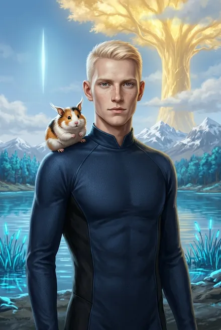{ loading=lazy }](../assets/portrety/001.webp)
  <figcaption><a href="../sigurd/">Колонист после падения</a> <small>ЗК-1, гл. 1–15</small></figcaption>
</figure>
<figure markdown="span">
  [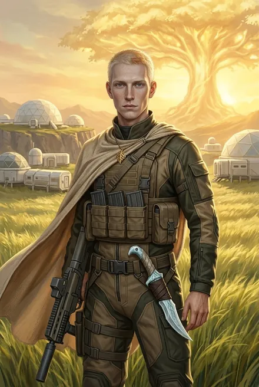{ loading=lazy }](../assets/portrety/002.webp)
  <figcaption><a href="../sigurd/">Фригольдер, ученик копья Динамита</a> <small>ЗК-1, гл. 16 — ЗК-2</small></figcaption>
</figure>
<figure markdown="span">
  [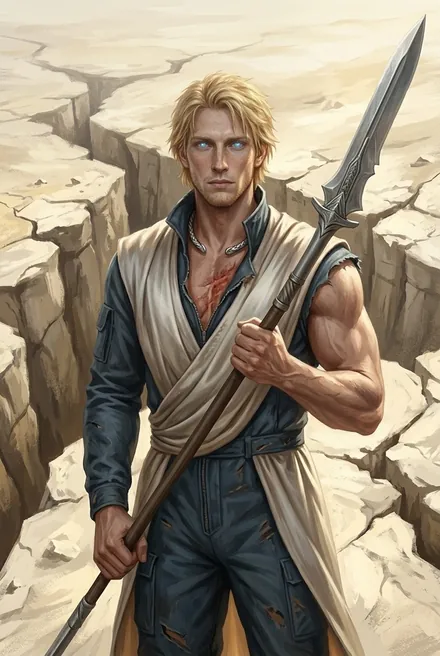{ loading=lazy }](../assets/portrety/003.webp)
  <figcaption><a href="../sigurd/">После Домена Азимандии: «очень крепкий мужчина» в одежде Кел</a> <small>ЗК-3</small></figcaption>
</figure>
<figure markdown="span">
  [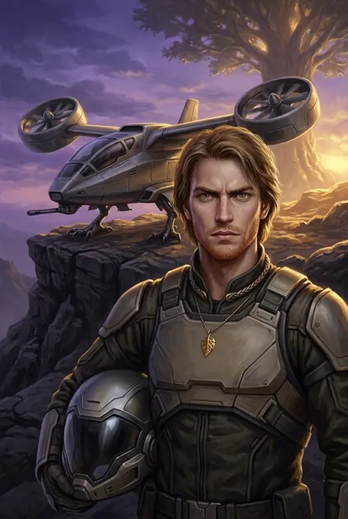{ loading=lazy }](../assets/portrety/004.webp)
  <figcaption><a href="../sigurd/">«Молодой волк», пилот «Грифона»</a> <small>ЗК-4</small></figcaption>
</figure>
<figure markdown="span">
  [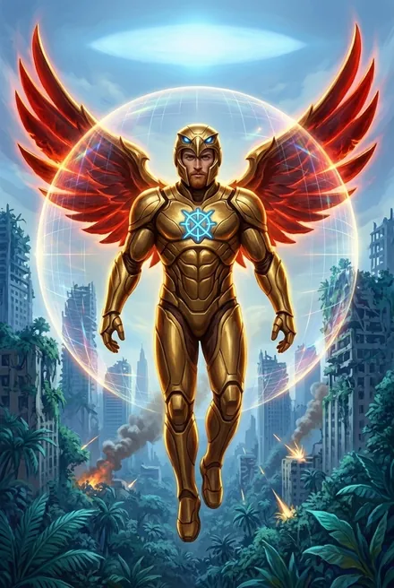{ loading=lazy }](../assets/portrety/005.webp)
  <figcaption><a href="../sigurd/">В доспехе Небесного Ястреба</a> <small>ЗК-5 — ЗК-9; конфискован в ЗК-10, гл. 1</small></figcaption>
</figure>
<figure markdown="span">
  [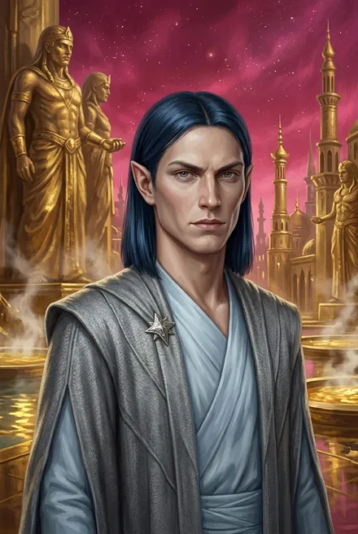{ loading=lazy }](../assets/portrety/006.webp)
  <figcaption><a href="../sigurd/">Отражение в Вечности «Звездный Флот»</a> <small>ЗК-5; ЗК-6, гл. 12–16; ЗК-8–ЗК-9 в Вечности</small></figcaption>
</figure>
<figure markdown="span">
  [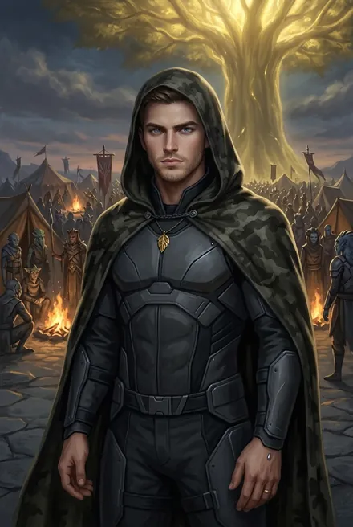{ loading=lazy }](../assets/portrety/007.webp)
  <figcaption><a href="../sigurd/">Серебряный Восходящий, «не Геракл, но Аполлон»; инкогнито</a> <small>ЗК-6</small></figcaption>
</figure>
<figure markdown="span">
  [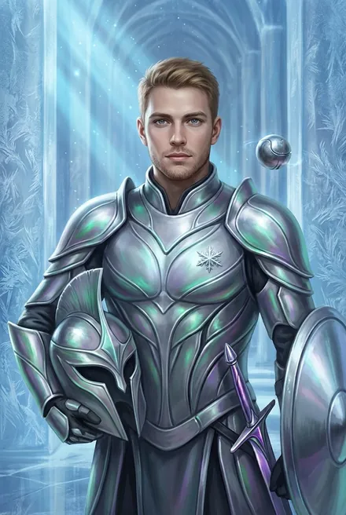{ loading=lazy }](../assets/portrety/008.webp)
  <figcaption><a href="../sigurd/">Командир в лед-доспехе Эргиаля</a> <small>ЗК-8, эпилог — ЗК-10</small></figcaption>
</figure>
<figure markdown="span">
  [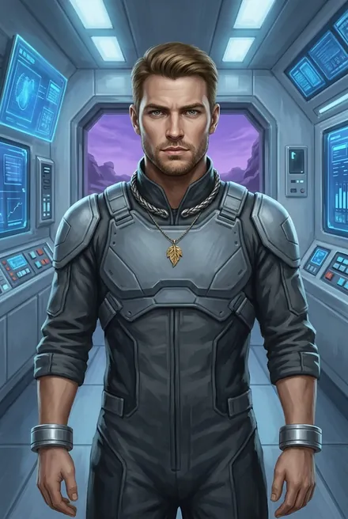{ loading=lazy }](../assets/portrety/009.webp)
  <figcaption><a href="../sigurd/">Анимафикация: черты Воглера</a> <small>ЗК-11</small></figcaption>
</figure>
<figure markdown="span">
  [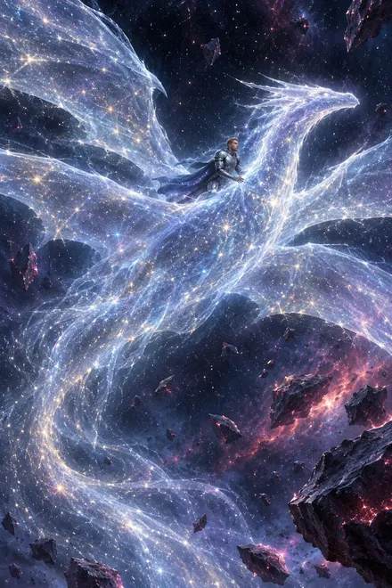{ loading=lazy }](../assets/portrety/010.webp)
  <figcaption><a href="../sigurd/">Дракон Звездного Света (Аспект; пробуждён SK-05, гл. 4)</a> <small></small></figcaption>
</figure>

## Травинка-на-Ветру (Адель Кассиди)

<figure markdown="span">
  [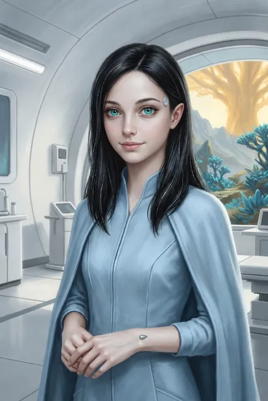{ loading=lazy }](../assets/portrety/011.webp)
  <figcaption><a href="../travinka/">Медком фригольда</a> <small>ЗК-1, гл. 19 — ЗК-3</small></figcaption>
</figure>
<figure markdown="span">
  [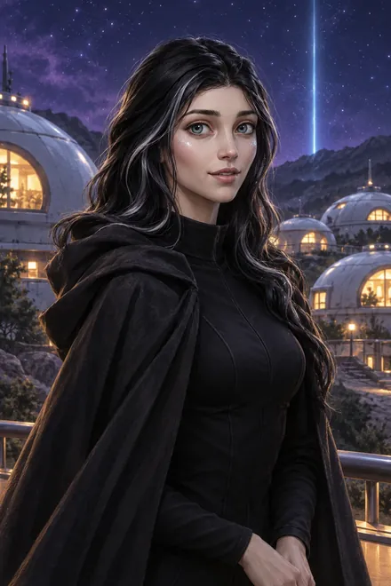{ loading=lazy }](../assets/portrety/012.webp)
  <figcaption><a href="../travinka/">Тайное свидание / вечер в «Виски»</a> <small>ЗК-2, гл. 9 — ЗК-4, гл. 3</small></figcaption>
</figure>
<figure markdown="span">
  [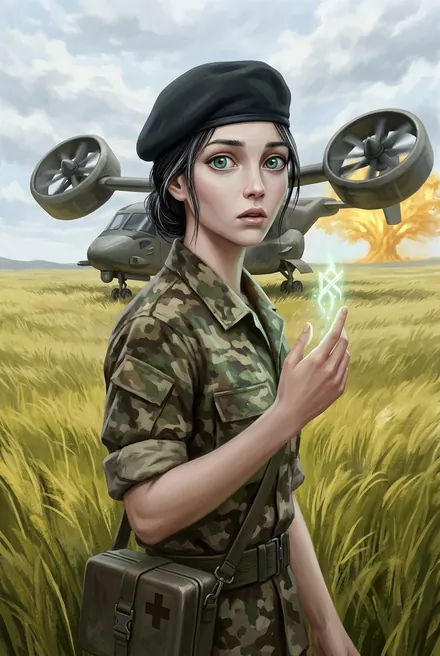{ loading=lazy }](../assets/portrety/013.webp)
  <figcaption><a href="../travinka/">Медик боевого копья</a> <small>ЗК-4, гл. 5 — ЗК-5</small></figcaption>
</figure>
<figure markdown="span">
  [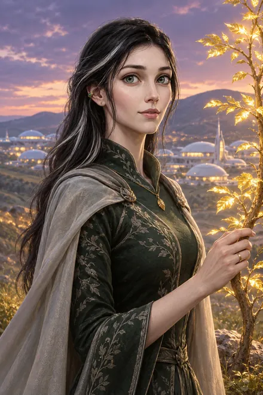{ loading=lazy }](../assets/portrety/014.webp)
  <figcaption><a href="../travinka/">Цветущая Восходящая, жена</a> <small>ЗК-6, гл. 26 — ЗК-11</small></figcaption>
</figure>

## Вероника «Ника» Максвелл

<figure markdown="span">
  [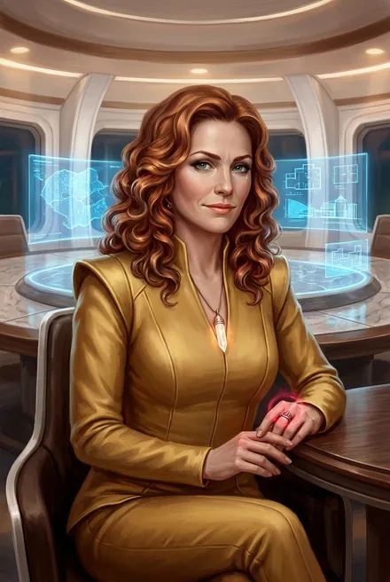{ loading=lazy }](../assets/portrety/015.webp)
  <figcaption><a href="../veronika/">Рикс в золотом комбинезоне</a> <small>ЗК-1, гл. 16 — ЗК-5</small></figcaption>
</figure>
<figure markdown="span">
  [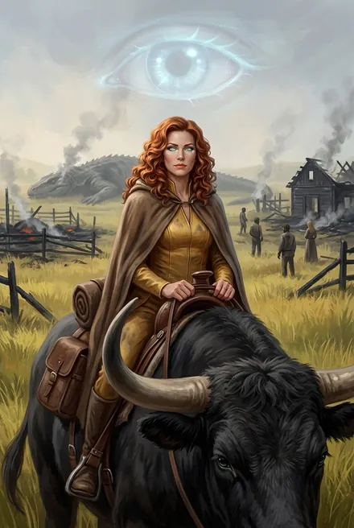{ loading=lazy }](../assets/portrety/016.webp)
  <figcaption><a href="../veronika/">В поле: серебряная Восходящая на тауро; Аспект-глаз</a> <small>ЗК-6</small></figcaption>
</figure>

## Винсент «Винс» Кассиди

<figure markdown="span">
  [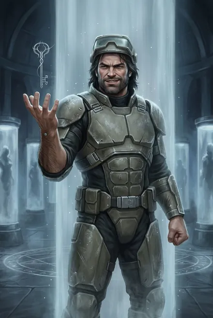{ loading=lazy }](../assets/portrety/017.webp)
  <figcaption><a href="../vinsent/">Пленник Колонны Безвременья</a> <small>ЗК-2, гл. 22 — ЗК-6, гл. 19</small></figcaption>
</figure>

## Белый Дьявол / Дарующий Молнии / Пламени Подобный

<figure markdown="span">
  [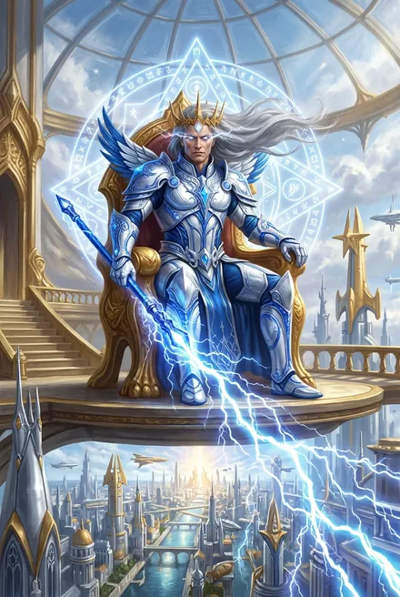{ loading=lazy }](../assets/portrety/072.webp)
  <figcaption><a href="../belyj_dyavol/">Дарующий Молнии, владыка Эстэ (древность; видения в SK-03 и TB-04)</a> <small></small></figcaption>
</figure>

