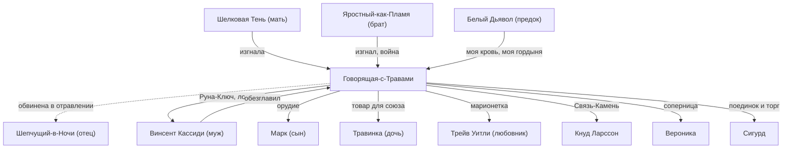

# Говорящая-с-Травами

## 1. Шапка

| | |
|---|---|
| **Имя** | Говорящая-с-Травами, коротко «Говорящая». Это имя для Восхождения, и оно не случайно: «Она Говорящая быть, она уметь такое. Имена не давать просто так…» (Юки, SK-03, гл. 5). Детское и настоящее имена не известны |
| **Прозвища** | «ведьма» (так её зовут во фригольде, SK-02, §4). «червивая ама» (Яростный-как-Пламя, SK-06, гл. 18). «червивая сестра», «червивая фламиника» (Тени, TB-03, гл. 5; TB-04, §10). «Буря моя» (муж, SK-06, гл. 21). «Мать» (Марк) |
| **Происхождение** | **Народ Теней**, высшая септа **Каменных Луков**. Дочь **Шепчущего-в-Ночи**: «последнего из тех, кого слушал весь Народ Теней» (SK-03, гл. 13), «последнего из кингов Народа Теней» (TB-03, гл. 6). Мать — **Шелковая Тень**, ментал-тенеходец и паучиха-интриганка (TB-03, гл. 7). Брат — **Яростный-как-Пламя**, рикс Каменных Луков (SK-03, гл. 13). Род владык с кровью Кел Аммоса, Дарующего Молнии (Белого Дьявола): «потомок „повелевающего кровью“» (SK-04, гл. 8) |
| **Роль** | Изгнанница, основательница земного фригольда «Небо» и его бессменная **фламиника** («вторая голова фригольда», SK-01, гл. 21). Жена первого рикса Винсента Кассиди, мать Марка и Травинки. Тайный **рунный мастер** (SK-05, гл. 19). Главный антагонист SK-04–06 |
| **Книги** | Действует в SK-01–SK-06. В SK-07–09 воспоминания и наследие. Упомянута в TB-01, TB-03, TB-04 |
| **Статус** | **Мертва.** Муж пробил ей средоточие Плоскостным Мечом и обезглавил на тинге (SK-06, гл. 23). Её стигмат «поглотил» проклятую Руну Кошмарной Рощи (гл. 24). Шелковая Тень говорит о ней «отправилась в Вечность» (TB-03, гл. 7) |

**Внешность кратко.** Нечеловеческая красота: точёное лицо, острые скулы и подбородок, заострённые уши, «сияющие, как два самоцвета, сине-зелёные миндалевидные глаза». Татуировка из сплетений трав и деревьев на висках, лбу, щеках, сбегает по шее. Тёмная мантия с капюшоном «очень необычного фасона», витой серебряный пояс, полные губы. «Красива резкой, экзотической, пугающей красотой», «королевское достоинство», «подавляющая харизма» (SK-01, гл. 21). Татуировки живые, они «меняли узор, двигались, как живые существа» в гневе (SK-04, гл. 16). Длинные чёрные волосы «тяжёлыми змеями», «яркие нефриты глаз» (SK-06, гл. 21). В темноте глаза «зло светятся» (SK-06, интерлюдия). Голос «тихий, но глубокий и вкрадчивый» (SK-01, гл. 21), «глубокий, волнующий» (SK-06, гл. 21). Глобиш знает в совершенстве, но с «необычной артикуляцией» (SK-01, гл. 21). Похожа на мать, Шелковую Тень (TB-03, гл. 7), и на Видящую-сквозь-Тьму (SK-03, гл. 11). С годами Травинка всё больше похожа на неё (SK-08, гл. 11).

---

## 2. Личность

- **Мышление категориями Народа и крови.** «Потребности Народа важнее, чем человеческие желания. Решают старшие, а младшие выполняют» (SK-04, интерлюдия «Фригольд»). Дочь — «Моя кровь и кровь моего мужа. Мне решать, как она будет жить» (там же). «Это дитя должно познать законы Народа Теней. Ибо её кровь священна» (SK-06, гл. 18).
- **Не землянка по психологии.** Травинка: «Понимаешь, Сигурд, она ведь не с Земли. У неё другая… психология. В Единстве имеет значение Слава и личная сила… кровь» (SK-04, гл. 4). Земные технологии считает «тупиковой ветвью развития» (SK-05, интерлюдия 1). Свою дочь видит «собственностью», «потому что была рождена в Единстве и воспитана по иным законам» (там же).
- **Терпеливая интриганка.** План «рассчитан на годы и десятилетия», в конечном счёте на «власть над всем Народом Теней» (SK-06, гл. 18). Через сына хотела получить власть во фригольде, через дочь — над септами (SK-03, гл. 13; SK-04, гл. 15). Использует людей, включая детей, мужа и любовника: «Любовь — не только глупый дурман… но грозное оружие» (SK-05, интерлюдия 1).
- **Отравительница и тайная убийца.** «Говорящая-с-Травами никогда не сражалась… но её недоброжелатели очень быстро исчезали. Кто-то… пропадал без вести, с другими происходили смертельные случайности, третьи подхватывали странные заболевания и сами приползали к фламинике, умоляя вылечить их» (SK-06, интерлюдия). Угрожает Сигурду: «Могу сделать так, что ты ослепнешь и сойдёшь с ума. Могу превратить тебя в гнильца» (SK-04, гл. 16).
- **Целительница.** Создаёт пилюли и препараты для Восхождения, лечит людей (SK-06, интерлюдия). У Портала в Шторме накладывает исцеляющую Руну на каждого раненого (SK-04, эпилог). Именно она лечила колонию «в первые годы»: «Очень многие обязаны ей жизнью» (Вероника, SK-06, гл. 1).
- **Уважает только силу.** Сигурда презирала, пока тот не приставил нож к её горлу: «Иногда кувшин нужно ударить, чтобы понять, из какого материала он сделан. Ты звучишь как металл» (SK-04, гл. 16). Винсент: «Она понимает только силу и очень… коварна» (SK-06, гл. 19).
- **Обида и гордыня.** «Мама… считает, что нас несправедливо обидели» (SK-04, гл. 4): фригольд не дал ей Титул рикса, хотя по Славе он полагался ей. Белый Дьявол о ней в последний миг: «О, моя кровь, моя гордыня» (SK-06, гл. 23). Унижение в фионтаре приводит её в ярость: «Нет ничего опасней униженной женщины!» (SK-06, гл. 22).
- **Любовь, которая умерла (или нет).** Винсент был «единственным, кого она уважала» (Травинка, SK-04, гл. 4). Она «до сих пор иногда зовёт его по ночам, во сне» (SK-04, гл. 9). Детям говорила, что он жив (SK-04, гл. 9). Сама же дала ему Ключ-ловушку (SK-06, гл. 19) и стала любовницей Трейва (SK-05). На тинге: «Здравствуй, бывший муж… время любви давно прошло. Лучше бы ты не возвращался…» (SK-06, гл. 21). Её холодный взгляд «ранил его сильнее клинка». Умирая, она смотрит на мужа «широко открытыми глазами… словно не веря, что он только что… убил её» (SK-06, гл. 23).
- **Мать-тиран, но мать.** Травинка помнит «её заботу, её любовь и ласку», общее горе после пропажи отца (SK-05, интерлюдия 1). Она бережёт дочь от смерти, хотя продаёт её: «Нет, Травинка нужна мне здесь» (SK-06, интерлюдия). На тинге, когда стрела уже готова, она кричит Марку «Быстрее! Убей их!» (SK-06, гл. 23). Это относится к Сигурду и дочери, раненой и закрывающей его.
- **Набожность Единства.** Призывает Единых: «Та-Кто-Закон рассудит» (SK-04, интерлюдия), «О, Творящая, если бы это слышал мой муж…» (там же), «Творящая распорядилась иначе» (SK-05, интерлюдия 1).

---

## 3. Речь

**Манера.** Властная, холодная, ядовитая. Притчи и метафоры: кувшин, звучащий металл, «малый дар истины», капля дерьма в блюде. Обращения: «дитя», «упрямое дитя», «дочь моя», «сын мой», «мой рикс» (Трейву), «глупец», «глупый землянин», «мальчик». В адрес других Народов презрительна («трусливые тенехваты, в сумерках крадущие чужих детей», SK-06, гл. 21). Насмешничает, но под угрозой умеет говорить мягко и вкрадчиво («Постой, мой рикс… Прошу, прояви мудрость и терпение…», SK-06, интерлюдия).

**Цитаты:**
1. «Имя для Восхождения очень подходит для моей дочери, ведь я сама его выбирала… Но я хотела бы, чтобы ты выбросил из головы Травинку и её имя. По крайней мере, пока не получишь своё!» (SK-01, гл. 21).
2. «Вы, безумцы, хотите дать гвоздь орудию чужой воли? Вырастить чужого зверя на погибель своего Народа?» (SK-04, интерлюдия «Фригольд»).
3. «И что ты сделаешь? Изгонишь меня… рикс⁈ Моих детей и моих людей тоже? Из дома, созданного нашими руками, в который тебя саму когда-то пригласили как доброго гостя?» — Веронике (там же).
4. «Иногда кувшин нужно ударить, чтобы понять, из какого материала он сделан. Ты звучишь как металл» (SK-04, гл. 16).
5. «Любовь — не только глупый дурман в голове и утоление голода тела, но грозное оружие. Запомни: женщина отворяет бёдра, чтобы заставить мужа принести нужные дары и говорить нужные слова» (SK-05, интерлюдия 1).
6. «Вот как? Твои желания, упрямое дитя, не имеют значения. Важна только… Звёздная Кровь» (SK-06, интерлюдия).
7. «Ты жалок настолько, что даже чрево жён отвергает твоё семя!» — брату Яростному (SK-06, гл. 18).
8. «Про… играла? Это вы все… проиграли, глупцы…» (SK-06, гл. 23).

---

## 4. Предыстория

### Происхождение и изгнание (версии расходятся)
| Версия | Источник |
|---|---|
| «Говорящая быть дочь рикса Каменных Луков… Говорить, она убить своего отца. Убить первого брата. Она хотеть стать риксом Народа Теней. Но **второй брат** остановить её, и Говорящая бежать!». Обвинили, потому что рикс и первый брат отравлены «тёмными Травами», а «все знать, что Говорящая ходить в тёмные земли, знать тёмные Травы» | Юки (слухи изгоев), SK-03, гл. 5 |
| «Она изгой, **отравившая отца и первого сына** тёмными Травами. Изгнавший её, **третий сын, Яростный-как-Пламя**, сейчас правит Каменными Луками» | Видящая-сквозь-Тьму под Гипнотизмом, SK-03, гл. 13 |
| Говорящая — «**старшая сестра** Яростного-как-Пламя» | TB-03, гл. 5 |
| «Именно **Шелковая Тень** сделала так, чтобы Говорящая-с-Травами навсегда покинула септу, ибо дочь была слишком похожа на мать и угрожала её планам». Шелковая Тень признаёт: «Да, мы были врагами», «И преследовала всю жизнь» | TB-03, гл. 7 |
| Шепчущий-в-Ночи «**якобы** отравлен дочерью „чёрными травами“» | TB-03, §4 |

*Итог.* Факт изгнания и обвинения в отравлении отца и брата бесспорны. Виновность Говорящей не доказана. Поздняя версия (TB-03) указывает на мать-интриганку как на подлинную силу за изгнанием. Расхождение «второй брат» (SK-03, гл. 5) против «третьего сына» (SK-03, гл. 13) можно списать на слухи Юки. «Старшая сестра» (TB-03) не противоречит: сестра старше Яростного.

### Земляне и Винсент
- **Встреча с Винсентом:** «А помнишь, как мы встретились, буря моя? Тоже дрались…» (SK-06, гл. 21).
- **Копьё:** входила в молодое бронзовое копьё Винсента с Ветром Равнин, Эйриком, Вероникой, Гаем Флоу и Кнутом (SK-07, гл. 15).
- **Основательница фригольда.** Изгнанница «показала землянам идеальное место для фригольда и научила основам Восхождения» (SK-09, гл. 7). «Это священное место землянам указала Говорящая-с-Травами» (TB-03, интерлюдия «Народ Теней»). «Одна из основательниц фригольда, она указала новое место для колонии и помогла встать Народу на ноги в первые годы» (Вероника, SK-06, гл. 1).
  - *Противоречие:* по Граю, место показали Люди Трав (SK-01, гл. 15).
- **Война с Каменными Луками.** Луки во главе с юным, только что получившим Титул Яростным пошли «покарать предательницу и очистить священное плато от чужаков». Фригольд её не выдал. «Кровавая битва», Луки «несколько циклов зализывали раны» и отступили (TB-03, интерлюдия; SK-09, гл. 7). По §12 разбора SK-09, это было на **2-м цикле** колонии.
- **Отказ от Народа.** Голос в SK-01: «она фламиника фригольда, но не вашей крови. Так бывает, когда Восходящего изгоняет его Народ. Или сам Восходящий отказывается от своего Народа перед лицом Единства, а потом вступает в другой» (SK-01, гл. 21). Во фригольде её отмечает интерфейс: «Народ: Земля, Фригольд Небо; Титул: фламиника; Ранг: серебро».
- **Брак и дети.** Жена Винсента. Сын Марк «телом пошёл в отца, но унаследовал мой ум», дочь — «моё молодое отражение с глупым сердцем своего отца» (SK-05, интерлюдия 1). Учила дочь, муж учил сына (SK-01, гл. 21). Закаляла детей Травами, зельями и пищей со Звёздной Кровью (TB-01, гл. 1; SK-04, интерлюдия: «я сама делала так»; SK-09, гл. 10). Сама выбрала дочери имя для Восхождения (SK-01, гл. 21). Ругала мужа за слишком раннюю инициацию дочери (SK-06, интерлюдия).
- **Разрыв с мужем.** «Когда вы начали взрослеть, у неё появились планы, которые я отверг» (Винсент, SK-06, гл. 19). Винсент хотел забрать Марка в своё копьё, «чтобы оторвать от матери». Тогда Говорящая дала ему **Руну-Ключ в «Серебряный Замок» Азимандии**: «Это была ловушка, доннерветтер!» (там же). Детям она говорила, что отец «вошёл в чужой Домен», «воспользовался тайной Руной» и жив (SK-02, гл. 9; SK-04, гл. 9). Сигурду: «Мой муж действительно жив, есть способы определить это… оттуда не возвращаются, это верная смерть. А может, что-то похуже смерти…» (SK-04, гл. 16).
- **Выборы.** По закону Восхождения рикс — она: «Её Слава выше всех, потому что она рождена в Единстве». Но её не приняли как «чужую по крови», и Тени считали её предательницей, поэтому она не ездила на тинги (SK-04, гл. 9). Её «мягко оттеснили от руля» (SK-05, гл. 19). Риксом стала Вероника, а Говорящая осталась фламиникой «бессменно» (SK-06, гл. 27).
- **Отношения с Эйриком.** «Старый друг» (SK-04, §10), но «два огнезуба не уживутся в одной пещере» (Травинка, SK-04, гл. 9).

### Тайная подготовка переворота (до SK-01)
- **Связной с Тенями:** сын Марк, «Мрак-подобный-Пламени», ведёт переговоры с риксами септ и предлагает руку Травинки (SK-03, гл. 13; SK-06, гл. 17).
- **Кнуд Ларссон.** «Чуть меньше цикла назад» (к SK-05) через торговых посланников передала изгнанному Кнуту **Связь-Камень**, обещая месть и возвращение в обмен на роль её «тайной руки». Снабжала изгоев оружием, медикаментами и информацией через Марка. Цель — уничтожить Веронику и Майкла в Шторме, а выживших «спасти» вместе с Марком (SK-05, гл. 12). Порталы изгоев изготовила она, «тайный мастер, скрывающий секреты изготовления Рун даже от своего Народа» (SK-05, гл. 19). Через Трейва Уитли шло оружие производственного крыла (SK-06, гл. 26).
- **Рунные секреты** держала даже от сына, «чтобы использовать сына как послушное орудие» (TB-01, гл. 4). Фламиника по функции хранит «знания о Звёздной Крови и древнем мастерстве изготовления Рун», передавая их только избранным ученикам (SK-05, гл. 19).

---

## 5. Биография по книгам

### SK-01 «Звёздная Кровь»
- **Гл. 21.** Входит в смотровую медкома. Спрашивает Сигурда о яйце найтволка, требует приносить ей «ядро» звёздных тварей «вот здесь», прижимая руку к середине груди. Попрекает Сигурда гибелью Гая и потраченной ночницей: «ты должен побыстрее стать одним из нас, чтобы вернуть фригольду долг». У выхода передаёт Травы для Динамита и запрещает ему думать о дочери «пока не получишь своё».

### SK-02 «Фригольд»
- **Гл. 1–2.** Лэндо описывает её как «старую Восходящую-целительницу из Народа Теней, изгоя для своих» и предупреждает, что она не терпит ухажёров дочери. Её пилюли восстанавливают Кровь (§6).
- **Гл. 5.** У Динамита «особые указания» от Говорящей насчёт Хладноцветов, которые трогать запрещено.
- **Гл. 9.** «Мечтает выдать [дочь] за какого-нибудь рикса»: «Подожди, Травинка, наступит время — и ты выберешь любого мужа…».

### SK-03 «Земли Теней»
- Заочно: рассказы Юки и Видящей о её изгнании и политических планах (гл. 5, 13). Коготь подозревает в Сигурде «подсыла Говорящей-с-Травами» (интерлюдия «Видящая»).

### SK-04 «Одиссей»
- **Интерлюдия «Фригольд».** Опознаёт Юки по татуировкам: изгой Серых Шипов, найдёныш, «трэль, сменившая трёх хозяев», память стёрта недавно. Опознаёт чёрную Траву **Кукольник**: «растёт на могильниках, оживляет мертвецов… Иногда её сажают в определённых местах и тайно подкармливают, чтобы охранять скрытое». Уверена, что Сигурду помогла «чужая, сильная воля». Против стигмата для него. Требует не трогать её дочь и угрожает Веронике.
- **Гл. 2–4.** Её шпионка **Сильви** (Пикси, серебряная Руна-Существо) следит за дочерью и подстраивает срыв свидания, разъярив тауро.
- **Гл. 10.** Ультимативно требует вернуть дочь, Травинка отказывается.
- **Гл. 11.** Её пилюли: розовая (+6 капель ЗК), голубая (+10), обе удваивают регенерацию.
- **Гл. 12.** Её легенда (в пересказе Травинки) о столице Круга, где правил изгнанный Вечностью «небесный Восходящий», копивший силу для мести, и о воителях Вечности, уничтоживших город за один день.
- **Гл. 15–16.** Усыпляет дочь. Сигурд, ведомый Белым Дьяволом, приставляет хазак к её горлу над пропастью. Она отвечает растительными плетями и серебряной Скрижалью, затем выпускает **Аспект — огромную змею-анаконду**. Допрашивает: «Кто твой хозяин?» — «Тот же, кто держал нож у твоего горла». В её глазах страх. Смена тона: «Ты звучишь как металл». Торг: стань Восходящим, соверши Подвиг, принеси золотую Руну или Предмет, и «я сама вложу руку своей дочери в твою». На встречное предложение «верну твоего мужа»: «Мой муж вошёл в Серебряный Замок, можешь поискать его там». От Клятвы уклоняется: «Поговорим о Клятвах, когда ты станешь настоящим Восходящим». Уносит дочь Руной перемещения в свой Домен (цветущий луг): «Помни о нашем договоре, Сигурд…».
- **Гл. 23–24.** Когда Небесный Ястреб громит рейд, открывает **Портал** и выводит людей как «спасительница».
- **Эпилог.** У фиолетового Портала лечит раненых, всматриваясь в лица. Марк: «Тела рикса нет». Она: «Я больше не слышу его», то есть Кнута через Связь-Камень (SK-04, §10; SK-05, гл. 12). «Звёздная Кровь важнее». — «Мертвецам не нужны Руны… Ведь это наш Народ, сын мой».

### SK-05 «Вечность»
- **Интерлюдия 1.** На похоронах: «Хватит верить в чудеса, люди… Они — мертвы. И вы должны отпустить их!». Новый рикс — Трейв, её **любовник и марионетка**. Знаменосцы — Серена и Марк. Отпускает Лэндо «с недоброй улыбкой»: «Он поплатится за свою дерзость». Дочь застаёт её с Трейвом, ссора, пощёчина, обещание найти мужа на тинге: «И будешь благодарить, когда станешь такой же, как я».
- **Интерлюдия 2.** Не идёт за дочерью к Эйрику сама. Эйрик говорит: «Мы говорили с ней».
- **Гл. 12, 19.** Через душу Кнута и допрос в Домене Тория раскрыты её роли: Связь-Камень и Порталы.

### SK-06 «Тинг»
- **Гл. 8.** Предлагала кингу Трав руку Травинки для любого из трёх сыновей в обмен на союз. Тот отказал.
- **Интерлюдия «Травинка».** У Храма: «Даже если в твоей Скрижали чужое золото, это тебе нужно бояться, потому что нить твоей судьбы в наших руках» (Веронике). Дочери: «Твои желания, упрямое дитя, не имеют значения». Ночью усыпляет лагерь, опутывает его **Железным Вьюном**, руководит убийствами: «Забери его Руны… Где Максвелл?», «Они не мертвы и не живы. Я заберу их тела в Домен… Жалкие пустышки, но нам пригодятся их гвозди… Пока не убивай их, пусть сначала всё расскажут». Дочь оставляет при себе.
- **Гл. 17–18.** Предлагает Когтю-как-Серебро «непокорный дар», дочь: «Союз, Клятву и кровь. А также немного истины» — голову Сигурда как «малый дар». План: Коготь свергнет Каменные Луки, их признают «династией» будущих детей Травинки при регенте, связанном Клятвой Говорящей. Яростный в облике телохранителя срывает торг: «Дорого ли продаёт кровь Каменных Луков эта червивая ама?». Она в ответ: «чрево жён отвергает твоё семя!». Её рунная ловушка из чёрных корней убивает **Рэнди**, когда Сигурд выкрадывает Травинку.
- **Гл. 20–21.** На тинге обвиняет Тени в похищениях. Против обвинений дочери: «Слова моей дочери не пусты, они наполнены чужим ядом… Ей заставили сказать эту ложь». Сигурда называет «жалкой маской», давним орудием Теней. Узнав мужа: «Здравствуй, бывший муж». Отрицает его Титул: «Он больше не рикс Народу, не отец детям и не муж мне». Вместо бронзового Трейва сама выходит на фионтар: «Это… моё дело».
- **Гл. 22. Фионтар с мужем.** Клетка чёрных корней, болото, ядовитый туман, зелёные огни, кинжальная трава, хищные лианы. Ментальная Руна ужаса. **Звериная Стая**, **Обжигающий Взгляд**, **Чёрная Гниль** (разложение заживо). Муж отвечает пощёчиной Аспекта. Тогда она в бешенстве выпускает усиленную серебряную **Бурю-смерч** с молниями, **Иллиумовую Пыль** и **змею-Аспект**. Плоть её «могла становиться твёрдой, как железное дерево»: удары Экзо-Шейда оставляют лишь рубцы. Призывает **Белый Лотос**. Проигрывает «удару Кассиди».
- **Гл. 23.** Поверженная, применяет проклятую Руну **Кошмарной Рощи**: деревья-шипы с Железным Вьюном и цистами Червей рушат тингвеллир и защитный щит, по головам сыплются Черви. Лианами отнимает у Сигурда золотое Семя. Мужа опутывает и даёт Марку бить его кинжалом. Приказ: «Быстрее! Убей их!». Исцелённый дочерью Винсент пробивает ей средоточие («Скрижаль… треснула пополам») и обезглавливает её. Белый Дьявол Сигурду: «Она решилась перевернуть сферу, чтобы лишить властелина победы… О, моя кровь, моя гордыня» (гл. 23).
- **Гл. 24–25.** Иниэсс: «Где проклятая Руна?» — «Поглощена стигматом» (Винсент). Народ Древа требует золотую виру. В её Домене **Остров Трав** лежат опутанные Вьюном пленники, Семя их освобождает. Хижину на острове когда-то построил Винсент.
- **Гл. 26–27.** Её тело перевозят в её же Домене-«крипторе». В её покоях находят парный Связь-Камень, улику. Её место фламина занимает Минос. Её серебряная Руна «Голос Трав» помогает Травинке разбудить Семя.

### После смерти
- **SK-07.** Говорящая «умела делать Порталы, но секрет скрывала» (§6). Её Пикси Сильви Винсент отдаёт Эйрику, она сгорает в зелёном пламени у пещеры Пожирателя (гл. 3). Кристалл-сферу её Домена используют как транспорт войск (гл. 9), хранят в А-лаборатории под силовым полем (§7). Травинка «пытается заменить» её в лаборатории (гл. 3). Её Аспект в перечне Аспектов: «удушающая змея» (§6).
- **SK-08, гл. 11.** Её отражение в зеркальном Лабиринте: «красивая и опасная, как змея».
- **SK-08, гл. 16.** Остров Трав становится плантацией и лабораторией Травинки.
- **SK-09, гл. 7.** Гибель Яростного. Наследники древней крови Луков — её дети и внуки.
- **TB-01, гл. 4, 16.** Пламени Подобный в теле её сына: мать держала сына в неведении о Рунах. Морвейн — «не Травинка-на-Ветру и даже не Говорящая-с-Травами, её кровь куда гуще».
- **TB-03, гл. 5–7, 15.** Пламени Подобный объявляет себя её сыном и внуком Шепчущего-в-Ночи и занимает престол Луков. Шелковая Тень, её мать, «готова забыть старые распри». Кошмарная Роща на тинге упомянута как образец «подобной мерзости» эмиссаров Червей.
- **TB-04, гл. 1.** Шелковая Тень — «мать Говорящей-с-Травами и бабушка его собственного тела».

---

## 6. Способности

**Ранг.** «Сильное серебро» (голос, SK-01, гл. 21). «Очень сильное серебро» (Травинка, SK-06, интерлюдия). «Сильнейшая Восходящая колонии» (SK-05, §4). Её Слава выше всех во фригольде (SK-04, гл. 9). Скрижаль серебряная (SK-04, гл. 16).

**Аспект.** Огромная призрачная **змея-анаконда**. Её касания «совсем не призрачные», она душит кольцами (SK-04, гл. 16; SK-06, гл. 22).

**Руны и умения**, по словам Травинки (SK-06, интерлюдия) и по боям:
- искать и призывать сильные Травы; «говорить с растениями и животными»;
- «делать дерево крепче железа», «прокладывать лёгкие пути»;
- **растительные яды** от усыпляющих и парализующих до мгновенно смертельных, а также противоядия и очищение;
- **Белый Лотос**, **Звериная Стая**, **Иллиумовая Пыль**, **Корни** (клетка-капкан из чёрных корней, применялась против Динамита, Рэнди, Винсента, Сигурда, SK-06, гл. 23), «превращать траву в ножи»;
- **Буря-смерч** (усиленное серебро), **Обжигающий Взгляд**, **Чёрная Гниль**, ментальная Руна ужаса, болото, ядовитый туман, зелёные огни (SK-06, гл. 22);
- **Кошмарная Роща**: проклятая Руна, вероятно оружие адептов Червей. Однажды, преследуя ассасинов Теней, она «мгновенно вырастила огромную отравленную рощу» (Вероника, SK-06, интерлюдия);
- **Железный Вьюн** («могильная колючка»): Чёрная Трава, «выведена как оружие против Восходящих адептами Червей», парализует и блокирует мнемонические команды Скрижали (SK-06, интерлюдия);
- **Сильви**: Пикси, серебряная Руна-Существо, невидимая шпионка, не может далеко отлетать от хозяйки (SK-04, гл. 3, 9);
- **Голос Трав**: серебряная Руна, будит семена (SK-06, гл. 27; SK-08, гл. 16);
- исцеляющие Руны (SK-04, эпилог); усыпление (SK-04, гл. 15); Руна перемещения в Домен (SK-04, гл. 16);
- **твердеющая плоть**, «как железное дерево» (SK-06, гл. 22);
- **Рунное Искусство**: изготовила Порталы для Кнута (SK-05, гл. 19). Умела делать Порталы (SK-07, §6). Открывала Портал для эвакуации рейда (SK-04, гл. 23). Создала рунную ловушку (SK-06, гл. 18);
- **Связь-Камень**, парный с камнем Кнута (SK-05, гл. 12; SK-06, гл. 26);
- **Домен «Остров Трав»**: «старая Руна, которая досталась маме в наследство» (SK-06, гл. 6). «Крошечный начальный Домен», «каменный остров, треугольник тверди, подвешенный в пространстве», с футбольное поле, заросший серо-жёлтыми травами, с хижиной Винсента и небольшой плантацией (SK-06, гл. 25). В SK-04 он виден как «бесконечный цветущий луг» (SK-04, гл. 17; §7);
- знание «древностей нашего Круга» (SK-02, гл. 9). Знание Чёрных Трав, например Кукольника (SK-04, интерлюдия). Чтение рода по татуировкам Теней (там же). Изготовление пилюль для Восхождения (SK-03, гл. 5; SK-04, гл. 11).

---

## 7. Отношения

- **Винсент.** Любовь, начавшаяся с драки. «Отличный тандем». Разрыв из-за будущего детей. Ловушка Ключом, фионтар, смерть от его руки.
- **Марк.** Её «ум» в теле отца, исполнитель и убийца. Она держала его в неведении о Рунах. Посылала к Теням. Он её последняя опора на тинге.
- **Травинка.** «Моё молодое отражение». Ценная фигура в династической игре. Шпионила за ней, похищала её, продавала. Но в бою дочь не убила и требовала оставить её в живых, пока не настал последний миг на тинге. Дочь унаследовала её Голос Трав и Остров Трав.
- **Трейв Уитли.** Любовник и «ручной рикс» (SK-05; SK-06, интерлюдия).
- **Кнуд Ларссон.** Бывший соратник по копью мужа, её «тайная рука» через Связь-Камень.
- **Вероника Максвелл.** Соперница с выборов. Говорящая организовала её «смерть» дважды: Ястреб Кнута, нападение у Древа.
- **Сигурд.** Сначала «случайная капля дерьма» и «мальчик», потом «металл». Подозревала в нём шпиона Теней. Договор о «выкупе» дочери. Враг на тинге.
- **Яростный-как-Пламя.** Брат. Изгнал её и воевал с её новым Народом. Его жёны «рожают мёртвых детей» (SK-03, гл. 13). Она мечтала свергнуть его руками Когтя (SK-06, гл. 18). Позже он погиб от Червей бездетным (SK-09, гл. 7).
- **Шелковая Тень.** Мать-соперница, «преследовала всю жизнь» (TB-03, гл. 7).
- **Коготь-как-Серебро, Видящая-сквозь-Тьму.** Партнёры по переговорам. Коготь её предал по Клятве «небесному господину» (SK-06, гл. 17–18). Видящая («первая мать») отвергла предложение Марка (SK-06, гл. 18).
- **Ветер Равнин.** Старый товарищ по копью. Ему она предлагала дочь, он отказал (SK-06, гл. 8).
- **Эйрик.** «Старый друг», нейтралитет. Укрыл от неё дочь.
- **Белый Дьявол / Пламени Подобный.** Её предок по линии Аммоса. В её последний бой он шепчет Сигурду: «О, моя кровь, моя гордыня». Позже живёт в теле её сына и пользуется её кровью как правом на престол.

---

## 8. Тайны, крючки, ограничения

### Открытые вопросы
2. **Откуда у неё оружие Червей** — Железный Вьюн и Кошмарная Роща? Была ли она связана с Червями или со Всадником, который через предателей-Теней посадил Семя Улья в Эстэ (TB-02, §1)? *(Предположение, канон молчит.)* Тени называют её «червивой», но это может быть просто бранью для изгнанников.
3. **«Особые указания» насчёт Хладноцветов** (SK-02, гл. 5).
4. **Остров Трав**: что за «наследство», от кого? Почему она не давала мужу развивать Домен (SK-06, гл. 6)?
5. **Знала ли она о Мико** и Ордене мужа? Ключ в Домен Азимандии мог быть выбран, чтобы избавиться от носителя драконьей Руны *(предположение)*.
6. **Душа.** Стигмат поглотил проклятую Руну (SK-06, гл. 24). Шелковая Тень говорит, что дочь «отправилась в Вечность» (TB-03, гл. 7). Что стало с её стигматом и Кровью: забрал ли Винсент, отдан ли он Храму? Встреча с ней в Вечности — возможный крючок.
7. **Её Руны после смерти.** Винсент «втянул выпавшие Руны» (SK-06, гл. 23). Голос Трав ушёл к Травинке, Сильви к Эйрику. Судьба Кошмарной Рощи, Бури и Иллиумовой Пыли неизвестна.
8. **Как она вошла в Народ Земли**: формальное отречение от Народа Теней «перед лицом Единства» (SK-01, гл. 21)?
