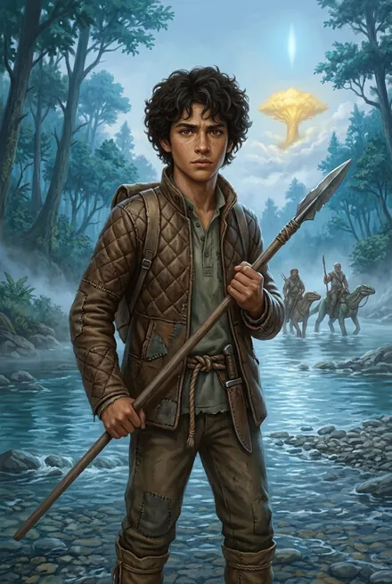
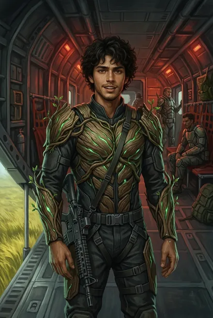

# Грай

| | |
|---|---|
| **Имя** | **Грай** (полного имени канон не даёт); «кудрявый латино» (ЗК-4, гл. 3; ЗК-5, эпилог) |
| **Происхождение** | Землянин-латино, **рождён в Единстве**: «Я здесь родился. И Рэнди тоже…» (ЗК-1, гл. 12); родился в поселении «на границе с Морем Трав», но не помнит его (ЗК-1, гл. 15). Мать — «невысокая полная латино лет сорока» во фригольде (ЗК-1, гл. 15; «Мать здесь…», ЗК-10, гл. 8) |
| **Роль** | Ученик на «испытательном сроке» в копье Гая Флоу/Марка (ЗК-1) → изгнан Мраком, конюх (ЗК-2) → боец копья Динамита (ЗК-4) → копья Сигурда, стрелок (ЗК-7–10) → новое копьё Динамита (ЗК-10) |
| **Книги** | ЗК-1 – ЗК-10 (в ЗК-3 нет; ЗК-11 — косвенно, «из копья Динамита») |
| **Ранг** | Не Восходящий → гвоздь на тинге: **дерево, 6-3-3** (Тело-Разум-Дух) (ЗК-6, интерлюдия «Травинка») → «среднее дерево» (ЗК-7, гл. 13) → «полноценная, хоть и слабенькая бронза» (ЗК-7, гл. 20) → бронза (ЗК-8, гл. 7) |
| **Статус на конец канона** | Жив; в копье Динамита; роман с поварихой Лю Минь |

---

## Облики на иллюстрациях

<figure markdown="span">
  [{ loading=lazy }](../assets/portrety/042.webp)
  <figcaption>Подросток из копья Гая <small>ЗК-1 — ЗК-2</small></figcaption>
</figure>
<figure markdown="span">
  [{ loading=lazy }](../assets/portrety/043.webp)
  <figcaption>Боец копья Сигурда, Древесный Доспех <small>ЗК-5 — ЗК-10</small></figcaption>
</figure>

Иллюстрации созданы нейросетью по описаниям из книг; это трактовка, а не официальный арт.

## Личность и речь

- **Добрый, открытый, болтливый.** Первый, кто помог Сигурду освоиться: объясняет ваал, Стрелы, Игг-Древа, кто такой Эйрик, советует пахучее масло от древожуков (ЗК-1, гл. 12–15). «Грай казался более-менее нормальным парнем» в копье Марка (ЗК-1, гл. 12). Любопытен: «у тебя еда есть? Земная? Дашь попробовать?» (там же).
- **Мягкосердечный.** Не смог добить раненого тауро: «Я не могу! Он живой… он смотрит…» — Мрак: «Грай, ты слабак! Ты не станешь Восходящим» (ЗК-1, гл. 13). Сигурд: «Трусом латино точно не был, просто Мрак кроил под себя» (ЗК-2, гл. 10).
- **Мечта о Восхождении:** «в поселении… никогда не станешь Восходящим. Я ведь сам напросился к Гаю» (ЗК-1, гл. 13).
- **Застенчив с женщинами:** о Лю Минь — «Она с Земли… такая… умная, красивая, а я-то местный…» (ЗК-8, гл. 7); «Муш… лен» (там же).
- **Домашний.** В ЗК-10 выбирает остаться: «Я бы… остался. Здесь… Мать здесь… и Лю Мин…» (гл. 8).
- **Слабости:** неопытен, «нервничающий» (ЗК-8, гл. 4), «зевающий» (ЗК-10, гл. 5); копьё «по привычке подтрунивало» (ЗК-8, гл. 7).

---

## Биография

- **ЗК-1, гл. 10–11.** Ученик копья Гая Флоу — третий поход, «испытательный срок» (гл. 13). Сигурд впервые видит его «молодого, лет семнадцати-восемнадцати темноволосого парня с прической, похожей на воронье гнездо»; Гай: «Грай, ты самый худенький, бери новичка вторым номером» (гл. 10). У брода Людей Реки замирает рядом с Сигурдом, «схватившись за копье» (гл. 10); когда Гай принимает фионтар, Грай «завороженно прошептал»: «Клятва Единству принята» (гл. 11). После гибели Гая хватает Сигурда за руку и сажает на свободного тауро; под обстрелом «Помогай!» — спрыгивает подобрать тело Гая; перед броском получает «Суворов» из раздачи оружия (гл. 11).
- **ЗК-1, гл. 12–15.** В пути — первый собеседник Сигурда: «Я здесь родился. И Рэнди тоже…» — Сигурд поражён, как давно падают капсулы; объясняет Стрелы, ваал, Игг-Древа, Эйрика, нордиек; учит мазать постель пахучим маслом от древожуков и ночниц. Не может добить раненого тауро — Мрак отдаёт нож Песчаному Змею и приговаривает: «Грай, ты слабак! Ты не станешь Восходящим. В следующий раз…» (гл. 13). У Южного Поста радуется: «Приехали, Сигурд. За ним уже — наши земли». В воротах фригольда его встречает мать (гл. 15).
- **ЗК-2, гл. 10.** Изгнан Мраком, работает конюхом; принимает у Сигурда тауро, предупреждает о засаде банды Рэнди и просится в копьё Динамита.
- **ЗК-4.** Взят Динамитом по рекомендации Сигурда, пока тот пропадал (гл. 3); ухаживает за тауро (гл. 18); в бою с Ястребом Лэндо на Речном Коне выхватывает его из-под удара (гл. 23).
- **ЗК-5.** Уходит с Динамитом в Шторм (интерлюдия «Травинка»; эпилог).
- **ЗК-6.** Гвоздь от Вероники в Храме Вечности — дерево 6-3-3 (гл. 12; интерлюдия); похищен ночной атакой Мрака, найден в Домене живым (гл. 25).
- **ЗК-7.** Помогает Грохоту с боепитанием; удар призрачной зелёной молнией Пожирателя — **кома** (гл. 4–5, 12); Руна **Древесный Доспех** (гл. 5); бронза Развития отложена для него (гл. 7); очнулся после гибели Пожирателя — «слабенькая бронза» (гл. 19–20).
- **ЗК-8.** Дозорный в Серебряном Замке; обморожение; влюблён в Лю Минь — Юки и Грохот подначивают (гл. 7); награда — Руна **Легкий Сон** (гл. 16).
- **ЗК-9.** Стрелок в рейде за Стену (гл. 4); Сигурд дарит ему бронзовое **Выслеживание** (гл. 10).
- **ЗК-10.** Летающий остров: гарпия-никси утаскивает его к краю, Сигурд и Кроу спасают; Жабник лечит звездной ночницей и слизняком (гл. 6). Отказывается от экспедиции в Альфу; переходит в **новое копьё Динамита** (гл. 8); приходит с ним в Либерти (гл. 22).

---

## Способности
Стрелок («Суворов»), обращение с тауро (конюх); Древесный Доспех, Легкий Сон, Выслеживание, Развития. Роль — стрелок второго эшелона, помощник «тяжёлого».

## Отношения
- **Сигурд** — друг с первого дня, рекомендатель в копьё.
- **Мрак** — бывший командир, презиравший его.
- **Рэнди, Свирель** — бывшие товарищи по копью Мрака, враги.
- **Лэндо** — спаситель (ЗК-4, гл. 23).
- **Динамит** — командир дважды.
- **Лю Минь** — повариха, бывший су-шеф ресторана «Мишлен» (ЗК-8, гл. 7), возлюбленная (ЗК-10, гл. 8).
- **Юки** — сводница; **Грохот** — шутливый покровитель.
