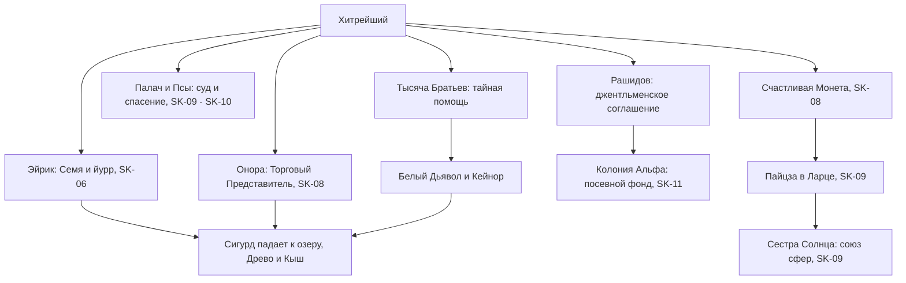

# Хитрейший (Хранитель Вечности, Хозяин Контракции)

| | |
|---|---|
| **Имена и титулы** | Хитрейший («Не люблю это имя», SK-08, гл. 9); «тот, что раньше звался Хитрейшим» (SK-03, интерлюдия «Хранители»); Хранитель Вечности; Хозяин / владыка / глава Контракции (SK-08, гл. 9–10); «бог торговли» (SK-09, пролог); «владыка тайн» (SK-06, гл. 14); «один из самых мерзких пауков Вечности» (Белый Дьявол, SK-08, гл. 2); «главный олигарх Вечности, по выходным изображающий нищего» (Сигурд, SK-09, гл. 16); «хитрая тварь», «ублюдок» (Палач, SK-09, гл. 19; SK-10, гл. 1); «старый торгаш» (TB) |
| **Природа** | Один из семи Хранителей Вечности, Восходящий ранга «небо», держатель Ключа Небесного Трона (SK-08, гл. 9; SK-09, пролог). По словам Олега Рашидова — **копия нейрограммы Рашидова**, «пережившая бездну времени» (SK-11, гл. 5) |
| **Происхождение** | Вечность (Хранители — создания Искуснейшего, «отражения величайших» предтеч, SK-09, интерлюдия); через Рашидова — земной проект «Космо»/«Стеллар» *(по Рашидову)* |
| **Сфера власти** | **Контракция** — монопольная торговая система Вечности; контрактории (включая «тёмных»/душеторговцев), Торговый Представитель/Бродячий Торговец, связь с Великими Караванами (SK-05, гл. 10; SK-06, гл. 14; SK-11, гл. 14) |
| **Роль** | Тайный кукловод линии Сигурда и землян: «ты фигура, он игрок» (Белый Дьявол, SK-10, гл. 3) |
| **Книги (SK)** | Упом.: SK-02, SK-05, SK-06; активно: SK-03 (интерлюдия), SK-06 (эпилог 2, неназванным), SK-08 (гл. 8–10, постскриптум от его лица), SK-09 (гл. 12–13, 19), SK-10 (гл. 1), SK-11 (гл. 5, 19). TB-02 (постскриптум), TB-03–TB-05 (через Торговца и упоминания) |
| **Статус на конец канона** | Действует; в SK-11 «вежливо грабит» Сигурда и напоминает о плате (SK-11, гл. 19) |

---

## 1. Природа и возможности

### 1.1. Хранитель
- **Семеро.** Хранители хранят Ключи Небесного Трона, созданные Тем-Кто-Искусен; по слухам, это «отражения лучших учеников Искуснейшего», предавшие его (SK-09, пролог). Пролог SK-09 ставит его вторым: «создателя Контракции — величайшей торговой паутины. Бог торговли многолик и непостоянен, ему служат даже те, кто не подозревает об этом, и нет существа богаче и могущественнее в Единстве и Вечности. Ему известны все секреты… Все можно купить, если дать правильную цену, — говорят контрактории» (SK-09, пролог).
- **Создание Искуснейшим.** В Саге Сестры Солнца семь золотых сгустков стоят перед Искуснейшим: «Вы — последние из Истинных… Я создал вас в нарушение запретов»; «Вы — отражения величайших из них [предтеч]» (SK-09, интерлюдия). Каждому сказано, чьё он эхо: «Ты… создал матрицы разума и глубже всех погрузился в тени» (там же). *Предположение (сильное):* это о Хитрейшем — у Рашидова программа нейрограмм («матрицы разума») и «эффект Рашидова-Шварц» — «дорога теней» (SK-10, гл. 16); см. также статья «Космология и история».
- **Сам о себе:** «Я говорил с ним [Искуснейшим] так же, как сейчас говорю с тобой» (SK-08, гл. 9). О Расколе: «тем, кто обвиняет нас в этом грехе [погашенное солнце], стоило бы вспомнить, что гасить и зажигать звезды под силу только Единым» (SK-08, гл. 9).
- **Ранг.** Небо: «аура небесного Восходящего едва ли не задавила» (о первой встрече, SK-08, гл. 9); его энергосигнатура «не считывается доступными методами» (SK-11, гл. 19).

### 1.2. «Копия нейрограммы» Рашидова
- **Утверждение Рашидова:** «Хитрейший — это моя копия… Меня, Олега Рашидова, вообще не было на ковчеге "Хельга". Как и тебя, Сигварта Морозова. Были только наши нейрограммы в базе данных… Так вот, Хитрейший — это такая же нейрограмма Олега Рашидова, как и я. Просто каким-то образом пережившая бездну времени» (SK-11, гл. 5).
- **Источник знания:** «Он сам мне сказал, представляешь?.. Да-да-да, я с ним встречался. И не один раз» (Рашидов, SK-11, гл. 5).
- **Внешнее сходство:** координатор Рашидов — «брат-близнец земного аватара Хитрейшего» лицом и голосом (SK-10, эпилог); «с лицом и улыбкой Хитрейшего» (SK-11, гл. 1); жесты — руки за спиной, «тот, что изображал нищего в золотых статуях Вечности» (SK-11, гл. 1). Отличие — «как между портретом и зеркалом» (SK-11, гл. 19).
- **Общие речевые маркеры:** «Воу-воу», «Бинго», «дружок» — у обоих (SK-08, гл. 9; SK-11, гл. 2, 5).
- **Как это возможно — не раскрыто.** Гипотезы Сигурда: Искуснейший использовал «старые исходники с Земли» или базу нейрограмм «первого ковчега» (SK-11, гл. 5). Рашидов о его отношении: «Он испытывает ко мне… что-то вроде ностальгии по давно утраченному» (SK-11, гл. 5).
- **Сам Хитрейший намекает на землян:** «Я выбрал отражение, чтобы ты понял, что я не враг тебе и твоему Народу. По правде говоря, я вас хорошо знаю. Не совсем я, но линии пространства, времени и событий скрестились так, что земляне мне… не совсем чужие. В отличие от многих кел, я знаю и помню, кто вы, откуда и зачем сюда пришли» (SK-08, гл. 10). «Мы когда-то были знакомы. По правде говоря, не совсем я и не совсем с тобой» (SK-08, гл. 9). Принимает облик «землянина-моно» и говорит с Сигурдом на его «родном языке, который и в колонии-то знали немногие» (SK-08, гл. 9).

### 1.3. Инструменты и способности (как показаны в тексте)
| Инструмент | Что делает | Источник |
|---|---|---|
| **Контракция** | Монопольная биржа Вечности в золотом столпе Золотого Города: гарант, витрина, платёжная система, обменник, доставка; комиссия ~10 %; кредиты с рунной меткой; защищённые апартаменты с шааром | SK-05, гл. 10; SK-09, гл. 12 |
| **Контрактории** | Слуги-торговцы: «одна сущность на тысячу лиц»; в Существо-контрактория Хитрейший может «шагнуть» сам — Существо «не могло даже выдержать его суть» | SK-08, гл. 6, 8 |
| **Статуя-нищий** | «Станция подзарядки» у входа в Контракцию: за 1 Монету — Кровь, временный Навык Мастерства Торговли (только внутри поста), полная синхронизация отражения; через статую — «проекция сознания через артефакт-якорь»: статуя подмигивает и даёт советы | SK-05, гл. 10; SK-09, гл. 12 |
| **Торговый Представитель Контракции** | Золотая Руна-Существо (глиф — торговец в капюшоне); Онора держала через неё связь с заказчиками; позволяет Хитрейшему «шагнуть» в мир; доступ к сети Контракции в обход Наблюдателя и без Славы (наценка 100 %, комиссия 1 Монета); разговор с хозяином — 10 000 Монет | SK-08, гл. 15, 19; SK-09, гл. 2 |
| **Счастливая Монета Контракции** | Золотая Руна-Предмет: бросок за 120 капель — случайная Руна «из запасов Контракции» или ничего; «наверняка даритель мог подкорректировать результат». Белый Дьявол: соглядатай, «Монета всегда отыграет своё с процентами» | SK-08, гл. 10, 19 |
| **Пайцза Хранителя** | Золотая Руна-Предмет (Привязка, Истинное Владение, Маскировка): «Владеющий этим предметом действует от лица и в интересах Хитрейшего… находится под его защитой»; неотчуждаема и невидима в Скрижали | SK-09, гл. 12 |
| **Время** | Останавливает/сжимает время: беседа длится «одну миллисекунду» для окружающих | SK-08, гл. 10 |
| **Иллюзии-«декорации»** | Луг с валуном, лагуна с двумя шезлонгами, стена над океаном, пещера с костром, мостик «Хельги» | SK-06, эпилог 2; SK-08, гл. 9 |
| **Анола** | Тропический портовый город с парусниками («века восемнадцатого»), созданный им в Вечности: «Некогда я создал ее»; «из этого мира не существует выхода» (по его словам; Сигурд считает это блефом) | SK-10, гл. 1 |
| **Власть над Скрижалями** | Снимает Печать Пустоты; сам открывает Скрижаль Сигурда и забирает Аграф | SK-08, гл. 10; SK-11, гл. 19 |
| **Души** | Вбирает душу Велиора Вортекса («золотая бабочка на цепи») во что-то на пальцах — «Кольцо?» | SK-10, гл. 1 |
| **Сферы** | Игровая сфера-доска, на которой он переставляет фигуры («корабль», «полководец», «дракон», «герой», «кузнец») | SK-08, постскриптум |
| **Оружие** | «У него никогда не было оружия. Он ставил совсем на другие вещи. Информация» | SK-08, постскриптум |

---

## 2. Личность, мотивация, цели, методы
- **Информация как капитал.** «Не без тщеславия он понимал, что является самым информированным существом Единства и Вечности, за исключением, быть может, лишь Того-Кто-Наблюдает» (SK-08, постскриптум). Миллионы сделок и секретов проходят через его паутину «сквозь реальность, время и сны» (там же).
- **Нищий-богач.** Сидит с чашей на ярусе торгового города: «чаша нищего должна быть пустой. Даже если этот нищий — самое богатое существо Единства и Вечности…» (SK-08, постскриптум). Место «напоминало о прошлом. И помогало думать» (там же).
- **Цель — Исток, но «поближе, чем другие».** «Мне хотелось бы… скажем так, быть поближе к этому процессу, чем другие» (SK-08, гл. 9). Тот, кто первым завладеет Истоком, «станет единственным ключом к будущему и сможет диктовать другим свою волю» (там же). Пропагандистская версия: получив Исток, Вечность освободит Единство от Храмов, стигматов и сбора душ — «Мы с тобой играем в одной сфере!» (там же).
- **Ставка на землян, не на «победителей».** «Тех, кто прибыл на небесном ковчеге из невообразимых бездн времени, тоже нельзя было недооценивать… Когда-то эту ошибку совершили их собственные враги — и поплатились всем… Он не поставил бы и одной Звездной Монеты на тех, кто уже считал себя победителями этой игры» (SK-08, постскриптум). Тот же рефрен — на совете Хранителей (SK-03, интерлюдия) и в SK-11, гл. 19.
- **Двойная игра с Тысячей.** Полководец обвиняет: «Ты пробудил их, свел вместе, обучил, дал оружие и помощь!.. Думаешь, никто не знает, как ты охотишься за секретами их гробниц? Может, хочешь его самого [Забытого] вернуть из-за Грани?» (SK-08, постскриптум). Палач: «Ты помогаешь пробудить Тысячу Братьев!» Его ответ: «Некоторые считают, что после того, как Защитник погиб, мы обязаны идти на… некоторые компромиссы» (SK-09, гл. 19). Сигурду он предлагает: «Пусть твой друг знает, что я даже готов поспособствовать в этом деле [возрождению Братьев]» (SK-08, гл. 9).
- **Не проигрывать «при любом исходе».** «Никто бы не поставил на тебя против нее даже одной Монетки, однако я… не люблю проигрывать. При любом исходе» (SK-08, гл. 10). Наслаждается гневом врагов: «Нескрываемая злость Полководца была настоящей амброзией… древнюю истину про сладкие слезы врагов» (SK-08, постскриптум).
- **Методы.**
  1. *Подстроенная беда + спасение + цена.* Ловушка Корпуса была «подстроена самим Хитрейшим, чтобы подцепить меня на крючок» (вывод Сигурда, SK-08, гл. 10); арест Псами — «он тщательно организовал ситуацию, в которой мы обязательно попали бы на разбирательство к Палачу» (SK-09, гл. 19); спасение — с конфискацией Рун у Палача «как частью платы» (SK-10, гл. 1).
  2. *Подарок с крючком.* Монета-соглядатай (SK-08, гл. 10, 19), Пайцза-клеймо (SK-09, гл. 12), золотая Перезарядка как намёк на дракона Кассиди (SK-10, гл. 1), Аграф Стойкого Разума «из личных запасов» — визитная карточка для Сестры Солнца (SK-09, гл. 13).
  3. *Посланник-фигура.* Сигурд с Пайцзой у Золотых Варваров — «предложение мира, союза, нейтралитета» Сестре Солнца; «Герой и торговец. Королева молний. Сестра Солнца — продано!» (SK-09, гл. 14).
  4. *Чужие руки.* Эйрик доставил Семя Игг-Древа и йурра (SK-06, эпилог 2); Онора — Торгового Представителя (SK-08, гл. 15); душеторговцы-заказчики «вероятно, даже не подозревая о своей роли» (SK-08, гл. 10).
  5. *Клятва с открытой датой.* «Отдашь мне то, о чем сам пока не знаешь. Тогда, когда я попрошу» (SK-08, гл. 9).
- **Отношение к правде.** Лекции полны полуправды; Кейнор: «правда, смешанная с ложью, ибо Хитрейший получил свое имя не просто так… Хитрейший часто дает надежду в долг, но платить за нее приходится истиной» (TB-04, гл. 17; то же — SK-11, гл. 17).

## 3. Речь
**Манера:** тон «доброго жулика» и ироничная галантность; вопросы вместо ответов; метафоры сфер и торга; бытовые земные словечки в устах небесного кел. Маркеры: «дружок», «мой герой», «герой», «друг мой», «Ой-вей», «Воу-воу, полегче!», «Бинго, дружок!», «Так-так-так», «К твоим услугам, герой», «Одна монета — один ответ», «моя леди/моя высокая госпожа» (издевательски — Палачу). Слова по слогам для нажима: «про-ва-ли-лась», «ни-че-го», «ин-стру-мент» (SK-08, гл. 9).

**Цитаты:**
1. «Я сейчас выдам тебе тайну Вечности, мой герой, но мы не можем» (SK-08, гл. 9).
2. «Отдашь мне то, о чем сам пока не знаешь. Тогда, когда я попрошу» (SK-08, гл. 9).
3. «Ты ведь и сам запретил себе помнить, Сигурд…» (SK-08, гл. 10).
4. «Леди во гневе просто прекрасна. Но злость мешает ей формулировать мысли» (Палачу, SK-09, гл. 19).
5. «Будь осторожнее с мертвыми именами. Ведь некоторые мертвы только потому, что кому-то так удобнее. А некоторые — потому что их слишком опасно будить» (SK-11, гл. 19).
6. «Скажи мне, капитан, на что ты способен ради твоих близких?.. дружба Вечности безгранична, но ее рука, так, между нами, лежит на горле каждого обитателя Единства» — «Угрозы — это к Палачу. По моей части — выгодные сделки» (SK-11, гл. 19).

---

## 4. Предыстория
- **Эпоха Искуснейшего.** Семь «последних Истинных» созданы «в нарушение запретов», им вручены Ключи (SK-09, интерлюдия). Версия SK-06 (пролог) и Белого Дьявола: Хранители предали учителя и «погасили солнце» (SK-05, гл. 9); сам Хитрейший это отрицает намёком (SK-08, гл. 9).
- **История мира по Хитрейшему** (SK-08, гл. 9; заведомо его версия):
  - Есть «Враг с большой буквы», желающий уничтожить всю материальную вселенную; «Твари Извне — лишь следствие».
  - «Люди узнали о Враге» и построили крепость-укрытие — Единство; цель — выживание человеческого рода и создание инструментов защиты.
  - Твари нашли Единство; после Бреши — режим осады, «замкнуло пространственно-временной контур».
  - Восхождение — фабрика Единых; октагоны, сезоны, Наблюдатель — инструменты провокации. «Фабрика не задалась».
  - Вечность — копия Единства и «репозитарий душ», затем «врата во времени и пространстве» и направление экспансии.
  - Две партии — экспансии и консервации; Забытый — последний рождённый Единый, радикал консервации, впустил Тварей ради нового витка Восхождения → Раскол; Забытого разделили на тысячу «мятежных отражений».
  - Исток — генератор бесконечной Звездной Крови, уничтоженный Единой Руной **Летос** (Забвение); изъян Руны — причина, по которой память об Истоке вообще сохранилась; парадокс знает лишь Искуснейший.
  - «Хельгу» перенесли Единой Руной **Хронос**; для этого «потребовалось собрать всех Хранителей Вечности и, используя наши Ключи, безвозвратно потратить запас Звездной Крови»; второй бросок невозможен без согласия всех; хранитель Руны «в одиночку не сможет сделать ни-че-го».
- **Совет в Тысячелетнем Замке** («двадцать восемь циклов назад», SK-03, интерлюдия): после вести «Тот-Кто-Сражается мертв» Предвестник показывает Хронос. Хитрейший: «Так вот как ты добился всего. Я всегда знал, что дело нечисто»; при виде ковчега: «Так вот что с ней случилось. Змея укусила свой хвост?»; о плане: «Прекрасный план, если вспомнить, кто придет среди них… Я бы не поставил на победителя и одной Монеты» (SK-03, интерлюдия). Договорённость: «не мешать ходу событий» и «вернуть Исток» (SK-08, постскриптум).
- **Расхождение дат:** SK-03 — «двадцать восемь циклов назад»; Полководец в SK-08 — «старые отражения уже двадцать восемь циклов вовне»; Хитрейший там же — «кое-кто говорил двадцать девять циклов назад». Новее — SK-08, оба числа сосуществуют.
- **Цитата-ловушка:** «Врага лучше остановить чужими руками, на дальних рубежах» — слова Полководца на совете (SK-03, интерлюдия); Хитрейший издевательски возвращает их Полководцу (SK-08, постскриптум).
- **Альфа как «посевной фонд».** Рашидов: «на начальном этапе он очень помог. Собственно, Колония Альфа в значительной мере обязана ему своим существованием. Вероятно, он рассматривает… нас как один из своих проектов по созданию Истока. Мы для него — фишки на доске. Посевной фонд» (SK-11, гл. 5).

## 5. Биография по книгам (SK; TB — кратко)
- **SK-02.** Азимандия подозревает в Белом Дьяволе «фактотума Хитрейшего», но решает: «ты никакой не контракторий — любой из них торговался бы до безумия» (SK-02, гл. 23); «Переходить дорогу Хитрейшему не стоит» (SK-02, гл. 19).
- **SK-03.** Совет Хранителей (интерлюдия, см. выше).
- **SK-05.** Статуя-нищий у Биржи; черты «тоже показались очень знакомыми» (SK-05, гл. 9). За Монету — Навык Мастерства Торговли (SK-05, гл. 10). Азимандия: тёмных контракториев «тайно прикрывает сам Хитрейший» (SK-05, гл. 13). Торий клянётся «Хитрейшим» (SK-05, гл. 12).
- **SK-06.** В Темном (теневой Домен Золотого Города) «болтают, что сам Хитрейший, владыка тайн, негласно покровительствует темным контракториям» — «Мафия!» (SK-06, гл. 14). Эриний: нео «дергает Хитрейшего за усы» (SK-06, гл. 13). **Эпилог 2** (Сага Эйрика): ожившая статуя норны — «Землянин! Нужный Народ, нужный Круг, и линии времени и места — нужные…» — переносит Эйрика на цветущий луг к «человеку в плаще с капюшоном» ранга небо; предлагает Руну «Слово Любви» за доставку «ключа и ключника» — Семени Игг-Древа и йурра Кыша — на озеро, где позже упадёт капсула Сигурда: «Он будет героем» (SK-06, эпилог 2). В SK-08, гл. 9 Сигурд узнаёт в Хитрейшем того самого Восходящего с валуна.
- **SK-08.**
  - Контракторий с медальоном-монеткой обвиняет Сигурда в «контрабанде» Рун: стать представителем Контракции под Клятвой или купить Руну-посредника (гл. 6).
  - Белый Дьявол: «один из самых мерзких пауков Вечности»; никаких сделок и Клятв с Контракцией (гл. 2).
  - Плен у Корпуса: через Существо-контрактория Оноры — «Я же сказал, что мы очень скоро увидимся. Здравствуй, герой» (гл. 8). Иллюзии, мостик «Хельги», проговорка о «пока нерожденном дитя» Травинки; лекция; предложение выкупить контракт и дать пайцзу за Клятву (гл. 9). Сигурд: «Нет! Я не буду приносить никаких Клятв, Хитрейший». Ответ: «Особая способность…», совет о слабости Оноры («Аспект Оноры — Темная Звезда»), Счастливая Монета («возвращаю тебе долг»), снятие Печати Пустоты; прощальный салют, «пародируя салют Звездного Флота» (гл. 10).
  - Онора держала его Торговый Представитель; Сигурд забирает Руну (гл. 15). Белый Дьявол: Представитель — соглядатай (гл. 19).
  - Сигурд понимает в эпилоге: «Хитрейший с самого начала играл им и заранее знал о его отказе» (эпилог).
  - **Постскриптум «Хранители»** — от его лица: нищий в торговом городе; ссора с маской Полководца; список Хранителей (Вестник, Странник, Сестра, Палач, Полководец, он сам, Предвестник с Хроносом); требование: «предтечи с небесного ковчега должны остаться неприкосновенными. Особенно те, что… ты и сам знаешь!»; «Если Предвестник не бросает снова Руну Хронос — мы находимся в верном течении». Переставляет фигуры; «Настоящая игра только начиналась».
- **SK-09.**
  - Через Торгового Представителя: разговор с хозяином — 10 000 Монет (гл. 2). Морвейн: «все торговцы… служат Хранителю Вечности» (гл. 10). Сигурд подозревает Эйрика как его фактотума (гл. 1).
  - Статуя бесплатно синхронизирует отражение Сигурда, подмигивает: «Навязываться плохо, но, когда ты приглашен в гости, отказываться глупо… передавай там… привет» (гл. 12).
  - Монета приносит Ларец с Пайцзой; Сигурд смотрит под Спиралью и откатывает время, не беря её (гл. 12). Затем дарит Ларец экзарху Сто Голосов — Пайцза уходит к Сестре Солнца; та: «Ты даровал мне золото Хитрейшего. А он отметил тебя знаком…» (гл. 13). Аграф Стойкого Разума Сестра узнаёт: «Надо же, из личных запасов» (гл. 13).
  - Сигурд выкупает Аграф за 600 Монет (гл. 14 по разбору).
  - Сигурд выстраивает схему: БД — «залог выживания… инициатор союза… Нужных тем, кто все это спланировал, то есть главному олигарху Вечности» (гл. 16).
  - После брошенной Монеты появляется в «стоп-кадре» Палача; спор о договорённостях «скрепленных Ключами»; Предвестник: «Предтечи неприкосновенны… нет второго броска Хроноса». Хитрейший: «отпусти мальчиков вовне. Они нужны нам живыми… Ты снимаешь обвинения, я закрываю претензии Вортекса» (гл. 19).
- **SK-10.**
  - Анола: соломенная шляпа, белая рубаха; дарит золотую Перезарядку; разоблачает Морвейн как «похитительницу душ» (999 душ Янтандера — «Стражи Курганов, которых Тысяча Братьев собирается использовать в своей войне»); забирает душу Велиора; «Мико и золото» оставляет как «инвестицию»; совет: «Держись подальше от Псов… За вашим фригольдом есть кому присмотреть… тебе стоит убраться подальше. Сам знаешь куда» (гл. 1).
  - Белый Дьявол: «Не верь и не заключай с ним сделок… ты фигура, он игрок» (гл. 3).
  - Сигурд цитирует его: «некоторые тайны лучше не знать» (гл. 17).
  - Рашидов-«двойник» в эпилоге (эпилог).
- **SK-11.**
  - Рашидов раскрывает «копию» и «джентльменское соглашение» (гл. 5).
  - Эдри под Волей Иерарха: «Все, кто продает и покупает, работают на него… Но Караваны — не Контракция» (гл. 14).
  - Кейнор: Хитрейший лгал, что Крови для Хроноса больше нет (гл. 17).
  - **Храм Новой Зари:** в сером хэлио, руки за спиной; знает всё (Башня, совет Тысячи); оценивает координаторов: «один держал всех за горло, вторая прячется в своей лаборатории, а третий… вообще душка»; «Ты ведь помнишь плату… капитан». Вопрос «Кто такая Луиза Шварц?» ломает «план разговора»; «На ответ у тебя не хватит Звездных Монет». Сам открывает Скрижаль Сигурда, забирает Аграф («мне он дорог как память») и оставляет 540 Монет из 600 (10 % — такса Контракции) — «Очень вежливое ограбление» (гл. 19).
- **TB (кратко, подробно — [hraniteli.md](../personazhi/hraniteli.md)).** Постскриптум TB-02 повторяет сцену с Полководцем (TB-02, постскриптум). Его фактотум — Бродячий Торговец («Воу-воу, сколько холодных секре…»), выдавший ему координаты Эргиаля (TB-02, гл. 15). Кейнор: за союзом Тысячи и землян стоят «игроки» (TB-03, гл. 1). Сатори: Хитрейший, Посланник и Сестра Солнца «сомкнули свои сферы против Палача и Полководца» (TB-04, гл. 11). Пламени Подобный: «в сферах была только одна фигура, способная уничтожить Кузнеца, — та, что старательно лепил Хитрейший из его ученика» (TB-04, гл. 16). Семя Гнилой Садовницы подброшено в Янтандер «за плату» (TB-05).

## 6. Отношения и сделки
- **Сигурд.** «Фигура-герой»; «капитан» (SK-11, гл. 19). Отвергнутая Клятва «отдашь то, о чем сам пока не знаешь» (SK-08, гл. 10) — тем не менее Хитрейший в SK-11 «напоминает плату», а Сигурд отвечает: «Помню, конечно. Потому ничего и не попрошу» (SK-11, гл. 19). Подозрения Сигурда: Хитрейший мог сбить его капсулу и направить её к озеру, запустить освобождение БД (SK-08, гл. 10 — внутренний вывод). «Фигуру "герой"… невозможно подкупить» и она может один раз убить любую фигуру (SK-08, эпилог; SK-10, гл. 13). Хитрейший защищает его («Они нужны нам живыми», SK-09, гл. 19), но и грабит (SK-11, гл. 19).
- **Белый Дьявол / Пламени Подобный.** Хитрейший «нарочно "сцепил"» Сигурда с ним (SK-08, гл. 9 — мысль Сигурда); передаёт ему «привет» и «он на верном пути» (SK-08, гл. 9). БД: не заключать сделок (SK-08, гл. 2; SK-10, гл. 3).
- **Рашидов.** «Джентльменское соглашение»; Рашидов хочет, «чтобы, когда придет время, серп оказался у его горла» (SK-11, гл. 5). Подробно — [rashidov.md](../personazhi/rashidov.md).
- **Палач** — открытая вражда: «Ты предатель. Я доберусь до тебя» (SK-09, гл. 19); «Забирай своих пташек, ублюдок!» (SK-10, гл. 1).
- **Полководец** — враг: ссора в постскриптуме, «Я вернусь. И не один…» (SK-08, постскриптум).
- **Сестра Солнца** — через Пайцзу и Аграф: «наши сферы снова близки. Я не буду вмешиваться, как и обещала» — «Передай своему другу» (SK-09, гл. 13).
- **Предвестник** — арбитр; Хитрейший почтительно замолкает при его появлении (SK-09, гл. 19).
- **Посланник / Дом Норн** — союз: «Контракция, Дом Норн, еще кое-кто» — его «полюс» (SK-08, гл. 9).
- **Кассиди** — Хитрейший, по выводу Сигурда, «подстроил похищение Винсента» в Фонтане Грез (SK-09, гл. 14).
- **Эйрик** — исполнитель «Семени и йурра» (SK-06, эпилог 2); награда — Руна «Слово Любви» *(обещана; получил ли — не сказано)*.
- **Онора и Корпус** — Онора хотела «Золотое Оживление» от заказчика через его Существо (SK-08, гл. 8); Хитрейший отрицает, что Корпус — его наёмники: «их наняли душеторговцы», которым Азимандия дала нить (SK-08, гл. 9).
- **Тёмные контрактории (Флекс Торий)** — негласный покровитель (SK-06, гл. 14); Белый Дьявол называет Тория «жалкой пародией на Хитрейшего» (SK-06, гл. 15).
- **Морвейн** — разоблачена и «прощена»: «Возвращайте хоть всех. Главное — отдай мне душу Велиора» (SK-10, гл. 1).
- **Велиор Вортекс** — Хитрейший «закрывает претензии Вортекса», забрав его душу (SK-09, гл. 19; SK-10, гл. 1).
- **Великие Караваны / Эдри** — Караваны почитают Странника и Хитрейшего; Эдри признаёт связь, но различает: «Караваны — не Контракция» (SK-11, гл. 14).
- **Кейнор** — считает его лжецом в вопросе Хроноса (SK-11, гл. 17; TB-04, гл. 17).

## 7. Противоречия и открытые вопросы канона
- **Природа:** «копия нейрограммы Рашидова» (SK-11, гл. 5, со слов Рашидова) vs «отражение величайшего из предтеч, созданное Искуснейшим» (SK-09, интерлюдия). Совместимо, если «предтеча» = оригинал Рашидова *(предположение)*. Как нейрограмма с «Хельги»/Земли оказалась в эпохе Искуснейшего — не объяснено.
- **Кровь для Хроноса:** «безвозвратно потратить запас» (SK-08, гл. 9) vs Кейнор: «правда, смешанная с ложью» (TB-04, гл. 17; SK-11, гл. 17). Предвестник: «нет второго броска Хроноса» — из-за отсутствия согласия, не Крови (SK-09, гл. 19).
- **Клятва Сигурда:** не принесена (SK-08, гл. 10), но «плата» упомянута как действующая (SK-11, гл. 19).
- **«Отдашь то, о чем сам не знаешь»** в SK-08 сказано в момент, когда Хитрейший уже знает о беременности Травинки (SK-08, гл. 9) — возможный намёк на ребёнка *(предположение)*.
