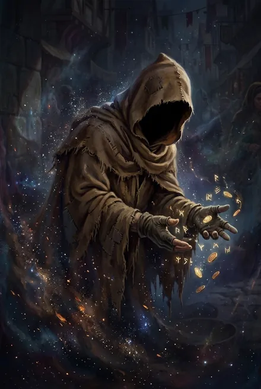
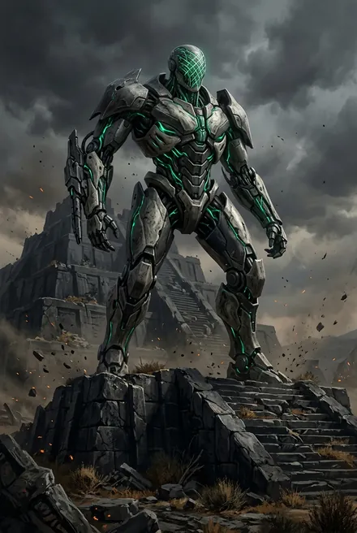

# Хранители Вечности (и их слуги)

> См. также: [Псы Вечности](../personazhi/psy_vechnosti.md) · [Единые и высшие силы](../personazhi/edinye.md) · [Белый Дьявол](../personazhi/belyj_dyavol.md) · [Кейнор](../personazhi/kejnor.md). Хитрейший в линии Сигурда подробно — [Хитрейший (Хранитель Вечности, Хозяин Контракции)](../personazhi/hitreyshiy.md), Сестра Солнца — [Сестра Солнца (как она показана в основной серии)](../personazhi/sestra-solntsa.md), Рашидов — [Олег Рашидов](../personazhi/rashidov.md) (досье основной серии, другой автор); здесь — сводка и взгляд ТБ.

## Облики на иллюстрациях

<figure markdown="span">
  [{ loading=lazy }](../assets/portrety/139.webp)
  <figcaption>основной облик <small></small></figcaption>
</figure>
<figure markdown="span">
  [{ loading=lazy }](../assets/portrety/140.webp)
  <figcaption>основной облик <small></small></figcaption>
</figure>

Иллюстрации созданы нейросетью по описаниям из книг; это трактовка, а не официальный арт.

## Общее

- **Кто они.** Семь правителей Вечности, хранящих **Ключи**, созданные Тем-Кто-Искусен для управления Небесным Троном; «все Хранители коснулись неба». Слухи: это **отражения лучших учеников Искуснейшего**, предавшие его, после чего он «проклял их и разрушил Исток, использовав Великую Руну Забвения, а потом пожертвовал собой»; Хранители «силой, обманом и предательством завладели частью Великих, Единых Рун» — времени, пространства, света, пустоты, памяти и энергии (ЗК-9, пролог). «Подлые ученики, предавшие Искуснейшего» (ТБ-4, пролог). У каждого «прежнее имя», в прошлом — герои Кел (ЗК-3, интерлюдия). «Притворялись Едиными», и только у Странника «не находилось подобия» (ТБ-5, гл. 1).
- **Совет в Тысячелетнем Замке, 28 циклов назад** — «когда ударил колокол Вечности», впервые за тысячу циклов: Тот-Кто-Сражается мёртв, Брешь не защищена. Предвестник показывает Великую Руну **Хронос** и видение: «Змея укусила свой хвост?». План — перенести в Единство тех, кто «сделает то, что уже было сделано однажды» (землян с ковчега «Хельга»), дать им создать новый Исток и стать щитом вовне, потом забрать Исток — «И их Звёздную Кровь». «Время не имеет значения. Важна только Звёздная Кровь» (ЗК-3, интерлюдия; ЗК-8, постскриптум). Договорились «не мешать ходу событий и вернуть Исток» (ЗК-8).
- **Кровь Хранителей иссякла** — так Хитрейший сказал Сигурду; Кейнор: «правда, смешанная с ложью» (ТБ-4, гл. 17). Кейнор: «Хранители правят через Руну Хронос, переигрывая проигранные ходы» (ТБ-4, гл. 17).
- **Расклад (ТБ-4, гл. 11, со слов Сатори):** Хитрейший, Посланник, Сестра Солнца «сомкнули свои сферы» против Палача и Полководца; Предвестник над ними, лишь следит; где бродит Странник, никому не известно. Норны отрежут нити в Единство тем, кто служит врагам. Хранители пока не тронут Тысячу — для норн и Контракции она «удобное оружие» (ТБ-4, гл. 11).

### Список и противоречия
| № | Хранитель | Полюс / слуги | Ключ/атрибут |
|---|---|---|---|
| 1 | **Предвестник** — «Первый Хранитель» (ЗК-9) | Вестники с белыми крыльями | Хранит **Великую Руну Хронос** |
| — | **Хитрейший** | Контракция («Компания»), контрактории, Великие Караваны | Торговля, информация |
| — | **Посланник / Посланница** | **Дом Норн**, Храмы Вечности, перенос душ | Дипломатия |
| 4 | **Сестра Солнца** — «Четвёртая» (ЗК-9) | **Золотые Варвары** | Небесный лук |
| — | **Полководец** | Гармония, Чёрная Гвардия и её Клинки | Серебряный Куб-Крепость |
| 6 | **Палач** — «Шестая», «Хранительница Закона» (ЗК-9) | **Псы Вечности** — небесные инквизиторы | Обруч с глифом весов |
| — | **Странник** | Странники дорог Вечности | — |

**Противоречия списков:** ЗК-3 (интерлюдия): Предвестник, Хитрейший, Посланник, Сестра Солнца, Полководец, **«крылатая фигура с копьём»** (четвёртая заговорившая), Палач — Странник не назван. ЗК-8 (постскриптум): **Вестник**, Странник, Сестра, Палач, Полководец, Хитрейший, Предвестник — Посланника нет. ЗК-9 (пролог, самый систематичный): Предвестник, Хитрейший, Посланник, Сестра Солнца, Полководец, Палач, Странник. *Вероятно:* «крылатый с копьём» = Странник, «Вестник» в ЗК-8 = Посланник (а в ТБ-4 «Вестник» — норна-отражение) *(предположение)*. Номера (Первый, Четвёртая, Шестая) дал только ЗК-9.

## Хитрейший («Хозяин Контракции», «старый торгаш»)

*Примечание:* таблица персонажей в разборе ТБ-5 пишет «Хитрейший / Незримый (Контракция)», но в тексте ТБ-5 прямого отождествления с Единым Незримым нет — это ошибка/догадка разбора; Незримый в речи героев — Единый, «бросающий камни».

- **Облик:** нищий в коричневом плаще с капюшоном, подбрасывающий монету; «самое богатое существо Единства и Вечности» (ТБ-2, постскриптум); «олигарх Вечности, по выходным изображающий нищего» (ЗК-9); «свой в доску парень» с ничем не примечательным лицом (ЗК-8); в сером хэлио, руки за спиной (ЗК-11). Статуя-«нищий» в Контракции, черты которой кажутся Сигурду знакомыми (ЗК-5). **Олег Рашидов**, координатор проекта «Космо» в Колонии Альфа, — его внешняя копия / копия нейрограммы: Рашидов «давно встречался со своей копией в Вечности» (ЗК-11).
- **Речь:** «Ой-вей», «Воу-воу», «дружок», «мой герой», «Одна монета — один ответ» (ТБ-2; ЗК-8). «Будь осторожнее с мёртвыми именами. Ведь некоторые мертвы только потому, что кому-то так удобнее» (ЗК-11, гл. 19). «Леди во гневе просто прекрасна» (ЗК-9). Прямо не лжёт, ставит на информацию.
- **Девиз** (Руна Бродячего Торговца): «**Что бы вы ни делали, мои, вы — мои**» — некогда присказка «древнего Червя» (ТБ-1, эпилог).
- **Роль в ТБ:** «пробудил, свёл вместе, обучил» Братьев (обвинение Полководца, ЗК-8/ТБ-2, постскриптум); вёл Орина через Торговца и давал Ключи (ТБ-1); Семя Игг-Древа и йурр Кыш — «ходы старого торгаша» (ТБ-3, гл. 1); устроил союз Тысячи и землян, защищает Сигурда; требует неприкосновенности «предтеч с небесного ковчега, особенно тех, что… ты и сам знаешь» (ТБ-2, постскриптум). Убирает со своей сферы фигурки «корабля» и «полководца», ставит «дракона» и «героя» с усилениями от «кузнеца»; гадает, выставит ли враг «варвара», «гончих» или «убийцу» (ТБ-2/ЗК-8, постскриптум) — дальше пришли Золотые Варвары (ЗК-9) и Псы (ТБ-4). Подбросил небесное семя Садовницы в Янтандер «за плату», продаёт Руны всем сторонам, дал Обочине пайцзу, извещает Кейнора (ТБ-5). Подозрение: таинственная торговка в зелёной вуали на Перекрёстке, продавшая ПП «Ложное Дно» и «Чужое Лицо», — сам Хитрейший (ТБ-5, гл. 1). Итог ТБ-5: Тысяча «всё ещё действует в пределах его плана»; «Компания довольна торгом», ПП «вернётся за сдачей».
- **В линии Сигурда (кратко):** упом. в ЗК-2 (глава Контрактории); ЗК-5 — временный Навык Торговли от статуи; ЗК-8 — плен, лекция, Счастливая Монета Контракции, Торговый Представитель Контракции; ЗК-9 — пайцза, совет статуи, бесплатная синхронизация; ЗК-10 — спасает Сигурда и Кассиди от Палача («Забирай своих пташек…»), забирает душу Велиора, дарит золотую Перезарядку; ЗК-11 — Храм Новой Зари, выкупает Аграф. Подозреваемый фактотум — Эйрик (ЗК-8).

## Бродячий Торговец («Компания»)
- **Что это:** Руна-Существо-контракторий, «отражение отражения» Хитрейшего, фактотум Контракции: что видит Торговец, знает и Хозяин (ТБ-2). Глиф — «услужливо согнутая фигура в надвинутом капюшоне» (ТБ-1, эпилог). Фигура в плаще, подбрасывающая монету, «любит вкладывать щиты и мечи в чужие руки» (ТБ-1).
- **Механика:** обходит ограничения Наблюдателя, завязанные на Славу; сделки через тысячи «узелков»-Восходящих; одна Руна за вызов, раз в древодень; «особый заказ» — 1 Монета аванса; «Мы не беремся за заказы, которые не можем исполнить» (ТБ-2, разд. 6).
- **Путь:** Руна Орина (ТБ-1, эпилог) → лавка БД; «Воу-воу, сколько холодных секре…» — вызван в Эргиале и **разбит Кузнецом**, но успел выдать координаты кристалл-сферы (ТБ-2, гл. 15) → снова в Скрижали ПП, три звезды (одну потерял при перезарядке), продаёт Слуг, «Дыхание Творящей» (ТБ-3) → продал Прозрачную Дорогу для выброса Псов за «особую цену» (ТБ-4, гл. 7) → ПП дал ему золотое Повышение; выкачивает Монеты, передаёт вести: «Компания довольна торгом», «в Ледяной Бездне уже извещены и ждут лишь Путей» (ТБ-5, гл. 19). У кель-рода Майр свой «Представитель Компании» произносит страж-слово «Цветок не знает могил» (ТБ-5, гл. 4). У Сигурда — **Торговый Представитель Контракции** (золотое Существо, ЗК-8…ЗК-9).
- *Противоречие:* в таблице ТБ-1 Торговец назван «одним из Хранителей» — в ТБ-2+ уточнено: это Существо Хитрейшего.

## Полководец
- **Маска (аватар)** — глава совета экзархов **Гармонии** (технофеодальная держава, наследующая кел, сбежавшим в Вечность); «слабое» небо (ТБ-2). Гармония 28–29 циклов охотится на лед-кузнецов. Когда-то Гармония остановила армии Тысячи (ТБ-2). Список обид Тысячи (Рукрейх, Мечта, Храм Познания, Чёрные Реки, Солнечная Башня, Разорванные Врата) — к нему.
- **ТБ-2:** ведёт флот и летающую крепость **Нексус Войны**; Нексус сбит (таран Сигурда + Руна Наблюдателя), маска в подледном море задушена Мариссой и **казнена Кейнором**: «Жалость — удел слабых» (гл. 21). Постскриптум: новая маска ссорится с Хитрейшим: «Я вернусь. И не один…».
- Слуги: **Клинки Гармонии** (золотые, живая броня, крылья-конечности), ликторы, Чёрная Гвардия, шагоходы. Серебряный Куб-Крепость (ЗК-9). По слухам, в совете экзархов Гармонии и Предвестник (ТБ-2, разд. 7).

## Палач
- Шестая Хранительница, «Хранительница Закона», «наследница павшего Закона» (ЗК-9). Невысокая, пепельное асари, фарфоровая кожа, обруч с глифом весов, чья стрелка показывает решение; аура — «хлебнул битого стекла»; холодна, но вспыльчива, грязно ругается на Хитрейшего (ЗК-9). «Я выпущу своих Псов» (ЗК-9). «Забирай своих пташек, ублюдок! Только я сперва подрежу им крылышки…» — конфискует у Сигурда Небесного Ястреба и Живые Цепи (ЗК-10, гл. 1).
- В Совете искала беглецов, «сбежавших в прошлое» с Руной Хронос (ЗК-3). Её шпионка — Всполох (ТБ-4). Три её Пса спали в Саркофагах под фригольдом землян (ТБ-3, гл. 1); выпустила их — Дикая Охота (ТБ-4). Использовала «старые пути, проложенные для охоты на Тысячу» (ТБ-4, гл. 4). Хранитель велела Псам не трогать предтеч (ТБ-4). «Опаснейшая» (ТБ-3).
- Псы — см. [Псы Вечности — Небесный, Драконоборец, Всполох (Тэйлисс)](../personazhi/psy_vechnosti.md).

## Сестра Солнца
- Четвёртая; кел-воительница с золотыми волосами и глазами — «вратами в солнце», небесно-голубой фрейм Восхождения (ЗК-9). Капризна, цинична («Мне… вообще плевать, что происходит вовне»), азартна; играет с Сигурдом в сферы, дарит Сагу (давшую Стратагемы), предлагает Пайцзу и армию (ЗК-9). Статуя-алтарь в Вечности благословляет Сигурда (ЗК-5). Её Ключ — небесный лук; слуги — **Золотые Варвары** (экзарх Сто Голосов — канал её нисхождения) (ЗК-9). Белый Дьявол мечтает вырвать ей сердце (ЗК-5).

## Предвестник
Первый Хранитель; провидец; Вестники с белыми крыльями; хранит **Хронос** (ЗК-8; ЗК-9). Показал Совету Хронос (ЗК-3). Применял Хронос против Моргейн и Лодочника (ТБ-3). Арбитр: «Предтечи неприкосновенны» (ЗК-9). «Над всеми, лишь следит» (ТБ-4, гл. 11). Допускал «собрать заново» Того-Кто-Забыт (ЗК-3).

## Посланник / Посланница
«У нее много обличий. Это ей служит Дом Норн. Это она создала Храмы, где Восходящих делают рабами Вечности» (Белый Дьявол, ЗК-6, гл. 11). Статуя над входом Храма Вечности. Появляется в Храме с небесно-голубым нимбом, называет Сигурда «Истинным, да ещё и двуединым», отпускает с посланием: «**Четверо из семи пали, одна пропала, один стал временем, а ещё один давно забыт**» (ЗК-6, гл. 12). Единственный Хранитель, которого Белый Дьявол **боится** (ЗК-6). Вестник на тинге Элтанира говорит от Дома Норн и Посланника (ТБ-4, гл. 14).

## Странник
Единственный сошёл «вовне» с Небесного Трона, чтобы убить Великого Червя (**Шелест** — ТБ-2, гл. 14); во время мятежа Тысячи самоустранился и «никогда не охотился на Братьев» (ТБ-4, разд. 12; ТБ-5, гл. 1). Странники дорог Вечности носят его знаки; Великие Караваны почитают Странника и Хитрейшего; Эдри «принадлежит Страннику» (ЗК-8; ТБ-5). Где бродит — неизвестно (ТБ-4, гл. 11). Камень Странника — в ступице Перекрёстка (ТБ-5, гл. 1).

## Дом Норн, норны, Вестник
- Дом Норн служит Посланнику, создал Храмы как «огромные врата» и перенос душ; для установки стигмата нужен жрец-норна (ЗК-6; ЗК-9). «Жалкие врата, что норны раскидали у Великих Древ» (ТБ-4, разд. 6). Золотая норна с иссиня-чёрными волосами разоблачает «маску» Сигурда (ЗК-6, гл. 12).
- **Вестник** (ТБ-4, гл. 14): норна, бесполое отражение-кел с бледно-серебряной кожей, фиалковыми глазами и золотой аурой: «Я — Вестник. Я буду говорить от Храма Вечности». О «трёх опорах Восхождения» — стигмате, Храме и Вечности; «возвращение не есть право на мятеж»; древо с «отравленными плодами» вырвут «вместе с Народами, что встанут под его тень». Ответ ПП — смех.
- **Посланник Небесного Трона** в ТБ-5 — фактотум-кел в теле подменённого хранителя Амарис (см. [Кель-рода Курганов Янтандера: хранители, ключники, предки](../personazhi/kel_roda_kurganov.md)).

## Тайны
Прежние имена Хранителей; кто такой «крылатый с копьём»; их Ключи и доли Великих Рун; Хитрейший — союзник или кукловод Тысячи; почему Посланник отпустил Сигурда; почему Странник не охотился на Тысячу.
