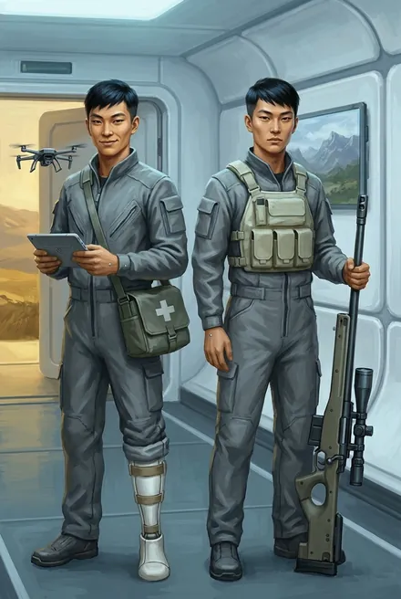
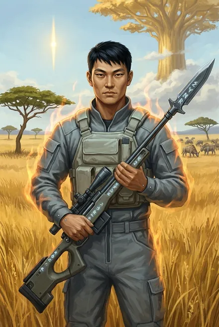

# Инь и Янь (близнецы-азио)

| | |
|---|---|
| **Имена** | **Инь** и **Янь** — прозвища: «Мы зовем их Инь и Янь, потому что настоящие имена хрен выговоришь… Главное, не перепутать» (Динамит, ЗК-1, гл. 17). Вместе — «Инь-Янь», «близнецы-азио»; Янь — «Азио» (разбор ЗК-8). Настоящие имена в каноне **не названы**. По карточке автора — **Тханават «Инь» Ринтхарамонгкхон** и **Тханачай «Янь» Ринтхарамонгкхон** (автор, TG: [пост 6430](https://t.me/prokofiev_litrpg/6430)) |
| **Происхождение** | Земляне-азио с «Хельги»: «оба — световые инфлюэнсеры, абсолютно невостребованная здесь профессия, — свалились на грузовой капсуле больше двух лет назад» (ЗК-1, гл. 17). Ровесники Сигурда «или чуть помладше». По разбору ЗК-1 — из Индо-Пацифики (так же в карточке автора). «Световые инфлюэнсеры» — «специалисты, которые работают с информацией при помощи света, то бишь световых голографических конструкций» (автор, TG: [пост 6430, комм. 230187](https://t.me/prokofiev_litrpg/6430?comment=230187)) |
| **Роли** | **Инь** — снайпер («Вдова», затем тяжёлое импульсное «Копье»), водитель багги; **Янь** — медик, техник, оператор дронов и барьерных щитов, санитар |
| **Книги** | ЗК-1 – ЗК-11 (Янь — до ЗК-10) |
| **Ранг** | **Инь:** гвоздь на тинге — дерево 4-7-4 (ЗК-6, интерлюдия «Травинка») → слабая бронза (ЗК-7, гл. 13) → полноценная бронза (ЗК-8, гл. 7). **Янь:** не Восходящий |
| **Статус на конец канона** | Оба живы, в **новом копье Динамита** (ЗК-10, гл. 8, 22). Инь ранен при побеге из Альфы (ЗК-11, гл. 10–11); Инь собирается жениться на Юко (ЗК-10, гл. 8) |

> **Близнецы или братья?** В ЗК-1, ЗК-2, ЗК-9 — «близнецы»; Сигурд в ЗК-8: «когда я попал в копье, азио казались почти близнецами» (гл. 7) — формулировка допускает, что они просто очень похожи. Разбор ЗК-5 называет их «братьями». Итог: в тексте устойчиво «близнецы-азио»; кровное родство не обсуждается.

---

## Облики на иллюстрациях

<figure markdown="span">
  [{ loading=lazy }](../assets/portrety/035.webp)
  <figcaption>Близнецы-новички <small>ЗК-1 — ЗК-7</small></figcaption>
</figure>
<figure markdown="span">
  [{ loading=lazy }](../assets/portrety/036.webp)
  <figcaption>Окрепший бронзовый Инь <small>ЗК-8 — ЗК-11</small></figcaption>
</figure>

Иллюстрации созданы нейросетью по описаниям из книг; это трактовка, а не официальный арт.

## Характер и речь

**Общее.** Весёлые «комментаторы» копья; «Инь-Янь не слишком уважают физический труд и выбирают легкие участки», едят «как птички, быстро, молча и торопливо» (ЗК-2, гл. 1). Учат новичков: Инь первым объясняет Сигурду Лохмача, камнеедов, огнезубов (ЗК-1, гл. 18).

**Инь.** «Глазастый» снайпер (ЗК-2, гл. 3); практичный — сводит Сигурда с перекупщиком («В таблице нет, а договориться можно…», ЗК-2, гл. 3, 8); не дурак засмотреться на дочек Эйрика («И дочки у него — огонь!», ЗК-4, гл. 8; «особенно Молли», ЗК-5); при этом «невеста держит его в маленьком, но сильном кулачке» (ЗК-8, гл. 7). Осторожен в политике: «Почему бы нам просто не вернуться во фригольд и честно рассказать все людям?» (ЗК-6, гл. 1). Восторженный: «Топовые пушки!» (ЗК-6, гл. 1). После прихода новичков — «держался с ленивой уверенностью ветерана, и, кажется, слегка задирал нос» (ЗК-7, гл. 19). «Невозмутимый Инь с тяжелым рунным „Копьем“» (ЗК-10, гл. 5). Признаёт страх: «Страшно. Мы все… как голые» (ЗК-8, гл. 4).

**Янь.** «Самым безобидным из нашего копья» (ЗК-4, гл. 3); бесхитростен о потере ноги: «бронзовый, сука, Червь отхватил, как ножницами» (там же); сплетник, «который про всех все знал» (ЗК-8, гл. 7); принципиален: «А я бы, наоборот, наградил… Люди должны знать, что происходит» — о журналистке Кардо (ЗК-10, гл. 4). Мечтает вернуться в строй.

**Цитаты:**
- Инь: «Стреляйте очередями, им пофиг на одиночные! Цельтесь в крылья!» (ЗК-1, гл. 19).
- Инь: «Ну, было пару раз… Задница там, ничего хорошего, Сигурд. Личинки и коконы…» (ЗК-2, гл. 12).
- Янь: «Да, в том рейде и лишился ноги…» (ЗК-4, гл. 3).
- Янь: «Дело идет к женитьбе, шаг влево — и невеста что-нибудь отрежет» (ЗК-8, гл. 7).
- Инь: «Командир, честно — не хочу в такую даль. Если прикажешь — пойду. Если есть выбор — я минус…» (ЗК-10, гл. 8).

---

## Биография

### ЗК-1
- **Гл. 17–18.** Знакомство; Инь и Лэндо на Третьем Дозорном посту; Инь подстреливает дрейка из «Вдовы».
- **Гл. 19 (ваал).** Инь за рулём багги вывозит Травинку и четверых детей, оставив Сигурда и Лэндо прикрывать; швыряет им магазины.

### ЗК-2
- **Гл. 3–6 (Ледяной Великан).** Двойка Инь-Янь; Ледяной Дикобраз — Янь запускает дрона; тигрекс бьёт Яня когтями, лавина — Инь с лёгким сотрясением, Яня откапывают через пару часов по маячку вокса, его несут на носилках.
- **Гл. 8.** Иня встречает девушка-азио **Юко** — «миниатюрная, похожая на худенького мальчика… с короткой стрижкой. Они… давно встречались».
- **Гл. 13–14 (Гнездо).** Дрон Яня — «слухач» группы; Инь оставлен наверху. В этом рейде **Янь лишился левой ноги** — бронзовый Червь «отхватил, как ножницами» (ЗК-4, гл. 3).

### ЗК-4
- **Гл. 3.** Янь на пластиковом протезе и костылях, выведен из копья.
- **Гл. 5–11.** Инь — в группе «Одиссей»: вскрывает капсулы, охраняет груз с Граем.

### ЗК-5
- Инь уходит с Динамитом в Шторм; Янь (с протезом) и Ханна остаются на ферме Эйрика (интерлюдия «Травинка»).

### ЗК-6
- **Гл. 1–12.** Инь сопровождает Веронику на тинг; получает гвоздь: дерево **4-7-4**. Янь просится в поход — Вероника отказывает (гл. 7).
- **Гл. 19, 25–26.** Инь похищен ночной атакой, найден в Домене; Сигурд эвакуирует «одноногого Яня» с фермы.

### ЗК-7
- **Гл. 4–5.** Инь в бою у Пика (плазма), выносит раненых; Руна **Огненная Защита**; Янь ждёт бионическую ногу — её изготавливает Илья Сухарин, новый руководитель репликации, «раш из Большой Евразии» (гл. 8).
- **Гл. 7, 13.** Инь — **Кристалл Видящего** (от Фьюри), девять бронзовых капель — «полностью закрыл Тело и Разум»; награды — **Эликсир Антияда** (дерево), Руна-Умение **Тепловое Зрение**; «слабая бронза».
- **Гл. 9–10, 17.** Удерживает позицию с «Копьем», приглядывает за Тревором; в штурмовой группе с Грохотом.

### ЗК-8
- **Гл. 3–4.** Янь с бионической ногой снова в строю; дроны «Обсервер» (разбор); остаются в саркофаге.
- **Гл. 7.** Инь — **Теневая Маскировка**; «полноценная бронза».
- **Гл. 16.** Инь — связка **Ядовитых Побегов и Ядовитого Облака**.

### ЗК-9
- **Гл. 4, 6.** Инь с «Копьем», Янь — техник и санитар; «Теневики или нет, своих надо вытаскивать» (Инь).

### ЗК-10
- **Гл. 5.** Янь ставит барьерный щит; гарпия разворотила протез — выбывает.
- **Гл. 6.** Инь сжигает тварь; бронирует себе Руну **Зоркий Глаз**.
- **Гл. 8.** Оба уходят в **копьё Динамита** (Инь — из-за скорой свадьбы).
- **Гл. 22–23.** С Динамитом в Либерти.

### ЗК-11
- **Гл. 5–6.** Инь попал в плен Альфы случайно — прикрывал отход своего копья; допрашивали «раз пятьдесят».
- **Гл. 10–11.** Ранен в плечо при побеге (Кроу его поддерживает).
- **Гл. 13.** Сигурд отдаёт Иню дубли Рун «аврор», хотя он «больше не в моем копье».

---

## Отношения
- **Сигурд** — товарищи с первого дня; Инь приходит на помощь после драки в очистителе (ЗК-2, гл. 11).
- **Динамит** — командир дважды.
- **Грохот** — подкалывает Иня насчёт невесты.
- **Юко** — девушка, затем невеста Иня.
- **Лэндо** — напарник Иня по дозору.

## Карточка автора (вне канона)

> Карточка персонажей из канала автора (автор, TG: [пост 6430](https://t.me/prokofiev_litrpg/6430), август 2026). Это не текст книг: при расхождении прав канон.

| | |
|---|---|
| **Имена, возраст** | Тханават «Инь» и Тханачай «Янь» Ринтхарамонгкхон; около 25 лет; Индо-Пацифика, братья-близнецы |
| **Биография** | Упали с очередной волной капсул в Море Трав у Пылающего Рога за два года до Сигурда; клан Людей Трав «ободрал их группу как липку», но они дошли до фригольда и попали к Динамиту. Инь получил стигмат из рук Вероники в Храме Вечности на тинге; Янь в это время был на ферме Эйрика — потерял ногу, позже получил бионический протез. Были в мобильной группе Сигурда, перед путешествием в Альфу остались во фригольде, после воскрешения Динамита вернулись к нему |
| **Приметы** | Похожи так, что новички путают, поэтому выкрасили волосы: у Иня иссиня-чёрные, Янь — белый. Инь в снайперском шлеме с трофейным импульсным «Копьём», Янь с бионической ногой и снаряжением медика. Синхронно присвистывают |
| **Характер** | Физический труд не уважают, зато незаменимы в своих ролях. Инь — общительный пройдоха, знает чёрный рынок и перекупщиков, может запаниковать («Уходим! Они нас сожрут!»), но вырос в профессионала; «под каблучком» невесты Юко. Янь тише и упрямее, единственный открыто занимает гражданскую позицию: «А я бы Кардо наградил» |
| **Речь** | Городской земной сленг. Инь: «В таблице нет, а договориться можно…», «Топовые пушки! Рабочий, Сигурд?». Янь: «Не везёт мне с ногой, командир. Видать, сверху намекают» |
| **Сила** | Инь: снайпер («Вдова», «Копьё» со спецзарядами Миноса), уклон в Разум, бронзовое Восприятие; Руны Огненная Защита, Кристалл Видящего, Эликсир Антияда, Тепловое Зрение, Зоркий Глаз. Янь: техника, электроника, полевая медицина, дроны, барьерные щиты |
| **Цель** | Инь — дожить до свадьбы и жить по-человечески; Янь — вернуться в строй наравне с братом |

**Сверка с каноном.** Руны Иня в карточке совпадают с досье. «Ядовитое Дыхание», которое таблица «Система Восхождения» даёт Иню, в каноне — Руна Сигурда (ЗК-3, гл. 17, 19).
