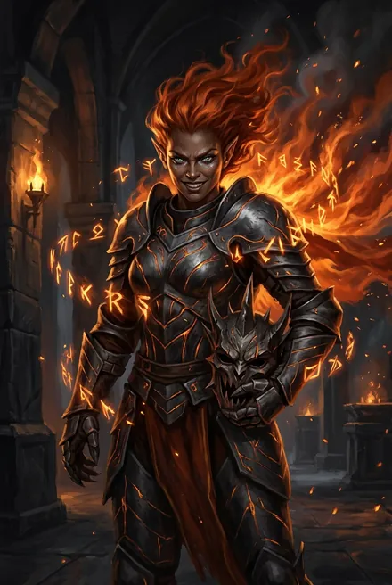
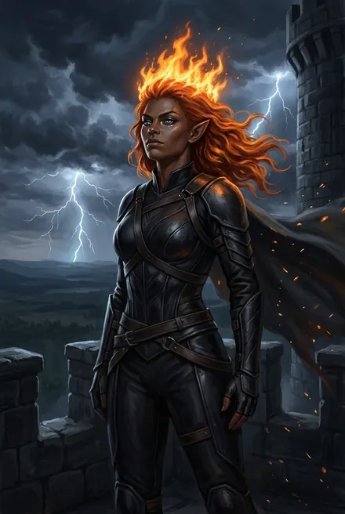

# Каласса Огненная-как-Ветер

> См. также: [Белый Дьявол](../personazhi/belyj_dyavol.md) · [Найтфир](../personazhi/najtfir.md) · [Народ Теней](../personazhi/narod_tenej.md)

| Поле | Значение |
|---|---|
| **Имена** | Каласса (на древнем языке — «Сильная», ТБ-3); Огненная-как-Ветер |
| **Происхождение** | Полукровка Каменных Луков: отец — танаан **Быстрый-как-Ветер** (непризнанная дочь), мать — пленная землянка-«афро» (ТБ-3); «из тех, что рождаются в одном случае из ста» |
| **Возраст** | **Не больше 29 циклов**: «видела не более чем двадцать девять циклов» (ТБ-3, гл. 6). Карточка автора: 25–28 циклов (автор, TG: [пост 4891](https://t.me/prokofiev_litrpg/4891)). При 25–28 её мать-землянку взяли в плен уже после падения «Хельги» |
| **Ранг** | Сильное серебро; Аспект «**Огненный Ветер**» (огненный) |
| **Руны и стиль** (ТБ-3, гл. 6) | Скорость Тигрекса, Сила Десяти Воинов, Власть Огня, Невидимый Рывок, Лёгкий Прыжок; Тлеющее Сердце, Эрозия, Отзвук (тройник в атаке), Гром и Молния на оружии, Боевая Ярость; «обычный набор»: Алый Коготь, Червелов, Кислотное Тление. **Стиль Железа серебряного ранга**. Из Домена Скелет-на-Холме — пять серебряных Рун, среди них «Танец Скелетов» (ТБ-4, гл. 16) |
| **Роль** | Соперница → любовница, наложница, «меч» кинга; знаменосец; **рикс Каменных Луков** (ТБ-4, гл. 18) |
| **Книги** | ТБ-3, ТБ-4; ЗК-11 (новый рикс Луков, гл. 20–21); ЗК-12 (гл. 3) |
| **Статус** | Жива, беременна от Пламени Подобного |

**Внешность.** Тёмная бронзовая (коричневая) кожа, рыжие «как пламя костра» волосы, глаза — лазурь с расплавленным серебром, острые уши (ТБ-3).

**Характер.** Всю жизнь выгрызала уважение; яростная, гордая, ревнивая, честолюбивая. Ненавидит героя за то, что он отнял её мечту (престол Луков), и желает его как единственного равного; любит и ненавидит после того, как он сломил её ментально (ТБ-3–04). Ненавидит Азимандию («золотая сука», ТБ-4, гл. 2), Азимандия и Шелковая Тень ненавидят её.

**Речь.** «Не думай… что опять победил. Это лишь… первый бой…» (ТБ-3, гл. 8). «Мой клинок не спрашивал, кто моя мать» (ТБ-4). «Небесные господа хуже Червей! Те хотя бы честны и убивают всего один раз» (ТБ-4, гл. 9).

**Путь.**
- **ТБ-3:** фионтар с героем (гл. 6); подозрение в связи с Черепами; он читает её разум — любовь (гл. 7–8); боевая соратница (гл. 9, 15), дракарис; зажигает Древо над Кузницей Молний; получает Маску Странника (гл. 11); в финале поведёт караван к землянам с дарами, освобождёнными трэлями и техникой, передаст Сигурду знак начинать миссию (гл. 17).
- **ТБ-4:** сцена ревности — кинг прижимает её к стене за горло, ломает волю нотками Подчинения и выполняет её просьбу дать ребёнка, «первого сына» (гл. 2); уходит с караваном к землянам с вестью для Сигурда; молния между бровей (гл. 9); Домен-Башня **Скелет-на-Холме** — пять серебряных Рун, среди них «Танец Скелетов» (гл. 16). Становится риксом Луков; Режущий Руны возражает, что в ней нет древней крови; кинг кладёт руку ей на живот: «Древняя кровь уже бьется у нее под сердцем» (гл. 18).
- **ЗК-11:** новый рикс Каменных Луков; гордо отказывается от помощи землян и уничтожает Червей у Чёрной Пасти золотой Руной призрачного Древа (гл. 20–21).
- **ЗК-12, гл. 3:** держит руины Каменных Луков против нашествия: «Пламени Подобный ушел к Курганам, а Тень оставил мне! Кинг сказал: держи, пока можешь… когда не смогу, мы не станем умирать за старые камни» — отход Порталом в Город Молний. «Тридцать рук воинов, половина — Восходящие». «Моя золотая Руна заснула и проснется на третий [день]»; просит землян помочь удержать Луки и называет Сигурда «эрл».

**Тайны.** Мать-землянка (трэль Теней) — кто она, жива ли; ребёнок Калассы — наследник «крови Дарующего» и землян; соперничество с Найтфир за первенца.

## Облики на иллюстрациях

<figure markdown="span">
  [{ loading=lazy }](../assets/portrety/103.webp)
  <figcaption>Вызов на фионтар: маска и рунная броня <small>ТБ-3, гл. 6</small></figcaption>
</figure>
<figure markdown="span">
  [{ loading=lazy }](../assets/portrety/104.webp)
  <figcaption>Знаменосец кинга в найткоже; рикс <small>ТБ-3, гл. 8 – ТБ-4</small></figcaption>
</figure>

Иллюстрации созданы нейросетью по описаниям из книг; это трактовка, а не официальный арт.

## Карточка автора (вне канона)

> Карточка персонажа из канала автора (автор, TG: [пост 4891](https://t.me/prokofiev_litrpg/4891), декабрь 2025). Это не текст книг: при расхождении прав канон.

| | |
|---|---|
| **Возраст** | 25–28 циклов (канон: не больше 29) |
| **Происхождение** | Каменные Луки. Отец — танаан Быстрый-как-Ветер, мать — пленная землянка-афро |
| **Род занятий** | Серебро; эрл Каменных Луков, правая рука и любовница Пламени Подобного |
| **Биография** | Мать умерла от тягот теневых земель, отец не признал дочь. Росла среди детей трэлей, дралась за еду, тайком училась оружию. Вызвала Пламени Подобного на фионтар, желая стать риксом, проиграла и покорилась; стала его знаменосцем, командиром копий и любовницей |
| **Приметы** | Кожа цвета кофе, вьющиеся огненно-рыжие волосы, острые уши, **голубые глаза**; высокая, мускулистая. Рунная броня с оранжевым свечением, шипастая боевая маска |
| **Речь** | Прямо, колко, рублено в гневе: «Жаль, что ты не отнял у нее жизнь», «Мать многому научила тебя, изгой», «Нам нужна сила, а не старые сказки!» |
| **Оружие** | Колючий бич-клинок, рунный кинжал; Стиль Железа |
| **Слабость** | Уязвима к ментальным атакам; ревность; комплекс полукровки |
| **Цель** | Стать золотой Восходящей и риксом Народа Теней; доказать, что она сильнейшая; возможно — завоевать сердце Пламени Подобного |

**Сверка с каноном.** Возраст — см. выше. Глаза в ТБ-3 «лазурь с расплавленным серебром»; «голубые» карточки с этим совместимы. Руны карточки все есть в ТБ-3, гл. 6.
