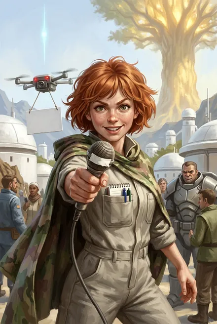

# Элли (Элеонора) Кардо

| | |
|---|---|
| **Имена** | Элли Кардо; полное — **Элеонора Кардо** (ЗК-10, гл. 10–11); «Кардо»; прозвища Грохота — «коза», «кошка драная», «крыса рыжая», «дурында», «коза ушибленная» (ЗК-10, гл. 4, 10, 14–15); «рыжая заноза», «рыжий "Голос Фригольда"» (Сигурд, ЗК-11, гл. 10, 12); «объект "Элеонора Кардо"» (Скай, ЗК-10, гл. 12) |
| **Происхождение** | Землянка, колонистка «Космо» с «Хельги»; «говорят, была журналистом Интервордла на Земле» (Инь, ЗК-9, гл. 2) |
| **Роль** | Создательница и единственный голос вокс-шоу «Голос Фригольда» во фригольде Небо; затем «полевой корреспондент» (ЗК-10, гл. 22); автор репортажа, обрушившего режим Кондора (ЗК-11, гл. 10–11) |
| **Ранг** | Не Восходящая (ЗК-11, разд. 4 разбора) |
| **Книги** | ЗК-9 (гл. 2, 6, 9), ЗК-10 (гл. 4, 8–15, 22–23), ЗК-11 (гл. 5–6, 9–12, 15–16) |
| **Статус** | Жива; «стала звездой» Либерти, выпускает ролики «со скоростью гаусс-пулемета» (ЗК-11, гл. 15) |

## Облики на иллюстрациях

<figure markdown="span">
  [{ loading=lazy }](../assets/portrety/049.webp)
  <figcaption>основной облик <small></small></figcaption>
</figure>

Иллюстрации созданы нейросетью по описаниям из книг; это трактовка, а не официальный арт.

## 1. Внешность (кратко)
«Рыжую, маленькую и с россыпью веснушек на носу» (ЗК-9, гл. 2); «рыжие волосы растрепались, на лице красовалась россыпь веснушек, ресницы дрожали»; «покрытый веснушками носик» (ЗК-10, гл. 10). Реквизит: «кустарно модифицированный дрон» с камерой (ЗК-9, гл. 2); «древний микрофон» с надписью маркером «КАРДО: СЛОВО ЗА ВАМИ» (там же); плакаты маркером — «КАРДО — ПРАВДА БЕЗ КУПЮР», «ОТ НАС СКРЫВАЮТ ПРАВДУ!» (ЗК-10, гл. 4); нагрудная камера (ЗК-10, гл. 22); вокс-имплант — «Имплант, сэр! Всегда со мной!» (ЗК-11, гл. 10); украденный плащ-хамелеон (ЗК-10, гл. 10–11).

## 2. Личность, мотивация, методы
- **Миссия — правда «без купюр».** «Я журналист, мэм! Я собираю новости, беру интервью, рассказываю людям правду! Это древнейшая профессия!» (ЗК-9, гл. 9). «Это цензура! Люди имеют право знать!» (ЗК-10, гл. 4). Сигурд: «Кардо — невыносимая заноза, но кое в чем была права. Люди действительно имеют право знать» (ЗК-10, гл. 4).
- **Бесстрашие на грани глупости.** Пробирается «зайцем» в винтокрыл, семь часов лежит под плащом («Я семь часов лежала и не дышала. Боялась чихнуть!», ЗК-10, гл. 10); сбегает снимать руины Терры и попадает к гигантопитекам (ЗК-10, гл. 11); даже в кулаке Каменного Грома «снимала — черт побери, снимала свой репортаж!» (ЗК-10, гл. 13); под пулями на террасе Альфы «продолжала что-то снимать, пока Толя не зашвырнул ее внутрь» (ЗК-11, гл. 10).
- **Мышление заголовками.** «Любовь и грязь в новом мире» (ЗК-9, гл. 2); «Кровавое небо Таира… Нет, лучше — "Алые небеса надежды"!» (ЗК-10, гл. 11); «Альфа, которую вы не знаете. Побег из Колонии Лжи» (ЗК-11, гл. 10); врезки «БОМБА В ТВОЕЙ ГОЛОВЕ», «АЛЬФА — КОЛОНИЯ ЛЖИ» (ЗК-11, гл. 11).
- **Протест как жанр.** Три жалобы на стене камеры Альфы — «на имя координатора, гранд-координатора и… "будущего независимого трибунала"»; надпись «ТРЕБУЮ КООРДИНАТОРА И ПРЕДСТАВИТЕЛЕЙ ПРЕССЫ!» (ЗК-11, гл. 5).
- **Профессионализм.** Монтаж «информационной бомбы» за двадцать–тридцать минут на ходу в глайдере; «Кардо даже почти не выпячивала себя»; факты — «имена, даты, короткие служебные формулировки… которые может проверить каждый»; материал подан так, что «никто не догадался о моей истинной природе» (ЗК-11, гл. 10–11). Волк: «За полчаса сделала?.. Отличная работа» — «Лучшая в моей жизни… Был подготовленный материал…» (ЗК-11, гл. 11).
- **Наивность.** Мечтает об Альфе как о «цивилизации» и «свободе слова» (ЗК-10, гл. 10); спрашивает, есть ли в новом поселении «собственная пресс-служба или новостные выпуски? Независимые медиа?» (ЗК-10, гл. 22).
- **Страх.** Боится Юки больше всех землян (ЗК-10, гл. 10).

## 3. Речь (цитаты)
1. «Ого, это же он! Сигурд Морозов!.. Я Элли Кардо, "Голос Фригольда"! Пожалуйста, пару вопросов для наших зрителей!» (ЗК-9, гл. 2).
2. «Сигурд Морозов: человек, который командует драконами, сажает Игг-деревья и не дает интервью!» (ЗК-9, гл. 2).
3. «Вопрос на миллион репликационных баллов: ради чего развязан кровавый террор? Кого ищут небесные Восходящие? С вами была Элли Кардо… Оставайтесь на связи… пока еще можете» (ЗК-10, гл. 4).
4. «Это была инвестиция! В мою свободу!.. Кстати, далеко еще? И… у вас тут есть туалет?» (ЗК-10, гл. 10).
5. «Я все записала! Это будет… репортаж века!» (ЗК-10, гл. 14).
6. «Я предпочитаю термин "полевой корреспондент"» (ЗК-10, гл. 22).
7. «Офигеть!.. Кто это собирал? Как⁈ Это же будет информационная бомба! Мне нужно двадцать минут на монтаж» (ЗК-11, гл. 10).

## 4. Предыстория
- На Земле — по слухам, журналист **Интервордла** (ЗК-9, гл. 2) *(название медиакомпании/сети будущей Земли; подробностей нет)*.
- В Единстве: «девку, что мы спасли от тавров в Море Трав… Ее еще порядком ободрали… ту, что Травинка лечила» — копьё Сигурда «в одном из первых рейдов вырвали у стада» её окровавленное тело (ЗК-9, гл. 2). Поправившись, через три дня после разрешения рикса уже «всех достать успела» (там же).

## 5. Биография по книгам
- **ЗК-9.** Первое интервью-нападение на Сигурда; эпизод про Джека, свалившегося с дозорной башни (гл. 2). Её «дурацкие репортажи» — часть источников растущей Славы Сигурда (гл. 6). Берёт интервью у Морвейн; та «говорит с её бабушкой»: «подслушивать соседей с помощью летающего механизма не очень достойно… тебе стоит научиться хранить свои секреты, прежде чем охотиться за чужими»; Кардо уходит «пунцовая, словно мак». Морвейн: «Ты служишь Хитрейшему?» — «Кому, мэм? Я служу только истине!» (гл. 9).
- **ЗК-10.**
  - Экстренный выпуск о беженцах-горцах и «небесных гостях»; пытается снимать Восходящих, её гонят — «Это цензура!» (гл. 4).
  - Тайком снимает Колонну Ветров (гл. 8).
  - За «журналистские разоблачения» рикс хотел её изгнать, а наказал — «собирать в пещерах дерьмо камнеедов»; сделала «научный» репортаж о сборщиках, «все только смеялись! Даже дети!»; украла плащ-хамелеон и улетела «зайцем» в Альфу; Сигурд: «Толя, подготовь парашют» (гл. 9–10).
  - В Таире сбегает за репортажем; Каменный Гром носит её на ладони как «игрушку» и приманку (гл. 11–12).
  - Сигурд, вопреки <5 % Скай, возвращается: «Лечить и защищать слабых — вообще нерационально, но это именно то, что делает нас людьми» (гл. 12). Её дрон, брошенный Психокинетикой в глотку Грома, — переломный момент боя; «эта идиотка даже сейчас… снимала» (гл. 13).
  - Спасена, «вся в синяках и кровоподтеках, явно поломанная, но живая» (гл. 14). Репортаж приносит всем участникам Славу; Сигурд видит в её роликах «аналог Саг» и «оружие» для контактов с Либерти и Альфой (гл. 15).
  - Приходит в Либерти через Портал с подкреплением как «полевой корреспондент» (гл. 22); ведёт «прямую трансляцию с исторической встречи представителей двух земных колоний» перед фионтаром с Волком (гл. 23).
- **ЗК-11.**
  - Схвачена десантом Альфы вместе с Грохотом, Кроу и Инем; надписи на стене (гл. 5). Возмущена на свидании с командиром (гл. 6).
  - Совет координаторов собирается «санировать» её, стерев память (гл. 9).
  - Освобождена; ведёт «экстренный репортаж прямо из Колонии Альфа»; по архиву Скай монтирует «Альфа, которую вы не знаете. Побег из Колонии Лжи»: кадры бегства, запись совещания, секретные архивы, схема имплантатов-бомб, статистика санаций; ранена «по касательной» на террасе (гл. 10–11). Скай рассылает репортаж по 17 медиаканалам и личным воксам всех колонистов (гл. 10).
  - Слава Сигурда растёт «почти на треть» (гл. 12); Кардо отказывается уходить в Домен — «делала новый репортаж» (гл. 12).
  - Звезда Либерти; экстренный выпуск о Ночной Песне: «если у вас есть важная информация о Ночной Песне или Соловье-в-Ночи… спросите Элли Кардо» (гл. 15).
  - Сигурд: репортаж «изрядно спутал карты» Рашидову (гл. 16).

## 5а. Репортаж как механика мира
- **Слава от медиа.** Слава в Единстве растёт от того, что о Восходящем узнают и говорят; Сигурд отмечает «дурацкие репортажи Кардо» среди причин прироста (ЗК-9, гл. 6). После таирского репортажа «всем "капает" Слава» участникам рейда (ЗК-10, гл. 15 по разбору). После «Колонии Лжи» Слава Сигурда «выросла почти на треть», хватило бы на Титул эрла (ЗК-11, гл. 12).
- **«Аналог Саг».** «Вокс-репортажи Кардо вполне могли служить аналогом Саг, добавляя нашему Народу (и Восходящим) известности. И, предполагая контакты с Либерти и Альфой, это оружие стоило держать заряженным» (ЗК-10, гл. 15).
- **Политическая сила.** Репортаж сорвал Рашидову планы «задним числом сформировать удобный нарратив» (Скай, ЗК-11, гл. 10; Сигурд, ЗК-11, гл. 16) и ускорил удаление имплантатов в Альфе (Аврора, ЗК-11, гл. 16).
- **Каналы.** Вокс-сеть фригольда (ЗК-9, гл. 2), виртуальные экраны на площадях Либерти (ЗК-11, гл. 15), 17 медиаканалов Альфы и личные воксы колонистов (ЗК-11, гл. 10).

## 5б. Как писать Кардо
- Говорит формулами ведущей: «Доброе утро, с вами Элли Кардо и экстренный выпуск…», «Оставайтесь на связи», «Специально для вас — Элли Кардо» (ЗК-9, гл. 2; ЗК-10, гл. 4).
- Обращается официально — «мистер Морозов», «сэр», «мэм» — даже под огнём (ЗК-10, гл. 22; ЗК-11, гл. 10).
- В страхе — сглатывает и замолкает (перед Юки); в обиде — «гордо задрала… носик» (ЗК-10, гл. 10).
- Внутри — профессионал: факты и проверяемые детали, а не самолюбование (ЗК-11, гл. 11).
- Комическая функция в сценах с Грохотом и Морвейн; драматическая — как «живой щит» и «приманка» у Каменного Грома (ЗК-10, гл. 12–13).

## 6. Отношения
- **Сигурд** — «мистер Морозов», объект охоты; затем командир, который её спас и сделал оружием (ЗК-10, гл. 12; ЗК-11, гл. 10).
- **Толя Грохот** — ругает и спасает: «Молоток, Элли… Санация, на! Выкуси, йопта!» (ЗК-11, гл. 11).
- **Юки** — держит нож у её горла; Кардо её боится (ЗК-10, гл. 10).
- **Морвейн** — высмеяла (ЗК-9, гл. 9).
- **Кассиди** — наказал работой, но не изгнал; Сигурд гадает, «как Кассиди после всего… вообще разрешил ей что-либо выпускать» (ЗК-10, гл. 15).
- **Скай** — соавтор монтажа: «Я структурирую материал и подготовлю монтажную канву. Кардо останется авторская сборка» (ЗК-11, гл. 10).
- **Волк (Маркус Крейв)** — оценил работу (ЗК-11, гл. 11).

## 7. Тайны и крючки
- **Прошлое в Интервордле** и почему её взяли в «Космо» (ЗК-9, гл. 2).
- **Что ещё у неё в архиве** — всё, что она «записала» в Терре, Либерти и Альфе (ЗК-10, гл. 14; ЗК-11, гл. 10).
- **Медиа как оружие колоний:** её ролики заменяют Саги и поднимают Славу (ЗК-10, гл. 15; ЗК-11, гл. 12) — сюжет «первой независимой прессы Единства».
- **Цели Вечности:** Морвейн шутила о службе Хитрейшему (ЗК-9, гл. 9) — «собиратель секретов» — естественная мишень для контракториев.
