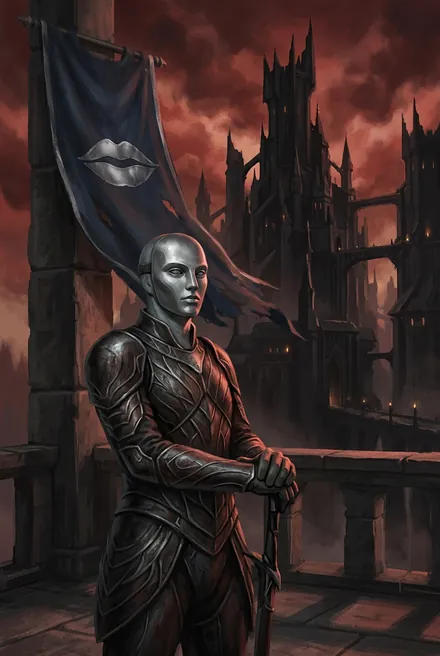
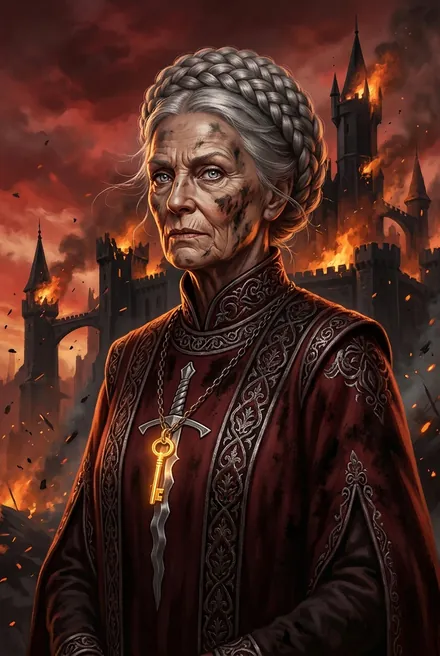
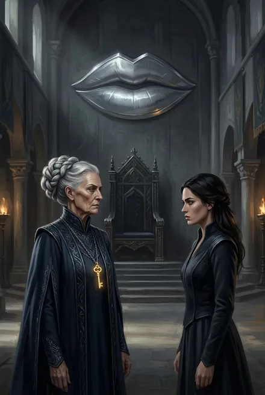
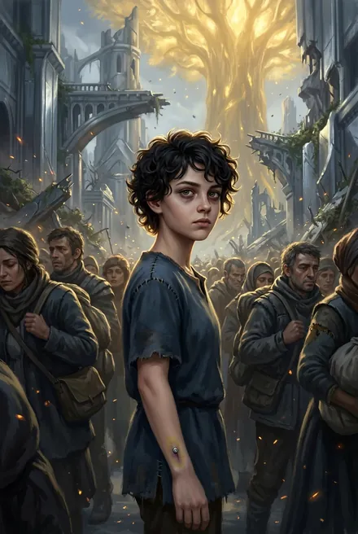
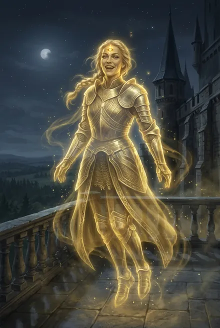
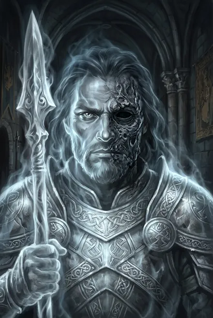
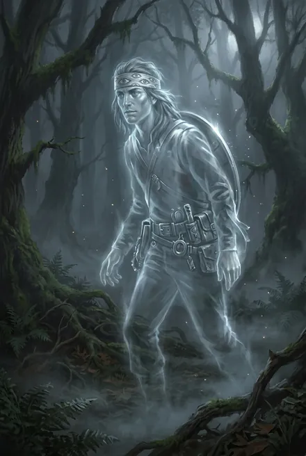
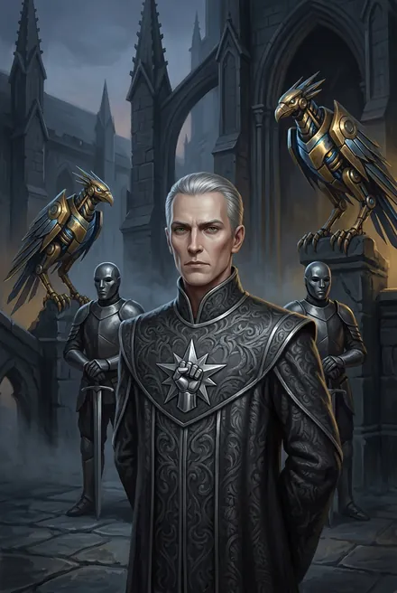

# Кель-рода Курганов Янтандера: хранители, ключники, предки

> Круг Семи Древ (**Янтандер**). См. также: [Морвейн](../personazhi/morvejn.md) · [Моргейн](../personazhi/morgejn.md) · [Предатель Арвейн](../personazhi/arvejn_predatel.md) · [Тысяча Братьев](../personazhi/tysyacha_bratev.md) · [Караванщики](../personazhi/karavanshchiki.md)

## Облики на иллюстрациях

<figure markdown="span">
  [{ loading=lazy }](../assets/portrety/130.webp)
  <figcaption>кель-страж <small></small></figcaption>
</figure>
<figure markdown="span">
  [{ loading=lazy }](../assets/portrety/131.webp)
  <figcaption>Хранительница Саар (гл. 12–18) <small></small></figcaption>
</figure>
<figure markdown="span">
  [{ loading=lazy }](../assets/portrety/132.webp)
  <figcaption>основной облик <small></small></figcaption>
</figure>
<figure markdown="span">
  [{ loading=lazy }](../assets/portrety/133.webp)
  <figcaption>основной облик <small></small></figcaption>
</figure>
<figure markdown="span">
  [{ loading=lazy }](../assets/portrety/134.webp)
  <figcaption>Итта <small></small></figcaption>
</figure>
<figure markdown="span">
  [{ loading=lazy }](../assets/portrety/135.webp)
  <figcaption>Эйр-Талас <small></small></figcaption>
</figure>
<figure markdown="span">
  [{ loading=lazy }](../assets/portrety/136.webp)
  <figcaption>Талар <small></small></figcaption>
</figure>
<figure markdown="span">
  [{ loading=lazy }](../assets/portrety/137.webp)
  <figcaption>лже-Амарис <small></small></figcaption>
</figure>

Иллюстрации созданы нейросетью по описаниям из книг; это трактовка, а не официальный арт.

## Общее
- Вокруг рубинового Игг-Древа **Арандар (Алый Корень)** — шесть Курганов с Малыми Древами (Аран-Талас, Аран-Саар, Аран-Майр…), корни которых оплетают саркофаги Братьев; у каждого — Замок кель-рода. Курганы насыпали «тысячи циклов назад, когда Семь Древ были Ростками»; основатели родов пришли с небесным воинством (ТБ-5). Курган — капкан о трёх Рубежах (Живой, Мёртвый, Теневой); взять его можно лишь изнутри; при неудаче родов Храм у **Медных Башен** зовёт охотников Небесного Трона (ТБ-5, гл. 4, 6, 17). Седьмой Курган — под корнями Арандара, тайный, «для Брата, который придёт освобождать других» — на деле гробница-засада Предателя (ТБ-5, гл. 10, 15). Над Кругом — небесное плетение «рэйя» на шести Замках (ТБ-5, гл. 19).
- **Кто они:** полукровки Аммос, присягнувшие Небесному Трону; только они в Круге получают стигматы; перекрещивают кровь; у хранительницы несколько **стражей-консортов**; различают духовную и плотскую любовь разными словами. Иерархия: **Хранитель (Первый Ключ)** → **Привратник** → **ключники** → **стражи** (ранг — алые звенья под сигной) → **затворы** (рядовые). Женщины носят хэлио; посмертные серебряные маски — в главном зале (ТБ-5, разд. 7). Заветы: «Тысяча приходит не с мечом, но со словом, и слово это будет — выбирай» (гл. 9); «Стойте и не отворяйте…» (гл. 15). По гл. 20 — **Народ (потомки) Предателя Арвейна**, который сам написал заветы.
- Три попытки освобождения на памяти Морвейн; вторжения воинства Восходящих через Порталы; два Замка разрушались и отстраивались; первый прорыв отразила Хельвейн (ТБ-5).
- **Младшие Народы Янтандера:** мирные **мясоеды** («чёрные мясоеды» восстали) и молчаливые **туманники** (линяют, откапывают оружие) (ТБ-5, гл. 12).

| Род | Сигна | Курган (Брат) | Судьба в ТБ-5 |
|---|---|---|---|
| **Талас** | Серебряные уста на синем | **Янтандер** | Замок разрушен Предателем (гл. 20); остатки рода во главе с Морри ушли в Эстэ |
| **Саар** | Серебряный сломанный клинок с волнистой кромкой на багровом — меч Моргейн (насмешка тюремщиков) | **Моргейн** | Курган вскрыт; род ушёл на базар Заова (гл. 19) |
| **Майр** | Чёрный холм, оплетённый алыми корнями | **Урсонд** | Уничтожен Цветением и битвой; на месте — кратер |
| **Роан** | Костяной венец; «молчаливы» | **Король Хворей** (четвёртый Курган) | Хранитель казнён Предателем, Ключ забран |
| **Варрен** | Две скрещённые стрелы; «хитры» | Неизвестный Брат (или Лодочник) | Хранитель казнён, Ключ забран |
| **Амарис** | Серебряная звезда в кулаке, тёмно-серые хэлио; «старшая кровь», заносчивы, подражают Кел; знают «последний затвор» | Вероятно, **Лодочник** | Хранитель — подменыш Вечности; Замок скован льдом Кейнора (гл. 20) |

## Род Талас

### Талар кель'Саар
Дух в Воющем Кувшине; кель-страж, дозорный, **ловец снов**, «ключник трёх замков»; в Вечности — мастер артефактов; серебряный щит (ТБ-1; ТБ-5, гл. 6). Пришёл из рода Саар, когда Морвейн было 20 циклов, — **муж** и «первый серебряный щит» Морвейн, **отец Эльвейн** (ТБ-5, гл. 7–8). В Домене Тория обезумел, сидел в клетке с шипами; Морвейн сделала его духом Кувшина (ЗК-5); исцелён от безумия (ЗК-9). Недоброжелателен к чужим (ЗК-9); характеризует Садовницу (ТБ-5, гл. 6). Третья Клятва — Пламени Подобному: «пойду… сквозь пламя и тьму, пока Вечность не падет или пока я не отправлюсь за Грань» (ТБ-5, гл. 7). Едва не распался под Изгоняющим Светом дочери, держал её при казни: «Эль… звёздочка моя…» (гл. 8–9). **Судьба неизвестна** (вероятно, погиб с Кувшином — *предположение*). *Противоречие: в ЗК-5, ТБ-1, ЗК-9 — «брат» Морвейн; в ТБ-5 — муж; объяснено её ложью.*

### Эльвейн кель'Талас
Дочь Морвейн и Талара; **Первый Ключ** рода Талас; золото, сильные Атрибуты Разума; «сухая, как клинок», «на век старше матери» (живя без Вечности); «камень, а не хранительница», никогда не улыбалась, учила Морри письму Кел (ТБ-5, гл. 8). Встречает мать словом «Гостья». Объявляет правду предков ложью — «потому что в неё поверила»; бьёт Изгоняющим Светом и Абсолютной Тишиной; призраки убивают её касанием, атамэ Морвейн отправляет её душу в Кувшин; стигмат пуст (гл. 9). «Ложь была не её, ей лгали» (гл. 10). **Мертва**, душа в Кувшине.

### Морри (Морвейн кель'Талас-младшая)
Правнучка Морвейн, внучка Эльвейн; дерзкая, коротко стриженная, тёмные кудри, серые глаза Аммос; хочет быть «стражем и дозорной»; мысленный призыв (ТБ-5). Пытается вырвать стигмат после осанн (гл. 9); подаёт Морвейн Первый Ключ (гл. 10). Тянется к «Углю»; «Ты обещал сказать, кто ты» — «Спроси меня после этой битвы» (гл. 19). Говорит за род перед Предателем: род стоит, «чтобы выбирать свою жизнь и свою смерть… самим. Стоит и не отворяет никому!» (гл. 20). Уводит выживших Порталом в Эстэ; на вопрос стражницы-тени «что же ты хранишь, хранительница?» обнимает детей: «**Теперь — их**» (эпилог). **Жива, новая хранительница.**

### Итта Талас кел Аммос — Итта Основательница
Дух; основательница и первая хранительница рода, одна из «писавших заветы»; **дочь Предателя**; высокая, изящная, как кел, с третьим оком над переносицей; насмешлива, древний акцент: «А я ведь говорила совету, что они просто стадо длинноухих дураков» (гл. 8). В Вечности — «дичь небесного Дома». «Курганов не шесть, а семь» (гл. 9). В старом теле ведёт Мёртвый Рубеж; называет Предателя: «Я скажу, Арвейн!» — и «отец»; «Мы исполняли твои заветы… Твой род служил верно, Арвейн!» (гл. 20). Погибла окончательно (по контексту).

### Эйр-Талас
Дух; строитель Замка, первый Первый Ключ; полуобожжённое лицо, без левого глаза (на маске — с двумя глазами) (гл. 8). Учит молодых стражей; ведёт мертвецов на Костяной Змее (гл. 20). Вероятно, погиб в огненной волне.

### Прочие Талас
- **Коравейн** — предок, певец; его вивисекция в Вечности показана в осанне (гл. 9). **Хельвейн** — отразила первый прорыв. **Ллеу** — хранительница, серебряный щит (ТБ-5).
- **Хранительница заветов** — слепая древняя старуха: «Заветы лгали» (гл. 10); записывает новые.
- **Эйлар кель'Талас** — старший ключник, встречает Морвейн у врат (гл. 7–8).
- **Мастер-над-дозорами** — страж-консорт из другого рода, шрам через лицо, золотой жезл-прерыватель; требует затворить Скрижаль слуги; первым присягает Морвейн (гл. 8; жив в гл. 19).
- **Дозор Кель'Саар:** Эйран (старший), Лиара (стрелок), Хайрад (толстяк) — проводили Морвейн к Талас.

## Род Саар

### Илиана кель'Саар («Ли»)
Хранительница рода Саар, золото; вдова **Арагвейна**; «мать только сыновей» (призрак мужа называет имя нерождённой дочери — **Ирвейн**, гл. 13). Жёсткая, властная, плачет молча; умеет считать и выбирает род, а не заветы (ТБ-5). Проводит Морвейн сквозь «тэль-ораан» — Пламя, срывающее маски (гл. 12). Враг → вынужденная союзница: снимает Мёртвый Рубеж Кургана Саар кровью и Ключом после Клятвы ПП перед Наблюдателем («ничего, что не отдано по своей воле») (гл. 17). «Демон! В заветах сказано — ты не лжёшь… Но там не говорится, что твоя правда хуже лжи!» (гл. 18). «Ты знал». — Срывает наплечник с сигной — «По своей воле» — и вынимает последний гвоздь: капля Моргейн переходит в неё (гл. 18). **Жива; тело делит с Моргейн** (ПП: прежний хозяин тела «живёт и здравствует»). Человек Илианы в Замке — **Тарк** (на связи по Говорящему Камню).

### Арагвейн кель'Саар
Дух; 70 циклов мастер-хранитель рубежей Саар, мёртв 10 циклов; муж Илианы; свидетельствует и преклоняет колено перед ней (гл. 13).

## Род Майр
- **Хранитель Кель-Майр** — глава рода, золото; Сфера Стоячих Часов (подарок Вечности), Отсекающие Грани, Ветровые Жернова; пытался запереть сад и заколоться — пророс рубиновым цветком (гл. 5). **Мёртв.**
- **Привратник Кель-Майр** — золото или почти; расцвёл и своей кровью открыл саду врата (гл. 5). **Ключница** (пробует кровь на вкус: «Какая… странная кровь») и **безволосый ключник** со Зраком Истины — дознатчики ПП, первыми гибнут от семени (гл. 4–5). Дозор Майр сковывает караван Печатями Пустоты (гл. 4).

## Род Роан
**Кайр кель'Роан** — хранитель, старейший, 108 циклов хранит заветы; Аспект — Говорящий Архив; требует от фактотума правды; цитирует завет и обрывает тайную строку о «последнем затворе» — «спрашивайте старшую кровь» (гл. 12); остался в башне, читал завет «Стойте и не отворяйте…» — казнён Предателем («Твой род служил верно») (гл. 15). Первый хранитель Роан (предок) свидетельствует о «тридцати поколениях, ушедших за врата» (гл. 13).

## Род Варрен
**Хранитель Варрен** — гладколицый, сильное серебро (не золото), трус; предки Варрен говорят о «золотых пустышках»; пересидел битву, отдал Ключ — разъят («Ваша служба окончена») (гл. 13, 15).

## Род Амарис
- **Лже-хранитель Амарис (фактотум)** — кел из Вечности, «Посланник Небесного Трона», в теле сына Сейты, подменённого через **Саркофаг Бесконечного Сна** («Из Саркофага возвращались не те, кто в него лёг» — в роду четырежды); ложный стигмат; сильное золото + Небесный Ястреб, две Экзо-Банши, Абсолютная Пустота. Допрашивает Морвейн: «из Вечности не возвращаются»; «Род Кель'Амарис объявляет вас всех предателями Круга» (гл. 12–13). Разоблачён, атакует тинг, бежит к Храму; **сожжён Анором** (гл. 14). С него: огромный запас Крови («гвоздь забирает девять десятых»), Ложный Стигмат, 10 золотых Рун, оплавленный Первый Ключ Амарис (гл. 15).
- **Сейта Кель'Амарис** — дух, мать подменённого: «Ты носишь его лицо. Но ты не мой сын» (гл. 13).

## Тайны
Первые поколения кель-родов и как Арвейн их основал; имя Брата в Кургане Варрен; что знала «старшая кровь» Амарис о последнем затворе; кто ещё из правителей подменён через Саркофаги; серебряная Восходящая в маске из зелёного камня, встречающая Морри в Эстэ (эпилог).
