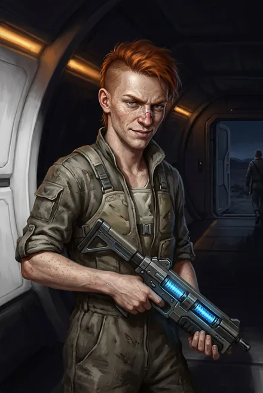

# Копьё Мрака: Свирель, Рэнди, Мик, Песчанка

## Облики на иллюстрациях

<figure markdown="span">
  [{ loading=lazy }](../assets/portrety/044.webp)
  <figcaption>основной облик <small></small></figcaption>
</figure>

Иллюстрации созданы нейросетью по описаниям из книг; это трактовка, а не официальный арт.

## Свирель
- **Кто:** землянка-азио «с социального дна», Восходящая (бронза), «слухач» — Руна слуха (ЗК-1–02).
- **Внешность:** короткостриженая, цифровые татуировки, пирсинг, ядовито-голубые пряди; свистит «заливисто»; дразнится пирсингованным языком (ЗК-4).
- **Речь:** «Котеночек сам хочет выйти на фионтар?» (ЗК-1, гл. 11).
- **Биография:** любовница Марка, боится его (ЗК-1); отключает камеры, блефует Скрижалью, «проспала» нападение (ЗК-2–03); в ЗК-6 Сигурд её вырубает при спасении Травинки; выдаёт, что пленники в Домене Трейва (гл. 24); изгнана с правом вернуться при серебряной вире (гл. 26).
- **Статус:** жива, изгой. **Белое пятно:** её поиски виры (ЗК-6 §12).

## Рэнди
- **Кто:** рыжий землянин ~20 лет, рождён в Единстве, ругательство «тс-си» (ЗК-1–02).
- **Биография:** пытался обокрасть криптор Сигурда, сломан нос (ЗК-1); дважды избит, нос/челюсть сломаны (ЗК-2); его кастет — трофей Сигурда; гибнет: Сигурд толкает его в рунную ловушку Говорящей из чёрных корней (ЗК-6, гл. 18).
- **Статус:** мёртв.

## Мик
Старший брат Рэнди, рыжебородый; сломана рука (ЗК-2); изгнан (ЗК-6).

## Песчанка (Песчаный Змей)
Плосколицый абориген, бывший пленник землян (из племени, напавшего на колонию), гражданин фригольда; погонщик, добил тауро (ЗК-1); в копье Мрака, сотрясение мозга (ЗК-2); изгнан (ЗК-6).
