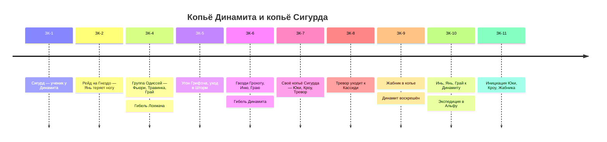

# Копьё Сигурда (и копьё Динамита): обзор отряда

> «Копьё» — боевая группа фригольда «Небо» (обычно 6–9 человек: Восходящие и не-Восходящие). Сигурд начинает учеником в **копье Динамита** (ЗК-1) и к ЗК-7 получает **собственное копьё**. Досье бойцов: `dinamit.md`, `lendo.md`, `grohot.md` (Толя Грохот = Анатолий Горохов), `in-yan.md`, `grai.md`, `fyuri.md`, `yuki.md`, `krou.md`, `zhabnik.md`, `trejv.md` (там же — Тревор «Мажор»; сам Трейв Уитли в копье не служил), `lohmach.md`, `travinka.md`, `maksvell.md`. Смежные — `minos.md` (Минос = доктор Матиас Амин), `eirik.md`, `serena.md`.

---

## 1. Как устроены копья во фригольде

- **Ранжирование копий.** «Слабые, недавно сформированные, получали наряды на охоту, дежурство, заставы или охрану сборщиков… Средние — таким было, например, копье Динамита — выходили на поисковые операции за пределами фригольда, устранение инцидентов и добычу опасных ресурсов, а сильные группы… выполняли самые рискованные, но и наиболее вкусные задания» (ЗК-7, гл. 2). С получением винтокрыла копьё становится «особой аэромобильной группой» — «Элита, на!» (ЗК-4, гл. 3–4, 7).
- **Задания** раздаются на утренних брифингах/«оперативках» (ЗК-4, гл. 4; ЗК-11, гл. 20).
- **Делёж добычи** (правила Динамита): «Слава — само собой, твоя. Звездная Монета — фригольду, отдашь Веронике. А Руна наша, берет тот, кому нужнее» (ЗК-4, гл. 6); «Все Монеты… уйдут во фригольд… Ими рикс распоряжается» (ЗК-2, гл. 14). Кровь и Руны со свободной охоты делят «по взаимному соглашению — кому что нужнее» (ЗК-2, гл. 6). Лезть в чужую Скрижаль — «моветон», возможен лишь добровольный обмен (ЗК-7, гл. 7). Личная добыча бойца неприкосновенна (ЗК-7, гл. 13).
- **Стигмат.** «Перед тингом от каждого копья выдвигается кандидат на стигмат» (ЗК-2, гл. 7; ЗК-11, гл. 12). Копьё с семью сильными Восходящими «фригольду невыгодно» — его делят (ЗК-8, гл. 7; ЗК-11, гл. 15, 19).
- **Награды Наблюдателя** засчитываются Восходящему с наибольшим вкладом; не-Восходящие их «съедают» впустую (ЗК-4, гл. 18).

---

## 2. Состав по книгам

| Период | Командир | Состав | Изменения |
|---|---|---|---|
| **ЗК-1–02** (копьё Динамита) | Динамит (бронза, хейр) | **Лохмач** — следопыт; **Грохот** — тяжёлое; **Инь** — снайпер; **Янь** — медик и оператор дронов; **Лэндо** — лучник, второй Восходящий; **Сигурд** — ученик (ЗК-2, гл. 3). «Нас — тоже семеро» (ЗК-2, гл. 13) | Янь теряет ногу в рейде на Гнездо (ЗК-2; ЗК-4, гл. 3); Сигурд пропадает (конец ЗК-2) |
| **ЗК-4** (группа «Одиссей», винтокрыл «Грифон») | Динамит | Сигурд — первый пилот; **Фьюри** — штурман/стрелок (от Вероники); **Травинка** — медик; **Грай** — новичок; Лэндо, Грохот, Инь, Лохмач (ЗК-4, гл. 3–4) | Янь выбыл; **Лохмач погиб**, закрыв Динамита (гл. 23); Сигурд «погиб» (гл. 23) |
| **ЗК-5** | Динамит | Динамит, Грохот, Лэндо, Инь, Янь, Грай, Фьюри; Травинка | Копьё хотят расформировать; угон «Грифона»; в Шторм уходят Динамит, Фьюри, Грохот, Инь, Грай; у Эйрика остаются Янь, Лэндо, Травинка, Ханна (интерлюдия) |
| **ЗК-6** (поход с Вероникой на тинг) | Динамит / Вероника | Динамит, Фьюри, Грохот, Инь, Грай, Сигурд, Травинка | Гвозди: **Грохот** (бронза + Титул), **Инь** (4-7-4), **Грай** (6-3-3); Лэндо уходит к своему Народу (гл. 7); **Динамит убит** (интерлюдия; гл. 25) |
| **ЗК-7** (копьё Сигурда) | **Сигурд** (серебро, хейр → танаан) | **Фьюри** — второй пилот; **Грохот**; **Инь**; **Грай** (кома); **Янь** (ждёт бионику); новобранцы **Юки «Тень»**, **Андре Кроу «Птица»**, **Тревор «Мажор»** (гл. 5, 9) | Грай очнулся (гл. 19–20) |
| **ЗК-8** | Сигурд | + Янь с бионической ногой (гл. 3) | **Тревор уходит** в копьё Кассиди (гл. 16) |
| **ЗК-9** | Сигурд | Фьюри, Грохот, Инь, Янь, Грай, Юки, Кроу + **Жабник** (доктор Мукерджи) вместо Тревора (гл. 4, 10) | Эйрик дарит копью чистый гвоздь (гл. 6) |
| **ЗК-10** (экспедиция в Альфу) | Сигурд | Фьюри, Грохот, Юки, Кроу, Жабник (+ «заяц» Элли Кардо) (гл. 8–9) | **Инь, Янь, Грай** уходят в новое копьё **воскрешённого Динамита** (гл. 8); захват Альфой (гл. 23) |
| **ЗК-11** | Сигурд (эрл, один из четырёх знаменосцев Кассиди — гл. 20) | Фьюри, Грохот, **Юки → Тень-из-Неба**, **Кроу → Ворон**, **Жабник** (все трое — Восходящие, гл. 19) | «шесть Восходящих! Ни в одном копье столько нет» (Грохот, гл. 19); Кроу — кандидат в командиры нового копья; Фьюри — дезертир Альфы |

**Погибшие/выбывшие навсегда:** Лохмач (ЗК-4), Динамит (ЗК-6 — воскрешён в ЗК-9, но уже в своём копье), Лэндо (ушёл в своё копьё/к Народу Трав, ЗК-7–11), Тревор (ЗК-8), Инь, Янь, Грай (к Динамиту, ЗК-10).

---

## 3. Иерархия и роли (на пике, ЗК-9–11)

- **Командир** решает за всё и отвечает за людей; в полёте командует пилот: «Дмитрий, в полете на воздушном судне командую я!» (Сигурд — Динамиту, ЗК-4, гл. 7).
- **Фьюри** — «она была старшей после меня» (ЗК-10, гл. 19).
- **Грохот** — неформальный старшина и «народный голос», раздаёт клички («Звездный Флот», «Тень», «Птица», «Мажор», «Жабник»).
- Обращение к командиру: «командир» (Грохот, Кроу, Тревор), «сэр» (Фьюри), «Сигурд» (Юки), «кано» (Лэндо).

---

## 4. Техника и снаряжение

- **Винтокрыл «Грифон»** (тилтротор с импеллерами; «Одиссей» — надпись/прежнее имя аппарата экспедиции Альфы — ЗК-5, гл. 20): штатная загрузка 8 человек, «дюжину впихнем» (ЗК-7, гл. 2); гаусс-турели под крыльями, ракетные барабаны «Пилумов» (ЗК-4, гл. 4), барьерные щиты, ретранслятор вокса (ЗК-7, гл. 10), десантный люк и **«люлька»** под брюхом для Грохота в Доспехе — схема «сибирских медведей» Звездного Флота (ЗК-7, гл. 7, 10). Восстановлен Сигурдом как **серебряный Предмет** (ЗК-6, гл. 6; ЗК-7, гл. 4); после крушения в Мертвом Городе (ЗК-10, гл. 16) — **превращён в Руну** и носится в Скрижали (ЗК-10, гл. 20–21; ЗК-11, гл. 15). Позже — Рассеивающая Линза (маскировка, ЗК-10, гл. 20), огненное ускорение (ЗК-11, гл. 10).
- **Земное оружие:** штурмовая винтовка «Суворов», снайперская «Вдова», тяжёлое импульсное «Копье» (Инь), наручный импульсный «Янтарь» (Динамит), импульсные «Стрелы», шестиствольный гаусс-пулемёт/турель (Грохот), ракетометы «Пилум»/«Ведьма», смарт-гранаты, штык-ножи.
- **Броня и экипировка:** «Скаут», «Фокс», «Хантер», «Варриор», «Гардиан» (легионная), экзоброня **«Мангус»** с мышечным усилителем и плащом-хамелеоном (ЗК-4, гл. 14, 18), кидо **«Гоплит»** → Боевой Отражающий Доспех (Руна) Грохота (ЗК-7, гл. 8), миоэлектрический экзоскелет (ЗК-2, ЗК-4), вокс за ухом, криптор, Скрижаль.
- **Транспорт:** тауро (верховые), багги, глайдеры, Порталы и Стрелы.

---

## 5. Типичная тактика

1. **Воздушная разведка → боевой заход:** птица-Острокрыл Фьюри, Аспект-Дракон и Глаз Небесного Змея Сигурда, затем удар турелями и «Пилумами», Грохот — из люльки или десантом без троса (ЗК-7, гл. 3, 10; ЗК-10, гл. 13).
2. **«В кучу!»** — круговая оборона вокруг тяжёлого: Грохот «незыблемой скалой», Инь с дистанции, барьерный щит Яня (ЗК-2, гл. 4; ЗК-7, гл. 4; ЗК-10, гл. 5).
3. **Приманка и отвод:** Лэндо на Речном Коне уводит голиафов (ЗК-4, гл. 5); феромонная метка Эйрика на Подкове (ЗК-7, гл. 9).
4. **Скрытное проникновение:** Юки в Плаще Фантома/с «танцами-с-тенями» + Кроу (ЗК-9, гл. 6; ЗК-10, гл. 7).
5. **Свет против тьмы:** прожекторы, солнцекамень, Полярия Лэндо, Светоч — против пустотников (ЗК-8, гл. 7).
6. **Объединение Разумов** (Руна с Вершителя): телепатическая сеть Сигурда — «я знал… где находится каждый из моих подопечных… мог мысленно… направить или затормозить его» (ЗК-8, гл. 4); действует как «сетецентрическая система управления Звездного Флота»; в ЗК-10–11 — стандарт копья (ЗК-10, гл. 5–6, 21; ЗК-11, гл. 10).
7. **Полевая медицина:** Ночницы Миноса (ЗК-1), Травинка (ЗК-4), Янь, затем «экстремальная медицина» Жабника (ЗК-9–11).
8. **Отступление «драп-маршем»** с прикрытием Грохота (ЗК-7, гл. 4; ЗК-10, гл. 7; ЗК-11, гл. 10).

---
