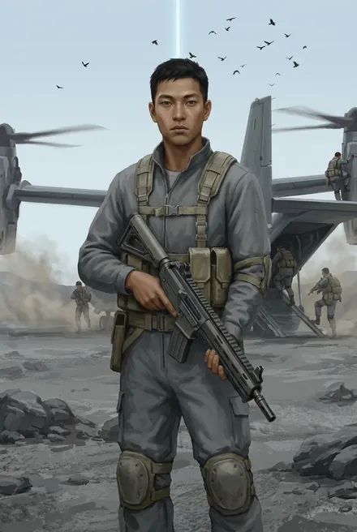

# Андре Кроу («Птица» → Ворон)

| | |
|---|---|
| **Имя** | **Андре Кроу** (ЗК-4, гл. 10; ЗК-7, гл. 5) |
| **Прозвища и позывные** | **«Птица»**, «Птицын» — от Грохота: «Шнобель у тебя как клюв, на… Пока будешь просто Птица» (ЗК-7, гл. 9, 13). **Ворон** — позывной в Восхождении: «Фамилия. И нравится, у меня такой уже был. В киберспорте» (ЗК-11, гл. 19) |
| **Происхождение** | Землянин, «из северной Пацифики… Аэриум» (айленд-сити) (ЗК-7, гл. 9); колонист «Хельги», в Небе — «из последней волны» (ЗК-7, гл. 5). «Серый комбинезон» с рабочей специальностью **«VR-спортсмен»**: многократный чемпион VR-боёв Аэриума (одиночный и командный зачёт), член сборной Пацифики; привлекался **инструктором VR-обучения спецподразделений планетарной безопасности**; в 2419 г. «задержан за участие в подпольных VR-боях. Приговорен к ограничению прав и двум годам трудового заключения» (ЗК-7, гл. 9) |
| **Роль** | Стрелок копья Сигурда, разведчик в паре с Юки; кандидат в командиры собственного копья (ЗК-8, гл. 7; ЗК-11, гл. 19) |
| **Книги** | ЗК-4 (1 упоминание), ЗК-7 – ЗК-11 |
| **Ранг** | Не Восходящий → **сразу бронза; Атрибуты Разума и Духа — бронзовые** (ЗК-11, гл. 19) |
| **Статус на конец канона** | Жив, Восходящий копья Сигурда; Сигурд намерен рекомендовать его «как командира нового копья» (ЗК-11, гл. 19) |

---

## Облики на иллюстрациях

<figure markdown="span">
  [{ loading=lazy }](../assets/portrety/048.webp)
  <figcaption>основной облик <small></small></figcaption>
</figure>

Иллюстрации созданы нейросетью по описаниям из книг; это трактовка, а не официальный арт.

## Личность

- **Хладнокровие.** На собеседовании «вообще не волновался. Он оценивал обстановку и людей цепким внимательным взглядом, молчал» (ЗК-7, гл. 9); в бою «спокоен как удав», «исполнительный, спокойный, как дремлющий удав» (ЗК-7, гл. 10, 19).
- **Профессионал.** «Кроу не ошибался. Он соображал и принимал решения быстро — и, как правило, они оказывались единственно верными. Нацеленный на результат, он почти не рисковал, но когда нужно — действовал решительно» (ЗК-8, гл. 7). Ссылается на опыт: «Я был в подобной ситуации», «командир, мы отрабатывали это на полигоне» (там же).
- **«Двойное дно».** «Когда человек умеет контролировать себя — это всегда видно. Кроу… умел. И у него, я чувствовал это, есть интересное двойное дно» (ЗК-7, гл. 13). Грохот: «Человек без нервов, на. Глаза мертвые, что курицу зарезать, на, что человека убить» (ЗК-8, гл. 7).
- **Скрытая человечность.** Сухой юмор (фыркает над Кардо; следит за выпусками её новостей, ЗК-10, гл. 10); тоска по Земле: «Когда привыкаешь, забывается, что мы не на Земле. А потом видишь что-то такое… и вспоминаешь» (ЗК-10, гл. 20); песня Соловья — «Прямо за душу берет…» (ЗК-11, гл. 15). Кивок уважения Сигурду после победы над золотым (ЗК-10, гл. 19).
- **Немногословие.** «Цедил свое пиво с непроницаемым лицом, больше слушая других» (ЗК-7, гл. 13).

## Речь — короткие реплики
- «Из северной Пацифики. Аэриум» (ЗК-7, гл. 9).
- «Я, командир. Можно?» — вызывается в Серебряный Замок (ЗК-8, гл. 3).
- «Ликвидировать?» — без эмоций, о детёныше никси (ЗК-10, гл. 6).
- «Я тоже остаюсь, командир. Альфа — так Альфа» (ЗК-10, гл. 8).
- «Золото мертвецам ни к чему… Торгаши жадные, но умные» (ЗК-10, гл. 20).
- «Нас снимают и пишут… Тут повсюду камеры» (ЗК-11, гл. 6).
- «Просто жизнь одна. Но с этой надстройкой я чувствую себя в хардкор-режиме» (ЗК-11, гл. 19).

---

## Биография

- **ЗК-4, гл. 10.** В списке колонистов, подобранных при спасении капсул «Хельги» (вместе с Элизабет Нуан, Ильёй Сухариным и др.).
- **ЗК-7, гл. 5, 8–9.** Сигурд выделяет его при мониторинге досье; Кассиди назначает его в копьё одновременно с Тревором. Стандартный набор новобранца — потрёпанный «Скаут». Грохот: «Птица».
- **ЗК-7, гл. 10–19.** Боевое крещение на Подкове — без паники; остаётся у «Грифона» в битве у Пика.
- **ЗК-8, гл. 3–4.** Добровольцем идёт в Серебряный Замок; в бою с пустотниками догадывается применить светошумовую гранату, выстрелом снимает тварь со спины Сигурда, помогает ему забраться внутрь — Сигурд «особо отметил его».
- **ЗК-8, гл. 7, 14, 16.** Двойка с Тревором; ночной дозор; кандидат на гвоздь «брал… классом»; дозорный у Стрелы; награда — баллы и новый «Фокс».
- **ЗК-9, гл. 4, 6.** Стрелок в рейде за Стену; с Юки изучает преддверие подземелий цвергов; «остался внешне невозмутимым» при обмене награды на стигмат.
- **ЗК-10.** Вытаскивает Грая от края платформы (гл. 6); выбирает экспедицию в Альфу (гл. 8); проверяет периметры и вышки на Терре (гл. 10–11); в Либерти валит «волчонка» коленом на шею (гл. 21); захвачен Альфой.
- **ЗК-11, гл. 5–6, 9–10.** В изоляторе «почти расслабленный»; Альфа собиралась его «санировать»; при побеге — с трофейной «Стрелой», поддерживает раненого Иня.
- **ЗК-11, гл. 19.** Первым входит в Храм Вечности Народа Зари — **бронза, позывной Ворон**. Стартовые Руны: Заклинание **Железной Хватки**, Умение **Энергетической Сети**, Предмет **Мертвая Пуля**; 48 капель.
- **ЗК-11, гл. 20.** Новые Руны (Развития, бронзовые Умения).

## Как Сигурд его выбрал (ЗК-7, гл. 9)
Досье «серого комбинезона» с бесполезной в Единстве специальностью привлекло Сигурда отметками: боевые VR-турниры — «аналог смертельных гладиаторских боев древности», где «требуется развитое аналитическое мышление, самообладание, хладнокровие, умение сохранять выдержку в стрессовых ситуациях и, конечно, прекрасная реакция». Объяснение, почему «восходящая звезда» попал в колонисты низшего разряда, — судимость 2419 г. Сигурд сам собирался встретиться с ним, когда Кассиди прислал в копьё именно Кроу и Тревора. В отличие от Тревора, на первом построении Кроу «вообще не волновался» — Навыки Сигурда позволяли читать эмоции. Вывод после первых рейдов: «Идеальный боец… С огромным потенциалом. Я видел, что он вполне способен пойти дальше и командовать собственным копьем, вот только молчаливая хладнокровность порой немного пугала» (ЗК-8, гл. 7).

## Способности
Снайперская и тактическая стрельба «экономными двойками» (ЗК-8, гл. 4); рукопашный бой (VR-гладиатор); аналитика. После инициации: бронза (Разум и Дух), Железная Хватка, Энергетическая Сеть, Мертвая Пуля.

## Отношения
- **Сигурд** — ценит как «идеального бойца»; будущий преемник/командир (ЗК-8, гл. 7; ЗК-11, гл. 19).
- **Грохот** — крёстный отец «Птицы», скептик, признавший его класс.
- **Юки** — напарница-разведчица и со-кандидат на гвоздь.
- **Тревор** — антипод (двойка в ЗК-8; Тревор завидует).
- **Инь** — товарищ по изолятору Альфы.

## Тайны и крючки
1. **Подпольные VR-бои и тюремный срок 2419 г.** — что стояло за делом; связь со спецподразделениями планетарной безопасности (как у Серены).
2. **«Двойное дно»** — не агент ли он чей-то *(предположение)*.
3. **Позывной «Ворон» из киберспорта** — прошлое в вирте.
