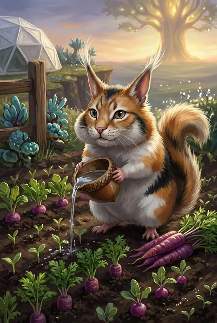

# Кыш

| | |
|---|---|
| **Кто** | Полевой йурр — зверёк-«огородник»/«садовник» Единства; «ключник» при Семени Игг-Древа; с ЗК-7 — звёздное существо, «главный садовник» Ростка |
| **Роль** | Спутник Сигурда, «восьмой член копья» (ЗК-2); страж Ростка / Древа «Скай» |
| **Книги** | ЗК-1–ЗК-8 (упом. ЗК-9–11), ТБ-4, ЗК-12 (гл. 2) |
| **Статус** | Жив; живёт у Ростка с самочкой и потомством (ЗК-8, ТБ-4). В ЗК-12 — **бронза**: «обогнал в развитии половину фригольдеров»; самочка Подарок — «золотисто-палевая», её принесла Иниэсс, — и несколько детёнышей: «Кыш, да ты теперь многодетный отец!» (ЗК-12, гл. 2) |
| **Имя** | Автор: Кыш «был вдохновлен криком „Кыш!“, которым я сгоняю с дивана домашних животных» ([пост 2712, комм. 46470](https://t.me/prokofiev_litrpg/2712?comment=46470)); «йурр» через «й» — чтобы подчеркнуть «чуждость мира и языка аборигенов», «юрр» звучало бы «смешно и глупо» ([комм. 47307](https://t.me/prokofiev_litrpg/2712?comment=47307)) |

## Облики на иллюстрациях

<figure markdown="span">
  [{ loading=lazy }](../assets/portrety/058.webp)
  <figcaption>основной облик <small></small></figcaption>
</figure>

Иллюстрации созданы нейросетью по описаниям из книг; это трактовка, а не официальный арт.

## Внешность и повадки
«Пухлый трёхцветный йурр с кошачьей мордочкой, белыми кисточками на ушах и глазами-бусинками; свистит "юрр-юрр", поливает огород из защечных мешков, кусает за ухо, когда обижен» (ЗК-1).

## Биография
- **ЗК-1:** кормит героя, будит, ловит вора, следует за Семенем; во фригольде его отбирают, затем Анни Ри возвращает (гл. 22).
- **ЗК-2:** лечит Хладноцветы, вызывает задание Наблюдателя; оставлен в палатке (гл. 14).
- **ЗК-3:** первым встречает Сигурда (эпилог). **ЗК-4:** Травинка ставит на него рунную метку, Эйрик интересуется им.
- **ЗК-5:** живёт в Домене, летает на Драконе-Аспекте, охотится на Ночницу.
- **ЗК-6:** освобождает Семя, вырывает его из лиан Кошмарной Рощи (гл. 23), выбирает место посадки на плато (гл. 26), страж Ростка (эпилог 1). **Эпилог 2:** Эйрик по заказу «небесного» Кел оставил йурра на островке озера и бросил туда Семя — «ключ и ключник».
- **ЗК-7:** «бывший питомец» — главный садовник Ростка; становится звёздным существом (дерево); получает самочку-йурра.
- **ЗК-8:** нора у Игга, ждёт потомство.
- **ТБ-4:** «дерзит Кейнору», кидает в небо комок земли.

## Тайны
Небесные Псы «тысячу циклов не видели» йурров (ЗК-9 §12) — Кыш как редкий вид, связанный с Творящей и Древами.
