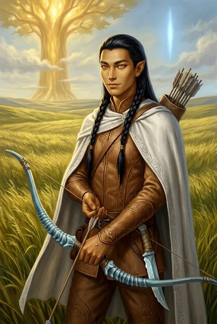
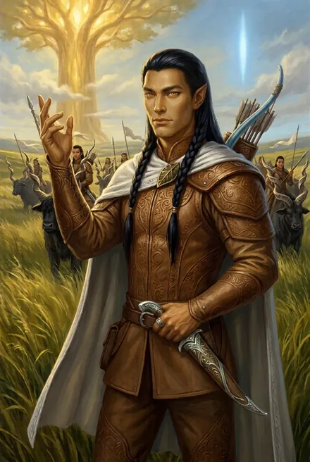

# Лэндо Солнечное Крыло

| | |
|---|---|
| **Имя** | Лэндо Солнечное Крыло (сам поправляет землян: «Лэндо Солнечный Крыло… Я быть Восходящий и быть средний сын рикса Народа Трав» — ЗК-1, гл. 17). Земляне зовут «Лэндо из Моря Трав», «принц», «сын рикса» |
| **Как зовёт Сигурда** | **«кано»** — побратим; формально Сигурд — его **саан-кано** («долг крови», ЗК-2, гл. 1) |
| **Народ** | Народ Трав (Люди Трав, «Дети Трав»), эль Пылающего Рога; клан Солнца (ЗК-7, гл. 14). *Не Народ Реки* — Люди Реки у Лэндо вызывают презрение (ЗК-1, гл. 17) |
| **Семья** | Отец — **Айно Ветер Равнин**, рикс эль Пылающего Рога → кинг всего Народа Трав (ЗК-6, гл. 8, 20). Мать — **Жемчужина-в-Волосах**, фламиника (ЗК-6, гл. 8). Старший брат — **Кандо Солнечный Ветер**, знаменосец Народа Трав (ЗК-7, гл. 14). Прадед (в ЗК-6, гл. 9: «отец моего деда») — **Горячее Солнце**, посадил Пылающий Рог и стал первым кингом. Двоюродная сестра — ученица Жемчужины, дочь сестры кинга (ЗК-7, гл. 15) |
| **Роль** | Принц-заложник во фригольде «Небо» → лучник/Восходящий копья Динамита → побратим Сигурда → хейр, командир копья молодых воинов у Пылающего Рога → командир копья фригольда (с Келли Флоу) в сезон Дикой Охоты |
| **Книги** | ЗК-1, 02, 04, 05 (интерлюдия), 06, 07, 08 — активно; ЗК-3, 09, 10, 11 — упоминания; отец — также ТБ-4 |
| **Ранг** | Дерево, ювейн (ЗК-1) → бронза (Руна Повышения, ЗК-4) → бронзовый хейр (ЗК-7) |
| **Статус на конец канона** | Жив. После тинга ушёл к своему Народу, «честно отработав сезон Дикой Охоты»; Келли Флоу приняла его дары, свадьба назначена на **День Творящей у Пылающего Рога** (ЗК-11, гл. 20) |

---

## Облики на иллюстрациях

<figure markdown="span">
  [{ loading=lazy }](../assets/portrety/022.webp)
  <figcaption>Юный принц-лучник <small>ЗК-1 — ЗК-6</small></figcaption>
</figure>
<figure markdown="span">
  [{ loading=lazy }](../assets/portrety/023.webp)
  <figcaption>Возмужавший хейр, командир копья <small>ЗК-7+</small></figcaption>
</figure>

Иллюстрации созданы нейросетью по описаниям из книг; это трактовка, а не официальный арт.

## 1. Личность, мотивация, слабости

**Ядро.** Лэндо — воплощение аристократического кодекса Народа Трав: честь, слово, Слава, родовая гордость. Сигурд характеризует его как «очень приятный, хотя и слегка занудный парень. У него на все было свое мнение, которое Лэндо не стеснялся высказывать» (ЗК-1, гл. 18). В быту «дотошен до мелочей и на каждый случай имеет сакраментальную цитату за авторством Того-Кто-Сражается» (ЗК-2, гл. 1); ест «аккуратно и с большим достоинством, словно исполняя некий ритуал» (там же).

**Честность.** Не умеет и не хочет лгать; уверен, что при Восходящей-риксе лгать бессмысленно: «Ваш рикс есть Восходящая. Нельзя лгать» (ЗК-1, гл. 18). Публично обвиняет Мрака и Трейва, не просчитав последствий: Говорящая «отпускает» его с хищной улыбкой, а Динамит ворчит: «зря ты возбухнул на Мрака…» (ЗК-5, интерлюдия «Травинка»).

**Трезвенник.** Отказывается от спиртного («ядовитой воды») в походе (ЗК-2, гл. 5), но пьёт ритуальный моос своего Народа (ЗК-4, гл. 8; ЗК-6, гл. 8).

**Воинская этика.** Охота без риска для него бесчестна: после истребления голиафов с воздуха — «В такой охоте нет чести» (ЗК-4, гл. 6); недоволен «бесславной охотой» обвалом (ЗК-4, гл. 17). Убийство Небесных Змеев без задания — «Позор» (ЗК-4, гл. 17). Свято чтит законы Единства и Клятвы: «За Клятву Восходящего отвечать его Народ» (ЗК-1, гл. 17).

**Верность и человечность.** В тяжёлые дни после возвращения Сигурда из Земель Теней «больше других поддерживал меня… Словами, молчанием, жестом — он все прекрасно понимал и помогал мне чем мог, ничего не требуя взамен. Может, оттого что были ровесниками» (ЗК-4, гл. 17). Защищает Сигурда перед командиром: «Сигурд не знать, командир. Он не быть виноват!» (ЗК-4, гл. 18).

**Слабости.**
- **Предрассудки крови.** Не женился бы на Травинке, потому что она наполовину из Людей Тени: «Травинка красивая и дочь рикса… Но она из Людей Тени, а я не хотеть жену их Народ» (ЗК-6, гл. 9). Ненависть к Теням — наследственная (история Пылающего Рога). Сигурд одёргивает его: «Тот-Кто-Сражается не слышит тебя, Лэндо… Они тоже люди, как мы с тобой» (там же) — и Лэндо уходит от темы.
- **Политическая наивность** (см. эпизод с Говорящей, ЗК-5).
- **Настырность в ухаживании:** хочет взять жену-землянку «с желтыми волосами» («Дети быть красивые», ЗК-6, гл. 9); Сигурд сомневается, «сколько в нем искренней симпатии, а сколько игры гормонов и желания заполучить редкую добычу» (там же).
- **Дисциплина старшинства:** при отце молчит, «пока говорят старшие и никто не спрашивает его мнения» (ЗК-6, гл. 8), — но на тинге всё же нарушает предостерегающий жест отца ради друга (ЗК-6, гл. 20).

**Эволюция.** Юноша-заложник, «живущий здесь не совсем по своей воле» (ЗК-1, гл. 18) → полноправный боец копья → политический актор (демарш перед Трейвом, речь на тинге) → хейр, «уже водит в бой копье молодых воинов» (ЗК-7, гл. 14) → командир земного копья и жених. Растёт и внешне: в ЗК-7 — «молодой мужчина, лицом похожий на мать, а статью пошедший в отца» (гл. 14).

---

## 2. Речь

**Манера.** Ломаный глобиш/русский: инфинитивы вместо спряжений, «быть» как связка, «есть» как артикль, порядок слов чужой. Когда не хватает слов — щёлкает пальцами (ЗК-2, гл. 3) и спрашивает: «как это на вашем языке?». О себе иногда в третьем лице: «Лэндо помогать разберемся» (ЗК-2, гл. 2). В торжественные моменты говорит почти правильно (речь на тинге, ЗК-6, гл. 20; ответ отцу «Верно, отец. Ее имя — Келли Флоу», ЗК-6, гл. 8). К ЗК-9 глобиш — эталон беглости аборигена: Эдри «говорил на глобише не хуже Лэндо, второй цикл живущего у нас» (ЗК-9, гл. 3).

**Фирменное — «Тот-Кто-Сражается говорить…».** Манеру он унаследовал от отца: Сигурд, услышав сентенции Ветра Равнин, «понял, у кого Лэндо позаимствовал тон и манеру своих сентенций» (ЗК-6, гл. 8). Клятвы: «клянусь Защитником!» (ЗК-6, гл. 9); упоминает Незримого и Единых.

**Словарь.** «тхи-усс» — Черви/твари Изнанки (ЗК-1, гл. 17; ЗК-2, гл. 14); «фэй-вэйд» — сторожевые рунные конструкты Кел (ЗК-1, гл. 17; ЗК-4, гл. 22); «кано», «саан-кано», «хазак», «моос».

**Цитаты Того-Кто-Сражается в устах Лэндо** (готовый материал):
- «Восходящий защищать людей» (ЗК-1, гл. 19).
- «Плохой помнить долго, а хороший забывать быстро, поэтому всегда оставлять знак тем, кто сделать добро» (ЗК-2, гл. 1).
- «Любовь проломить любые преграды!» (ЗК-4, гл. 4).
- «Нельзя победить врага, если твои руки сражаться между собой» (ЗК-5).
- «У каждый Восходящий быть свой секрет» (ЗК-5, интерлюдия «Травинка»).
- «За гранью не ждать торопливых!» (ЗК-6, гл. 8).
- «Плоха та добыча, что сама идти в руки» (ЗК-6, гл. 9).
- «Не поднимать оружие на того, с кем твое сердце» (ЗК-6, гл. 10).
- «Рука, что даровать, сильнее быть руки, что отнимать» (ЗК-8, гл. 16).

**Прочие цитаты.**
- «Я Восходящий! Тот-Кто-Сражаться говорить — Восходящий защищать людей» (ЗК-1, гл. 19).
- «Ты брать право. Я брать лево» (ЗК-1, гл. 19).
- «Я мужчина и охотник быть! Как у вас говорить — нет проблем!» (ЗК-4, гл. 5).
- «Кано! Мой кано Сигурд! Восходящий! И серебро! Тот-Кто-Посадил-новое-Древо!» (ЗК-7, гл. 14).
- «Слава твоя высока быть, кано! Я благодарить Единых, что знать тебя» (ЗК-7, гл. 19).

---

## 3. Предыстория

- **Происхождение.** Средний (второй) сын Айно Ветра Равнин; рождён в Единстве (ЗК-7, гл. 14). Хазак из клыка ледозуба мальчики Народа Трав получают «после большой испытаний, когда стать мужчиной» (ЗК-2, гл. 1) — Лэндо прошёл это посвящение до ЗК-1.
- **Дружба отцов.** Когда земляне «начинать падать с небес», Винсент Кассиди спас будущего кинга (тогда «простой хейр») от огнезуба; тот подарил Винсу хазак и назвал своим кано; его лечили во фригольде, он учил язык; позже Кассиди долго жил у Пылающего Рога, у них было одно бронзовое копьё, где был и Эйрик, а Веронику кинг «знать давно»; Винсент «вернуть долг жизни» (ЗК-6, гл. 9). В ЗК-7 кинг перечисляет состав того копья: «Кано, я, Эйрик, Ника… Не хватает Гая Флоу и Кнута» (ЗК-7, гл. 15). На плече кинга — татуировка с нашивкой «Космо» и ковчегом «Хельга» (ЗК-6, гл. 8).
- **Заложничество.** На прошлом большом тинге Эйрик и Вероника договорились с Ветром Равнин об обмене детьми: дети землян (близнецы Максвелл, Ярослав) живут у Трав, а Лэндо и **Эйно** — в поселениях землян (Лэндо во фригольде, Эйно на ферме Эйрика) (ЗК-5, интерлюдия «Травинка»; ЗК-6, гл. 8). В ЗК-1 Лэндо «второй год живет с нами» (гл. 17). Сам признаёт: «Я тоже не хотеть покидать Пылающий Рог! И Эйно не хотеть… Но — так решать, так полезный быть для Народов! И я не жалеть, что жить у вас» (ЗК-6, гл. 9).
- **Земная выучка.** Умело обращается с «Суворовым» и меняет магазины — «обращаться с земным оружием его научили, и научили неплохо» (ЗК-1, гл. 19).
- **Как отец стал кингом.** Ветер Равнин убил Белого Варга — пробудившееся «старое серебро»; головы варгов выставлены в стойбище (ЗК-6, гл. 9). Для Лэндо это стало неожиданностью: «Я сам удивлен быть!» (там же).

---

## 4. Биография по книгам

### ЗК-1 — Звездная Кровь
- **Гл. 17.** Знакомство в спальне копья Динамита. Рассказывает, что Сигурд упал в запретных руинах Кел на землях Народа Реки («Старая смерть. Зло!»); объясняет коллективную ответственность за Клятвы и кару Единства: Наблюдатель прислал «небесный корабль», чьи воины «состоять из огня и металла», против Людей Пещер.
- **Гл. 18.** Наряд с Инем на Третьем Дозорном посту над пропастью; лекция о чае из духотрав (три листа — слабый, шесть — «всю ночь бежать, охотиться, любить», девять — только на войну). Сигурд узнаёт, что Лэндо — заложник. Подстреливают дрейка («Не убить… Ранить, Инь! По крыльям бить!»).
- **Гл. 19 — ваал.** Сигнальный костёр, бегство на багги, встреча с Травинкой и четырьмя детьми; Лэндо и Сигурд уступают им места и остаются прикрывать. Лэндо бьётся «Суворовым», затем тремя Рунами (щиты, клинок, призрачный двойник); его хватает альфа-дрейк, щиты лопаются. Без сознания — не видит, как Сигурд убивает альфу Руной Алого Когтя. Сигурд накладывает жгут и тащит его к фригольду; Минос подсаживает в рану золотую ночницу.
- **Гл. 21.** Оба в медкоме; Травинка: «вас вместе привезли».

### ЗК-2 — Фригольд
- **Гл. 1.** Объявляет Сигурда своим саан-кано и вручает хазак «Клык Ледозуба» как залог долга крови: «Хазак твой, пока я не отдать долг. Любой из Народа Трав узнать и помогать». Голос: «Надо же, дети Эррос не забыли старые обычаи…». Рассказывает о Травинке и Говорящей-с-Травами (изгой Теней, жена первого рикса — «друга и саан-кано моего отца»), о вражде Трав и Теней. Объясняет пилюли Говорящей.
- **Гл. 2.** На похоронах Гая Флоу шепчет о Келли; обещает «разобраться» в сердечных делах Сигурда; в драке у колумбария с бандой Рэнди не бросает друга.
- **Гл. 3–6 (рейд за хладонитом).** Роль — лучник, следопыт, наездник; работает в паре с Сигурдом («Лэндо-Сигурд, ваши двойки…»). Объясняет «повеления» Единства (защищённые твари: «сначала предупреждать, потом наказывать»). В бою с Ледяным Дикобразом — двойник и Полярия (свет). Лавина. Получает от тигрекса Усиление, Развитие и каплю; Динамит передаёт ему Руну Стихии (лёд) — первый обмен Рунами, который видит Сигурд (гл. 5). Ледяные Поющие Стрелы отгоняют ледяного дрейка (гл. 6).
- **Гл. 7.** Вместе с Динамитом решает отдать Сигурду одно Соцветие.
- **Гл. 11.** Прибегает на помощь Сигурду после схватки («Живой, кано? Кто тебя бить?»).
- **Гл. 12.** Правило Народа Трав о Порталах: группа не менее пяти Восходящих, чей ранг выше ранга Руны.
- **Гл. 13–14 (Гнездо).** Стреляет первым по личинкам — стрелы, усиленные Хладноцветом Сигурда, сковывают их льдом; рассказ об Ульях Изнанки и «умном тхи-усс»; объясняет, что разумный, заточённый в Руну, — вечный раб владельца. Счёт: 14 Червей (у Динамита 56).

### ЗК-3 — Земли Теней
Не появляется; его хазак — главное оружие Сигурда в Тенях (гл. 1, 3, 9).

### ЗК-4 — Одиссей
- **Гл. 3.** В «Виски» уверяет, что в Сигурде «есть» Звездная Кровь («Надо гвоздь давать»), и выдвигает почти верную версию: Гнездо зачистил «чужой… Я думать, он золото быть».
- **Гл. 5–6.** На Речном Коне уводит семейство голиафов от капсулы; влетает на аппарель взлетающего «Грифона». Ведёт сбор Крови: 8 капель и 5 деревянных Рун (две пустые, две Развития, Звериная Мощь).
- **Гл. 7.** Советует брать с задания Предмет; Динамит отмечает, что Руны-Существа во всём копье есть только у Лэндо.
- **Гл. 8.** На пиру у Эйрика угощает моосом; девушки фермы к нему неравнодушны, он их игнорирует.
- **Гл. 14.** Просит у Сигурда совета, как ухаживать за Келли Флоу («Я хотеть подарить венок Келли!»); совет — катать её на Речном Коне по озеру.
- **Гл. 17.** Делёж с задания по Небесным Змеям: берёт **Руну Повышения**, чтобы «делать свое дерево бронзой», и настаивает, чтобы Глаз Змея достался Сигурду — «Он заслужить!».
- **Гл. 18.** Получает второй комплект экзоброни «Мангус».
- **Гл. 22.** Рассказывает легенду о «тысяче демонов»: «Тот, чьё имя все забыть» призвал Тварей Извне и распался на тысячу Восходящих-демонов, — первый для Сигурда источник о Тысяче Братьев.
- **Гл. 23.** Бой с Ястребом: стреляет ледяными стрелами; на Речном Коне выхватывает из-под удара Грая.

### ЗК-5 — Вечность (интерлюдия «Травинка»)
- После «гибели» Сигурда и Вероники публично заявляет новому риксу Трейву: «Тебе, Трейв Уитли, Народ Трав не обещать ничего… Я уходить к мой Народ», требует вернуть детей старого рикса и обвиняет Мрака. Говорящая отпускает его «с недоброй улыбкой». Травинка предупреждает его об опасности.
- На ферме Эйрика тот не отпускает ни Травинку, ни Лэндо (заложничество до тинга): «Справедливо быть… Мы быть друзья. Но слово рикса быть сильней. Я не могу пойти с вами в Шторм». Приехавшие всадники Трав уезжают без него.

### ЗК-6 — Тинг
- **Гл. 7.** Оставляет Травинке подаренный Сигурдом «Мангус».
- **Гл. 8.** Встречает Сигурда у Пылающего Рога («Я знать, ты не быть мертвый!»), проводит сквозь рунное Пламя, прислуживает на совете. Ветер Равнин сватает за Лэндо Келли Флоу.
- **Гл. 9.** Объясняет, почему не женился бы на Травинке; рассказывает историю дружбы отцов и долга жизни; показывает головы Белого Варга; чертит на земле карту Круга и рассказывает историю Пылающего Рога, вторжения Червей под Стеной и битвы с небесными воинами Наблюдателя. Дарит Сигурду палатку.
- **Гл. 10.** Прощание на Речном Коне: «Мы быть друзья, Люди Земли!».
- **Гл. 20.** На большом тинге вопреки жесту отца выходит и требует слова для Травинки и Сигурда против Трейва: «Весь прошлый цикл я жил с Людьми Земли и хорошо знаю их имена».
- **Гл. 21, 24.** Рвётся вперёд на тинге (отец удерживает за плечо); стоит рядом с отцом у арены фионтара.
- **Гл. 28.** Сигурд добивает Марка хазаком Лэндо.

### ЗК-7 — Дикая Охота
- **Гл. 14.** Встреча у клана Солнца: теперь бронзовый хейр, водит копьё молодых; при нём наставник и телохранитель **Поющий Клинок**. Прислуживает на совете вместе с юной девушкой, похожей на него «словно зеркальное отражение». Кинг признаёт Сигурда: «Мой второй сын называет тебя своим кано… Он отдаст тебе долг саан-кано».
- **Гл. 15.** По шёпоту Лэндо кинг ставит условие: после великой битвы Лэндо послужит Народу Земли, если его поставят над копьём. Винсент: «А поставлю, буря!… И дам ему в копье дочку Флоу».
- **Гл. 19.** После битвы у Одинокого Пика, «запыленный и покрытый кровью», узнаёт, что золотая птица — это Сигурд: «Ты приносить нам победу!»; кинг подтверждает и провозглашает Сигурда танааном. Лэндо летит во фригольд и «прожужжал нам все уши, что у него тоже будет свое копье».
- **Гл. 20.** Объясняет погребальный обряд Трав: тело Восходящего должно быть полностью сожжено, чтобы душа ушла за грань и переродилась. Официально возвращается во фригольд в обмен на остающихся у Трав Райана Максвелла и Ярослава Эйрикссона.

### ЗК-8 — Истинный
- **Гл. 7.** Одалживает Сигурду Руну-Существо Полярию для похода во тьму; сам рвался в Серебряный Замок, ходил к Винсенту, но рикс отказал (слишком много секретов).
- **Гл. 16.** Снова прибивается к старой компании. Сигурд просит его подарить Келли Флоу **Алую Волну** — долг её отцу, дравшемуся за Сигурда на фионтаре. Ответ: «Рука, что даровать, сильнее быть руки, что отнимать… Мое копье быть сильней. Келли быть рада!»

### ЗК-9 – ЗК-11
- ЗК-9, гл. 3: эталон беглого глобиша. ЗК-10, гл. 8: «в последнее время везде появлялся исключительно в компании Келли Флоу».
- ЗК-11, гл. 20: ушёл после тинга, Келли приняла дары, свадьба — День Творящей у Пылающего Рога; Райан Максвелл вернулся от Трав с девушкой.

---

## 5. Способности и снаряжение

| Книга | Ранг/Титул | Руны и снаряжение |
|---|---|---|
| ЗК-1 | Дерево, ювейн; серебрящийся стигмат на запястье (гл. 17) | Призрачные щиты, клинок, призрачный двойник (гл. 19); «Суворов», лёгкая полуброня |
| ЗК-2 | Дерево (зелёная Скрижаль) | **Двойник** (полностью копирует владельца, просвечивает в луче фонаря); **Золотая Полярия** — светящаяся медуза-Существо; клинок с рукоятью-крылом; лук **«Поющие Стрелы»** (Руна-Предмет) + Руна Стихии (лёд) от Динамита (гл. 4–5); Усиление, Развитие с тигрекса |
| ЗК-4 | Дерево → бронза | **Речной Конь** — серебряная Руна-Существо, дар отца, подобие лошади/единорога, скачет «даже по поверхности воды» (гл. 5); **Руна Повышения** дерево→бронза (гл. 17); экзоброня «Мангус» (гл. 18); «Поющий Лук» |
| ЗК-7 | Бронза, хейр | Командир копья у Трав; серебряные Руны — «наследство Народа Трав» (ЗК-4, гл. 22) |
| ЗК-8 | Бронза | Получает для Келли Алую Волну (усиленную) |

Клинок-Руну Лэндо однажды потерял в бою с дрейками, и голос резко запретил Сигурду её подобрать (ЗК-4, гл. 14) — у Рун бывают хозяева.

**Роль в бою.** Лучник и конный застрельщик, приманка для крупных стай (голиафы, тавры), «свет» копья (Полярия), разведчик-следопыт (вместе с Лохмачом — «лучшие охотники нашего копья», ЗК-2, гл. 10).

---

## 6. Отношения

- **Сигурд.** Кано и саан-кано. Хазак — залог до возврата долга жизни; в ЗК-7 кинг подтверждает, что Лэндо «отдаст» его (гл. 14). *Долг формально не закрыт к концу канона* — хазак остаётся у Сигурда. Их дружба зеркалит дружбу отцов (Ветер Равнин — Винсент).
- **Келли Флоу.** Дочь Гая Флоу. От «неровно дышал» (ЗК-2, гл. 8) через сватовство отца (ЗК-6, гл. 8) к совместному копью (ЗК-7, гл. 15) и помолвке (ЗК-11, гл. 20). Через него Сигурд дарит ей Алую Волну.
- **Травинка.** Уважает как дочь рикса, но в жёны не взял бы (кровь Теней). Ей оставил «Мангус» (ЗК-6, гл. 7).
- **Динамит.** Командир; делят добычу «по справедливости» (ЗК-4, гл. 6, 17).
- **Грай.** Спасает его в бою с Ястребом (ЗК-4, гл. 23).
- **Говорящая-с-Травами, Мрак, Трейв.** Открытая вражда с ЗК-5.
- **Отец.** Почтителен; на тинге единственный раз ослушивается его жеста (ЗК-6, гл. 20).
- **Поющий Клинок.** Наставник и телохранитель (ЗК-7, гл. 14).

### Отец: Айно Ветер Равнин (справка)
Кинг Народа Трав; «прежде я много циклов был риксом эль Пылающий Рог… Люди Трав назвали меня кингом. Я говорю за весь Народ Трав!» (ЗК-6, гл. 20). Серебро, Призрачный Щит, ездит на цезаре, доспех из кожи голиафа (ЗК-7, гл. 14). Говорит на глобише свободно и тоже цитирует Того-Кто-Сражается: «новости лучше слышит сытый желудок» (ЗК-6, гл. 8), «у друзей два тела, но одна душа», «каждый может превзойти Единых, если не опустит руки» (ЗК-7, гл. 14), «битвы смеются над планами» (ЗК-7, гл. 17). «Мягко стелет», но торгуется жёстко: за союз против Пожирателя (Клятвы, ЗК-7, гл. 15) требует большую партию «Суворовых», патронов, взрывчатки и импульсного оружия; при дележе трофеев выбирает Поглощение и Изменение (ЗК-7, гл. 19). Аспект его жены Жемчужины — «Мудрость Предков», призрачная шептунья-старуха (ЗК-7, гл. 15, 18). В ТБ-4 (гл. 13–14) на тинге враждебен Народу Молний (Белому Дьяволу) — «Народ Трав знает, каковы Люди Тени» — требует в виру «старую ведьму», но как правитель соглашается на сделку.

---
