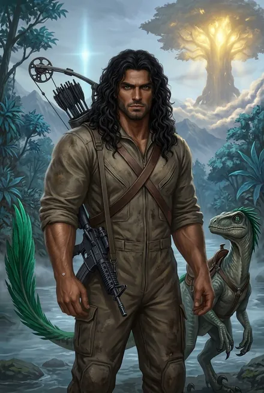
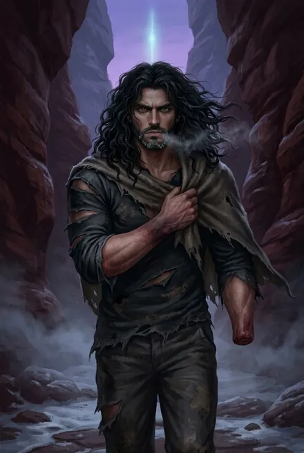

# Марк Кассиди («Мрак», «Мрак-подобный-Пламени»)

## Облики на иллюстрациях

<figure markdown="span">
  [{ loading=lazy }](../assets/portrety/020.webp)
  <figcaption>«Варвар», командир копья <small>ЗК-1 — ЗК-6, гл. 26</small></figcaption>
</figure>
<figure markdown="span">
  [{ loading=lazy }](../assets/portrety/021.webp)
  <figcaption>Осуждённый изгнанник, без руки <small>ЗК-6, гл. 27–28</small></figcaption>
</figure>

Иллюстрации созданы нейросетью по описаниям из книг; это трактовка, а не официальный арт.

## 1. Шапка

| | |
|---|---|
| **Имена** | **Марк Кассиди**, «младший Кассиди». Во фригольде прозвище **«Мрак»**: его произносят «вполне привычно» (ЗК-1, гл. 12). Имя для Восхождения, известное у Народов Круга, — **«Мрак-подобный-Пламени»** (ЗК-3, гл. 13; ЗК-5, интерлюдия 1; ТБ-1, гл. 6). Тени и Люди Реки говорят о нём «сын червивой матери», «червивый изгой» (ТБ-1, гл. 6–7) |
| **Происхождение** | Полукровка. Сын рикса Винсента Кассиди (землянин) и Говорящей-с-Травами (Народ Теней, септа Каменных Луков, кровь Аммоса). Рождён в Единстве, «плоть от плоти» этого мира (ЗК-1, гл. 12). По матери внук Шепчущего-в-Ночи и Шелковой Тени. Носитель древней крови владык Теней (ТБ-1, §7; ТБ-3, гл. 5) |
| **Роль** | Командир боевого копья фригольда «Небо» (с ЗК-1). Второй знаменосец рикса Трейва Уитли, «старший над боевыми копьями» (ЗК-5). Главный «внутренний» антагонист ЗК-1–06, исполнитель замыслов матери. Невидимый убийца |
| **Семья** | Жена — высокая красивая женщина с длинными каштановыми волосами (имя не названо). **Двое детей**, мальчик и девочка «с такими же чёрными вьющимися шевелюрами» (ЗК-1, гл. 15). Любовница — **Свирель** (ЗК-1, гл. 14). Сестра — Травинка, младше на 10 лет (ЗК-2, гл. 10) |
| **Возраст** | **≈27 в ЗК-1/02** (карточка автора: «27 циклов», [пост 2690](https://t.me/prokofiev_litrpg/2690); колония в 28-м цикле по порядковому счёту автора). Из ЗК-2, гл. 10 выходит 29: Травинке 19, «на десять лет меня старше» — противоречие канона, см. §8 и `09_open_threads.md`. По интерлюдии ЗК-6, при инициации ему было 17, сестре 6 |
| **Книги** | Активно ЗК-1–ЗК-6. Как имя, тело и наследство: ЗК-7–ЗК-11, ТБ-1–ТБ-5 |
| **Статус** | **Мёртв.** Отец лишил его стигмата и изгнал (ЗК-6, гл. 27). Убит Сигурдом в Змеином Каньоне, дух «ушёл». Тело оживлено «даром истинной Крови» и занято Белым Дьяволом, который принял имя **«Подобный Пламени»** (ЗК-6, гл. 28; ТБ-1, гл. 7). В каноне о смерти знают Сигурд, Винсент (ЗК-11, гл. 15; ТБ-4, гл. 12) и Пламени Подобный. **Травинка не знает** |

**Внешность кратко.** «Огромный „варвар“ с чёрной гривой и тяжёлой челюстью» (ЗК-1, §4). Массивный, «раза в полтора больше» Сигурда, «состоит как будто из одних мышц», «волчьи глаза» с зелёными огоньками (ЗК-1, гл. 12; ЗК-2, гл. 10). Смуглый, «тёмно-бронзовая спина» (ЗК-1, гл. 14). «Массивная копия отца с угрюмой и угрожающей аурой», волосы длиннее, чем у Винсента, лицо моложе (ЗК-6, гл. 19, 21). Оружие — **блочный лук** с чёрными стрелами (ЗК-1, гл. 13; ЗК-6, гл. 23). Ездит на кархе (ЗК-1).

---

## 2. Личность

- **Мрачный, немногословный, опасный.** «Мрачноватому варвару оно [прозвище] хорошо подходило» (ЗК-1, гл. 12). Голос в голове Сигурда: «Этот Восходящий опасен. Он знает вкус крови. Он опаснее всех в твоём Народе» (ЗК-2, гл. 10). Люди его «уважали, а ещё больше — откровенно побаивались» (ЗК-5, интерлюдия 1).
- **Культ силы и Звёздной Крови.** «Самое главное здесь — Звёздная Кровь!» (ЗК-1, гл. 12). Цель: «открыть первое серебро и получить Аспект» (ЗК-1, гл. 14). Сигурд увидел в его глазах «злобу, жадность и едва сдерживаемую агрессию»: Кровь и Руны для него «гораздо ценнее… каких-то там человеческих жизней» (ЗК-1, гл. 13).
- **Мыслит как местный.** «Поведение и характер как будто полностью принадлежали этому миру» (ЗК-1, гл. 12). Говорит на наречии Людей Реки (ЗК-1, §4; ТБ-1, гл. 6). Не верит в земные законы: «Вы сильнее — и вы судите. Окажись сильнее мы, здесь судили бы вас» (ЗК-6, гл. 27).
- **Двойная жизнь, «лицемер».** Дома «счастливый муж и отец» обнимает жену и детей, а при этом любовник Свирели («Чёртов лицемер…», ЗК-1, гл. 15). Сам наказывает «за оружие на своих» («Нельзя поднимать оружие на своих… Это изгнание», ЗК-1, гл. 13), а сам застрелил своего командира.
- **Жёсткий командир-«воспитатель».** Заставляет новичка Грая добить раненого тауро и выгоняет его как «слабака» (ЗК-1, гл. 13; ЗК-2, §4). Держит копьё страхом: Свирель его «боится до дрожи» (ТБ-1, интерлюдия).
- **Опекун сестры** (по-своему). «Когда была ребёнком, всегда защищал. От всего… Он ещё хуже мамы!» (Травинка, ЗК-2, гл. 10). Отваживает Сигурда: «оставь в покое мою сестру» (ЗК-2, гл. 10). Бережёт её как «династическую партию» (ЗК-3, гл. 2).
- **Подражание отцу и обида на него.** «Очень хочет быть похожим на отца. Рано начал ходить в походы» (ЗК-2, гл. 10). Защищает имя отца («прекращай трепать имя моего отца», ЗК-1, гл. 15). На тинге при появлении отца «на мгновение превратился в восхищённого ребёнка» (ЗК-6, гл. 21), но отрекается («Мой настоящий отец не стал бы рядом с предателями нашего фригольда!»).
- **Зависим от матери.** Под её взглядом «съёжился, как будто став ниже ростом» (ЗК-4, эпилог). Исполняет её приказы: «Ее и Восходящую Альфы я убил первыми, как ты приказала» (ЗК-6, интерлюдия). Мать: «твой брат телом пошёл в отца, но унаследовал мой ум» (ЗК-5, интерлюдия 1). Она держала его в неведении о Рунном Искусстве, «чтобы использовать сына как послушное орудие» (ТБ-1, гл. 4).
- **Нераскаянный, гордый до конца.** «Жалею, что не довёл дело до конца… наш Народ от этого стал бы только сильнее» (ЗК-6, гл. 27). Просит умереть «как Восходящему» в фионтаре. Лишившись стигмата, «завыл, как смертельно раненый зверь» (там же). Отчаянно цепляется за жизнь: «Он очень хотел жить, отчаянно боролся!» (ЗК-6, гл. 28).
- **Тактическое мышление.** Знает Единство «получше многих наших стариков» (Трейв, ЗК-5, интерлюдия 1). В Шторме вовремя ставит щит и организует отступление (ЗК-4, гл. 23). Даже без Рун использует хитрость: культя как отвлекающий манёвр, камень в голову (ЗК-6, гл. 28).

**Мотивация.** Власть для себя и матери: сначала главенство в копье («Вероника поставит меня над копьём. Но это только первый шаг», ЗК-1, гл. 14), затем знаменосец и рикс фригольда. Вероятно, через мать и сестру ещё и власть у Народа Теней (ЗК-3, гл. 13). «Право», о котором он собирается «заявить» (ЗК-1, гл. 14), в тексте не раскрыто. Вероятно, это наследственное право сына Винса *(предположение разбора ЗК-1, §10)*.

---

## 3. Речь

Коротко, угрожающе, приказным тоном. С младшими на «ты». К матери обращается **«мать»** (не «мама»), к отцу «отец». Ругается умеренно.

1. «Следующему, кто дёрнется, отстрелю яйца» (ЗК-1, гл. 13).
2. «Нельзя поднимать оружие на своих. Никогда! Это изгнание. Понял, Сигурд?» (ЗК-1, гл. 13).
3. «Запомни, Свирель, и вы все запомните, если когда-нибудь хотите стать Восходящими. Самое главное здесь — Звёздная Кровь!» (ЗК-1, гл. 12).
4. «Вероника поставит меня над копьём. Но это только первый шаг» (ЗК-1, гл. 14).
5. «Здесь тебе не Земля, мальчик. Здесь не пытаются, здесь люди просто исчезают, раз — и нету!» (ЗК-2, гл. 10).
6. «Наш… Теперь он наш, мать» — о Народе Земли после Шторма (ЗК-4, эпилог).
7. «Мать, достаточно глупой болтовни… Здесь есть арена для фионтара. Решим дело, как подобает Восходящим!» (ЗК-6, интерлюдия).
8. «Плевать, признаю или нет… жалею, что не довёл дело до конца… Если наша кровь для тебя что-нибудь значит… дай мне умереть как Восходящему!» (ЗК-6, гл. 27).
9. «Так и знал. Отомстить пришёл?… Жаль, что не прихлопнул тебя в самом начале… Кто ты, дьявол побери, вообще такой⁈» (ЗК-6, гл. 28).

---

## 4. Предыстория

- **Детство.** Рос сначала в первом поселении у лесов, затем на плато. Учил его отец («Отец учил брата», ЗК-1, гл. 21), но «большую часть времени Марка воспитывала мама. Ты вечно пропадал в своих рейдах» (Травинка, ЗК-6, гл. 19). Его тело «закаляли с детства — Травами, зельями и пищей, содержащей Звёздную Кровь» (ТБ-1, гл. 1). Отсюда особые свойства (см. §6).
- **Инициация в 17 лет.** Стигмат, купленный отцом в Храме Вечности (ЗК-2, гл. 9; ЗК-6, интерлюдия). Отец собирался взять его в своё копьё, «чтобы оторвать от матери», но попал в ловушку жены (ЗК-6, гл. 19).
- **После пропажи отца.** Рано начал ходить в походы, стал сильным Восходящим, «у него большие амбиции» (ЗК-2, гл. 10). Семья, жена и двое детей. «Молодое крыло» фригольда: **Фрост, Ассоль, Угрюмый, Уэнтвуд** видят в нём лидера (ЗК-4, §4; ЗК-5, интерлюдия 1).
- **Связной матери.** С прошлого тинга, ещё до прилёта Сигурда, через Марка Говорящая снабжала изгнанного Кнуда Ларссона оружием, медикаментами и информацией (ЗК-5, гл. 12; ЗК-6, гл. 1). Вместе со Свирелью он прятал кейс «Космо» с оружием «то ли для изгоев Шторма, то ли на чёрный день» (ТБ-1, интерлюдия).
- **Посольства к Теням.** На тинге вёл переговоры с риксами септ. Видящая-сквозь-Тьму: «Мрак-подобный-Пламени говорил со мной на тинге… говорил и с другими… того, кто возьмёт её [Травинку] в жёны, будут слушать не только в его септе» (ЗК-3, гл. 13). Приходил к Небесным Когтям: мать предлагала Травинку в обмен на свержение Каменных Луков (ЗК-6, гл. 17). «Первая мать отвергла мои слова» (Говорящая, ЗК-6, гл. 18).

---

## 5. Биография по книгам

### ЗК-1 «Звёздная Кровь»
- **Гл. 10–11.** Вместе с Гаем Флоу спасает Сигурда у Бурной. Накладывает на Гая Руны-усилители. Невидимым переправляется на другой берег.
- **Гл. 11–12.** Во время фионтара Гая с Зирдином Хвостом Акулы убивает **Гая Флоу** стрелой из блочного лука «за двести шагов» (подтверждено в ЗК-6, гл. 23). Возвращается окровавленным: «у Людей Реки четверо мёртвых». Ищет пропавшие Руны и Кровь Гая, хватает Свирель за горло, проверяет запястья Сигурда на стигмат.
- **Гл. 13.** Стрелой выбивает у Сигурда «Дефендер» и отбирает его. Заставляет Грая добить тауро.
- **Гл. 14.** Секс со Свирелью у водопадов. Разговор подслушан: «Теперь, когда Гай мёртв…». Собирается на тинге найти «кто из речных взял его Кровь и Руны». Голос объясняет его мотив: стравить племена, выступить миротворцем, забрать власть и Кровь (гл. 15). Убийство Гая нарушило Клятву, и **ваал дрейков** — кара Наблюдателя на фригольд (гл. 19).
- **Гл. 15.** Во фригольде обнимает жену и детей. Майкл: «Марк, тебя ждёт Вероника с отчётом». Стал главой копья.
- **Гл. 18.** Копьё наказано вывозом «дерьма камнеедов».

### ЗК-2 «Фригольд»
- **Гл. 9–10.** Угрожает Сигурду из-за сестры: «люди просто исчезают».
- **Гл. 10–11.** Банда Рэнди устраивает засаду в очистителе. «Из ниоткуда» появляется Мрак, и Сигурд понимает: «я должен убить Марка». Через Динамита и Грохота предлагает замять дело (у Свирели видео, у Сигурда нож).
- **Гл. 12.** Вероника не трогает его: он сын героя, это «индульгенция» (Динамит).
- **Гл. 13–14.** Рейд в Расколотые Земли. Свирель «проспала» нападение Червей. **Невидимка сбрасывает Сигурда в трещину** «к червякам». Тогда это предположение, позже Марк фактически признаёт это обвинение на суде (ЗК-6, гл. 27).

### ЗК-3 «Земли Теней»
- Заочно. Видящая рассказывает о его переговорах с Тенями (гл. 13). Сигурд понимает, что Мрак «целенаправленно выбивает Восходящих фригольда» (гл. 2).

### ЗК-4 «Одиссей»
- **Гл. 3.** Вероника отсылает его копьё на неделю в горы.
- **Гл. 12.** Его копьё и копьё Ассоль идут в Шторм на разведку.
- **Гл. 22.** «Находит» базу изгоев, то есть ведёт рейд в подготовленную ловушку.
- **Гл. 23–24.** Когда Небесный Ястреб громит площадь, его копьё вовремя ставит барьерный щит, мать открывает Портал. Они выводят людей как «спасители».
- **Эпилог.** Докладывает матери: Руны и Кровь на площади не собраны, тела рикса нет. «Мертвецам не нужны Руны… Ведь это наш Народ, сын мой». — «Наш… Теперь он наш, мать».

### ЗК-5 «Вечность»
- После разведки поля боя его фрейм «отливал серебром»: **Марк — серебряный Восходящий** (интерлюдия 1). Рикс Трейв назначает его **вторым знаменосцем**, «старшим над боевыми копьями», отвечающим за рейды: «Марк достойный наследник основателя нашей колонии». Лэндо публично обвиняет «Мрака-подобного-Пламени» в том, что тот «спасать, кого хотеть». Марк насмешничает: «без меня и моей матери ты бы сейчас Червей в Шторме кормил».
- Приходит на ферму Эйрика за сестрой и беглецами, получает «весьма холодный приём», уходит (интерлюдия 2).
- Допрос души Кнута раскрывает его роль связного (гл. 12).

### ЗК-6 «Тинг»
- **Интерлюдия «Травинка».** У Храма предлагает Веронике фионтар. Пытается схватить сестру за руку. Ночью **невидимым убивает** обездвиженных Железным Вьюном: пробивает сердца Веронике и Фьюри («как ты приказала»), участвует в убийстве **Динамита** и забирает его Руны, в том числе Раскалённую Ауру.
- **Гл. 18.** Охраняет «дар» у древесного дома, выходит на ссору матери с Яростным.
- **Гл. 21.** На тинге усмехается обвинителям. «Позволь, я выдерну кое-кому ядовитое жало». При появлении отца на миг «восхищённый ребёнок», затем отречение: «Не знаю тебя!».
- **Гл. 23.** Невидимым крадётся к арене, чтобы вытащить мать. В Кошмарной Роще трижды бьёт отца рунным кинжалом, его же подарком. **Громовой Волной** сбивает Сигурда, **чёрной стрелой пробивает сестру**, закрывшую Сигурда. На приказ матери «Убей их!» уточняет: «Обоих?». В рукопашной с Сигурдом раскаляется Аурой Динамита. Сигурд ломает ему руку и надевает **Иллиумовый Браслет** (блокирует Скрижаль).
- **Гл. 24.** Отец не отдаёт его Хранителям и вырубает оплеухой. Аурвак требует его голову: Вероника обещала её Народу Реки. Винсент откупается (гл. 25).
- **Гл. 26–27.** Сообщники (Свирель, Песчанка, Мик) дают показания против него. Суд у колумбария, список вин: убийство Гая Флоу, ваал, поддержка изгоев, заговор против Вероники, покушение на Сигурда, убийство Динамита, удар по отцу и сестре на тинге. Просит фионтар с отцом, получает отказ и оплеуху Аспектом. Отец отсекает ему **левую кисть со стигматом**: «Ты больше не Восходящий… изгой». Травинка исцеляет культю. Вернуться можно лишь с **золотой вирой** и прощением всех родичей жертв, «то есть — никогда». Белый Дьявол: изгнанный может вживить новый стигмат или вернуть свой, а «Атрибуты и некоторые Навыки навсегда останутся с Восходящим».
- **Гл. 28. Смерть.** Конвой (с ним новичок Беркут) выводит его за Западный Пост и бросает ночью в Змеином Каньоне с пустым рюкзаком. У костра его настигает Сигурд Переносом. Марк обманывает культей и разбивает Сигурду голову камнем. Проигрывает рукопашную, и в момент, когда Сигурд режет его хазаком, Белый Дьявол перехватывает контроль над Сигурдом. Марк вгоняет **ледяной клинок Сигурду под подбородок**. Над телом Сигурда возникает символ, и Марк, «больше не Восходящий», касается его: «капля втянулась в его пальцы», и его затрясло. Сигурд инкарнирует и пронзает Марка в сердце хазаком несколько раз. Раны Марка заживают, и встаёт уже Белый Дьявол: «Ты ведь убил его, а он — просто человек. Его дух ушёл». Над телом появляется новый фрейм, имя «странным образом… походило на имя Мрака». Белый Дьявол о выборе тела: «А тело… оно серебряное, в нём есть моя кровь, и о нём никто не будет плакать. Мне оно нравится, хейр» (ЗК-6, гл. 28).

### После смерти: тело и наследство (ЗК-7–ТБ-5)
- **Тело.** «Большое и сильное, от рождения напитанное Звёздной Кровью… Восходящему, почти достигшему серебра» (ТБ-1, гл. 1). Рука не отрастает: «кисть была потеряна раньше, а рана залечена, и Кровь запомнила это» (ТБ-1, гл. 7). Позже Пламени Подобный возвращает её, убив серебряного локи (ТБ-3, гл. 7). Дух «сожрёт внешность Марка» за пару циклов (ТБ-1, гл. 8). В ЗК-10 Пламени Подобный «уже не похож на Марка Кассиди» (ЗК-10, §2, гл. 3). Но в ТБ-4, гл. 12 сходство тела с Винсентом «несомненно даже сейчас», хотя дух «уже изрядно изменил телесное вместилище».
- **Рюкзак изгоя:** набор для огня, фляга с эмблемой ковчега, верёвка, старая одежда и **вокс, запечатанный секретным словом** (ТБ-1, гл. 1). Содержимое не раскрыто.
- **Месть изгоям.** Свирель, ставшая лидером шестёрки изгнанных (Мик-«Медвежонок», Песчанка, Барк, Миро, Варанаси), опустошила его тайный схрон: кейс «Космо» с винтовками, копией его блочного лука и девятью смарт-гранатами из арсенала «Хельги». Они собирались выдать его Народу Реки или Теням. Белый Дьявол в его теле убивает их (ТБ-1, интерлюдия «Изгои»). Свирель видит: «Это был Мрак — и это был не Мрак».
- **Кровь и долги.** Люди Реки «не видят» его: «Ты должен нам кровь за кровь». Он убил нескольких Людей Реки и вмешался в священный поединок. Аурвак собирался вызвать его на фионтар (ТБ-1, гл. 6–7). Танаан болотников узнаёт «сына Кассиди» по руке (ТБ-1, гл. 5).
- **Право на престол.** По матери тело имеет право на престол Каменных Луков (ТБ-2, гл. 4). Пламени Подобный объявляет: «Я был рождён Говорящей-с-Травами. Дочерью Шепчущего-в-Ночи, последнего из кингов Народа Теней» (ТБ-3, гл. 6). Бабушка тела, **Шелковая Тень**, становится его «покорной тенью» и первым знаменосцем (ТБ-3, гл. 7).
- **Дети Марка** остались во фригольде. Шелковая Тень собиралась «вернуть их сюда» и править их именем (ТБ-3, гл. 7). Винсент: «У Марка тоже есть дети… мои внуки» (ЗК-7, гл. 9). Травинка обещает защищать «племянников» (ЗК-6, гл. 27).
- **Отец.** «У меня больше нет сына» (ЗК-7, гл. 14). На тинге в ТБ-4 Винсент спрашивает Пламени Подобного: «Как умер мой сын?» (ТБ-4, гл. 12). Сигурд признаётся ему (ЗК-11, гл. 15): «эта смерть всегда будет стоять между нами».
- **Изгнанники.** Сообщники с правом вернуться за серебряную виру. Их судьба решена в ТБ-1: Свирель скормлена дрейку (ТБ-1, §4).

---

## 6. Способности

| Период | Ранг | Возможности |
|---|---|---|
| ЗК-1–04 | **Бронза** (ЗК-1, §4; ЗК-4, §4). «Один из сильнейших Восходящих фригольда» (ЗК-2, гл. 10). Цель: «первое серебро и Аспект» | **Невидимость** (ЗК-1, гл. 11; ЗК-2, гл. 11, 14). **Блочный лук** со стрелами с чёрным оперением: убийство «за двести шагов». Руны-усилители на союзников (ЗК-1, гл. 11). Наречие Людей Реки. Верховая езда на кархе. Барьерный щит в Шторме (ЗК-4, гл. 23) |
| ЗК-5–06 | **Серебро** после разведки в Шторме: «таких в земном фригольде можно было пересчитать по пальцам одной руки» (ЗК-5, интерлюдия 1). Сигурд: «серебряным рангом среди землян обладали лишь двое: Мрак и она» (ЗК-6, гл. 21) | **Громовая Волна** (гравитационный толчок). **Руна Невидимости**. **Чёрные стрелы** пробивают человека навылет. Рунный кинжал отца. **Раскалённая Аура** (Руна Огнезуба, отнятая у убитого Динамита, ЗК-6, гл. 23). Его «готовили и затачивали для фионтаров… передавали Руны и развивали Навыки» (ЗК-6, гл. 21). Аспекта нет |
| После лишения стигмата | Не Восходящий | Тело «измененного организма серебряного ранга», сила и реакция не меньше, чем у Сигурда (ЗК-6, гл. 28) |

**Свойства тела** от закалки с детства (ТБ-1, гл. 1): кожа «прочная, как упругая резина» (трудно проткнуть ножом), «полный иммунитет к болезням и ядам, в том числе отраве Червей», острое ночное зрение, терморегуляция, мгновенная остановка крови, быстрое заживление, медленный пульс, долгая задержка дыхания, в том числе под водой (ТБ-1, гл. 7).

**Противоречие по рангу.** В ЗК-5–06 Марк «серебряный». В ТБ-1 тело принадлежало Восходящему, «почти достигшему серебра» (гл. 1): «он открыл всего шесть серебряных звёзд — просто сильный бронзовый воин» (гл. 8). После вселения Восхождение видит в теле 2 серебряные звезды в Теле и по одной в Стихийности и Ментальности (гл. 1). *Возможное согласование:* «серебряный фрейм» в ЗК выдаётся за первые серебряные звёзды, а полноценным серебром ТБ-1 считает больше звёзд; часть Атрибутов могла быть утрачена с потерей стигмата *(предположение)*. Исходная запись в досье («6 серебряных звёзд тела») опиралась на ТБ-1, гл. 8.

**Рунного Искусства не знал**: мать не учила его (ТБ-1, гл. 4).

---

## 7. Отношения

- **Говорящая-с-Травами (мать).** Главная фигура его жизни. Она воспитывала его, держала Рунное Искусство в тайне от него и сделала его своим «орудием» (ТБ-1, гл. 4). Он действует по её приказам, в том числе убивает. Защищает её до последнего: пытается вытащить её с арены на тинге (ЗК-6, гл. 23).
- **Винсент Кассиди (отец).** Идеал детства, отсутствующий отец. Публичное отречение на тинге. Три удара кинжалом в Кошмарной Роще. Требование фионтара, отказ отца, лишение стигмата и изгнание. До последнего мига Марк ждал от отца хоть какого-то шанса: «Отец! … ты дал другим шанс!» (ЗК-6, гл. 27).
- **Травинка (сестра).** Защита и подавление в детстве, ссора в юности. Видит в ней пешку в династических планах. Стреляет в неё (ЗК-6, гл. 23). Она лечит ему культю.
- **Сигурд.** Смертельные враги с первой встречи. Марк отнял у него «Дефендер», угрожал, сбросил в трещину. Оба хотят фионтара. Последний бой, где Марк убивает Сигурда, а Сигурд убивает его (ЗК-6, гл. 28).
- **Свирель.** Любовница и сообщница (видео, «проспанный» дозор, схрон). Предала его на суде, позже ограбила схрон. Новый хозяин тела убивает её спутников, а саму её отдают дрейку (ТБ-1).
- **Копьё Мрака:** Рэнди (погиб в рунной ловушке матери, ЗК-6, гл. 18), его брат Мик, абориген Песчанка (Песчаный Змей). Позже трое новичков. Выгнанный им Грай перешёл к Сигурду.
- **Трейв Уитли.** Союзник и марионетка матери. Назначил Марка знаменосцем (ЗК-5).
- **Кнуд Ларссон.** Марк — связной матери с ним (ЗК-5, гл. 12).
- **Фрост, Ассоль, Угрюмый, Уэнтвуд.** «Молодое крыло», для них Марк — «несомненный лидер» (ЗК-5, интерлюдия 1).
- **Народ Реки.** Говорит на их наречии. Убийства у брода на нём неоплаченная кровь (ТБ-1, гл. 7).
- **Народ Теней.** Посол матери к септам. Для Луков он «червивый» сын изгнанницы (ТБ-3, гл. 5). Его тело — наследник Каменных Луков.
- **Белый Дьявол / Пламени Подобный.** Предок по крови (Кел Аммос). Он манипулировал Сигурдом так, чтобы Марк его убил и тем освободил каплю Крови, а затем занял тело Марка (ЗК-6, гл. 28).

---

## 8. Тайны, крючки, ограничения

### Противоречия и вопросы
1. **«Стопроцентный землянин по генотипу»** (ЗК-1, гл. 12) против «сына Говорящей» (ЗК-1, гл. 21 и все дальнейшие книги). Канон — сын Говорящей. Ранняя фраза, видимо, просто впечатление Сигурда.
2. **Ранг**: серебро (ЗК-5–06) против «почти серебра» (ТБ-1). См. §6.
3. **Возраст**: «на 10 лет старше» девятнадцатилетней сестры (ЗК-2, то есть ≈29) против 17 и 6 лет при инициации (ЗК-6). Автор даёт **27 циклов** (карточка, [пост 2690](https://t.me/prokofiev_litrpg/2690)); это число и держим.
4. **Что он делал сам, а что по приказу матери**: убийство Гая, гибель Восходящих в Шторме, сброс Сигурда (ЗК-6, гл. 26 — список вин).
5. **«Право»**, о котором говорила Свирель (ЗК-1, гл. 14).
6. **Вокс в рюкзаке**, запечатанный секретным словом (ТБ-1, гл. 1). Кто его оставил и что в нём?
7. **Жена и дети.** Имена не названы. Как живут вдова и дети изгнанника во фригольде? Их статус наследников Луков (ТБ-3, гл. 7).
8. **Знал ли Марк о Рунном мастерстве матери**, о Связь-Камне, о Кошмарной Роще? По ТБ-1 мать держала его в неведении.

## 9. Карточка автора (вне канона)

> Карточка персонажа из канала автора (автор, TG: [пост 2690](https://t.me/prokofiev_litrpg/2690), январь 2025). Это не текст книг: при расхождении прав канон.

| | |
|---|---|
| **Имя, возраст** | Марк «Мрак-Подобный-Пламени» Кассиди (Мрак); **27 циклов** |
| **Происхождение** | Метис Народа Земли и Народа Теней. **«Первый ребенок, рожденный в земном фригольде Небо»** |
| **Титулы** | Хейр, «в дальнейшем — танаан» |
| **Биография** | Отец — «сначала разведчик, а затем рикс». Стигмат Марк получил юным, и «практически сразу» после этого отец пропал в рейде. Растила его мать, ставшая фламиникой; она внушала, что место во главе Народа Земли принадлежит ему по праву. Итог — заговор, мятеж, изгнание и смерть |
| **Приметы** | Очень похож на молодого Винсента: крупный, смуглый, длинные тёмные волосы, тяжёлая челюсть, часто небрит. Глаза «сине-зелёные, нефритовые» — глаза Народа Теней. **Слегка заострённые уши**, обычно под волосами. Носит снаряжение воинов Единства, а не земное |
| **Речь, жесты** | Немногословен, говорит сквозь зубы: «ты получил урок», «я научу тебя…», «хватит разговоров». Молча чистит ногти огромным ножом и играет с ним |
| **Ценности, цель** | Сила, власть, Восхождение; не верит в силу других, земные законы считает слабостью. Цель — захватить власть во фригольде любой ценой |
| **Тайна** | Знает от матери, что он потомок владык Теней, и мечтает объединить Народы под своей властью. Помогал изгоям в Шторме, чтобы ослабить фригольд и убрать его лидеров. Любовник Свирели |

**Сверка с каноном.** Возраст и титулы с книгами не спорят (по ЗК-2 выходит ≈29, см. §8). «Первый ребёнок Неба» совместим с каноном: Марк родился на плато, где потом встал фригольд. Уши и нефритовые глаза в книгах не названы: там «волчьи глаза» с зелёными огоньками (ЗК-1, гл. 12; ЗК-2, гл. 10).

**Два имени.** «У всех Восходящих ДВА имени, полученное при рождении и взятое при начале Восхождения» (автор, TG: [пост 1614, комм. 17246](https://t.me/prokofiev_litrpg/1614?comment=17246)). У Марка это «Марк» и «Мрак-подобный-Пламени». Половину его имени взял себе Белый Дьявол — «и в этом заложен глубокий смысл» (автор, TG: [пост 1614, комм. 17249](https://t.me/prokofiev_litrpg/1614?comment=17249)).
