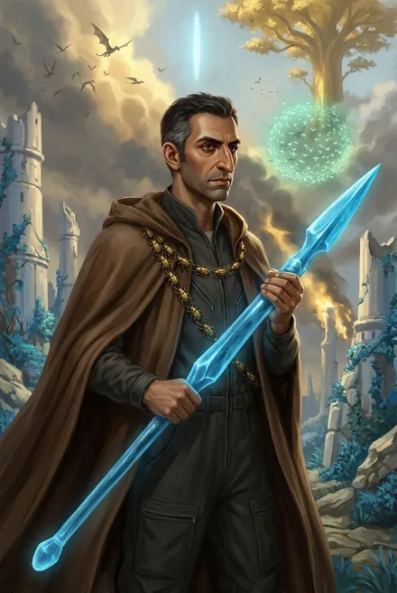

# Минос (доктор Матиас Амин)

| | |
|---|---|
| **Настоящее имя** | **Доктор наук Матиас Амин** — «Я и есть Матиас. Доктор наук Матиас Амин, если быть точным» (ЗК-1, гл. 22) |
| **Имя в Восхождении** | **Минос** (ЗК-1, гл. 19). В тексте имена чередуются: «доктор Матиас», «Матиас-Минос», «доктор Матиас, Восходящий Минос» (ЗК-4, гл. 1; ЗК-6, интерлюдия «Травинка»), «доктор Амин» (Аврора, ЗК-11, гл. 16). Сигурд обращается к нему то «Матиас», то «Минос» в пределах одной сцены — **это один человек**; отдельного досье «Матиас» нет |
| **Происхождение** | Землянин, «эксперт» проекта «Космо» (ЗК-4, гл. 10) — колонист-специалист с учёной степенью; автор работы **«Нелинейная нейросистематика»**, которую знает Аврора Мартинс (ЗК-11, гл. 16). Речь пересыпана испанскими/итальянскими словечками («мадре де диос», «амиго», «сеньорита», «беллиссимо», «Санта-Мария») — испано-латиноязычный бэкграунд *(страна не названа)* |
| **Роль** | Глава научного отдела фригольда «Небо» и **копья Миноса** (учёные-Восходящие, раскопки) → с ЗК-6 **фламин** фригольда (гл. 27) → руководитель исследований Домена Серебряный Замок, производства Рун и Порталов → переговорщик с Авророй и Тысячей (ЗК-11; ТБ-4) |
| **Книги** | ЗК-1 – ЗК-11; ТБ-4 (гл. 17) |
| **Ранг** | Бронза, танаан (ЗК-1) → «бронзовые мастера» (о себе и Ключе, ЗК-7, гл. 7) → **серебро, «шестой в нашей колонии»** (ЗК-9, гл. 2) |
| **Статус на конец канона** | Жив; фламин, владеет золотым **Фолиантом Тысячи Печатей и Символов** (ЗК-11, гл. 19–20); назначен на получение брахма-симбионта «авроры»: «Один — Матиасу» (ЗК-11, гл. 18); посвящён в тайну Сигурда (ЗК-11, гл. 16) |

---

## Облики на иллюстрациях

<figure markdown="span">
  [{ loading=lazy }](../assets/portrety/024.webp)
  <figcaption>Восходящий-«маг» <small>ЗК-1, гл. 19–20; в рейдах ЗК-4, ЗК-6</small></figcaption>
</figure>

Иллюстрации созданы нейросетью по описаниям из книг; это трактовка, а не официальный арт.

## 1. Личность, мотивация, слабости

**Учёный-энтузиаст.** «Немного не от мира сего, полностью увлеченным своим делом» (ЗК-6, гл. 24). Лекции читать «не впервой и даже доставляет определенное удовольствие» (ЗК-1, гл. 23). Реакции — детский восторг: при виде Серебряного Замка «восторженного, почти детского изумления на смуглом лице… Так малыши смотрят на огромный торт-сюрприз» (ЗК-7, гл. 21). Главная мотивация — знание: «за ответ на него я бы продал душу и добавил сверху» (ЗК-1, гл. 23); «Ради науки я готов заплатить эту цену» (ЗК-8, гл. 1).

**Добрый и порядочный.** Спасает раненых, тратит на Сигурда драгоценную ночницу (ЗК-1, гл. 20–21), симпатизирует ему — «врать Миносу, явно симпатизирующему мне, было противно» (ЗК-4, гл. 1). Заступается за справедливость при обсуждении судьбы Сигурда (ЗК-4, интерлюдия «Фригольд»). Сочувствует пленнице: «Может, дать ей шанс? Проявить снисхождение?» (ЗК-8, гл. 5).

**Скептик-методист.** Требует экспериментов и техники безопасности; скептичен к смешению земной техники и Рун (ЗК-7, гл. 8: артефакт должен быть «простым, однокомпонентным»); протестует против рискованного использования кристалл-сферы и десанта из Домена (ЗК-7, гл. 9, 16, 20). Строит гипотезы, позже подтверждаемые: Единство — сфера Дайсона, Наблюдатель — сеть альфа-разумов (ЗК-1, гл. 23), кел модифицировали геном аборигенов (ЗК-9, гл. 3), теневое ядро летающих островов (ЗК-10, гл. 7).

**Политически неловок.** Один из старейших Восходящих, но «находился между двух огней» на тинге между Вероникой и Трейвом (ЗК-6, интерлюдия); робко: «фригольд провел голосование… мы должны изучить этот вопрос» (ЗК-6, гл. 21). Был кандидатом в риксы на выборах, набрал мало (ЗК-6, гл. 26). Фламином стал неожиданно для себя (ЗК-6, гл. 27).

**Слабости.**
- **Одержимость знанием**, переходящая в зависимость: под влиянием **Скрипторума Некролита** — «энтузиазм… казался чрезмерным, почти маниакальным», лихорадочный блеск, «спящий всего пару часов» (ЗК-9, гл. 2). Скрипторум зовёт его «ученик» (ЗК-9, гл. 9). Отказаться от «наставника» — «настоящая пытка» (там же).
- **Готов жертвовать безопасностью ради науки** (серебряная звезда Некротики, ЗК-8, гл. 1).
- **Очарованность авторитетами**: перед Авророй — «тающий, как улыбающийся кусок льда» (ЗК-11, гл. 16).
- Вместе с Кассиди допустил провал «погружений» в Вечность (ЗК-9, гл. 10–11).

**Эволюция.** Скромный бронзовый учёный-«волшебник» → фламин и «главный исследователь» → едва не потерянный для колонии адепт Некролита (спасён Морвейн и Сигурдом) → серебряный партнёр Авроры и Тысячи, носитель тайны Сигурда.

---

## 2. Речь

Образованный, лекторский, с научной лексикой («цивилизация типа два по шкале Кардашева», «А-резонанс», «нейротрансформация», «эффект высокой базы»). Восклицания: **«Дева Мария!»** (ЗК-1, гл. 20; ЗК-6, гл. 25; ЗК-7, гл. 21), **«Мадре де диос!»** (ЗК-9, гл. 2–3, 9), **«Санта-Мария!»** (ЗК-9, гл. 8; ЗК-10, гл. 6–7), **«амиго»** (постоянно), **«беллиссимо»** (ЗК-7, гл. 8), **«Эврика!»** (ЗК-10, гл. 7), к женщинам — «сеньорита» (Морвейн, ЗК-9), «милая» (Милли, ЗК-4, гл. 18).

**Цитаты:**
- «Охренительный масштаб, не правда ли, Сигурд?» (ЗК-1, гл. 23, по разбору).
- «А вот это очень хороший и важный вопрос, Сигурд, и за ответ на него я бы продал душу и добавил сверху» (ЗК-1, гл. 23).
- «Сигурд, мы — всего лишь бронзовые мастера. Получается, ты должен быть главным рунным мастером фригольда!» (ЗК-7, гл. 7).
- «Винс, я прошу, нет, я умоляю — Скрипторум!» (ЗК-7, гл. 20).
- «Амиго, если у тебя есть доступ в такое место, почему не сказал раньше⁈» (ЗК-7, гл. 21).
- «Наука, амиго! Познание!» (ЗК-9, гл. 2).
- «Аврора, Земли больше нет» (ЗК-11, гл. 16).

---

## 3. Предыстория

- **Первые циклы.** «Один из старейших земных Восходящих» (ЗК-6, интерлюдия); давно знаком с Винсентом (ЗК-6, гл. 24); по-видимому, связан Клятвой о прошлом Кассиди и знает его тайну (ЗК-9, гл. 9 — «ученый в курсе этой истории… скорее всего, тоже связан Клятвой»). Мир понимал как «яйцеголовые двадцать с гаком лет голову ломают» (Динамит, ЗК-1, гл. 17).
- **Наука во фригольде.** Научный отдел с Томом-«Ключом», Анни Ри (биолог), позже Милли; голографическая модель Единства (ЗК-1, гл. 22). Преподаёт в школе: Тревор Моримото был «одним из лучших учеников» (ЗК-7, гл. 8). Отбирает одарённых детей колонии в смену для научной команды (ЗК-8, гл. 3).
- **Раскопки на плато** — руины форта Кел у Скалы, путевые руны (ЗК-1, гл. 19; ЗК-4, гл. 18); тайно — **аванпост кел Вечности под фригольдом** за Полем Остановленного Времени, где спят клоны-отражения трёх Преображающих, пленивших Белого Дьявола («секрет Миноса», ЗК-7, эпилог; ЗК-8, гл. 1).
- **Вычисления:** только в нашем Круге около сотни падений капсул за большой цикл (ЗК-4, гл. 10); Круг ~5000 км в диаметре (ЗК-3, гл. 14).

---

## 4. Биография по книгам

### ЗК-1
- **Гл. 19–20 (ваал).** Отбивается в руинах форта; подсаживает золотую Ночницу раненому Лэндо; ведёт Сигурда с колонистами в модуль; кел-разрыватель не берёт бронзового альфу; его Рой защищает от ледяного выдоха; добивает тварь огненной Руной; Ночница спасает Сигурда. «Отличный выстрел, Милли… я буду настаивать, чтобы тебе дали стигмат».
- **Гл. 21.** Вероника: «Минос потратил на тебя одну ночницу».
- **Гл. 22–23.** Лекция: Единство — сфера Дайсона ~2,5 а.е.; кел — цивилизация II типа; Звездный Трон и Вечность — «загробный мир»; Наблюдатели; земные колонии в других Кругах. Предлагает перевод в научный отдел.

### ЗК-2–03
- Упоминания: голограмма траектории «Хельги» (ЗК-2, пролог); Ключ — из копья Миноса (ЗК-2, гл. 14); рассказы о Круге (ЗК-3).

### ЗК-4 — Одиссей
- **Гл. 1.** С Анни обследует вернувшегося Сигурда «А-монитором»; Сигурд требует объяснений.
- **Интерлюдия «Фригольд».** Докладывает Веронике: Сигурд «не Руна, не зеркальная кукла, не одержимый фантомным духом»; уровень «сильное дерево / слабая бронза»; поддерживает выдачу гвоздя («один гвоздь Сигурд сдал сам»); тактично напоминает, что Сигурд и Травинка «обменялись дарами».
- **Гл. 10, 12.** На операции по сбору капсул прикрывает с Сереной «серьезными Предметами».
- **Гл. 18–19.** С Милли и Ключом восстанавливает рунный знак Переноса в руинах (Малая Стрела).
- **Гл. 22.** Фэй-вэйд — «сторожевой рунный конструкт».

### ЗК-5
- Упоминается: знает о Небесных Знаках (эпилог).

### ЗК-6 — Тинг
- **Интерлюдия «Травинка».** Приводит в Храм новичков (Келли Флоу, Милли, Беркут, Оливер, Брайан); узнаёт воскресшую Веронику через **Око** (парящий восьмиугольник перед глазом); пытается не допустить драки.
- **Гл. 21, 24.** Растерян на тинге; лечит Сигурда Ночницей; узнаёт про Семя; получает Сагу о преступлениях Мрака; изучает ядро Домена Говорящей.
- **Гл. 25–26.** Входит в Домен с Винсентом и Сигурдом; объясняет «золотую виру»; выбирает место для Ростка.
- **Гл. 27.** **Назначен фламином** «сам немало удивленный»; представляет фригольду Росток и проект пробуждения флорокинезом. Ключ — рунный мастер.

### ЗК-7 — Дикая Охота
- **Гл. 7–8.** Учит Сигурда Символам и рунному ремеслу; признаёт его превосходство; эксперимент: «Гоплит» Грохота → рунный Доспех (Минос накладывает своё Зеркальное Отражение); предупреждает о Треворе — сыне Трейва.
- **Гл. 16, 18–19.** Встречает Яшму («персонаж местного фольклора»); штаб у Пика; применяет «Истребление Призраков»; анализирует «сердце» Пожирателя и Печать Единства; передаёт Сигурду Руну Энергии (100 капель).
- **Гл. 20.** Выпрашивает **Скрипторум Некролита**; предлагает сократить поливы Ростка ради других Трав — Кассиди против.
- **Гл. 21.** Первый визит в Серебряный Замок: Саркофаги, клоны кел, «Амиго, это ведь может помочь…».
- **Эпилог.** Показывает Сигурду тайну аванпоста под плато.

### ЗК-8 — Истинный
- **Гл. 1.** Ритуал призыва Скрипторума на полигоне (Купол, щиты Милли): заставляет Существо подчиниться; платит **серебряной звездой Некротики** за первые знания (Руны Поглощения Боли и др.).
- **Гл. 2.** Теория Навыков как «адаптивной базы данных»; Эфирные Манипуляции.
- **Гл. 3–4.** Экспедиция в Серебряный Замок с командой: Том-Ключ, Милли Симмонс, Эндрю «Зверолов» Мэйпл, Исла ван Рейн (историк), Габриэль Савиньян (энергетик), диггеры-грязекопы Дилмас и Эри (нюх на артефакты). Изготавливает второй Портал.
- **Гл. 5–6, 14–16.** Контроль оборудования; пленница; продажа Рун в Контракции; кел-оружие из хранилищ; кристалл-сфера спрятана в его лаборатории.

### ЗК-9 — Ранг неизвестен
- **Гл. 2.** Полевая лаборатория в Домене; **серебро**; «Камни Реанимации», существо «Мертвая Рука», шар-«пожиратель жизни». Скай: «возможное внешнее воздействие… Скрипторум Некролита оказывает скрытое мен[тальное влияние]».
- **Гл. 3.** Доклад: кел — «постлюди», генная инженерия; стигмат привязан к Храму; кел модифицировали аборигенов, лишив их прямого управления Звездной Кровью; землянам нужен «настройщик» Саркофагов.
- **Гл. 8–9.** Допрос Морвейн («Санта Мария!… Сеньорита»); Морвейн разоблачает: Скрипторум посеял в его лаборатории некротическое «Семя» и считает его учеником. Кассиди: «Матиас, готовь Руну к передаче!» — Скрипторум решено обменять в Вечности.
- **Гл. 10–11, 14–15.** Ведёт журнал «погружений» Винсента в Вечность (11 сеансов; провал); участвует в воскрешении Динамита — тот узнаёт его: «Матиас…».

### ЗК-10 — Прозрачные Дороги
- **Гл. 4.** Фолиант Тысячи Печатей и Символов; Порталы в Альфу; навигационная база.
- **Гл. 5–7 (Колонна Ветров).** Идёт с рейдом «под моей защитой»; находит «теневое ядро» — «Амиго, эврика!»; **Руной Прерывания** закрывает Портал под жаром золотой твари.
- **Гл. 13–14.** Принимает доктора Чжэнь; храм Танцующих, Путевые Камни → Порталы в Таир.
- **Гл. 22.** Занят открывшейся Прозрачной Дорогой: «Уже установлен контакт с… другой стороной».

### ЗК-11 — Колония Альфа
- **Гл. 12.** Выдаёт Сигурду Руну-Портал для Либерти; Дороги — «настоящий феномен!».
- **Гл. 16.** Переговоры с Авророй: она знает его «Нелинейную нейросистематику»; «Тогда просто Матиас…»; предлагает совместную рабочую группу; «Аврора, Земли больше нет». Единственный, кроме рикса, посвящён в тайну Сигурда.
- **Гл. 17 (= ТБ-4, гл. 17).** Переговоры с Кейнором и Пламени Подобным: «Тень Творящей?», «Мошенники…», «Вы говорите о нейротрансформации?… я могу записывать?»; формулирует роль Крови Истинного как «эталон-катализатор». Рецепт инициации по Кейнору: капля Крови Истинного, Слияние, Забвение.
- **Гл. 18.** Получит один из трёх брахма-симбионтов.
- **Гл. 20.** Освоил Фолиант — теперь можно целенаправленно заказывать ингредиенты.

---

## 5. Способности и снаряжение

| Период | Что есть |
|---|---|
| ЗК-1 | Бронза, танаан. **Кел-разрыватель** («молекулярный», копьеобразное ружьё — невидимый расщепляющий луч; не действует на рунную защиту альфы); **Рой** — Руна-Существо, сфера зелёных светлячков, ставит щит-полусферу; **цепь золотых «жуков» — Алые/золотые Ночницы**, каждое звено подсаживается раненому и регенерирует его; огненная Руна |
| ЗК-6 | **Око** — парящий восьмиугольник/кристалл перед глазом, видит истинную суть (опознаёт Веронику) |
| ЗК-7 | Бронзовый рунный мастер; Заклинание **Зеркальное Отражение**; **Истребление Призраков**; Руна Энергии (передаёт); навык языков надписей (дерево, 2 звезды, ЗК-8, гл. 1) |
| ЗК-8 | **Скрипторум Некролита** (золотая Руна-Существо, хранитель знаний Некролита) + серебряная звезда **Некротики**; Руны Поглощения Боли и др. |
| ЗК-9 | Серебро; Камни Реанимации, «Мертвая Рука» (созданное Существо дерева); Скрипторум передан к обмену |
| ЗК-10 | **Руна Прерывания** (закрытие Порталов); производство Рун-Порталов; Окулус (в пользовании фригольда) |
| ЗК-11 | Золотой **Фолиант** (энциклопедия Печатей и Символов); будущий брахма-симбионт |

**Роль в бою и в экспедициях:** полевой медик (Ночницы), щит (Рой), научный штаб и связь, «закрывающий» Порталов; в мирное время — главный производитель Рун, Символов, Порталов и Предметов колонии.

---

## 6. Отношения

- **Сигурд.** Спаситель и «амиго»; сначала исследует его как феномен, затем признаёт мастером Рун и коллегой; Сигурд оберегает его от Скрипторума. В ЗК-11 — доверенное лицо.
- **Винсент Кассиди.** Старый друг («Винс»), осаживает научный задор: «Сдается мне, Матиас, ты слегка загибаешь» (ЗК-9, гл. 3).
- **Вероника.** Коллега; на тинге она ищет у него поддержки: «Матиас, я невиновна» (ЗК-6, интерлюдия).
- **Том «Ключ» Янг.** Ближайший помощник — мулат из Нео-Мумбаи, молчун с визором, рунный мастер фригольда, глава копья Миноса после его назначения фламином (ЗК-6, гл. 27; ЗК-7, гл. 7).
- **Миллисент «Милли» Симмонс.** Рыжая лучница со взрывными стрелами (ЗК-1), затем инженер команды — щиты и Купол (ЗК-8); получила гвоздь на тинге (ЗК-6).
- **Анни Ри** — биолог, коллега (ЗК-1, гл. 22; ЗК-4, гл. 1).
- **Морвейн.** Разоблачительница Скрипторума и учительница: «большую часть времени Восходящая проводила с Миносом» (ЗК-9, гл. 10).
- **Аврора Мартинс.** Коллега-кумир (ЗК-11).
- **Скрипторум.** «Наставник», объявивший его «учеником».

---
