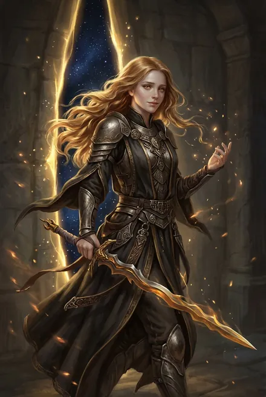
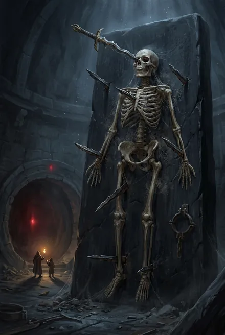
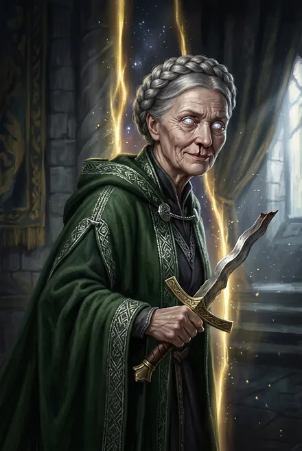

# Моргейн — Владычица Путей и Порталов

> См. также: [Белый Дьявол](../personazhi/belyj_dyavol.md) · [Кейнор](../personazhi/kejnor.md) · [Кель-рода Курганов](../personazhi/kel_roda_kurganov.md) (Илиана) · [Предатель Арвейн](../personazhi/arvejn_predatel.md) · [Тысяча Братьев](../personazhi/tysyacha_bratev.md) · [Азимандия](../personazhi/azimandiya.md) (Визуандия)

| Поле | Значение |
|---|---|
| **Имена/титулы** | Моргейн; **Владычица (Хранительница) Путей и Порталов**; у врагов — **Ведьма Путей**, «Ведьма, что охотилась на врагов в прошлом» (ТБ-3, пролог); «символ Тысячи»; «самая прекрасная в Тысяче» (ТБ-5, гл. 18) |
| **Природа** | Одна из Тысячи (Сестра), бывший небесный ранг |
| **Роль** | **Собрала Тысячу** — искала Братьев по Кругам; «Тысячу объединяли мудрость Янтандера, блеск Моргейн и гений Генерала» (ТБ-2); пока Братья держали врага, она «открывала дорогу» (ТБ-5) |
| **Книги** | ЗК-2 (флешбэк, гл. 23); упом. ТБ-1…ТБ-4, ЗК-11; действует в ТБ-5, гл. 18–20 |
| **Статус** | **Жива** — в золотом теле хранительницы Саар Илианы, которое та отдала добровольно (ТБ-5, гл. 18); вернула Тысяче Пути |

**Внешность.** При жизни — «мед развевающихся волос и тонкое лицо» (ТБ-5, гл. 18); Кейнор: «Ее волосы пахли медом» (ТБ-2, гл. 18). Оружие — **драконий клинок с волнистой кромкой** (ТБ-5, гл. 18); в ЗК-2 — «пламенный меч-дракон» / «золотая Руна-меч» (ЗК-2, гл. 23 и обзор). Ныне — в теле старой Илианы, в зелёном хэлио.

**Характер и речь.** Немногословна; древнее «**Айе**» (да); не любит объятий; улыбается печально (ТБ-5). «Брат. Долго же ты шел» (ТБ-5, гл. 18). Справедлива по-своему: «Этот род сторожил мои кости. И он достоин кары… Но эта Восходящая отворила Курган и сама дала мне тело. Потому — пусть уходят, покуда могут. Айе!» (ТБ-5, гл. 19). Финал: «Айе. У Тысячи теперь всегда будут Пути» (ТБ-5, гл. 20).

**История.**
- **Пробуждение Братьев.** *(Предположение, сильно подкреплённое текстом:)* именно она — «Восходящая с медовыми волосами, что пришла из Портала и сказала: «Ты один из нас»» Дарующему Молнии (ТБ-4, гл. 3).
- **Казнь Визуандии Аран** — предательницы-эвгины Дома Визу Аран — на сожжённой «Мечте» «оборот галактики назад»; голос (Белый Дьявол) называет её «его сестрой» (ЗК-2, гл. 23).
- Её драконий клинок «спас немало осколков Единого» (ТБ-3, пролог); путь у Разорванных Врат был «прочный, как драконий клинок Моргейн» — его разорвал Предатель (ТБ-5).
- **Пленение.** После поражения её пытали, клинок сломали и **прибили её кости семью осколками клинка к алтарю из морлоида** в Кургане рода **Саар**; Саркофаг заращён внутрь Древа **Аран-Саар**; дух держит капля Звёздной Крови в глазнице (ТБ-5, гл. 18). Сигна рода Саар — серебряный сломанный клинок с волнистой кромкой — насмешка тюремщиков. Вечность сковывала её и Лодочника Великой Руной **Хронос** (Предвестник; ТБ-3).
- **Освобождение (ТБ-5, гл. 18–20).** Пламени Подобный прожигает ход в Древе под Остановленным Временем (теряет всю Славу); иллиумовую оковку открывает кровь хранительницы. Илиана отдаёт ей тело. Моргейн получает Универсальную Золотую Руну, перечисляет нужные Руны («Путеводные Звезды, Прерывания, Запечатления, Связи, одно Слияние и семь золотых пустышек»), пьёт с братом Чашу Тёмных Гроз, дарит ему **Руну Пути** (гл. 19), рвёт «рэйю» — небесное плетение на шести Замках, запечатавшее Круг. В финале Путём сшивает пространство, и Разделитель Предателя выходит ему между лопаток (гл. 20). Идёт освобождать **Лодочника**: «Я всегда знаю, где он…» (гл. 19).

**Отношения.** Сестра Белого Дьявола (ЗК-2); память Кейнора о ней — нежность и скорбь; связь с Лодочником; Морвейн названа в её честь; Илиана — сосуд (ПП говорил, что Моргейн «захочет обрести своё» тело — ТБ-5).

**Тайны.** Как именно она «собрала Тысячу»; драконий клинок (работа Дракона?) *(предположение)*; любовь Кейнора; её путешествия «в прошлое» с Лодочником; что будет с Илианой внутри общего тела.
## Облики на иллюстрациях

<figure markdown="span">
  [{ loading=lazy }](../assets/portrety/120.webp)
  <figcaption>Владычица Путей (древность; память героя и Кейнора) <small></small></figcaption>
</figure>
<figure markdown="span">
  [{ loading=lazy }](../assets/portrety/121.webp)
  <figcaption>Останки в Кургане <small>ТБ-5, гл. 18</small></figcaption>
</figure>
<figure markdown="span">
  [{ loading=lazy }](../assets/portrety/122.webp)
  <figcaption>Моргейн в теле Илианы кель'Саар <small>ТБ-5, гл. 18–20</small></figcaption>
</figure>

Иллюстрации созданы нейросетью по описаниям из книг; это трактовка, а не официальный арт.

