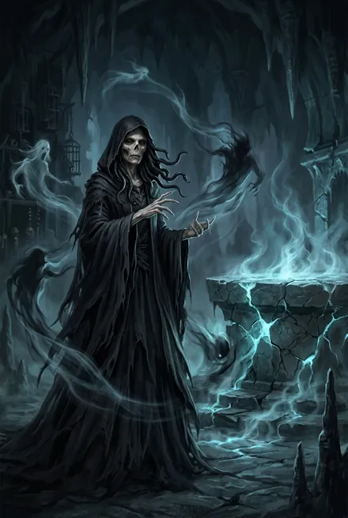
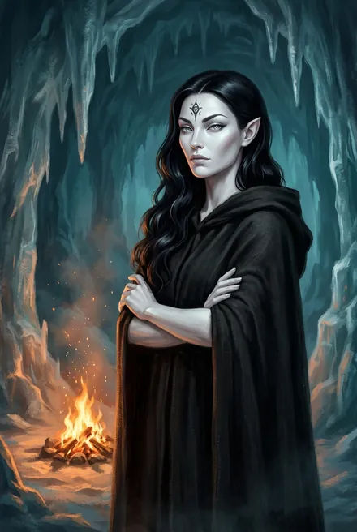
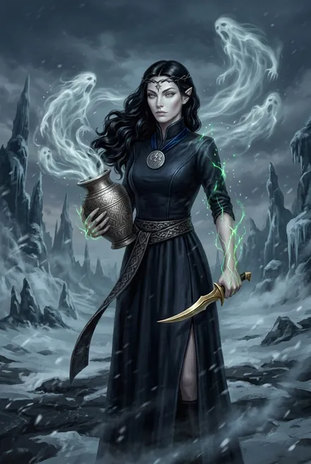
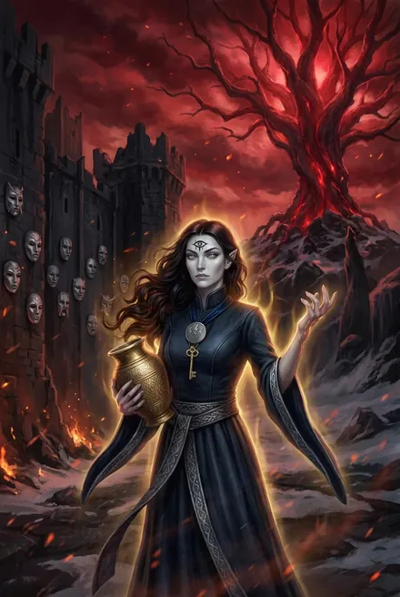
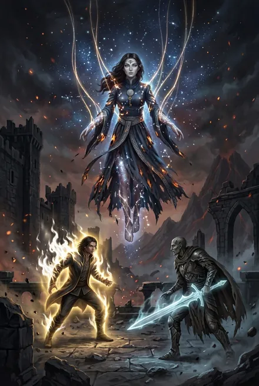

# Морвейн кель'Талас (Морвена)

> См. также: [Белый Дьявол](../personazhi/belyj_dyavol.md) · [Кель-рода Курганов](../personazhi/kel_roda_kurganov.md) (Талар, Эльвейн, Морри, Итта) · [Флекс Торий](../personazhi/flex-torij.md) · [Моргейн](../personazhi/morgejn.md) · [Тысяча Братьев](../personazhi/tysyacha_bratev.md) (Янтандер) · [Предатель Арвейн](../personazhi/arvejn_predatel.md)

## Облики на иллюстрациях

<figure markdown="span">
  [{ loading=lazy }](../assets/portrety/094.webp)
  <figcaption>Морвена, «живой труп» в Вечности <small>ЗК-5, гл. 12–14</small></figcaption>
</figure>
<figure markdown="span">
  [{ loading=lazy }](../assets/portrety/095.webp)
  <figcaption>Новое живое тело <small>ТБ-1, гл. 4</small></figcaption>
</figure>
<figure markdown="span">
  [{ loading=lazy }](../assets/portrety/096.webp)
  <figcaption>Руна Пламени Подобного: тёмно-синее асари, Знак Трёх Молний, Воющий Кувшин <small>ТБ-1, гл. 16 – ТБ-4</small></figcaption>
</figure>
<figure markdown="span">
  [{ loading=lazy }](../assets/portrety/097.webp)
  <figcaption>Золотая хранительница кель-рода Талас <small>ТБ-5, гл. 6–19</small></figcaption>
</figure>
<figure markdown="span">
  [{ loading=lazy }](../assets/portrety/098.webp)
  <figcaption>Сосуд Янтандера <small>ТБ-5, гл. 20</small></figcaption>
</figure>

Иллюстрации созданы нейросетью по описаниям из книг; это трактовка, а не официальный арт.

## Шапка

| Поле | Значение |
|---|---|
| **Имена** | **Морвейн кель'Талас** («моё имя в Восхождении», ЗК-5, гл. 17); **Морвена** — так её зовут в Домене Тория и Сигурд в ЗК-5/ЗК-6 («Морвейн-Морвена», ЗК-6, гл. 13); Заклинательница Духов / Заклинательница Душ; «похитительница душ» (ЗК-10); названа в честь Моргейн (ТБ-5) |
| **Раса/род** | Полукровка Аммос («нео» в терминах Вечности), кель-род **Талас** — сторожевой род Кургана Янтандера, Круг Семи Древ |
| **Роль** | Бывшая Хранительница Кургана Янтандера; Руна-Существо Сигурда (ЗК-5…ЗК-6, ЗК-9), затем Белого Дьявола (ЗК-6 финал, ТБ-1…ТБ-4); первая и преданнейшая слуга, любовница героя, провидица; в ТБ-5 — свободная союзница и глава рода |
| **Возраст** | **40 / 146 циклов**: около 40 прожила в Единстве, 106 — в Вечности (ЗК-5, гл. 17; ТБ-1); так же в карточке автора: «40/146 лет» (автор, TG: [пост 2163](https://t.me/prokofiev_litrpg/2163)) |
| **Ранг** | При жизни — **серебро**: «стала серебряной Восходящей, хранительницей Кургана Янтандера» (карточка автора, [пост 2163](https://t.me/prokofiev_litrpg/2163)). В Рунах: серебро (ЗК-5: Некротика 10, Ритуальность 8, Прозрение 8, Теургия 6 — 36 звёзд, ТБ-1) → **золото** (ЗК-9, гл. 18; «слабое золото после Вечности», ТБ-4) |
| **Книги** | ЗК-5, ЗК-6, ЗК-9, ЗК-10 (передача), ТБ-1…ТБ-5 |
| **Статус** | **Мертва** окончательно (ТБ-5, гл. 20): разъята Разделителем Предателя вместе с духом Янтандера в своём теле; умерла свободной и в Единстве, как и хотела |

## Внешность
- **В Домене Тория:** «мёртвая домоправительница» с пергаментной кожей и пустыми глазницами, «высохшая, гниющая заживо мумия» (ЗК-5; ЗК-6, гл. 15).
- **Истинный облик** (ЗК-6, гл. 15; ТБ-1): белая кожа, длинные волосы «цвета воронова крыла», прозрачно-серые глаза, острые ушки; руна-татуировка третьего глаза (Око Истины) над переносицей; рунные татуировки; зелёный камень в пупке; «синее с серебром» — цвета кель'Талас; «женщина в расцвете сил… холодная, чуть надменная красота».
- ТБ-5: тёмно-синие одежды, раскрытое око на лбу, амулет с молнией на груди (Знак Трёх Молний героя).
- Атрибуты: **Воющий Кувшин** (душелов; к ТБ-5 ≈ 999–1000 душ), **атамэ** из осколка Алтаря Душ Тория (ТБ-2, гл. 18), Скрипторум Некролита (ТБ-4, гл. 4), Браслеты Тысячи Эхо (ЗК-5).

## Характер
Ледяная аристократка, сломленная Вечностью, но несгибаемая; сдержанная, «покорная, но волевая» (ЗК-5). Сухой юмор (сцена с журналисткой Элли Кардо, ЗК-9). Обретя живое тело, жадно наслаждается вкусом, запахом, близостью (ТБ-1). Ненавидит Вечность: «Я хочу, чтобы Вечность горела!» (ТБ-1). Фаталистка-провидица: «Пусть будет так, как предначертано Подобному Пламени» (ТБ-2). Не боится смерти: «В Вечности я умирала столько раз и столь изощренно, что смерть перестала быть страхом» (ТБ-5, гл. 7). Нежна с правнучкой Морри, беспощадна к дочери ради её души. Понимает, как легко ПП жертвует чужими жизнями (ТБ-5, гл. 16), но остаётся с ним. Её желание — **умереть в Единстве, а не в Вечности** (ТБ-3; ТБ-5, гл. 7).

## Манера речи
Торжественно, нараспев; клятвы «Семью Древами», «во имя всех Единых, даже Забытого», «как предначертано», «Я провижу…».
- «Не может быть ничего хуже, чем оставаться здесь. Я готова умолять кого угодно» (ЗК-5 — о Домене Тория).
- «Я пойду за тебя сквозь пламя и тьму» (ТБ-1); полная клятва: «Я, Морвейн кель'Талас, пойду за Пламени Подобным сквозь пламя и тьму, пока Вечность не падет или пока я не умру. Пусть предначертанное свершится…» (ТБ-5, гл. 7).
- «Свободные выбирают сами» (ТБ-5, гл. 20 — Предателю).
- «Небо умеет ждать и умеет мстить» (ТБ-4 — о Тэйлисс).

## Биография

### До ЗК (ТБ-1, ТБ-5)
- Родилась в Круге Семи Древ **146 циклов назад** (по счёту ЗК-5, гл. 17), в роде Талас; Хранительница Великого Кургана Янтандера.
- В 20 циклов в род пришёл **Талар** из рода Саар — «мой первый серебряный щит, муж и возлюбленный»; «потом были и иные» — у хранительницы несколько стражей-консортов (ТБ-5, гл. 7). Дочь — **Эльвейн** (ТБ-5).
- Видела три попытки освобождения Курганов; **погибла, отражая прорыв**, больше ста циклов назад, прожив около **40 циклов** в Единстве (ТБ-1; ТБ-5, гл. 4). Её стигмат отнесли в Храм — душа ушла в Вечность.
- **106 циклов в Вечности** (ТБ-1): нео-игрушка, затем «мёртвая» служанка душеторговца **Флекса Тория** (~40 из них); Торий ломал её и Талара игрой «разрушение любви» (ТБ-5, гл. 9). Талар обезумел и сидел в клетке с шипами, его пожирали семарглы (ЗК-5).

### ЗК-5 «Вечность»
В Домене Тория домоправительница Морвена предаёт хозяина и добровольно становится Руной Сигурда: «Я, Морвейн кель'Талас из Великого Кургана Янтандера… готова стать Руной моего нового господина» (гл. 14). Воющим Кувшином всасывает призраков Домена, ритуалом (Некроз, Вечные Узы, Извлечение Сущности) превращает обезумевшего Талара в духа Кувшина. Сжигается Провидицей в бою, очищает Архив Снов.

### ЗК-6 «Тинг»
Освобождена от Тория и от Клятвы (Белый Дьявол казнит Тория, гл. 15), обретает в Бассейне Душ Золотого Города «настоящий облик» — и снова добровольно становится Руной (1 Символ + 24 капли). В финале Белый Дьявол забирает её Руну с собой в тело Марка (гл. 28).

### ТБ-1
Первый вызов у Пальцев (гл. 4): учит героя Создавать Артефакты и Чувству Звёздной Крови. Рассказывает о Курганах; Белый Дьявол дарит ей платье из асари сестры Азимандии; она дарит ему **Знак Трёх Молний** (гл. 16). Пророчество за ужином в Серебряном Замке; добровольная жертва на Арене — Руна сломана (гл. 17–18).

### ТБ-2
Восстановлена; собирает призраков, поднимает реаниматов; получает атамэ-душелов из золотых осколков Алтаря (гл. 18), забирает душу Клинка Гармонии. **Сожжена ликтором** в битве за Эргиаль (гл. 20) — Руна позже снова действует.

### ТБ-3
Рассказывает о Круге Семи Древ (Медные Башни, шесть Курганов с Малыми Древами, шесть кель-родов) и предлагает план: вернуться в Вечность и собрать души предков кель-родов, чтобы мёртвые «открыли печати» (гл. 1). Закрывает ветку Предвидения (10★). Прозревает убийство; передана **Сигурду** для миссии в Вечности вместе с золотыми Живыми Цепями в залог (гл. 4). Оба — приманка для Псов (гл. 17). Просит освобождения «в Единстве, но не в Вечности».

### ЗК-9…ЗК-10 (в Скрижали Сигурда)
Разоблачает некродермис и Скрипторум Некролита, приносит ему в жертву золотую душу Клинка Гармонии и получает золотую Руну-Навык «Великое Возрождение Плоти»; делает тело для погибшего Динамита; выполняет тайную миссию в Вечности; похищает в Кувшин душу кел-лорда **Велиора Вортекса**; становится **золотом** (ЗК-9, гл. 18). Травинка ревнует к ней. Хитрейший разоблачает её как «похитительницу душ» (999 душ в Кувшине) (ЗК-10); Руна передана Пламени Подобному (ЗК-10, гл. 3; ТБ-4, гл. 4).

### ТБ-4
Получает Скрипторум Некролита; поднимает армию реаниматов в руинах Эстэ («связала руки» Псам мертвецами); переносит душу Тэйлисс в тело трэли (гл. 8); вместе с духами Кувшина под клятвой свидетельствует перед приближёнными кинга о Вечности: рай — приманка, нео — игрушки, бессмертие — проклятие (гл. 9).

### ТБ-5 — возвращение домой и гибель
- Освобождена от рунного рабства: Руна Заклинательницы Душ уничтожена, стигмата нет — Вечность её больше не украдёт (гл. 7). Признаётся, что Талар — муж, а не брат; новые добровольные клятвы её и Талара. ПП: «Верность — единственная кровь, которую я считаю».
- Вводит ПП в Замок Талас как слугу «Угля» (гл. 8). Предки из Кувшина осаннами раскрывают правду о Вечности; **дочь Эльвейн** объявляет это ложью, призраки убивают её касанием, а Морвейн атамэ отправляет душу дочери в Кувшин: «Никто из Кель'Талас больше не достанется Небесному Трону» (гл. 9).
- Принимает Первый Ключ от Морри; новый завет — ни один стигмат не переступит порог Храма; созывает тинг в Медных Башнях (гл. 10). Даёт ПП 30 сфер Крови (9000 капель), 200 Монет и 20 серебряных Рун (гл. 10–11).
- На тинге открывает Кувшин; предки других родов свидетельствуют; разоблачён лже-Амарис (гл. 13).
- Прощание перед последней битвой: «Скажи ей… хранительница, носившая её имя, вернулась из Вечности, чтобы открыть ей дверь» — «Сама скажешь» (гл. 17).
- Вскрывает Курган Янтандера, **принимает в своё тело дух Янтандера**, воскресает; Янтандер спорит с Предателем; Предатель разымает их обоих (гл. 20). Душа ушла за Грань.

## Способности
Атрибуты Духа: Некротика, Ритуальность (Ритуалистика), Прозрение/Предвидение (10★), Теургия, Контроль 5★ (ТБ-3). Зрение Мёртвых. Воющий Кувшин (призраки как армия, свидетели, «говорящие духи»). Скрипторум Некролита (Руна-Существо «сильное золото», поднимает Мёртвый Город, Костяных Титана и Змею — ТБ-5, гл. 16). Великое Возрождение Плоти (создание тел). Три Золотых Голема (от героя, ТБ-2, гл. 1). Перенос душ в тела (Тэйлисс). Призыв Руной: 8 часов, 1 раз в сутки (ЗК-9). **Руны в каноне:** серебряная **Подчинение Призрака** — её Руна, отданная Сигурду (ЗК-5, гл. 14, 16–17); от Белого Дьявола — **Отражающая Чешуя**, связка **Защитник Восходящего + Парящий Щит** (бронза) и **Наряд, Меняющий Цвет** (ТБ-1, гл. 16); золотая **Мёртвая Коса** (ТБ-4, гл. 5). Таблица «Система Восхождения» числит за ней и Бездонную Сумку, но в ЗК-5, гл. 6 это Руна-Хранилище Сигурда.

## Отношения
- **Пламени Подобный** — «связана страстью и смертью» (ТБ-2); любовь без претензий на исключительность.
- **Талар кель'Саар** — муж; называла «братом» из скромности/опасения.
- **Эльвейн** (дочь), **Морри** (правнучка, внучка Эльвейн) — см. [Кель-рода Курганов Янтандера: хранители, ключники, предки](../personazhi/kel_roda_kurganov.md).
- **Азимандия** — соперница за внимание господина.
- **Сигурд** — второй хозяин Руны; её «вынес из Вечности человек из Народа Земли» (ТБ-5, гл. 13).
- **Моргейн** — её тёзка-«прототип»; Морвейн «вернулась из Вечности, чтобы открыть ей дверь».

## Противоречия и ретконы
- **Талар: брат или муж.** ЗК-5, ТБ-1, ЗК-9 — «брат»; ТБ-5, гл. 7 — муж из рода Саар (Талар кель'Саар). Последняя версия — канон; ранняя объяснена как её ложь.
- Её смерть встречается трижды до окончательной: ТБ-1 (Арена — Руна сломана), ТБ-2, гл. 20 (сожжена ликтором) — оба раза Руна восстановлена «за кадром»; ТБ-5 — окончательная.
- Счёт циклов: 40 + 106 = 146 — согласован (ЗК-5, гл. 17; ТБ-1).

## Карточка автора (вне канона)

> Карточка персонажа из канала автора (автор, TG: [пост 2163](https://t.me/prokofiev_litrpg/2163), октябрь 2024 — до выхода ТБ-5). Это не текст книг: при расхождении прав канон.

| | |
|---|---|
| **Имя, возраст** | Морвейн кель'Талас (Морвейн, Морвена); 40/146 лет |
| **Происхождение** | Круг Семи Древ, Курган Янтандера; «низшая, полукровка Кел Аммос»; кель-род Талас — «один из шести, управляющих этим Кругом» |
| **Род занятий** | Заклинательница Духов: некромант, оракул, провидица; бывшая хранительница Кургана; по своей воле служит Белому Дьяволу в Руне |
| **Биография** | С детства учена как теург и провидица; стала **серебряной** Восходящей и хранительницей Кургана с доступом ко всем охранным Рунам. Погибла вместе с Таларом при прорыве; в Янтандере осталась дочь, тоже хранительница. В Вечности — вольные странники, союзы нео, войны небесных господ, служба Алмазному Двору и Дому Вортексов. Обманом, по долговому контракту попала к душеторговцу: он держал её в искажённом мёртвом теле, а Талара пытал, **заставляя её каждый день убивать и воскрешать его**, отчего тот сошёл с ума |
| **Приметы** | Холодная красота Кел Аммос: длинные тёмные волосы, удлинённые серые глаза, высокие скулы. Руна-татуировка третьего глаза на лбу, руны на плечах и бёдрах, зелёный камень в пупке. Тёмно-синее с серебром — фамильные цвета |
| **Характер, речь** | Изысканна, вежлива, ледяное спокойствие, архаичные обороты; безжалостна к врагам; с теми, кому доверяет, улыбается и радуется жизни |
| **Сила** | Сильный заклинатель духов, теург, оракул; подчиняет призраков; ищет людей, предметы и Руны; знает все охранные рубежи Кургана |
| **Слабость** | Атрибуты Тела не развиты — слаба в ближнем бою; готова на крайности ради Талара; кошмары о том, что приходилось делать |
| **Тайна** | «СКРЫТО» |
| **Цель** | Вернуть Талара, вернуться в свой Круг, отомстить Вечности, «умереть в Единстве, разрушить Вечность» |

**Сверка с каноном.** В карточке Талар — «брат»: это её легенда до ТБ-5, где он муж (гл. 7); скрытая «тайна» карточки, видимо, и есть муж. Цель «умереть в Единстве» исполнена в ТБ-5, гл. 20. Пытка «убивать и воскрешать» в книгах прямо не описана (там Талара пожирают семарглы).
