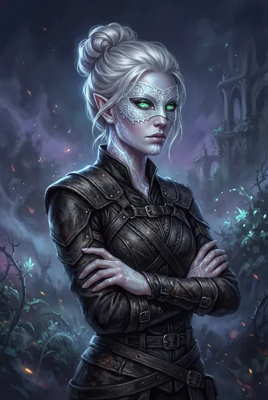
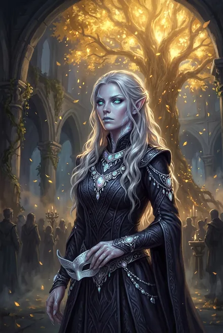

# Найтфир (Ночной Страх) — Королева Снов

> См. также: [Белый Дьявол](../personazhi/belyj_dyavol.md) · [Каласса](../personazhi/kalassa.md) · [Народ Теней](../personazhi/narod_tenej.md) (Шепот-в-Ночи, Шелковая Тень)

| Поле | Значение |
|---|---|
| **Имена** | Найтфир; Ночной Страх; «королева», «голос» кинга; первая **Королева Снов** Народа Молний (ТБ-4, гл. 3) |
| **Раса/септа** | Народ Теней, септа **Лунных Теней (Луноликих)**; кровь Кел Аммос; внучка Шепот-в-Ночи |
| **Роль** | Посланница Луноликих → пленница → первая жена кинга, правительница Эстэ на время его отсутствия |
| **Ранг** | Сильное серебро, ментал, сновидица; золотая Руна «Искусство Грез», золотой Предмет «Корона Грез»; Аспект «**Лунная Вуаль**» (ТБ-4, гл. 3). Серебряную Руну-Заклинание **Большое Погружение-в-Грезы** Сигурд отнял у неё в ЗК-9, гл. 5 — видимо, та Руна, которую «забрали Люди Земли» (ТБ-3); с ней она усыпила копьё. **Призрачный Шаг / «Тенеходец»** в ЗК-9, гл. 5 — Руна Сигурда, не её |
| **Возраст** | В каноне не назван; карточка автора — около 30 циклов (автор, TG: [пост 5666](https://t.me/prokofiev_litrpg/5666)) |
| **Книги** | ЗК-9 (гл. 4–5), ТБ-3, ТБ-4 |
| **Статус** | Жива; регент Эстэ; хочет ребёнка |

**Внешность.** Серебристые волосы, нефритово-зелёные или сине-зелёные светящиеся глаза, голубые губы; на теле татуировки рун снов; маска из лунного камня (серебряный Предмет). «Тело хранила для будущего мужа» (ТБ-4).

**Характер.** Гордая, холодная, наблюдательная; «дважды сломлена — Сигурдом и Пожирателем Костей»; через испытание приходит к искренней верности и становится собственницей (ТБ-4). Ревнует к Калассе: «пусть Незримый решит, чьё дитя закричит первым!» (ТБ-4, гл. 18).

**Речь.** Клятвы лунным камнем: «О лунный камень…», «Лунный камень не боится ночи, но он не слеп». «Ночной Страх кусается даже в золотом ошейнике!» (ТБ-4, гл. 1).

**Путь.**
- **ЗК-9, гл. 4–5:** предводительница отряда Луноликих в маске из лунного камня; усыпляет копьё Сигурда Руной «серебро-10»; выбирает алчность вместо фионтара; Сигурд ломает её волю Ментальным Императивом и надевает иллиумовый ошейник, берёт выкуп — её Руну Сна. Позже — невеста Пламени Подобного.
- **ТБ-3:** посланница Луноликих, нареченная невеста «если согласится»; её Руну «забрали Люди Земли» — кинг обещал вернуть; пленница Пожирателя Костей (тот едва не взял её в жёны), спасена, открывает Портал (гл. 12–16).
- **ТБ-4:** кинг не давит на неё Голосом Древней Власти, а даёт выбор и золотую Руну «Искусство Грез» из Крови Истока — «Я не беру то, что не отдано» (гл. 1). Свадьба во Дворце Пустоты; спуск в **Архив Забвения**: Отражение Королевы Снов, похожее на неё лицом; пробуждает Аспект; получает Корону Грез и становится Королевой Снов; первая близость по её просьбе (гл. 2–3). Через Корону видит вокруг головы мужа «небесную корону» из молний. Грёзами показывает Всполох прежний Эстэ (интерлюдия «Всполох»). Получает молнию между бровей в клятве пятерых (гл. 9); клятвы на тинге за Народ (Клятва Найтфир кингу Трав, гл. 14). Регент Эстэ с золотыми Рунами, Эсмеррой, Архитектором и Аур-Таленом (гл. 18).

**Связи.** Бабка — Шепот-в-Ночи (умерла от Печати Тайны, наведя Псов на Эстэ). «Бабка с плетью» в её кошмарах (ТБ-4, гл. 3) — *вероятно, Шелковая Тень или Шепот (неясно)*. Соперница — Каласса. «Две королевы — меч и сны» (ТБ-4, гл. 3).

**Тайны.** Королевы Снов прошлого Эстэ (семь поколений; «моя золотая Королева Снов» Белого Дьявола, ЗК-5); запретные залы Архива; её будущий ребёнок.

## Облики на иллюстрациях

<figure markdown="span">
  [{ loading=lazy }](../assets/portrety/105.webp)
  <figcaption>Посланница в найткоже и маске из лунного камня <small>ТБ-3, гл. 14 – ТБ-4, гл. 1</small></figcaption>
</figure>
<figure markdown="span">
  [{ loading=lazy }](../assets/portrety/106.webp)
  <figcaption>Невеста кинга <small>ТБ-4, гл. 2 и далее</small></figcaption>
</figure>

Иллюстрации созданы нейросетью по описаниям из книг; это трактовка, а не официальный арт.

## Карточка автора (вне канона)

> Карточка персонажа из канала автора (автор, TG: [пост 5666](https://t.me/prokofiev_litrpg/5666), апрель 2026). Это не текст книг: при расхождении прав канон.

| | |
|---|---|
| **Возраст** | неизвестен; около 30 циклов |
| **Род занятий** | Серебряная сновидица и ментал, командир боевых групп Луноликих; первая жена Пламени Подобного и Королева Снов |
| **Биография** | Внучка Шепот-в-Ночи; носительница древней крови Кел Аммос, одна из наследниц Королев Снов. Как ценный актив для брака долго не выходила замуж. Проиграла землянам Сигурда и **потеряла важную Руну**. Посланная к Черепам, попала в плен к Пожирателю Костей; после разгрома Черепов отдана в жёны Пламени Подобному как условие союза септ. **Первая из Людей Теней, принявшая перекованную молнию вместо гвоздя Вечности** |
| **Приметы** | Полукровка Кел Аммос, безупречные черты, высокие скулы, заострённые уши, серебряные волосы; ритуальные узоры Луноликих на шее и ключицах; маска из лунного камня |
| **Характер** | Гордая, тщеславная, холодная на поверхности, «предпочитает смерть позору»; после Архива Грёз начала меняться |
| **Речь** | Медленно, с нажимом, формулы Лунных Теней: «Лунный камень не боится ночи, а его Тени не страшатся крови», «Твоя тень сейчас на нашей земле, человек Земли», «Убей. Смерть… лучше позора!», «Лунный камень знает, наши предки обходились без гвоздей. Владыка даровал им молнии…», «Я принимаю твой дар» |
| **Слабость** | Самоуверенность, гордыня, ревность, уязвимость в любви |
| **Тайна** | Узнала в Архиве Забвения многое о прежнем воплощении Пламени Подобного |
| **Цель** | Вернуть честь и силу древних сновидиц; власть первой жены кинга; уничтожить соперниц и родить наследника |

**Сверка с каноном.** Совпадает с ЗК-9 и ТБ-3–04. «Первой приняла молнию» — в ТБ-4, гл. 9 молнии принимает весь Народ; первенство Найтфир в книгах прямо не названо.
