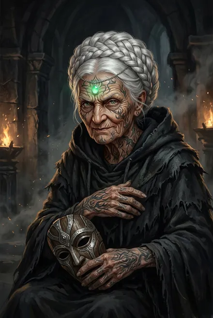
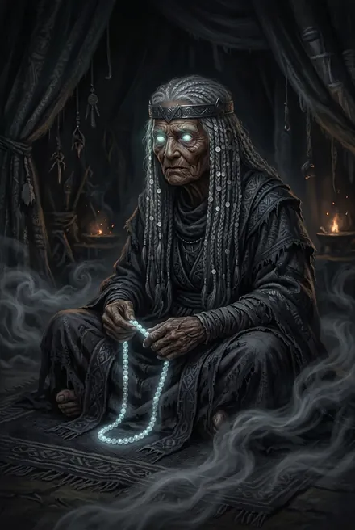
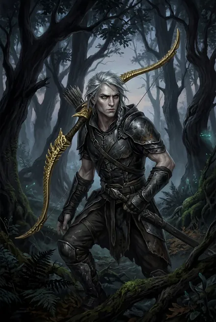
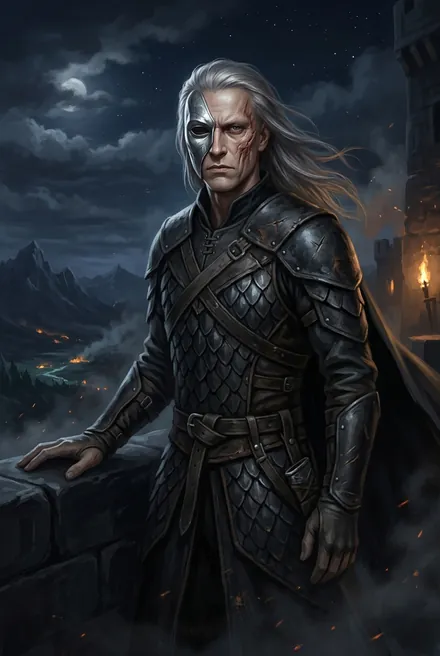
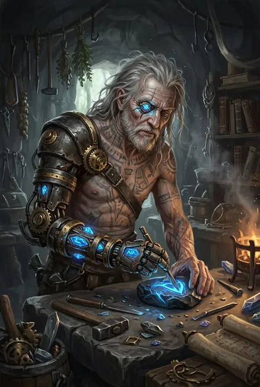
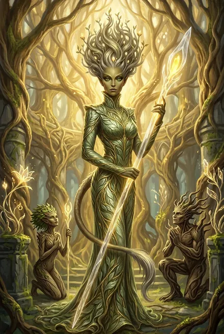
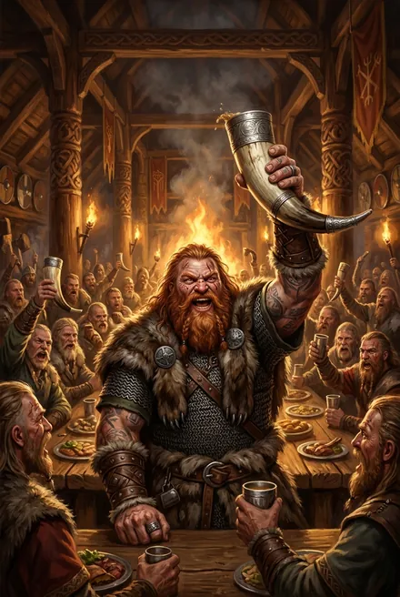
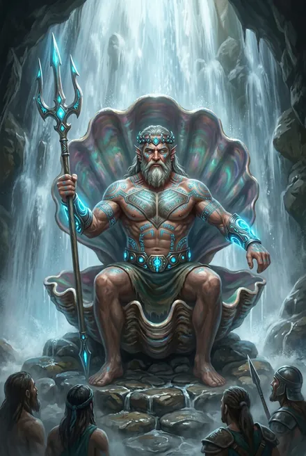
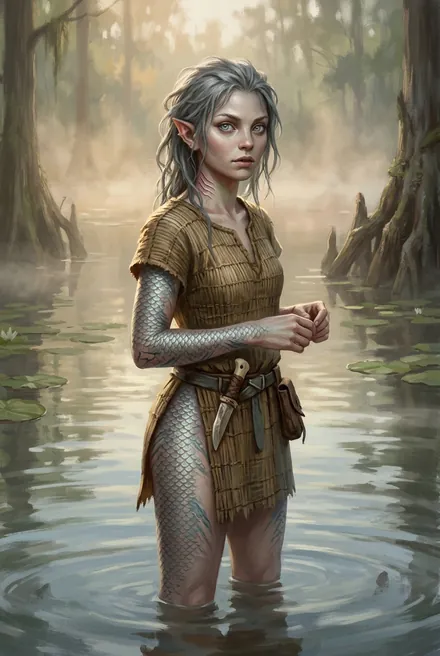

# Народ Теней / Народ Молний — вожди и знать (ТБ-3…ТБ-4)

> См. также: [Белый Дьявол](../personazhi/belyj_dyavol.md) · [Найтфир](../personazhi/najtfir.md) · [Каласса](../personazhi/kalassa.md) · [Великие Черви](../personazhi/velikie_chervi.md) · [Существа Скрижали](../personazhi/sushchestva_skrizhali.md) (Аур-Тален, Эсмерра). Травинка, Говорящая, Коготь в ЗК, Марк — досье основной серии: [Травинка-на-Ветру (Адель Кассиди)](../personazhi/travinka.md), [Говорящая-с-Травами](../personazhi/govoryashchaya.md), [Коготь-как-Серебро](../personazhi/kogot-kak-serebro.md), [Марк Кассиди («Мрак», «Мрак-подобный-Пламени»)](../personazhi/mark-mrak.md).

## Облики на иллюстрациях

<figure markdown="span">
  [{ loading=lazy }](../assets/portrety/107.webp)
  <figcaption>Шелковая Тень <small></small></figcaption>
</figure>
<figure markdown="span">
  [{ loading=lazy }](../assets/portrety/108.webp)
  <figcaption>Шепот-в-Ночи <small></small></figcaption>
</figure>
<figure markdown="span">
  [{ loading=lazy }](../assets/portrety/109.webp)
  <figcaption>Острый-как-Шип <small></small></figcaption>
</figure>
<figure markdown="span">
  [{ loading=lazy }](../assets/portrety/110.webp)
  <figcaption>Коготь-как-Серебро <small></small></figcaption>
</figure>
<figure markdown="span">
  [{ loading=lazy }](../assets/portrety/111.webp)
  <figcaption>Режущий Руны <small></small></figcaption>
</figure>
<figure markdown="span">
  [{ loading=lazy }](../assets/portrety/152.webp)
  <figcaption>Иниэсс <small></small></figcaption>
</figure>
<figure markdown="span">
  [{ loading=lazy }](../assets/portrety/153.webp)
  <figcaption>Сторм <small></small></figcaption>
</figure>
<figure markdown="span">
  [{ loading=lazy }](../assets/portrety/154.webp)
  <figcaption>Аурвак <small></small></figcaption>
</figure>
<figure markdown="span">
  [{ loading=lazy }](../assets/portrety/155.webp)
  <figcaption>Форель <small></small></figcaption>
</figure>

Иллюстрации созданы нейросетью по описаниям из книг; это трактовка, а не официальный арт.

## Народ
- **Происхождение.** Потомки жителей Эстэ — Кел Аммос, «смешавшихся с низшими в жуткие времена Раскола», и «детей» Дарующего Молнии; после падения Эстэ беглецы ушли в тени и стали изгоями (ТБ-1; ТБ-3, гл. 4; ТБ-4, гл. 3). Белый Дьявол — их «Отец», клятва «Кровью Белого Дьявола» (ЗК-3). Кингом может быть **только носитель крови Дарующего** (ТБ-3; ЗК-9). Народ Реки — тоже потомки Эстэ (ТБ-1, гл. 4/7).
- **Септы:** Каменные Луки (сильнейшая; астролит Кел Аммос), Небесные Когти, Серые Шипы (слабейшая, из изгоев), Лунные Тени (Луноликие), Тёмные Грозы (Кузница Молний; искусство перековки молний), Черепа (три септы — Чёрные Черепа и др.; Кровавые Черепа). Раскол на восемь септ; нашествие на Пылающий Рог при кинге Поющем-о-Смерти — погибли три септы (ТБ-3, разд. 10, 12).
- **Малый тинг септ** собирается у **Колонны (Столпа) Сияния** — аванпоста Наблюдателя с антирунным полем: «Люди Теней собирались у Колонны уже четвертую сотню циклов, чтобы провести малый тинг» (ТБ-3, интерлюдия «Народ Теней»; поле — ЗК-9, гл. 7). Там убит Яростный-как-Пламя. Автор: «Колонна Сияния, где не действуют рунные эффекты» (автор, TG: [пост 3654](https://t.me/prokofiev_litrpg/3654)).
- **Септы по «Справочнику» автора** ([пост 3654](https://t.me/prokofiev_litrpg/3654)): Каменные Луки — самая многочисленная, «хранители древней крови и традиций»; **Небесные Когти** — собиратели и оружейники, мастера **когтей-тарнов**; Лунные Тени (Луноликие) — у единственной в Круге россыпи лунного камня, сны и ментальное внушение (они же «Маски» ЗК-3, см. статья «Народы и фракции» § 10); Серые Шипы — мастера ловушек, лазутчики, проводники караванов, охотники на Червей; **Тёмные Грозы** — мастера молний и теневых животных, **держат одну из важнейших Стрел теневых земель, через которую идут все торговые караваны**; **Черепа** — общее имя нескольких диких септ: **Чёрные, Дикие и Кровавые**; многие изменены телом, по слухам пользуются Проклятыми Рунами и встречаются с посланниками Червей. Справочник помещает Черепа «на западе Круга» — против канона (восток: ЗК-9, гл. 7; ТБ-3); держим канон.
- **Облик и обычаи** (там же): заострённые уши, вытянутые пропорции, бледная кожа с сероватым оттенком, часто нефритовые глаза, волосы цвета серебристого пепла или угля; ритуальные татуировки — **Узоры** (септа, заслуги или знаки позора). Тайно чтут Белого Дьявола — «Одного из Тысячи Демонов» — как великого предка; по поверью, изгнаны за пределы игг-света за поддержку Тысячи в войне с Вечностью и считаются **официальным народом-изгоем**. Доспехи и оружие из найткожи, зирдина, лунного камня, иллиумовых шипов, хитина Червей. Считают своим всё теневое кольцо, хотя держат малую его часть. Узоры у септ разные: травы у Танцующей (ЗК-3), «языки пламени, похожие на волнистые клинки» у Луков (ЗК-6, гл. 17), «пугающие синие узоры» на восково-бледной коже у Черепов (ТБ-3, гл. 7).
- **Переименование:** «Народ Молний вернулся» — тинг Элтанира (ТБ-4, гл. 13); исход в Эстэ; Клятва молнии (ТБ-4, гл. 9); вира — цена десяти гвоздей; обязанность — быть щитом/стражем Тени против Червей (ТБ-4, гл. 14).

## Шелковая Тень
| | |
|---|---|
| **Кто** | Мать Яростного-как-Пламя и Говорящей-с-Травами, жена кинга Шепчущего-в-Ночи; **бабушка тела героя**; около 80 циклов; Аммос |
| **Сила** | Серебро, ментал «близко к золоту», **тенеходец**, шпионская сеть во всех септах |
| **Роль** | Враг-интриганка → «покорная тень», **первый знаменосец**, «уши кинга» |
| **Статус** | Жива (ТБ-4) |

Старая паучиха и матриарх, «шея, что поворачивает мужские головы»: правила через сына и мужа-кинга, изгнала собственную дочь Говорящую (ТБ-3). Рефрен — «**Тени шепчут…**». После клейма служит герою, но интригует: сватает ему жён, ненавидит Калассу (ТБ-3). Разведка, допросы, выпускает Аур-Талена (ТБ-3, гл. 6–7). В ТБ-4 принимает молнию (гл. 9), надзирает с плетью за трэлью-Всполох (гл. 8). *Тайна: молодость, интриги при Шепчущем-в-Ночи, правда об отравлении кинга.*

## Коготь-как-Серебро (Серебряный Коготь)
Рикс **Небесных Когтей**; тонкий и быстрый «как тенептица»; высокий гибкий копейщик-серебро, лицо изуродовано когтистой лапой и «отпечатком ладони» — шрам-метка, оставленная голосом/героем на тинге (ЗК-3; ЗК-6; ТБ-3); раньше носил серебряную маску поверх шрама. Горд, жаден до Славы, «клянусь Кровью Белого Дьявола» (ЗК-3). Наставница — **Видящая-сквозь-Тьму** («первая мать»), учила «Пустой Голове» и предупреждала, что Древо принесёт смерть; тайная Клятва Когтей служить «небесному господину» (ЗК-3; ТБ-3). Первым принёс Клятву Пламени Подобному — «мой верный» (ЗК-9; ТБ-3); шпион и приманка Всадника; в гл. 14 ТБ-3 герой в виде Водяного Тела «прячется» у него в желудке — самая напряжённая сцена книги от его лица. ТБ-4: разведка Эстэ, «мы — твои дети», на свадьбе «Кинг и королева!», молния, клятва на тинге. **Жив.**

## Острый-как-Шип (Острый Шип)
Рикс **Серых Шипов**; около 30 циклов; золотой лук из кости небесного змея, плащ Искателя; охотник на Червей; «золотая охота» — отрезал рой от Пасти, убил почти-золотую Мать, поставил Игг-Метку на Всадника (ТБ-3, гл. 10–15). Верен, задаёт неудобные вопросы; молния, клятва на тинге (ТБ-4). **Жив.**

## Шепот-в-Ночи
Глава Лунных Теней, величайшая сновидица Народа; слепая старуха в кел-венце из истинной стали, вместо глаз — светящиеся лунные камни, серебряные диски «в тысяче седых косиц», чётки из лунного камня; серебро с 1–2 золотыми звёздами в Грёзах (ТБ-3). Вторгается в сон героя, смотрит сны Всадника, приводит Луноликих; торгуется за место для септы даже после того, как всё поняла; признаёт кинга за брачный союз внучки Найтфир (ТБ-3, гл. 12). В ТБ-4 оставлена у лунного камня как наводка для Псов; **умирает от Печати Тайны**, передав Всполох угрозу (интерлюдия «Дикая Охота»; гл. 5 — «была отдана им сознательно»). **Мертва.**

## Яростный-как-Пламя
Рикс **Каменных Луков**, потомок Белого Дьявола, дядя тела героя (брат Говорящей); серебро (ТБ-3). Встречал «прародителя» в теле землянина: голос осанной подчинил его на тинге (ЗК-6, гл. 17); показывал осанну героя Видящей-сквозь-Тьму. Отвечал, что кингом может быть только носитель крови Дарующего (ТБ-3). POV интерлюдии ТБ-3: на малом тинге Теней убит засадой Секаторов/серебряных Червей Всадника вместе с фламиникой и знаменосцем — гибель «последнего законного наследника» (ТБ-3, интерлюдия; ЗК-9). **Мёртв.** Его наследство (Аур-Тален, Кристалл Теневого Ока, Учитель Храма Битвы, Призрак Великого Древа, Фолиант Грёз, Чаша Огня, 117 Монет) перешло к герою (ТБ-3, гл. 7).

## Пожиратель Костей / Всадник
| | |
|---|---|
| **Маска** | Рикс **Черепов** (из септы Чёрных Черепов): громадный воин в чёрном хитиновом доспехе и шлеме-черепе, который «по Клятве» не снимает до овладения Древом |
| **Суть** | **Золотой Отрекшийся** («старое золото»): жидкая Тьма, шесть жёлтых огней, поющая личинка Великого Червя в голове; ходит через Тьму; Наблюдатель не видит сквозь «червивую Тьму» (ТБ-3; ЗК-9, гл. 8) |
| **Статус** | Уничтожен Золотой Кровью Пламени Подобного в Кузнице Молний (ТБ-3, гл. 15) |

Говорит отрывисто и дико: «Сильный берет, слабый дает. Рикс, не рикс — все мясо!»; всех зовёт «мясо», щёлкает вместо смеха (ТБ-3). Цель — стравить Народы и погасить свет Древ; призывал Теней к войне против землян за юное Игг-Древо. Убил прежних риксов Черепов (**Смеющийся**, **Лунохвост**), Яростного, рикса Гроз **Пьющего-Кровь-Ледозубов** (отказался назвать его «Хозяином»); в Саге ТБ-2 «Всадник» руками предателя-тенника посеял Семя Улья в Эстэ. Пленил Найтфир. «Лишь тень великой угрозы» (ТБ-3). Трофеи: Домен-Ключ «Забытые Золотые Сады», Чаша Тёмных Гроз, Крылья Народа Молний, кейс «Проект Аврора» с шестью сосудами Крови Истока (ТБ-3, гл. 16–17).

## Режущий Руны
Эрл (старший танаан) Каменных Луков, лучший рунный мастер Теней; рука-конструкт, глаз-кристалл; серебро «близко к золоту»; верен древней крови; **второй знаменосец** (ТБ-3). Возражает против Калассы-рикса: в её жилах нет древней крови — но признаёт её (ТБ-4, гл. 18). **Жив.** *Не Брат Тысячи.* Его сын (в другом месте — внук) **Молния-из-Стали** — хейр, сторонник Калассы, перешёл к герою (ТБ-3, гл. 8).

## Говорящая-с-Травами (кратко)
Фламиника, мать Марка Кассиди и Травинки, дочь Шелковой Тени и кинга Шепчущего-в-Ночи; изгнанница, «червивая сестра» Яростного; якобы отравила отца «чёрными травами»; указала землянам плато; скрывала от сына рунные секреты, «использовала как орудие» (ТБ-1, гл. 4); на тинге применила Проклятую Руну (Кошмарная Роща) (ЗК-6); «отправилась в Вечность» — **мертва** (ТБ-3). Дала Винсенту Ключ в Домен (ЗК-6). «Червивая мать» (Форель, ТБ-1).

## Прочие
- **Серебряное Облако** — ученица погибшей фламиники, белые волосы, молодая Восходящая; новая фламиника Луков; при ней пробудилась Эсмерра (ТБ-3); проводит свадебный обряд кинга (ТБ-4).
- **Туман-из-Глубины** — одноглазый танаан Луков, первый пленник, разносит весть (ТБ-3, гл. 5). **Чёрный Гром-Камень** — танаан, ставленник Шелковой Тени, метнул тарн — сожжён изнутри (ТБ-3). **Чёрный Тарн** — танаан со шрамом, первым перешёл к герою, командует 50 копьями у Танцев (ТБ-3).
- **Костерез** — червивый фламин Черепов, комендант Черепа Великана; казнён публично (ТБ-3, гл. 13).
- **Буря-в-Ночи** — фламиника и жена рикса Гроз, червивая марионетка при Пожирателе (ТБ-3).
- **Рвущий-Червивые-Жилы** — новый рикс Черепов; с 3000 воинов клянётся быть стражами теней (ТБ-4, гл. 15).
- **Шепчущий-в-Ночи** — последний кинг Народа Теней, дед тела героя; якобы отравлен дочерью (ТБ-3). **Поющий-о-Смерти** — древний кинг времён нашествия на Пылающий Рог (ТБ-3). **Быстрый-как-Ветер** — танаан Луков, отец Калассы; его иллиумовый коготь Сигурд и голос нашли в Гнезде Червей (ЗК-2/ЗК-3; ТБ-3).
- **Видящая-сквозь-Тьму** — Видящая Небесных Когтей («первая мать») (ЗК-3; ТБ-3).
- **Королева Снов** — древняя кел с молнией-третьим глазом, хранительница Великого Архива Снов в Эстэ; «моя золотая Королева Снов» (Белый Дьявол, ЗК-5); погибла в Архиве при падении Эстэ; её Отражение-страж в Архиве Забвения уничтожено (ТБ-4, гл. 3); прародительница Луноликих.
