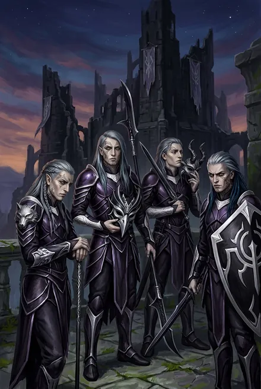
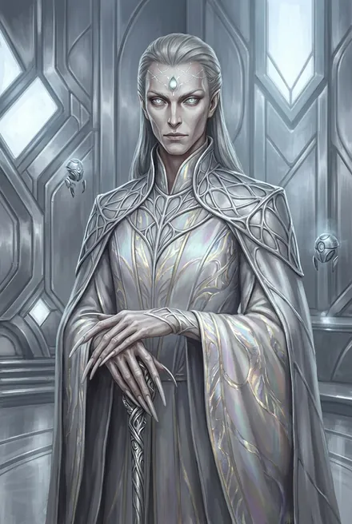

# Народы Круга Элтанир в цикле ТБ: риксы, кинги и спутники (кроме Теней)

> Народ Теней — [Народ Теней / Народ Молний — вожди и знать (ТБ-3…ТБ-4)](../personazhi/narod_tenej.md); Иниэсс — [Иниэсс Зелёный Лист](../personazhi/iniess.md); караванщики — [Великие Караваны в ТБ-5: Обочина, Вешка, Подкова, Найра, Вейн](../personazhi/karavanshchiki.md). Земляне (Винсент, Аврора, Минос, Сигурд и др.) — досье основной серии.

## Облики на иллюстрациях

<figure markdown="span">
  [{ loading=lazy }](../assets/portrety/160.webp)
  <figcaption>Народ Теней (групповой портрет <small></small></figcaption>
</figure>
<figure markdown="span">
  [{ loading=lazy }](../assets/portrety/161.webp)
  <figcaption>Кел (Аммос), эталон <small></small></figcaption>
</figure>

Иллюстрации созданы нейросетью по описаниям из книг; это трактовка, а не официальный арт.

## Народ Реки (клан Мёртвой Рыбы и соседи)
Потомки Эстэ, как и Тени (ТБ-1, гл. 4). Речь — водные метафоры и жаргон.

### Серебряная Форель — Мирисс
| | |
|---|---|
| **Кто** | Восходящая Народа Реки, внучка рикса Аурвака («вторая дочь его третьего сына, Керна Ныряльщика», ТБ-1, гл. 6; так же в карточке автора); ищейка |
| **Возраст** | В каноне не назван; карточка автора — около 20–25 циклов |
| **Ранг** | Слабая бронза (+2 звезды); облик выдры (ТБ-1); бронза (ТБ-4) |
| **Путь** | Пленница → проводница → любовница → предательница → должница (ТБ-1) |
| **Статус** | Жива; связана Клятвой; ушла в клан Золотых Каналов (ТБ-4) |

Юная, дерзкая, любопытная, амбициозная до алчности; маленькая, сероволосая, остроскулая, прозрачно-голубые глаза, жаберные щели, татуировки рыбьей чешуи (ТБ-1). Речной жаргон: «журчать», «брызги», «тёмная глубина!»; герой зовёт её «бронзовая рыбка». **ТБ-1:** после пробуждения у Стрелы ведёт героя к Мертвой Рыбе (гл. 6–7); любовь; удар в спину ради пяти серебряных Рун — у локи (гл. 13); пощажена — «Я не человек» — цена: Клятва рассказать правду, выкупить и привести во фригольд землян всех земных трэлей Народа Реки «в дар от Подобного Пламени» и передать риксу: «время старых войн прошло… всем Народам придётся сражаться вместе» (гл. 14). Отдаёт Руну Черного Ползуна (гл. 13). **ЗК-9:** привозит Сигурду трэлей и виру — жемчужное ожерелье-Предмет для Травинки; объясняет, что Пламени Подобный пощадил её лишь «из-за» Сигурда. **ТБ-4:** из её памяти Псы получили образ и имя героя (интерлюдия «Дикая Охота»); приходит к кингу, убивает **Ирса Серого Плавника**, уводит пятерых Восходящих в клан **Золотых Каналов** под власть Народа Молний; осматривает каналы Эстэ (гл. 13–15).

**Карточка автора (вне канона)** — автор, TG: [пост 3879](https://t.me/prokofiev_litrpg/3879), июль 2025. Это не текст книг: при расхождении прав канон.

| | |
|---|---|
| **Происхождение** | Клан Мёртвой Рыбы; росла во дворце-крепости в скелете гигантского звёздного многозуба. Предки Народа Реки «населяли закрытые октагоны и были созданы как жители рек и озер» |
| **Биография** | Бронзовая Восходящая, одна из лучших ищеек клана: дальние разведрейды, охота, захват пленных. Воевала с Народом Трав и **первой столкнулась с землянами фригольда в ранний период колонизации** |
| **Приметы** | Худощавая, гибкая; синяя татуировка мелкой рыбьей чешуи на половину тела (клановый узор); остроскулое лицо, «злые голубые глаза», длинные пепельно-серебристые волосы; перепонки между пальцами, жаберные щели. Одежды не носит, кроме нитки цветных ракушек на талии и украшений |
| **Речь** | Речное Наречие и Единый язык; жаргон: «брызжет» — лжёт, «журчит» — говорит, «бурлит» — спорит, «многозуб» — сильный воин, «рыбка» — молодая женщина, «локи» — водное чудовище, «мальки» — дети, «плавник» — оружие |
| **Сила** | Дышит под водой; гарпун, ловчая сеть, следопытство; **Стиль Железа**; Руна превращения в **энхидриодрона** — гигантскую выдру |
| **Характер, слабость** | Дикая, гордая, жадная до Рун и Крови, готова предать ради серебра; после ряда случаев осторожнее. Уязвима на суше, импульсивна, зависит от рунных предметов |
| **Тайна, цель** | Втайне восхищается теми, кто её победил, и мечтает о серебре и достойном спутнике; цель — стать серебряной и принести славу Народу Реки |

**Сверка с каноном.** Облик выдры, татуировки и жаргон совпадают с ТБ-1. «Первой столкнулась с землянами в ранний период колонизации» в книгах не описано; при 20–25 циклах это могло быть лишь в последние годы перед ЗК.

### Аурвак Владыка Чешуи
Рикс **Мёртвой Рыбы** (фригольд в скелете древнего многозуба — того, которого убил Дарующий); старое серебро, древние Предметы Кел (ТБ-1). Громогласный, гневливый, но честный: «Слова рикса — не брызги!»; подчиняется мудрости жены. Враг → союзник: обещание «гвоздя Черного Триглава» (гл. 7), выдаёт стигмат (гл. 10), предлагает вступить в клан; узнав правду, хохочет над «у твоего Народа уже есть рикс» (ТБ-1). На тинге ЗК-6 требовал голову Марка. По Клятве шлёт землянам 40–50 бывших трэлей (ЗК-9). **Замучен Псами** (Живые Цепи, Вливаемое Исцеление) — **мёртв** (ТБ-4, интерлюдия «Дикая Охота»).

### Элесс Голубая Раковина
Жена Аурвака, фламиника, «владычица Вод»; серебро (Разум); «шея, что поворачивает голову рикса»; самая умная из речников; ментально проверяет героя, понимает, «кто он», помнит запретное наследие Эстэ: «Он… и правда подобен пламени… которое сжигает» (ТБ-1). Судьба после ТБ-4 неизвестна. **Жемчужина** (вероятно, фламиника Мёртвой Рыбы — *предположение разбора*) погибла при налёте Псов (ТБ-4).

### Прочие речники
- **Яростный Многозуб** — серебряный знаменосец Мёртвой Рыбы, враждебен → признаёт (ТБ-1).
- **Зирдин Хвост Акулы** — речной наездник-чемпион, «законный наследник» по мнению многих; ушёл к Холодным Водам (ТБ-1; ТБ-4).
- **Ирс Серый Плавник** — сын сестры Аурвака, слабое серебро, танаан; претендует на Титул; убит Форелью (ТБ-4).
- **Звездоперая** — рикс Золотого Озера, нейтрально-доброжелательна (ТБ-4). **Рикс Холодных Вод** — безымянный конкурент (ТБ-4).

## Болотные Пещеры и фрогги (ТБ-1)
- **Чёрный Триглав** — рикс Болотных Пещер, повелитель фроггов; серебро (Изменяемость, Мощь, Размерность), Аспект — гидра; владел **драконьим Жезлом Змеиной Крови** (подчиняет всех фроггов в прямой видимости, без перезарядки); разорван Живыми Цепями (гл. 9). Его гвоздь герой дарит Мёртвой Рыбе.
- **Мираак Острый Плавник** — танаан Пещер, крепкая бронза; сброшен Крыланом на гарпун (гл. 6). **Гребень** — его гвоздь у героя.

## Народ Гор
- **Камешек** — юноша клана Чёрной Ящерицы (детское имя), не Восходящий; пленник → проводник → должник; изгои пробивают ему ладонь; отдаёт герою нож-таир (треугольник из панциря сталь-жука с вечной Остротой) — «память о первом испытании» (ТБ-1, гл. 1–3). «Рука не главное». В ТБ-4 узнаёт кинга на тинге; клан Ящериц уничтожили Псы; получит гвоздь, теперь под землянами (гл. 11).
- **Змейка** — суженая Камешка, знает три языка, придумала побег; клянётся назвать первенца его именем (ТБ-1); станет ученицей фламина землян (ТБ-4). Ломаная речь Единого: «Что тебе быть нужный?».
- **Песчанка (Песчаный Змей)** — одноглазый изгой из клана Ползунов, проводник изгоев; зарублен (ТБ-1).

## Изгои-земляне (ТБ-1, интерлюдия «Изгои»)
- **Свирель** — изгнанная из фригольда землянка, слабая бронза (Руны отняты), бывшая любовница Мрака; вожак шайки; жаргон «типа»; первый взгляд со стороны на «кого-то другого» в теле Мрака; превращена героем в живую приманку и **съедена серебряным дрейком** (гл. 3).
- **Микки-Медвежонок (Мик)** — брат Рэнди, новый любовник Свирели — убит; **Барк, Миро, Варанаси** — убиты у озера.

## Другие Народы на тинге ТБ-4
- **Сторм Сто Смертей** — кинг Людей Моря, «владыка Морского Света»; серебро; громогласный рыжебородый великан с красноватыми зрачками, впадает в боевое неистовство; «Солёная кость!»; меряет людей пивом и пощёчинами; друг-союзник на тинге (ТБ-4). *(В ЗК-6 «чемпионат по оплеухам» выиграл Винсент Кассиди.)*
- **Ветер Равнин** — кинг Народа Трав; враждебен, затем сделка — вира гвоздями, Клятва Найтфир (ТБ-4); в ЗК-6/ЗК-7 — союзник землян, цитирует Того-Кто-Сражается «правильным языком».
- **Раатан** — рикс фригольда Седой Рощи (Люди Леса), говорит за Народ; недоверчив; вира и Клятва (ТБ-4).
- **Безумец** — вождь объединённых пещерных племён (ТБ-4).
- **Рикс горцев**, назвавший кинга изгоем, — получил предупреждение (ТБ-4, гл. 13).

## Шайо-Иннах («Желтомордые»)
Народ из отрезанного октагона **Аан-Тил** без Древа, под вечным светом двух сломанных искусственных солнц; без Храма и гвоздей; естественные мутанты Звёздной Крови. **Тиис-Унно** — старший; без Рун, ментальные силы; дружелюбен; первый контакт через Прозрачные Дороги у Эстэ (ТБ-4, гл. 15). Кандидат в союзники Тысячи.

## Древние соратники Дарующего (Эстэ)
- **Талайн Змеиный Глаз** — Держатель Меча, мастер-артефактор, воин и поэт рода Сказочников; слуга и ученик Дарующего; серебро; его останки и амулет с вырезанными самим героем Тремя Молниями — у расколотого Меча Истинного Света в Затопленных Башнях (ТБ-1, гл. 14). Один из 12 Держателей Мечей.
