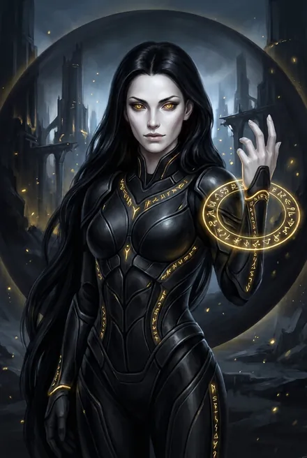

# Эрда Онора (Онора Эверент Ноктис кел Аммос)

| | |
|---|---|
| **Полное имя** | «Онора Эверент Ноктис кел Аммос. Эрда Корпуса Ноктис» (ЗК-8, гл. 15); «Онора Кел Ноктис» (ТБ-4, интерлюдия «Всполох»); «эрда Онора», «золотая эрда» |
| **Раса** | Чистокровная кел из Дома Ноктис; «вероятно, тем немногим, что оставались в Единстве»; гвоздя (стигмата) у неё нет (ЗК-8, гл. 8, 15) |
| **Фракция** | **Корпус Ноктис** — наёмный «орден Восходящих», элита наёмников (Хитрейший, ЗК-8, гл. 9); «аналог земных ЧВК» (Кассиди, ЗК-8, гл. 16). Эрды — командиры, «преимущественно чистокровные потомки Дома Ноктис» (ТБ-2, гл. 18) |
| **Специализация** | «В Корпусе она считалась мастером поиска и захвата» (ТБ-2, гл. 18) |
| **Ранг** | Золото (до гибели); после оживления — **дерево**: «Скрижаль… маленькую, мерцающую зеленью дерева» (ЗК-8, гл. 18) |
| **Книги** | ЗК-8 (гл. 8–9, 13–15, 17–18), ТБ-2 (гл. 17–18 — та же сделка глазами Белого Дьявола), упом.: ЗК-9–ЗК-11, ТБ-4 |
| **Статус** | Жива (оживлена), разорена, под Клятвой авгура за неё и весь Дом (ЗК-8, гл. 18; ТБ-2, гл. 18) |

## Облики на иллюстрациях

<figure markdown="span">
  [{ loading=lazy }](../assets/portrety/051.webp)
  <figcaption>основной облик <small></small></figcaption>
</figure>

Иллюстрации созданы нейросетью по описаниям из книг; это трактовка, а не официальный арт.

## 1. Внешность (кратко)
- В бою: «золотой Восходящий в черной броне, покрытой золотыми рунами… Восходящая… Волна черных, длинных, как плащ, волос… мраморно-белая кожа… Ядовитая змея перед броском» (ЗК-8, гл. 8). Глаза — «угольно-черные», радужка «наливается сияющим золотом» (ЗК-8, гл. 15).
- В осанне-послании: полукомбинезон «из тончайшей змеиной кожи, изумрудной с серебряным переливом»; чёрные ногти; на шее — драконий сосуд «в форме свитого кольцом дракона, глотающего свой хвост» (ЗК-8, гл. 15).
- После смерти тело восстановлено в саркофаге: «словно просто спала… Матово-белая кожа… длинные черные волосы» (ЗК-8, гл. 18).

## 2. Возможности и снаряжение
- **Аспект — Темная Звезда:** «она способна растворяться и перемещаться во тьме на любые расстояния» (Хитрейший, ЗК-8, гл. 10). В бою — «неожиданно вынырнув из тьмы» (ЗК-8, гл. 13).
- **Руна-«пустота»:** накрывает сферой, гасящей Руны, «что-то вроде Великой Пустоты Азимандии, только очень локальной» (ЗК-8, гл. 8, 13); Клетка Пустоты и Печать Пустоты для пленника (ЗК-8, гл. 8, 10).
- **Отражающий барьер** вернул Сигурду его же Испепеляющий Взгляд (ЗК-8, гл. 8 по разбору); «темный покров», блокирующий атаки, на золотом доспехе (ЗК-8, гл. 13).
- **Связка Пустотный Разлом + Втягивающий Вихрь** (серебро) — «мощное искажение пространства, засасывающее противника» (ЗК-8, гл. 15).
- **Кристаллоидный Арходракон** (золото) — летающее Существо-«дракон», на котором она сражалась (ЗК-8, гл. 15).
- **Луч Небесного Огня** (золото) — «просверлил дырку в схрон Визу Аран» (ЗК-8, гл. 15).
- **Драконья Клетка Душ** — «Запечатанная Драконья Клетка Душ»: драконья Руна (ранг по владельцу), Хранилище и Предмет, уловила её душу в момент смерти; «Никто, кроме небесного мастера, не сможет снять печать Хранилища»; работает как гвоздь без клейма Вечности (ЗК-8, гл. 15).
- **Связь с заказчиком** через золотую Руну-Существо «Торговый Представитель Контракции» (ЗК-8, гл. 8, 15).
- **Прочее из осколка Скрижали** (19 слотов, только золото и серебро, 113 Монет): Сага «Послание Оноры», Портал «Хартленд Корпуса», Змеиная Маска, Эликсир Звёздного Сна (трижды усилен — «Онора очень ценила его»), Рука Теней, Кровь Распутника (афродизиак), Око Молчащего, Сто Благородных Ароматов, Тысяча Нарядов, Сфера Пустоты, Слуги, Ключ Эрды Корпуса; доспех Кор Ноктис (сломан, подходит только женщинам) (ЗК-8, гл. 14–15).
- **Служители** (боевая тройка «эрд-командир и два служителя», ТБ-2, гл. 18):
  - **Моркан** — «Народ: Корпус», «Титул: служитель», серебро; гигант-«мясной голем» (Аспект в десять раз больше), Изменяемость, самоисцеление, Руны Живая Крепость, Крушитель, Рунический Костолом; Онора — «смысл его жизни, главная привязанность»; она «держала своего телохранителя на голодном пайке» (ЗК-8, гл. 8, 13–14).
  - **Чернокрыл** — разведчик-невидимка (серебро): Полная Невидимость, Плащ Пустоты, Стая Тёмных Каргон, Навык Трансформации; убит Небесным Ястребом (ЗК-8, гл. 8, 14).

## 3. Личность, мотивация, методы
- **Профессионал контракта.** Торгуется с заказчиком: «Корпус не был предупрежден, что придется столкнуться с фактотумами Вечности. Контракт не предусматривает возможных последствий… Я хочу получить дополнительную компенсацию. Иначе… я взыщу ее самостоятельно. В виде самого пленника и его Рун» — требует «Золотое Оживление… Для моего служителя» (ЗК-8, гл. 8).
- **Проницательна.** С первого взгляда: «Он не тот, за кого себя выдает… Чужое отражение. Может, фактотум. Не знаю чей. Золотые Руны Вечности и ложные стигматы не дают просто так» (ЗК-8, гл. 8). И — **«Круглоухий из Народа Земли. Я таких уже видела»** (там же).
- **Холодная хищница**: смотрит на пленника «с интересом энтомолога, поймавшего диковинную бабочку» (ЗК-8, гл. 8).
- **Посмертная дипломатия.** Сага-послание продумана как трио «награда — соблазн — угроза»; «Она не просто хочет вернуться — она уверена, что сможет… Онора не боялась. Ни своей смерти, ни того, кто ее победил» (ЗК-8, гл. 15).
- **Гордыня после поражения.** Едва оживлённая, намекает авгуру отобрать у Сигурда «остальное», пока Клятвы не произнесены — и получает пощёчину (ЗК-8, гл. 18).

## 4. Речь (цитаты)
1. «Он не тот, за кого себя выдает» (ЗК-8, гл. 8).
2. «Если ты, Восходящий, сейчас видишь мою осанну, это означает, что я погибла и тебе досталось содержимое моей Скрижали… Не будем тянуть ламию за хвост» (ЗК-8, гл. 15).
3. «Пятьсот Звездных Монет. Это цена души золотой эрды… И я принесу Клятву, что не буду мстить и преследовать своего убийцу… И кое-что еще, если захочешь, когда верну тело…» (ЗК-8, гл. 15).
4. «Аммор вен'тар, ноктис весс» — пароль, «дракон клянется, тени слышат» (ЗК-8, гл. 15).
5. «Корпус всегда добирается до своей добычи… До встречи в Хартленде» (ЗК-8, гл. 15).
6. «Я… проиграла. Я пленила этого круглоухого… а потом он сбежал и вернулся! Мой авгур… он не тот, за кого себя выдает!» (ЗК-8, гл. 18).

## 5. Предыстория
- **Дом Ноктис / Корпус.** Хартленд — небо из кипящих теней, восьмигранная обсидиановая башня около километра; экзарх — **Эверент Ноктис Кел Аммос**, авгур Дома (древнее золото); хранительница Рун — драконья Руна-Существо **Марисса Золотая Змея** (бывшая эвгина Ноктис, предавшая Дракона) (ЗК-8, гл. 17–18). Второе имя Оноры — «Эверент» — совпадает с именем авгура *(родство не уточнено)*.
- **Элита Корпуса** — потомки или бастарды Ноктис, «прекрасно экипированы древними Рунами и Предметами… сокровищниц Дома»; командиры-эрды: Литара Ноктис (разведка), Дхаарон (стратег), Таналия («рассекатель миров», ассасины), Вейрам Ноктис (штурм) (ТБ-2, гл. 18).
- **Контракт.** Корпус наняли **душеторговцы** Вечности, мстящие за похождения Сигурда и Белого Дьявола; «Нить к Домену им дала Азимандия»; контракт — найти кристалл-сферу Визу Аран и пленников («Особенно — пленников») (ЗК-8, гл. 8–9). Хитрейший: «Это, кстати, не единственная команда, которая взяла контракт…» (ЗК-8, гл. 9).

## 6. Биография
- **ЗК-8, гл. 7–8.** Её отряд вырезает плазменный «люк» в своде храма Визу Аран; Сигурд убивает Чернокрыла, сбивает «золотую всадницу» с Арходракона, но Онора накрывает его сферой пустоты, Моркан убивает (смерть № 4); после инкарнации — Клетка Пустоты. Переговоры через Существо-контрактория; в него «шагает» Хитрейший.
- **Гл. 13.** Сигурд возвращается из Ордена со Скай; Ментальный Императив — «Убей Онору!»; Моркан бьёт хозяйку; воздушный бой с Ястребом; Скай делает Клинок Небесного Огня, Временная Петля ловит момент; Скрижаль Оноры трескается, последняя Руна — звуковая волна (сигнал?); Моркан добивает её Костоломом и вырывает своё «сущностное ядро».
- **Гл. 14–15.** Сигурд вскрывает её золотой осколок; Сага-послание.
- **Гл. 16.** Кассиди: драконья Руна «стоит как небо», Корпус — ЧВК; советует продать через посредника.
- **Гл. 17–18 (и ТБ-2, гл. 17–18).** Сигурд, Белый Дьявол и «Эрин» (Кейнор) входят в Хартленд; Белый Дьявол: «Мы пришли вернуть то, что принадлежит Дому Ноктис… Душу золотой эрды Оноры»; Эверент: «Корпус всегда добирается до своей добычи? Я знаю слова Оноры. И знаю цену ее обещаниям» (ТБ-2, гл. 17). После раскрытия Братьев Корпус капитулирует; Эверент приносит Клятву «за Онору и весь Дом»; «Клятву Онора сможет дать только после того, как вернет свое тело» (ТБ-2, гл. 18). Марисса оживляет её золотым Оживлением; Онора — с деревянной Скрижалью; пощёчина и «Иди в свои покои! И жди там…»; «наградив меня обжигающим взглядом. Если бы глазами умели убивать…» (ЗК-8, гл. 18).
- **Дальше.** Драконья Клетка ушла Корпусу как выкуп, затем к Кейнору; Марисса ловит в неё душу Преображающей Тэйлисс Кел Эммис (Всполох): «драконий сосуд… тот самый, что принадлежал Оноре Кел Ноктис» (ТБ-4, интерлюдия «Всполох»). Трофеи Оноры служат Сигурду: Полная Невидимость, Плащ Пустоты, Пустотный Разлом, Луч Небесного Огня, Перчатка/Рука Теней (ЗК-10, гл. 6–7, 15). Торговый Представитель — канал Хитрейшего (ЗК-9, гл. 2).

## 7. Отношения
- **Сигурд** — победитель и кровный враг; она признаёт «он не тот, за кого себя выдает».
- **Эверент Ноктис** — авгур, судья и господин; презирает её поражение.
- **Марисса Золотая Змея** — оживила её; «что-то в ее позе… мгновенно напомнило эрду Онору» (ЗК-8, гл. 18).
- **Моркан** — преданный слуга-голем, её убийца поневоле.
- **Хитрейший** — через его Руну она получала контракты; он выдал Сигурду её слабость (ЗК-8, гл. 10).
- **Тысяча Братьев** — после ЗК-8 Корпус нанят Тысячей (оплата — звёздный лёд, разрыв контрактов с Вечностью), в сердце Эверента — ледяной конструкт Кейнора (ЗК-8, гл. 17; ЗК-11, гл. 17 — Корпус в списке сил Тысячи).

## 8. Противоречия
- Старый разбор ТБ-2 предполагал, что её душа «будет воскрешена» позже; по ЗК-8, гл. 18 оживление уже состоялось в той же сцене (ТБ-2 описывает те же события с другой точки зрения).
