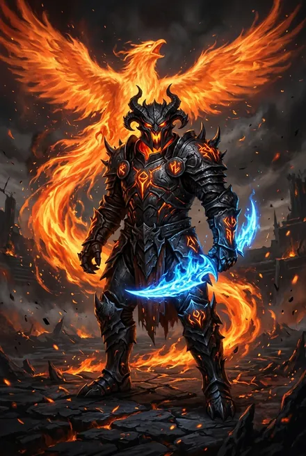
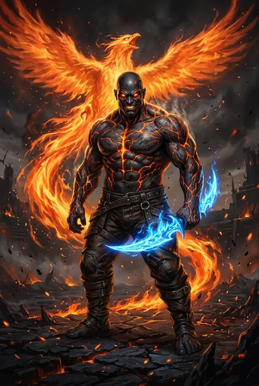

# Орин Огненный Клинок

> См. также: [Белый Дьявол](../personazhi/belyj_dyavol.md) · [Тысяча Братьев](../personazhi/tysyacha_bratev.md) · [Хранители](../personazhi/hraniteli.md) (Бродячий Торговец)

| Поле | Значение |
|---|---|
| **Имена/титулы** | Орин Огненный Клинок; Владыка Горна; Лорд Тысячи Битв (ТБ-1, гл. 18) |
| **Природа** | Брат из Тысячи, «Истинный по сути»: его Кровь и Руны не удерживает стигмат (ТБ-1, эпилог) |
| **Тело** | Рикс Народа Огня (Дети Огня): угольно-чёрная кожа с сеткой огненных линий, глаза-угли, рокочущий бас |
| **Ранг** | Пиковое серебро, Атрибуты у золота; Аспект **Феникс**; Призрачный Клинок Небесного Огня; Чёрный Доспех из морлиума; стабилизатор хронопотока |
| **Роль** | Непобедимый чемпион Арены «Проклятое Святилище» (не меньше шести побед); правитель одного из Тиглей в рубиновых октагонах |
| **Книги** | ТБ-1 (гл. 18, эпилог); упом. ТБ-2…ТБ-5 |
| **Статус** | Мёртв — убит Белым Дьяволом на Арене, ушёл посмертным Переносом (тело и Предметы — в Горн) |

**Характер и речь.** Брат-воин, «грубый и нетерпеливый, всегда идущий напролом», с вечным «**Хоу!**» (ТБ-1). Фаталист: раз Тот-Кто-Сражается мёртв, Единого надо собрать любой ценой — смертью всех осколков. Узнав от БД о землянах-предтечах и Истоке, признаёт: «в этом есть смысл», но с Арены выйдет только один — «жребий уже брошен». «Хоу! Так же, как и ты, я пришел за Рунами и Кровью» (ТБ-1, гл. 18); «Исток? Хоу! Тот самый?» (там же). Над его исчезнувшим телом герой говорит «в пустоту»: «Ты славно бился, но сегодня Незримый улыбнулся мне. Увидимся за гранью, брат» (ТБ-1, гл. 18).

**История.** После поражения Тысячи его колокол бросили в вулкан в рубиновых октагонах; **двадцать циклов назад** Народ Огня освободил его «дарованными» Рунами (ключи давал Хитрейший через Бродячего Торговца — ТБ-1, эпилог). Нашёл и «отправил за грань» Братьев **Мелькиора** и **Сарвару Нежную** (ТБ-1, гл. 18; ТБ-2, гл. 14). На Арене узнал БД под Живыми Цепями — оба отозвали Руны: «Брат». Дуэль: герой пробуждает Холодное Пламя, Водяным Телом вливается Орину в горло, Сковывающий Змей блокирует Скрижаль, Коготь Триглава с Громовым Разрывом разносит средоточие.

**Наследство** (ТБ-2, гл. 1): Связка «Огненный Вихрь + Река Энергии» с небесным огнём, две Руны Живых Цепей, Стабилизатор Времени и Пространства («дар Орина» вовремя «преподнёс Незримый», ТБ-5), Призрак Небесного Огня («дар мёртвого Брата», ТБ-5), Огненная Кровь, Огненная Стена, Хрустальная Сфера, Три Золотых Голема, Портал Огненного Куба, **Руна Бродячего Торговца** — «зримая удавка», через которую Хитрейший «вёл» Орина. Пояс Проклятого Святилища.

**Тайны.** 20 циклов правления Тиглем; как он выследил Мелькиора и Сарвару; его наследники в Горне; кто давал Ключи. Увидев Клинок Небесного Огня, герой вспоминает: «Один из его Братьев когда-то использовал такой же Предмет — и его страшились даже небесные псы Вечности» (ТБ-1, гл. 18) — сказано до того, как он узнал Орина, т. е. речь, вероятно, о другом Брате *(кто — не раскрыто)*.
## Облики на иллюстрациях

<figure markdown="span">
  [{ loading=lazy }](../assets/portrety/112.webp)
  <figcaption>Непобедимый чемпион Арены в морлиуме <small>ТБ-1, гл. 18</small></figcaption>
</figure>
<figure markdown="span">
  [{ loading=lazy }](../assets/portrety/113.webp)
  <figcaption>Без доспеха, брат <small>ТБ-1, гл. 18</small></figcaption>
</figure>

Иллюстрации созданы нейросетью по описаниям из книг; это трактовка, а не официальный арт.

