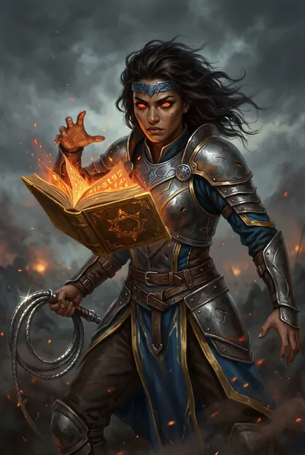

# Провидица — Ида Сторн

> См. также: [Азимандия](../personazhi/azimandiya.md) · [Белый Дьявол](../personazhi/belyj_dyavol.md)

| Поле | Значение |
|---|---|
| **Имена** | Провидица; **Ида Сторн**, бывш. **Ида аурим Сторн** (ТБ-2) |
| **Происхождение** | Боевая провидица-паладин **Империи Семи Звёзд** (осколок цивилизации Кел, теократия летающих островов под опекой Истинных дрейф-цитаделей); из Клинков, обучалась в Колыбели на Светоче; паладины аурим/луанор/касторн (ТБ-2, разд. 7) |
| **Роль** | Руна-Существо Азимандии («сильнейшая из её Рун», ТБ-1) → Руна Белого Дьявола; мятежная → фанатично преданная «Истинному» |
| **Ранг** | Серебро (ЗК-5; ТБ-1–ТБ-2) → золото (золотой фолиант; ТБ-4 — предположение разбора, ТБ-5) |
| **Книги** | ЗК-2 (упом.), ЗК-5, ТБ-1…ТБ-5 |
| **Статус** | Руна сломана в бою с Предателем (ТБ-5, гл. 15) |

**Внешность и оружие.** Смуглая, темноволосая; обруч из синей стали, бич-клинок, кел-разрыватель, золотой боевой Фолиант; огонь (ТБ-2).

**Характер и речь.** Вспыльчивая фанатичка; сохранила память в Руне (ЗК-5) — потому мятежна и просит освобождения. После того как Белый Дьявол открывается ей как Истинный, служит «с искрящимся фанатизмом». «Иди, Истинный! Я их… задержу!» (ТБ-2, гл. 20). Империя Семи Звёзд не признавала Тысячу — «будь по-иному — может, у той войны с Вечностью был бы другой исход» (ТБ-2).

**Путь.**
- ЗК-5: в коллекции Азимандии; сжигает Морвену, бьётся с Торием.
- ТБ-1: заинтригована героем; зажигает алтарь, убита противником на Арене — Руна сломана (гл. 17–18); затем Руна Провидицы переходит к герою (гл. 15 — в описи).
- ТБ-2: «ломка» и новая клятва (гл. 5) — по её кинжалу герой добровольно умирает и воскресает, доказывая природу Истинного; бои на Короне и Нексусе; «Провидица исчезла» при падении Нексуса (гл. 21).
- ТБ-3: снова в свите Азимандии (Руна восстановлена — *перерыв в тексте не объяснён*).
- ТБ-4: «звено цепи», ведёт Существ Азимандии в бою с Ловчими Драконоборца.
- ТБ-5: бьётся на тинге в Медных Башнях и против Предателя; Руна сломана (гл. 15).

**Тайны.** Как паладин Семи Звёзд попал в коллекцию Азимандии; история Империи Семи Звёзд (Походы, Колыбель, Светоч) и её конфликт с Тысячей; её отношение к Ордену Истинных.
## Облики на иллюстрациях

<figure markdown="span">
  [{ loading=lazy }](../assets/portrety/102.webp)
  <figcaption>основной облик <small></small></figcaption>
</figure>

Иллюстрации созданы нейросетью по описаниям из книг; это трактовка, а не официальный арт.

