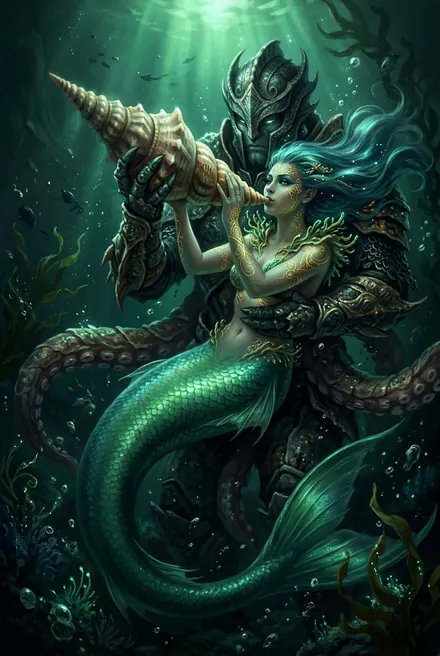
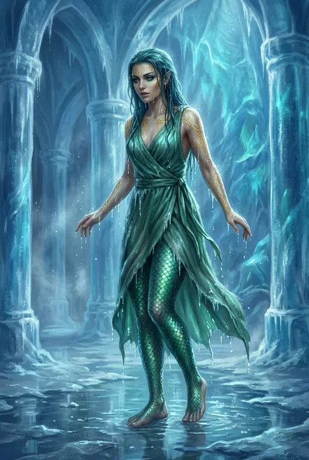
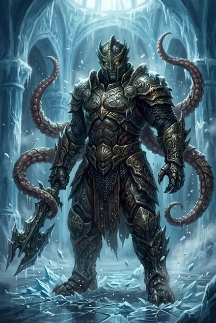

# Сатори «Морская Роза» и Осьминог

> См. также: [Тысяча Братьев](../personazhi/tysyacha_bratev.md) · [Кейнор](../personazhi/kejnor.md) · [Белый Дьявол](../personazhi/belyj_dyavol.md)

## Облики на иллюстрациях

<figure markdown="span">
  [{ loading=lazy }](../assets/portrety/114.webp)
  <figcaption>1 <small></small></figcaption>
</figure>
<figure markdown="span">
  [{ loading=lazy }](../assets/portrety/115.webp)
  <figcaption>2 <small></small></figcaption>
</figure>
<figure markdown="span">
  [{ loading=lazy }](../assets/portrety/116.webp)
  <figcaption>основной облик <small></small></figcaption>
</figure>

Иллюстрации созданы нейросетью по описаниям из книг; это трактовка, а не официальный арт.

## Сатори

| Поле | Значение |
|---|---|
| **Имена** | Сатори, «Морская Роза»; в ТБ-2, гл. 15 — «Сатора/Сатору» (опечатка/вариант, далее — Сатори) |
| **Раса** | Русалка глубоководной ветви **Народа Моря** (Подводного Народа), «гидроморфная раса»; **Сатори** — также одно из племён Подводного Народа (ТБ-5, гл. 2) — связь имени и племени не раскрыта |
| **Природа/ранг** | Одна из Тысячи; золото (золотая Скрижаль, ТБ-2; ТБ-3) |
| **Роль** | Искуснейший ментал, интриганка, знаток Вечности (долго жила там); разведчица «течений Вечности» |
| **Книги** | ЗК-8 (подводная засада), ТБ-2 (гл. 15–21), ТБ-3 (гл. 1), ТБ-4 (гл. 4, призраком), ТБ-5 (упом.) |
| **Статус** | Жива |

**Внешность.** Изящная русалка с волосами цвета морских глубин (длинные мерцающие локоны), золотые узоры на теле, гибкий чешуйчатый хвост (ТБ-2; ТБ-4, гл. 4).

**Речь.** Морские метафоры: «Воды шепчут…», «Великие Воды», «Клянусь солью глубин», «Омуты Вечности тихи». «Когда отлив уносит добычу, рыбы начинают пожирать друг друга» (ТБ-2, гл. 19).

**Путь.** Приходила к Кейнору с призывом объединиться — и была заморожена в Чертоге Трофеев вместе с Осьминогом (ТБ-2, гл. 15). Разморожена (гл. 16), командует подводным Народом в битве за Эргиаль, подводная засада на Гармонию (ТБ-2; ЗК-8). В ТБ-3, гл. 1 дарит БД серебряную Руну-Сокровище «Разбитая Скрижаль» и уходит: сначала к **Живому Острову**, где «в мусорном теле» прячется Брат **Эрланд**, затем «нырнёт в Вечность» искать души опозоренных — Деймоса, Тёмной Звезды, Миротворца, Тысячеликой. Кейнор ставит ей ледяное клеймо-зов. В ТБ-4, гл. 4 является призраком: Палач провела Псов «старыми путями, проложенными для охоты на Тысячу»; предлагает приманку. От неё БД знает расклад: Хитрейший, Посланник, Сестра Солнца — против Палача и Полководца; Предвестник наблюдает; Странник неизвестно где (ТБ-4, гл. 11). В ТБ-5 её «братья и сёстры» сопровождают караван в октагоне Тихие Воды (гл. 2); Моргейн считает её среди свободных: «Кейнор. Сатори. Соловей. И я» (гл. 19).

**Тайны.** Что она делала в Вечности; её Народ; Эрланд и опозоренные Братья.

## Осьминог

| Поле | Значение |
|---|---|
| **Кто** | Шестиногий воин-«осьминог»/человек-спрут в панцирной броне; говорит «на глубинном языке» (ТБ-3, гл. 1) |
| **Статус в Тысяче — противоречие** | ТБ-2 и ЗК-8: **Хранитель (страж)**, друг и любовник Сатори; ТБ-3 (разбор) и Предатель в ТБ-5, гл. 15 («Осьминог и Сатори») — считают его **Братом** Тысячи |
| **Ранг** | Золото (ЗК-8; ТБ-2 — предположение) |
| **Путь** | Заморожен с Сатори (ТБ-2, гл. 15), бой в море — ранен (ТБ-2); молча стоит рядом с Сатори на совете (ТБ-3, гл. 1); отсутствует на совете (ТБ-4, гл. 4) |
| **Статус** | Жив |
