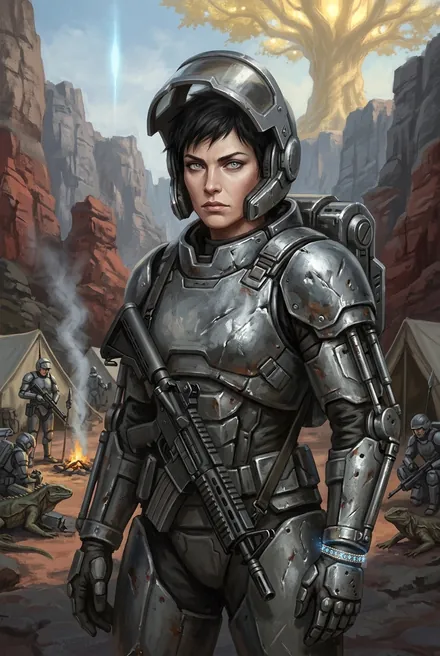
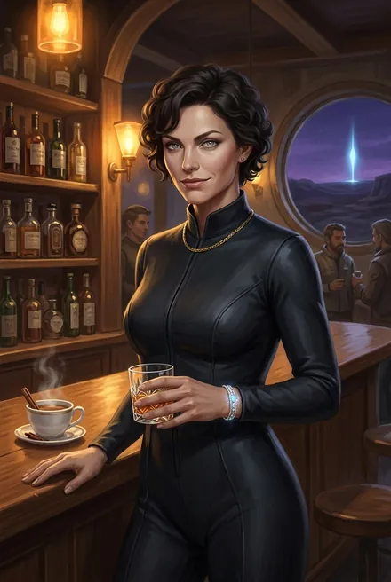

# Серена Лафайет

| | |
|---|---|
| **Имя** | **Серена Лафайет**; «в Восхождении она звалась так же» — позывного нет (ЗК-2, гл. 8) |
| **Происхождение** | Землянка, «одна из старейших Восходящих фригольда, соратницей Винсента, Гая и Эйрика», на Земле — «чисто военная специальность, подразделение планетарной безопасности» (ЗК-2, гл. 13) — «в какой-то мере моей коллегой», замечает Сигурд (военный пилот) |
| **Роль** | Командир Южного Поста и боевого копья (ЗК-1) → старшая над рейдами (ЗК-2) → **первый знаменосец** при Трейве — внутренняя безопасность (ЗК-5) → знаменосец Кассиди, заменила Майкла в обеспечении безопасности (ЗК-6, гл. 27) → отвечает за новичков, освобождённых пленников, переселенцев (ЗК-9–10) → глава представительства Неба в Либерти (ЗК-11, гл. 19) |
| **Книги** | ЗК-1 – ЗК-11 |
| **Ранг** | Бронза (ЗК-2 – ЗК-9; «многие старые Восходящие, вроде той же Серены… до сих пор не преодолели бронзовый порог», ЗК-7, гл. 2) → на очереди к серебру (ЗК-9, гл. 6) → **серебро** (ЗК-10, гл. 4; ЗК-11, гл. 20) |
| **Статус на конец канона** | Жива; серебро в лед-доспехе Эргиаля (ЗК-10, гл. 5; ЗК-11, гл. 15); её копьё охраняет Домен (ЗК-11, гл. 12); возможная получательница третьего брахма-симбионта — «Скорее всего, Серене» (ЗК-11, гл. 18) |

---

## Облики на иллюстрациях

<figure markdown="span">
  [{ loading=lazy }](../assets/portrety/045.webp)
  <figcaption>В экзоскелете <small>ЗК-1 — ЗК-8</small></figcaption>
</figure>
<figure markdown="span">
  [{ loading=lazy }](../assets/portrety/046.webp)
  <figcaption>Вне службы <small>ЗК-2, гл. 8</small></figcaption>
</figure>

Иллюстрации созданы нейросетью по описаниям из книг; это трактовка, а не официальный арт.

## Личность
- **Две маски.** В баре — «искусительница с чертями в глазах», откровенно флиртует с новичком Сигурдом; отказ её задевает: «Тень раздражения мелькнула на ее лице» (ЗК-2, гл. 8). В походе — «суровый и строгий командир, пользующийся заслуженным авторитетом у своих бойцов. Даже Толя Грохот, особо не признающий авторитетов, относился к ней с некоторым пиететом» (ЗК-2, гл. 13).
- **Коммуникабельный администратор безопасности** — превосходит в этом Айса (ЗК-5, интерлюдия «Травинка»). Тренирует своих людей рукопашному бою (ЗК-4, гл. 22).
- **Ревнива к чужому первенству:** «Кто старший, Винс?» — ревнивый взгляд на Эйрика (ЗК-7, гл. 9).
- **Хищный интерес к силе:** о «помощнике» Сигурда (Белом Дьяволе) — «Я бы с ним познакомилась поближе» (ЗК-7, гл. 21).
- **Лояльность институту, а не лицу:** служила Веронике, Трейву и Кассиди; на выборах отказалась в пользу Винсента (ЗК-6, гл. 26).
- **Прямолинейна:** «Вот уж кого не ждали и не приглашали… Какого черта им от нас надо?» (ЗК-7, гл. 22).

## Речь — цитаты
- «Я Серена Лафайет. Приветствую тебя в нашем фригольде… Не теряйся, еще увидимся» (ЗК-1, гл. 14).
- «Аккуратнее там, Вероника мне голову отвернет, если с нашим звездным флотом что-нибудь случится» (ЗК-2, гл. 13).
- «Маршрут ясен?… Нет смысла идти толпой, мы с Мраком идем направо, вы с Фростом налево» (ЗК-2, гл. 13).
- «Да потому что невозможно!… Сто раз уже говорили — ночью там н[ельзя]…» (ЗК-5, интерлюдия).

---

## Биография
- **ЗК-1, гл. 14–15.** Командир Южного Поста: встречает копьё Марка с телом Гая Флоу, скорбит; заметила, что луки тавров «пустые… Голые, из диких табунов». Знакомится с Сигурдом.
- **ЗК-2, гл. 8.** Флирт в «Виски», «Звездная Кровь» с горением; Сигурд уходит к Травинке.
- **ЗК-2, гл. 12–14.** Старшая над рейдом в Расколотые Земли на поиск Гнезда (27 человек, 10 Восходящих): её копьё — восемь бойцов, двое Восходящих; с ракетомётом. Руна-Существо **Слепая Гончая** — «поджарая гибкая собака… на ней не было ни малейшего признака глаз». Столкновение с бронзовым Жнецом. Сигурд пропадает в её рейде (ЗК-3, гл. 2: Динамит и Грохот ругаются с Сереной).
- **ЗК-4.** В её копье погиб молодой Восходящий Али (гл. 3); её разведчица **Холли «Ласточка»** убита, разведчик **Вэй** похищен изгоями (гл. 11); её копьё прикрывает операцию по сбору капсул (гл. 10); в Портале потеряна её боевая гончая (гл. 12); в рейде на Шторм — люди в легионных «Гардианах» (гл. 18).
- **ЗК-5 (интерлюдия).** Трейв назначает её **первым знаменосцем** — внутренняя безопасность (вторым — Мрака). Остаётся над схваткой; навещает ферму Эйрика.
- **ЗК-6.** Остаётся во фригольде (не едет на тинг) (гл. 1); высылает два копья с Южного Поста на помощь ферме (гл. 5); встречает воскресшего Кассиди «изумлённой улыбкой»; арестовывает сообщников Трейва; кандидат в риксы — снялась в пользу Винсента (гл. 26); сохраняет Титул знаменосца — заменила Майкла в обеспечении безопасности (гл. 27).
- **ЗК-7.** Предлагает большой рейд в Расколотые Земли (гл. 9); командует Южным Постом (гл. 14); **кома** от призрачных копий Пожирателя (гл. 16), очнулась после его гибели (разбор); голосует за золотое Существо (гл. 20); в ближнем круге Кассиди.
- **ЗК-8, гл. 14.** Её копьё — в резерве Домена.
- **ЗК-7, гл. 9 (план против Прыгунов).** На срочном совете предлагает «большой рейд в Расколотые Земли» (Адамант — вынести туда пост, Фрост — ловить «на живца»); Кассиди выбирает вариант Эйрика с феромонами, но берёт Серену в ударную группу.
- **ЗК-9, гл. 3.** Доклад об адаптации освобождённых из Домена Восходящих; о шамане Клана Зверя, не идущем на контакт, предлагает «отпустить его на все четыре стороны, в крайнем случае — ликвидировать, как дикого зверя» — Кассиди решает иначе. В секретной части совета (Винсент, Минос, Серена, Вероника, Адамант) задаёт ключевой вопрос о генетической блокировке аборигенов — «Внесенное кем?» (ответ Миноса: кел). Поддерживает союз с Ледяным Кузнецом: «Согласна». Её копьё и копьё Адаманта — первые кандидаты на лед-доспехи.
- **ЗК-10.** Объявляет по воксу боевую тревогу, «призывавшей сохранять спокойствие» (гл. 2); **серебро** — одна из восьми серебряных Восходящих фригольда (гл. 4); Кассиди: «Серена, ты отвечаешь за переселение» горцев — ей подчинены группы Фроста, Ассоль, Асмодея (гл. 4); получает в личное пользование серебряный лед-доспех Кузнеца — вместе с Адамантом единственные (гл. 5). Сигурд советует Веронике послать в Либерти «кого-нибудь пожестче. Серена хорошо подойдет. Или Ассоль» (ЗК-11, гл. 12).
- **ЗК-11.** Её копьё — «группа захвата» в Домене (гл. 12); охраняет Портал с Кассиди и Адамантом (гл. 15); вероятная носительница симбионта (гл. 18); остаётся в Либерти как глава представительства (гл. 19).

## Способности и копьё
Слепая Гончая (Руна-Существо, ЗК-2; одна «боевая гончая» потеряна в ЗК-4, гл. 12); ракетомёт в копье; бронза → серебро; лед-доспех Эргиаля. Её люди: Али (погиб ЗК-3/04), Холли «Ласточка» (погибла ЗК-4), Вэй (скаут, похищен ЗК-4, найден у Вероники ЗК-6, гл. 1).

## Отношения
- **Сигурд** — флирт → уважение; «наш звездный флот».
- **Винсент, Гай Флоу, Эйрик** — соратники первого поколения.
- **Вероника, Трейв, Кассиди** — сменяющиеся начальники.
- **Адамант** — пара старших боевых командиров колонии.
- **Мрак** — равный по рангу коллега по рейду (ЗК-2).

## Крючки
1. **Служба в планетарной безопасности Земли** (ср. Серого Волка, экс-офицера той же службы — ЗК-10; Кроу — инструктор её спецподразделений).
2. **Первые циклы колонии** глазами старейшей Восходящей.
3. **Брахма-симбионт** — Серена-«аврора».
4. **Представительство в Либерти** — политический триллер в «городе без закона».
5. Её личная жизнь — за маской хищницы.

## Карточка автора (вне канона)

> Карточка персонажа из канала автора (автор, TG: [пост 6179](https://t.me/prokofiev_litrpg/6179), июль 2026). Это не текст книг: при расхождении прав канон.

| | |
|---|---|
| **Имя, возраст** | Серена Лафайет; 49 лет |
| **Род занятий** | Серебряная Восходящая, первый знаменосец фригольда: внутренняя безопасность и руководство копьями. На Земле — офицер-специалист, трибун сил планетарной безопасности |
| **Биография** | Ветеран из первых волн, соратница Винсента, Гая Флоу и Эйрика; **первая женщина-командир боевой группы**, одна из первых Восходящих-землян. После переворота Трейв назначил её первым знаменосцем; после его гибели должна была принять власть, но уступила Винсенту. При нём лично арестовывала заговорщиков. Тяжело ранена Пожирателем в битве Дикой Охоты; руководила переселением Людей Гор, охраной Домена и Портала в Либерти |
| **Приметы** | Короткие тёмные волосы, резкие черты, «прозрачные карие глаза»; вне службы — элегантная брюнетка. **Крестик на тонкой золотой цепочке**, **чёрный маникюр**, татуировка-лого «Космо» на правом плече |
| **Характер** | На службе жёсткий властный командир (даже Грохот относится с пиететом), ревнива к чужому старшинству, но умеет уступить; вне службы флиртует в баре; одинока и страдает от этого |
| **Речь** | Рубленые команды; вне службы — игривый тон. «Астра фатида» — проклятие сквозь зубы; «Годится» — высшая похвала; «Расслабься! Я тебе не командир, пришла развеяться после рейда»; «Вылезет кто — кричи в канал, если не потянете сами» |
| **Сила** | Полевой командир: рейды, координация, зачистки Гнёзд; кидо и тяжёлое оружие (гаусс-турель, ракетомёт); неплохой набор Рун; оборона, эвакуация, аресты |
| **Слабость** | Пугающая жёсткость, упрямство, азарт, затаённая ревность, нереализованные амбиции; иногда перебирает с алкоголем |
| **Тайна** | **Не может иметь детей** и страдает от этого; втайне хочет быть любимой; предпочитает мужчин помладше |
| **Цель** | Безопасность фригольда «железной рукой», место в первых рядах, уважение, личное счастье |

**Сверка с каноном.** Глаза в карточке карие, в каноне — «прозрачных серых глаз» (ЗК-1, гл. 14): держим канон. Остальное с книгами не спорит; бездетность, крестик и «Астра фатида» в книгах не названы.
