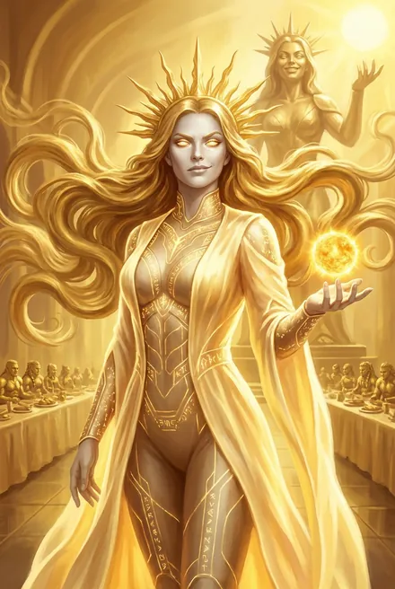

# Сестра Солнца (как она показана в основной серии)

| | |
|---|---|
| **Имена** | Сестра Солнца; «та, что когда-то была блистательной Сестрой Солнца» (ЗК-3, интерлюдия «Хранители»); «Сестра» (ЗК-8, постскриптум); «Хозяйка Золотых Варваров» (ЗК-9, гл. 13) |
| **Природа** | Четвёртая из семи Хранителей Вечности (ЗК-9, пролог); ранг «небо» — «небесно-голубой фрейм Восхождения» (ЗК-9, гл. 13); по Саге — одна из «последних Истинных», созданных Искуснейшим (ЗК-9, интерлюдия) |
| **Ключ** | «Она единственная из Хранителей, чей Ключ известен — он имеет форму небесного лука… нет оружия более смертоносного в пределах Единства и Вечности» (ЗК-9, пролог) |
| **Слуги** | Золотые Варвары; экзарх **Сто Голосов**; «Дети Солнца» (ЗК-9, гл. 11–13) |
| **Книги** | ЗК-3 (интерлюдия), ЗК-5 (гл. 9 — статуя), ЗК-9 (пролог, гл. 11–14, интерлюдия «Сага Сестры Солнца», гл. 16), упом. ЗК-10–ЗК-11; ТБ-2, ТБ-4 (упом.) |
| **Статус** | Действует; в коалиции с Хитрейшим и Посланником против Палача и Полководца (ТБ-4, гл. 11) |

## Облики на иллюстрациях

<figure markdown="span">
  [{ loading=lazy }](../assets/portrety/056.webp)
  <figcaption>основной облик <small></small></figcaption>
</figure>

Иллюстрации созданы нейросетью по описаниям из книг; это трактовка, а не официальный арт.

## 1. Облик (кратко)
- **Статуя** в Храме Сестры Солнца (Золотой Город): «женщина в странном венце, вероятно, символизирующем солнечные лучи. Поза с поднятой рукой… напомнили древнюю земную статую Свободы»; «чистокровной Кел, с высокомерной, неприятной усмешкой… гордой осанкой королевы-воительницы»; облегающий доспех-комбинезон с рунным узором; одна рука держит солнце, другая — «нечто вроде лука» (ЗК-5, гл. 9).
- **Во плоти** (через экзарха): «женщина, чьи глаза казались вратами в солнце, а одежды состояли из лучистого света. Ее волосы были длинными и золотыми»; «венец солнечных лучей»; «холодная улыбка мадонны»; «Жестокая сверхчеловеческая сущность просвечивает изнутри, выдавая, что тело — всего лишь жалкая маска» (ЗК-9, гл. 13).

## 2. Природа и возможности
- **Нисхождение через экзарха:** Сто Голосов говорит её «грудным женским со звонкими самоуверенными нотками» голосом, татуировки «наливаются ярким золотом» — и в экзарха нисходит сама Хранительница (ЗК-9, гл. 13).
- **Ментальная мощь:** играючи срывает с Сигурда золотой Аграф Стойкого Разума; одним взглядом узнаёт «все мои секреты, за исключением… скрытых Печатью Тайны» (ЗК-9, гл. 13). Скай: Печати она не вскрыла, а «пробежала по верхам» (ЗК-9, гл. 14).
- **Преображение пространства:** застывшие Варвары «превращались в деревья и распускались цветами», Чертог Вечного Пира стал садом (ЗК-9, гл. 13).
- **Руна-Сага «Тем-Чей-Ранг-Неизвестен»** (золото) — дар Сигурду; Скай: «скрытая связка Рун, предназначенная для инсталляции золотого Навыка»; результат — +20 серебряных звёзд, золотой Атрибут Анализ и золотой Навык **«Стратагемы»** с побочным «холодным расчётом»; «необратимые изменения в энио» (ЗК-9, гл. 16).
- **Храм-«станция»:** жертва в чашу у статуи (Ларец не принят — «Жадная тварь!» — принят с Звездой из 3 капель) даёт полное восстановление Крови и временный бафф Атрибутов Духа (ЗК-5, гл. 9; ЗК-9, гл. 12).

## 3. Личность, мотивация
- **Капризна:** «Каждый ее взгляд приносит свет и жизнь, когда она весела, и тьму и смерть, когда Сестру одолевают мрачные мысли» (ЗК-9, пролог).
- **Равнодушна к «вовне»:** «Нам не нужно Единство. Мне, откровенно говоря, вообще плевать, что происходит вовне… Но нам нужен Исток. И мы заберем его в любом случае» (ЗК-9, гл. 13). На совете 28 циклов назад: «Мы должны забрать Исток, и тогда то, что вовне, больше не будет иметь значения» (ЗК-3, интерлюдия).
- **Азартна, уважает игру и силу:** «Ты хотел сыграть в сферы? Давай, я тысячу циклов не играла…»; проигрыш признаёт: «Блестящий ход… И тот, что сделал ты, и тот, что сделали тобой. Я никогда не проигрывала так быстро» (ЗК-9, гл. 13).
- **Враг Тысячи:** «Мы уничтожали его отражения тысячи циклов, а теперь ты предлагаешь заново собрать его?» (о Забытом, ЗК-3, интерлюдия); «С осколками мертвого Единого, что решили поиграть в спасителей, разбирайтесь как хотите…» (ЗК-9, гл. 13).
- **Презрение к Ордену:** «Орден Истинных спустится с неба? Забудь, им плевать на все, кроме глупых заветов Защитника» (ЗК-9, гл. 13).

## 4. Речь (цитаты)
1. «Как давно я не слышала этих имен, и не хочу слышать еще дольше. Какое нам дело до того, что вовне?» (ЗК-3, интерлюдия; та же сцена — ЗК-9, интерлюдия).
2. «О! Не может быть. Надо же, из личных запасов. Значит, ты…» (об Аграфе, ЗК-9, гл. 13).
3. «Знаешь, ты первый пришелец с небесного ковчега, которого я встречаю. Здравствуй» (ЗК-9, гл. 13).
4. «Такие как вы — редкая сила, чей ранг неизвестен» (ЗК-9, гл. 13).
5. «Нам нужен Исток, вам — Единство. Пусть так и будет… Передай своему другу, что наши сферы снова близки. Я не буду вмешиваться, как и обещала» (ЗК-9, гл. 13).
6. «Ты даровал мне золото Хитрейшего. А он отметил тебя знаком… Что ж, Дети Солнца не останутся в долгу. Прими мой дар — частицу того, кем ты был. И кем, быть может, станешь вновь» (ЗК-9, гл. 13).

## 5. Предыстория
- **Сага Сестры Солнца** (ЗК-9, интерлюдия), три видения:
  1. Искуснейший перед семью: «Вы — последние из Истинных… Я создал вас в нарушение запретов»; ковчег **«Гедеон»** у разбитой Земли — «Кровь Истока, матрицы разума, семена жизни. С этого началось Единство»; «предтечи предтеч», из крови и памяти которых «родился Тот-Кто-Сражается». О ней: «Ты… создавала жизнь и смерть. И стояла у истоков…»; финал — «Помните — их ранг неизвестен!»
  2. Глазами женщины «мэм» в ударном «Грифоне»: Гренландский Город за тройным кольцом Стен, останки Червей, фреска героя со щитом-драконом: «— Сигурд? — Так точно, мэм! Это Стена Дракона!.. — Гранд-легат в Городе?»; разбитая чёрная луна на орбите. *(Предположение: «мэм» — земной прообраз Сестры Солнца; Скай связывает видения с Землёй после А-катастрофы, ЗК-9, гл. 16.)*
  3. Семь крылатых Истинных уничтожают Тварь у Бреши; видение в кристалле обсуждают Хранители — та же реплика, что на совете в ЗК-3.
- **Обвинения Белого Дьявола:** одна из Хранителей, «погасивших солнце Единства», бывших учеников Искуснейшего; он мечтает вырвать ей сердце (ЗК-5, гл. 9 по разбору).
- **Слух в Вечности:** Золотые Варвары и её экзарх давно ищут Азимандию (ЗК-5, гл. 12).

## 6. Биография в ЗК
- **ЗК-3 (интерлюдия).** Совет в Тысячелетнем Замке «двадцать восемь циклов назад»: возражает против Забытого; поддерживает план «забрать Исток».
- **ЗК-5 (гл. 9).** Статуя восстанавливает Сигурду Кровь, даёт бафф Духа.
- **ЗК-9.**
  - Золотые Варвары у купели предлагают Сигурду «подвезти» — ловушка; Кассиди в Фонтане Грез у Варваров (гл. 10–11). «Жертв называют "цветами"», «нельзя принимать их дары» (Морвейн, гл. 12 по разбору).
  - Чертог Вечного Пира под её статуей — «Валгалла насилия и наслаждения»; Сто Голосов требует Руну Азимандии; Сигурд дарит Ларец с Пайцзой Хитрейшего; нисхождение Сестры; партия «Мост» против «полумесяца» — победа Скай ходом корабля с героем и торговцем; Кассиди освобождён; Пайцза поглощена; дар — Сага (гл. 13).
  - Сигурд: Хитрейший «разыграл партию с самой Сестрой Солнца, снова использовав меня как фигуру»; «Герой и торговец. Королева молний. Сестра Солнца — продано!» (гл. 14).
  - Сага активирует Стратагемы; Сигурд: «Сестра Солнца ведь не просто так подбросила мне Сагу — она поняла замысел Хитрейшего. И немного ускорила процесс» (гл. 16).
- **ЗК-11.** В видении «Ночной Песни» — «ослепительная Сестра Солнца, бросающая камень хаоса в свою сферу» (гл. 15); Сигурд с тех пор «побаивается» Саг как ловушек (гл. 19).
- **ТБ.** «Сестра Солнца пирует в своих чертогах» (ТБ-4, гл. 4); вместе с Хитрейшим и Посланником «сомкнули свои сферы» (ТБ-4, гл. 11).

## 7. Отношения
- **Хитрейший** — союз через Пайцзу (ЗК-9, гл. 13–14).
- **Палач** — давние «разногласия» (Хитрейший, ЗК-8, постскриптум).
- **Полководец** — «Я слышала, в прошлой партии вы дали хорошего пинка Полководцу… Давно пора» (ЗК-9, гл. 13).
- **Сигурд и Скай** — «редкая сила»; Скай она поздравляет отдельно — «той, что в твоей голове» (ЗК-9, гл. 13).
- **Тысяча Братьев / Белый Дьявол** — враги.

## 8. Тайны и крючки
- **«Мэм» из Гренландии** — её земной прообраз? кто «создавал жизнь и смерть» (ЗК-9, интерлюдия).
- **«Частица того, кем ты был»** — что именно в Стратагемах от прошлого Сигурда (гранд-легата Зигфрида?) (ЗК-9, гл. 13, 16).
- **Её «обещание»** не вмешиваться — кому и когда дано (ЗК-9, гл. 13).
- **Погасила ли солнце** — версия БД против слов Хитрейшего «гасить и зажигать звезды под силу только Единым» (ЗК-8, гл. 9).
