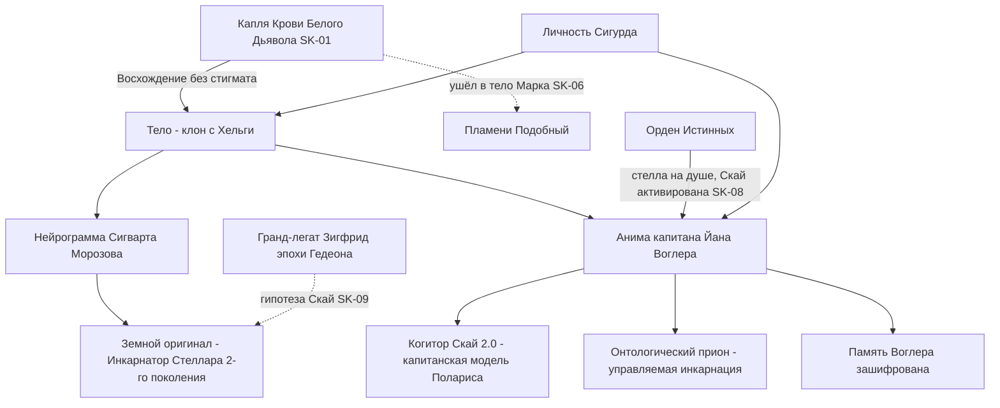
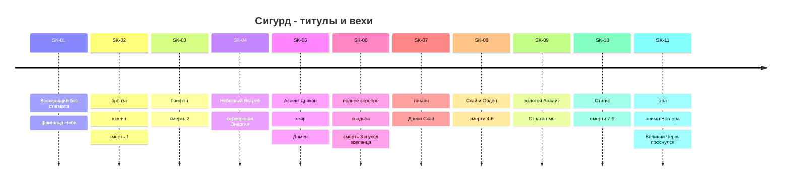
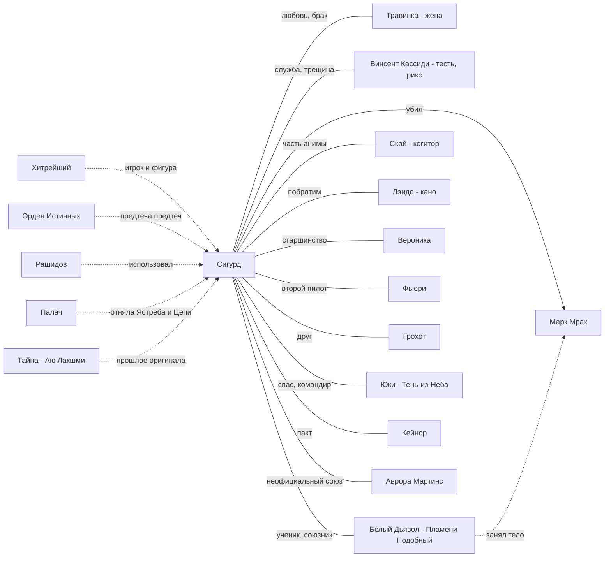

# Сигурд (Сигварт Морозов)

> Протагонист и рассказчик (1-е лицо) основной серии SK-01…SK-11; эпизодический персонаж цикла «Тысяча Братьев» (TB-01…TB-05).

**Навигация:** [1. Шапка и природа](#1-шапка-имена-природа-статус) · [2. Личность](#2-личность) · [3. Голос рассказчика](#3-голос-рассказчика) · [4. Биография по книгам](#4-биография-по-книгам) · [5. Таблица прогресса](#5-таблица-прогресса) · [6. Инвентарь](#6-инвентарь-на-конец-канона-sk-11) · [7. Бой и тактика](#7-боевой-стиль-и-тактика) · [8. Отношения](#8-отношения)

---

## 1. Шапка: имена, природа, статус

### 1.1. Карточка

| | |
|---|---|
| **Имя по документам** | **Сигварт Морозов**. Метка: род. 2396, «биологический возраст 23 года, календарный — ???», место рождения — Новая Аркона, Аркто-Пацифика; отец — Сергей Александрович Морозов, гранд-трибун Звездного Флота в отставке; мать — Ингрид Эльстад, госслужащая; братьев и сестёр нет; «внеобрядовый христианин», холост (SK-01, гл. 16). Сам себя считает уроженцем Нео-Арктики и учился в Санкт-Петербурге (SK-07, гл. 5, 8). Аврора при встрече зовёт его «Сигварт?» (SK-11, гл. 5) |
| **Имя в Единстве** | **Сигурд** — так во сне-воспоминании его зовёт Тайна: «Звучит похоже на твое имя. Буду звать тебя как древнего героя… Ты не читал «Нибелунги»?» (SK-01, гл. 7); это имя он вписывает в Хроники Единства (SK-01, гл. 8). Аватар в Вечности — **«Звездный Флот»** (SK-05, гл. 6) |
| **Прозвища** | **«Звездный Флот»** — от Толи Грохота с первых недель («Врежь ему, Звездный Флот!», SK-02, гл. 2; «наш Звездный Флот, на!», SK-03, эпилог). «Сиги» — Динамит (SK-06, гл. 6); «Сиг» — Ассоль (SK-07, гл. 13). «Командир» — Скай и копьё. Позывной винтокрыла/группы — **«Одиссей»** («Одиссей вызывает фригольд Небо!», SK-03, эпилог) |
| **Обращения по Титулу** | «юный Восходящий» → **«ювейн»** (голос, SK-02) → **«хейр»** (БД, SK-05–06) → **«танаан/тан»** (Пламени Подобный, Найтфир; SK-09–10) → **«эрл»** (Пламени Подобный, Народ Молний; SK-11, гл. 18, 20) |
| **Эпитеты высших сил** | «Истинный» (Посланник, SK-06, гл. 12; БД, SK-06, гл. 28); «брат» (Тайновидица, SK-08); **«предтеча предтеч, идущий дорогой сброса»** и «дракон, кусающий свой хвост» (небо-страж Щит Победы, SK-08, гл. 12; Мико, SK-11, гл. 15); «одним из нас» (Ледяной Кузнец, SK-08, эпилог); «Слуга Забытого? А-а, сам не знаешь…» (бабушка Яшма, SK-07, гл. 16); «Измененный предтеча» (Палач, SK-09, гл. 19); **«Тот-Кто-Меняет-Пути»** (Найра и караванщики, SK-10, гл. 19); «капитан» (Хитрейший, SK-11, гл. 19); «фигура-разрушитель… специально против меня» (Рашидов, SK-11, гл. 9); «Тем-Чей-Ранг-Неизвестен» — название подаренной Саги (SK-09, гл. 13–14) |
| **Титулы (Слава)** | ювейн (SK-02, гл. 17) → хейр (SK-05, гл. 16) → танаан, публично признан кингом Ветром Равнин (SK-07, гл. 19) → эрл как **«четвертый знаменосец по особым поручениям»** рикса Кассиди (SK-11, гл. 15, 20) |
| **Должности** | ученик копья Динамита (SK-01) → первый пилот аэромобильной группы «Одиссей» (SK-04) → командир особой боевой группы «Одиссей» (SK-06, гл. 27) → командир копья и рунный мастер фригольда (SK-07, гл. 7) → член «ближнего круга» рикса (SK-07, гл. 20) → эрл-знаменосец, обязан готовить себе замену в копье (SK-11, гл. 15) |
| **Народ** | Народ Земли, фригольд «Небо» (с SK-07 Древо фригольда — «Скай») |
| **Ранг на конец SK-11** | **серебро** с золотыми Атрибутами (Анализ, Искусность, Потенциал) и золотыми Навыками; «уже серебро с кучей золотых Рун» (SK-11, гл. 5); в TB-04 — «слабое серебро с золотой прожилкой» (TB-04, разд. 4). См. противоречие о «золотом ранге» в §5 |
| **Стигмат** | **настоящего гвоздя нет никогда.** Восходящий «через голос» (каплю Крови Белого Дьявола, SK-01, гл. 6–7); с SK-06 — Руна **Ложного Стигмата** (маска «средней бронзы», SK-06, гл. 15–16). Сканеры Альфы определили: «конструкция стигмата… имитирующая рунная матрица» (SK-10, эпилог) |
| **Бессмертие** | Истинный: тело «не отпускает душу», инкарнирует (SK-06, гл. 28); нужно ≥30 % тела (SK-10, гл. 16). Всего ~9 смертей (см. §5.2) |
| **Семья** | Жена — **Травинка-на-Ветру (Адель Кассиди)**, свадьба под Ростком (SK-06, эпилог 1); ребёнок ожидается (SK-08, гл. 9, 14). Тесть — рикс **Винсент Кассиди** («муж моей дочери»). Шурин — Марк «Мрак» Кассиди, которого Сигурд убил (SK-06, гл. 28) |
| **Спутники** | **Скай** — нейрокогитор в аниме (с SK-08, гл. 12); йурр **Кыш** — «ключник» Семени, позже страж Ростка (SK-01–07) |

### 1.2. Кто он по сути — все версии

Природа Сигурда — главная загадка серии; знание о ней наслаивается от книги к книге. Ниже версии **в порядке появления**; итоговая — в конце.

| № | Версия | Кто и где | Статус на конец канона |
|---|---|---|---|
| 1 | **Колонист-землянин после криостазиса**, амнезия «норма» | Вокс-запись капитана Йана Воглера (SK-01, гл. 4) | **Опровергнута**: «криогенная заморозка — легенда», все колонисты — клоны с нейрограммами, оригиналы остались на Земле; на «Хельге» 50 тыс. альфа-инкубаторов (Рашидов, SK-11, гл. 2) |
| 2 | **Потомок/кровник Кел** — «Добро пожаловать домой, Кел!»; смерть не взяла его, «возможно, сама твоя природа Кел» | Голос (SK-01, гл. 23; SK-02, гл. 17); Небесный Ястреб надевает «только Кел по крови», а земляне — «предтечи истинных Кел» (SK-04, гл. 14) | **Переосмыслена**: земляне — «предтечи», от которых произошли Кел (SK-09, интерлюдия Саги; SK-11, гл. 18) |
| 3 | **Истинный** — «Значит, ты тоже из Истинных?» (SK-02, гл. 15); «ты — Истинный, твоё тело не отпускает душу» (SK-06, гл. 28); Посланник: «Истинный, да еще и…» (SK-06, гл. 12) | Белый Дьявол, Посланник | **Подтверждена** Орденом: на его душе «наша сигна» (стелла), он «пришёл из верховьев или низовьев Реки Времени» (SK-08, гл. 12). Эйлориан: «Истинные рождаются только по воле Единых» (SK-11, гл. 21) |
| 4 | **Истинный, идущий «дорогой сброса»** — обнулил память и силу, чтобы восходить заново; «Ты ведь и сам запретил себе помнить, Сигурд» | Хитрейший (SK-08, гл. 10); Тайновидица: «если ты возвращаешься домой дорогой сброса — просто вспомни, что ты уже знал» (SK-08, гл. 10); небо-страж (SK-08, гл. 12); Найра (SK-10, гл. 17) | Сигурд сам **выбрал** пройти дорогу сброса до конца, а не ломать печати памяти (SK-08, гл. 12). В тексте прямо не опровергнута |
| 5 | **«Предтеча предтеч»** — потомок/отражение создателей «Космо» и ковчегов, а не экипажа первого ковчега «Гедеон» | Небо-страж Щит Победы (SK-08, гл. 12); Мико (SK-11, гл. 15); Пламени Подобный о нём — «Истинный, будто только что снявший Печать Сброса» (TB-01, гл. 14); Кузнец: «Даже у предтеч есть предтечи» (TB-02, гл. 18) | Действующая формула высших сил |
| 6 | **Связь с гранд-легатом Зигфридом** — в Саге Сестры Солнца на Земле эпохи «Гедеона» фреска героя с драконом на щите: «Сигурд? — Так точно, мэм! Это Стена Дракона!» — «Гранд-легат в Городе?» (SK-09, интерлюдия) | Гипотеза Скай: «мы являемся клоном с нейрограммой Сигурда Морозова, чей оригинал в прошлом стал основой личности, известной как гранд-легат Зигфрид»; три «инкарнации» — оригинал на Земле, клон на «Гедеоне», клон на «Хельге» (SK-09, гл. 16) | **Не подтверждена и не опровергнута**. *(Предположение: нейрограмма Морозова — «носитель», а Зигфрид — либо земной Морозов после «Стеллара», либо его прежняя инкарнация)* |
| 7 | **Инкарнатор «Стеллара»** — метка: «С 2418 (альфа-доступ), зачислен в экспериментальную группу проекта «Стеллар» в рамках испытания программы «Инкарнация»… Вторая специализация: Инкарнатор» | Рашидов (SK-11, гл. 2). Оригиналы Кондора и Рашидова — первое поколение Инкарнаторов, Морозова и Авроры — второе (SK-11, гл. 8) | **Факт о земном оригинале**. Но у клонов нет онтологического приона, подделать его нельзя (SK-11, гл. 8) — значит, бессмертие Сигурда не от нейрограммы Морозова |
| 8 | **Клон Морозова с чужой анимой — анимой капитана «Хельги» Йана Воглера** — единственного Инкарнатора на ковчеге, носителя когитора «Скай 2.0» (корпорация «Поларис», капитанская модель) | Скай высказала гипотезу «клон + чужая анима» ещё в SK-08 (гл. 14); вывод сделан на совете Альфы (SK-11, гл. 8): Скай подтверждает, что матрица была заблокирована приказом до активации в Ордене | **Итоговая рабочая версия канона**. Анима «со старыми письменами» вызывает **анимафикацию** — тело подстраивается под аниму: лицо угловатее, надбровные дуги толще, глаза из серо-голубых стальные, волосы темнеют до тёмно-русого, рост +2 см (SK-11, гл. 2, 12) |
| 9 | **«Двуединый» и «Измененный»** | Неустранимые особенности отражения в Вечности (SK-05, гл. 6). «Двуединый» исчезает после ухода Белого Дьявола (SK-08, гл. 6); «Измененный» остаётся: Палач — «Измененный предтеча… память кишит клеймами Истинных» (SK-09, гл. 19) | «Измененный» = искусственно изменённая анима («Стеллар»/«Поларис») *(предположение, хорошо согласуется с SK-11, гл. 2)* |
| 10 | **Фигура в чужой партии** — Хитрейший «лепил» его; Белый Дьявол внедрён как «залог выживания, ментор ускоренного Восхождения и инициатор союза между землянами и Тысячей» | Вывод Сигурда со Стратагемами (SK-09, гл. 16); Кейнор, прочитав его память: союз предтеч и Тысячи задуман «наверху», Пламени Подобный был **избран** наставником Сигурда, Семя и йурр — ходы «старого торгаша» (TB-03, гл. 1) | Сигурд сам формулирует: «вся моя жизнь… спектакль, разыгранный по заранее написанному сценарию» (SK-09, гл. 16) |
| 11 | **«Слуга Забытого?»** | Бабушка Яшма видит на нём что-то от Того-Кто-Забыт и посылает «в лабиринт» (SK-07, гл. 16) | Не раскрыто *(предположение: речь о связи с Тысячей — осколками Забытого — через Кровь Белого Дьявола, либо о роли «Изменённого» в замысле возвращения Забытого)* |

**Итог (на конец SK-11):** тело — клон, выращенный на «Хельге» по нейрограмме Сигварта Морозова (земного Инкарнатора «Стеллара» второго поколения); анима — капитана Йана Воглера (Инкарнатор, криптограф), со встроенным когитором «Скай 2.0»; память Воглера зашифрована и не восстановлена; Орден признаёт его Истинным-«предтечей предтеч» на дороге сброса; кто и зачем совершил подмену — неизвестно (SK-11, гл. 8; Хитрейший «запретил себе помнить», SK-08, гл. 10). Личность — Сигурда, а не Воглера: восстановление памяти капитана, по оценке Скай, изменит личность (SK-11, гл. 8), и Сигурд от этого отказывается.

### 1.3. Статус на конец канона

- **На конец SK-11 (гл. 21):** жив, во фригольде «Небо»; эрл и четвёртый знаменосец Кассиди; командир группы «Одиссей» (ему поручена глубинная разведка у Черной Пасти, SK-11, гл. 20); на Стигисе «Голубая Стрела» долетел через мёртвые октагоны до **Великого Улья** (опухоль >3000 км вокруг мёртвой Башни) и увидел, что **Великий Червь проснулся** (SK-11, гл. 21). Связан пактом перед Наблюдателем с Тысячей Братьев и Альфой (SK-11, гл. 18). Ждёт «окна» к «Хельге» — через 47 дней от совета (SK-11, гл. 18). Травинка беременна.
- **На конец TB-05:** жив, в Элтанире; Караван Эль-Керр идёт к нему по его же Ключу и в долгу у Народа Земли (TB-05, гл. 1).

---

## 2. Личность

### 2.1. Ядро характера

- **Упрямство и любопытство.** «На чистой злости и упорстве (я, оказывается, упертый)» (SK-01, гл. 3); «Не попробую — не узнаю» (SK-02, гл. 5). Динамит: «Совсем упертый, да? Жизнь-то ничуть не дорога?» (SK-02, гл. 6).
- **Рассудочность.** Почти любую ситуацию раскладывает по пунктам, считает варианты, ищет закономерности (капля Крови в сутки, механика Славы, лимит сделок с Наблюдателем — SK-05, гл. 18; SK-07, гл. 17). С появлением Скай (SK-08) и Стратагем (SK-09) аналитика становится его оружием.
- **Хладнокровие в бою.** Дремлющий Навык Жизнестойкость 10/10 — голос удивлён: «мало кто развивает его до бронзы даже к старости» (SK-03, гл. 2). После первых убийств — почти никакой рефлексии (SK-03, разд. 4).
- **Совестливость.** Тяготится ложью: «Боже мой, как надоело врать…» (SK-06, гл. 16). Честно отдаёт Соцветия Хладноцвета копью: «так переступая через принципы, недолго и уважение к самому себе потерять» (SK-02, гл. 6).
- **Щедрость к «своим» и прагматизм к остальным.** Отдаёт фригольду Копьё Игг-Света и Рунный Конструктор (SK-07, гл. 2, 7), Грохоту — Кристалл Странника (SK-07, гл. 6), Келли — Алую Волну (SK-08, гл. 16). Но держит при себе Перенос, Феромоны, связь с хранилищем Наблюдателя (SK-07, разд. 4), прячет часть добычи от рикса (SK-08, разд. 4) и решает, что «помощь в ущерб собственному Восхождению ведет в тупик» (SK-10, гл. 8) — хотя тут же честно показывает Кассиди Стигис.
- **Независимость.** Главная черта зрелого Сигурда — отказ становиться чьей-то собственностью: Клятва Хитрейшему — «Нет! Я не буду приносить никаких Клятв, Хитрейший» (SK-08, гл. 10); Пайцза Хранителя — откатывает время и не принимает (SK-09, гл. 12); Белому Дьяволу — «Иди к черту! Я не собираюсь становиться твоей послушной марионеткой» (SK-09, гл. 8); «поклялся себе, что больше не буду игрушкой высших сил» (SK-10, гл. 1); отказ приказать Скай передать права командира Альфе (SK-11, гл. 8).
- **Самоуправство.** Иногда решает за всех: отдаёт кингу Иниэсс золотую Сагу «Улей Великого Червя» как виру, не спросив рикса (SK-07, гл. 22); закрывает Стрелу в Домене вопреки интересам рикса (SK-08, гл. 8, 14). Кассиди отчитывает, потом мирится.
- **Готовность к самопожертвованию.** Прыгает в пламя Лабиринта (SK-08, гл. 11), один выходит против семерых теневиков (SK-09, гл. 5), разворачивается за Кардо при шансе <5 % (SK-10, гл. 12).

### 2.2. Ценности

1. **Человечность как принцип, а не как чувство.** Ключевая формула: «Мы — люди, должны спасать и защищать других людей, так как только это делает нас людьми» (SK-03, гл. 15) — родилась из воспоминания об академической лекции про сросшуюся бедренную кость как первый признак цивилизации. Повторена через восемь книг: «Лечить и защищать слабых — вообще нерационально, но это именно то, что делает нас людьми» (SK-10, гл. 12).
2. **Товарищество.** Перенимает у Грохота «десант своих не бросает» (SK-04; SK-11, гл. 6). Командир, который вытаскивает каждого.
3. **Верность слову.** «Я не даю Клятв, в которых не уверен… Поклясться и не выполнить — хуже, чем не клясться вообще» (SK-10, гл. 17).
4. **Семья.** Травинка — якорь личности: «Пока она рядом, я останусь собой» (SK-09, гл. 16). Честно говорит Тайне, что у него жена и будет ребёнок (SK-11, гл. 6).
5. **Свобода выбора.** Своя и чужая: ненавидит рабство (трэли Эйрика — SK-04, гл. 9), запрещает Юки вставать на колени (SK-03, гл. 6), морщится, когда перед ним склоняется Найра: «мне, в отличие от Белого Дьявола, подобные жесты всегда были немного… неприятны» (SK-10, гл. 19). Мама Роза с её «Люди должны быть свободными» ему близка (SK-11, гл. 12).

### 2.3. Юмор

- Самоирония: «Хищная обезьяна я или нет?» (SK-01, гл. 2), «Сигурд-тритон — только хвоста и плавников не хватает» (SK-03, разд. 4).
- Земные аналогии к системе Единства: VR-игра, «туториал», редактор персонажа, маркетплейсы и Биржа (SK-05, гл. 6, 10).
- Чёрный армейский юмор в разговорах с Грохотом; подыгрывает Динамиту и раскусывает его байку о «пропавшем новичке Моските» (SK-02, гл. 3).
- Сухая насмешка над высокопарностью Кел и над пафосом вселенца — даже когда сам начинает «говорить как Восходящий».

### 2.4. Страхи

- **Утрата себя.** Самый устойчивый страх серии. Земная память «как нейрограмма», за ней «закрытый черный ящик» (SK-04, гл. 17); «Было — но как будто с кем-то другим» (SK-07, гл. 1); «Привет, я Сигурд Морозов, а ты кто?» (SK-07, гл. 17); «Того наивного Сигурда… давно не существовало, сквозь его оболочку прорастал кто-то другой» (SK-09, гл. 2); Стратагемы меняют мышление (SK-09, гл. 16); анимафикация меняет лицо (SK-11, гл. 12); Орден обещает «вернуть тебя самого» (SK-11, гл. 18) — то есть, возможно, заменить Сигурда Воглером.
- **Стать Белым Дьяволом.** Ловит себя на его мимике и логике («как бы поступил вселенец», SK-07, гл. 8) и проводит черту: «Я — не он» (SK-09, гл. 5).
- **Быть марионеткой.** «Спектакль, разыгранный по заранее написанному сценарию» (SK-09, гл. 16).
- **За Травинку и ребёнка.** Хитрейший давит именно на это: «твой фригольд, друзья, Травинка, ваше пока нерожденное дитя — всего лишь симуляция?» (SK-08, гл. 9).
- **Ранний страх разоблачения.** В SK-01–06 боится, что саркофаги инициации распознают «две души в одном теле» и за ним придут ищейки Вечности (SK-02, гл. 7).

### 2.5. Слабости

- **Тело отстаёт от разума.** Физионика 0/10 подводит в бою с призраком (SK-05, гл. 4); Скай: тело «ещё застряло на бронзовом ранге» (SK-08, разд. 5); Псионика 0 (SK-07, разд. 5).
- **Ставка на стимуляторы.** Черная Пилюля → тяжёлый откат (SK-09, гл. 6); сочетание Черного Надлома и Несокрушимости его убивает (SK-10, гл. 19).
- **Склонность рисковать в одиночку**: поединок с Марком (SK-06, гл. 28), Сага Вершителя (SK-07), рывок к Грому (SK-10, гл. 13).
- **Уязвимость перед L-полем и хронозахватом**: Руны отключаются (SK-09, гл. 19; SK-10, гл. 23; SK-11, гл. 1).
- **Политическая наивность в начале** (Марк, Вероника, Говорящая играют им), потом — привычка решать без спроса.
- **Зависимость от чужих подарков**: Аграф, Ястреб, Цепи, Монета — почти всё «золото» ему дано высшими силами и потом отнято.

### 2.6. Как принимает решения

1. **SK-01–03:** сначала инстинкт и мораль, потом — советы голоса, которые он всё чаще отвергает (Юки — SK-03, гл. 7, 15).
2. **SK-04–06:** вслушивается в Белого Дьявола, но строит **свой** план (трёхэтапный план из SK-05, гл. 15: стигмат с легендой, пробуждение Кассиди, фионтар с Мраком). На тинге играет политически. Финальный выбор — по совести (честный бой с Марком), и за это умирает.
3. **SK-07:** «как бы поступил вселенец» — но в границах своих принципов (SK-07, гл. 8). Распределяет развитие «сам, без подсказок» (SK-07, гл. 17).
4. **SK-08–09:** холодный счёт Скай (вероятности: 7 %, «боевой прогноз нелетального сдерживания» — SK-08, гл. 13; SK-09, гл. 5) + своя мораль как вето. Стратагемы выдают ход, а он фильтрует их через «Травинка. Не стратегический ресурс» (SK-09, гл. 16).
5. **SK-10–11:** решает как командир экспедиции и политик. Стратагемы предлагают неожиданные ходы («не бежать, а идти к координаторам», SK-11, гл. 10), но последнее слово за человеческим выбором (Кардо — SK-10, гл. 12).

### 2.7. Военный бэкграунд пилота Звездного Флота

- **Образование:** 2408–2413 — Кадетский корпус Новой Арконы (в SK-04, гл. 17 он вспоминает «товарищей по интернату» — по-видимому, кадетский корпус); 2413–2418 — Санкт-Петербургский филиал Академии Звездного Флота, факультет «Летательные аппараты» (SK-01, гл. 16).
- **Специализация:** «универсальный пилот»; ранг — «специалист» (когитор «Грифона»: «СИГВАРТ МОРОЗОВ, РАНГ — СПЕЦИАЛИСТ, ПИЛОТСКАЯ ЛИЦЕНЗИЯ ПОДТВЕРЖДЕНА», SK-03, гл. 16). Вторая специализация засекречена (SK-01, гл. 16; SK-07, гл. 1) → «Инкарнатор» (SK-11, гл. 2). С 2418 — «Стеллар», с 2419 — «Космо».
- **Профессиональные рефлексы:** «вряд ли меньше трёхсот часов налёта» — оценка Фьюри (SK-04, гл. 8); Навык Универсальный Пилот растёт до Искусства Пилотирования (серебро, SK-05, гл. 16), Небесный Вираж (SK-08). На борту жёстко ставит иерархию: «Дмитрий, в полёте на воздушном судне командую я!» (SK-04, гл. 7). Помнит посадку десанта в винтокрыл (SK-01, гл. 18), лекцию о модуле «Домус» (SK-01, гл. 15), устройство грузовых капсул (SK-04, гл. 10).
- **Кадровый военный:** «парень, опять-таки, кадровый, Звездный Флот, пилот, таких махом вяжут» (Грохот, SK-02, гл. 7).
- **Мирная культура XXIV века:** читает Травинке «Аннабель Ли» (SK-04, гл. 15), помнит город тысячи башен, свинцовую реку, мраморных львов (SK-02, гл. 9), зал медитаций с **трёхлучевой звездой** (SK-02, гл. 7 — позже это знак стеллы Ордена, см. §9).

### 2.8. Отношение к…

| К чему | Позиция и её развитие |
|---|---|
| **Власти рикса** | Признаёт законную власть («решать может только рикс», SK-08, эпилог), но торгуется с Кассиди «запанибрата» (SK-08, разд. 4) и иногда действует через голову. Сам власти не ищет; назначение эрлом принимает как долг (SK-11, гл. 15) и с иронией чувствует себя «старичком-ветераном» (SK-11, гл. 20) |
| **Единству** | От шока (SK-01–02) — к принятию законов: «Важна только Звездная Кровь» (SK-07, разд. 4); трезво: «в Единстве вообще нет «светлых» сил» (SK-08, разд. 4). Пламени Подобный: «ты — уже принадлежишь ему» (SK-11, гл. 18). Думает о Наблюдателе как о бесчеловечной, но нужной системе (SK-07, гл. 19) |
| **Землянам / Альфе** | Безусловная лояльность Небу. Альфе не доверяет с первой встречи с советом («Не договоримся», SK-11, гл. 7); защищает право колоний на независимость: протоколы «Космо» несостоятельны, «Земли больше не существует» (SK-11, гл. 7). Не хочет, чтобы «Хельгой» распоряжался кто-то один (SK-11, гл. 16) |
| **Вечности** | Отвращение, перенятое у БД и подтверждённое опытом: душеторговцы, Дом Кубков, Чертог Вечного Пира; Ангел: «Крысиный рай. Позолоченный, но внутри гнилой» (SK-09, гл. 14). При этом умеет там торговать и играть по правилам |
| **Кел** | Брезгливое любопытство: «Кел не…» (SK-05, гл. 1); к их жестокости и к жестокости БД — «Ну и плевать, чума на оба их дома!» (SK-05, гл. 16) |
| **Тысяче Братьев** | Союзник с трезвым расчётом: помощь против Червей — да, вступать в войны Тысячи — нет (SK-11, гл. 18) |
| **Рабству** | Неприятие; освобождает трэлей и пленников везде, где может (SK-03; SK-05, гл. 19; SK-11, гл. 20) |
| **Убийству пленных** | «Земляне не убивают пленных врагов» (SK-09, гл. 5). **Но**: выжигает личность Кондора («Чистый лист», SK-11, гл. 10) — это его самый жёсткий поступок в серии |

### 2.9. Эволюция по этапам

| Этап | Книги | Что меняется | Маркер |
|---|---|---|---|
| 1. Выживальщик-амнезиак | SK-01 | Земной человек в чужом мире: страх, упорство, ирония, «хищная обезьяна» | «Хищная обезьяна я или нет?» (SK-01, гл. 2) |
| 2. Тайный Восходящий под чужой волей | SK-02–03 | Носит голос; дважды отдаёт тело; учится скрывать силу; впервые побеждает голос в схватке воли за Юки | «Есть ты, и есть я, и каждый сам выбирает путь» (голос, SK-03, гл. 15) |
| 3. «Молодой волк» | SK-04 | Внешне и внутренне «матереет»: бородка, ястребиный взгляд; убивает без тошноты; убивает Кнута | «Тело — отражение души Восходящего» (БД, SK-04, гл. 1) |
| 4. Самостоятельный игрок | SK-05–06 | Свои планы в Вечности и на тинге; «говорит как Восходящий»; отвергает метод БД в финале и платит смертью | «Тот Сигурд… в ужасе схватился бы за голову от такого безумия» (SK-05, гл. 18) |
| 5. Командир без вселенца | SK-07 | Перенимает жёсткость БД, но остаётся щедрым; первые «самоуправные» решения; вопрос о природе | «Привет, я Сигурд Морозов, а ты кто?» (SK-07, гл. 17) |
| 6. Истинный и фигура | SK-08–09 | Скай, Орден, Хитрейший; отказывается от Клятв; маска Белого Дьявола в переговорах; Стратагемы приносят холод | «Того наивного Сигурда… давно не существовало» (SK-09, гл. 2) |
| 7. Лидер экспедиции | SK-10 | Клятва «не быть игрушкой»; ведёт людей через три октагона; спасает слабых вопреки расчёту | «Мы облажались» — первая фраза книги (SK-10, гл. 1) |
| 8. Знание о себе, политик | SK-11 | Узнаёт, что клон с анимой Воглера; ломает Кондора; признаётся Кассиди в убийстве Марка; эрл; дипломат на совете | «Ты вырос, эрл» (Пламени Подобный, SK-11, гл. 18) |

---

## 3. Голос рассказчика

### 3.1. Как устроена речь

- **Первое лицо, прошедшее время, живой внутренний монолог** с вопросами к себе и восклицаниями. Абзацы-рассуждения чередуются с короткими рублеными фразами в бою.
- **Две лексики.** Технарская/военная (импеллер, тилтротор, гаусс-турель, когитор, «боевой прогноз», «вокс», «сетка прицела») — и высокая «рунная» (Скрижаль, Средоточие, осанна, Вечность). Чем дальше, тем свободнее он переходит на высокий слог в разговорах с Кел и Братьями: кинг Трав, Лэндо, Иниэсс отмечают, что он «говорит как Восходящий» (SK-06, разд. 4).
- **Ругательства умеренные, «интеллигентские»:** «Черт побери» (самое частое, >100 раз за серию), «Дьявольщина!» (с SK-03), «хрень», «твою…». Мата нет — мат у Грохота («на», «копать-хоронить», «епта»). Колонистское «астра фатида» — чаще у других (Серена, Фьюри).
- **Интерфейсные вставки** — системные сообщения («Ваша Слава повышена на 1», «Активация № 3. Носитель мертв. Провести инкарнацию?»). С SK-08 — реплики когитора отдельной строкой: **«Скай: …»** (сухой аналитический тон, проценты, рекомендации). Голос Белого Дьявола в SK-01–06 — прямой речью в среднем ухе, с афоризмами.
- **Земные отсылки** — к XXIV веку, VR, «Нибелунгам», Шекспиру («чума на оба ваших дома»), Эдгару По.

### 3.2. Опорные цитаты (короткие)

1. «Хищная обезьяна я или нет?» (SK-01, гл. 2) — первые дни, юмор выживальщика.
2. «На чистой злости и упорстве (я, оказывается, упертый)…» (SK-01, гл. 3).
3. «Мы — люди, должны спасать и защищать других людей, так как только это делает нас людьми» (SK-03, гл. 15) — кредо.
4. «Считаю, что дракону не стоит назначать цену за то, чего у него нет! Сокровище ему уже не принадлежит» (SK-04, гл. 12) — ответ Эйрику на притчу о драконе (о Травинке и Говорящей).
5. «Ну и плевать, чума на оба их дома!» (SK-05, гл. 16).
6. «Боже мой, как надоело врать…» (SK-06, гл. 16).
7. «Черт побери, неужели все-таки во мне дремлет какой-то тайный агент Звездного Флота?.. Привет, я Сигурд Морозов, а ты кто?» (SK-07, гл. 17).
8. «Иди к черту!.. Я не собираюсь становиться твоей послушной марионеткой» (SK-09, гл. 8).
9. «Я — не он. Земляне не убивают пленных врагов» (SK-09, гл. 5).
10. «Травинка. Моя Травинка. Не стратегический ресурс. Не объект защиты. Девушка, которую я люблю» (SK-09, гл. 16).
11. «Лечить и защищать слабых — вообще нерационально, но это именно то, что делает нас людьми» (SK-10, гл. 12).
12. «Я не даю Клятв, в которых не уверен» (SK-10, гл. 17).
13. «Может, я и не знаю, на кого работаю, — но уже точно знаю, на кого работать не буду» (SK-11, гл. 8).
14. «Чистый лист. Истинные называли это — идти дорогой сброса» (SK-11, гл. 10) — о выжженном Кондоре.
15. «Поздно. Они уже здесь» (SK-11, гл. 16).

### 3.3. Как писать за Сигурда — памятка

- Он **объясняет** мир читателю, как инженер: механику Рун — через аналогии (заготовка + Символ + Кровь), политику — через интересы сторон.
- Эмоции прорываются короткой фразой после длинного рассуждения («Дело в том, что я умер», SK-10, гл. 19).
- Он не пафосен о себе; пафос — у других (БД, Кел, Братья). Если Сигурд говорит высоким слогом, это **маска** для собеседника (маска Белого Дьявола — SK-09, гл. 5, 11).
- В конце главы любит клиффхэнгер-реплику или вопрос («И что мне теперь делать?», SK-07, эпилог).

---
## 4. Биография по книгам

### 4.0. До SK-01: Земля и «Хельга»

- **Земной оригинал — Сигварт Морозов** (род. 2396): кадетский корпус Новой Арконы, Академия Звездного Флота (СПб), с 2418 — экспериментальная группа «Стеллар», программа «Инкарнация»; вторая специализация — Инкарнатор; с 2419 — участник «Космо» (SK-01, гл. 16; SK-11, гл. 2). Оригинал остался на Земле (SK-11, гл. 2).
- **Тайна (Аю Лакшми)**, учитель истории Земли: они познакомились в архиве Нео-Мумбаи, были вместе около девяти месяцев, перед его секретным отбытием провели три дня в лагуне; ради него она записалась в «Космо» (SK-11, гл. 6). Именно она назвала его «Сигурдом» (SK-01, гл. 7).
- **Земля погибла:** Сага Сестры Солнца показывает Землю после А-катастрофы — метеоритная бомбардировка, повреждённый аномальный объект на орбите, город с кольцами стен в Гренландии (космодром, орбитальный лифт, секретный объект Звездного Флота) (SK-09, гл. 16).
- **«Хельга»** вышла из А-пространства рядом с Миром-Кольцом, капитан помнит «синюю вспышку Грани» и «зловещего пришельца»; все на борту мертвы, кроме капитана, который «мог воскресать даже в тех случаях, когда материальная оболочка утрачена» (SK-01, интерлюдия «Хельга»). Ковчег прибыл ~29 циклов назад, перешёл в аварийный режим и по автоматике сбрасывает капсулы с клонами (SK-11, гл. 8). Перенесла его Единая Руна Хронос (Хитрейший, SK-08, гл. 9).
- **Видения в смерти**, которые принадлежат, по-видимому, капитану: кадеты и звездолёты, Тайна у океана, **капитанский мостик, «КРАСНАЯ ТРЕВОГА», чёрная сфера в голубом нимбе** (SK-02, гл. 15); «лазурная бездна» (SK-03, гл. 8); корабль под Куполом, Мир-Кольцо, ковчег у доков (SK-06, гл. 28); Палач в «чёрном ящике» видит Мир-Кольцо, золотую сферу с отростком в груди Сигурда и синюю воронку (SK-09, гл. 19).

### 4.1. SK-01 «Звездная Кровь» — пробуждение

**Где:** Круг Элтанир — озеро Девы у руин гиперполиса Кел (Эстэ), Море Трав, фригольд «Небо».

Сигурд приходит в себя в падающей капсуле-торпеде: отказ когитора, катапульта, падение в озеро. Хвост капсулы срезан идеально ровно — её сбили (гл. 1). Амнезия: общие знания целы, личности нет; в отражении — юноша нордического типа, хотя он «ощущает себя старше» (гл. 1). На островке находит огород и зверька-йурра — Кыша, который остаётся с ним (гл. 4); в озере — золотое **Семя Великого Игг-Древа** (гл. 5); из ложемента — «Набор Колониста, тип 2» с криптором, воксом, «Дефендером» и Схемами «Мангуса» (гл. 3). Вокс проигрывает смонтированную запись капитана Йана Воглера о «повторной колонизации Земли» — Сигурд не верит, что это Земля (гл. 4).

Преследуя раненого найтволка, он находит склеп с распятым **чёрным скелетом** под охраной голограммы Всполоха; Семя защищает его от рунного огня. Касание радужной капли над черепом — **поглощение Звездной Крови казнённого** (гл. 6), видение казни Белого Дьявола тремя Преображающими (интерлюдия). Он втягивает в свою «Скрижаль» золотую Руну **Живых Цепей**, забирает стигмат-«гвоздь» и яйцо найтволка; нейротрансформация; сон о Тайне, давшей имя «Сигурд»; в среднем ухе — чужой голос: «Йурр» (гл. 7). Интерфейс: Атрибуты Тело 5 / Разум 4 / Дух 1, Задание Наблюдателя посадить Семя у границы Теней, Повеление Храма вернуть стигмат; в Хроники он вписывает имя «Сигурд» (гл. 8).

У реки Бурной его в два счёта скручивает Серебряная Форель — ищейка Людей Реки (гл. 10). Спасают всадники фригольда — Гай Флоу и Марк Кассиди. Гай выходит на **фионтар** за право забрать Сигурда и погибает от стрелы в шею; Сигурд тайно забирает его Кровь и Руны (Алый Коготь, Бой-без-Оружия, Обломок Скрижали) (гл. 11). Голос впервые говорит развёрнуто («МОЛЧИ!»), Марк проверяет у Сигурда запястья — гвоздя нет (гл. 12). Голос признаётся, что он «суть» Крови, Восходящий древнее стигматов (гл. 13). Ночью Рэнди лезет в криптор — Сигурд ломает ему нос, Марк отбирает «Дефендер» (гл. 13). У Южного Поста Сигурд подслушивает Марка и Свирель; голос: «Разве ты еще не понял, кто убил старика на переправе?» (гл. 14–15).

Во фригольде рикс Вероника Максвелл применяет «Ауру Доверия» — голос впервые «вдвигается» в сознание и снимает внушение. Сигурд отдаёт стигмат и показывает яйцо (Слава +2), **скрывает Семя**. Сканер читает метку «Сигварт Морозов». Его принимают в Народ Земли, учеником в копьё Дмитрия «Динамита» Воронина (гл. 16–17). Знакомство с Инем и Янем, Лэндо Солнечное Крыло, Лохмачом, Толей Грохотом (гл. 17–18). Ночью голос предлагает **союз: помощь в Восхождении в обмен на поиск нового тела** (гл. 17).

Ваал дрейков: Сигурд с Лэндо прикрывает отход Травинки и детей, тайно убивает альфа-дрейка Алым Когтем, тащит раненого Лэндо (гл. 19); в теплице бьётся с бронзовым дрейком рядом с Миносом, ранен, лечится Алой Ночницей (шрам-«жучок» над левым бедром) (гл. 20–21). Знакомится с целительницей **Травинкой-на-Ветру — Адель Кассиди**, сестрой Марка; её мать Говорящая-с-Травами холодно велит «выбросить её из головы» (гл. 21). Лекция Миноса: Единство — сфера Дайсона; голос, увидев голограмму ковчега: «Добро пожаловать домой, Кел!» (гл. 23).

**Итог:** скрытое «дерево» без стигмата; Т7/Р4/Д2; ЗК 33/46; Слава 4; Руны: Живые Цепи (золото), Алый Коготь (бронза), Развитие (бронза), Чуткое Ухо, Порыв Ветра, Нулевая, Малое Изменение; Навык Бой-без-Оружия; спутник Кыш (SK-01, разд. 5). **Враг:** Марк. **Тайна:** Семя.

### 4.2. SK-02 «Фригольд» — голос берёт тело

**Где:** фригольд, ледник Великан, Расколотые Земли, Гнездо Червей, Домен «Серебряный Замок».

Лэндо объявляет себя **саан-кано** Сигурда (долг крови) и даёт в залог хазак «Клык Ледозуба» (гл. 1). Драка с Рэнди — проявляется моторика Боя-без-Оружия, кастет-трофей, Слава 5 (гл. 2). В походе за хладонитом Сигурд двумя Порывами Ветра обращает смертельный «взгляд» Хладноцвета на тигрекса (гл. 4); Кыш лечит Хладноцветы — тайное задание Наблюдателя, награда — щит-**Зерцало** (¼ доспеха лед-кузнецов Эргиаля) (гл. 5–7). Динамит обещает выдвинуть его кандидатом на стигмат (гл. 7). Свидания с Травинкой: рассказы о Земле, первый поцелуй; голос противопоставляет «посвящению» в Вечности свою версию — стигматы как **«рабские оковы»** (гл. 9).

Банда Рэнди подвешивает Сигурда в очистителе; голос: «Впусти меня в себя» — и расшвыривает всех; под взглядом Мрака Сигурд понимает: «я должен убить Марка. Иначе он убьет меня» (гл. 10–11). Травинка дарит ему артефакт Кел **«Живой Лист»**, он ей — Соцветие Хладноцвета: «Вот мы и обменялись дарами…» (гл. 11) — позже выяснится, что это помолвка (SK-04, гл. 3). Веронике он говорит только «дрались из-за девушки», чтобы не попасть под ментальный допрос (гл. 12).

Рейд в Расколотые Земли против Гнезда Червей; Наблюдатель выдаёт ему бесконечное задание «Уничтожайте Червей везде» (гл. 13). В дозоре невидимка (люди Мрака) сбрасывает его в разлом — **первая смерть**: видения Тайны и мостика; голос в изумлении: «Значит, ты тоже из Истинных?» (гл. 14–15). Очнувшись в коконе Гнезда, Сигурд отказывается снова отдавать тело, поднимает Семя и выжигает выводок, Зерцалом отражает луч Имаго-Стража, обрушивает сталактиты на Матерь (гл. 15). Скрижаль — бронза, с Матери — Гипнотизм, Феромоны, Большая Развития (гл. 16). Голос признаётся, что ждал его смерти, чтобы занять тело, и клянётся «Кровью Тысячи Братьев», что не враг (гл. 17). Задание на Гнездо засчитано ему: **Титул «ювейн»**, серебряная награда; по совету голоса он берёт Руну-Домен-Ключ «Серебряный Замок» (гл. 17).

В Домене Сигурд уступает тело голосу (повествование уходит в 3-е лицо): тот покоряет хозяйку — золотую кел-леди **Азимандию Визу Аран**, получает Навык Рунное Мастерство, через её триадр поднимает Сигурда до **девяти бронзовых Атрибутов** (гл. 18–21). В лаборатории — колонна Безвременья с **Винсентом Кассиди**, пропавшим риксом землян (гл. 22). Голос показывает Азимандии казнь её прародительницы и делает её **Руной-Существом «Рунный Мастер»** (золото) (гл. 23). Эпилог: голос возвращает выбор: «ювейн справится. Ведь это его тело и его жизнь».

**Итог:** бронза; Слава 19; Руны: Живые Цепи, Рунный Мастер (= Азимандия), Зерцало, Алый Поток, Плащ Призрака, Гипнотизм, Феромоны, Биолокация; Торк-Экзопокров; Навыки Рунное Мастерство (5★), Аутотренинг, Осознанный Сон, Навык Чуткое Ухо (SK-02, разд. 5). **Смерть № 1.**

### 4.3. SK-03 «Земли Теней» — выбор против голоса

**Где:** Расколотые Земли, аванпост Наблюдателя, септа Небесных Когтей, Черная Пасть, плато над Солью, фригольд.

Голос возвращает тело через двое суток: «Благодарю, что помог вспомнить дни нашей славы, ювейн…» (гл. 1). Сигурд первым убивает изгоев — землянина Дугласа Кирка и Восходящего Раздавленного Клыка — и получает их трэль **Юки** с цепью на ошейнике (гл. 3). Наблюдатель поручает ему доставить эль-целестус в Колонну Сияния (гл. 4). В пути Юки греет его по обычаю Теней, голос учит **Стилю Железа** (гл. 6). Ночной бой с Червями: Сигурд выжигает плато Семенем — Юки видит Семя; голос требует убрать свидетельницу («только мертвые умеют хранить тайны»), Сигурд лишь берёт с неё клятву (гл. 7). У аванпоста — **рип-сканирование, вторая смерть**, «лазурная бездна» (гл. 8; SK-08, разд. 5).

Засада Теней: голос в теле Сигурда вызывает на фионтар и дерётся с **Когтем-как-Серебро** — «Он дрался подобно Белому Дьяволу» (гл. 9). Пытки пламенной перчаткой (тело ведёт голос и смеётся) — ожоги остаются Сигурду (гл. 10); выбор награды — **Экзо-Шейд** (гл. 11). В яму спускают **Шона Макдональда** из экспедиции «Одиссей» Колонии Альфа: в Черной Пасти почти исправный винтокрыл **«Грифон»**, а Сигурд — пилот (гл. 12). Голос гипнотизирует, пробивает святилище, даёт рикс-провидице Видящей-сквозь-Тьму пощёчину; выкуп — Шон, винтокрыл и Портал (гл. 13). По пути голос рассказывает о своём Народе и **соглашается на имя «Белый Дьявол»** (гл. 14).

У винтокрыла — призрачный кукольник: Шон гибнет, Юки отравлена. Голос силой пытается свернуть ей шею руками Сигурда — **первая выигранная Сигурдом схватка воли**: его спасает воспоминание об академической лекции про бедренную кость; голос отступает: «Так говорили те Истинные, кто служат Защитнику… Есть ты, и есть я, и каждый сам выбирает путь» (гл. 15). Когитор «Грифона» подтверждает его пилотскую лицензию; на фюзеляже — надпись «Одиссей» (гл. 16). Сигурд с Юки, светящей Семенем из люка, выжигает Червей с воздуха (гл. 17). Белый Дьявол вызывает Азимандию, «перевоспитывает» её, по просьбе Юки та стирает девушке память (гл. 18). Азимандия выдаёт: **Тот-Кто-Сражается мёртв** — БД уходит вглубь в скорби (гл. 19). Сигурд один разбирает добычу: Рунный Конструктор, Истинный Взор, Скрижаль — серебро (82 слота). Эпилог: «Одиссей вызывает фригольд Небо!» — Грохот, Вероника, Травинка: «Дурак!… думала, что ты умер!».

**Итог:** «слабая бронза», серебряная Скрижаль; Слава 32+; Навыки: Стиль Железа, Рунное Искусство (серебро), Универсальный Пилот, Жизнестойкость 10/10; винтокрыл «Грифон» (SK-03, разд. 5). **Смерть № 2.** **Узнал:** Колония Альфа существует; проект «Аврора»; смерть Защитника.

### 4.4. SK-04 «Одиссей» — первый пилот и убийство Кнута

**Где:** фригольд, Море Трав, ферма Эйрика, Шторм (руины Эстэ).

Карантин; Слава 35 (до хейра нужно 50). Внешне — бронзовое тело, бородка, «ястребиный» взгляд (гл. 1). Допрос Вероники: Сигурд держится на Ментальной Чувствительности и поддержке БД, а по команде голоса бьёт собственным серебряным Гипнотизмом — Вероника, не поняв, что проиграла ментальную дуэль, «верит»; под Сферой Тишины он рассказывает о Марке, Свирели и ваале. Награда — должность первого пилота и место в списке на стигмат (гл. 2). Невидимая фея-Пикси над Травинкой — шпион матери; Травинка объясняет **обычай обмена дарами** — они помолвлены (гл. 3). Сигурд — **первый пилот аэромобильной группы «Одиссей»** («Грифон» с гаусс-турелями и «Пилумами») (гл. 4–5). Охота на тавров с воздуха; «Дмитрий, в полёте на воздушном судне командую я!» (гл. 6–7). На ферме Эйрика ему неприятны трэли (гл. 9). Изгои отбивают модуль колонистов, «Грифон» горит (гл. 11); Портал ведёт в Шторм — это Эстэ, город последнего боя Белого Дьявола (гл. 12). Эйрик рассказывает притчу о драконе; ответ Сигурда — о драконе, которому не принадлежит сокровище (гл. 12).

С Травинкой — первая близость и «Аннабель Ли» (гл. 15). Говорящая усыпляет дочь, Сигурд валит её у обрыва и держит хазак у горла — **но не убивает**; она торгуется: стань Восходящим, соверши Подвиг, принеси золото — получишь дочь; признаёт, что Винсент «вошёл в Серебряный Замок» (гл. 16). Память о земной жизни возвращается, но ощущается **«как нейрограмма»**, за ней — «закрытый черный ящик» (гл. 17).

Большой рейд в Шторм. В Архиве Снов — первое Медленное Падение (гл. 19); по акведукам — в башню БД: **Око Наблюдателя** показывает битву у Бреши и Того-Кто-Сражается; из тайника — золотая Универсальная Руна: **Ментальность и Энергия — серебро, «Вы можете пробудить свой Аспект»** (гл. 20–21). На переговорах **Кнут = Кнуд Ларссон**, бывший знаменосец Кассиди, превращается в золотого **Небесного Ястреба** и уничтожает переговорщиков — Веронику и Майкла (интерлюдия, гл. 23). Невидимый Сигурд метит Ястреба Феромонами, сковывает Живыми Цепями, давая своим бежать; с высотки бьёт из плазменного «Копья». Каэдометрическое лезвие Наблюдателя режет Ястреба; Кнут, выживший, гибнет из-за любопытства («Кто ты такой?»): Червь откусывает руку, тарн на Призрачной Руке пробивает сплетение (гл. 23–24). Трофеи — **повреждённый золотой Небесный Ястреб**, стигмат Кнута. «Пора и Вечности посмотреть на тебя, ювейн» (гл. 24). Во фригольде его считают погибшим.

**Итог:** бронза + серебряные Энергия и Ментальность (Навык Ментальное Искусство), право на Аспект; Слава ~40; Мастер Пловец; ЗК ~447 (SK-04, разд. 5).

### 4.5. SK-05 «Вечность» — Аспект, отражение и Домен

**Где:** Серебряный Замок, Храм Первого Шага, Вечность (мир Камни, Золотой Город, Темное), Домен Тория, Шторм.

БД через Азимандию отдаёт Сигурду Серебряный Замок: Стрелы, конструкцион, Призрачные Девы Айхо и Неумеха (гл. 1–2). Сигурд учится запечатывать Предметы в Руны (гл. 3). **Храм Первого Шага** (Руна-Башня Кнута): три испытания, общая оценка «хорошо» — и пробуждение **Аспекта «Дракон Звездного Света»** (гл. 4). Злится на БД за смертельный риск; впервые слышит про Истинных как про **происхождение, а не ранг**, и что «Истинных… саму Звездную Кровь и ее Исток создали предтечи Кел, прибывшие на небесном ковчеге. Ответы… должен знать твой Народ» (гл. 5).

Через Саркофаг — в **Вечность**. Отражение «Звездный Флот» — полукровка Кел с заострёнными ушами и иссиня-чёрными волосами; особенности **«Двуединый», «Измененный»** (гл. 6). Бой с Фениксом Эринием Зариманом и Гадюками: БД сражается, Сигурд пилотирует Небесного Ястреба (гл. 8). Золотой Город, Храм Сестры Солнца, статуя Хитрейшего — временный Навык Торговли, Биржа (гл. 9–10). В Домене душеторговца **Флекса Тория** вскрывают душу Кнута, Азимандия с Существами громит Домен (гл. 12–13); **Морвена** становится Руной (гл. 14). Синхронизация отражения стоит дорого (гл. 15). **Домен «Серебряный Замок» — его**, Титул **хейр** (гл. 16); убит Отрекшийся, награда — Ночница (гл. 17); выполнено задание «1000 Червей» с высоты Дракона (гл. 18).

Сигурд выясняет, что Порталы Кнута делала Говорящая (гл. 19). Убежище изгоев он берёт **Доминионом Арахнидов с приказом «не убивать, не калечить»**; в бою на рефлексах убивает Восходящего-защитника (гл. 19). Над телом Вероники нет Рун — БД тарном в средоточие оживляет её, взламывает разум Ментальным Доминированием (гл. 20). Вероника — носитель «авроры», Фьюри приставлена следить за Сигурдом; Сигурд осанной показывает ей свою историю; БД открывает ей свою суть; **Вероника признаёт старшинство Сигурда** (гл. 21). Эпилог: копьё находит его — «Мужики, это же Звездный Флот!»; смена Небесного Знака — **Дикая Охота**.

**Итог:** «слабое серебро» (5 из 9 Атрибутов), хейр; Слава 65/500 в Единстве, 24 в Вечности; Аспект; Руны: Ястреб, Цепи (+блок Скрижали), Азимандия, Морвена, Плоскостной Меч, Ускорение Времени, Ментальное Доминирование и др.; Владение Телом (SK-05, разд. 5). **Взгляд:** «Тот Сигурд… что пришел во фригольд половину цикла назад, в ужасе схватился бы за голову от такого безумия» (гл. 18).

### 4.6. SK-06 «Тинг» — свадьба и третья смерть

**Где:** Убежище, Бурная, ферма Эйрика, Пылающий Рог, Великое Древо и Храм Вечности, Темное, тингвеллир, фригольд, Змеиный Каньон.

Сигурд показывает Веронике оружие из схронов Кнута — доказательство, что Трейв (марионетка Говорящей) снабжал изгоев (гл. 1). Берёт награду — Шепот Червей (гл. 2). На броде **Серебряная Форель** проверяет его фионтаром — Сигурд побеждает её Стилем Железа и тарном, +12 Славы, отказывается от «рыбки»: он уже обменялся дарами (гл. 3) — милость, которая окупится в SK-09. В Небесном Ястребе убивает **Старого Огнезуба** (гл. 4); Ястреб передаёт Веронике под Клятву, Исцеление — раненым (гл. 5). Рунной Артефакцией превращает «Грифон» в **серебряный Предмет «Одиссей»** (507 капель); Травинка решает, что он «дикий Восходящий»; признание в любви (гл. 6).

У кинга Трав Ветра Равнин он — «кано» Лэндо; кинг отказывается от предложенной Говорящей Травинки, потому что та обменялась дарами с Сигурдом (гл. 8). В Храме Вечности Сигурд пытается переделать стигмат; появляется **Посланник**: «Истинный, да еще и…» — и отпускает с посланием: Тот-Кто-Сражается мёртв, земляне — «новый Исток и новый Щит» (гл. 12–13). В Темном — ловушка Тория; БД в Ястребе казнит его, освобождает Морвейн; Ковенант отдаёт **Руну Ложного Стигмата** (гл. 14–15); Сигурд ставит его — маска «средней бронзы» (гл. 16).

Ночью Марк убивает Динамита и «убивает» Веронику с Фьюри, Говорящая забирает Травинку (интерлюдия). Сигурд с планом БД вербует Когтя-как-Серебро и Яростного-как-Пламя (рикса Каменных Луков, брата Говорящей), который падает перед БД на колени (гл. 17); Ночницей подслушивает торг, вырывает Травинку из саркофага (гл. 18). В Домене — **полное серебро** (гл. 19); Сигурд замечает, что БД нарочно оставлял Мышление и Волю «напоследок». **Освобождает Винсента Кассиди** из колонны (гл. 19). На тинге они с Травинкой обвиняют заговорщиков; Кассиди выходит из толпы: «Я» (гл. 20–21); побеждает Говорящую (гл. 22). Кошмарная Роща: Сигурд по приказу Наблюдателя выжигает её Семенем, стрела Марка пронзает закрывшую его Травинку; Сигурд ломает Марку руку и надевает Иллиумовый Браслет (гл. 23). Сигурд публично отдаёт Семя Кассиди **как свадебный дар за Травинку**; тот возвращает: «Даны тебе плечи — неси!» (гл. 25). Слава 300 (гл. 26). Кассиди: «Я не могу отдать тебе сына, но отдаю дочь»; Марк изгнан без кисти со стигматом; **Росток посажен**; Сигурд — командир особой группы «Одиссей» (гл. 27).

Гл. 28: Сигурд отвязывает у Азимандии золотую Руну **Переноса**, переносится к Марку в Змеиный Каньон и, не желая бить безоружного, предлагает честный бой. Почти побеждает — но **Белый Дьявол перехватывает контроль**, и Марк убивает Сигурда ледяным клинком. «**Активация № 3.** Носитель мертв. Провести инкарнацию?» — Сигурд воскресает и убивает Марка; тело Марка встаёт — в нём теперь Белый Дьявол: Кровь вселенца могла выйти только через смерть носителя. БД забирает Азимандию, Живые Цепи, Портал Ледяной Бездны, Морвену, даёт советы (искать Истинных «Авроры», Храмы Второго и Третьего Шага, «носящих стеллу») и берёт имя **«Подобный Пламени»**: «Прощай, хейр» (гл. 28). Эпилог: свадьба под Ростком; Эйрик дарит Сагу о том, как по просьбе «небесного» Кел бросил Семя в озеро и оставил йурра — «ключ и ключника» (эпилоги 1–2).

**Итог:** полное серебро, Истинный; хейр, Слава ~400; Перенос, Ложный Стигмат, Шепот Червей, Кристалл Странника (серебро) (SK-06, разд. 5). **Смерть № 3**, отделение вселенца. **Убил Марка** — тайна, которую он скрывает от Кассиди до SK-11.

### 4.7. SK-07 «Дикая Охота» — командир без вселенца

**Где:** фригольд Небо/Скай, Одинокий Пик, Подкова, Народ Трав у Пылающего Рога, логово Пожирателя.

Сигурд сидит с ножом у груди, думая проверить бессмертие (гл. 1). За ромом открывает Кассиди часть правды (бестелесный союзник, Саркофаги, Домен, реальный ранг) и видит на гвозде рикса не клеймо Вечности, а синюю стеллу Ордена Истинных (гл. 1). Награду за Росток — золотую Руну — отдаёт фригольду с условием Клятвы возврата; выбрано **Копьё Игг-Света**; официальная легенда — Ястреба ему отдали, а серебро он «купил» (гл. 1–2); он — четвёртое серебро фригольда. Пожиратель сбивает «Грифон» — Сигурд сажает его на брюхо с Медленным Падением и чинит Артефакцией (гл. 4). Травинка — потомок древних вождей Теней, то есть **праправнучка Белого Дьявола** (гл. 5). Набирает копьё: **Юки** («Тень») из пищеблока, Андре **Кроу** и Тревор Моримото (гл. 5, 9). Тяжёлый бой с Палачом-Червём: спасает Грохота и отдаёт ему Кристалл Странника (гл. 6). Биосенсорика, Конструктор — учёным под Клятву, Сигурд — рунный мастер фригольда (гл. 7). Тайно оставляет БД послание в мусорной Саге в Домене (гл. 8).

На Подкове Кассиди отдаёт ему Копьё: «Лети! Найди и убей эту тварь» (гл. 10). В разломе — **Имаго-Вершитель**: Ментальное Доминирование («ПОДОЙДИ», «СТОЙ», «ПОКАЗЫВАЙ»), Сигурд читает память Червя — Улей, «Он», приказ уничтожить «Боль» (игг-свет) — и в ужасе добивает тварь (гл. 11). Сутки в ступоре; Вероника снимает часть кошмара Резонансом; **золотая Сага «Улей Великого Червя»** и Подвиги — Золотой и Небесный (гл. 12). Посольство к Народу Трав; чай на семи Травах — +2 капли к максимуму навсегда (гл. 14). **Бабушка Яшма**: «Слуга Забытого? А-а, сам не знаешь… Так сходи в лабиринт» (гл. 16). Сигурд закрывает всю бронзу, Интеллект → Гиперкалькуляция, золотое Повышение → **Временная Петля** (гл. 16–17). Битва с Пожирателем в Ястребе; Петля решает исход (гл. 18); кинг Ветер Равнин **признаёт его танааном** (гл. 19). Руна Звезды; Сигурд в ближнем круге рикса (гл. 20). Ведёт Кассиди и Миноса по Серебряному Замку; Айхо и Неумеха свободны; «Говорящие Камни» — связь с БД (гл. 21). Кинг Иниэсс требует золотую виру — Сигурд **без спроса отдаёт Сагу Улья**; дарит Древу имя **«Скай»** (гл. 22). Эпилог: под фригольдом в поле Остановленного Времени — три Саркофага Преображающих, разрушивших Эстэ. «И что мне теперь делать?»

**Итог:** серебро (3 серебряных Атрибута), танаан; Временная Петля, Биосенсорика, Знание Червей, Гиперкалькуляция (SK-07, разд. 5). **Вопрос себе:** «Привет, я Сигурд Морозов, а ты кто?» (гл. 17).

### 4.8. SK-08 «Истинный» — Скай, Орден, Хитрейший

**Где:** фригольд, кристалл-сфера Домена в тёмных землях, Вечность/Контракция, Храм Второго Шага, Аль-Минастир у Бреши, Эстэ, Хартленд Корпуса, Эргиаль.

Сигурд прячет тайну Преображающих как козырь в торге с БД (гл. 1). Через Говорящий Камень говорит с БД: новый Титул танаан, секрет Рун-Навыков и Рун-Порталов; рассказывает о Великом Черве (гл. 2). Экспедиция к кристалл-сфере Домена в тёмных землях; пустотники; спасение аэри Аэлин; Ночная Гостья (гл. 3–7). Первый одиночный вход в Вечность: «Особенность «Двуединый» потеряна» (гл. 6). Копьё становится полноценной бронзой благодаря Навыкам, которые Сигурд делает из Эссенции Эфира (гл. 7). Корпус Ноктис атакует Домен: Сигурд в Ястребе сбивает всадницу, таранит Моркана, золотая эрда **Онора** накрывает его — **смерть № 4** (гл. 8).

**Хитрейший** останавливает время, принимает облик землянина, проговаривается о «нерождённом дитя», читает лекцию о «Хельге», Истоке, Хроносе, Забытом — и требует Клятвы «Отдашь мне то, о чем сам пока не знаешь» (гл. 9). «Ты ведь и сам запретил себе помнить, Сигурд» — **отказ** (гл. 10). Дар — **Счастливая Монета Контракции**. Лабиринт Второго Шага: зеркала с Тайной, Воглером, Сигурдом-неумехой — испытание принять все отражения; Торк ломается; прыжок в пламя — **смерть № 5** (гл. 11). **Аль-Минастир**, Тайновидица («брат»), Архив Тайн, «дорога сброса»; небо-страж Щит Победы: «предтеча предтеч», «дракон, кусающий свой хвост»; выбор — пройти дорогу сброса до конца; **«Скай готова к работе, командир»** (гл. 12). Печати Забвения и Тайны; при шансе 7 % — победа над Онорой: Ментальный Императив, Клинок Небесного Огня (гл. 13). Гипотеза Скай: тело — клон, анима — чужая (гл. 14). **Травинка подтверждает беременность** (гл. 14). Рунная Инженерия — золото (гл. 14).

Трофеи Оноры: Драконья Клетка с её душой, Торговый Представитель, Луч Небесного Огня (гл. 15). Сигурд продаёт часть фригольду, дарит Травинке Ароматы и Наряды (гл. 16). В Эстэ — **союз с БД**, Серебряный Фиал; вместе с «Эрин» (Ледяным Кузнецом) ломают Корпус в Хартленде; Онору оживляют, Сигурд получает Монеты, золотые Уменьшение и **Оживление** (гл. 17–18). Эверент показывает «Кровь Истока» — Скай опознаёт **брахма-материю** проекта «Аврора» (гл. 18). Битва за Эргиаль против Гармонии и Полководца: Сигурд убивает Клинка Гармонии, Скай «подсматривает» Петлёй, приходит ПРИКАЗ НАБЛЮДАТЕЛЯ уничтожить фрагмент Великого Червя — каэдометрия режет Сигурда вместе с Нексусом: **смерть № 6** (целостность 42 %, ~300 капель) (гл. 21–22). Эпилог: Кузнец дарит **Серебряный Доспех Лед-Кузнеца** и **Несокрушимый Реликварий**, называет «одним из нас», предлагает союз — «решать может только рикс». Партия в сферы: фигура «герой», которую «невозможно подкупить».

**Итог:** серебро (тело «на бронзе»), ~10 золотых Рун, Рунная Инженерия; Слава в Вечности 104 (SK-08, разд. 5). **Узнал:** он Истинный на дороге сброса; Скай в аниме; брахма = «Кровь Истока».

### 4.9. SK-09 «Ранг неизвестен» — Стратагемы и Палач

**Где:** фригольд, Язва в Пустошах, Эстэ, Вечность (Контракция, Чертог Вечного Пира, Небесные Террасы).

Реликварий у Серебряного Замка (гл. 1); Скай предупреждает о ментальном влиянии Скрипторума на Миноса (гл. 2). Полёт за капсулами к Язве: всё копьё усыплено Руной; «Как бы поступил Белый Дьявол?» — Сигурд **один против семерых** теневиков под Черной Пилюлей, ломает Императивом волю серебряной **Найтфир** и надевает ошейник, но **никого не убивает**: «Я — не он. Земляне не убивают пленных врагов» (гл. 5). Спасает золотого эксперта Амадея Касселя и других; от Кассиди — 5 серебряных Развитий, одно — Травинке (гл. 6). Узнав о казни Яростного, летит к Пламени Подобному; тот просит отнести Морвейн в Вечность; «Иди к черту!» — и в залог получает назад **Живые Цепи**; Морвейн в его Скрижали (гл. 7–8). Караван Народа Реки: Форель привозит виру — БД пощадил её лишь потому, что когда-то её пощадил Сигурд (гл. 10). В копьё приходит ксеномедик Жабник (гл. 10). Руны Привязки на главное золото (гл. 10).

Вечность с Кассиди: отражение «выцвело» без синхронизации; Золотые Варвары; уход «шагом в пустоту» под Спиралью (гл. 11). Статуя Хитрейшего бесплатно синхронизирует его; **Пайцза Хранителя** — откат времени и отказ (гл. 12). В Чертоге Вечного Пира нисходит **Сестра Солнца**: срывает Аграф, узнаёт о нём всё, кроме скрытого Печатями, и играет с ним в сферы; Скай выигрывает партию «Мост» (гл. 13). Дар — **Сага «Тем-Чей-Ранг-Неизвестен»** (гл. 14). Сигурд воскрешает **Динамита** Руной Оживления, тело делает Морвейн (гл. 15). Сага оказывается «крючком»: +20 серебряных звёзд, золотой **Анализ** и **Стратагемы** — с холодом, который Сигурд отталкивает; видения «Гедеона» и Стены Дракона; гипотеза о гранд-легате Зигфриде (гл. 16). У Велиора Вортекса находят драконью Руну Кассиди — **Мико**; бой Скай+Мико; Морвейн забирает душу Велиора (гл. 17–18). **Палач** ловит их хронозахватом, читает его «чёрный ящик», отступает с руганью; Хитрейший и Предвестник: «Предтечи неприкосновенны»; Палач спускает **Псов** на осколок Забытого (гл. 19). Эпилог: Псы (среди них Всполох) у фригольда, бабушка Яшма их прогоняет.

**Итог:** серебро + золотой Атрибут Анализ, золотые Стратагемы (5/10); Аграф Стойкого Разума (SK-09, разд. 5). **Узнал:** он, вероятно, клон с нейрограммой будущего «гранд-легата Зигфрида»; БД внедрён в план «главного олигарха Вечности».

### 4.10. SK-10 «Прозрачные Дороги» — путь в Альфу

**Где:** Анола (Хитрейший), фригольд, Домен Пламени Подобного, небесный остров, Круг Таир (Станция Терра), Каменные Троны и Мертвый Город, октагон Заов, Либерти.

«Мы облажались»: **Палач конфискует Небесного Ястреба и Живые Цепи**; Хитрейший дарит Перезарядку и забирает душу Велиора; Кассиди открывает тайну **Мико** и Ордена; Сигурд **клянётся себе больше не быть игрушкой высших сил** (гл. 1). Псы у фригольда, гибнет сосед Тадеуш (гл. 2). У Пламени Подобного: «Ты зря пришел, танаан. Небо взяло твой след»; задача — найти творцов новых Истинных, то есть Альфу; Сигурд отдаёт Руну Морвейн, получает Портал «Голубая Стрела» и **Фолиант** (Азимандия создаёт его из брахмы) (гл. 3; TB-04, гл. 4). Рейд на небесный остров: Руна **Стигиса «Голубая Стрела»**, Кассиди отдаёт её тайно: «ты что, с подковой на заднице родился?» (гл. 5–8). Травинка беременна (гл. 8).

Экспедиция в Альфу на «Грифоне» (гл. 9); заяц на борту — журналистка Элли Кардо (гл. 10). В Таире — растоптанная Станция Терра и золотой гигантопитек **Каменный Гром**: Сигурд разворачивается за Кардо при шансе <5 % — «Лечить и защищать слабых — вообще нерационально…» (гл. 12); эвакуация терранцев; **смерть № 7** (гл. 13); Гром гибнет под обвалом, Сигурд берёт его Руны, Эйрик теряет руку (гл. 14). Крылатая Матерь; Ночница — серебро (гл. 15). Невидимый страж кел-гробниц **Сай’Рхос** разрубает «Грифон» и Сигурда — **смерть № 8** (45 % тела) (гл. 16). **Найра Эль-Кадис** видела инкарнацию; «Я не даю Клятв, в которых не уверен» (гл. 17). Сигурд разворачивает Стигис, синхронизируется с анимой пилота **Эйлориана**, убивает Сай’Рхоса (гл. 18) — и умирает от отката стимуляторов: «Восьмая?» (**смерть № 9** по счёту, гл. 19). Найра на коленях: «Истинный. Тот-Кто-Меняет-Пути…»; Небесный Знак «Прозрачные Дороги»; Ключ к Домену «Великий Перекресток»; «Грифон» — Руна-Предмет (гл. 19). Заов, Либерти, банда Волков (гл. 20–21); мама Роза об Альфе (гл. 22). Серый Волк требует Фьюри; Сигурд дерётся в фионтаре с кайр’элиссом Хель Рааном без Рун и побеждает — и тут его накрывает L-поле Альфы, «спецоперация», нейролептик (гл. 23). Эпилог: сканирование — «А-симбионт… класс «онтоприон»», «имитирующая рунная матрица» стигмата; голограмма Рашидова.

**Итог:** серебро + золотая Искусность (Взор Создателя), Энергия 10/10; Каменный Гром, Второй Рубеж, Экзо-Банши, Стигис, Домен-Перекресток; Слава +200 (SK-10, разд. 5). **Смерти № 7–9.**

### 4.11. SK-11 «Колония Альфа» — правда о себе

**Где:** Колония Альфа (внутри иллиумовой Башни 1200×1200 км), Либерти и Каменное Море, Серебряный Замок, Новая Заря, Эстэ, Черная Пасть, Великий Улей.

Плен: Скрижаль подавлена, Скай цела; допрос «сывороткой правды» и сканом — Печати вырезают защищённые воспоминания; на шее А-супрессор, в позвоночнике капсула с микрозарядом (гл. 1). Рашидов — «одно лицо с Хитрейшим»: **все колонисты — клоны**, в метке Сигурда — «Стеллар», «Инкарнатор» (гл. 2). В Зале Семи Осей Аврора — пленница Оси Стражи; Сигурд принимает поток всего октагона через Скай и Резонансом вытаскивает её (гл. 3–4). Аврора: «Сигварт?» — их оригиналы были в одном проекте (гл. 5). **Тайна — Аю Лакшми**: он честно говорит, что женат и ждёт ребёнка; «Теперь буду знать, что это был прощальный сон» (гл. 6). Совет координаторов; Кондор — «Не договоримся» (гл. 7).

**Откровение** (гл. 8): «Стеллар» создавал бессмертных Инкарнаторов; на ковчеге был один — **капитан Йан Воглер**, носитель «Скай 2.0»; значит, в Сигурде — анима Воглера. Капитан может покинуть «Хельгу» только мёртвым или назначив замену — поэтому ковчег кружит. От него требуют приказать Скай передать права командира; Скай отказывает Рашидову: «Инициатор запроса не является участником проекта «Стеллар»». Сигурд: «уже точно знаю, на кого работать не буду» (гл. 8). План Кондора — санация, экстракция анимы, обнуление Скай (гл. 9); Фьюри отбивает конвой (гл. 9). Стратагемы: «не бежать, а идти к координаторам» — Перенос за спину Кондора, Ментальный Императив, **выжигание узла личности: «Чистый лист»**; Скай захватывает когитор «Кейт»; репортаж Кардо «Побег из Колонии Лжи»; впервые призвана **Экзо-Банши** с приказом «обезоруживать, не убивать» (гл. 10). Сигурд понимает, что Рашидов использовал его, чтобы убрать Кондора (гл. 11). Аврора возвращает Аграф и Кристалл; Сигурд отдаёт ей Печати, Ключ в Серебряный Замок и **цилиндр брахмы** — доказательство, что он не кел-шпион (гл. 11).

В «Приюте» мамы Розы извлекают имплантаты — бомба Сигурда была пустышкой (гл. 12); **анимафикация** заметна (гл. 12). Потенциал → **Нерожденная Звезда** (гл. 13); бой с огненными тварями и закрытие Дороги в «Пекло» (гл. 13–14). **Кассиди узнаёт от Пламени Подобного, что тот в теле Марка; Сигурд признаётся во всём**: «эта смерть всегда будет стоять между нами»; Травинке рикс ничего не скажет; Сигурд — **эрл, четвёртый знаменосец по особым поручениям** (гл. 15). «Ночная Песня» Соловья-в-Ночи: Тысяча просыпается (гл. 15). Переговоры с Авророй в Реликварии: Небо независимо; спор — «Сигурд — не капитан», а носитель анимы; приходят Пламени Подобный и Кейнор: «Поздно. Они уже здесь» (гл. 16).

**Совет с Тысячей** (гл. 17–18): Кейнор — война с Вечностью проиграна, земляне — «камень хаоса», Исток — ловушка; рецепт инициации без гвоздя; Мико говорит от лица Ордена: Сигурду вернут «его самого», если он придёт к небо-стражам; Сигурд предлагает Ордену прийти самому. Решение: помощь против Червей — да, Небо не станет Народом Тысячи, Исток — никому, «пока не разберемся»; **пакт перед Наблюдателем**; Сигурд отдаёт Пламени Подобному Ключ на Великий Перекрёсток: «Ты вырос, эрл»; дар — «Колыбель Умирающей Звезды». В Храме Новой Зари он раздаёт гвозди Кроу, Жабнику и Юки; **Хитрейший** зовёт его «капитаном», напоминает о плате, на вопрос «Кто такая Луиза Шварц?» отвечает: «некоторые мертвы только потому, что кому-то так удобнее» — и «вежливо грабит» Аграф за 540 Монет (гл. 19). Сага Эйлориана — первый день Раскола (интерлюдия). Миссия в Эстэ к королеве Найтфир — возврат землян и грузов (гл. 20). Разведка у Черной Пасти; Эйлориан: «Значит, ты Истинный»; стелла — «Три луча — три обета»; полёт Стигиса к **Великому Улью** — «Великий Червь больше не спал» (гл. 21).

**Итог:** серебро с золотыми Анализом, Искусностью, Потенциалом; Навыки Нерожденная Звезда, Тень Врага, Накопление Атрибутов; эрл (SK-11, разд. 5). **Узнал:** клон + анима Воглера; Инкарнатор; Альфа живёт в Башне; Оси и Исток; Улей проснулся.

### 4.12. Появления в «Тысяче Братьев» (TB-01…TB-05)

- **TB-01 «Пламени Подобный»** — Сигурд за кадром. Пламени Подобный постоянно вспоминает ученика: щадит девушку, «как Сигурд пощадил девушку из Народа Теней» (гл. 13); у озера находит обломки капсулы Сигурда и вскрытый колокол темницы и понимает, что его освобождение и встреча с Сигурдом — «Истинным, будто только что снявшим Печать Сброса», «Предтечей предтеч» — были подстроены (гл. 14). В Серебряном Замке читает Руну-Сагу Сигурда с вопросами и оставляет ему в дар освобождённых Призрачных Дев с Говорящим Камнем (гл. 15). «Сигурд так и не появился» (гл. 17).
- **TB-02 «Лед-Кузнец»** — по Говорящему Камню сообщает о Великом Черве (гл. 4, 14); просит помощи против Корпуса (гл. 16). Прилетает в Эстэ в облике Небесного Ястреба, «заметно возмужал и по силе уже чуть превосходит учителя»; сделка — Братья щит для Народа Земли, Сигурд — их «золотые крылья» (гл. 17); требует 500 Монет за Драконью Клетку, Уменьшение и Оживление (гл. 17–18). Кузнец, заглянув в его душу: «Даже у предтеч есть предтечи. Те, что сражались с Тварями Извне ещё до того, как был рожден Защитник» (гл. 18). В Эргиале пикирует в Око Пустоты Нексуса — «Белый Дьявол смотрел на рождение героя» (гл. 21). (Это та же битва, что SK-08, гл. 17–22, глазами БД.)
- **TB-03 «Владыка Теней»** — Кейнор, прочитав память Сигурда, раскрывает: союз предтеч и Тысячи задуман «наверху», Пламени Подобный избран наставником Сигурда, Семя и йурр — ходы Хитрейшего; под фригольдом — саркофаги Псов, и **Сигурд знал, но не сказал**, понимая, что учитель потребует немедленной мести (гл. 1). Гл. 4 — три просьбы Сигурда (тело Динамиту, инициация через Саркофаги, драконья Руна), «Иди к черту!», Живые Цепи в залог (= SK-09, гл. 7–8). Гл. 17 — план Тысячи: Сигурд и Морвейн в Вечности как **приманка** для Псов; его защищает Хитрейший.
- **TB-04 «Дарующий Молнии»** — Сигурд попадает в «Сети» Пламени Подобного, вернувшись из Вечности; **Голос Древней Власти на него больше не действует** (Аграф); приносит Руну Морвейн с полным Кувшином душ; получает Голубую Стрелу и Фолиант (= SK-10, гл. 3) (гл. 4). Иниэсс показывает тингу его Сагу Улья (гл. 14). Сигурд выходит на связь и «нашёл создателей нового поколения Истинных» (гл. 15–16). Совет в Серебряном Замке глазами ПП: Сигурд — «слабое серебро с золотой прожилкой»; отдаёт Ключ Великого Каравана на Перекрёсток (гл. 17–18; = SK-11, гл. 16–18).
- **TB-05 «Семь Древ Янтандера»** — упоминания: Пламени Подобный приходит к Каравану Эль-Керр по Ключу Сигурда; Найра «заметно неравнодушна» к Сигурду; Вейн: Сигурд вернулся в Элтанир и зовёт Караван с игг-оружием против Червей (гл. 1); предыстория Морвейн как Руны в Скрижали Сигурда (гл. 7).

**Расхождения между циклами:** в SK-10 (гл. 3) Скрипторум «пусть останется Морвейн», в TB-04 (гл. 4) Фолиант отдан «в обмен на Скрипторум» — по сути одно и то же (Морвейн служит ПП). Ключ на Перекрёсток в SK-10/11 — награда за Сай’Рхоса, в TB-04 — «за победу над Руной Закона» *(предположение: Сай’Рхос — это «Руна-Функция» Закона, Kel-Thaem)*.

---
## 5. Таблица прогресса

### 5.1. По книгам

| Книга | Ранг на конец | Атрибуты | Ключевые Руны (новые) | Навыки (новые/ключевые) | Аспект | Титул | Слава | Смерти |
|---|---|---|---|---|---|---|---|---|
| SK-01 | скрытое «дерево», без стигмата | Т7/Р4/Д2 (дерево) | Живые Цепи (зол.), Алый Коготь (бр.), Развитие (бр.), Чуткое Ухо, Порыв Ветра | Бой-без-Оружия 8/10 | — | — | 4 | — |
| SK-02 | бронза | 9 бронзовых Атрибутов, Ментальность вложена | Рунный Мастер = Азимандия (зол.), Зерцало, Алый Поток, Плащ Призрака, Гипнотизм, Феромоны (сер.), Биолокация | Рунное Мастерство 5★, Аутотренинг 6, Осознанный Сон, Навык Чуткое Ухо | — | ювейн | 19 | № 1 (гл. 14–15) |
| SK-03 | «слабая бронза», Скрижаль серебро (82) | Моторика, Мышление, Ментальность 2, Предвидение, Восприятие — по 1–2 бр. | Экзо-Шейд, Истинный Взор ×5, Рунный Конструктор, Ключ Серебряного Замка | Стиль Железа, Рунное Искусство (сер.), Универсальный Пилот, Жизнестойкость 10/10, Язык Кел | — | ювейн | 32+ | № 2 (гл. 8) |
| SK-04 | бронза + первые серебряные (Энергия, Ментальность) | — | Небесный Ястреб (зол., повреждён), Медленное Падение, Дуговая Искра, Холодное Дыхание | Ментальное Искусство (сер. 1), Мастер Пловец, Пилот 8/10 | «можно пробудить» | ювейн | ~40 | — |
| SK-05 | «слабое серебро» (5 из 9 на 10/10) | Моторика, Телесность, Восприятие, Стихийность, Ментальность — сер.; Физионика 0 | Ястреб (зол.), Цепи + Великое Усиление, Морвена, Плоскостной Меч, Ускорение Времени, Ментальное Доминирование, Домен Серебряный Замок (зол.) | Искусство Пилотирования (сер.), Владение Телом, Темновидение, Искусство Артефакции, Искусство Торговли, Криптография («спящий») | **Дракон Звездного Света** (гл. 4) | хейр (гл. 16) | 65/500; Вечность 24 | — |
| SK-06 | полное серебро | все 9 серебро + 9 новых серебряных Атрибутов открыто (гл. 19) | Перенос (зол.), Ложный Стигмат, Шепот Червей, Кристалл Странника (сер.); **потеряны** Азимандия, Цепи, Морвена, Портал Ледяной Бездны | Рунная Артефакция 4 сер., Контроль Крови — сер. | Дракон | хейр | ~300 → +100 | № 3 (гл. 28) |
| SK-07 | серебро | вся бронза закрыта; сер.: Познание, Энергия, Интеллект | Временная Петля (зол.), Дуговая Молния, Руна Звезды, Говорящие Камни; Копьё Игг-Света → фригольду | Биосенсорика, Знание Червей, Гиперкалькуляция (3/10), Ментальное Искусство 3 сер. | Дракон | **танаан** (гл. 19) | «чистая» 177 из 400+ | — |
| SK-08 | серебро («тело на бронзе») | рост Энергии, Моторики, Псионики, Элементности, Выносливости, Мнемоники | Счастливая Монета, Луч и Клинок Небесного Огня, Ментальный Императив, Торговый Представитель, Обитель Третьего Шага, Доспех Лед-Кузнеца, Реликварий, Спираль Времени, Серебряный Фиал | **Рунная Инженерия (зол.)**, Решимость, Эфирные Манипуляции, Печати Тайны/Забвения, Небесный Вираж; **Скай** | Дракон | танаан | Вечность 104 | № 4, 5, 6 |
| SK-09 | серебро + **золотой Атрибут Анализ** | +20 серебряных звёзд, Интеллект — предел | Цепи (вернулись), Морвейн (Существо), Цепной Разряд, Аграф (зол.), Сага «Тем-Чей-Ранг-Неизвестен» | **Стратагемы (зол., 5/10)**, Молниеносность и др. | Дракон | танаан | растёт извне | — |
| SK-10 | серебро + **золотая Искусность**; Энергия 10/10; ~47 звёзд | — | Перезарядка, Печать Доминиона, Каменный Гром, Второй Рубеж, Экзо-Банши, Стигис (все зол.), Ключ Перекрёстка; **потеряны** Ястреб и Цепи (Палач), Морвейн (→ ПП) | **Взор Создателя (зол.)**, Несгибаемость, Перезарядка, Искусство Артефакции 6 | Дракон | танаан | +100, +100 | № 7, 8, 9 |
| SK-11 | серебро + золотые Анализ, Искусность, **Потенциал** | Выносливость 8, Адаптивность +2 | Воля Иерарха, Разрыв Связи (зол., с Кондора), Колыбель Умирающей Звезды; **потерян** Аграф (Хитрейший), отдан Ключ Перекрёстка | **Нерожденная Звезда, Тень Врага, Накопление Атрибутов** (зол.) | Дракон («Звёздный Дракон» в списке, SK-11, разд. 5) | **эрл**, 4-й знаменосец | +⅓ (гл. 12) | — |

**Противоречие о ранге (SK-11).** Его несколько раз называют «золотым рангом» («скорость золотого ранга», гл. 10; «шагнул на золотой ранг», гл. 14), но сам он считает себя серебром (гл. 20), Пламени Подобный — «слабое серебро с золотой прожилкой» (TB-04). Вероятно, имеются в виду золотые Атрибуты/Навыки *(предположение)*. Фрейм Восхождения на конец канона — **серебро**.

**Аспект.** Дракон Звездного Света — серебро, 100 капель отдельного запаса, без перезарядки; «Полет» (1 капля), «Звездный Свет», «Эфирное Дыхание» (24 капли) (SK-05, гл. 4–5). БД ожидал Аспект Воздуха; **на золоте Дракон станет Звёздным Драконом** (SK-05, гл. 5). Аспект многократно «уничтожался» и призывался заново (SK-10, гл. 5–7); Солнечная Змея сжигает его (SK-10, гл. 7).

### 5.2. Смерти и инкарнации

| № | Книга, глава | Как | Примечание |
|---|---|---|---|
| 1 | SK-02, гл. 14–15 | Невидимка сбросил в разлом, Червь утащил в Гнездо | «Значит, ты тоже из Истинных?»; −3 капли безвозвратно (SK-02, гл. 17) |
| 2 | SK-03, гл. 8 | Рип-сканирование у аванпоста Наблюдателя | «лазурная бездна»; в нумерации БД — вторая (SK-07, гл. 1) |
| 3 | SK-06, гл. 28 | Ледяной клинок Марка, пока БД держал тело | «Активация № 3» — первая системная нумерация; отделение БД; инкарнация ~30 капель |
| 4 | SK-08, гл. 8 | Удар Моркана/Оноры (Корпус) | «Активация № 4» |
| 5 | SK-08, гл. 11 | Прыжок в пламя Лабиринта Второго Шага | «Активация № 5» |
| 6 | SK-08, гл. 22 | Каэдометрия Наблюдателя по Нексусу | «Активация № 6», целостность 42 %, почти 300 капель |
| 7 | SK-10, гл. 13 | Рёв Каменного Грома | «инкарнация номер семь» |
| 8 | SK-10, гл. 16 | Сай’Рхос рассёк от плеча до бедра | 45 % тела, порог 30 %; без номера в тексте |
| 9? | SK-10, гл. 19 | Откат Черного Надлома + Несокрушимости | Сам Сигурд: «Какая по счету эта смерть? Восьмая?» — **расхождение**: по порядку это девятая. Смерть сбрасывает «похмелье» стимуляторов (гл. 13, 19) |

Механика: тело «не отпускает душу» (SK-06, гл. 28); нужно ≥30 % тела (SK-10, гл. 16); цена растёт (≈30 капель в SK-06 → ≈300 в SK-08). Инкарнация обнуляет действие Печати Доминиона и стимуляторов (SK-10, гл. 16, 19). В Вечности смерть отражения стоила бы 10–20 % Крови (SK-05, гл. 8). Альфа называет это «управляемой инкарнацией» — следствием «Стеллара» (SK-11, гл. 1–2).

---

## 6. Инвентарь на конец канона (SK-11)

Список собран по разд. 5 разборов; «качество» — ранг Руны. Где судьба вещи не уточнена, это отмечено.

### 6.1. Золотые Руны и Предметы

| Руна | Вид | Получена | Эффект / заметки |
|---|---|---|---|
| **Перенос** | Руна-Умение | у Азимандии, отвязана золотым Очищением (SK-06, гл. 28) | Мгновенный перенос (в т. ч. туда, куда «видит» Аспект); с Привязкой (SK-09, гл. 10). Брал с собой Фьюри (SK-11, гл. 10) |
| **Спираль Времени** | Руна | Ускорение Времени (SK-05) → Временная Петля (золотое Повышение, SK-07, гл. 17: откат объекта на 3 с, 240 капель, перезарядка 1 мин) → 6 с (золотое Изменение, SK-08, гл. 14) → Спираль (SK-08, гл. 20) | До трёх петель, «второй шанс»; откат ~6 с; Скай «подсматривает» будущее и бросает Монету при каждом применении (SK-10, разд. 5) |
| **Луч Небесного Огня** | Руна-Заклинание | с осколка Оноры (SK-08, гл. 15) | «Мощнейшее золотое Заклинание» Сигурда (SK-11, разд. 5); синий огонь рвёт эфирные связи (SK-10, гл. 18); с Привязкой |
| **Счастливая Монета Контракции** | Руна-Предмет | дар Хитрейшего (SK-08, гл. 10) | Бросок даёт случайный Предмет; каждая активация — 120 капель безвозвратно (SK-09, гл. 2); «Монета всегда отыграет своё с процентами» (БД, SK-08, гл. 19). Через неё Хитрейший появляется (SK-09, гл. 19) |
| **Торговый Представитель Контракции** | Руна-Существо | с осколка Оноры (SK-08, гл. 15) | Доступ к рынку Контракции из Единства; «соглядатай Хитрейшего» (БД, SK-08, гл. 19) |
| **Несокрушимый Реликварий** | Хранилище | дар Кузнеца (SK-08, эпилог) | Пирамида из изменённого иллиума у Серебряного Замка; золотая Скрижаль на 256 ячеек, ларец звёздного льда, лед-доспехи, Портал в Ледяные Чертоги (SK-09, гл. 1) |
| **Домен «Серебряный Замок»** (Визу Аран) | Руна-Домен | SK-05, гл. 16; золотая Привязка (SK-10, гл. 20) | Бессрочный Ключ из любой точки (24 капли); возвращает в точку входа (SK-10, гл. 9); ядро спрятано под Древом (TB-04, гл. 16) |
| **Обитель Третьего Шага** | Руна-Домен | SK-08, гл. 11 | Плюс Ключ к Третьему Шагу от Ордена (SK-10, гл. 1) — Ключ один, Кейнор советует размножить брахма-копированием (SK-11, гл. 18) |
| **Каменный Гром** | Руна-Умение | с Грома (SK-10, гл. 14) | Инфразвуковой крик; срывает невидимость (Сай’Рхос, SK-10, гл. 16) |
| **Второй Рубеж** | Руна-Заклинание | награда Наблюдателя (SK-10, гл. 13–14) | Спас экипаж при крушении «Грифона» (SK-10, гл. 16) |
| **Печать Замкнутого Доминиона** | Руна-Заклинание | с Велиора (SK-10, гл. 1) | Блокирует перемещения противника |
| **Перезарядка** | Руна-Свойство | дар Хитрейшего (SK-10, гл. 1) | Мгновенно снимает откат Руны своего ранга |
| **Экзо-Банши** | Руна-Существо | за золотой Подвиг (SK-10, гл. 20) | Боевой страж-истребитель; впервые призвана в Альфе с приказом «обезоруживать, не убивать» (SK-11, гл. 10) |
| **Стигис «Голубая Стрела»** | Руна-Предмет (корабль) | с небесного острова (SK-10, гл. 7), отдан Кассиди тайно (гл. 8) | 30 м, синяя сталь, люкс-накопитель; активация 600 капель, перезарядка 7 древодней; анима пилота **Эйлориана** («ар-ринг, курьер небесного дозора»); Инскрипции, Звёздный Полёт; в SK-11 залито 6000 капель (гл. 21) |
| **Воля Иерарха**, **Разрыв Связи** | Умение / Заклинание | с Кондора (SK-11, гл. 10) | Волю Иерарха использует (SK-11, гл. 14) |
| **Истинный Взор** | серебро ×5 усилений ≈ «слабое золото» | Азимандия (SK-03, гл. 18) | Видит Руны, Предметы, бионику (SK-04, гл. 2) |
| **Клинок Небесного Огня** | серебро→золото *(ранг в тексте не уточнён)* | Плоскостной Меч (от Кнута, SK-05) + Стихия Небесного Огня (SK-08, гл. 13) | ~10-метровое лезвие (SK-07, гл. 6); ломался и чинился (SK-10, гл. 16, 18) |
| Окулус Бесконечности | Предмет | с Велиора (SK-10, гл. 1) | Работает только в теневом радиусе (SK-10, гл. 8); хранится у фригольда (SK-11, разд. 5) |
| Светящийся шар «???» | внесистемный, золото | Скрижаль Эйлориана (SK-11, гл. 20) | Не опознан |

### 6.2. Серебро и ниже — боевые и служебные

- **Ментальный Императив** (сер.; из Гипнотизма → Ментальное Доминирование ×3 → +4-я звезда и Усиление, SK-08, гл. 13) — приказы голосом разума.
- **Экзо-Шейд** (сер. Существо, 48 капель; «призрачный прыжок», SK-07, гл. 17) — невидимый ассасин; через «малые» Дороги проходит 16 раз (SK-11, гл. 20).
- **Объединение Разумов** (сер., 30 мин) — общая ментальная сеть копья. **Психокинетика** (сер.). **Полная Невидимость** (сер. ×3). **Призрачный Шаг** (перезарядка вдвое короче, SK-09, гл. 12). **Цепной Разряд** (из Дуговой Молнии, SK-09, гл. 12). **Ледяной Взор**, **Вьюга**, **Пылающие Руки**, **Ядовитый Побег + Ядовитое Дыхание** (связка, SK-05, гл. 10), **Кристаллические Шипы** (SK-11, гл. 13).
- **Пустотный Разлом** и **Втягивающий Вихрь** (трофеи эрды Корпуса), **Сфера Пустоты** (гасит Руны и пси-эффекты), **Всеобъемлющая Чистота**, **Рука Теней**, **Призрачная Рука**, **Змеиная Маска**.
- **Плащ Тишины** (из Сферы Тишины Ассоль, SK-08, гл. 21), **Плащ Пустоты** (холод и вакуум), **Плащ Фантома**, **Цепкость**, **Медленное Падение**, **Прыгучесть** (бр., из Воздушного Прыжка, SK-11, гл. 14), **Глаз Небесного Змея** (бр., зум и спектры).
- **Существа:** Доминион Призрачных Арахнидов (30 пауков), Стая Тёмных Каргон (9 бронзовых невидимых химер), **Серебряная Ночница** (разведчик-сборщик Рун и Крови, теневые рывки), Всевидящий Веридий (сер., просвечивает Скрижали), Астральные Фантомы.
- **Шепот Червей** (сер., понимать и воспроизводить команды Червей) + **Феромоны** (приманка/маскировка).
- **Восстановление:** **Серебряный Фиал** (дар БД, +1000 капель раз в древодень; три апгрейда, SK-08–09); **Звезда Искателя** (×10 регенерации); **Серебряный Кристалл Странника** (6 зарядов, пассивная регенерация, сбрасывает нокаут) — *судьба неясна: в SK-07, гл. 6 он отдан Грохоту, но с SK-08 снова у Сигурда*.
- **Стимуляторы:** **Пилюля/Эликсир Несокрушимости** (физические Атрибуты до максимума серебра, без боли; сделана Предметом) и **Эликсир Черного Надлома** (ускорение до «золотого» уровня) — вместе смертельны (SK-10, гл. 19).
- **Трофеи Кондора:** Великая Руна Развития, Прерывание, Якорь Стабилизации, Ключ Альфа-Домена, Полный Паралич, **Экзо-Сейф** (запечатан; ПП объяснил три способа вскрыть, SK-11, гл. 18).
- **Прочее:** Руна Звезды (доп. слот усиления), **Колыбель Умирающей Звезды** (Руна-Сокровище/Домен с большим запасом Крови — дар ПП, SK-11, гл. 18), Квантовый Азур-Вокс (дар Авроры, 3 заряда), Говорящие Камни (связь с ПП), Печать Курьера (Инскрипция Эйлориана — ключ к Осям Башни), «Плоть Детей Звезд», иллиумовый многогранник (не открыт).

### 6.3. Предметы и техника

- **Винтокрыл «Грифон»**, бортовой позывной **«Одиссей»** — земная «альфа-техника» из экспедиции Колонии Альфа (SK-03, гл. 12, 16); 2 гаусс-турели, 16 ракет «Пилум»; серебряный Предмет (SK-06, гл. 6), затем Руна-Предмет (SK-10, гл. 19); Инскрипции Вуаль, Рассеивающая Линза, Ускорение Полёта. **Формально собственность Альфы** (Фьюри, SK-10, гл. 20; Кондор требует вернуть, SK-11, гл. 7).
- **Серебряный Доспех Лед-Кузнеца** (щит-Зерцало, шлем, панцирь, наручи, поножи, стабилизатор/резонатор, лед-клинок, лед-кинжал, мгновенная экипировка) — SK-08, эпилог; привязан (SK-09, гл. 10).
- **Торк «Экзопокров»** Азимандии — ~10 с неуязвимости за заряд, до 30 зарядов; был у Кассиди на тинге (SK-06, гл. 22), сломан на три части и восстановлен небо-стражем (SK-08, гл. 11, 13), ломался и в SK-10 (гл. 16).
- **Тарн Искателя** (сер., SK-08, гл. 11); хазак Лэндо «Клык Ледозуба» (замораживает; Лэндо велит носить открыто, SK-06, гл. 8).
- **«Живой Лист»** — амулет Кел, дар Травинки (SK-02, гл. 11).
- Земное: «Мангус» (бета-броня с плащом-хамелеоном), «Суворов», «Дефендер», бластер «Янтарь», криптор.
- **Брахма-материя** («Кровь Истока»): контейнер от Ноктис (SK-08, гл. 18); ~⅔ хранилось как козырь (SK-10, гл. 4); цилиндр отдан Авроре (SK-11, гл. 11). *Остаток неясен.*

### 6.5. Навыки (ключевые на конец канона)

- **Золото:** Стратагемы (5/10), Рунная Инженерия, Взор Создателя (ремонт до «золото-3»), Нерожденная Звезда (безвозвратная Кровь → эффект на ранг выше, разово), Тень Врага, Накопление Атрибутов (неудачные/отражённые атаки временно повышают Атрибуты) (SK-09–11). **Золотые Атрибуты:** Анализ, Искусность (ветка Интеллекта), Потенциал (из Энергии).
- **Серебро:** Искусство Пилотирования (5+), Небесный Вираж (6), Ментальное Искусство (осанны, Резонанс, Эхо, Ментальный Барьер, Мыслеформы), Искусство Артефакции (6), Рунное Искусство, Гиперкалькуляция, Решимость (7), Биосенсорика, Стойкость, Концентрация, Мультисенсорика, Криптография и Шифрование (у Воглера — профильная специальность, SK-11, разд. 4), Искусство Торговли, Наречие Кел, Печати Тайны и Забвения, ветка Энергии (Энергетическая Регенерация, Переток Крови, Манипуляция Звездной Кровью, Эфирные Манипуляции, Поглощение Энергии, Эфирный Резонанс, Энергетическая Адаптация, Перезарядка), ветка Выносливости (Второе Дыхание, Длинное Дыхание, Каменное Сердце, Закалка, Медленная Кровь, Звериный Сон, Серебряная Закалка, Сопротивление Перегрузкам), Молниеносность, Быстрый Бег, Кинестетическая Память, Безупречная Точность, Несгибаемость, Чувство Элементов, Морозная Закалка.
- **Бронза и ниже:** Стиль Железа, Суперслух, Темновидение, Мастерство Медитации («нары» — до 6 капель за сеанс), Токсичная Иммунность, Знание Червей, Подводное Дыхание, Сила Десяти Воинов, Владение Телом, Любовное Искусство, Выживание, Знание Минералов, Осознанный Сон, Диалект Народа Реки.
- **Звездная Кровь:** запас — тысячи капель (≈3,7 тыс. у самого, SK-11, гл. 12; до 3000 после закупки в Вечности, SK-09, гл. 12); регенерация >2500 в сутки с Предметами и нарами (SK-08, гл. 19).

---

## 7. Боевой стиль и тактика

### 7.1. Принципы

1. **Пилот прежде всего.** Лучший бой — с воздуха: гаусс-турели и «Пилумы» «Грифона» (SK-04, гл. 6; SK-11, гл. 13), выжигание Червей Семенем из люка над Феромонами (SK-03, гл. 17), «вечерняя охота» с Дракона (SK-05, гл. 18). Фьюри — второй пилот, Грохот — стрелок в «люльке» под брюхом (SK-07, гл. 7, 10).
2. **Скрытность и мобильность.** Невидимость → Плащ Тишины → Призрачный Шаг → Перенос; Цепкость, Воздушный Прыжок/Прыгучесть, Медленное Падение (проникновение к Грому — SK-10, гл. 12). Перенос с напарником прямо за спину цели (Кондор — SK-11, гл. 10).
3. **Ментальное превосходство.** Ментальное Доминирование/Императив: «ПОДОЙДИ», «СТОЙ», «ПОКАЗЫВАЙ» (Вершитель, SK-07, гл. 11), «Убей Онору!» (Моркан, SK-08, гл. 13), слом воли Найтфир (SK-09, гл. 5), вскрытие Кондора (SK-11, гл. 10). Защита — Ментальный Барьер, Аграф (пока был).
4. **Время как ресурс.** Временная Петля/Спираль — «второй шанс»: Скай «подсматривает» и даёт откат (SK-08, гл. 21; SK-10, гл. 16 — первая попытка Сай’Рхоса откачена Спиралью).
5. **Счёт Скай.** Вероятности и «боевые прогнозы» (7 % против Оноры — SK-08, гл. 13; «боевой прогноз нелетального сдерживания» — SK-09, гл. 5); Стратагемы выбирают нетривиальный ход (SK-10, гл. 23; SK-11, гл. 10).
6. **Нелетальность, где можно.** Арахниды «не убивать, не калечить» (SK-05, гл. 19), теневики живы (SK-09, гл. 5), Банши «обезоруживать, не убивать» (SK-11, гл. 10).
7. **Стимуляторы как последний аргумент.** Черная Пилюля → откат (SK-09, гл. 6); Черный Надлом даёт «золотую» скорость; вместе с Несокрушимостью — смерть (SK-10, гл. 19).

### 7.2. Любимые связки и трюки

- **Ядовитый Побег + Ядовитое Дыхание** — связка через Руну Связи (SK-05, гл. 10); накрывает группы (SK-05, гл. 19).
- **Феромоны + Живые Цепи** — пометить и сковать сильного врага (Ястреб Кнута, SK-04, гл. 23); **Цепи при обмене Скрижалями** — «трюк Белого Дьявола» (Эриний, SK-05, гл. 8; Велиор, SK-09, гл. 18).
- **Свет против тьмы:** Семя Древа против Червей (SK-02, гл. 15; SK-03, гл. 7), Светоч не даёт Оноре уйти во тьму (SK-08, гл. 13), Луч Небесного Огня в ядро/глаз (Гром — SK-10, гл. 13).
- **Ледяной Взор в уязвимую точку** — огненный зоб Огнезуба (SK-06, гл. 4).
- **Небесный Ястреб** (пока был): Покров Жесткого Света, Испепеляющий Взгляд, Огненные Крылья, Астральные Двойники, «Небесный Разрыв»; 1200 м/с, 240 капель/ч (SK-06, гл. 4; SK-08, гл. 17, 20).
- **Ночница** собирает Руны и Кровь с убитых во время боя (SK-08, гл. 8; SK-11, разд. 5) и подслушивает (SK-06, гл. 18).
- **Объединение Разумов** — копьё действует как один организм (SK-10, гл. 16; SK-11, гл. 10).
- **Рукопашная:** Стиль Железа (учил БД, SK-03, гл. 6), против Форели (SK-06, гл. 3) и Хель Раана без Рун: суставы, опорные ноги (SK-10, гл. 23).
- **Земное оружие:** «Суворов», плазменное «Копьё» (выстрелы по Ястребу, SK-04, гл. 24), термогранаты (Матерь, SK-02, гл. 15), дроны.

### 7.3. Роли в копье и стиль командования

- Командир-пилот, сам идёт в самое опасное место, оставляя копьё на Фьюри/Грохота (SK-09, гл. 5; SK-10, гл. 12). Делает бойцам Навыки из Эссенции Эфира — всё копьё стало бронзой (SK-08, гл. 7). Раздаёт трофеи по правилу «трофеи принадлежат победителю», но щедро (SK-07, гл. 13).
- Копьё «Сигурда» — элита фригольда (SK-09, разд. 5). Состав к концу SK-11: Грохот, Кроу/Ворон, Юки/Тень-из-Неба, Жабник, Фьюри; прикомандирована Кардо; после инициации — шесть Восходящих (SK-11, разд. 5). Кассиди велел готовить себе замену (SK-11, гл. 15) — кандидат *(предположение)*: Кроу.

### 7.4. Уязвимости

L-поле и хронозахват отключают Руны (SK-09, гл. 19; SK-10, гл. 3, 23; SK-11, гл. 1); каэдометрия Наблюдателя (SK-08, гл. 21–22); враги с пробиваемостью «золото-5…8» (Гром, Сай’Рхос); отсутствие технитов вне зоны Наблюдателя (SK-10, гл. 10); споровые облака Червей глушат способности (SK-10, гл. 9); «червивый туман» слепит даже Наблюдателя (SK-11, гл. 21).

---

## 8. Отношения

### 8.1. Травинка-на-Ветру (Адель Кассиди) — любовь

- **SK-01:** спасает её с детьми во время ваала (гл. 19); она — медик, «каменные глаза Аммос» (полукровка Теней), сестра Марка; «искра» (гл. 21). Говорящая велит Сигурду забыть её.
- **SK-02:** переписка по воксу, свидания, первый поцелуй (гл. 9); она лечит его после засады и дарит «Живой Лист», он — Соцветие: **обмен дарами** (гл. 11). Её берут под опеку (гл. 12).
- **SK-03–04:** она верит, что он жив; встреча: «Дурак!… думала, что ты умер!» (SK-03, эпилог). Узнаёт, что обмен дарами — помолвка (SK-04, гл. 3); уходит от матери в «Одиссей»; ловят Пикси-шпиона; первая близость (гл. 15). Говорящая выставляет «цену» — золото или Подвиг (SK-04, гл. 16).
- **SK-05–06:** считает его погибшим, ссорится с матерью, бежит к Эйрику (SK-05, интерлюдия). Признание в любви (SK-06, гл. 6); похищение матерью и спасение (гл. 18); ментальная связь показывает ночь нападения; Сигурд объясняет ей Домен под Клятвой (гл. 19); она **закрывает его от стрелы Марка** (гл. 23); будит Семя (гл. 27); **свадьба** под Ростком (эпилог 1).
- **SK-07–08:** «семейное утро»; праправнучка БД (SK-07, гл. 5); против Тревора в копье (SK-07, гл. 8); бабушка Яшма дарит ей Кувшин Звездной Воды (SK-07, гл. 16); заведует Островом Трав; **беременность** (SK-08, гл. 14).
- **SK-09–11:** ревнует к Морвейн; видит его «чужое» лицо со светящимися глазами после Саги — его якорь против Стратагем (SK-09, гл. 16); лечит Чжэнь (SK-10, гл. 13); встречи в Домене (SK-11). **Не знает**, что Сигурд убил Марка — Кассиди обещал молчать (SK-11, гл. 15). Сигурд не скрывает от Тайны, что любит жену (SK-11, гл. 6).
- **Клятвы/обычаи:** обмен дарами = обещание верности; Семя — свадебный дар отцу (SK-06, гл. 25).

### 8.2. Винсент «Винс» Кассиди — тесть, рикс, «буря»

- Первый рикс землян, пропал; Сигурд видит его в колонне Безвременья у Азимандии (SK-02, гл. 22) и **освобождает** (SK-06, гл. 19). На тинге Винсент побеждает Говорящую и возвращает себе власть (SK-06, гл. 21–22, 26).
- Отдаёт Сигурду дочь вместо фионтара с сыном (SK-06, гл. 27); возвращает Семя: «Даны тебе плечи — неси!» (гл. 25).
- SK-07: держит Копьё Игг-Света; отдаёт его Сигурду в бою; отчитывает за Сагу, мирится, вводит в ближний круг (гл. 10, 20, 22).
- SK-08: торг «запанибрата», совет продавать драконью Руну через посредника; знает дорогу сброса по себе (гл. 14, 16).
- SK-09: самовольно уходит в Вечность («Я рикс, а не собачка на привязи, буря!»), Сигурд вытаскивает его, Кассиди доплачивает 300 Монет за Аграф (гл. 11–14).
- SK-10: открывает тайну **Мико** и свою связь с Орденом (носил душу Истинного, но Истинным не стал) (гл. 1); тайно отдаёт Стигис (гл. 8).
- SK-11: узнаёт от ПП про Марка; Сигурд признаётся — **«эта смерть всегда будет стоять между нами»**; назначает его эрлом; сам связан какой-то Клятвой: «Я тоже расскажу тебе кое-что… Когда смогу снять эту чертову Клятву» (гл. 15). Орден обещает Кассиди «вернуть Клятву и то, что под ней» (гл. 18).
- Обращение: «муж моей дочери»; присказки «буря», «Доннерветтер».

### 8.3. Белый Дьявол / Пламени Подобный — вселенец, наставник, союзник

- **SK-01–02:** голос в Крови; предлагает союз: Восхождение в обмен на новое тело (SK-01, гл. 17). Дважды берёт тело (SK-02, гл. 11, 18–23). Признаётся, что ждал смерти Сигурда, клянётся «Кровью Тысячи Братьев» (SK-02, гл. 17).
- **SK-03:** «Убивай первым»; борьба за жизнь Юки — Сигурд побеждает; «Есть ты, и есть я» (гл. 15); принимает имя «Белый Дьявол» (гл. 14).
- **SK-04–06:** ведёт по Эстэ, открывает тайник; учит языку Кел, Стилю Железа, медитации «нары»; разрешает Сигурду «пилотировать» Ястреба, пока сам дерётся (SK-05, гл. 8). Сигурд замечает, как БД «оставлял Мышление и Волю напоследок» (SK-06, гл. 19). Финал: перехватывает контроль, Сигурд умирает, БД уходит в тело Марка (SK-06, гл. 28).
- **SK-07–08:** Сигурд копирует его мимику (SK-07, гл. 8); связь через Говорящие Камни; Сигурд держит тайну Преображающих/Псов под фригольдом как козырь (SK-08, гл. 1; TB-03, гл. 1). **Союз в Эстэ**, Серебряный Фиал (SK-08, гл. 17).
- **SK-09–10:** «Иди к черту!… не собираюсь становиться твоей послушной марионеткой» — ПП смеётся: «ты напомнил мне одного молодого Истинного» и возвращает Цепи в залог (SK-09, гл. 8). «Ты фигура, он игрок» (SK-10, гл. 3).
- **SK-11:** «Ты вырос, эрл»; «ты — уже принадлежишь ему [Единству]» (гл. 18).
- **Чувства Сигурда:** смесь благодарности, обиды и опаски; не желает ему зла (SK-10, гл. 3). **Чувства ПП:** уважение, «тоска» по ученику (TB-01).

### 8.4. Скай — «часть тебя»

Встроенный в аниму когитор «Скай 2.0» класса альфа-плюс (корпорация «Поларис», капитанская модель); была заблокирована приказом до активации небо-стражем (SK-08, гл. 12–13; SK-11, гл. 8). Ведёт Скрижаль, расчёты, тактику, взлом сетей («Кейт» — SK-11, гл. 10), фильтрует поток Оси (SK-11, гл. 4). Зовёт его **«командир»**. Перед Палачом уходит в пассивный режим (SK-09, гл. 19); отказывает Рашидову и Кондору — «Инициатор запроса не является участником проекта «Стеллар»» (SK-11, гл. 8). «Старшая сестра» Мико (SK-10, гл. 1). Сигурд **не отдаёт** приказа об её обнулении или передаче прав.

### 8.5. Лэндо Солнечное Крыло — «кано»

Спасён Сигурдом во время ваала (SK-01, гл. 19) → **саан-кано** (долг крови), хазак в залог (SK-02, гл. 1). После «гибели» Сигурда уходит к Народу Трав и публично обвиняет Мрака (SK-05, интерлюдия). Встречает «кано», велит носить хазак открыто (SK-06, гл. 8); после битвы с Пожирателем переходит к землянам командовать копьём с Келли Флоу (SK-07, разд. 4); одалживает Полярию (SK-08, гл. 7). В SK-11 ушёл; **свадьба Лэндо и Келли** назначена на День Творящей (SK-11, гл. 20). Сигурд в долгу перед Гаем Флоу — отцом Келли (SK-08, разд. 4).

### 8.6. Вероника «Ника» Максвелл — покровительница → союзница

Аура Доверия при первой встрече (SK-01, гл. 16); ментальный допрос (SK-04, гл. 2). «Погибает» от Ястреба Кнута (SK-04), выживает как носитель «авроры»; БД оживляет её тарном и взламывает разум; она признаёт **старшинство Сигурда** (SK-05, гл. 20–21). Держит Ястреба под Клятвой (SK-06, гл. 5); «убита» Марком, спасена (SK-06); отрекается от Титула, затем знаменосец (SK-06, гл. 26–27). Помогает Резонансом после Вершителя (SK-07, гл. 12); холодна после отказа Ардженту (SK-07, гл. 5). В SK-10–11 — связная фригольда.

### 8.7. Копьё

- **Толя Грохот** — первый друг, автор «Звездного Флота»; «Десант своих не бросает!»; Сигурд спасает его от Палача-Червя и дарит Кристалл Странника (SK-07, гл. 6); выжигает дверь изолятора в Альфе (SK-11, гл. 10).
- **Динамит (Дмитрий Воронин)** — первый командир, «Сиги»; убит Марком (SK-06, интерлюдия); **воскрешён Сигурдом** Руной Оживления (SK-09, гл. 15). Жена — Ханна.
- **Фьюри (Кристина Фальк / Лилия ван дер Саар)** — конвоир (SK-04, гл. 2), второй пилот, агент «Авроры», приставлена следить (SK-05, гл. 21). Сигурд учит её летать (SK-04, гл. 17). Знала о захвате в Либерти (SK-11, гл. 1), но спасает его, убивает двоих «аврор», просит звать её «просто Фьюри» (SK-11, гл. 9–11).
- **Юки (Тень, Тень-из-Неба)** — его трэль (SK-03), которую он спас от БД и от самой себя; память стёрта; в копье с SK-07; получает гвоздь из рук Сигурда (SK-11, гл. 19). Говорит «Тень быть в копье Восходящий Сигурд!».
- **Андре Кроу «Птица» → Ворон**, **Тревор Моримото** (сын Трейва), **Жабник** (Деврадж Мукерджи), **Инь, Янь, Грай, Лохмач** — см. [_index_sk.md](../personazhi/zvezdnaya-krov.md).
- **Элли Кардо** — журналистка-заяц; Сигурд спасает её от Грома; её репортажи поднимают его Славу (SK-10, гл. 15; SK-11, гл. 12).

### 8.8. Хитрейший — игрок

Его статуя кажется Сигурду знакомой (SK-05, разд. 4). «Партнёр»: лекция о «Хельге» и Истоке, попытка Клятвы, Монета (SK-08, гл. 9–10); бесплатная синхронизация и Пайцза (SK-09, гл. 12); спасает от Палача (SK-09, гл. 19); Перезарядка, Анола (SK-10, гл. 1); «капитан», «вежливое ограбление» Аграфа, Луиза Шварц (SK-11, гл. 19). Рашидов — «брат-близнец земного аватара Хитрейшего» (SK-10, эпилог). По выводу Стратагем, Хитрейший — автор всей операции с Сигурдом и БД (SK-09, гл. 16). Хитрейший: «мы когда-то были знакомы. По правде говоря, не совсем я и не совсем с тобой» (SK-08, гл. 9); «земляне мне… не совсем чужие» (SK-08, гл. 10). **Долг:** никакой Клятвы Сигурд ему не давал, но Хитрейший говорит о «плате — то, о чем пока сам не знаешь» (SK-11, гл. 19) *(предположение: плата подразумевается сделкой через Монету/Представителя или будет навязана)*.

### 8.9. Хранители, Орден, Корпус, Наблюдатель

- **Сестра Солнца** — благосклонна; Сага-«крючок» встроила Стратагемы (SK-09, гл. 13–16).
- **Палач** — враг: сканировала память, отняла Ястреба и Цепи, спустила Псов (SK-09, гл. 19; SK-10, гл. 1).
- **Посланник** — отпустил из Храма с посланием (SK-06, гл. 12). **Предвестник** — «Предтечи неприкосновенны» (SK-09, гл. 19).
- **Орден Истинных** — Тайновидица («брат»), небо-страж Щит Победы; Ключ к Третьему Шагу; через Мико требует прибыть к Бреши и обещает «вернуть тебя самого» (SK-08, гл. 12; SK-10, гл. 1; SK-11, гл. 18). Сигурд дал Клятву неразглашения испытаний (SK-08, гл. 10).
- **Корпус Ноктис** — Онора (убил, затем её оживили), Эверент выплатил 500 Монет; Корпус нанят Тысячей (SK-08, гл. 13–18).
- **Наблюдатель** — даёт задания, Славу и Руны; убил его каэдометрией (SK-08, гл. 22); Око Наблюдателя БД показало Брешь (SK-04, гл. 21); Око ведёт Стигис к Улью (SK-11, гл. 21). Перед ним принесён пакт (SK-11, гл. 18).

### 8.10. Колония Альфа

- **Аврора Мартинс** — «создательница Истинных» (TB-04), коллега оригинала Морозова по «Стеллару»; спасена Сигурдом из Оси; «Лучше бы убил»; неофициальный союз; считает, что «Сигурд — не капитан» (SK-11, гл. 4–5, 11, 16).
- **Олег Рашидов** — использовал его, чтобы убрать Кондора; «фигура-разрушитель» (SK-11, гл. 9, 11). Его условие: нейрослепок **Луизы Шварц** с ковчега (SK-11, гл. 18).
- **Дирк Кондор** — враг; личность выжжена Сигурдом (SK-11, гл. 10).
- **Тайна (Аю Лакшми)** — возлюбленная земного оригинала; в Альфе; «прощальный сон» (SK-11, гл. 6).

### 8.11. Прочие ключевые связи

- **Эйрик (Мастер Зверей)** — подбросил Семя и йурра по заказу «небесного» Кел (SK-06, эпилог 2); притча о драконе (SK-04, гл. 12); теряет руку в бою с Громом (SK-10, гл. 14).
- **Минос (Матиас Амин)** — спас в ваале, лекция о сфере, научный союзник; Скай предупреждала о влиянии Скрипторума на него (SK-09, гл. 2).
- **Кыш** — «ключник» Семени; спутник SK-01–06; страж Ростка, с семьёй (SK-07; TB-04, гл. 16).
- **Азимандия** — сначала пленница голоса, потом слуга Сигурда, потом ПП; дала Фолиант (SK-10, гл. 3).
- **Морвейн кель’Талас** — Существо Сигурда, служит ПП; сделала тело Динамиту (SK-09, гл. 15).
- **Кейнор (Ледяной Кузнец)** — «одним из нас», дары, пакт с условием «не заключать сделок с Вечностью за спиной Тысячи» (SK-08, эпилог; SK-11, гл. 18).
- **Найра Эль-Кадис** — влюблена, видела инкарнацию; «Тот-Кто-Меняет-Пути» (SK-10, гл. 17–19; TB-05, гл. 1).
- **Найтфир** — побеждённая Сигурдом, позже королева Народа Молний и жена ПП (SK-09, гл. 5, 16; SK-11, гл. 20).
- **Серебряная Форель** — пощажена в SK-06, платит добром в SK-09 (гл. 10).
- **Коготь-как-Серебро** — враг-пытатель (SK-03), затем союзник БД (SK-06, гл. 17).
- **Марк «Мрак» Кассиди** — смертельный враг с первой книги: убил Гая, подставил Сигурда в Гнезде, убил Динамита; Сигурд убил его (SK-06, гл. 28).
- **Бабушка Яшма** — «Слуга Забытого?»; прогоняет Псов от фригольда (SK-09, эпилог).

---
